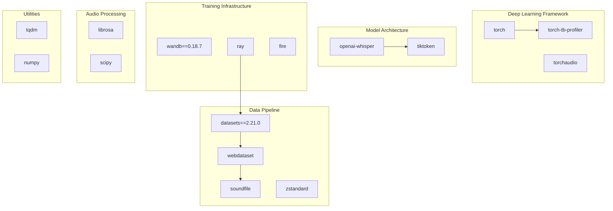
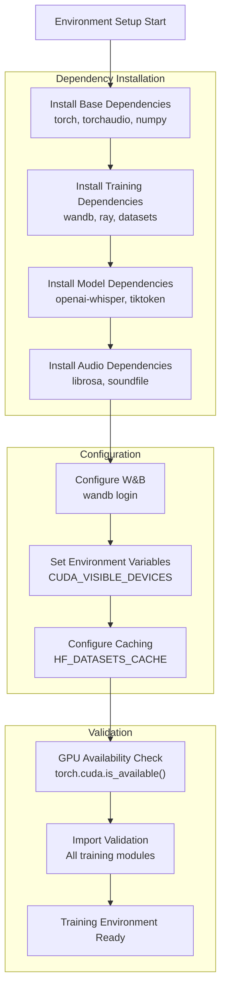
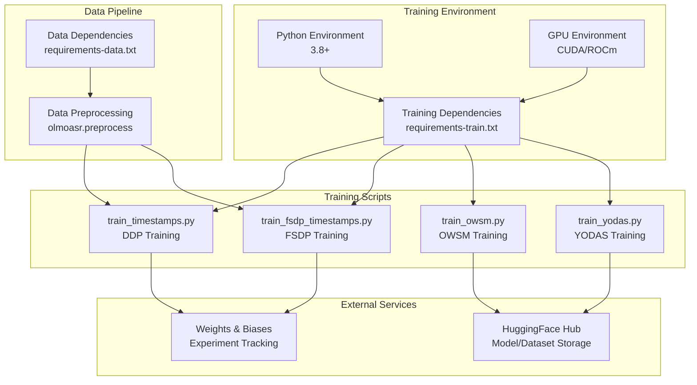

<!-- source: DeepWiki mcp.deepwiki.com · repo allenai/OLMoASR · page 4.1 Training Environment & Dependencies · fetched 2026-10-26 -->

# Training Environment & Dependencies

<details>
<summary>Relevant source files</summary>

The following files were used as context for generating this wiki page:

- [requirements.txt](requirements.txt)
- [requirements/requirements-data.txt](requirements/requirements-data.txt)
- [requirements/requirements-train.txt](requirements/requirements-train.txt)
- [requirements/requirements.txt](requirements/requirements.txt)

</details>


This document covers the environment setup and dependency management required for training OLMoASR models. It focuses on the training-specific requirements, hardware considerations, and environment configuration needed to run the distributed training scripts.

For general installation and basic dependencies, see [Installation & Dependencies](#2.1). For specific training script usage, see [Training Scripts & Distributed Strategies](#4.2).

## Dependency Categories

The OLMoASR training environment is organized around several categories of dependencies, each serving specific roles in the training pipeline.

### Core Training Dependencies



**Training Dependency Architecture**

Sources: [requirements/requirements-train.txt:1-19]()

### Training-Specific Requirements

The training environment uses a focused set of dependencies optimized for distributed training:

| Category | Dependencies | Purpose |
|----------|-------------|---------|
| **Core ML** | `torch`, `torchaudio` | PyTorch framework and audio tensor operations |
| **Data Loading** | `datasets==2.21.0`, `webdataset`, `soundfile` | Efficient dataset loading and audio I/O |
| **Model Base** | `openai-whisper`, `tiktoken` | Whisper architecture and tokenization |
| **Experiment Tracking** | `wandb==0.18.7` | Training metrics and experiment management |
| **Distributed Training** | `ray` | Distributed computing and data processing |
| **Performance** | `torch-tb-profiler`, `zstandard` | Profiling and compression |

Sources: [requirements/requirements-train.txt:1-19]()

## Environment Setup Flow

The training environment setup follows a specific sequence to ensure proper dependency resolution and configuration:



**Training Environment Setup Sequence**

Sources: [requirements/requirements-train.txt:1-19]()

## Training Script Integration

The training environment integrates with multiple training scripts, each with specific dependency requirements:



**Training Environment Integration with Scripts**

Sources: [requirements/requirements-train.txt:1-19](), [requirements/requirements-data.txt:1-24]()

## Hardware Requirements

### GPU Requirements

The training environment is optimized for GPU-accelerated training with specific hardware considerations:

| Training Strategy | Minimum GPU Memory | Recommended Setup | Notes |
|-------------------|-------------------|-------------------|-------|
| **DDP** | 24GB per GPU | Multi-GPU, same memory | Data parallel training |
| **FSDP** | 16GB per GPU | Multi-GPU, variable memory | Model sharding |
| **Single GPU** | 40GB+ | A100/H100 | Large model training |

### Memory and Storage

- **System RAM**: 64GB+ recommended for data loading
- **Storage**: NVMe SSD for dataset caching (500GB+ available)
- **Network**: High-bandwidth for distributed training (InfiniBand preferred)

## Environment Variables

Key environment variables for training configuration:

```bash
# GPU Configuration
export CUDA_VISIBLE_DEVICES="0,1,2,3"
export TORCH_DISTRIBUTED_DEBUG="DETAIL"

# Data Caching
export HF_DATASETS_CACHE="/path/to/cache"
export TRANSFORMERS_CACHE="/path/to/cache"

# Training Configuration
export WANDB_PROJECT="olmoasr-training"
export WANDB_ENTITY="your-team"

# Performance Tuning
export OMP_NUM_THREADS=8
export TORCH_NUM_THREADS=8
```

## Version Pinning Strategy

The training environment uses strategic version pinning for stability:

### Pinned Versions
- `datasets==2.21.0`: Ensures consistent data loading behavior
- `wandb==0.18.7`: Maintains experiment tracking compatibility

### Floating Versions
- `torch`, `torchaudio`: Allow minor updates for performance improvements
- `transformers`: Follows HuggingFace ecosystem updates
- `ray`: Enables distributed computing improvements

Sources: [requirements/requirements-train.txt:1-19]()

## Troubleshooting Common Issues

### CUDA Compatibility
Ensure PyTorch CUDA version matches system CUDA installation:
```bash
python -c "import torch; print(torch.cuda.is_available())"
```

### Memory Issues
For out-of-memory errors during training:
- Reduce batch size in training configurations
- Enable gradient checkpointing
- Use FSDP for model sharding

### Wandb Authentication
Initialize Weights & Biases before training:
```bash
wandb login
```

Sources: [requirements/requirements-train.txt:10]()

---

