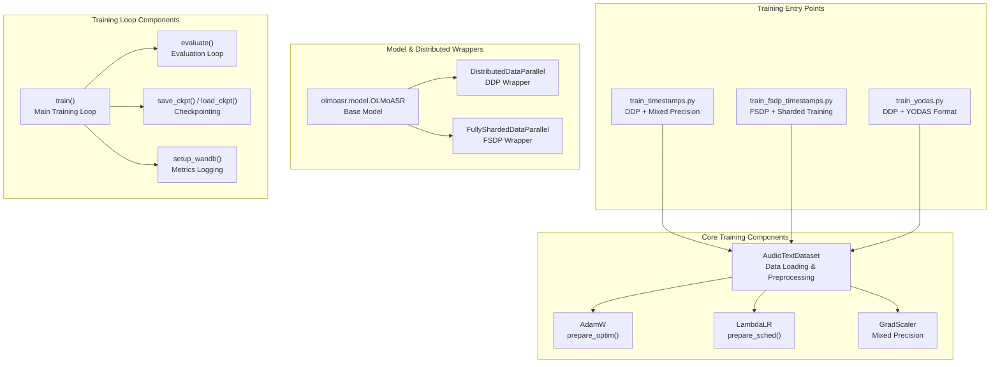
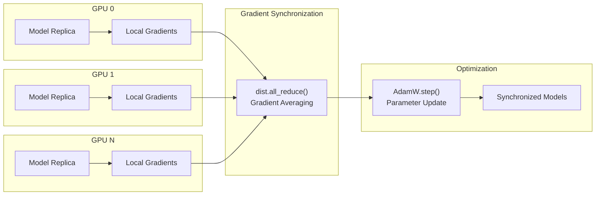
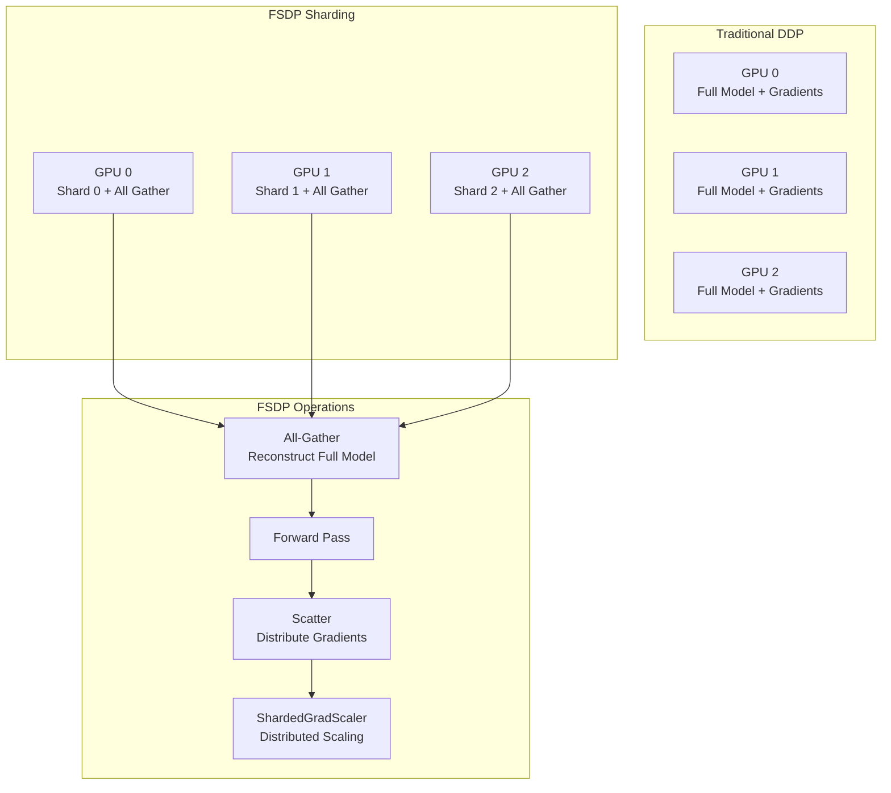
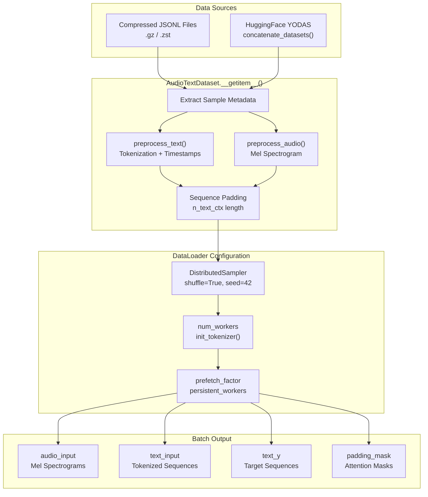
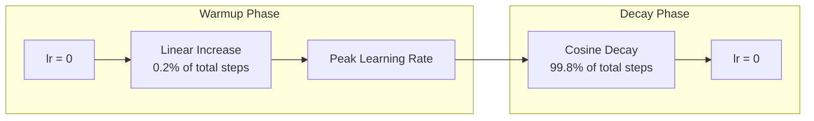
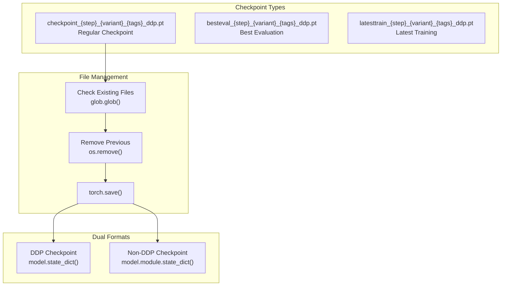
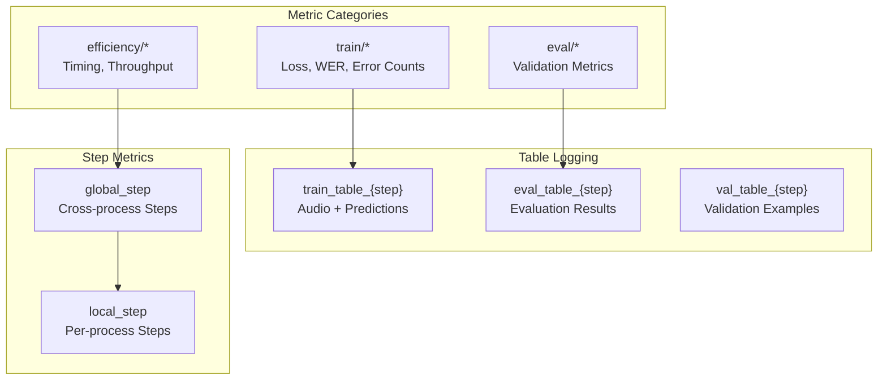
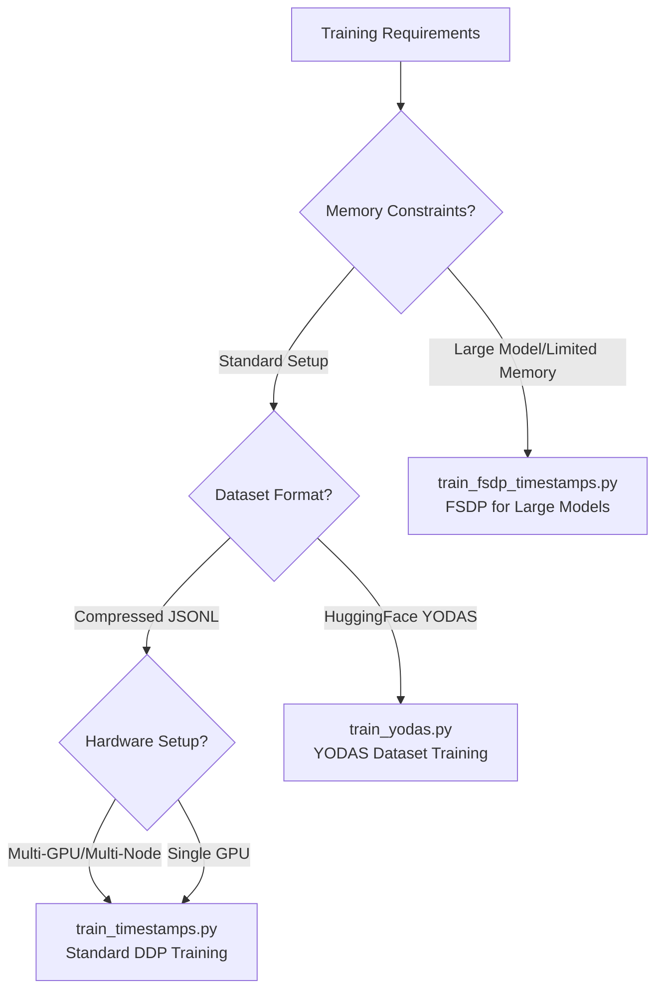

<!-- source: DeepWiki mcp.deepwiki.com · repo allenai/OLMoASR · page 4.2 Training Scripts & Distributed Strategies · fetched 2026-10-26 -->

# Training Scripts & Distributed Strategies

<details>
<summary>Relevant source files</summary>

The following files were used as context for generating this wiki page:

- [scripts/training/for_logging.py](scripts/training/for_logging.py)
- [scripts/training/train_fsdp_timestamps.py](scripts/training/train_fsdp_timestamps.py)
- [scripts/training/train_timestamps.py](scripts/training/train_timestamps.py)
- [scripts/training/train_yodas.py](scripts/training/train_yodas.py)

</details>


This page covers OLMoASR's training infrastructure, including the various distributed training strategies, mixed precision support, and training script implementations. The system provides multiple training approaches optimized for different hardware configurations and dataset formats.

For information about data preparation and preprocessing, see [Data Processing Pipeline](#3). For evaluation and model assessment, see [Model Evaluation](#5).

## Overview of Training Scripts

OLMoASR provides three main training scripts, each optimized for different scenarios and distributed strategies:

| Script | Strategy | Dataset Format | Key Features |
|--------|----------|----------------|--------------|
| `train_timestamps.py` | DDP | Compressed JSONL | Standard distributed training with timestamp support |
| `train_fsdp_timestamps.py` | FSDP | Compressed JSONL | Memory-efficient sharded training |
| `train_yodas.py` | DDP | HuggingFace YODAS | Optimized for YODAS dataset format |

**Training Script Architecture**



Sources: [scripts/training/train_timestamps.py:1-50](), [scripts/training/train_fsdp_timestamps.py:1-70](), [scripts/training/train_yodas.py:1-45]()

## Distributed Training Strategies

### DDP (Distributed Data Parallel)

The `train_timestamps.py` and `train_yodas.py` scripts implement DDP training using PyTorch's `DistributedDataParallel` wrapper.

**DDP Training Flow**



Key DDP implementation details:
- Model wrapped with `DDP(model, device_ids=[rank], output_device=rank)` [scripts/training/train_timestamps.py:1035]()
- Gradient synchronization via `dist.all_reduce()` [scripts/training/train_timestamps.py:1553]()
- Uses `DistributedSampler` for data distribution [scripts/training/train_timestamps.py:633-667]()

### FSDP (Fully Sharded Data Parallel)

The `train_fsdp_timestamps.py` script implements FSDP for memory-efficient training of larger models.

**FSDP Memory Management**



FSDP configuration details:
- Uses `transformer_auto_wrap_policy` with `ResidualAttentionBlock` [scripts/training/train_fsdp_timestamps.py:1110-1113]()
- Implements `ShardedGradScaler` for distributed mixed precision [scripts/training/train_fsdp_timestamps.py:1098-1099]()
- Supports `BackwardPrefetch.BACKWARD_PRE` for optimization [scripts/training/train_fsdp_timestamps.py:1120]()

Sources: [scripts/training/train_timestamps.py:1034-1036](), [scripts/training/train_fsdp_timestamps.py:31-50](), [scripts/training/train_yodas.py:982]()

## Dataset Integration and Loading

### AudioTextDataset Implementation

All training scripts use variants of the `AudioTextDataset` class for data loading and preprocessing:

**Data Loading Pipeline**



### Timestamp Processing

The training scripts support both timestamp and no-timestamp modes with random selection during training:

- **Timestamp Mode**: Generates sequences like `<sot> <start_ts> text <end_ts> <start_ts> text <end_ts> ... <eot>`
- **No-timestamp Mode**: Generates sequences like `<sot> <notimestamps> text <eot>`
- **Random Selection**: 50% probability for each mode [scripts/training/train_timestamps.py:427-428]()

Sources: [scripts/training/train_timestamps.py:64-84](), [scripts/training/train_fsdp_timestamps.py:93-111](), [scripts/training/train_yodas.py:63-75]()

## Mixed Precision and Optimization

### Precision Modes

All scripts support multiple precision modes for memory efficiency and training speed:

| Precision | Usage | Scaler |
|-----------|-------|--------|
| `float16` | Standard mixed precision | `GradScaler` |
| `bfloat16` | Better numerical stability | `GradScaler` |
| `float32` | Full precision (debugging) | None |

**Mixed Precision Training Flow**

```mermaid
graph LR
    subgraph "Forward Pass"
        AUTOCAST["autocast(device_type='cuda', dtype=precision)"]
        LOSS["F.cross_entropy()"]
        NORMALIZE["loss / accumulation_steps"]
    end
    
    subgraph "Backward Pass" 
        SCALE["scaler.scale(loss).backward()"]
        UNSCALE["scaler.unscale_(optimizer)"]
        CLIP["clip_grad_norm_(model.parameters(), max_grad_norm)"]
    end
    
    subgraph "Optimizer Step"
        STEP["scaler.step(optimizer)"]
        UPDATE["scaler.update()"]
        ZERO_GRAD["optimizer.zero_grad()"]
    end
    
    AUTOCAST --> LOSS
    LOSS --> NORMALIZE
    NORMALIZE --> SCALE
    SCALE --> UNSCALE
    UNSCALE --> CLIP
    CLIP --> STEP
    STEP --> UPDATE
    UPDATE --> ZERO_GRAD
```



### Gradient Accumulation

Gradient accumulation is implemented to achieve large effective batch sizes:

```python
accumulation_steps = eff_batch_size // (world_size * train_batch_size)
```

The training loop accumulates gradients over `accumulation_steps` before calling `optimizer.step()` [scripts/training/train_timestamps.py:764-768]().

Sources: [scripts/training/train_timestamps.py:1413-1450](), [scripts/training/train_fsdp_timestamps.py:1497-1532](), [scripts/training/train_yodas.py:1369-1402]()

## Learning Rate Scheduling

All scripts use a `LambdaLR` scheduler with linear warmup and cosine decay:

**Learning Rate Schedule**



Implementation in `prepare_sched()`:
- Warmup steps: `np.ceil(0.002 * train_steps)` [scripts/training/train_timestamps.py:770]()
- Lambda function combines linear warmup and cosine decay [scripts/training/train_timestamps.py:772-779]()

Sources: [scripts/training/train_timestamps.py:738-783](), [scripts/training/train_fsdp_timestamps.py:767-812](), [scripts/training/train_yodas.py:669-714]()

## Checkpointing and Resume

### Checkpoint Structure

The training scripts save comprehensive checkpoints containing:

```python
checkpoint = {
    "global_step": int,
    "local_step": int, 
    "epoch": int,
    "best_eval_wer": float,
    "model_state_dict": dict,
    "optimizer_state_dict": dict,
    "scaler_state_dict": dict,
    "scheduler_state_dict": dict,
    "dims": ModelDimensions
}
```

### Checkpoint Management

**Checkpoint Saving Strategy**



For FSDP, checkpoints use `FSDP.state_dict_type()` with `FullStateDictConfig` for proper state management [scripts/training/train_fsdp_timestamps.py:976-990]().

Sources: [scripts/training/train_timestamps.py:894-973](), [scripts/training/train_fsdp_timestamps.py:930-1022](), [scripts/training/train_yodas.py:841-920]()

## Logging and Monitoring

### Weights & Biases Integration

The `setup_wandb()` function configures comprehensive experiment tracking:

**Logging Architecture**



### Performance Monitoring

Efficiency metrics tracked include:
- `time_per_step`: End-to-end step timing
- `audio_min_per_GPU_second_gpu`: Training throughput
- `fwd_time`, `bwd_time`, `optim_step_time`: Component timing
- `preproc_time`, `audio_load_time`: Data pipeline timing

Table column definitions are centralized in [scripts/training/for_logging.py:1-44]().

Sources: [scripts/training/train_timestamps.py:786-891](), [scripts/training/for_logging.py:1-44](), [scripts/training/train_fsdp_timestamps.py:815-927]()

## Usage Patterns

### When to Use Each Script

**Training Script Selection Guide**



### Command Line Usage

Example training commands:

```bash
# DDP training with timestamps
torchrun --nproc_per_node=8 scripts/training/train_timestamps.py \
    --model_variant=base \
    --exp_name=whisper_base_experiment \
    --samples_dicts_dir=/path/to/data \
    --train_steps=100000

# FSDP training for larger models  
torchrun --nproc_per_node=8 scripts/training/train_fsdp_timestamps.py \
    --model_variant=large \
    --precision=bfloat16 \
    --sharding_strategy=FULL_SHARD

# YODAS dataset training
torchrun --nproc_per_node=4 scripts/training/train_yodas.py \
    --model_variant=small \
    --eff_batch_size=512 \
    --async_eval=True
```

Sources: [scripts/training/train_timestamps.py:2098-2184](), [scripts/training/train_fsdp_timestamps.py:2450-2550](), [scripts/training/train_yodas.py:2850-2950]()

---

