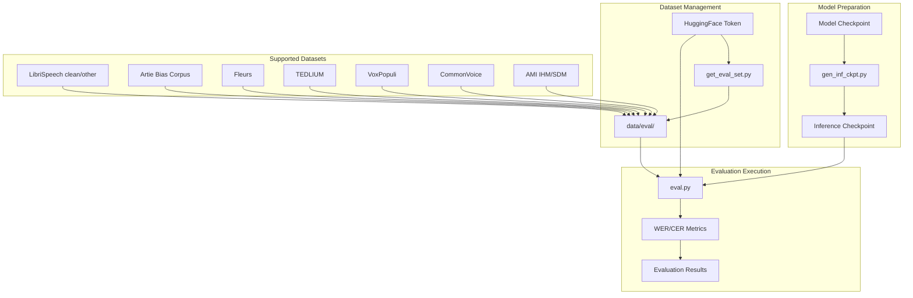
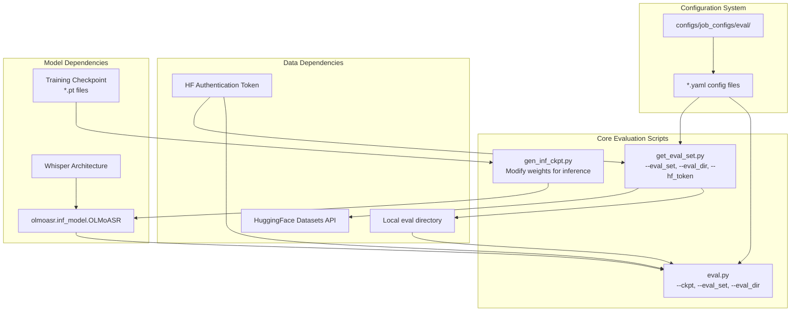
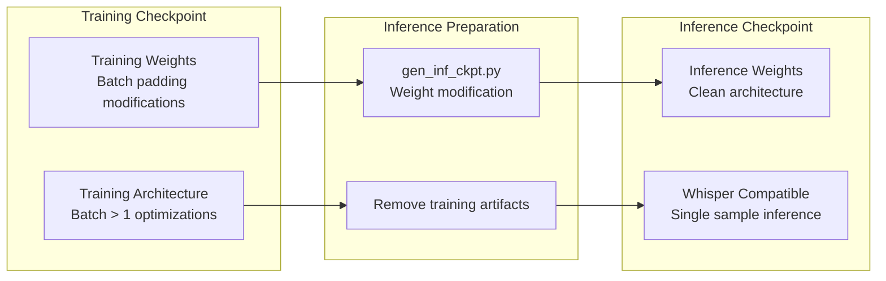
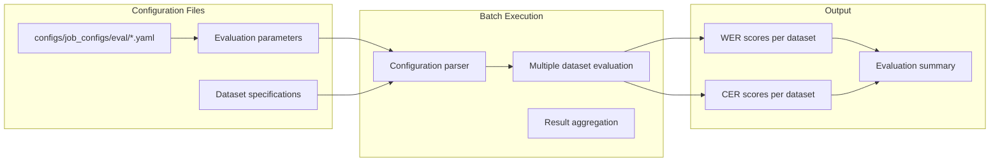
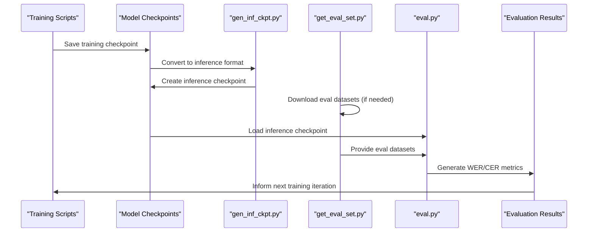

<!-- source: DeepWiki mcp.deepwiki.com · repo allenai/OLMoASR · page 5 Model Evaluation · fetched 2026-10-26 -->

# Model Evaluation

<details>
<summary>Relevant source files</summary>

The following files were used as context for generating this wiki page:

- [scripts/README.md](scripts/README.md)
- [scripts/eval/README.md](scripts/eval/README.md)

</details>


The OLMoASR evaluation system provides a comprehensive suite for assessing trained ASR models against standard benchmark datasets. This system handles dataset downloading, preprocessing, model evaluation, and metric computation across multiple speech recognition benchmarks.

For information about model training, see [Model Training](#4). For details on using trained models for inference, see [Inference & Deployment](#6).

## Evaluation System Architecture

The evaluation system consists of three main components: dataset management, model preparation, and evaluation execution. The system is designed to work with both locally trained checkpoints and models from the HuggingFace Hub.

### Evaluation Pipeline Flow



**Sources:** [scripts/README.md:29-36](), [scripts/eval/README.md:1-24]()

### Evaluation Script Integration



**Sources:** [scripts/README.md:29-36](), [scripts/eval/README.md:3-7](), [scripts/eval/README.md:20-24]()

## Supported Evaluation Datasets

The evaluation system supports multiple benchmark datasets commonly used in ASR research. Each dataset has specific requirements and characteristics.

| Dataset | Identifier | Description | Special Requirements |
|---------|------------|-------------|---------------------|
| LibriSpeech Clean | `librispeech_clean` | Clean speech subset of LibriSpeech | None |
| LibriSpeech Other | `librispeech_other` | Noisy speech subset of LibriSpeech | None |
| Artie Bias Corpus | `artie_bias_corpus` | Bias evaluation corpus | None |
| Fleurs | `fleurs` | Multilingual speech dataset | None |
| TEDLIUM | `tedlium` | TED talk transcriptions | None |
| VoxPopuli | `voxpopuli` | European Parliament speeches | None |
| CommonVoice | `common_voice` | Mozilla's crowdsourced dataset | HuggingFace token required |
| AMI IHM | `ami_ihm` | Meeting corpus (individual headset) | None |
| AMI SDM | `ami_sdm` | Meeting corpus (single distant mic) | None |

**Sources:** [scripts/eval/README.md:9-18]()

### Dataset Download Process

The `get_eval_set.py` script handles automatic dataset downloading and preparation:

```bash
python get_eval_set.py --eval_set=librispeech_clean --eval_dir=data/eval --hf_token=<token>
```

Key parameters:
- `--eval_set`: Name of the evaluation dataset to download
- `--eval_dir`: Directory to store evaluation datasets (default: `data/eval`)
- `--hf_token`: HuggingFace authentication token (required for some datasets)

**Sources:** [scripts/eval/README.md:3-7](), [scripts/eval/README.md:16]()

## Model Preparation for Evaluation

### Inference Checkpoint Generation

The `gen_inf_ckpt.py` script modifies training checkpoints to create inference-optimized versions. This addresses architectural modifications made during training that are not needed for inference.



**Sources:** [scripts/README.md:32-37]()

## Running Evaluations

### Evaluation Execution

The `eval.py` script performs the actual evaluation against downloaded datasets:

```bash
python eval.py --ckpt=path/to/checkpoint --eval_set=librispeech_clean --eval_dir=data/eval --hf_token=<token>
```

### Evaluation Parameters

| Parameter | Description | Required | Notes |
|-----------|-------------|----------|-------|
| `--ckpt` | Path to model checkpoint | Yes | Can be training or inference checkpoint |
| `--eval_set` | Name of evaluation dataset | Yes | Must match downloaded dataset |
| `--eval_dir` | Directory containing eval datasets | No | Default: `data/eval` |
| `--hf_token` | HuggingFace authentication token | Conditional | Required for CommonVoice |

**Sources:** [scripts/eval/README.md:20-24]()

### Configuration-Based Evaluation

The system supports YAML configuration files for batch evaluation:



**Sources:** [scripts/README.md:35]()

## Integration with Training Pipeline

The evaluation system integrates with the broader OLMoASR training pipeline to provide continuous model assessment capabilities.

### Evaluation Workflow Integration



**Sources:** [scripts/README.md:29-37](), [scripts/eval/README.md:1-24]()

The evaluation system provides essential feedback for model development, enabling researchers to assess model performance across diverse speech recognition benchmarks and guide iterative improvements to the training process.

---

