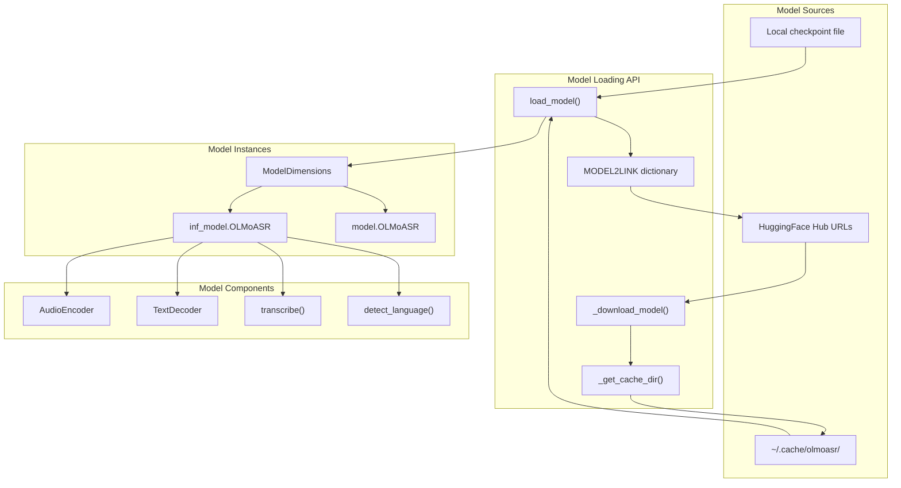
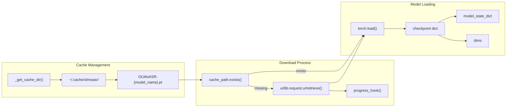
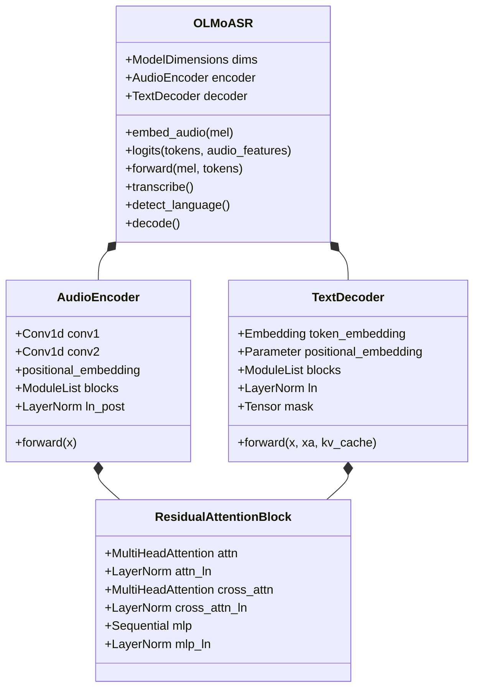
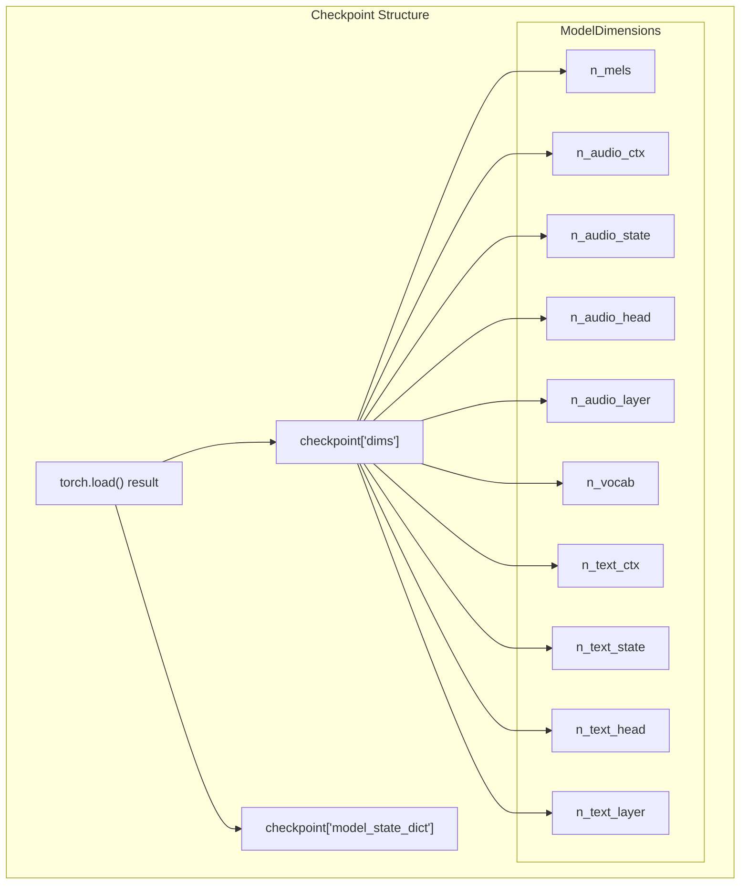

<!-- source: DeepWiki mcp.deepwiki.com · repo allenai/OLMoASR · page 6 Inference & Deployment · fetched 2026-10-26 -->

# Inference & Deployment

<details>
<summary>Relevant source files</summary>

The following files were used as context for generating this wiki page:

- [olmoasr/__init__.py](olmoasr/__init__.py)
- [olmoasr/inf_model.py](olmoasr/inf_model.py)

</details>


This page covers using trained OLMoASR models for inference, including model loading, the Python API, caching mechanisms, and deployment patterns. This documentation focuses on the inference-optimized model classes and the unified loading system that enables seamless model access from both local checkpoints and HuggingFace Hub.

For information about training models, see [Model Training](#4). For evaluation procedures, see [Model Evaluation](#5). For demo applications, see [Demo Applications](#6.2).

## Model Loading System

The OLMoASR inference system provides a unified model loading API through the `load_model()` function, which handles both local checkpoints and automatic downloads from HuggingFace Hub.

### Available Models and Download URLs

The system supports multiple pre-trained model sizes, each optimized for different compute and accuracy requirements:

| Model Size | Download URL | Use Case |
|------------|--------------|----------|
| `tiny` | `allenai/OLMoASR/models/OLMoASR-tiny.en.pt` | Lightweight, fast inference |
| `base` | `allenai/OLMoASR/models/OLMoASR-base.en.pt` | Balanced performance |
| `small` | `allenai/OLMoASR/models/OLMoASR-small.en.pt` | Good accuracy/speed tradeoff |
| `medium` | `allenai/OLMoASR/models/OLMoASR-medium-v2.en.pt` | Higher accuracy |
| `large` | `allenai/OLMoASR/models/OLMoASR-large.en.pt` | Best accuracy |
| `large-v2` | `allenai/OLMoASR/models/OLMoASR-large.en-v2.pt` | Latest large model |

### Model Loading Architecture



**Sources:** [olmoasr/__init__.py:23-30](), [olmoasr/__init__.py:97-166](), [olmoasr/__init__.py:33-41](), [olmoasr/__init__.py:44-94]()

### Caching and Storage System

The model loading system implements automatic caching to avoid repeated downloads:



**Sources:** [olmoasr/__init__.py:33-41](), [olmoasr/__init__.py:64-94](), [olmoasr/__init__.py:147-161]()

## Inference Model Architecture

The inference system uses specialized model classes optimized for deployment scenarios, distinct from the training models.

### Model Class Hierarchy

The `inf_model.OLMoASR` class provides the inference-optimized implementation:



**Sources:** [olmoasr/inf_model.py:365-457](), [olmoasr/inf_model.py:241-281](), [olmoasr/inf_model.py:284-362](), [olmoasr/inf_model.py:199-238]()

### Audio Processing Pipeline

The inference pipeline processes audio through multiple stages:

```mermaid
flowchart LR
    subgraph "Audio Input Processing"
        AUDIO_IN["Raw Audio"]
        LOAD_AUDIO["load_audio()"]
        MEL_SPEC["log_mel_spectrogram()"]
        PAD_TRIM["pad_or_trim()"]
    end
    
    subgraph "Model Processing"
        CONV1["Conv1d conv1"]
        GELU1["F.gelu()"]
        CONV2["Conv1d conv2"] 
        GELU2["F.gelu()"]
        POS_EMB["positional_embedding"]
        BLOCKS["ResidualAttentionBlock[]"]
        LN_POST["LayerNorm ln_post"]
    end
    
    subgraph "Output"
        AUDIO_FEATURES["Audio Features"]
        DECODER_INPUT["TextDecoder Input"]
    end
    
    AUDIO_IN --> LOAD_AUDIO
    LOAD_AUDIO --> MEL_SPEC
    MEL_SPEC --> PAD_TRIM
    PAD_TRIM --> CONV1
    CONV1 --> GELU1
    GELU1 --> CONV2
    CONV2 --> GELU2
    GELU2 --> POS_EMB
    POS_EMB --> BLOCKS
    BLOCKS --> LN_POST
    LN_POST --> AUDIO_FEATURES
    AUDIO_FEATURES --> DECODER_INPUT
```



**Sources:** [olmoasr/__init__.py:17-21](), [olmoasr/inf_model.py:265-281](), [olmoasr/inf_model.py:241-263]()

## Python API Usage

### Basic Model Loading

The primary interface for loading models supports multiple usage patterns:

```python
import olmoasr

# Load by model name (auto-download)
model = olmoasr.load_model("base")

# Load from local checkpoint
model = olmoasr.load_model("/path/to/checkpoint.pt")

# Load inference-optimized version
model = olmoasr.load_model("medium", inference=True)

# Load with custom cache location
model = olmoasr.load_model("large", download_root="/custom/cache")
```

### Model Loading Parameters

| Parameter | Type | Description |
|-----------|------|-------------|
| `name` | `str` | Model name from `MODEL2LINK` or path to checkpoint |
| `device` | `str/torch.device` | Target device (auto-detects CUDA) |
| `download_root` | `str` | Custom cache directory |
| `inference` | `bool` | Use `inf_model.OLMoASR` vs `model.OLMoASR` |
| `in_memory` | `bool` | Preload weights into host memory |

**Sources:** [olmoasr/__init__.py:97-166]()

### Inference Methods

The loaded model provides several inference capabilities:

```python
# Basic transcription
result = model.transcribe(audio_path)

# Language detection
language = model.detect_language(mel_spectrogram)

# Low-level decoding
result = model.decode(tokens, audio_features)
```

**Sources:** [olmoasr/inf_model.py:455-457]()

## Model Checkpoint Format

OLMoASR checkpoints use a standardized format containing both model weights and configuration:



**Sources:** [olmoasr/__init__.py:150-161](), [olmoasr/inf_model.py:376-392]()

## Device and Memory Management

The inference system handles device placement and memory optimization automatically:

### Device Selection
- Auto-detects CUDA availability via `torch.cuda.is_available()`
- Defaults to CPU if CUDA unavailable
- Supports explicit device specification

### Memory Loading Options
- Standard loading: checkpoint loaded from disk during inference
- In-memory loading: checkpoint preloaded into RAM for faster access
- Automatic cleanup of temporary data when using in-memory mode

**Sources:** [olmoasr/__init__.py:127-128](), [olmoasr/__init__.py:141-154]()

## Integration Patterns

The model loading system integrates with various deployment scenarios:

### Direct Python Usage
```python
import olmoasr
model = olmoasr.load_model("base")
result = model.transcribe("audio.wav")
```

### Web Application Integration
Models can be loaded once and reused across requests, with the caching system ensuring efficient startup times.

### Batch Processing
The `in_memory=True` option enables efficient batch processing by avoiding repeated disk I/O.

**Sources:** [olmoasr/__init__.py:97-166]()

---

