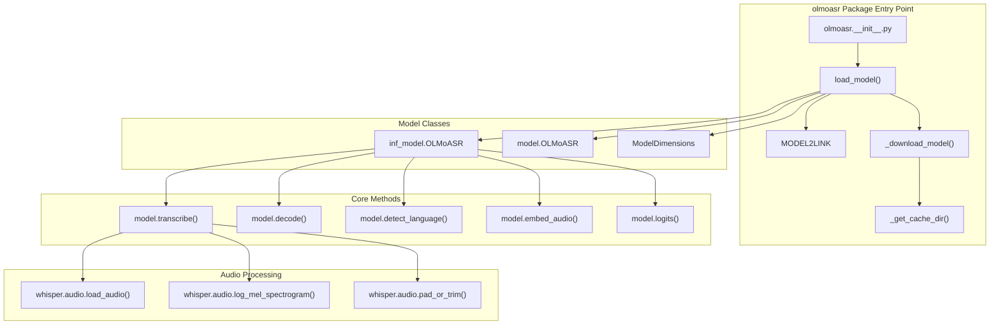
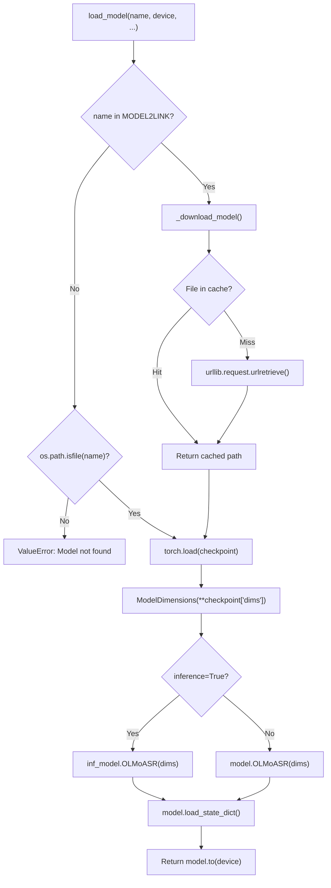
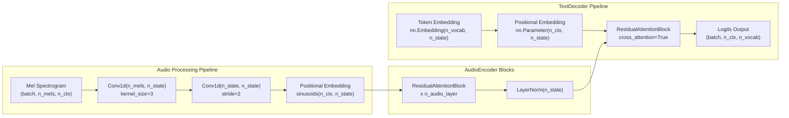
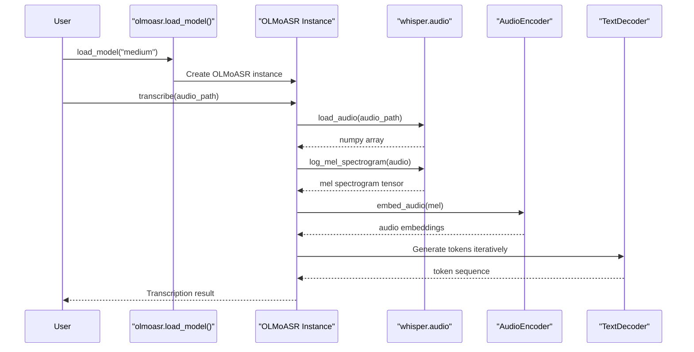

<!-- source: DeepWiki mcp.deepwiki.com · repo allenai/OLMoASR · page 6.1 Python API Reference · fetched 2026-10-26 -->

# Python API Reference

<details>
<summary>Relevant source files</summary>

The following files were used as context for generating this wiki page:

- [olmoasr/__init__.py](olmoasr/__init__.py)
- [olmoasr/inf_model.py](olmoasr/inf_model.py)

</details>


This page documents the Python API for programmatically using OLMoASR models for automatic speech recognition tasks. The API provides functions for model loading, audio transcription, and language detection. For information about training models, see [Model Training](#4). For demo applications and web interfaces, see [Demo Applications](#6.2).

## Core API Overview

The OLMoASR Python API centers around the `olmoasr` package, which provides a high-level interface for loading pre-trained models and performing speech recognition tasks. The API follows a simple workflow: load a model, then use it to transcribe audio files.



**Model Loading and Instantiation API Flow**

Sources: [olmoasr/__init__.py:1-167](), [olmoasr/inf_model.py:365-458]()

## Model Loading API

### `load_model()` Function

The primary entry point for loading OLMoASR models is the `load_model()` function, which handles both pre-trained model download and local checkpoint loading.

| Parameter | Type | Description | Default |
|-----------|------|-------------|---------|
| `name` | `str` | Model name from `MODEL2LINK` or path to checkpoint | Required |
| `device` | `Union[str, torch.device]` | PyTorch device for model placement | Auto-detect |
| `download_root` | `str` | Download directory for cached models | `~/.cache/olmoasr` |
| `inference` | `bool` | Load inference-optimized version | `False` |
| `in_memory` | `bool` | Preload model weights into memory | `False` |

### Available Pre-trained Models

The `MODEL2LINK` dictionary defines available model sizes and their HuggingFace Hub URLs:

| Model Name | Size Category | URL Pattern |
|------------|---------------|-------------|
| `"tiny"` | Smallest | `OLMoASR-tiny.en.pt` |
| `"base"` | Base | `OLMoASR-base.en.pt` |
| `"small"` | Small | `OLMoASR-small.en.pt` |
| `"medium"` | Medium | `OLMoASR-medium-v2.en.pt` |
| `"large"` | Large | `OLMoASR-large.en.pt` |
| `"large-v2"` | Large v2 | `OLMoASR-large.en-v2.pt` |

### Model Loading Workflow



**Model Loading Decision Tree and Cache Management**

Sources: [olmoasr/__init__.py:97-166](), [olmoasr/__init__.py:44-94](), [olmoasr/__init__.py:33-41]()

## Model Classes and Architecture

### `OLMoASR` Model Class

The `OLMoASR` class serves as the main model interface, available in both training (`olmoasr.model`) and inference (`olmoasr.inf_model`) variants. The inference version is optimized for production use.

#### Core Model Components

| Component | Class | Purpose | Location |
|-----------|-------|---------|----------|
| Audio Encoder | `AudioEncoder` | Converts mel spectrograms to embeddings | [olmoasr/inf_model.py:241-282]() |
| Text Decoder | `TextDecoder` | Generates text from audio embeddings | [olmoasr/inf_model.py:284-363]() |
| Model Dimensions | `ModelDimensions` | Architecture configuration | [olmoasr/config/model_dims.py]() |

#### Model Architecture Flow



**OLMoASR Model Architecture with Actual Class Names**

Sources: [olmoasr/inf_model.py:365-458](), [olmoasr/inf_model.py:241-282](), [olmoasr/inf_model.py:284-363]()

### Model Methods and Properties

#### Primary Inference Methods

| Method | Parameters | Returns | Purpose |
|--------|------------|---------|---------|
| `transcribe()` | `audio, **kwargs` | Transcription result | Full audio-to-text pipeline |
| `decode()` | `mel, options` | Decoded tokens | Token-level decoding |
| `detect_language()` | `mel` | Language probabilities | Identify input language |
| `embed_audio()` | `mel` | Audio embeddings | Extract audio features |
| `logits()` | `tokens, audio_features` | Token logits | Raw model output |

#### Model Properties

| Property | Type | Description |
|----------|------|-------------|
| `device` | `torch.device` | Current device placement |
| `is_multilingual` | `bool` | Whether model supports multiple languages |
| `num_languages` | `int` | Number of supported languages |
| `dims` | `ModelDimensions` | Architecture configuration |

Sources: [olmoasr/inf_model.py:394-457](), [olmoasr/inf_model.py:410-421]()

## Audio Processing Integration

The API integrates with Whisper's audio processing utilities for handling various audio formats and preprocessing steps.

### Audio Processing Functions

| Function | Module | Purpose | Typical Usage |
|----------|--------|---------|---------------|
| `load_audio()` | `whisper.audio` | Load audio file to numpy array | File input preprocessing |
| `log_mel_spectrogram()` | `whisper.audio` | Convert audio to mel spectrogram | Model input preparation |
| `pad_or_trim()` | `whisper.audio` | Standardize audio length | 30-second chunk processing |

### Transcription Pipeline Workflow



**End-to-End Transcription API Call Flow**

Sources: [olmoasr/__init__.py:18-21](), [olmoasr/transcribe.py](), [olmoasr/inf_model.py:455-457]()

## Usage Patterns and Examples

### Basic Model Loading

```python
import olmoasr

# Load pre-trained model
model = olmoasr.load_model("medium")

# Load from local checkpoint
model = olmoasr.load_model("/path/to/checkpoint.pt")

# Load for inference optimization
model = olmoasr.load_model("large", inference=True)
```

### Transcription Workflows

| Use Case | Model Configuration | Recommended Parameters |
|----------|-------------------|----------------------|
| Real-time processing | `inference=True, in_memory=True` | Minimal latency |
| Batch processing | `device="cuda"` | GPU acceleration |
| Memory-constrained | `inference=True` | Optimized memory usage |
| Development/debugging | Default parameters | Full feature access |

### Model Size Selection Guide

| Model Size | Parameters | Use Case | Memory Requirements |
|------------|------------|----------|-------------------|
| `tiny` | Smallest | Development, testing | Minimal |
| `base` | Small | Real-time applications | Low |
| `small` | Medium | General purpose | Moderate |
| `medium` | Large | High accuracy needs | High |
| `large` | Largest | Research, highest quality | Very high |

Sources: [olmoasr/__init__.py:23-30](), [olmoasr/__init__.py:97-166]()

---

