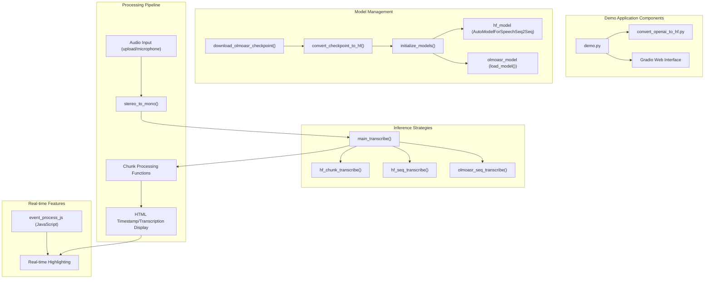
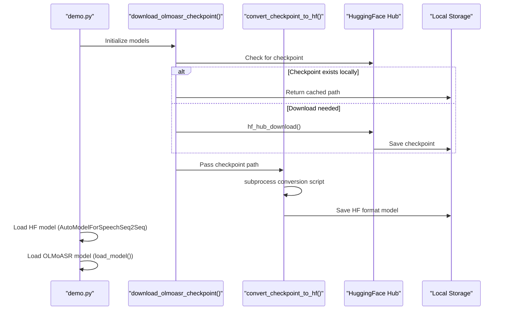
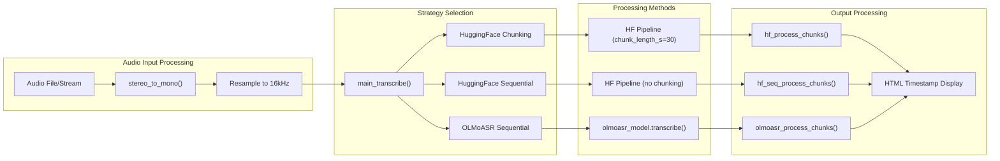
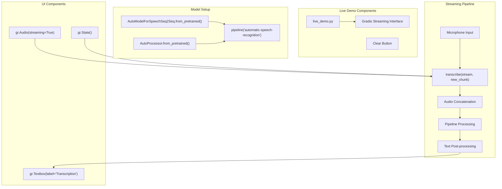
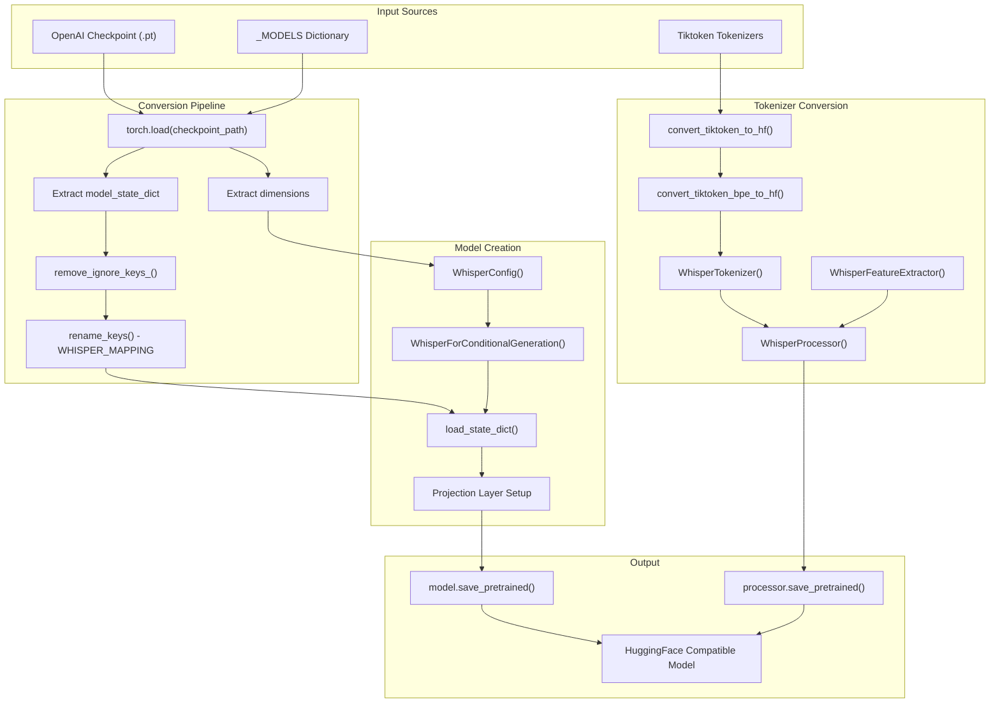

<!-- source: DeepWiki mcp.deepwiki.com · repo allenai/OLMoASR · page 6.2 Demo Applications · fetched 2026-10-26 -->

# Demo Applications

Relevant source files

The following files were used as context for generating this wiki page:

- [demo/convert_openai_to_hf.py](demo/convert_openai_to_hf.py)
- [demo/demo.py](demo/demo.py)
- [demo/live_demo.py](demo/live_demo.py)

This document covers the demo applications provided with OLMoASR for interactive speech recognition. These applications demonstrate different usage patterns and provide ready-to-use web interfaces for testing and showcasing OLMoASR capabilities.

For information about the Python API for programmatic usage, see [Python API Reference](#6.1). For broader deployment strategies beyond demos, see [Inference & Deployment](#6).

## Demo Application Overview

OLMoASR provides two main demo applications built with Gradio:

| Application | File | Purpose | Input Methods |
|-------------|------|---------|---------------|
| **Main Demo** | `demo/demo.py` | Full-featured interface with multiple inference strategies | File upload, microphone |
| **Live Demo** | `demo/live_demo.py` | Real-time streaming transcription | Microphone streaming |

Both applications provide web-based interfaces accessible through a browser and can be configured to share publicly via Gradio's sharing functionality.

## Main Gradio Demo Architecture

The main demo application provides a comprehensive interface for testing different OLMoASR inference approaches with both batch and real-time processing capabilities.

**Sources:** [demo/demo.py:1-544]()

### Model Initialization Process

The main demo automatically handles model downloading, conversion, and loading through a sophisticated initialization pipeline:

**Sources:** [demo/demo.py:40-147]()

### Inference Strategy Comparison

The main demo supports three distinct inference strategies, each with different performance characteristics:

| Strategy | Implementation | Chunking | Timestamping | Use Case |
|----------|----------------|----------|--------------|----------|
| **HuggingFace Chunking** | `hf_chunk_transcribe()` | 30-second chunks | Automatic | Long audio files |
| **HuggingFace Sequential** | `hf_seq_transcribe()` | No chunking | Manual reconstruction | Short-medium files |
| **OLMoASR Sequential** | `olmoasr_seq_transcribe()` | Native segmentation | Built-in | High accuracy needs |

**Sources:** [demo/demo.py:163-304](), [demo/demo.py:306-429]()

## Live Streaming Demo

The live demo provides real-time speech recognition with continuous audio streaming from the microphone.

### Live Demo Architecture

**Sources:** [demo/live_demo.py:1-69]()

The live demo uses Gradio's streaming capabilities to continuously process audio chunks:

- **Stream Management**: The `transcribe()` function [demo/live_demo.py:31-47]() manages audio stream concatenation
- **Audio Processing**: Automatic mono conversion and normalization [demo/live_demo.py:34-39]()
- **Real-time Updates**: Gradio's `audio_source.stream()` provides continuous updates [demo/live_demo.py:58-62]()

## Model Conversion Utility

The `convert_openai_to_hf.py` utility converts OpenAI Whisper checkpoints to HuggingFace format for compatibility with HuggingFace pipelines.

### Conversion Process Flow

**Sources:** [demo/convert_openai_to_hf.py:185-251](), [demo/convert_openai_to_hf.py:272-327]()

### Key Conversion Functions

The conversion utility provides several critical functions:

- **`convert_openai_whisper_to_tfms()`** [demo/convert_openai_to_hf.py:185-251](): Main conversion function that handles model architecture transformation
- **`rename_keys()`** [demo/convert_openai_to_hf.py:126-137](): Maps OpenAI parameter names to HuggingFace equivalents using `WHISPER_MAPPING`
- **`convert_tiktoken_to_hf()`** [demo/convert_openai_to_hf.py:291-327](): Converts tokenizer format from tiktoken to HuggingFace

## Customization and Extension

### Adding New Inference Strategies

To add a new inference strategy to the main demo:

1. **Create Strategy Function**: Implement a function following the pattern of `hf_chunk_transcribe()` [demo/demo.py:163-206]()
2. **Add Processing Function**: Create a corresponding chunk processing function like `hf_process_chunks()` [demo/demo.py:342-373]()
3. **Update Dropdown**: Add the strategy to the `gr.Dropdown` choices [demo/demo.py:513-524]()
4. **Update Router**: Add the strategy to `main_transcribe()` [demo/demo.py:297-304]()

### Customizing the UI

The demos use several key UI components that can be modified:

- **Audio Input**: `gr.Audio(sources=["upload", "microphone"])` [demo/demo.py:512]()
- **Strategy Selection**: `gr.Dropdown` with custom choices [demo/demo.py:513-524]()
- **HTML Display**: Custom HTML components with embedded styling [demo/demo.py:432-444]()
- **Real-time Highlighting**: JavaScript integration via `event_process_js` [demo/demo.py:451-506]()

### Model Path Configuration

Both demos allow model path customization:

- **Main Demo**: Configure via `OLMOASR_REPO`, `CHECKPOINT_FILENAME`, and directory constants [demo/demo.py:26-31]()
- **Live Demo**: Configure via `model_path` variable [demo/live_demo.py:13]()

**Sources:** [demo/demo.py:1-544](), [demo/live_demo.py:1-69](), [demo/convert_openai_to_hf.py:1-371]()

---

