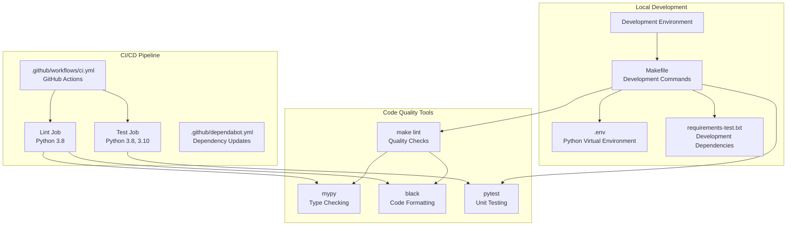
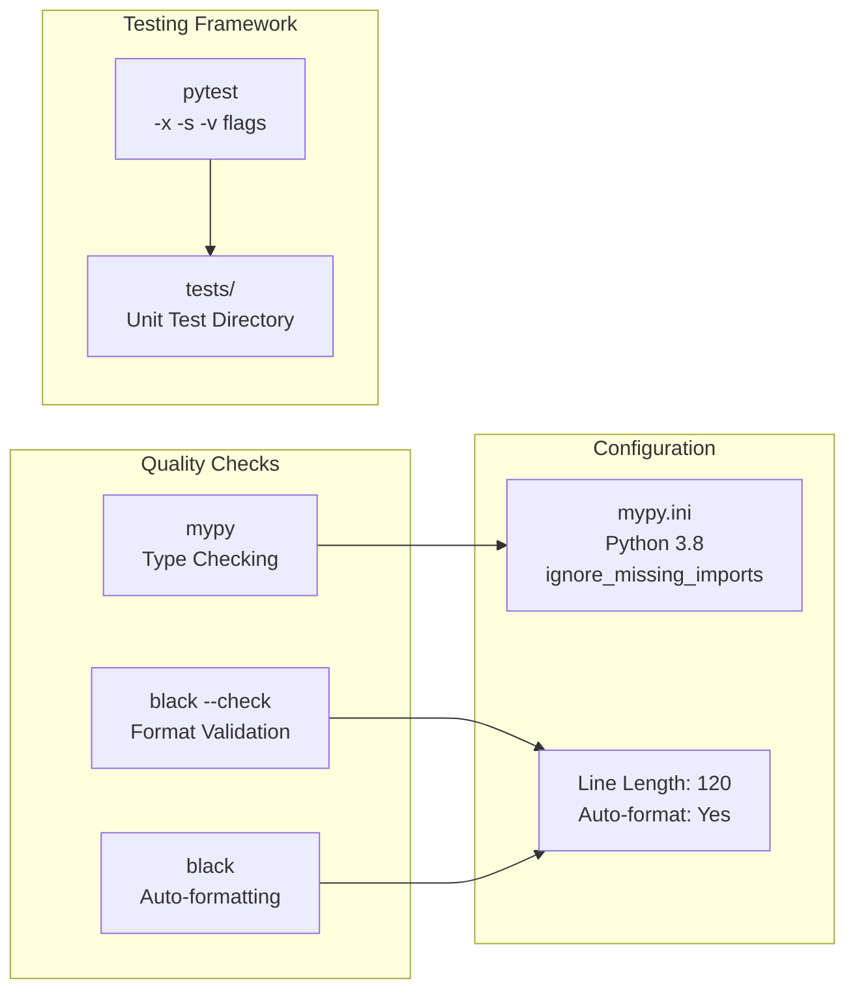
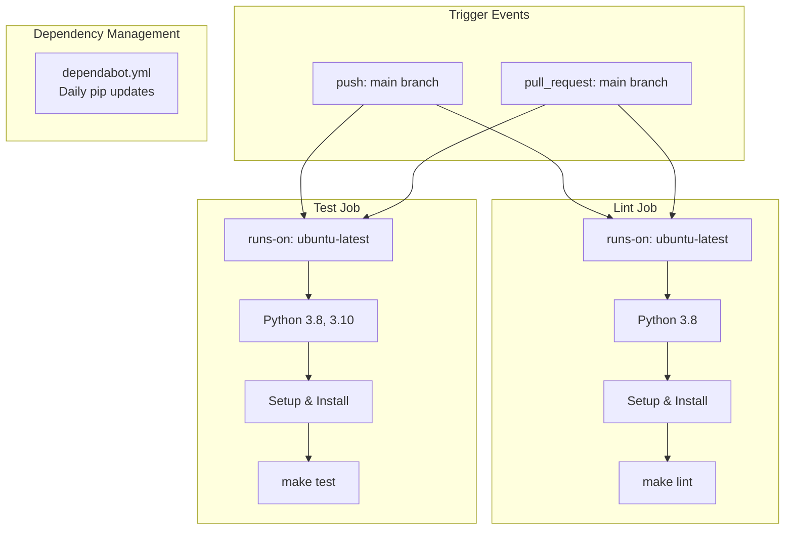

<!-- source: DeepWiki mcp.deepwiki.com · repo allenai/OLMoASR · page 7 Development & Contributing · fetched 2026-10-26 -->

# Development & Contributing

Relevant source files

The following files were used as context for generating this wiki page:

- [.github/dependabot.yml](.github/dependabot.yml)
- [.github/workflows/ci.yml](.github/workflows/ci.yml)
- [HISTORY.md](HISTORY.md)
- [LICENSE](LICENSE)
- [Makefile](Makefile)
- [mypy.ini](mypy.ini)

This document provides an overview of the development workflow and contribution guidelines for the OLMoASR system. It covers the essential tools, processes, and standards that developers need to understand when contributing to the project.

For detailed development environment setup instructions, see [Development Setup & Tools](#7.1). For understanding the codebase organization, see [Project Structure & Organization](#7.2).

## Development Workflow Overview

The OLMoASR project follows standard open-source development practices with automated quality checks and continuous integration. The development workflow is built around several key tools and processes that ensure code quality and system reliability.

### Development Environment Architecture

Sources: [Makefile:1-27](), [.github/workflows/ci.yml:1-53](), [mypy.ini:1-6]()

## Development Commands

The project uses a `Makefile` to standardize common development tasks. Key commands include:

| Command | Purpose | Description |
|---------|---------|-------------|
| `make install` | Package Installation | Upgrades pip and installs package in development mode |
| `make install-dev` | Development Dependencies | Installs testing and development requirements |
| `make lint` | Code Quality | Runs `mypy` type checking and `black` format checking |
| `make black` | Code Formatting | Auto-formats Python code using `black` with 120 character line limit |
| `make test` | Unit Testing | Runs the full test suite using `pytest` |
| `make help` | Command Reference | Shows all available make commands with descriptions |

Sources: [Makefile:1-27]()

### Code Quality Standards

The project enforces several code quality standards through automated tools:

Sources: [Makefile:8-23](), [mypy.ini:1-6]()

## Continuous Integration Pipeline

The project uses GitHub Actions for continuous integration with two main job types:

### CI Job Configuration

Sources: [.github/workflows/ci.yml:1-53](), [.github/dependabot.yml:1-7]()

## Licensing and Legal

The project is licensed under the MIT License, providing broad permissions for use, modification, and distribution. Contributors should ensure their contributions are compatible with this license.

Key license characteristics:
- **Permissions**: Commercial use, modification, distribution, private use
- **Limitations**: No liability, no warranty
- **Conditions**: Include license and copyright notice

Sources: [LICENSE:1-22]()

## Version Management

The project maintains version history through semantic versioning practices. Current version information is tracked in the `HISTORY.md` file, which follows a changelog format for documenting releases and changes.

Sources: [HISTORY.md:1-3]()

## Getting Started as a Contributor

To begin contributing to OLMoASR:

1. **Environment Setup**: Follow the development setup process detailed in [Development Setup & Tools](#7.1)
2. **Code Organization**: Understand the project structure covered in [Project Structure & Organization](#7.2)  
3. **Quality Standards**: Ensure all code passes `make lint` and `make test` before submitting
4. **CI Requirements**: Verify that changes pass all GitHub Actions workflows

The development workflow emphasizes automation and consistency, with most quality checks handled through the `Makefile` commands and CI pipeline. This ensures that all contributors work within the same standards and that the codebase maintains high quality across all contributions.

---

