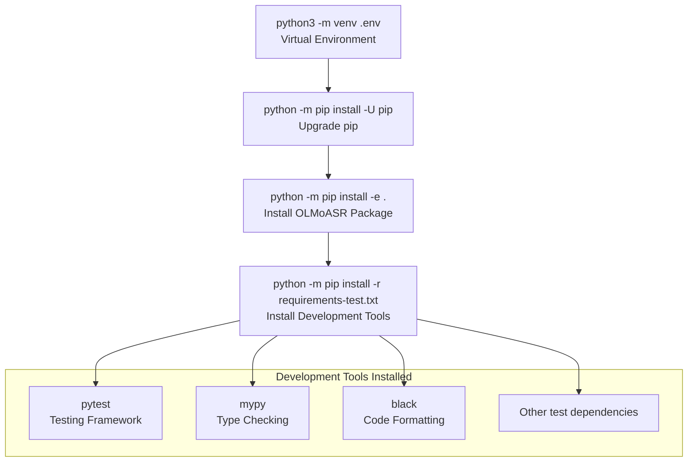
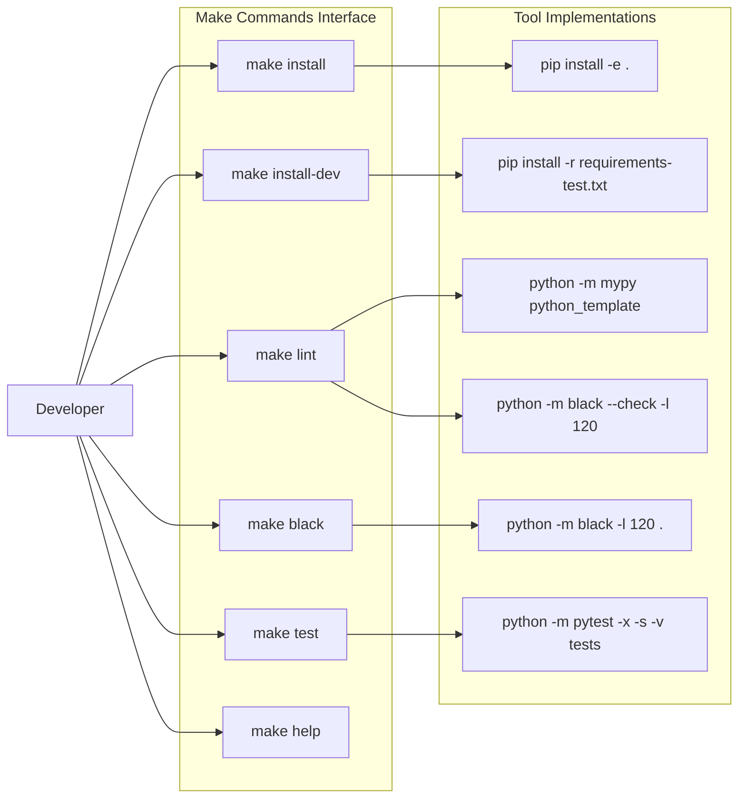
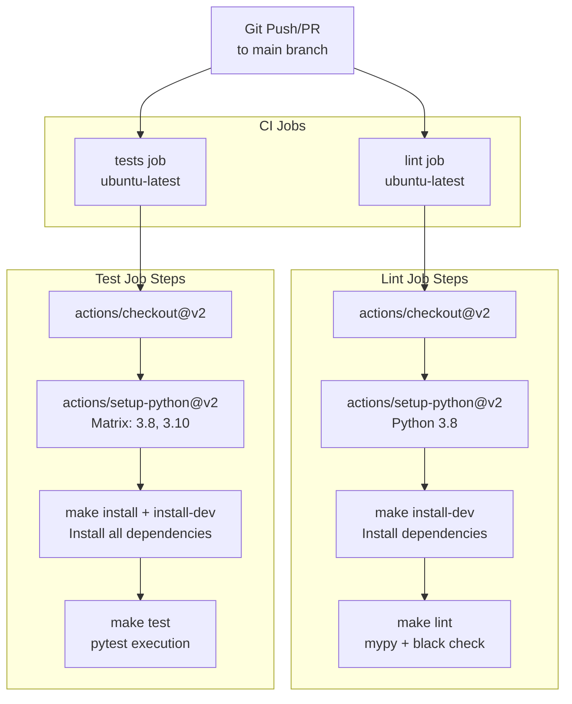

<!-- source: DeepWiki mcp.deepwiki.com · repo allenai/OLMoASR · page 7.1 Development Setup & Tools · fetched 2026-10-26 -->

# Development Setup & Tools

Relevant source files

The following files were used as context for generating this wiki page:

- [.github/dependabot.yml](.github/dependabot.yml)
- [.github/workflows/ci.yml](.github/workflows/ci.yml)
- [.gitignore](.gitignore)
- [HISTORY.md](HISTORY.md)
- [LICENSE](LICENSE)
- [Makefile](Makefile)
- [mypy.ini](mypy.ini)

This document covers the development environment setup, development tools, and code quality infrastructure for OLMoASR contributors. It focuses on local development setup, the Makefile command interface, testing framework, and continuous integration pipeline.

For information about the overall project structure and module organization, see [Project Structure & Organization](#7.2). For installation instructions for end users, see [Installation & Dependencies](#2.1).

## Local Development Environment Setup

OLMoASR uses a standard Python package development setup with additional tooling for code quality and testing. The development environment is configured through several key files that define dependencies, linting rules, and development workflows.

### Development Dependencies

The project separates runtime dependencies from development-specific dependencies:

- **Runtime dependencies**: Defined in [setup.py]() and installed via `pip install -e .`
- **Development dependencies**: Defined in [requirements-test.txt]() and installed via `make install-dev`

The development dependencies include testing frameworks, code formatting tools, and type checking utilities required for maintaining code quality during development.

**Development Environment Setup Diagram**

Sources: [Makefile:1-6](), [.github/workflows/ci.yml:20-47]()

## Development Tools and Commands

The project uses a [Makefile]() to provide a standardized interface for common development tasks. The Makefile defines several targets that automate frequent development operations.

### Available Make Commands

| Command | Purpose | Implementation |
|---------|---------|----------------|
| `make install` | Install package for development | Upgrades pip and installs package in editable mode |
| `make install-dev` | Install development dependencies | Installs testing and linting tools |
| `make lint` | Run code quality checks | Executes mypy type checking and black format checking |
| `make black` | Auto-format code | Applies black code formatting with 120 character line length |
| `make test` | Run unit tests | Executes pytest with verbose output |
| `make build-pex` | Build PEX executable | Creates standalone executable using pex |
| `make help` | Display available commands | Shows formatted help for all make targets |

### Code Quality Tools Configuration

The development environment includes several code quality tools with specific configurations:

**Type Checking Configuration** ([mypy.ini:1-6]()):
- Target Python version: 3.8
- Ignore missing imports enabled for external dependencies
- Global mypy configuration applied to entire codebase

**Code Formatting Standards** ([Makefile:10,13]()):
- Line length limit: 120 characters
- Black formatter for consistent code style
- Automatic formatting available via `make black`

**Development Tools Integration Diagram**

Sources: [Makefile:1-26](), [mypy.ini:1-6]()

## Testing Infrastructure

The project uses pytest as the testing framework with specific configuration for comprehensive test execution.

### Test Execution Configuration

The test command [Makefile:21-22]() executes pytest with several flags:
- `-x`: Stop on first failure for faster feedback
- `-s`: Don't capture stdout, allowing print statements during debugging
- `-v`: Verbose output showing individual test names

### Test Directory Structure

Tests are organized in a `tests/` directory, which is excluded from the main package but included in the development workflow. The testing framework is configured to discover and execute all test files following pytest conventions.

## Version Control and File Management

The project uses Git for version control with specific exclusions defined in [.gitignore:1-12]():

### Excluded Files and Directories

| Pattern | Purpose |
|---------|---------|
| `*.egg-info` | Python package metadata |
| `.vscode` | VS Code editor configuration |
| `.env*` | Environment configuration files |
| `__pycache__` | Python bytecode cache |
| `.coverage*` | Test coverage reports |
| `wandb` | Weights & Biases experiment logs |
| `*.pex` | PEX executable files |
| `whisper` | Whisper model cache |
| `*.out` | Output files |

These exclusions prevent temporary files, build artifacts, and sensitive configuration from being committed to the repository.

Sources: [.gitignore:1-12]()

## Continuous Integration Pipeline

The project implements automated testing and code quality checks through GitHub Actions defined in [.github/workflows/ci.yml]().

### CI/CD Workflow Structure

### CI Job Configuration

**Lint Job** ([.github/workflows/ci.yml:12-29]()):
- Runs on Ubuntu latest
- Uses Python 3.8
- Executes `make lint` to verify code formatting and type checking

**Test Job** ([.github/workflows/ci.yml:30-52]()):
- Runs on Ubuntu latest with Python version matrix (3.8, 3.10)
- Installs both runtime and development dependencies
- Executes full test suite via `make test`

### Automated Dependency Management

The project uses Dependabot ([.github/dependabot.yml:1-7]()) for automated dependency updates:
- Package ecosystem: pip
- Update schedule: daily
- Directory scope: root directory

Sources: [.github/workflows/ci.yml:1-53](), [.github/dependabot.yml:1-7]()

## Development Workflow

### Standard Development Process

1. **Environment Setup**: Create virtual environment and install dependencies
2. **Code Development**: Write code following project conventions
3. **Code Quality**: Run `make lint` to check formatting and types
4. **Testing**: Execute `make test` to verify functionality
5. **Formatting**: Use `make black` to auto-format code before committing

### Pre-commit Checklist

Before committing code, developers should verify:
- [ ] Code passes `make lint` (mypy and black checks)
- [ ] All tests pass via `make test`
- [ ] New functionality includes appropriate tests
- [ ] Code follows 120-character line length limit

### Build and Distribution Tools

The Makefile includes a [build-pex]() target ([Makefile:15-19]()) for creating standalone executables:
- Creates temporary virtual environment
- Installs pex build tool
- Generates `.pex` executable file
- Cleans up temporary environment

This enables distribution of the tool as a single executable file for deployment scenarios where package installation is not preferred.

Sources: [Makefile:15-19](), [Makefile:8-13](), [Makefile:21-22]()

---

