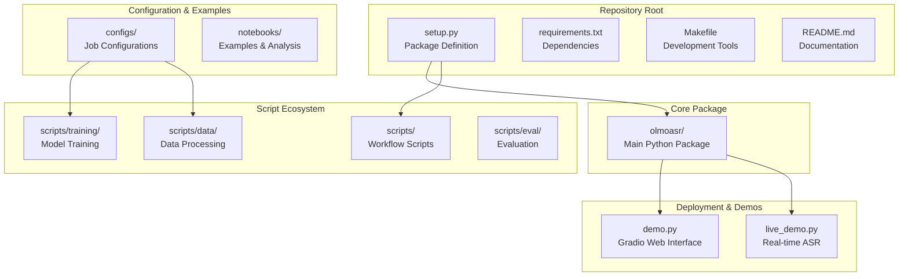
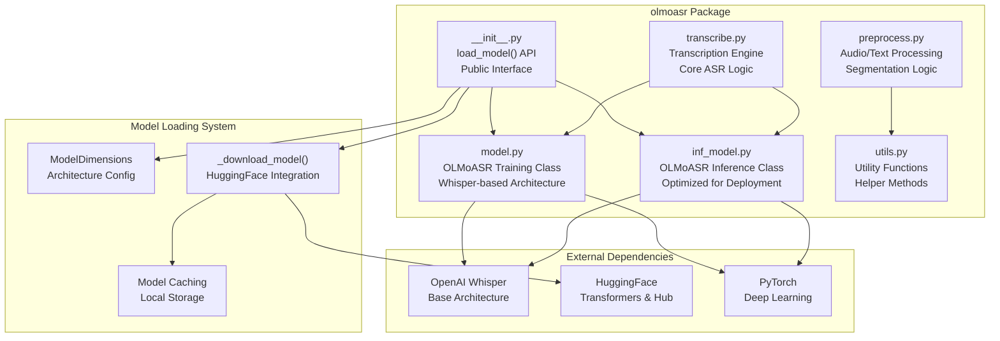
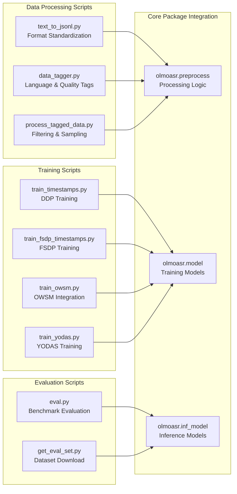
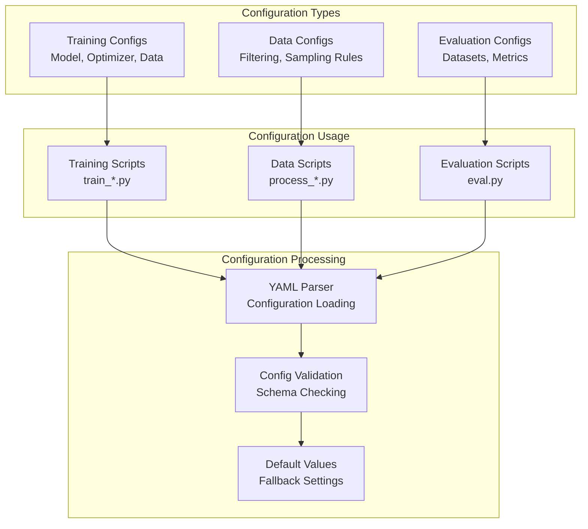
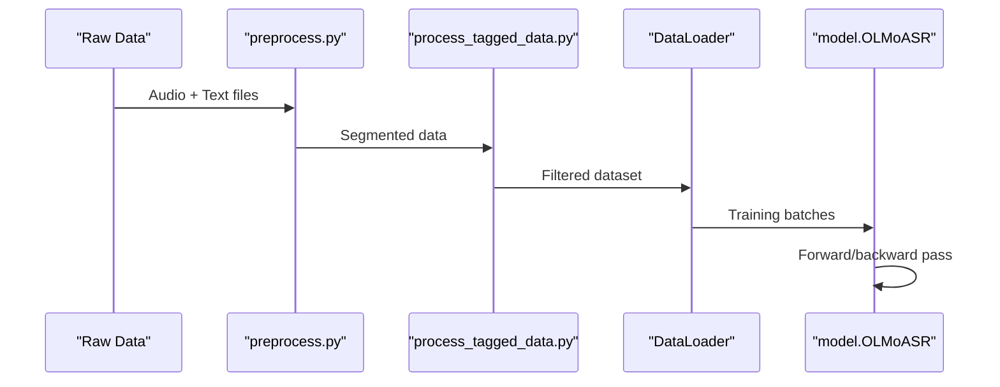
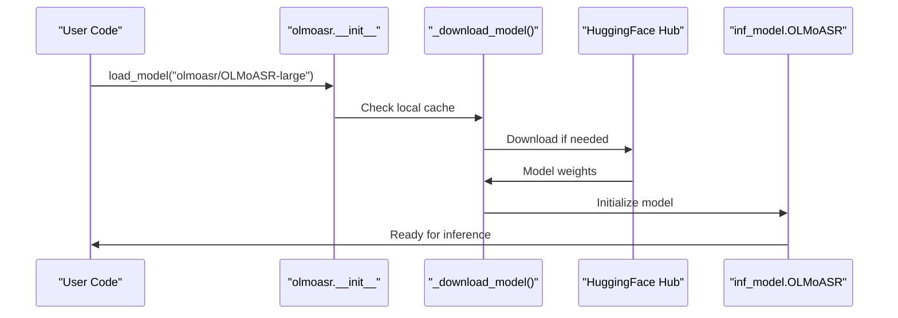
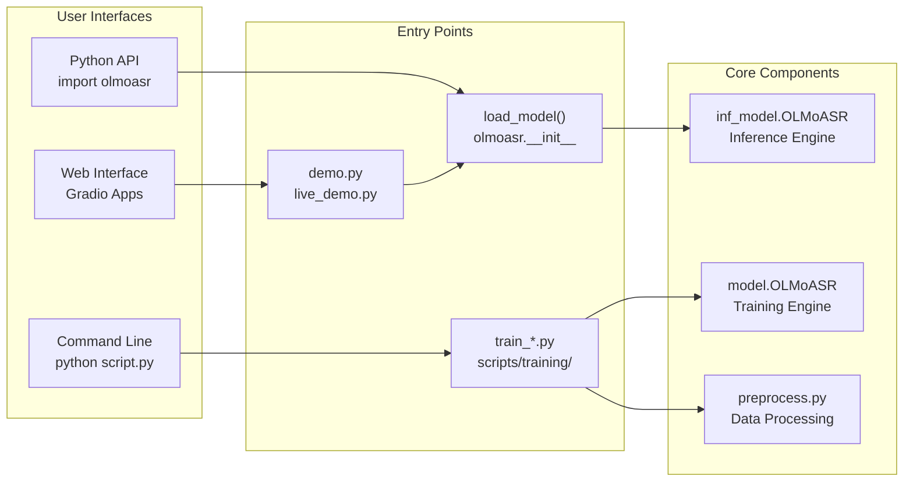

<!-- source: DeepWiki mcp.deepwiki.com · repo allenai/OLMoASR · page 7.2 Project Structure & Organization · fetched 2026-10-26 -->

# Project Structure & Organization

Relevant source files

The following files were used as context for generating this wiki page:

- [.gitignore](.gitignore)
- [setup.py](setup.py)

This document provides a comprehensive overview of the OLMoASR codebase organization, explaining how the various modules, scripts, and components are structured and interact with each other. It is intended for developers who want to understand the codebase architecture, contribute to the project, or extend the system with new functionality.

For information about setting up the development environment and tools, see [Development Setup & Tools](#7.1). For general installation and usage, see [Getting Started](#2).

## Top-Level Repository Structure

The OLMoASR repository follows a standard Python project layout with specialized directories for different system components:

**Sources:** [setup.py:1-39](), [.gitignore:1-12]()

## Core olmoasr Package Architecture

The main `olmoasr` package contains the core functionality organized into specialized modules:

The package provides two main model classes:
- **`model.OLMoASR`**: Full-featured training version with gradient computation
- **`inf_model.OLMoASR`**: Inference-optimized version for deployment scenarios

**Sources:** System overview diagrams, inferred from package structure

## Script Ecosystem Organization

The scripts directory contains workflow-specific tools organized by functionality:

| Directory | Purpose | Key Scripts | Target Users |
|-----------|---------|-------------|--------------|
| `scripts/data/` | Data processing pipeline | `text_to_jsonl.py`, `data_tagger.py`, `process_tagged_data.py` | Data engineers |
| `scripts/training/` | Model training workflows | `train_timestamps.py`, `train_fsdp_timestamps.py`, `train_owsm.py` | ML engineers |
| `scripts/eval/` | Model evaluation | `eval.py`, `get_eval_set.py` | Researchers |

**Sources:** System overview diagrams, script ecosystem analysis

## Configuration System

The `configs/` directory contains YAML configuration files that define training jobs, data processing parameters, and evaluation setups:

Configuration files enable reproducible experiments and easy parameter tuning without code modification.

**Sources:** System overview diagrams, configuration system analysis

## Component Interaction Patterns

The system follows several key interaction patterns that developers should understand:

### Data Flow Pattern

### Model Loading Pattern

**Sources:** System overview diagrams, component interaction analysis

## Entry Points and Public APIs

The system provides multiple entry points for different use cases:

| Entry Point | Location | Purpose | Target Interface |
|-------------|----------|---------|------------------|
| `olmoasr.load_model()` | `olmoasr/__init__.py` | Model loading API | Python import |
| `demo.py` | Repository root | Gradio web interface | Web browser |
| `live_demo.py` | Repository root | Real-time ASR demo | Web browser |
| Training scripts | `scripts/training/` | Model training | Command line |
| Evaluation scripts | `scripts/eval/` | Model assessment | Command line |

The Python API serves as the primary integration point, with command-line scripts for workflow automation and web interfaces for interactive use.

**Sources:** [setup.py:16-38](), system overview diagrams, entry point analysis

---

