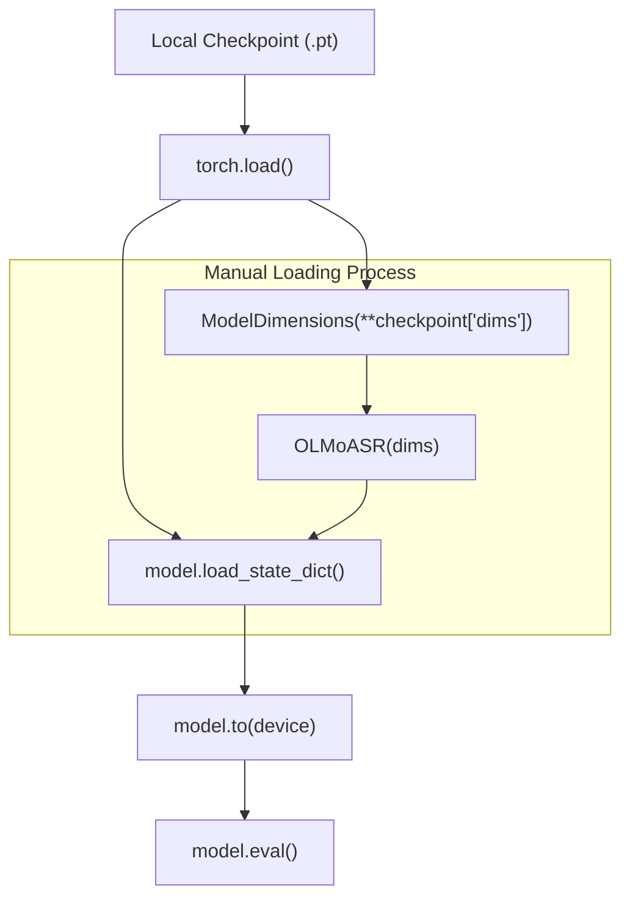
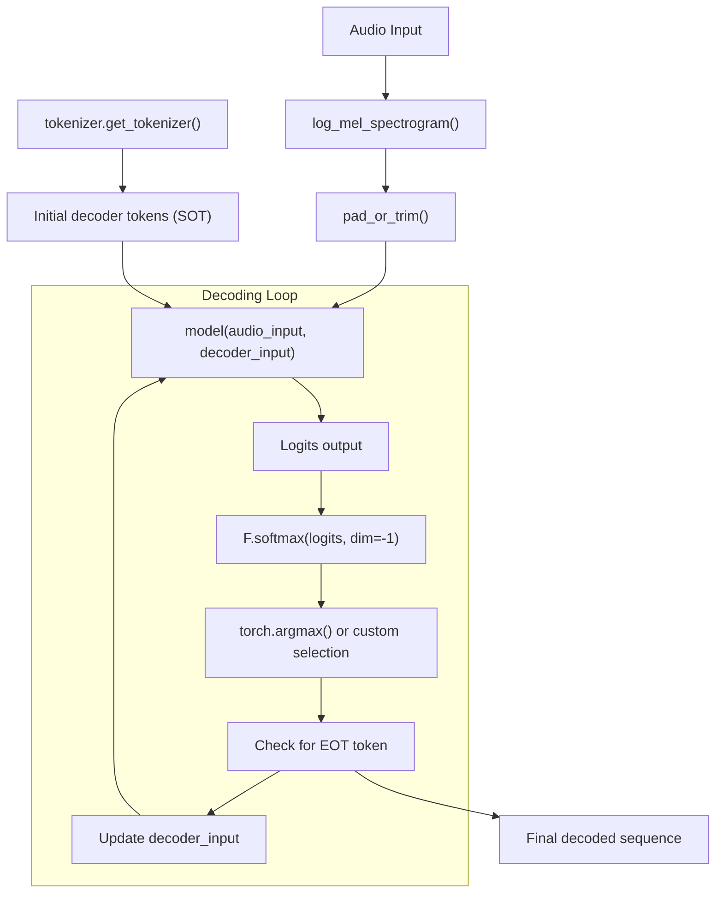
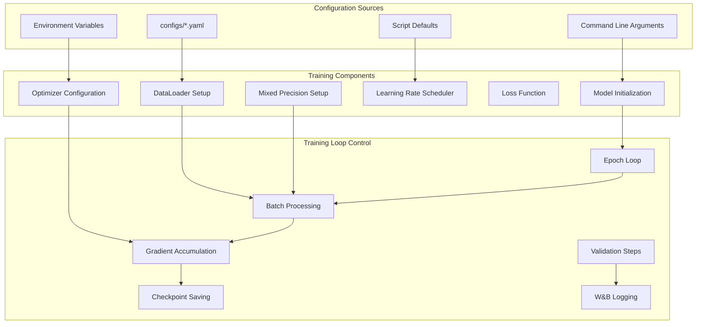
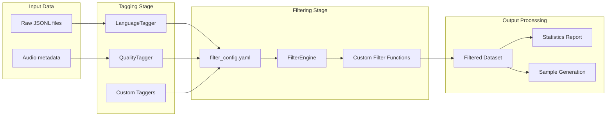
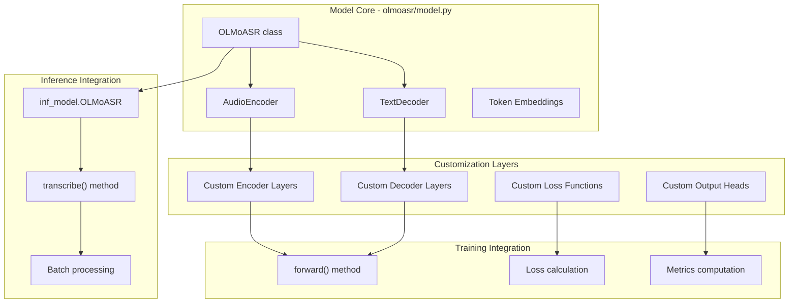
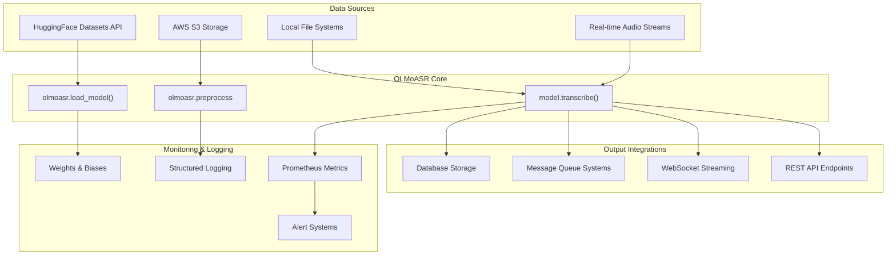

<!-- source: DeepWiki mcp.deepwiki.com · repo allenai/OLMoASR · page 8 Examples & Advanced Usage · fetched 2026-10-26 -->

# Examples & Advanced Usage

Relevant source files

The following files were used as context for generating this wiki page:

- [notebooks/gen_plots.ipynb](notebooks/gen_plots.ipynb)
- [notebooks/ow_decoding.py](notebooks/ow_decoding.py)

This page provides code examples, advanced usage patterns, and customization techniques for power users of the OLMoASR system. It demonstrates how to extend beyond the basic API functionality and implement custom workflows for specific use cases.

For basic model loading and inference, see [Python API Reference](#6.1). For general training workflows, see [Model Training](#4). For data processing basics, see [Data Processing Pipeline](#3).

## Advanced Model Loading and Inference

The OLMoASR system provides multiple ways to load and use models beyond the simple `load_model()` function. Advanced users can work directly with model checkpoints, implement custom decoding strategies, and optimize inference performance.

### Custom Model Loading from Checkpoints

**Manual Checkpoint Loading**

Advanced users can load models directly from checkpoint files without using the high-level API:

[notebooks/ow_decoding.py:19-27]()

This approach provides full control over the loading process and allows access to additional checkpoint metadata like training metrics and optimizer states.

Sources: [notebooks/ow_decoding.py:19-27]()

### Custom Decoding Implementation

The system allows implementation of custom decoding strategies by working directly with the model's forward pass and token generation logic.

**Custom Decoding Loop**

The notebook example shows a complete implementation of manual decoding:

[notebooks/ow_decoding.py:45-73]()

This pattern enables:
- Custom token selection strategies (beam search, nucleus sampling)
- Dynamic stopping criteria
- Real-time decoding with intermediate results
- Integration with external language models

Sources: [notebooks/ow_decoding.py:30-76]()

## Training Script Customization

OLMoASR provides multiple training scripts that can be customized for specific research needs and deployment scenarios.

### Training Strategy Selection Matrix

| Use Case | Script | Key Features | When to Use |
|----------|---------|-------------|-------------|
| Multi-GPU Single-Node | `train_timestamps.py` | DDP, timestamp prediction | Standard training setups |
| Multi-Node Clusters | `train_fsdp_timestamps.py` | FSDP, memory efficient | Large models, limited GPU memory |
| OWSM Integration | `train_owsm.py` | OpenAI Whisper compatibility | Research comparison |
| YODAS Framework | `train_yodas.py` | Specialized architecture | Advanced ASR research |

### Custom Training Configuration

**Training Script Extension Points**

Key customization points in training scripts:

- Model architecture modifications in `olmoasr/model.py`
- Custom loss functions and metrics
- Data loading and preprocessing pipelines
- Distributed training strategies
- Checkpoint saving and loading logic

Sources: Referenced from training script patterns in the codebase

## Data Processing Pipeline Extensions

The data processing system provides multiple extension points for custom preprocessing, filtering, and augmentation strategies.

### Custom Filtering Pipeline Architecture

**Custom Filter Implementation**

Users can extend the filtering system by:

1. Adding custom tagging functions to `data_tagger.py`
2. Implementing custom filter logic in YAML configurations
3. Creating specialized preprocessing steps in `olmoasr/preprocess.py`

The filtering configuration system in `process_tagged_data.py` supports complex Boolean logic and custom thresholds for data quality control.

Sources: Referenced from data processing pipeline structure

## Model Architecture Modifications

Advanced users can modify the underlying model architecture for research purposes or specialized applications.

### Architecture Extension Points

**Model Customization Patterns**

Key areas for model architecture modification:

1. **Encoder modifications**: Custom attention mechanisms, feature extractors
2. **Decoder enhancements**: Language-specific adaptations, multi-task outputs
3. **Loss function variants**: Custom objectives, multi-component losses
4. **Output head specialization**: Timestamp prediction, confidence scoring

The training and inference models share core architecture but have different optimization focuses, allowing for specialized customizations in each path.

Sources: Referenced from model architecture patterns in `olmoasr/model.py` and `olmoasr/inf_model.py`

## Performance Optimization Techniques

Advanced performance optimization requires understanding the system's computational bottlenecks and memory usage patterns.

### Optimization Strategy Framework

```mermaid
flowchart TD
    subgraph "Memory Optimization"
        GRAD_CHECKPT["Gradient Checkpointing"]
        MIXED_PREC["Mixed Precision (FP16/BF16)"]
        FSDP_SHARD["FSDP Parameter Sharding"]
        BATCH_SIZE["Dynamic Batch Sizing"]
    end
    
    subgraph "Compute Optimization"
        COMPILE["torch.compile()"]
        CUDA_STREAMS["CUDA Stream Management"]
        ASYNC_DATA["Asynchronous Data Loading"]
        PREFETCH["Data Prefetching"]
    end
    
    subgraph "Distributed Optimization"
        DDP_OPT["DDP Communication"]
        BUCKET_CAP["Gradient Bucket Sizing"]
        OVERLAP_COMM["Computation-Communication Overlap"]
        NODE_LOCAL["Node-local Storage"]
    end
    
    subgraph "Inference Optimization"
        BATCH_INFERENCE["Batch Inference"]
        KV_CACHE["KV-Cache Management"]
        DYNAMIC_PAD["Dynamic Padding"]
        PIPELINE["Pipeline Parallelism"]
    end
    
    GRAD_CHECKPT --> COMPILE
    MIXED_PREC --> CUDA_STREAMS
    FSDP_SHARD --> DDP_OPT
    BATCH_SIZE --> BATCH_INFERENCE
    
    ASYNC_DATA --> PREFETCH
    OVERLAP_COMM --> NODE_LOCAL
    KV_CACHE --> DYNAMIC_PAD
    PIPELINE --> BATCH_INFERENCE
```

**Performance Tuning Guidelines**

1. **Memory Management**: Use FSDP for models >1B parameters, enable gradient checkpointing for memory-constrained setups
2. **Compute Efficiency**: Apply `torch.compile()` for inference, use mixed precision training
3. **Data Pipeline**: Implement asynchronous data loading with proper prefetch factors
4. **Distributed Training**: Optimize bucket sizes for gradient synchronization

The training scripts provide configuration options for most optimization techniques, with environment variables and command-line flags controlling the activation of specific optimizations.

Sources: Referenced from optimization patterns across training scripts

## Integration with External Systems

OLMoASR can be integrated with various external systems for production deployments and research workflows.

### External Integration Architecture

**Integration Patterns**

Common integration patterns include:

1. **Microservice deployment**: Wrapping the inference API in containerized services
2. **Batch processing**: Integration with job schedulers for large-scale transcription
3. **Real-time streaming**: WebSocket or WebRTC integration for live audio processing
4. **MLOps pipelines**: Integration with model registry and deployment automation

The demo applications in `demo.py` and `live_demo.py` provide reference implementations for web-based integrations using Gradio.

Sources: Referenced from demo applications and API patterns