# Page: Overview

# Overview

<details>
<summary>Relevant source files</summary>

The following files were used as context for generating this wiki page:

- [README.md](README.md)
- [tech_report/olmoasr_tech_report.pdf](tech_report/olmoasr_tech_report.pdf)

</details>


This document provides a comprehensive overview of OLMoASR, an open-source Automatic Speech Recognition (ASR) system designed for training robust speech recognition models from web-scale data. It covers the system's architecture, core components, and data flow from raw audio-transcript pairs to deployed models.

For detailed installation instructions, see [Installation & Dependencies](#2.1). For hands-on usage examples, see [Quick Start with Demos](#2.2). For training-specific guidance, see [Model Training](#4).

## What is OLMoASR

OLMoASR is a complete end-to-end ASR training and inference system that processes web-scale audio-transcript data to produce high-quality speech recognition models. The system provides:

- **Data Processing Pipeline**: Transforms raw audio-transcript pairs into training-ready datasets through segmentation, tagging, and filtering
- **Distributed Training**: Supports multiple training strategies including DDP, FSDP, and specialized approaches like OWSM and YODAS
- **Model Variants**: Produces models in multiple sizes (tiny, base, small, medium, large) optimized for different use cases
- **Inference API**: Provides a unified Python API for loading and using trained models
- **Evaluation Suite**: Comprehensive evaluation across multiple benchmark datasets

The system is built on top of OpenAI's Whisper architecture but extends it with improved data processing, training strategies, and deployment capabilities.

**Sources**: [README.md:1-20]()

## System Architecture Overview

OLMoASR follows a modular architecture organized around four main subsystems that work together to transform raw data into production-ready ASR models.

### High-Level System Components

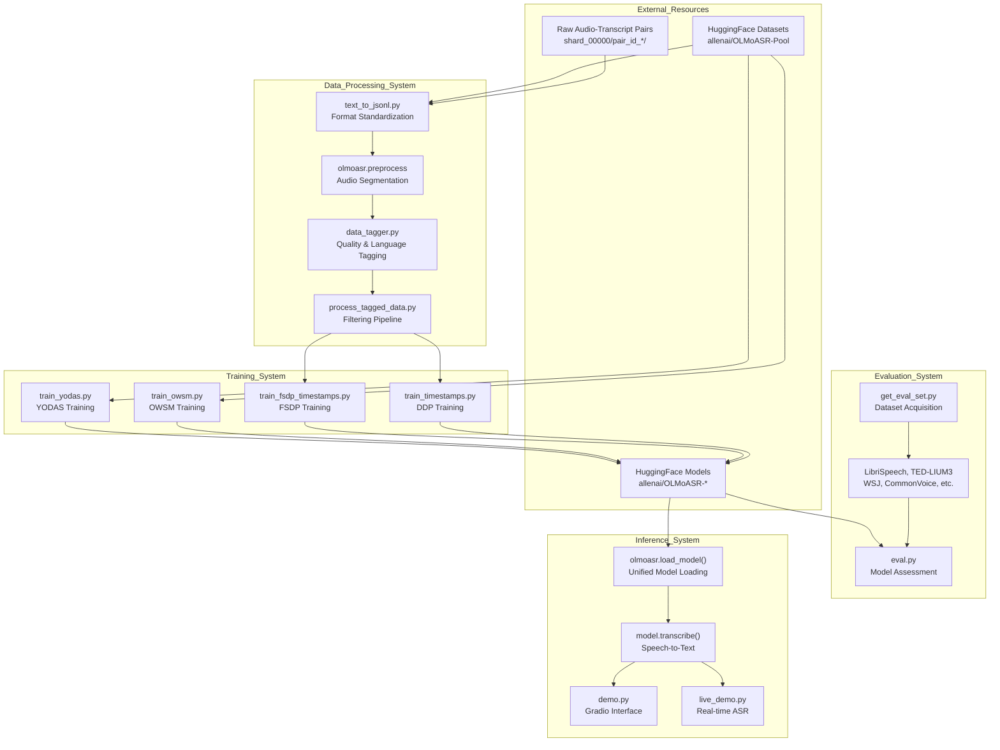

This diagram shows how the four subsystems interact, with data flowing from raw inputs through processing and training to evaluation and deployment. Each component is implemented as specific Python modules and scripts.

**Sources**: [README.md:58-67](), [README.md:98-149]()

### Core Package Architecture

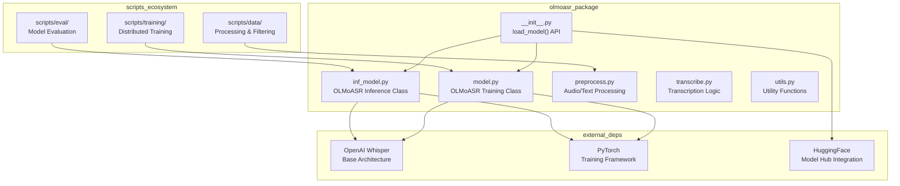

The `olmoasr` package provides the core APIs while the `scripts/` directory contains workflow implementations for data processing, training, and evaluation. The system builds on established frameworks like PyTorch and Whisper while adding specialized functionality.

**Sources**: [README.md:47-56](), [README.md:194-198]()

## Data Processing Pipeline

The data processing pipeline transforms raw audio-transcript pairs into training-ready datasets through a multi-stage process that handles quality control, language identification, and format standardization.

### Data Flow and Processing Stages

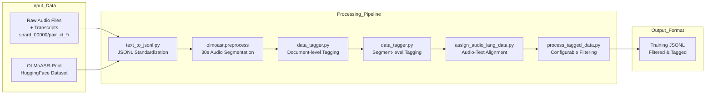

Each processing stage adds metadata and quality metrics to the dataset. The final JSONL format contains fields for audio paths, transcripts, timestamps, quality scores, and language identification.

**Data Schema**: The processed data follows a standardized JSONL schema with required fields including `id`, `audio_file`, `subtitle_file`, `seg_text`, `timestamp`, `audio_lang`, `text_lang`, `length`, and optional quality metrics like `edit_dist` and `seg_edit_dist`.

**Sources**: [README.md:58-70](), [README.md:71-95]()

## Training System

The training system supports multiple distributed training strategies and model architectures, with configurations managed through YAML files and execution via `torchrun`.

### Training Strategies and Scripts

| Training Script | Strategy | Use Case |
|-----------------|----------|----------|
| `train_timestamps.py` | DDP (Distributed Data Parallel) | Standard distributed training |
| `train_fsdp_timestamps.py` | FSDP (Fully Sharded Data Parallel) | Large model training with memory optimization |
| `train_owsm.py` | OWSM | Specialized training approach |
| `train_yodas.py` | YODAS | Alternative training methodology |

All training scripts accept common parameters for model configuration, data paths, optimization settings, and distributed training parameters. The system uses `torchrun` for launching distributed training jobs across multiple GPUs and nodes.

**Key Training Parameters**:
- `--model_variant`: Model size (tiny, base, small, medium, large)
- `--samples_dicts_dir`: Path to processed training data
- `--eff_batch_size`: Global batch size across all GPUs
- `--precision`: Training precision (fp16, bf16, fp32)
- `--train_steps`: Total training steps

**Sources**: [README.md:98-142]()

## Model Variants and Performance

OLMoASR produces models in multiple sizes, each trained on a subset of the OLMoASR-Mix dataset. All models support both short-form and long-form speech recognition with sentence-level timestamps.

### Available Model Sizes

| Model Size | Parameters | Short-form Avg WER | Long-form Avg WER |
|------------|------------|-------------------|------------------|
| tiny.en | ~37M | 20.5% | 15.6% |
| base.en | ~72M | 16.6% | 12.9% |
| small.en | ~242M | 13.8% | 11.5% |
| medium.en | ~769M | 12.8% | 11.0% |
| large.en | ~1.5B | 13.0% | 11.4% |
| large.en-v2 | ~1.5B | 12.6% | 11.5% |

Models are distributed through HuggingFace Hub under the `allenai/OLMoASR-*` namespace and can be loaded using the unified `olmoasr.load_model()` API.

**Sources**: [README.md:152-188]()

## Inference and Usage

The inference system provides a unified Python API for loading and using trained models, with support for both file-based and real-time transcription.

### Python API Usage

```python
import olmoasr

# Load model for inference
model = olmoasr.load_model("medium", inference=True)

# Transcribe audio file
result = model.transcribe("audio.mp3")

# Access transcription results
print(result["text"])           # Full transcription
print(result["segments"])       # Timestamped segments
print(result["language"])       # Detected language
```

The API automatically handles model downloading, caching, and format conversion. Models can be loaded from local checkpoints or automatically downloaded from HuggingFace Hub.

### Demo Applications

The system includes two demo applications:
- `demo.py`: Gradio-based web interface for file upload transcription
- `live_demo.py`: Real-time streaming transcription interface

Both applications use the same underlying `olmoasr.load_model()` API and provide user-friendly interfaces for testing model capabilities.

**Sources**: [README.md:189-247]()

## Key File Organization

The codebase follows a clear organizational structure with separation between core package functionality and workflow scripts:

```
olmoasr/                    # Core package
├── __init__.py            # Main API (load_model)
├── model.py               # Training model implementation  
├── inf_model.py           # Inference-optimized model
├── preprocess.py          # Audio/text processing
└── transcribe.py          # Transcription logic

scripts/                   # Workflow implementations
├── data/                  # Data processing scripts
├── training/              # Training configurations
└── eval/                  # Evaluation scripts

configs/                   # Configuration files
└── job_configs/          # Training job configurations
```

This organization enables the core `olmoasr` package to be used independently while providing comprehensive workflow scripts for the complete training pipeline.

**Sources**: [README.md:1-257]()

---

# Page: Getting Started

# Getting Started

<details>
<summary>Relevant source files</summary>

The following files were used as context for generating this wiki page:

- [olmoasr/__init__.py](olmoasr/__init__.py)
- [requirements.txt](requirements.txt)
- [requirements/requirements-data.txt](requirements/requirements-data.txt)
- [requirements/requirements.txt](requirements/requirements.txt)
- [setup.py](setup.py)

</details>


This document provides an overview of how to quickly get started with OLMoASR, covering basic installation, model loading, and initial usage patterns. For detailed installation instructions and dependency management, see [Installation & Dependencies](#2.1). For hands-on exploration using the web interface, see [Quick Start with Demos](#2.2).

## Overview

OLMoASR is an open-source Automatic Speech Recognition system that provides pre-trained models for transcribing audio to text. The system offers multiple model sizes and supports both programmatic usage through a Python API and interactive usage through web-based demos.

## User Journey: From Installation to First Transcription

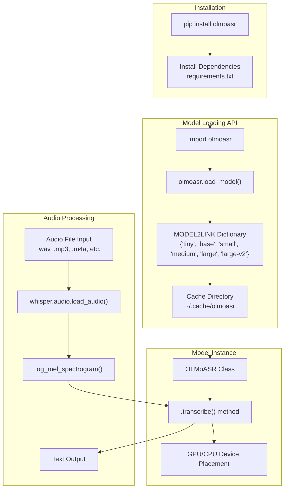

*Sources: [olmoasr/__init__.py:97-166](), [setup.py:16-38]()*

## Core Components and API Structure

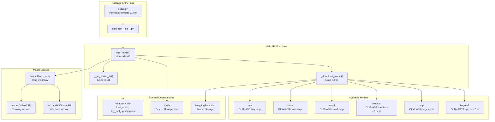

*Sources: [olmoasr/__init__.py:1-167](), [setup.py:1-39]()*

## Basic Usage Pattern

The simplest way to use OLMoASR follows this pattern:

1. **Import the package**: `import olmoasr`
2. **Load a model**: `model = olmoasr.load_model("base")`
3. **Transcribe audio**: `result = model.transcribe("audio.wav")`

The `load_model()` function [olmoasr/__init__.py:97-166]() handles model downloading, caching, and device placement automatically. Models are downloaded from HuggingFace Hub URLs defined in `MODEL2LINK` [olmoasr/__init__.py:23-30]() and cached locally in `~/.cache/olmoasr` [olmoasr/__init__.py:33-41]().

## Available Model Sizes

| Model Size | Checkpoint File | Use Case |
|------------|----------------|----------|
| `tiny` | `OLMoASR-tiny.en.pt` | Fast inference, low resource environments |
| `base` | `OLMoASR-base.en.pt` | Balanced speed and accuracy |
| `small` | `OLMoASR-small.en.pt` | Good accuracy, moderate resources |
| `medium` | `OLMoASR-medium-v2.en.pt` | Higher accuracy applications |
| `large` | `OLMoASR-large.en.pt` | Best accuracy, more resources required |
| `large-v2` | `OLMoASR-large.en-v2.pt` | Latest version of large model |

*Sources: [olmoasr/__init__.py:23-30]()*

## Key Dependencies and Requirements

The system requires several core dependencies managed through [requirements.txt:1-29]():

- **PyTorch ecosystem**: `torch`, `torchaudio` for deep learning operations
- **Audio processing**: `librosa`, `pydub` for audio format handling  
- **OpenAI Whisper**: `openai-whisper` for base architecture components
- **HuggingFace**: `transformers`, `huggingface_hub` for model management
- **Data handling**: `datasets`, `pandas`, `numpy` for data processing
- **Web interface**: `gradio` for demo applications

The package is installed as `olmoasr` version 1.0.0 [setup.py:20]() with MIT license [setup.py:21]().

*Sources: [requirements.txt:1-29](), [setup.py:16-38]()*

## Next Steps

After basic setup:

- **Try the demos**: See [Quick Start with Demos](#2.2) to explore OLMoASR capabilities through web interfaces
- **Advanced installation**: See [Installation & Dependencies](#2.1) for development setup and environment configuration  
- **Training models**: See [Model Training](#4) to train custom models on your data
- **Python API**: See [Python API Reference](#6.1) for comprehensive API documentation
- **Evaluation**: See [Model Evaluation](#5) to benchmark model performance

*Sources: [olmoasr/__init__.py:1-167](), [setup.py:1-39]()*

---

# Page: Installation & Dependencies

# Installation & Dependencies

<details>
<summary>Relevant source files</summary>

The following files were used as context for generating this wiki page:

- [HISTORY.md](HISTORY.md)
- [LICENSE](LICENSE)
- [Makefile](Makefile)
- [NOTICES.txt](NOTICES.txt)
- [mypy.ini](mypy.ini)
- [requirements.txt](requirements.txt)
- [requirements/requirements-data.txt](requirements/requirements-data.txt)
- [requirements/requirements.txt](requirements/requirements.txt)
- [setup.py](setup.py)

</details>


This document provides detailed instructions for installing OLMoASR and managing its dependencies. It covers both basic user installation for inference and complete development environment setup for contributing to the project.

For information about using the Python API after installation, see [Python API Reference](#6.1). For development tools and workflows, see [Development Setup & Tools](#7.1).

## System Requirements

OLMoASR requires Python 3.8 or later and has been tested on Linux and macOS systems. The package supports both CPU and GPU execution, with GPU strongly recommended for training workflows.

### Hardware Requirements

| Component | Minimum | Recommended |
|-----------|---------|-------------|
| RAM | 8 GB | 16+ GB |
| Storage | 10 GB free space | 50+ GB for datasets |
| GPU | Not required | CUDA-compatible GPU with 8+ GB VRAM |

Sources: [setup.py:36]()

## Installation Methods

### Standard Installation

The simplest installation method uses pip with the main requirements file:

```bash
pip install -r requirements.txt
```

This installs all core dependencies needed for both inference and basic data processing workflows.

### Development Installation

For contributors and advanced users, use the development installation process defined in the Makefile:

```bash
make install
make install-dev
```

The `make install` command performs these steps:
1. Upgrades pip to the latest version
2. Installs the package in editable mode using `pip install -e .`

Sources: [Makefile:1-3](), [setup.py:16-38]()

## Dependency Architecture

The dependency structure is organized into several categories based on functionality:

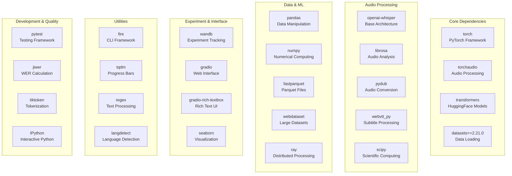

Sources: [requirements.txt:1-29]()

## Package Definition Structure

The package is configured through `setup.py` with the following key parameters:

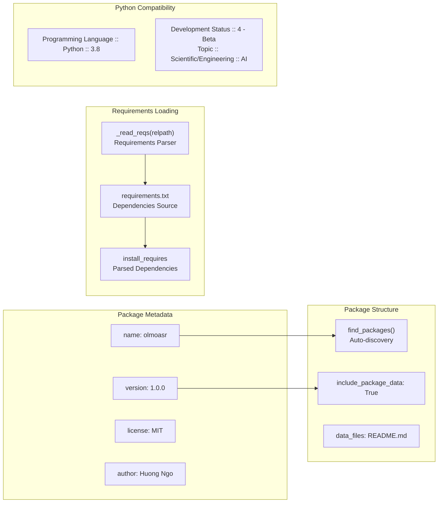

Sources: [setup.py:1-38]()

## Specialized Requirements Files

The project includes multiple requirements files for different use cases:

| File | Purpose | Key Dependencies |
|------|---------|-----------------|
| `requirements.txt` | Main installation | All core dependencies with specific versions |
| `requirements/requirements.txt` | Alternative main | Similar to main but without some optional packages |
| `requirements/requirements-data.txt` | Data processing | Focused on data manipulation and processing tools |

### Data Processing Requirements

The data-specific requirements file includes specialized tools:

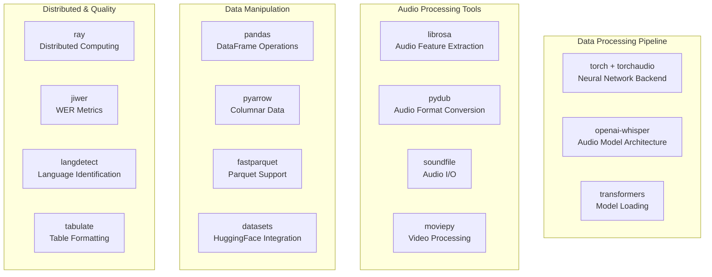

Sources: [requirements/requirements-data.txt:1-24]()

## Development Environment Setup

### Make Commands

The Makefile provides standardized commands for development workflow:

| Command | Function | Details |
|---------|----------|---------|
| `make install` | Package installation | Upgrades pip, installs package in editable mode |
| `make install-dev` | Development setup | Installs testing requirements |
| `make lint` | Code quality | Runs mypy and black checkers |
| `make black` | Code formatting | Auto-formats Python code |
| `make test` | Testing | Runs pytest with verbose output |

### Type Checking Configuration

The project uses mypy for static type checking with configuration in `mypy.ini`:

- Target Python version: 3.8
- Missing imports ignored for external libraries
- Global type checking enabled

Sources: [Makefile:1-28](), [mypy.ini:1-6]()

## Installation Verification

After installation, verify the setup by checking key imports and basic functionality:

```python
# Verify core package
import olmoasr

# Verify key dependencies  
import torch
import transformers
import datasets
import gradio

# Check GPU availability (optional)
print(f"CUDA available: {torch.cuda.is_available()}")
```

### Common Installation Issues

| Issue | Symptom | Solution |
|-------|---------|----------|
| PyTorch version mismatch | CUDA errors or slow performance | Install PyTorch for your specific CUDA version |
| Audio library conflicts | Import errors for librosa/pydub | Install system audio libraries (e.g., ffmpeg) |
| Memory errors during installation | pip crashes | Use `--no-cache-dir` flag or increase virtual memory |

Sources: [setup.py:14-30](), [requirements.txt:11-12]()

## License and Third-Party Components

OLMoASR is distributed under the MIT License. The project includes numerous third-party dependencies with various licenses, documented in `NOTICES.txt`. Key license categories include:

- MIT License: Core package and many utilities
- Apache 2.0: HuggingFace components, some audio tools  
- BSD variants: Scientific computing libraries
- Python Software Foundation License: Python ecosystem tools

Sources: [LICENSE:1-22](), [NOTICES.txt:1-100](), [setup.py:21]()

---

# Page: Quick Start with Demos

# Quick Start with Demos

<details>
<summary>Relevant source files</summary>

The following files were used as context for generating this wiki page:

- [demo/convert_openai_to_hf.py](demo/convert_openai_to_hf.py)
- [demo/demo.py](demo/demo.py)
- [demo/live_demo.py](demo/live_demo.py)

</details>


This page provides a hands-on introduction to OLMoASR through interactive demo applications. The demos showcase core ASR capabilities including file-based transcription, real-time streaming, and different inference strategies, allowing users to quickly evaluate model performance without complex setup.

For detailed API usage and Python integration, see [Python API Reference](#6.1). For deployment and production usage, see [Inference & Deployment](#6).

## Demo Applications Overview

OLMoASR includes three demo applications that demonstrate different usage patterns:

| Demo | Purpose | Interface | Key Features |
|------|---------|-----------|--------------|
| **Main Demo** | File upload transcription | Gradio web UI | Multiple inference strategies, timestamp visualization |
| **Live Demo** | Real-time streaming ASR | Gradio web UI | Continuous audio capture, streaming transcription |
| **Conversion Script** | Model format conversion | Command line | OpenAI → HuggingFace format conversion |

## Main Demo Architecture

The primary demo application in [`demo/demo.py`]() provides a comprehensive interface for testing OLMoASR models with uploaded audio files.

### Demo System Flow

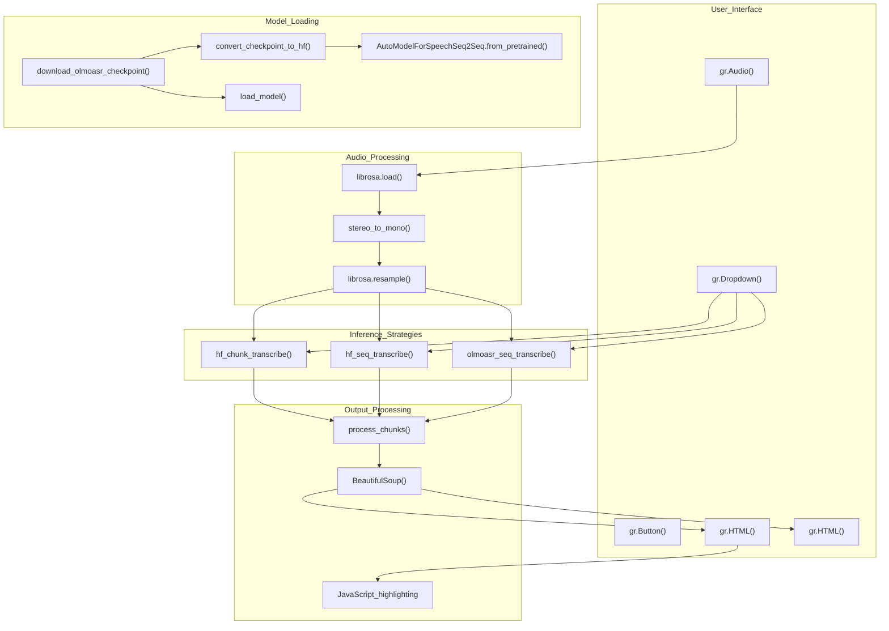

**Sources:** [`demo/demo.py:1-544`]()

### Model Initialization System

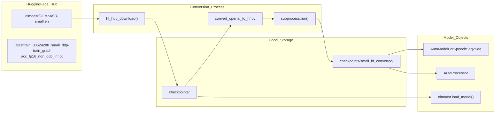

**Sources:** [`demo/demo.py:25-147`](), [`demo/convert_openai_to_hf.py:1-371`]()

## Running the Main Demo

### Initialization Process

The demo automatically handles model downloading and initialization:

1. **Model Download**: The `download_olmoasr_checkpoint()` function retrieves models from HuggingFace Hub [`demo/demo.py:40-63`]()
2. **Format Conversion**: `convert_checkpoint_to_hf()` converts OpenAI format to HuggingFace format [`demo/demo.py:65-116`]()
3. **Model Loading**: Both HuggingFace and OLMoASR model instances are created [`demo/demo.py:118-147`]()

### Inference Strategies

The demo provides three inference approaches accessible via dropdown selection:

| Strategy | Implementation | Use Case |
|----------|----------------|----------|
| **HuggingFace Chunking** | `hf_chunk_transcribe()` | 30-second chunked processing with overlap handling |
| **HuggingFace Sequential** | `hf_seq_transcribe()` | Sequential processing with timestamp accumulation |
| **OLMoASR Sequential** | `olmoasr_seq_transcribe()` | Native OLMoASR inference with segment output |

### Audio Processing Pipeline

All inference strategies share common audio preprocessing:

```python
# Audio loading and conversion (demo/demo.py:174-180, 209-215, 260-266)
waveform, sample_rate = librosa.load(audio_file, sr=None, mono=False)
waveform = stereo_to_mono(waveform)  # Convert stereo to mono
if sample_rate != 16000:
    waveform = librosa.resample(waveform, orig_sr=sample_rate, target_sr=16000)
```

**Sources:** [`demo/demo.py:152-161`](), [`demo/demo.py:163-304`]()

### Real-time Timestamp Visualization

The demo includes JavaScript-based timestamp synchronization that highlights the current segment being spoken:

```javascript
// Real-time highlighting (demo/demo.py:451-505)
function getTime() {
    // Synchronizes audio playback position with transcript highlighting
    // Updates HTML with highlighted current segment
}
```

**Sources:** [`demo/demo.py:451-506`]()

## Live Demo for Streaming ASR

The live demo in [`demo/live_demo.py`]() provides real-time transcription capabilities using microphone input.

### Live Demo Architecture

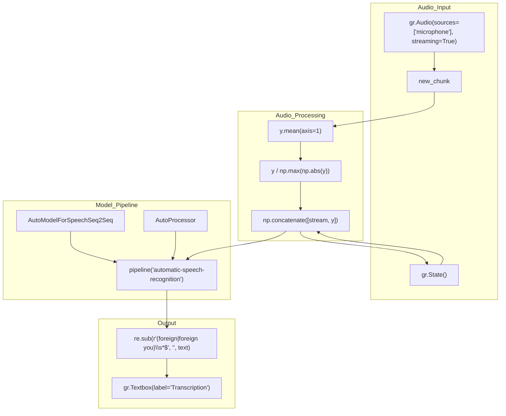

**Sources:** [`demo/live_demo.py:1-69`]()

### Key Implementation Details

The live demo uses Gradio's streaming capability with state management:

- **Streaming Handler**: `transcribe(stream, new_chunk)` processes incoming audio chunks [`demo/live_demo.py:31-47`]()
- **State Accumulation**: Audio chunks are concatenated to maintain continuous context [`demo/live_demo.py:41-44`]()
- **Real-time Pipeline**: HuggingFace pipeline processes accumulated audio stream [`demo/live_demo.py:45`]()

**Sources:** [`demo/live_demo.py:31-66`]()

## Model Format Conversion

The conversion script [`demo/convert_openai_to_hf.py`]() handles transformation between OpenAI Whisper and HuggingFace formats.

### Conversion Process Flow

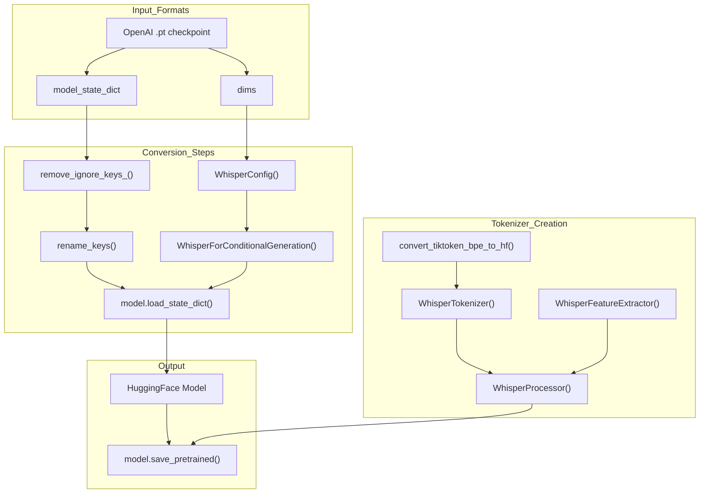

**Sources:** [`demo/convert_openai_to_hf.py:185-251`](), [`demo/convert_openai_to_hf.py:291-327`]()

### Key Conversion Components

The conversion process involves several critical transformations:

- **State Dictionary Mapping**: `WHISPER_MAPPING` dictionary maps OpenAI parameter names to HuggingFace equivalents [`demo/convert_openai_to_hf.py:102-123`]()
- **Configuration Creation**: Model dimensions are extracted and converted to `WhisperConfig` [`demo/convert_openai_to_hf.py:207-223`]()
- **Tokenizer Conversion**: tiktoken BPE is converted to HuggingFace tokenizer format [`demo/convert_openai_to_hf.py:272-327`]()

**Sources:** [`demo/convert_openai_to_hf.py:96-137`](), [`demo/convert_openai_to_hf.py:185-251`](), [`demo/convert_openai_to_hf.py:272-327`]()

## Usage Instructions

### Starting the Main Demo

```bash
python demo/demo.py
```

The demo will:
1. Download the OLMoASR model from HuggingFace Hub
2. Convert it to HuggingFace format if needed
3. Initialize both model variants
4. Launch a Gradio interface accessible via web browser

### Starting the Live Demo

```bash
python demo/live_demo.py
```

This launches a streaming interface that captures microphone input and provides real-time transcription.

### Manual Model Conversion

```bash
python demo/convert_openai_to_hf.py \
    --checkpoint_path path/to/model.pt \
    --pytorch_dump_folder_path output/directory \
    --convert_preprocessor True
```

**Sources:** [`demo/demo.py:543-544`](), [`demo/live_demo.py:66-67`](), [`demo/convert_openai_to_hf.py:330-341`]()

---

# Page: Data Processing Pipeline

# Data Processing Pipeline

<details>
<summary>Relevant source files</summary>

The following files were used as context for generating this wiki page:

- [configs/job_configs/data/processing/segmentation.sh](configs/job_configs/data/processing/segmentation.sh)
- [configs/job_configs/data/processing/text_to_jsonl.sh](configs/job_configs/data/processing/text_to_jsonl.sh)
- [scripts/README.md](scripts/README.md)

</details>


The data processing pipeline transforms raw audio files and transcript pairs into standardized, segmented datasets suitable for ASR model training. This system handles format conversion, temporal segmentation, quality assessment, and filtering to create high-quality training data from diverse input sources.

This document covers the core data transformation stages. For detailed preprocessing and segmentation mechanics, see [Data Preprocessing & Segmentation](#3.1). For quality control and tagging systems, see [Data Tagging & Quality Control](#3.2). For filtering configuration options, see [Filtering Configuration System](#3.3).

## Pipeline Overview

The data processing pipeline consists of three main stages that progressively transform and refine raw audio-transcript pairs into training-ready datasets.

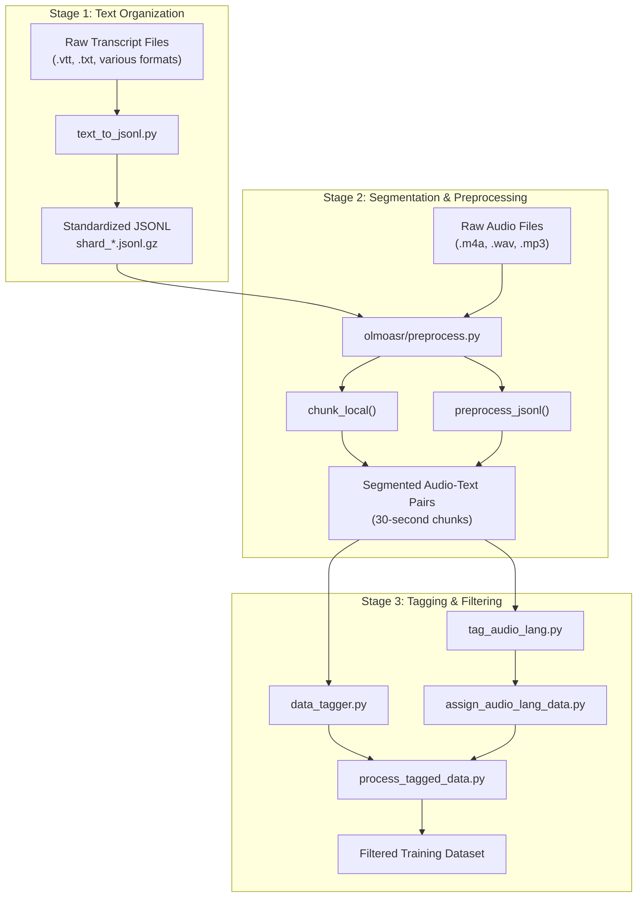

The pipeline processes data through three distinct stages, each with specific responsibilities and outputs. Stage 1 standardizes text formats, Stage 2 performs temporal segmentation, and Stage 3 applies quality control and filtering.

Sources: [scripts/README.md:1-37](), [configs/job_configs/data/processing/segmentation.sh:1-70](), [configs/job_configs/data/processing/text_to_jsonl.sh:1-4]()

## Text Organization Stage

The first stage converts diverse transcript formats into a standardized JSONL structure using the `text_to_jsonl.py` script. This script organizes transcript files from directory structures into compressed JSONL files.

### text_to_jsonl.py Functionality

The script processes transcript files from organized directory structures and creates standardized JSONL output:

| Parameter | Purpose | Example |
|-----------|---------|---------|
| `--input_path` | Source directory containing transcript files | `/path/to/shard_00000` |
| `--output_path` | Target JSONL file (typically compressed) | `/path/to/output.jsonl.gz` |
| `--num_processes` | Parallel processing workers | `10` |

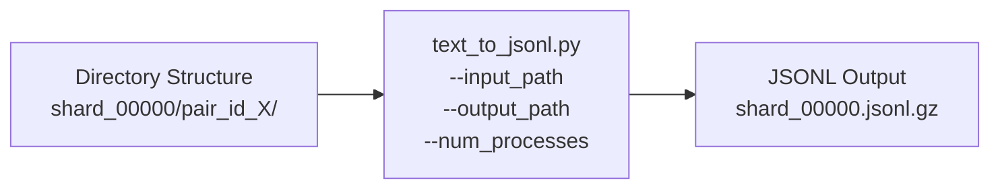

The script handles parallel processing to efficiently convert large directory structures containing thousands of transcript files into manageable JSONL format for downstream processing.

Sources: [scripts/README.md:6](), [configs/job_configs/data/processing/text_to_jsonl.sh:1-4]()

## Segmentation & Preprocessing Stage

The segmentation stage uses `olmoasr/preprocess.py` to chunk audio and transcript data into fixed-duration segments suitable for training. The preprocessing module provides two main functions: `chunk_local()` for local audio/transcript files and `preprocess_jsonl()` for JSONL input data.

### chunk_local() Function

Processes individual audio-transcript pairs from local files:

| Parameter | Purpose | Values |
|-----------|---------|--------|
| `--transcript_file` | Input transcript file path | `.vtt`, `.txt` formats |
| `--audio_file` | Input audio file path | `.m4a`, `.wav`, `.mp3` formats |
| `--output_dir` | Output directory for segments | Directory path |
| `--in_memory` | Memory processing mode | `True`/`False` |
| `--transcript_only` | Process transcripts only | `True`/`False` |
| `--audio_only` | Process audio only | `True`/`False` |

### preprocess_jsonl() Function

Processes JSONL-formatted data with additional options for machine transcription and subsampling:

| Parameter | Purpose | Usage |
|-----------|---------|-------|
| `--json_file` | Input JSONL file | `shard_00000.jsonl.gz` |
| `--shard` | Shard identifier | `00000` |
| `--seg_mach` | Include machine transcriptions | `True`/`False` |
| `--subsample` | Enable subsampling | `True`/`False` |
| `--subsample_size` | Number of samples | `20000` |
| `--only_subsample` | Subsample only (no segmentation) | `True`/`False` |

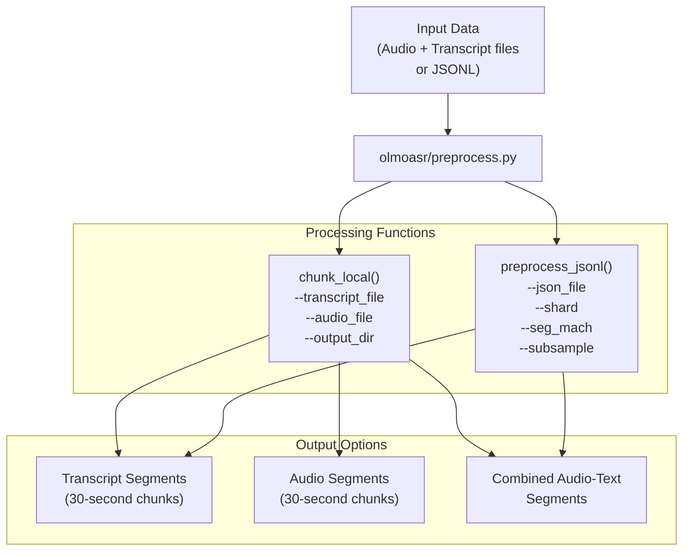

The segmentation stage creates 30-second chunks from longer audio-transcript pairs, enabling efficient batch training while maintaining temporal alignment between audio and text.

Sources: [scripts/README.md:6](), [configs/job_configs/data/processing/segmentation.sh:1-70]()

## Tagging & Filtering Stage

The final stage applies quality assessment, language identification, and filtering to create curated training datasets. This stage uses multiple specialized scripts working in sequence.

### Tagging Scripts

| Script | Function | Purpose |
|--------|----------|---------|
| `data_tagger.py` | General data tagging | Applies quality metrics and metadata tags |
| `tag_audio_lang.py` | Language identification | Identifies spoken language in audio |
| `assign_audio_lang_data.py` | Language assignment | Maps language tags to JSONL data |

### Filtering & Sampling Scripts

| Script | Function | Purpose |
|--------|----------|---------|
| `process_tagged_data.py` | Data filtering | Executes filtering and random sampling |
| `reservoir_sample.py` | Statistical analysis | Provides percentile information for numerical tags |
| `gen_video_samples.py` | Sample generation | Creates video samples for data assessment |

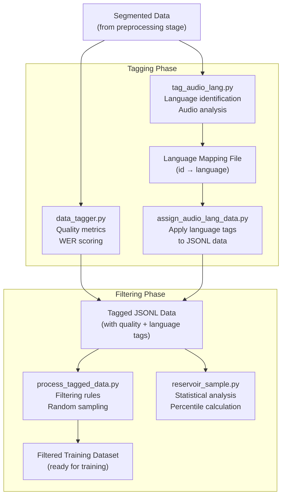

The tagging and filtering stage ensures data quality through automated assessment of transcription accuracy, language identification, and configurable filtering rules that can be customized based on specific training requirements.

Sources: [scripts/README.md:8-18]()

## Integration & Configuration

The data processing pipeline is controlled through YAML configuration files that specify processing parameters, filtering rules, and output requirements. Configuration examples are provided in the `configs/job_configs/data/` directory structure.

### Configuration Structure

| Directory | Purpose | Contents |
|-----------|---------|----------|
| `configs/job_configs/data/processing/` | Processing configurations | Segmentation and text organization scripts |
| `configs/job_configs/data/filtering/` | Filtering configurations | Tagging and filtering rule definitions |

The pipeline integrates with the broader OLMoASR training system by producing standardized datasets that can be consumed by the training scripts in `scripts/training/`. The processed data maintains consistent format and quality standards across all training approaches (DDP, FSDP, OWSM, YODAS).

Sources: [scripts/README.md:18](), [scripts/README.md:27]()

---

# Page: Data Preprocessing & Segmentation

# Data Preprocessing & Segmentation

<details>
<summary>Relevant source files</summary>

The following files were used as context for generating this wiki page:

- [configs/job_configs/data/processing/segmentation.sh](configs/job_configs/data/processing/segmentation.sh)
- [configs/job_configs/data/processing/text_to_jsonl.sh](configs/job_configs/data/processing/text_to_jsonl.sh)
- [scripts/README.md](scripts/README.md)

</details>


This document covers the initial data preprocessing and segmentation pipeline in OLMoASR, which transforms raw audio-transcript pairs into standardized, segmented datasets ready for training. The preprocessing system handles format standardization, audio/text temporal alignment, and segmentation into fixed-duration chunks.

For information about data quality assessment and filtering that occurs after segmentation, see [Data Tagging & Quality Control](#3.2). For training pipeline configuration, see [Training Scripts & Distributed Strategies](#4.2).

## Overview

The data preprocessing pipeline consists of two main stages:

1. **Text Organization**: Converting raw transcript files into standardized JSONL format
2. **Segmentation**: Splitting audio and text into aligned temporal segments (typically 30-second chunks)

## Text Organization Pipeline

### text_to_jsonl.py Processing

The first stage organizes scattered transcript files into a structured JSONL format using `scripts/data/processing/text_to_jsonl.py`.

#### Text Organization Workflow
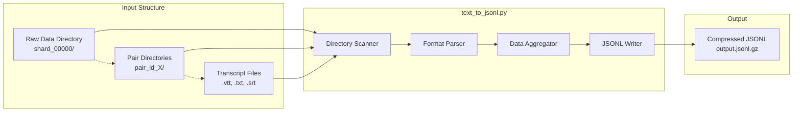

The script processes directories containing audio-transcript pairs and consolidates them into a single JSONL file with standardized metadata.

**Sources:** [scripts/README.md:6](), [configs/job_configs/data/processing/text_to_jsonl.sh:1-4]()

## Audio/Text Segmentation Pipeline

### Core Segmentation Module

The main segmentation logic resides in `olmoasr/preprocess.py`, which provides two primary entry points:

- `chunk_local`: Processes individual audio/transcript file pairs
- `preprocess_jsonl`: Processes existing JSONL datasets

#### Segmentation Architecture
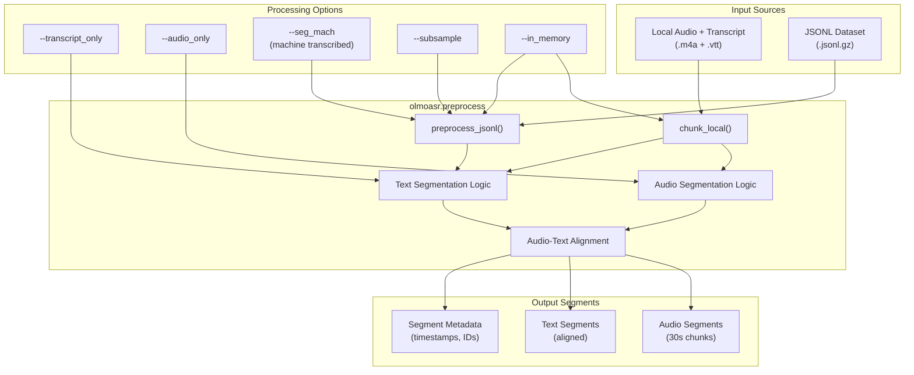

**Sources:** [scripts/README.md:6](), [configs/job_configs/data/processing/segmentation.sh:1-70]()

## Segmentation Modes

### Local File Processing

The `chunk_local` function processes individual audio-transcript pairs:

| Mode | Command Flag | Purpose |
|------|--------------|---------|
| Full Segmentation | Default | Segments both audio and text with alignment |
| Transcript Only | `--transcript_only True` | Segments text without processing audio |
| Audio Only | `--audio_only True` | Segments audio without text processing |

**Example Usage:**
```bash
python olmoasr/preprocess.py/chunk_local \
    --transcript_file /path/to/transcript.vtt \
    --audio_file /path/to/audio.m4a \
    --output_dir /path/to/output \
    --in_memory False
```

### JSONL Processing

The `preprocess_jsonl` function handles existing JSONL datasets:

| Processing Type | Flags | Description |
|----------------|-------|-------------|
| Manual Transcripts | Default | Processes manually-created transcripts only |
| Mixed Sources | `--seg_mach True` | Includes machine-transcribed content |
| Subsampling | `--subsample True --subsample_size N` | Random sampling during segmentation |
| Subsample Only | `--only_subsample True` | Subsamples pre-segmented data |

### Memory Management

The system supports two memory modes controlled by the `--in_memory` flag:

- `--in_memory True`: Loads data into memory for faster processing
- `--in_memory False`: Streams data from disk for memory-constrained environments

**Sources:** [configs/job_configs/data/processing/segmentation.sh:8-70]()

## Data Flow and File Formats

### Complete Preprocessing Pipeline
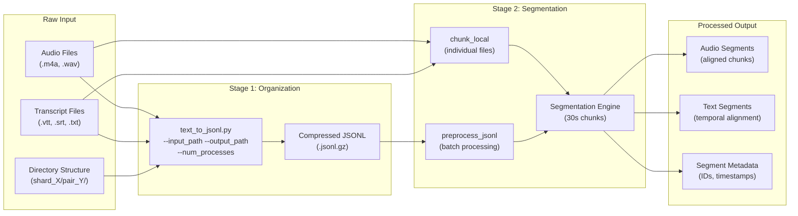

### Processing Configuration

The segmentation system supports parallel processing through the `--num_processes` parameter in `text_to_jsonl.py`, enabling efficient handling of large datasets.

**Key Configuration Options:**

| Parameter | Function | Purpose |
|-----------|----------|---------|
| `--shard` | `preprocess_jsonl` | Identifies data shard for processing |
| `--log_dir` | `preprocess_jsonl` | Specifies logging output directory |
| `--output_dir` | Both functions | Target directory for processed segments |
| `--subsample_size` | `preprocess_jsonl` | Number of samples for random subsampling |

**Sources:** [scripts/README.md:5-6](), [configs/job_configs/data/processing/segmentation.sh:18-62](), [configs/job_configs/data/processing/text_to_jsonl.sh:1-4]()

---

# Page: Data Tagging & Quality Control

# Data Tagging & Quality Control

<details>
<summary>Relevant source files</summary>

The following files were used as context for generating this wiki page:

- [configs/data_configs/tagging/main_tagging.yaml](configs/data_configs/tagging/main_tagging.yaml)
- [configs/data_configs/tagging/main_tagging_seg.yaml](configs/data_configs/tagging/main_tagging_seg.yaml)
- [configs/job_configs/data/filtering/tagging.sh](configs/job_configs/data/filtering/tagging.sh)
- [scripts/data/filtering/tag_audio_lang.py](scripts/data/filtering/tag_audio_lang.py)

</details>


This section covers the data tagging system that assigns quality metrics and metadata tags to audio-transcript pairs in the OLMoASR pipeline. The tagging system evaluates content quality, identifies languages, and provides metrics used for subsequent filtering decisions.

For information about the initial data preprocessing and segmentation that occurs before tagging, see [Data Preprocessing & Segmentation](#3.1). For details on how tags are used in filtering configurations, see [Filtering Configuration System](#3.3).

## Tagging System Overview

The OLMoASR tagging system operates on processed audio-transcript data to assign quality metrics and metadata tags. The system supports both document-level and segment-level tagging through configurable YAML pipelines.

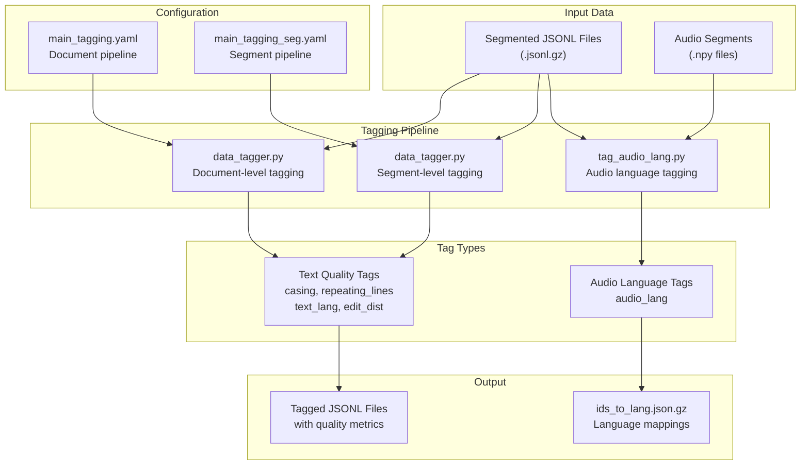

Sources: [configs/data_configs/tagging/main_tagging.yaml:1-6](), [configs/data_configs/tagging/main_tagging_seg.yaml:1-3](), [scripts/data/filtering/tag_audio_lang.py:1-412]()

## Audio Language Identification

The audio language identification system uses SpeechBrain models to classify the spoken language in audio segments. This process operates independently of transcript text to provide objective language verification.

### AudioLanguageDataset Class

The `AudioLanguageDataset` class handles loading and preprocessing audio segments for language identification:

```mermaid
graph TB
    subgraph "AudioLanguageDataset"
        INIT["__init__(data)<br/>Initialize with transcript segments"]
        GETITEM["__getitem__(idx)<br/>Load single audio segment"]
        PREPROCESS["_load_and_preprocess_audio()<br/>Load .npy, normalize, pad/trim"]
    end
    
    subgraph "Data Flow"
        TRANSCRIPT["Transcript Segment<br/>{id, seg_content, audio_file}"]
        NPY_FILE["Audio File<br/>(.npy format)"]
        PROCESSED["Processed Audio<br/>(normalized, padded)"]
    end
    
    subgraph "Dependencies"
        WHISPER["whisper.audio<br/>pad_or_trim()"]
        NUMPY["numpy<br/>load(), normalize"]
    end
    
    TRANSCRIPT --> INIT
    INIT --> GETITEM
    GETITEM --> PREPROCESS
    NPY_FILE --> PREPROCESS
    PREPROCESS --> PROCESSED
    
    WHISPER --> PREPROCESS
    NUMPY --> PREPROCESS
```

Sources: [scripts/data/filtering/tag_audio_lang.py:43-143]()

### Language Identification Process

The language identification process uses a pre-trained SpeechBrain model to classify audio segments:

| Component | Function | Details |
|-----------|----------|---------|
| **Model** | `EncoderClassifier.from_hparams()` | Uses "speechbrain/lang-id-voxlingua107-ecapa" |
| **Processing** | `identify_segment_languages()` | Batch inference on audio segments |
| **Aggregation** | `aggregate_video_languages()` | Majority voting per video ID |
| **Output** | `ids_to_lang.json.gz` | Video ID to language mappings |

The `process_data()` function coordinates the entire audio language identification workflow:

```mermaid
graph LR
    subgraph "Input Processing"
        GLOB["glob.glob()<br/>Find .jsonl.gz files"]
        LOAD["load_compressed_jsonl()<br/>Load transcript data"]
        COMBINE["chain()<br/>Combine all data"]
    end
    
    subgraph "Model Setup"
        DEVICE["torch.device<br/>CUDA/CPU selection"]
        MODEL["EncoderClassifier<br/>SpeechBrain model"]
        DATASET["AudioLanguageDataset<br/>Audio preprocessing"]
        LOADER["DataLoader<br/>Batch processing"]
    end
    
    subgraph "Inference & Output"
        CLASSIFY["model.classify_batch()<br/>Language prediction"]
        AGGREGATE["aggregate_video_languages()<br/>Majority voting"]
        SAVE["gzip.open()<br/>Save results"]
    end
    
    GLOB --> LOAD
    LOAD --> COMBINE
    COMBINE --> DATASET
    DEVICE --> MODEL
    DATASET --> LOADER
    LOADER --> CLASSIFY
    CLASSIFY --> AGGREGATE
    AGGREGATE --> SAVE
```

Sources: [scripts/data/filtering/tag_audio_lang.py:259-402]()

## Text-Based Quality Tags

The text-based tagging system applies various quality metrics to transcript content. These tags are configured through YAML pipeline definitions and applied at different granularities.

### Document-Level Tags

Document-level tagging processes entire transcript documents and applies the following tags:

| Tag Type | Purpose | Implementation |
|----------|---------|----------------|
| **casing** | Analyzes text capitalization patterns | Identifies unusual casing issues |
| **repeating_lines** | Detects repetitive content | Flags transcripts with excessive repetition |
| **text_lang** | Identifies transcript language | Text-based language detection |
| **edit_dist** | Calculates edit distance metrics | Measures transcript quality |

### Segment-Level Tags

Segment-level tagging focuses on individual 30-second transcript segments:

| Tag Type | Scope | Configuration |
|----------|-------|---------------|
| **edit_dist** | Per-segment quality | Applied to each audio-transcript segment pair |

### Tag Pipeline Configuration

The tagging pipeline is configured through YAML files that define tag sequences:

**Document-level pipeline** (`main_tagging.yaml`):
```yaml
name: main_tagging
pipeline:
  - tag: casing
  - tag: repeating_lines  
  - tag: text_lang
  - tag: edit_dist
```

**Segment-level pipeline** (`main_tagging_seg.yaml`):
```yaml
name: main_tagging_seg
pipeline:
  - tag: edit_dist
```

Sources: [configs/data_configs/tagging/main_tagging.yaml:1-6](), [configs/data_configs/tagging/main_tagging_seg.yaml:1-3]()

## Tag Application Process

The tagging process is orchestrated through the `data_tagger.py` script, which applies configured tag pipelines to input data directories.

### Execution Workflow

```mermaid
graph TB
    subgraph "Input Specification"
        CONFIG_PATH["--config_path<br/>YAML pipeline definition"]
        INPUT_DIR["--input_dir<br/>Source JSONL directory"]
        OUTPUT_DIR["--output_dir<br/>Tagged output directory"]
        NUM_CPUS["--num_cpus<br/>Parallel processing"]
    end
    
    subgraph "Processing Pipeline"
        LOAD_CONFIG["Load YAML Configuration<br/>Parse tag pipeline"]
        LOAD_DATA["Load Input Data<br/>Read .jsonl.gz files"]
        APPLY_TAGS["Apply Tag Pipeline<br/>Execute configured tags"]
        SAVE_OUTPUT["Save Tagged Data<br/>Write enhanced JSONL"]
    end
    
    subgraph "Execution Types"
        DOC_LEVEL["Document-Level Tagging<br/>main_tagging.yaml"]
        SEG_LEVEL["Segment-Level Tagging<br/>main_tagging_seg.yaml"]
        AUDIO_LEVEL["Audio Language Tagging<br/>tag_audio_lang.py"]
    end
    
    CONFIG_PATH --> LOAD_CONFIG
    INPUT_DIR --> LOAD_DATA
    OUTPUT_DIR --> SAVE_OUTPUT
    NUM_CPUS --> APPLY_TAGS
    
    LOAD_CONFIG --> APPLY_TAGS
    LOAD_DATA --> APPLY_TAGS
    APPLY_TAGS --> SAVE_OUTPUT
    
    APPLY_TAGS --> DOC_LEVEL
    APPLY_TAGS --> SEG_LEVEL
    LOAD_DATA --> AUDIO_LEVEL
```

### Typical Usage Pattern

The tagging system is typically executed in sequence for comprehensive data quality assessment:

1. **Document-level tagging**: Applies comprehensive quality tags to full documents
2. **Segment-level tagging**: Adds segment-specific quality metrics  
3. **Audio language tagging**: Provides independent language verification

Example execution sequence:
```bash
# Document-level tagging
python scripts/data/filtering/data_tagger.py \
    --config_path configs/data_configs/tagging/main_tagging.yaml \
    --input_dir /path/to/jsonls_dir \
    --output_dir /path/to/output \
    --num_cpus 10

# Segment-level tagging  
python scripts/data/filtering/data_tagger.py \
    --config_path configs/data_configs/tagging/main_tagging_seg.yaml \
    --input_dir /path/to/jsonls_dir \
    --output_dir /path/to/output \
    --num_cpus 10
```

Sources: [configs/job_configs/data/filtering/tagging.sh:1-15]()

The tagged output data contains the original transcript content enhanced with quality metrics and metadata tags that inform subsequent filtering decisions in the data processing pipeline.

---

# Page: Filtering Configuration System

# Filtering Configuration System

<details>
<summary>Relevant source files</summary>

The following files were used as context for generating this wiki page:

- [configs/data_configs/filtering/lang_align.yaml](configs/data_configs/filtering/lang_align.yaml)
- [configs/data_configs/filtering/mixed_lang_eq.yaml](configs/data_configs/filtering/mixed_lang_eq.yaml)
- [configs/data_configs/filtering/mixed_no_repeats_lang_eq.yaml](configs/data_configs/filtering/mixed_no_repeats_lang_eq.yaml)
- [configs/data_configs/filtering/no_repeats_lang_eq.yaml](configs/data_configs/filtering/no_repeats_lang_eq.yaml)
- [configs/data_configs/filtering/no_upper_lang_eq.yaml](configs/data_configs/filtering/no_upper_lang_eq.yaml)
- [configs/data_configs/filtering/seg_edit_dist_edit_dist/seg_edit_dist_0.2_edit_dist_0.2.yaml](configs/data_configs/filtering/seg_edit_dist_edit_dist/seg_edit_dist_0.2_edit_dist_0.2.yaml)
- [configs/data_configs/filtering/seg_edit_dist_edit_dist/seg_edit_dist_0.4_edit_dist_0.4.yaml](configs/data_configs/filtering/seg_edit_dist_edit_dist/seg_edit_dist_0.4_edit_dist_0.4.yaml)
- [configs/data_configs/tagging/main_tagging.yaml](configs/data_configs/tagging/main_tagging.yaml)
- [configs/data_configs/tagging/main_tagging_seg.yaml](configs/data_configs/tagging/main_tagging_seg.yaml)
- [configs/job_configs/data/filtering/tagging.sh](configs/job_configs/data/filtering/tagging.sh)

</details>


This document covers the YAML-based configuration system that defines data filtering and tagging pipelines in OLMoASR. The configuration system enables flexible, reproducible data quality control through composable filter stages. For information about the actual data processing implementation, see [Data Tagging & Quality Control](#3.2). For the broader data processing context, see [Data Processing Pipeline](#3).

## Configuration Architecture

The filtering configuration system operates through two distinct types of YAML configurations: **tagging configs** that define what metadata to compute for each data sample, and **filtering configs** that define criteria for accepting or rejecting samples based on their computed tags.

### Configuration File Structure

All configuration files follow a consistent YAML structure with a `name` field and a `pipeline` field containing an ordered list of operations:

```yaml
name: config_name
pipeline:
  - tag: tag_name
    parameter: value
  - tag: another_tag
    ref_value: expected_value
```

**Configuration System Flow**
```mermaid
flowchart LR
    subgraph "Configuration Types"
        TAGGING_CONFIG["Tagging Configs<br/>main_tagging.yaml<br/>main_tagging_seg.yaml"]
        FILTER_CONFIG["Filtering Configs<br/>mixed_lang_eq.yaml<br/>seg_edit_dist_*.yaml"]
    end
    
    subgraph "Processing Scripts"
        DATA_TAGGER["data_tagger.py<br/>--config_path"]
        PROCESS_TAGGED["process_tagged_data.py<br/>--config_path"]
    end
    
    subgraph "Data Flow"
        RAW_DATA["Raw JSONL Files"]
        TAGGED_DATA["Tagged JSONL Files<br/>(with metadata)"]
        FILTERED_DATA["Filtered JSONL Files<br/>(quality controlled)"]
    end
    
    TAGGING_CONFIG --> DATA_TAGGER
    RAW_DATA --> DATA_TAGGER
    DATA_TAGGER --> TAGGED_DATA
    
    FILTER_CONFIG --> PROCESS_TAGGED
    TAGGED_DATA --> PROCESS_TAGGED
    PROCESS_TAGGED --> FILTERED_DATA
```

Sources: [configs/data_configs/tagging/main_tagging.yaml:1-6](), [configs/job_configs/data/filtering/tagging.sh:1-14]()

## Tagging Configuration System

Tagging configurations define which metadata fields to compute and attach to data samples. These configs are used by `data_tagger.py` to enrich data with quality metrics and categorical labels.

### Available Tags

| Tag Name | Purpose | Output Type |
|----------|---------|-------------|
| `casing` | Analyzes text capitalization patterns | Categorical (`mixed`, `upper`, `lower`) |
| `repeating_lines` | Detects repetitive text content | Boolean |
| `text_lang` | Identifies text language | Language code (`en`, `es`, etc.) |
| `audio_lang` | Identifies spoken language in audio | Language code (`en`, `es`, etc.) |
| `edit_dist` | Computes edit distance between audio/text | Float (0.0-1.0) |
| `seg_edit_dist` | Edit distance for segmented audio chunks | Float (0.0-1.0) |

### Tagging Pipeline Examples

**Document-level tagging** applies comprehensive analysis to full documents:
```yaml
# main_tagging.yaml
pipeline:
  - tag: casing
  - tag: repeating_lines
  - tag: text_lang
  - tag: edit_dist
```

**Segment-level tagging** focuses on audio-text alignment quality:
```yaml
# main_tagging_seg.yaml
pipeline:
  - tag: edit_dist
```

Sources: [configs/data_configs/tagging/main_tagging.yaml:1-6](), [configs/data_configs/tagging/main_tagging_seg.yaml:1-6]()

## Filtering Configuration System

Filtering configurations define acceptance criteria for data samples based on their computed tags. Each filter stage can specify exact matches (`ref_value`), ranges (`upper_bound`, `lower_bound`), or boolean conditions.

### Filter Parameters

| Parameter | Purpose | Example Usage |
|-----------|---------|---------------|
| `ref_value` | Exact value match or list of acceptable values | `ref_value: en` or `ref_value: [mixed, lower]` |
| `upper_bound` | Maximum threshold for numeric tags | `upper_bound: 0.2` |
| `lower_bound` | Minimum threshold for numeric tags | `lower_bound: 0.1` |
| `inclusive` | Whether bounds are inclusive or exclusive | `inclusive: true` |

### Filtering Pipeline Patterns

**Language Alignment Filter**
```yaml
# lang_align.yaml
pipeline:
  - tag: audio_lang
    ref_value: en
  - tag: text_lang
    ref_value: en
```

**Quality Threshold Filter**
```yaml
# seg_edit_dist_0.2_edit_dist_0.2.yaml
pipeline:
  - tag: edit_dist
    upper_bound: 0.2
    inclusive: true
  - tag: seg_edit_dist
    upper_bound: 0.2
    inclusive: true
```

**Multi-criteria Quality Filter**
```yaml
# mixed_no_repeats_lang_eq.yaml
pipeline:
  - tag: casing
    ref_value: mixed
  - tag: repeating_lines
    ref_value: False
  - tag: audio_lang
    ref_value: en
  - tag: text_lang
    ref_value: en
```

Sources: [configs/data_configs/filtering/lang_align.yaml:1-6](), [configs/data_configs/filtering/seg_edit_dist_edit_dist/seg_edit_dist_0.2_edit_dist_0.2.yaml:1-12](), [configs/data_configs/filtering/mixed_no_repeats_lang_eq.yaml:1-10]()

## Configuration Usage Patterns

### Command Line Integration

The configuration system integrates with data processing scripts through the `--config_path` parameter:

```bash
# Tagging phase
python scripts/data/filtering/data_tagger.py \
    --config_path configs/data_configs/tagging/main_tagging.yaml \
    --input_dir /path/to/jsonls_dir \
    --output_dir /path/to/output \
    --num_cpus 10

# Filtering phase  
python scripts/data/filtering/process_tagged_data.py \
    --config_path configs/data_configs/filtering/lang_align.yaml \
    --input_dir /path/to/tagged_data \
    --output_dir /path/to/filtered_data
```

### Configuration Organization

**Directory Structure for Filter Configs**
```mermaid
graph TB
    subgraph "configs/data_configs/"
        subgraph "tagging/"
            MAIN_TAG["main_tagging.yaml"]
            MAIN_SEG["main_tagging_seg.yaml"]
        end
        
        subgraph "filtering/"
            LANG["lang_align.yaml"]
            MIXED["mixed_lang_eq.yaml"]
            NO_REPEATS["no_repeats_lang_eq.yaml"]
            NO_UPPER["no_upper_lang_eq.yaml"]
            
            subgraph "seg_edit_dist_edit_dist/"
                EDIT_02["seg_edit_dist_0.2_edit_dist_0.2.yaml"]
                EDIT_04["seg_edit_dist_0.4_edit_dist_0.4.yaml"]
            end
        end
    end
    
    subgraph "Script Usage"
        DATA_TAGGER["data_tagger.py<br/>uses tagging configs"]
        PROCESS_TAGGED["process_tagged_data.py<br/>uses filtering configs"]
    end
    
    MAIN_TAG --> DATA_TAGGER
    MAIN_SEG --> DATA_TAGGER
    LANG --> PROCESS_TAGGED
    MIXED --> PROCESS_TAGGED
    EDIT_02 --> PROCESS_TAGGED
    EDIT_04 --> PROCESS_TAGGED
```

Sources: [configs/job_configs/data/filtering/tagging.sh:3-13](), [configs/data_configs/filtering/seg_edit_dist_edit_dist/seg_edit_dist_0.2_edit_dist_0.2.yaml:1-12]()

## Common Configuration Patterns

### Progressive Quality Filtering

Multiple configurations enable progressive quality filtering with different thresholds:

| Configuration | Edit Distance Threshold | Use Case |
|---------------|-------------------------|----------|
| `seg_edit_dist_0.2_edit_dist_0.2.yaml` | ≤ 0.2 | High-quality training data |
| `seg_edit_dist_0.4_edit_dist_0.4.yaml` | ≤ 0.4 | More permissive filtering |

### Text Style Filtering

Configurations can filter based on text characteristics:

| Configuration | Casing Requirements | Repetition Policy | Use Case |
|---------------|--------------------|--------------------|----------|
| `mixed_lang_eq.yaml` | Mixed case only | Any | Proper capitalization |
| `no_upper_lang_eq.yaml` | Mixed or lowercase | No repeats | Exclude shouting text |
| `no_repeats_lang_eq.yaml` | Any | No repeats | Remove repetitive content |

### Language Consistency

All filtering configurations enforce language alignment between audio and text through consistent `audio_lang: en` and `text_lang: en` requirements.

Sources: [configs/data_configs/filtering/mixed_lang_eq.yaml:1-8](), [configs/data_configs/filtering/no_upper_lang_eq.yaml:1-12](), [configs/data_configs/filtering/no_repeats_lang_eq.yaml:1-8]()

---

# Page: Model Training

# Model Training

<details>
<summary>Relevant source files</summary>

The following files were used as context for generating this wiki page:

- [requirements/requirements-train.txt](requirements/requirements-train.txt)
- [scripts/README.md](scripts/README.md)

</details>


This page covers the complete model training system in OLMoASR, including training environment setup, distributed training strategies, and the various training scripts available. The training system supports multiple approaches for different data types and scales, from small-scale DDP training to large-scale FSDP training with various pre-existing datasets.

For information about setting up the training environment and dependencies, see [Training Environment & Dependencies](#4.1). For details on the specific training scripts and distributed strategies, see [Training Scripts & Distributed Strategies](#4.2). For data preparation before training, see [Data Processing Pipeline](#3).

## Training System Architecture

The OLMoASR training system is designed around multiple training strategies that can handle different scales of data and computational resources. The system provides specialized training scripts for different data formats and training paradigms.

```mermaid
flowchart TB
    subgraph "Training Data Sources"
        OLMO_DATA["OLMoASR Processed Data<br/>JSONL Format"]
        OWSM_DATA["OWSM-Eng Dataset<br/>External Format"]
        YODAS_DATA["YODAS-Eng Dataset<br/>External Format"]
    end
    
    subgraph "Training Scripts"
        TRAIN_FSDP["train_fsdp_timestamps.py<br/>FSDP Strategy"]
        TRAIN_DDP["train_timestamps.py<br/>DDP Strategy"] 
        TRAIN_OWSM["train_owsm.py<br/>OWSM Data Pipeline"]
        TRAIN_YODAS["train_yodas.py<br/>YODAS Data Pipeline"]
    end
    
    subgraph "Training Configuration"
        JOB_CONFIGS["configs/job_configs/training/<br/>Training Job Configs"]
        MODEL_CONFIG["Model Architecture<br/>Whisper-based Config"]
        OPTIM_CONFIG["Optimizer Settings<br/>AdamW + Scheduling"]
    end
    
    subgraph "Training Infrastructure" 
        TORCH_DDP["PyTorch DDP<br/>Multi-GPU Training"]
        TORCH_FSDP["PyTorch FSDP<br/>Memory-Efficient Training"]
        WANDB_LOG["Weights & Biases<br/>Experiment Tracking"]
        MIXED_PREC["Mixed Precision<br/>FP16/BF16 Training"]
    end
    
    subgraph "Model Outputs"
        CHECKPOINTS["Model Checkpoints<br/>*.pt Files"]
        TRAIN_LOGS["Training Logs<br/>Loss & Metrics"]
        WANDB_RUNS["W&B Experiment Runs<br/>Visualization & Tracking"]
    end
    
    OLMO_DATA --> TRAIN_FSDP
    OLMO_DATA --> TRAIN_DDP
    OWSM_DATA --> TRAIN_OWSM
    YODAS_DATA --> TRAIN_YODAS
    
    JOB_CONFIGS --> TRAIN_FSDP
    JOB_CONFIGS --> TRAIN_DDP
    JOB_CONFIGS --> TRAIN_OWSM
    JOB_CONFIGS --> TRAIN_YODAS
    
    MODEL_CONFIG --> TRAIN_FSDP
    MODEL_CONFIG --> TRAIN_DDP
    OPTIM_CONFIG --> TRAIN_FSDP
    OPTIM_CONFIG --> TRAIN_DDP
    
    TRAIN_FSDP --> TORCH_FSDP
    TRAIN_DDP --> TORCH_DDP
    TRAIN_OWSM --> TORCH_DDP
    TRAIN_YODAS --> TORCH_DDP
    
    TORCH_DDP --> MIXED_PREC
    TORCH_FSDP --> MIXED_PREC
    
    TRAIN_FSDP --> WANDB_LOG
    TRAIN_DDP --> WANDB_LOG
    TRAIN_OWSM --> WANDB_LOG
    TRAIN_YODAS --> WANDB_LOG
    
    TORCH_DDP --> CHECKPOINTS
    TORCH_FSDP --> CHECKPOINTS
    WANDB_LOG --> TRAIN_LOGS
    WANDB_LOG --> WANDB_RUNS
```

Sources: [scripts/README.md:20-27]()

## Training Dependencies and Environment

The training system requires a comprehensive set of dependencies for deep learning, data processing, audio handling, and experiment tracking. The training-specific requirements are managed separately from the base package requirements.

### Core Training Dependencies

| Category | Dependencies | Purpose |
|----------|--------------|---------|
| Deep Learning | `torch`, `torchaudio` | PyTorch ecosystem for model training |
| Data Processing | `datasets==2.21.0`, `webdataset` | HuggingFace datasets and WebDataset format |
| Audio Processing | `librosa`, `soundfile` | Audio file reading and processing |
| Experiment Tracking | `wandb==0.18.7` | Weights & Biases integration |
| Evaluation | `jiwer` | Word Error Rate calculation |
| Base Model | `openai-whisper` | Whisper model architecture |
| Performance | `torch-tb-profiler`, `ray` | Training profiling and distributed computing |
| Utilities | `fire`, `tqdm`, `regex`, `scipy`, `numpy` | CLI interfaces and utilities |

```mermaid
graph TB
    subgraph "Training Requirements Stack"
        BASE_TORCH["torch + torchaudio<br/>Core Training Framework"]
        WHISPER_BASE["openai-whisper<br/>Base Model Architecture"] 
        DATA_STACK["datasets + webdataset<br/>Data Loading Pipeline"]
        AUDIO_STACK["librosa + soundfile<br/>Audio Processing"]
        TRACK_STACK["wandb + torch-tb-profiler<br/>Experiment Tracking"]
        UTIL_STACK["fire + tqdm + regex + scipy<br/>Utilities & CLI"]
    end
    
    subgraph "Training Script Integration"
        TRAIN_SCRIPTS["scripts/training/*.py<br/>Training Entry Points"]
        OLMO_MODEL["olmoasr/model.py<br/>Training Model Class"]
        PREPROCESS["olmoasr/preprocess.py<br/>Data Preprocessing"]
    end
    
    BASE_TORCH --> TRAIN_SCRIPTS
    WHISPER_BASE --> OLMO_MODEL
    DATA_STACK --> PREPROCESS
    AUDIO_STACK --> PREPROCESS
    TRACK_STACK --> TRAIN_SCRIPTS
    UTIL_STACK --> TRAIN_SCRIPTS
    
    OLMO_MODEL --> TRAIN_SCRIPTS
    PREPROCESS --> TRAIN_SCRIPTS
```

Sources: [requirements/requirements-train.txt:1-19]()

## Training Script Overview

The OLMoASR system provides four distinct training scripts, each optimized for different training scenarios and data formats. These scripts handle different distributed training strategies and dataset formats.

### Training Script Comparison

| Script | Distributed Strategy | Target Dataset | Key Features |
|--------|---------------------|----------------|--------------|
| `train_fsdp_timestamps.py` | FSDP | OLMoASR processed data | Memory-efficient large model training |
| `train_timestamps.py` | DDP | OLMoASR processed data | Standard multi-GPU training |
| `train_owsm.py` | DDP | OWSM-Eng dataset | Pre-configured for OWSM data format |
| `train_yodas.py` | DDP | YODAS-Eng dataset | Pre-configured for YODAS data format |

```mermaid
flowchart LR
    subgraph "Data Format Decision"
        OLMO_FORMAT["OLMoASR Processed Data<br/>JSONL with timestamps"]
        OWSM_FORMAT["OWSM-Eng Dataset<br/>Hugging Face format"]
        YODAS_FORMAT["YODAS-Eng Dataset<br/>Hugging Face format"]
    end
    
    subgraph "Scale Decision"
        SMALL_SCALE["Small to Medium Scale<br/>< 8 GPUs"]
        LARGE_SCALE["Large Scale<br/>8+ GPUs, Memory Constrained"]
    end
    
    subgraph "Training Script Selection"
        DDP_OLMO["train_timestamps.py<br/>DDP + OLMoASR Data"]
        FSDP_OLMO["train_fsdp_timestamps.py<br/>FSDP + OLMoASR Data"]
        DDP_OWSM["train_owsm.py<br/>DDP + OWSM Data"]
        DDP_YODAS["train_yodas.py<br/>DDP + YODAS Data"]
    end
    
    OLMO_FORMAT --> SMALL_SCALE
    OLMO_FORMAT --> LARGE_SCALE
    OWSM_FORMAT --> SMALL_SCALE
    YODAS_FORMAT --> SMALL_SCALE
    
    SMALL_SCALE --> DDP_OLMO
    LARGE_SCALE --> FSDP_OLMO
    SMALL_SCALE --> DDP_OWSM
    SMALL_SCALE --> DDP_YODAS
```

Sources: [scripts/README.md:20-27]()

## Training Configuration System

The training system uses a configuration-based approach where job configurations are stored in `configs/job_configs/training/` and specify all training parameters, data paths, and model settings. This allows for reproducible training runs and easy parameter sweeps.

### Configuration Structure

Training configurations typically include:

- **Data Configuration**: Dataset paths, batch sizes, data loading parameters
- **Model Configuration**: Architecture settings, model size, initialization
- **Optimization Configuration**: Learning rate, scheduler, optimizer settings  
- **Training Configuration**: Number of epochs, checkpoint frequency, distributed settings
- **Logging Configuration**: Weights & Biases project settings, logging frequency

```mermaid
graph TB
    subgraph "Configuration System"
        JOB_CONFIGS["configs/job_configs/training/<br/>Training Job Configurations"]
        YAML_FILES["*.yaml Config Files<br/>Parameter Specifications"]
    end
    
    subgraph "Configuration Categories"
        DATA_CONFIG["Data Configuration<br/>Paths, Batch Sizes, Loading"]
        MODEL_CONFIG["Model Configuration<br/>Architecture, Size, Init"] 
        OPTIM_CONFIG["Optimization Configuration<br/>LR, Scheduler, Optimizer"]
        TRAIN_CONFIG["Training Configuration<br/>Epochs, Checkpoints, Distributed"]
        LOG_CONFIG["Logging Configuration<br/>W&B Settings, Frequency"]
    end
    
    subgraph "Training Script Integration"
        FIRE_CLI["Python Fire CLI<br/>Parameter Parsing"]
        SCRIPT_ARGS["Script Arguments<br/>Config Overrides"]
        RUNTIME_PARAMS["Runtime Parameters<br/>Final Training Config"]
    end
    
    JOB_CONFIGS --> YAML_FILES
    YAML_FILES --> DATA_CONFIG
    YAML_FILES --> MODEL_CONFIG
    YAML_FILES --> OPTIM_CONFIG
    YAML_FILES --> TRAIN_CONFIG
    YAML_FILES --> LOG_CONFIG
    
    DATA_CONFIG --> FIRE_CLI
    MODEL_CONFIG --> FIRE_CLI
    OPTIM_CONFIG --> FIRE_CLI
    TRAIN_CONFIG --> FIRE_CLI
    LOG_CONFIG --> FIRE_CLI
    
    FIRE_CLI --> SCRIPT_ARGS
    SCRIPT_ARGS --> RUNTIME_PARAMS
```

Sources: [scripts/README.md:27]()

## Training Process Flow

The training process follows a standardized workflow regardless of the specific training script used. The process involves data loading, model initialization, distributed training setup, and iterative training with checkpointing.

```mermaid
sequenceDiagram
    participant CLI as "Training Script CLI"
    participant DATA as "Data Loader"
    participant MODEL as "OLMoASR Model"
    participant DIST as "Distributed Training"
    participant WANDB as "W&B Logging"
    participant CKPT as "Checkpoint System"
    
    CLI->>DATA: "Initialize DataLoader<br/>Load training data"
    CLI->>MODEL: "Initialize OLMoASR model<br/>Load base weights"
    CLI->>DIST: "Setup distributed training<br/>DDP/FSDP initialization"
    CLI->>WANDB: "Initialize experiment<br/>Setup logging"
    
    loop Training Epochs
        DATA->>MODEL: "Batch of audio/text pairs"
        MODEL->>MODEL: "Forward pass<br/>Compute loss"
        MODEL->>DIST: "Backward pass<br/>Gradient computation"
        DIST->>MODEL: "Gradient synchronization<br/>Parameter updates"
        MODEL->>WANDB: "Log training metrics<br/>Loss, learning rate"
        
        alt Checkpoint Interval
            MODEL->>CKPT: "Save model checkpoint<br/>Optimizer state"
        end
    end
    
    MODEL->>CKPT: "Save final checkpoint<br/>Training complete"
    WANDB->>WANDB: "Finalize experiment<br/>Upload final metrics"
```

Sources: [scripts/README.md:20-27]()

## Model Checkpointing and Output

The training system generates several types of outputs that capture the trained model state and training progress. These outputs are essential for model deployment, evaluation, and continued training.

### Training Output Types

| Output Type | File Pattern | Purpose |
|-------------|--------------|---------|
| Model Checkpoints | `*.pt` files | Trained model weights and optimizer state |
| Training Logs | Local log files | Detailed training progress and metrics |
| W&B Experiments | Online dashboard | Visualization and experiment tracking |
| Configuration Snapshots | Embedded in checkpoints | Reproducible training parameters |

The checkpoint system is designed to support both inference and continued training scenarios. For model deployment and evaluation workflows, see [Model Evaluation](#5) and [Inference & Deployment](#6).

Sources: [scripts/README.md:20-27](), [scripts/README.md:32-37]()

---

# Page: Training Environment & Dependencies

# Training Environment & Dependencies

<details>
<summary>Relevant source files</summary>

The following files were used as context for generating this wiki page:

- [requirements.txt](requirements.txt)
- [requirements/requirements-data.txt](requirements/requirements-data.txt)
- [requirements/requirements-train.txt](requirements/requirements-train.txt)
- [requirements/requirements.txt](requirements/requirements.txt)

</details>


This document covers the environment setup and dependency management required for training OLMoASR models. It focuses on the training-specific requirements, hardware considerations, and environment configuration needed to run the distributed training scripts.

For general installation and basic dependencies, see [Installation & Dependencies](#2.1). For specific training script usage, see [Training Scripts & Distributed Strategies](#4.2).

## Dependency Categories

The OLMoASR training environment is organized around several categories of dependencies, each serving specific roles in the training pipeline.

### Core Training Dependencies

```mermaid
graph TB
    subgraph "Deep Learning Framework"
        TORCH["torch"]
        TORCHAUDIO["torchaudio"]
        TORCH_PROF["torch-tb-profiler"]
    end
    
    subgraph "Data Pipeline"
        DATASETS["datasets==2.21.0"]
        WEBDATASET["webdataset"]
        SOUNDFILE["soundfile"]
        ZSTD["zstandard"]
    end
    
    subgraph "Model Architecture"
        WHISPER["openai-whisper"]
        TIKTOKEN["tiktoken"]
    end
    
    subgraph "Training Infrastructure"
        WANDB["wandb==0.18.7"]
        RAY["ray"]
        FIRE["fire"]
    end
    
    subgraph "Audio Processing"
        LIBROSA["librosa"]
        SCIPY["scipy"]
    end
    
    subgraph "Utilities"
        TQDM["tqdm"]
        NUMPY["numpy"]
    end
    
    TORCH --> TORCH_PROF
    DATASETS --> WEBDATASET
    WEBDATASET --> SOUNDFILE
    WHISPER --> TIKTOKEN
    RAY --> DATASETS
```

**Training Dependency Architecture**

Sources: [requirements/requirements-train.txt:1-19]()

### Training-Specific Requirements

The training environment uses a focused set of dependencies optimized for distributed training:

| Category | Dependencies | Purpose |
|----------|-------------|---------|
| **Core ML** | `torch`, `torchaudio` | PyTorch framework and audio tensor operations |
| **Data Loading** | `datasets==2.21.0`, `webdataset`, `soundfile` | Efficient dataset loading and audio I/O |
| **Model Base** | `openai-whisper`, `tiktoken` | Whisper architecture and tokenization |
| **Experiment Tracking** | `wandb==0.18.7` | Training metrics and experiment management |
| **Distributed Training** | `ray` | Distributed computing and data processing |
| **Performance** | `torch-tb-profiler`, `zstandard` | Profiling and compression |

Sources: [requirements/requirements-train.txt:1-19]()

## Environment Setup Flow

The training environment setup follows a specific sequence to ensure proper dependency resolution and configuration:

```mermaid
flowchart TD
    START["Environment Setup Start"]
    
    subgraph "Dependency Installation"
        BASE_DEPS["Install Base Dependencies<br/>torch, torchaudio, numpy"]
        TRAIN_DEPS["Install Training Dependencies<br/>wandb, ray, datasets"]
        MODEL_DEPS["Install Model Dependencies<br/>openai-whisper, tiktoken"]
        AUDIO_DEPS["Install Audio Dependencies<br/>librosa, soundfile"]
    end
    
    subgraph "Configuration"
        WANDB_CONFIG["Configure W&B<br/>wandb login"]
        ENV_VARS["Set Environment Variables<br/>CUDA_VISIBLE_DEVICES"]
        CACHE_CONFIG["Configure Caching<br/>HF_DATASETS_CACHE"]
    end
    
    subgraph "Validation"
        GPU_CHECK["GPU Availability Check<br/>torch.cuda.is_available()"]
        IMPORT_CHECK["Import Validation<br/>All training modules"]
        READY["Training Environment Ready"]
    end
    
    START --> BASE_DEPS
    BASE_DEPS --> TRAIN_DEPS
    TRAIN_DEPS --> MODEL_DEPS
    MODEL_DEPS --> AUDIO_DEPS
    
    AUDIO_DEPS --> WANDB_CONFIG
    WANDB_CONFIG --> ENV_VARS
    ENV_VARS --> CACHE_CONFIG
    
    CACHE_CONFIG --> GPU_CHECK
    GPU_CHECK --> IMPORT_CHECK
    IMPORT_CHECK --> READY
```

**Training Environment Setup Sequence**

Sources: [requirements/requirements-train.txt:1-19]()

## Training Script Integration

The training environment integrates with multiple training scripts, each with specific dependency requirements:

```mermaid
graph TB
    subgraph "Training Environment"
        TRAIN_DEPS["Training Dependencies<br/>requirements-train.txt"]
        PYTHON_ENV["Python Environment<br/>3.8+"]
        GPU_ENV["GPU Environment<br/>CUDA/ROCm"]
    end
    
    subgraph "Training Scripts"
        DDP_TRAIN["train_timestamps.py<br/>DDP Training"]
        FSDP_TRAIN["train_fsdp_timestamps.py<br/>FSDP Training"]
        OWSM_TRAIN["train_owsm.py<br/>OWSM Training"]
        YODAS_TRAIN["train_yodas.py<br/>YODAS Training"]
    end
    
    subgraph "External Services"
        WANDB_SERVICE["Weights & Biases<br/>Experiment Tracking"]
        HF_HUB["HuggingFace Hub<br/>Model/Dataset Storage"]
    end
    
    subgraph "Data Pipeline"
        DATA_DEPS["Data Dependencies<br/>requirements-data.txt"]
        PREPROCESSING["Data Preprocessing<br/>olmoasr.preprocess"]
    end
    
    TRAIN_DEPS --> DDP_TRAIN
    TRAIN_DEPS --> FSDP_TRAIN
    TRAIN_DEPS --> OWSM_TRAIN
    TRAIN_DEPS --> YODAS_TRAIN
    
    PYTHON_ENV --> TRAIN_DEPS
    GPU_ENV --> TRAIN_DEPS
    
    DDP_TRAIN --> WANDB_SERVICE
    FSDP_TRAIN --> WANDB_SERVICE
    OWSM_TRAIN --> HF_HUB
    YODAS_TRAIN --> HF_HUB
    
    DATA_DEPS --> PREPROCESSING
    PREPROCESSING --> DDP_TRAIN
    PREPROCESSING --> FSDP_TRAIN
```

**Training Environment Integration with Scripts**

Sources: [requirements/requirements-train.txt:1-19](), [requirements/requirements-data.txt:1-24]()

## Hardware Requirements

### GPU Requirements

The training environment is optimized for GPU-accelerated training with specific hardware considerations:

| Training Strategy | Minimum GPU Memory | Recommended Setup | Notes |
|-------------------|-------------------|-------------------|-------|
| **DDP** | 24GB per GPU | Multi-GPU, same memory | Data parallel training |
| **FSDP** | 16GB per GPU | Multi-GPU, variable memory | Model sharding |
| **Single GPU** | 40GB+ | A100/H100 | Large model training |

### Memory and Storage

- **System RAM**: 64GB+ recommended for data loading
- **Storage**: NVMe SSD for dataset caching (500GB+ available)
- **Network**: High-bandwidth for distributed training (InfiniBand preferred)

## Environment Variables

Key environment variables for training configuration:

```bash
# GPU Configuration
export CUDA_VISIBLE_DEVICES="0,1,2,3"
export TORCH_DISTRIBUTED_DEBUG="DETAIL"

# Data Caching
export HF_DATASETS_CACHE="/path/to/cache"
export TRANSFORMERS_CACHE="/path/to/cache"

# Training Configuration
export WANDB_PROJECT="olmoasr-training"
export WANDB_ENTITY="your-team"

# Performance Tuning
export OMP_NUM_THREADS=8
export TORCH_NUM_THREADS=8
```

## Version Pinning Strategy

The training environment uses strategic version pinning for stability:

### Pinned Versions
- `datasets==2.21.0`: Ensures consistent data loading behavior
- `wandb==0.18.7`: Maintains experiment tracking compatibility

### Floating Versions
- `torch`, `torchaudio`: Allow minor updates for performance improvements
- `transformers`: Follows HuggingFace ecosystem updates
- `ray`: Enables distributed computing improvements

Sources: [requirements/requirements-train.txt:1-19]()

## Troubleshooting Common Issues

### CUDA Compatibility
Ensure PyTorch CUDA version matches system CUDA installation:
```bash
python -c "import torch; print(torch.cuda.is_available())"
```

### Memory Issues
For out-of-memory errors during training:
- Reduce batch size in training configurations
- Enable gradient checkpointing
- Use FSDP for model sharding

### Wandb Authentication
Initialize Weights & Biases before training:
```bash
wandb login
```

Sources: [requirements/requirements-train.txt:10]()

---

# Page: Training Scripts & Distributed Strategies

# Training Scripts & Distributed Strategies

<details>
<summary>Relevant source files</summary>

The following files were used as context for generating this wiki page:

- [scripts/training/for_logging.py](scripts/training/for_logging.py)
- [scripts/training/train_fsdp_timestamps.py](scripts/training/train_fsdp_timestamps.py)
- [scripts/training/train_timestamps.py](scripts/training/train_timestamps.py)
- [scripts/training/train_yodas.py](scripts/training/train_yodas.py)

</details>


This page covers OLMoASR's training infrastructure, including the various distributed training strategies, mixed precision support, and training script implementations. The system provides multiple training approaches optimized for different hardware configurations and dataset formats.

For information about data preparation and preprocessing, see [Data Processing Pipeline](#3). For evaluation and model assessment, see [Model Evaluation](#5).

## Overview of Training Scripts

OLMoASR provides three main training scripts, each optimized for different scenarios and distributed strategies:

| Script | Strategy | Dataset Format | Key Features |
|--------|----------|----------------|--------------|
| `train_timestamps.py` | DDP | Compressed JSONL | Standard distributed training with timestamp support |
| `train_fsdp_timestamps.py` | FSDP | Compressed JSONL | Memory-efficient sharded training |
| `train_yodas.py` | DDP | HuggingFace YODAS | Optimized for YODAS dataset format |

**Training Script Architecture**

```mermaid
graph TB
    subgraph "Training Entry Points"
        TS["train_timestamps.py<br/>DDP + Mixed Precision"]
        FSDP["train_fsdp_timestamps.py<br/>FSDP + Sharded Training"]
        YODAS["train_yodas.py<br/>DDP + YODAS Format"]
    end
    
    subgraph "Core Training Components"
        DATASET["AudioTextDataset<br/>Data Loading & Preprocessing"]
        OPTIMIZER["AdamW<br/>prepare_optim()"]
        SCHEDULER["LambdaLR<br/>prepare_sched()"]
        SCALER["GradScaler<br/>Mixed Precision"]
    end
    
    subgraph "Model & Distributed Wrappers"
        MODEL["olmoasr.model.OLMoASR<br/>Base Model"]
        DDP_WRAP["DistributedDataParallel<br/>DDP Wrapper"]
        FSDP_WRAP["FullyShardedDataParallel<br/>FSDP Wrapper"]
    end
    
    subgraph "Training Loop Components"
        TRAIN_LOOP["train()<br/>Main Training Loop"]
        EVAL_LOOP["evaluate()<br/>Evaluation Loop"]
        CKPT["save_ckpt() / load_ckpt()<br/>Checkpointing"]
        LOGGING["setup_wandb()<br/>Metrics Logging"]
    end
    
    TS --> DATASET
    FSDP --> DATASET
    YODAS --> DATASET
    
    DATASET --> OPTIMIZER
    DATASET --> SCHEDULER
    DATASET --> SCALER
    
    MODEL --> DDP_WRAP
    MODEL --> FSDP_WRAP
    
    TRAIN_LOOP --> EVAL_LOOP
    TRAIN_LOOP --> CKPT
    TRAIN_LOOP --> LOGGING
```

Sources: [scripts/training/train_timestamps.py:1-50](), [scripts/training/train_fsdp_timestamps.py:1-70](), [scripts/training/train_yodas.py:1-45]()

## Distributed Training Strategies

### DDP (Distributed Data Parallel)

The `train_timestamps.py` and `train_yodas.py` scripts implement DDP training using PyTorch's `DistributedDataParallel` wrapper.

**DDP Training Flow**

```mermaid
graph LR
    subgraph "GPU 0"
        MODEL0["Model Replica"]
        GRAD0["Local Gradients"]
    end
    
    subgraph "GPU 1" 
        MODEL1["Model Replica"]
        GRAD1["Local Gradients"]
    end
    
    subgraph "GPU N"
        MODELN["Model Replica"]  
        GRADN["Local Gradients"]
    end
    
    subgraph "Gradient Synchronization"
        ALLREDUCE["dist.all_reduce()<br/>Gradient Averaging"]
    end
    
    subgraph "Optimization"
        OPTIMIZER["AdamW.step()<br/>Parameter Update"]
        SYNC["Synchronized Models"]
    end
    
    MODEL0 --> GRAD0
    MODEL1 --> GRAD1
    MODELN --> GRADN
    
    GRAD0 --> ALLREDUCE
    GRAD1 --> ALLREDUCE
    GRADN --> ALLREDUCE
    
    ALLREDUCE --> OPTIMIZER
    OPTIMIZER --> SYNC
```

Key DDP implementation details:
- Model wrapped with `DDP(model, device_ids=[rank], output_device=rank)` [scripts/training/train_timestamps.py:1035]()
- Gradient synchronization via `dist.all_reduce()` [scripts/training/train_timestamps.py:1553]()
- Uses `DistributedSampler` for data distribution [scripts/training/train_timestamps.py:633-667]()

### FSDP (Fully Sharded Data Parallel)

The `train_fsdp_timestamps.py` script implements FSDP for memory-efficient training of larger models.

**FSDP Memory Management**

```mermaid
graph TB
    subgraph "Traditional DDP"
        DDP_GPU0["GPU 0<br/>Full Model + Gradients"]
        DDP_GPU1["GPU 1<br/>Full Model + Gradients"]
        DDP_GPU2["GPU 2<br/>Full Model + Gradients"]
    end
    
    subgraph "FSDP Sharding"
        FSDP_GPU0["GPU 0<br/>Shard 0 + All Gather"]
        FSDP_GPU1["GPU 1<br/>Shard 1 + All Gather"]
        FSDP_GPU2["GPU 2<br/>Shard 2 + All Gather"]
    end
    
    subgraph "FSDP Operations"
        GATHER["All-Gather<br/>Reconstruct Full Model"]
        FORWARD["Forward Pass"]
        SCATTER["Scatter<br/>Distribute Gradients"]
        SHARD_GRAD["ShardedGradScaler<br/>Distributed Scaling"]
    end
    
    FSDP_GPU0 --> GATHER
    FSDP_GPU1 --> GATHER  
    FSDP_GPU2 --> GATHER
    
    GATHER --> FORWARD
    FORWARD --> SCATTER
    SCATTER --> SHARD_GRAD
```

FSDP configuration details:
- Uses `transformer_auto_wrap_policy` with `ResidualAttentionBlock` [scripts/training/train_fsdp_timestamps.py:1110-1113]()
- Implements `ShardedGradScaler` for distributed mixed precision [scripts/training/train_fsdp_timestamps.py:1098-1099]()
- Supports `BackwardPrefetch.BACKWARD_PRE` for optimization [scripts/training/train_fsdp_timestamps.py:1120]()

Sources: [scripts/training/train_timestamps.py:1034-1036](), [scripts/training/train_fsdp_timestamps.py:31-50](), [scripts/training/train_yodas.py:982]()

## Dataset Integration and Loading

### AudioTextDataset Implementation

All training scripts use variants of the `AudioTextDataset` class for data loading and preprocessing:

**Data Loading Pipeline**

```mermaid
graph TD
    subgraph "Data Sources"
        JSONL["Compressed JSONL Files<br/>.gz / .zst"]
        YODAS["HuggingFace YODAS<br/>concatenate_datasets()"]
    end
    
    subgraph "AudioTextDataset.__getitem__()"
        SAMPLE["Extract Sample Metadata"]
        PREPROC_TEXT["preprocess_text()<br/>Tokenization + Timestamps"]
        PREPROC_AUDIO["preprocess_audio()<br/>Mel Spectrogram"]
        PADDING["Sequence Padding<br/>n_text_ctx length"]
    end
    
    subgraph "DataLoader Configuration"
        SAMPLER["DistributedSampler<br/>shuffle=True, seed=42"]
        WORKERS["num_workers<br/>init_tokenizer()"]
        PREFETCH["prefetch_factor<br/>persistent_workers"]
    end
    
    subgraph "Batch Output"
        AUDIO_INPUT["audio_input<br/>Mel Spectrograms"]
        TEXT_INPUT["text_input<br/>Tokenized Sequences"]
        TEXT_Y["text_y<br/>Target Sequences"]
        PADDING_MASK["padding_mask<br/>Attention Masks"]
    end
    
    JSONL --> SAMPLE
    YODAS --> SAMPLE
    
    SAMPLE --> PREPROC_TEXT
    SAMPLE --> PREPROC_AUDIO
    
    PREPROC_TEXT --> PADDING
    PREPROC_AUDIO --> PADDING
    
    PADDING --> SAMPLER
    SAMPLER --> WORKERS
    WORKERS --> PREFETCH
    
    PREFETCH --> AUDIO_INPUT
    PREFETCH --> TEXT_INPUT
    PREFETCH --> TEXT_Y  
    PREFETCH --> PADDING_MASK
```

### Timestamp Processing

The training scripts support both timestamp and no-timestamp modes with random selection during training:

- **Timestamp Mode**: Generates sequences like `<sot> <start_ts> text <end_ts> <start_ts> text <end_ts> ... <eot>`
- **No-timestamp Mode**: Generates sequences like `<sot> <notimestamps> text <eot>`
- **Random Selection**: 50% probability for each mode [scripts/training/train_timestamps.py:427-428]()

Sources: [scripts/training/train_timestamps.py:64-84](), [scripts/training/train_fsdp_timestamps.py:93-111](), [scripts/training/train_yodas.py:63-75]()

## Mixed Precision and Optimization

### Precision Modes

All scripts support multiple precision modes for memory efficiency and training speed:

| Precision | Usage | Scaler |
|-----------|-------|--------|
| `float16` | Standard mixed precision | `GradScaler` |
| `bfloat16` | Better numerical stability | `GradScaler` |
| `float32` | Full precision (debugging) | None |

**Mixed Precision Training Flow**

```mermaid
graph LR
    subgraph "Forward Pass"
        AUTOCAST["autocast(device_type='cuda', dtype=precision)"]
        LOSS["F.cross_entropy()"]
        NORMALIZE["loss / accumulation_steps"]
    end
    
    subgraph "Backward Pass" 
        SCALE["scaler.scale(loss).backward()"]
        UNSCALE["scaler.unscale_(optimizer)"]
        CLIP["clip_grad_norm_(model.parameters(), max_grad_norm)"]
    end
    
    subgraph "Optimizer Step"
        STEP["scaler.step(optimizer)"]
        UPDATE["scaler.update()"]
        ZERO_GRAD["optimizer.zero_grad()"]
    end
    
    AUTOCAST --> LOSS
    LOSS --> NORMALIZE
    NORMALIZE --> SCALE
    SCALE --> UNSCALE
    UNSCALE --> CLIP
    CLIP --> STEP
    STEP --> UPDATE
    UPDATE --> ZERO_GRAD
```

### Gradient Accumulation

Gradient accumulation is implemented to achieve large effective batch sizes:

```python
accumulation_steps = eff_batch_size // (world_size * train_batch_size)
```

The training loop accumulates gradients over `accumulation_steps` before calling `optimizer.step()` [scripts/training/train_timestamps.py:764-768]().

Sources: [scripts/training/train_timestamps.py:1413-1450](), [scripts/training/train_fsdp_timestamps.py:1497-1532](), [scripts/training/train_yodas.py:1369-1402]()

## Learning Rate Scheduling

All scripts use a `LambdaLR` scheduler with linear warmup and cosine decay:

**Learning Rate Schedule**

```mermaid
graph LR
    subgraph "Warmup Phase"
        START["lr = 0"]
        WARMUP["Linear Increase<br/>0.2% of total steps"]
        PEAK["Peak Learning Rate"]
    end
    
    subgraph "Decay Phase"
        COSINE["Cosine Decay<br/>99.8% of total steps"]
        END["lr = 0"]
    end
    
    START --> WARMUP
    WARMUP --> PEAK
    PEAK --> COSINE
    COSINE --> END
```

Implementation in `prepare_sched()`:
- Warmup steps: `np.ceil(0.002 * train_steps)` [scripts/training/train_timestamps.py:770]()
- Lambda function combines linear warmup and cosine decay [scripts/training/train_timestamps.py:772-779]()

Sources: [scripts/training/train_timestamps.py:738-783](), [scripts/training/train_fsdp_timestamps.py:767-812](), [scripts/training/train_yodas.py:669-714]()

## Checkpointing and Resume

### Checkpoint Structure

The training scripts save comprehensive checkpoints containing:

```python
checkpoint = {
    "global_step": int,
    "local_step": int, 
    "epoch": int,
    "best_eval_wer": float,
    "model_state_dict": dict,
    "optimizer_state_dict": dict,
    "scaler_state_dict": dict,
    "scheduler_state_dict": dict,
    "dims": ModelDimensions
}
```

### Checkpoint Management

**Checkpoint Saving Strategy**

```mermaid
graph TD
    subgraph "Checkpoint Types"
        REGULAR["checkpoint_{step}_{variant}_{tags}_ddp.pt<br/>Regular Checkpoint"]
        BEST["besteval_{step}_{variant}_{tags}_ddp.pt<br/>Best Evaluation"]
        LATEST["latesttrain_{step}_{variant}_{tags}_ddp.pt<br/>Latest Training"]
    end
    
    subgraph "File Management"
        CHECK_EXISTS["Check Existing Files<br/>glob.glob()"]
        REMOVE_OLD["Remove Previous<br/>os.remove()"]
        SAVE_NEW["torch.save()"]
    end
    
    subgraph "Dual Formats"
        DDP_CKPT["DDP Checkpoint<br/>model.state_dict()"]
        NON_DDP["Non-DDP Checkpoint<br/>model.module.state_dict()"]
    end
    
    REGULAR --> CHECK_EXISTS
    CHECK_EXISTS --> REMOVE_OLD
    REMOVE_OLD --> SAVE_NEW
    
    SAVE_NEW --> DDP_CKPT
    SAVE_NEW --> NON_DDP
```

For FSDP, checkpoints use `FSDP.state_dict_type()` with `FullStateDictConfig` for proper state management [scripts/training/train_fsdp_timestamps.py:976-990]().

Sources: [scripts/training/train_timestamps.py:894-973](), [scripts/training/train_fsdp_timestamps.py:930-1022](), [scripts/training/train_yodas.py:841-920]()

## Logging and Monitoring

### Weights & Biases Integration

The `setup_wandb()` function configures comprehensive experiment tracking:

**Logging Architecture**

```mermaid
graph TB
    subgraph "Metric Categories"
        TRAIN["train/*<br/>Loss, WER, Error Counts"]
        EFFICIENCY["efficiency/*<br/>Timing, Throughput"]
        EVAL["eval/*<br/>Validation Metrics"]
    end
    
    subgraph "Table Logging"
        TRAIN_TABLE["train_table_{step}<br/>Audio + Predictions"]
        EVAL_TABLE["eval_table_{step}<br/>Evaluation Results"]
        VAL_TABLE["val_table_{step}<br/>Validation Examples"]
    end
    
    subgraph "Step Metrics"
        GLOBAL_STEP["global_step<br/>Cross-process Steps"]
        LOCAL_STEP["local_step<br/>Per-process Steps"]
    end
    
    TRAIN --> TRAIN_TABLE
    EVAL --> EVAL_TABLE
    EFFICIENCY --> GLOBAL_STEP
    
    GLOBAL_STEP --> LOCAL_STEP
```

### Performance Monitoring

Efficiency metrics tracked include:
- `time_per_step`: End-to-end step timing
- `audio_min_per_GPU_second_gpu`: Training throughput
- `fwd_time`, `bwd_time`, `optim_step_time`: Component timing
- `preproc_time`, `audio_load_time`: Data pipeline timing

Table column definitions are centralized in [scripts/training/for_logging.py:1-44]().

Sources: [scripts/training/train_timestamps.py:786-891](), [scripts/training/for_logging.py:1-44](), [scripts/training/train_fsdp_timestamps.py:815-927]()

## Usage Patterns

### When to Use Each Script

**Training Script Selection Guide**

```mermaid
graph TD
    START["Training Requirements"]
    
    MEMORY_CHECK{"Memory Constraints?"}
    DATASET_FORMAT{"Dataset Format?"}
    HARDWARE{"Hardware Setup?"}
    
    USE_FSDP["train_fsdp_timestamps.py<br/>FSDP for Large Models"]
    USE_TIMESTAMPS["train_timestamps.py<br/>Standard DDP Training"]
    USE_YODAS["train_yodas.py<br/>YODAS Dataset Training"]
    
    START --> MEMORY_CHECK
    MEMORY_CHECK -->|"Large Model/Limited Memory"| USE_FSDP
    MEMORY_CHECK -->|"Standard Setup"| DATASET_FORMAT
    
    DATASET_FORMAT -->|"Compressed JSONL"| HARDWARE
    DATASET_FORMAT -->|"HuggingFace YODAS"| USE_YODAS
    
    HARDWARE -->|"Multi-GPU/Multi-Node"| USE_TIMESTAMPS
    HARDWARE -->|"Single GPU"| USE_TIMESTAMPS
```

### Command Line Usage

Example training commands:

```bash
# DDP training with timestamps
torchrun --nproc_per_node=8 scripts/training/train_timestamps.py \
    --model_variant=base \
    --exp_name=whisper_base_experiment \
    --samples_dicts_dir=/path/to/data \
    --train_steps=100000

# FSDP training for larger models  
torchrun --nproc_per_node=8 scripts/training/train_fsdp_timestamps.py \
    --model_variant=large \
    --precision=bfloat16 \
    --sharding_strategy=FULL_SHARD

# YODAS dataset training
torchrun --nproc_per_node=4 scripts/training/train_yodas.py \
    --model_variant=small \
    --eff_batch_size=512 \
    --async_eval=True
```

Sources: [scripts/training/train_timestamps.py:2098-2184](), [scripts/training/train_fsdp_timestamps.py:2450-2550](), [scripts/training/train_yodas.py:2850-2950]()

---

# Page: Model Evaluation

# Model Evaluation

<details>
<summary>Relevant source files</summary>

The following files were used as context for generating this wiki page:

- [scripts/README.md](scripts/README.md)
- [scripts/eval/README.md](scripts/eval/README.md)

</details>


The OLMoASR evaluation system provides a comprehensive suite for assessing trained ASR models against standard benchmark datasets. This system handles dataset downloading, preprocessing, model evaluation, and metric computation across multiple speech recognition benchmarks.

For information about model training, see [Model Training](#4). For details on using trained models for inference, see [Inference & Deployment](#6).

## Evaluation System Architecture

The evaluation system consists of three main components: dataset management, model preparation, and evaluation execution. The system is designed to work with both locally trained checkpoints and models from the HuggingFace Hub.

### Evaluation Pipeline Flow

```mermaid
flowchart TD
    subgraph "Dataset Management"
        GET_EVAL["get_eval_set.py"]
        EVAL_DIR["data/eval/"]
        HF_TOKEN["HuggingFace Token"]
    end
    
    subgraph "Model Preparation"
        CKPT["Model Checkpoint"]
        GEN_INF["gen_inf_ckpt.py"]
        INF_CKPT["Inference Checkpoint"]
    end
    
    subgraph "Evaluation Execution"
        EVAL_PY["eval.py"]
        METRICS["WER/CER Metrics"]
        RESULTS["Evaluation Results"]
    end
    
    subgraph "Supported Datasets"
        LIBRI["LibriSpeech clean/other"]
        ARTIE["Artie Bias Corpus"]
        FLEURS["Fleurs"]
        TEDLIUM["TEDLIUM"]
        VOXPOP["VoxPopuli"]
        CV["CommonVoice"]
        AMI["AMI IHM/SDM"]
    end
    
    GET_EVAL --> EVAL_DIR
    HF_TOKEN --> GET_EVAL
    LIBRI --> EVAL_DIR
    ARTIE --> EVAL_DIR
    FLEURS --> EVAL_DIR
    TEDLIUM --> EVAL_DIR
    VOXPOP --> EVAL_DIR
    CV --> EVAL_DIR
    AMI --> EVAL_DIR
    
    CKPT --> GEN_INF
    GEN_INF --> INF_CKPT
    
    INF_CKPT --> EVAL_PY
    EVAL_DIR --> EVAL_PY
    HF_TOKEN --> EVAL_PY
    EVAL_PY --> METRICS
    METRICS --> RESULTS
```

**Sources:** [scripts/README.md:29-36](), [scripts/eval/README.md:1-24]()

### Evaluation Script Integration

```mermaid
graph TB
    subgraph "Configuration System"
        JOB_CONFIGS["configs/job_configs/eval/"]
        EVAL_CONFIG["*.yaml config files"]
    end
    
    subgraph "Core Evaluation Scripts"
        GET_EVAL_SET["get_eval_set.py<br/>--eval_set, --eval_dir, --hf_token"]
        GEN_INF_CKPT["gen_inf_ckpt.py<br/>Modify weights for inference"]
        EVAL_SCRIPT["eval.py<br/>--ckpt, --eval_set, --eval_dir"]
    end
    
    subgraph "Data Dependencies"
        HF_DATASETS["HuggingFace Datasets API"]
        LOCAL_STORAGE["Local eval directory"]
        AUTH_TOKEN["HF Authentication Token"]
    end
    
    subgraph "Model Dependencies"
        TRAIN_CKPT["Training Checkpoint<br/>*.pt files"]
        INF_MODEL["olmoasr.inf_model.OLMoASR"]
        WHISPER_ARCH["Whisper Architecture"]
    end
    
    JOB_CONFIGS --> EVAL_CONFIG
    EVAL_CONFIG --> GET_EVAL_SET
    EVAL_CONFIG --> EVAL_SCRIPT
    
    GET_EVAL_SET --> HF_DATASETS
    GET_EVAL_SET --> LOCAL_STORAGE
    AUTH_TOKEN --> GET_EVAL_SET
    AUTH_TOKEN --> EVAL_SCRIPT
    
    TRAIN_CKPT --> GEN_INF_CKPT
    GEN_INF_CKPT --> INF_MODEL
    INF_MODEL --> EVAL_SCRIPT
    WHISPER_ARCH --> INF_MODEL
    
    LOCAL_STORAGE --> EVAL_SCRIPT
```

**Sources:** [scripts/README.md:29-36](), [scripts/eval/README.md:3-7](), [scripts/eval/README.md:20-24]()

## Supported Evaluation Datasets

The evaluation system supports multiple benchmark datasets commonly used in ASR research. Each dataset has specific requirements and characteristics.

| Dataset | Identifier | Description | Special Requirements |
|---------|------------|-------------|---------------------|
| LibriSpeech Clean | `librispeech_clean` | Clean speech subset of LibriSpeech | None |
| LibriSpeech Other | `librispeech_other` | Noisy speech subset of LibriSpeech | None |
| Artie Bias Corpus | `artie_bias_corpus` | Bias evaluation corpus | None |
| Fleurs | `fleurs` | Multilingual speech dataset | None |
| TEDLIUM | `tedlium` | TED talk transcriptions | None |
| VoxPopuli | `voxpopuli` | European Parliament speeches | None |
| CommonVoice | `common_voice` | Mozilla's crowdsourced dataset | HuggingFace token required |
| AMI IHM | `ami_ihm` | Meeting corpus (individual headset) | None |
| AMI SDM | `ami_sdm` | Meeting corpus (single distant mic) | None |

**Sources:** [scripts/eval/README.md:9-18]()

### Dataset Download Process

The `get_eval_set.py` script handles automatic dataset downloading and preparation:

```bash
python get_eval_set.py --eval_set=librispeech_clean --eval_dir=data/eval --hf_token=<token>
```

Key parameters:
- `--eval_set`: Name of the evaluation dataset to download
- `--eval_dir`: Directory to store evaluation datasets (default: `data/eval`)
- `--hf_token`: HuggingFace authentication token (required for some datasets)

**Sources:** [scripts/eval/README.md:3-7](), [scripts/eval/README.md:16]()

## Model Preparation for Evaluation

### Inference Checkpoint Generation

The `gen_inf_ckpt.py` script modifies training checkpoints to create inference-optimized versions. This addresses architectural modifications made during training that are not needed for inference.

```mermaid
flowchart LR
    subgraph "Training Checkpoint"
        TRAIN_WEIGHTS["Training Weights<br/>Batch padding modifications"]
        TRAIN_ARCH["Training Architecture<br/>Batch > 1 optimizations"]
    end
    
    subgraph "Inference Preparation"
        GEN_INF_SCRIPT["gen_inf_ckpt.py<br/>Weight modification"]
        ARCH_CLEANUP["Remove training artifacts"]
    end
    
    subgraph "Inference Checkpoint"
        INF_WEIGHTS["Inference Weights<br/>Clean architecture"]
        WHISPER_COMPAT["Whisper Compatible<br/>Single sample inference"]
    end
    
    TRAIN_WEIGHTS --> GEN_INF_SCRIPT
    TRAIN_ARCH --> ARCH_CLEANUP
    GEN_INF_SCRIPT --> INF_WEIGHTS
    ARCH_CLEANUP --> WHISPER_COMPAT
```

**Sources:** [scripts/README.md:32-37]()

## Running Evaluations

### Evaluation Execution

The `eval.py` script performs the actual evaluation against downloaded datasets:

```bash
python eval.py --ckpt=path/to/checkpoint --eval_set=librispeech_clean --eval_dir=data/eval --hf_token=<token>
```

### Evaluation Parameters

| Parameter | Description | Required | Notes |
|-----------|-------------|----------|-------|
| `--ckpt` | Path to model checkpoint | Yes | Can be training or inference checkpoint |
| `--eval_set` | Name of evaluation dataset | Yes | Must match downloaded dataset |
| `--eval_dir` | Directory containing eval datasets | No | Default: `data/eval` |
| `--hf_token` | HuggingFace authentication token | Conditional | Required for CommonVoice |

**Sources:** [scripts/eval/README.md:20-24]()

### Configuration-Based Evaluation

The system supports YAML configuration files for batch evaluation:

```mermaid
graph LR
    subgraph "Configuration Files"
        YAML_CONFIG["configs/job_configs/eval/*.yaml"]
        EVAL_PARAMS["Evaluation parameters"]
        DATASET_LIST["Dataset specifications"]
    end
    
    subgraph "Batch Execution"
        CONFIG_PARSER["Configuration parser"]
        MULTI_EVAL["Multiple dataset evaluation"]
        RESULT_AGGREGATION["Result aggregation"]
    end
    
    subgraph "Output"
        WER_SCORES["WER scores per dataset"]
        CER_SCORES["CER scores per dataset"]
        SUMMARY_REPORT["Evaluation summary"]
    end
    
    YAML_CONFIG --> EVAL_PARAMS
    EVAL_PARAMS --> CONFIG_PARSER
    DATASET_LIST --> CONFIG_PARSER
    CONFIG_PARSER --> MULTI_EVAL
    MULTI_EVAL --> WER_SCORES
    MULTI_EVAL --> CER_SCORES
    WER_SCORES --> SUMMARY_REPORT
    CER_SCORES --> SUMMARY_REPORT
```

**Sources:** [scripts/README.md:35]()

## Integration with Training Pipeline

The evaluation system integrates with the broader OLMoASR training pipeline to provide continuous model assessment capabilities.

### Evaluation Workflow Integration

```mermaid
sequenceDiagram
    participant Training as "Training Scripts"
    participant Checkpoint as "Model Checkpoints"
    participant GenInf as "gen_inf_ckpt.py"
    participant GetEval as "get_eval_set.py"
    participant Eval as "eval.py"
    participant Results as "Evaluation Results"
    
    Training->>Checkpoint: Save training checkpoint
    Checkpoint->>GenInf: Convert to inference format
    GenInf->>Checkpoint: Create inference checkpoint
    
    GetEval->>GetEval: Download eval datasets (if needed)
    
    Checkpoint->>Eval: Load inference checkpoint
    GetEval->>Eval: Provide eval datasets
    Eval->>Results: Generate WER/CER metrics
    Results->>Training: Inform next training iteration
```

**Sources:** [scripts/README.md:29-37](), [scripts/eval/README.md:1-24]()

The evaluation system provides essential feedback for model development, enabling researchers to assess model performance across diverse speech recognition benchmarks and guide iterative improvements to the training process.

---

# Page: Inference & Deployment

# Inference & Deployment

<details>
<summary>Relevant source files</summary>

The following files were used as context for generating this wiki page:

- [olmoasr/__init__.py](olmoasr/__init__.py)
- [olmoasr/inf_model.py](olmoasr/inf_model.py)

</details>


This page covers using trained OLMoASR models for inference, including model loading, the Python API, caching mechanisms, and deployment patterns. This documentation focuses on the inference-optimized model classes and the unified loading system that enables seamless model access from both local checkpoints and HuggingFace Hub.

For information about training models, see [Model Training](#4). For evaluation procedures, see [Model Evaluation](#5). For demo applications, see [Demo Applications](#6.2).

## Model Loading System

The OLMoASR inference system provides a unified model loading API through the `load_model()` function, which handles both local checkpoints and automatic downloads from HuggingFace Hub.

### Available Models and Download URLs

The system supports multiple pre-trained model sizes, each optimized for different compute and accuracy requirements:

| Model Size | Download URL | Use Case |
|------------|--------------|----------|
| `tiny` | `allenai/OLMoASR/models/OLMoASR-tiny.en.pt` | Lightweight, fast inference |
| `base` | `allenai/OLMoASR/models/OLMoASR-base.en.pt` | Balanced performance |
| `small` | `allenai/OLMoASR/models/OLMoASR-small.en.pt` | Good accuracy/speed tradeoff |
| `medium` | `allenai/OLMoASR/models/OLMoASR-medium-v2.en.pt` | Higher accuracy |
| `large` | `allenai/OLMoASR/models/OLMoASR-large.en.pt` | Best accuracy |
| `large-v2` | `allenai/OLMoASR/models/OLMoASR-large.en-v2.pt` | Latest large model |

### Model Loading Architecture

```mermaid
flowchart TD
    subgraph "Model Loading API"
        LOAD_MODEL["load_model()"]
        MODEL2LINK["MODEL2LINK dictionary"]
        DOWNLOAD["_download_model()"]
        CACHE_DIR["_get_cache_dir()"]
    end
    
    subgraph "Model Sources"
        LOCAL_FILE["Local checkpoint file"]
        HF_URL["HuggingFace Hub URLs"]
        CACHE["~/.cache/olmoasr/"]
    end
    
    subgraph "Model Instances"
        INF_MODEL["inf_model.OLMoASR"]
        TRAIN_MODEL["model.OLMoASR"]
        MODEL_DIMS["ModelDimensions"]
    end
    
    subgraph "Model Components"
        AUDIO_ENC["AudioEncoder"]
        TEXT_DEC["TextDecoder"]
        TRANSCRIBE["transcribe()"]
        DETECT_LANG["detect_language()"]
    end
    
    LOAD_MODEL --> MODEL2LINK
    MODEL2LINK --> HF_URL
    HF_URL --> DOWNLOAD
    DOWNLOAD --> CACHE_DIR
    CACHE_DIR --> CACHE
    LOCAL_FILE --> LOAD_MODEL
    CACHE --> LOAD_MODEL
    
    LOAD_MODEL --> MODEL_DIMS
    MODEL_DIMS --> INF_MODEL
    MODEL_DIMS --> TRAIN_MODEL
    
    INF_MODEL --> AUDIO_ENC
    INF_MODEL --> TEXT_DEC
    INF_MODEL --> TRANSCRIBE
    INF_MODEL --> DETECT_LANG
```

**Sources:** [olmoasr/__init__.py:23-30](), [olmoasr/__init__.py:97-166](), [olmoasr/__init__.py:33-41](), [olmoasr/__init__.py:44-94]()

### Caching and Storage System

The model loading system implements automatic caching to avoid repeated downloads:

```mermaid
flowchart LR
    subgraph "Cache Management"
        GET_CACHE["_get_cache_dir()"]
        CACHE_PATH["~/.cache/olmoasr/"]
        FILENAME["OLMoASR-{model_name}.pt"]
    end
    
    subgraph "Download Process"
        CHECK_EXISTS["cache_path.exists()"]
        URLRETRIEVE["urllib.request.urlretrieve()"]
        PROGRESS["progress_hook()"]
    end
    
    subgraph "Model Loading"
        TORCH_LOAD["torch.load()"]
        CHECKPOINT["checkpoint dict"]
        STATE_DICT["model_state_dict"]
        DIMS_DATA["dims"]
    end
    
    GET_CACHE --> CACHE_PATH
    CACHE_PATH --> FILENAME
    FILENAME --> CHECK_EXISTS
    CHECK_EXISTS -->|"exists"| TORCH_LOAD
    CHECK_EXISTS -->|"missing"| URLRETRIEVE
    URLRETRIEVE --> PROGRESS
    URLRETRIEVE --> TORCH_LOAD
    
    TORCH_LOAD --> CHECKPOINT
    CHECKPOINT --> STATE_DICT
    CHECKPOINT --> DIMS_DATA
```

**Sources:** [olmoasr/__init__.py:33-41](), [olmoasr/__init__.py:64-94](), [olmoasr/__init__.py:147-161]()

## Inference Model Architecture

The inference system uses specialized model classes optimized for deployment scenarios, distinct from the training models.

### Model Class Hierarchy

The `inf_model.OLMoASR` class provides the inference-optimized implementation:

```mermaid
classDiagram
    class OLMoASR {
        +ModelDimensions dims
        +AudioEncoder encoder
        +TextDecoder decoder
        +embed_audio(mel)
        +logits(tokens, audio_features)
        +forward(mel, tokens)
        +transcribe()
        +detect_language()
        +decode()
    }
    
    class AudioEncoder {
        +Conv1d conv1
        +Conv1d conv2
        +positional_embedding
        +ModuleList blocks
        +LayerNorm ln_post
        +forward(x)
    }
    
    class TextDecoder {
        +Embedding token_embedding
        +Parameter positional_embedding
        +ModuleList blocks
        +LayerNorm ln
        +Tensor mask
        +forward(x, xa, kv_cache)
    }
    
    class ResidualAttentionBlock {
        +MultiHeadAttention attn
        +LayerNorm attn_ln
        +MultiHeadAttention cross_attn
        +LayerNorm cross_attn_ln
        +Sequential mlp
        +LayerNorm mlp_ln
    }
    
    OLMoASR *-- AudioEncoder
    OLMoASR *-- TextDecoder
    AudioEncoder *-- ResidualAttentionBlock
    TextDecoder *-- ResidualAttentionBlock
```

**Sources:** [olmoasr/inf_model.py:365-457](), [olmoasr/inf_model.py:241-281](), [olmoasr/inf_model.py:284-362](), [olmoasr/inf_model.py:199-238]()

### Audio Processing Pipeline

The inference pipeline processes audio through multiple stages:

```mermaid
flowchart LR
    subgraph "Audio Input Processing"
        AUDIO_IN["Raw Audio"]
        LOAD_AUDIO["load_audio()"]
        MEL_SPEC["log_mel_spectrogram()"]
        PAD_TRIM["pad_or_trim()"]
    end
    
    subgraph "Model Processing"
        CONV1["Conv1d conv1"]
        GELU1["F.gelu()"]
        CONV2["Conv1d conv2"] 
        GELU2["F.gelu()"]
        POS_EMB["positional_embedding"]
        BLOCKS["ResidualAttentionBlock[]"]
        LN_POST["LayerNorm ln_post"]
    end
    
    subgraph "Output"
        AUDIO_FEATURES["Audio Features"]
        DECODER_INPUT["TextDecoder Input"]
    end
    
    AUDIO_IN --> LOAD_AUDIO
    LOAD_AUDIO --> MEL_SPEC
    MEL_SPEC --> PAD_TRIM
    PAD_TRIM --> CONV1
    CONV1 --> GELU1
    GELU1 --> CONV2
    CONV2 --> GELU2
    GELU2 --> POS_EMB
    POS_EMB --> BLOCKS
    BLOCKS --> LN_POST
    LN_POST --> AUDIO_FEATURES
    AUDIO_FEATURES --> DECODER_INPUT
```

**Sources:** [olmoasr/__init__.py:17-21](), [olmoasr/inf_model.py:265-281](), [olmoasr/inf_model.py:241-263]()

## Python API Usage

### Basic Model Loading

The primary interface for loading models supports multiple usage patterns:

```python
import olmoasr

# Load by model name (auto-download)
model = olmoasr.load_model("base")

# Load from local checkpoint
model = olmoasr.load_model("/path/to/checkpoint.pt")

# Load inference-optimized version
model = olmoasr.load_model("medium", inference=True)

# Load with custom cache location
model = olmoasr.load_model("large", download_root="/custom/cache")
```

### Model Loading Parameters

| Parameter | Type | Description |
|-----------|------|-------------|
| `name` | `str` | Model name from `MODEL2LINK` or path to checkpoint |
| `device` | `str/torch.device` | Target device (auto-detects CUDA) |
| `download_root` | `str` | Custom cache directory |
| `inference` | `bool` | Use `inf_model.OLMoASR` vs `model.OLMoASR` |
| `in_memory` | `bool` | Preload weights into host memory |

**Sources:** [olmoasr/__init__.py:97-166]()

### Inference Methods

The loaded model provides several inference capabilities:

```python
# Basic transcription
result = model.transcribe(audio_path)

# Language detection
language = model.detect_language(mel_spectrogram)

# Low-level decoding
result = model.decode(tokens, audio_features)
```

**Sources:** [olmoasr/inf_model.py:455-457]()

## Model Checkpoint Format

OLMoASR checkpoints use a standardized format containing both model weights and configuration:

```mermaid
graph TB
    subgraph "Checkpoint Structure"
        CHECKPOINT["torch.load() result"]
        DIMS["checkpoint['dims']"]
        STATE_DICT["checkpoint['model_state_dict']"]
        
        subgraph "ModelDimensions"
            N_MELS["n_mels"]
            N_AUDIO_CTX["n_audio_ctx"]  
            N_AUDIO_STATE["n_audio_state"]
            N_AUDIO_HEAD["n_audio_head"]
            N_AUDIO_LAYER["n_audio_layer"]
            N_VOCAB["n_vocab"]
            N_TEXT_CTX["n_text_ctx"]
            N_TEXT_STATE["n_text_state"] 
            N_TEXT_HEAD["n_text_head"]
            N_TEXT_LAYER["n_text_layer"]
        end
    end
    
    CHECKPOINT --> DIMS
    CHECKPOINT --> STATE_DICT
    DIMS --> N_MELS
    DIMS --> N_AUDIO_CTX
    DIMS --> N_AUDIO_STATE
    DIMS --> N_AUDIO_HEAD
    DIMS --> N_AUDIO_LAYER
    DIMS --> N_VOCAB
    DIMS --> N_TEXT_CTX
    DIMS --> N_TEXT_STATE
    DIMS --> N_TEXT_HEAD
    DIMS --> N_TEXT_LAYER
```

**Sources:** [olmoasr/__init__.py:150-161](), [olmoasr/inf_model.py:376-392]()

## Device and Memory Management

The inference system handles device placement and memory optimization automatically:

### Device Selection
- Auto-detects CUDA availability via `torch.cuda.is_available()`
- Defaults to CPU if CUDA unavailable
- Supports explicit device specification

### Memory Loading Options
- Standard loading: checkpoint loaded from disk during inference
- In-memory loading: checkpoint preloaded into RAM for faster access
- Automatic cleanup of temporary data when using in-memory mode

**Sources:** [olmoasr/__init__.py:127-128](), [olmoasr/__init__.py:141-154]()

## Integration Patterns

The model loading system integrates with various deployment scenarios:

### Direct Python Usage
```python
import olmoasr
model = olmoasr.load_model("base")
result = model.transcribe("audio.wav")
```

### Web Application Integration
Models can be loaded once and reused across requests, with the caching system ensuring efficient startup times.

### Batch Processing
The `in_memory=True` option enables efficient batch processing by avoiding repeated disk I/O.

**Sources:** [olmoasr/__init__.py:97-166]()

---

# Page: Python API Reference

# Python API Reference

<details>
<summary>Relevant source files</summary>

The following files were used as context for generating this wiki page:

- [olmoasr/__init__.py](olmoasr/__init__.py)
- [olmoasr/inf_model.py](olmoasr/inf_model.py)

</details>


This page documents the Python API for programmatically using OLMoASR models for automatic speech recognition tasks. The API provides functions for model loading, audio transcription, and language detection. For information about training models, see [Model Training](#4). For demo applications and web interfaces, see [Demo Applications](#6.2).

## Core API Overview

The OLMoASR Python API centers around the `olmoasr` package, which provides a high-level interface for loading pre-trained models and performing speech recognition tasks. The API follows a simple workflow: load a model, then use it to transcribe audio files.

```mermaid
graph TB
    subgraph "olmoasr Package Entry Point"
        INIT["olmoasr.__init__.py"]
        LOAD_MODEL["load_model()"]
        MODEL2LINK["MODEL2LINK"]
        DOWNLOAD["_download_model()"]
        CACHE["_get_cache_dir()"]
    end
    
    subgraph "Model Classes"
        INF_MODEL["inf_model.OLMoASR"]
        TRAIN_MODEL["model.OLMoASR"] 
        DIMS["ModelDimensions"]
    end
    
    subgraph "Audio Processing"
        WHISPER_AUDIO["whisper.audio.load_audio()"]
        MEL_SPEC["whisper.audio.log_mel_spectrogram()"]
        PAD_TRIM["whisper.audio.pad_or_trim()"]
    end
    
    subgraph "Core Methods"
        TRANSCRIBE["model.transcribe()"]
        DECODE["model.decode()"]
        DETECT["model.detect_language()"]
        EMBED["model.embed_audio()"]
        LOGITS["model.logits()"]
    end
    
    INIT --> LOAD_MODEL
    LOAD_MODEL --> MODEL2LINK
    LOAD_MODEL --> DOWNLOAD
    DOWNLOAD --> CACHE
    LOAD_MODEL --> INF_MODEL
    LOAD_MODEL --> TRAIN_MODEL
    LOAD_MODEL --> DIMS
    
    INF_MODEL --> TRANSCRIBE
    INF_MODEL --> DECODE
    INF_MODEL --> DETECT
    INF_MODEL --> EMBED
    INF_MODEL --> LOGITS
    
    TRANSCRIBE --> WHISPER_AUDIO
    TRANSCRIBE --> MEL_SPEC
    TRANSCRIBE --> PAD_TRIM
```

**Model Loading and Instantiation API Flow**

Sources: [olmoasr/__init__.py:1-167](), [olmoasr/inf_model.py:365-458]()

## Model Loading API

### `load_model()` Function

The primary entry point for loading OLMoASR models is the `load_model()` function, which handles both pre-trained model download and local checkpoint loading.

| Parameter | Type | Description | Default |
|-----------|------|-------------|---------|
| `name` | `str` | Model name from `MODEL2LINK` or path to checkpoint | Required |
| `device` | `Union[str, torch.device]` | PyTorch device for model placement | Auto-detect |
| `download_root` | `str` | Download directory for cached models | `~/.cache/olmoasr` |
| `inference` | `bool` | Load inference-optimized version | `False` |
| `in_memory` | `bool` | Preload model weights into memory | `False` |

### Available Pre-trained Models

The `MODEL2LINK` dictionary defines available model sizes and their HuggingFace Hub URLs:

| Model Name | Size Category | URL Pattern |
|------------|---------------|-------------|
| `"tiny"` | Smallest | `OLMoASR-tiny.en.pt` |
| `"base"` | Base | `OLMoASR-base.en.pt` |
| `"small"` | Small | `OLMoASR-small.en.pt` |
| `"medium"` | Medium | `OLMoASR-medium-v2.en.pt` |
| `"large"` | Large | `OLMoASR-large.en.pt` |
| `"large-v2"` | Large v2 | `OLMoASR-large.en-v2.pt` |

### Model Loading Workflow

```mermaid
flowchart TD
    START["load_model(name, device, ...)"]
    CHECK_NAME{"name in MODEL2LINK?"}
    DOWNLOAD["_download_model()"]
    CHECK_FILE{"os.path.isfile(name)?"}
    ERROR["ValueError: Model not found"]
    
    CACHE_CHECK{"File in cache?"}
    FETCH["urllib.request.urlretrieve()"]
    CACHE_HIT["Return cached path"]
    
    LOAD_CHECKPOINT["torch.load(checkpoint)"]
    CREATE_DIMS["ModelDimensions(**checkpoint['dims'])"]
    
    INFERENCE_CHECK{"inference=True?"}
    INF_MODEL["inf_model.OLMoASR(dims)"]
    TRAIN_MODEL["model.OLMoASR(dims)"]
    
    LOAD_STATE["model.load_state_dict()"]
    RETURN_MODEL["Return model.to(device)"]
    
    START --> CHECK_NAME
    CHECK_NAME -->|Yes| DOWNLOAD
    CHECK_NAME -->|No| CHECK_FILE
    CHECK_FILE -->|Yes| LOAD_CHECKPOINT
    CHECK_FILE -->|No| ERROR
    
    DOWNLOAD --> CACHE_CHECK
    CACHE_CHECK -->|Hit| CACHE_HIT
    CACHE_CHECK -->|Miss| FETCH
    FETCH --> CACHE_HIT
    CACHE_HIT --> LOAD_CHECKPOINT
    
    LOAD_CHECKPOINT --> CREATE_DIMS
    CREATE_DIMS --> INFERENCE_CHECK
    INFERENCE_CHECK -->|Yes| INF_MODEL
    INFERENCE_CHECK -->|No| TRAIN_MODEL
    
    INF_MODEL --> LOAD_STATE
    TRAIN_MODEL --> LOAD_STATE
    LOAD_STATE --> RETURN_MODEL
```

**Model Loading Decision Tree and Cache Management**

Sources: [olmoasr/__init__.py:97-166](), [olmoasr/__init__.py:44-94](), [olmoasr/__init__.py:33-41]()

## Model Classes and Architecture

### `OLMoASR` Model Class

The `OLMoASR` class serves as the main model interface, available in both training (`olmoasr.model`) and inference (`olmoasr.inf_model`) variants. The inference version is optimized for production use.

#### Core Model Components

| Component | Class | Purpose | Location |
|-----------|-------|---------|----------|
| Audio Encoder | `AudioEncoder` | Converts mel spectrograms to embeddings | [olmoasr/inf_model.py:241-282]() |
| Text Decoder | `TextDecoder` | Generates text from audio embeddings | [olmoasr/inf_model.py:284-363]() |
| Model Dimensions | `ModelDimensions` | Architecture configuration | [olmoasr/config/model_dims.py]() |

#### Model Architecture Flow

```mermaid
graph LR
    subgraph "Audio Processing Pipeline"
        MEL["Mel Spectrogram<br/>(batch, n_mels, n_ctx)"]
        CONV1["Conv1d(n_mels, n_state)<br/>kernel_size=3"]
        CONV2["Conv1d(n_state, n_state)<br/>stride=2"]
        POS_EMB["Positional Embedding<br/>sinusoids(n_ctx, n_state)"]
    end
    
    subgraph "AudioEncoder Blocks"
        ATT_BLOCKS["ResidualAttentionBlock<br/>x n_audio_layer"]
        LAYER_NORM["LayerNorm(n_state)"]
    end
    
    subgraph "TextDecoder Pipeline"
        TOKEN_EMB["Token Embedding<br/>nn.Embedding(n_vocab, n_state)"]
        TEXT_POS["Positional Embedding<br/>nn.Parameter(n_ctx, n_state)"]
        DECODER_BLOCKS["ResidualAttentionBlock<br/>cross_attention=True"]
        LOGITS_OUT["Logits Output<br/>(batch, n_ctx, n_vocab)"]
    end
    
    MEL --> CONV1
    CONV1 --> CONV2
    CONV2 --> POS_EMB
    POS_EMB --> ATT_BLOCKS
    ATT_BLOCKS --> LAYER_NORM
    
    TOKEN_EMB --> TEXT_POS
    TEXT_POS --> DECODER_BLOCKS
    LAYER_NORM --> DECODER_BLOCKS
    DECODER_BLOCKS --> LOGITS_OUT
```

**OLMoASR Model Architecture with Actual Class Names**

Sources: [olmoasr/inf_model.py:365-458](), [olmoasr/inf_model.py:241-282](), [olmoasr/inf_model.py:284-363]()

### Model Methods and Properties

#### Primary Inference Methods

| Method | Parameters | Returns | Purpose |
|--------|------------|---------|---------|
| `transcribe()` | `audio, **kwargs` | Transcription result | Full audio-to-text pipeline |
| `decode()` | `mel, options` | Decoded tokens | Token-level decoding |
| `detect_language()` | `mel` | Language probabilities | Identify input language |
| `embed_audio()` | `mel` | Audio embeddings | Extract audio features |
| `logits()` | `tokens, audio_features` | Token logits | Raw model output |

#### Model Properties

| Property | Type | Description |
|----------|------|-------------|
| `device` | `torch.device` | Current device placement |
| `is_multilingual` | `bool` | Whether model supports multiple languages |
| `num_languages` | `int` | Number of supported languages |
| `dims` | `ModelDimensions` | Architecture configuration |

Sources: [olmoasr/inf_model.py:394-457](), [olmoasr/inf_model.py:410-421]()

## Audio Processing Integration

The API integrates with Whisper's audio processing utilities for handling various audio formats and preprocessing steps.

### Audio Processing Functions

| Function | Module | Purpose | Typical Usage |
|----------|--------|---------|---------------|
| `load_audio()` | `whisper.audio` | Load audio file to numpy array | File input preprocessing |
| `log_mel_spectrogram()` | `whisper.audio` | Convert audio to mel spectrogram | Model input preparation |
| `pad_or_trim()` | `whisper.audio` | Standardize audio length | 30-second chunk processing |

### Transcription Pipeline Workflow

```mermaid
sequenceDiagram
    participant User
    participant API as "olmoasr.load_model()"
    participant Model as "OLMoASR Instance"
    participant Audio as "whisper.audio"
    participant Encoder as "AudioEncoder"
    participant Decoder as "TextDecoder"
    
    User->>API: load_model("medium")
    API->>Model: Create OLMoASR instance
    
    User->>Model: transcribe(audio_path)
    Model->>Audio: load_audio(audio_path)
    Audio-->>Model: numpy array
    
    Model->>Audio: log_mel_spectrogram(audio)
    Audio-->>Model: mel spectrogram tensor
    
    Model->>Encoder: embed_audio(mel)
    Encoder-->>Model: audio embeddings
    
    Model->>Decoder: Generate tokens iteratively
    Decoder-->>Model: token sequence
    
    Model-->>User: Transcription result
```

**End-to-End Transcription API Call Flow**

Sources: [olmoasr/__init__.py:18-21](), [olmoasr/transcribe.py](), [olmoasr/inf_model.py:455-457]()

## Usage Patterns and Examples

### Basic Model Loading

```python
import olmoasr

# Load pre-trained model
model = olmoasr.load_model("medium")

# Load from local checkpoint
model = olmoasr.load_model("/path/to/checkpoint.pt")

# Load for inference optimization
model = olmoasr.load_model("large", inference=True)
```

### Transcription Workflows

| Use Case | Model Configuration | Recommended Parameters |
|----------|-------------------|----------------------|
| Real-time processing | `inference=True, in_memory=True` | Minimal latency |
| Batch processing | `device="cuda"` | GPU acceleration |
| Memory-constrained | `inference=True` | Optimized memory usage |
| Development/debugging | Default parameters | Full feature access |

### Model Size Selection Guide

| Model Size | Parameters | Use Case | Memory Requirements |
|------------|------------|----------|-------------------|
| `tiny` | Smallest | Development, testing | Minimal |
| `base` | Small | Real-time applications | Low |
| `small` | Medium | General purpose | Moderate |
| `medium` | Large | High accuracy needs | High |
| `large` | Largest | Research, highest quality | Very high |

Sources: [olmoasr/__init__.py:23-30](), [olmoasr/__init__.py:97-166]()

---

# Page: Demo Applications

# Demo Applications

<details>
<summary>Relevant source files</summary>

The following files were used as context for generating this wiki page:

- [demo/convert_openai_to_hf.py](demo/convert_openai_to_hf.py)
- [demo/demo.py](demo/demo.py)
- [demo/live_demo.py](demo/live_demo.py)

</details>


This document covers the demo applications provided with OLMoASR for interactive speech recognition. These applications demonstrate different usage patterns and provide ready-to-use web interfaces for testing and showcasing OLMoASR capabilities.

For information about the Python API for programmatic usage, see [Python API Reference](#6.1). For broader deployment strategies beyond demos, see [Inference & Deployment](#6).

## Demo Application Overview

OLMoASR provides two main demo applications built with Gradio:

| Application | File | Purpose | Input Methods |
|-------------|------|---------|---------------|
| **Main Demo** | `demo/demo.py` | Full-featured interface with multiple inference strategies | File upload, microphone |
| **Live Demo** | `demo/live_demo.py` | Real-time streaming transcription | Microphone streaming |

Both applications provide web-based interfaces accessible through a browser and can be configured to share publicly via Gradio's sharing functionality.

## Main Gradio Demo Architecture

The main demo application provides a comprehensive interface for testing different OLMoASR inference approaches with both batch and real-time processing capabilities.

```mermaid
graph TB
    subgraph "Demo Application Components"
        MAIN_DEMO["demo.py"]
        CONVERT_UTIL["convert_openai_to_hf.py"]
        GRADIO_UI["Gradio Web Interface"]
    end
    
    subgraph "Model Management"
        DOWNLOAD_FUNC["download_olmoasr_checkpoint()"]
        CONVERT_FUNC["convert_checkpoint_to_hf()"]
        INIT_MODELS["initialize_models()"]
        HF_MODEL["hf_model (AutoModelForSpeechSeq2Seq)"]
        OLMO_MODEL["olmoasr_model (load_model())"]
    end
    
    subgraph "Inference Strategies"
        HF_CHUNK["hf_chunk_transcribe()"]
        HF_SEQ["hf_seq_transcribe()"]
        OLMO_SEQ["olmoasr_seq_transcribe()"]
        MAIN_TRANSCRIBE["main_transcribe()"]
    end
    
    subgraph "Processing Pipeline"
        AUDIO_INPUT["Audio Input (upload/microphone)"]
        STEREO_MONO["stereo_to_mono()"]
        CHUNK_PROCESS["Chunk Processing Functions"]
        HTML_OUTPUT["HTML Timestamp/Transcription Display"]
    end
    
    subgraph "Real-time Features"
        JS_HIGHLIGHT["event_process_js (JavaScript)"]
        TIME_SYNC["Real-time Highlighting"]
    end
    
    MAIN_DEMO --> CONVERT_UTIL
    MAIN_DEMO --> GRADIO_UI
    
    DOWNLOAD_FUNC --> CONVERT_FUNC
    CONVERT_FUNC --> INIT_MODELS
    INIT_MODELS --> HF_MODEL
    INIT_MODELS --> OLMO_MODEL
    
    MAIN_TRANSCRIBE --> HF_CHUNK
    MAIN_TRANSCRIBE --> HF_SEQ
    MAIN_TRANSCRIBE --> OLMO_SEQ
    
    AUDIO_INPUT --> STEREO_MONO
    STEREO_MONO --> MAIN_TRANSCRIBE
    MAIN_TRANSCRIBE --> CHUNK_PROCESS
    CHUNK_PROCESS --> HTML_OUTPUT
    
    JS_HIGHLIGHT --> TIME_SYNC
    HTML_OUTPUT --> TIME_SYNC
```

**Sources:** [demo/demo.py:1-544]()

### Model Initialization Process

The main demo automatically handles model downloading, conversion, and loading through a sophisticated initialization pipeline:

```mermaid
sequenceDiagram
    participant Demo as "demo.py"
    participant Download as "download_olmoasr_checkpoint()"
    participant Convert as "convert_checkpoint_to_hf()"
    participant HFHub as "HuggingFace Hub"
    participant Local as "Local Storage"
    
    Demo->>Download: Initialize models
    Download->>HFHub: Check for checkpoint
    alt Checkpoint exists locally
        Download->>Local: Return cached path
    else Download needed
        Download->>HFHub: hf_hub_download()
        HFHub->>Local: Save checkpoint
    end
    
    Download->>Convert: Pass checkpoint path
    Convert->>Convert: subprocess conversion script
    Convert->>Local: Save HF format model
    
    Demo->>Demo: Load HF model (AutoModelForSpeechSeq2Seq)
    Demo->>Demo: Load OLMoASR model (load_model())
```

**Sources:** [demo/demo.py:40-147]()

### Inference Strategy Comparison

The main demo supports three distinct inference strategies, each with different performance characteristics:

| Strategy | Implementation | Chunking | Timestamping | Use Case |
|----------|----------------|----------|--------------|----------|
| **HuggingFace Chunking** | `hf_chunk_transcribe()` | 30-second chunks | Automatic | Long audio files |
| **HuggingFace Sequential** | `hf_seq_transcribe()` | No chunking | Manual reconstruction | Short-medium files |
| **OLMoASR Sequential** | `olmoasr_seq_transcribe()` | Native segmentation | Built-in | High accuracy needs |

```mermaid
flowchart LR
    subgraph "Audio Input Processing"
        AUDIO["Audio File/Stream"]
        MONO["stereo_to_mono()"]
        RESAMPLE["Resample to 16kHz"]
    end
    
    subgraph "Strategy Selection"
        STRATEGY["main_transcribe()"]
        HF_CHUNK["HuggingFace Chunking"]
        HF_SEQ["HuggingFace Sequential"]
        OLMO_SEQ["OLMoASR Sequential"]
    end
    
    subgraph "Processing Methods"
        PIPELINE["HF Pipeline (chunk_length_s=30)"]
        PIPELINE_SEQ["HF Pipeline (no chunking)"]
        OLMO_NATIVE["olmoasr_model.transcribe()"]
    end
    
    subgraph "Output Processing"
        HF_PROCESS["hf_process_chunks()"]
        HF_SEQ_PROCESS["hf_seq_process_chunks()"]
        OLMO_PROCESS["olmoasr_process_chunks()"]
        HTML_OUT["HTML Timestamp Display"]
    end
    
    AUDIO --> MONO --> RESAMPLE
    RESAMPLE --> STRATEGY
    
    STRATEGY --> HF_CHUNK --> PIPELINE --> HF_PROCESS
    STRATEGY --> HF_SEQ --> PIPELINE_SEQ --> HF_SEQ_PROCESS
    STRATEGY --> OLMO_SEQ --> OLMO_NATIVE --> OLMO_PROCESS
    
    HF_PROCESS --> HTML_OUT
    HF_SEQ_PROCESS --> HTML_OUT
    OLMO_PROCESS --> HTML_OUT
```

**Sources:** [demo/demo.py:163-304](), [demo/demo.py:306-429]()

## Live Streaming Demo

The live demo provides real-time speech recognition with continuous audio streaming from the microphone.

### Live Demo Architecture

```mermaid
graph TB
    subgraph "Live Demo Components"
        LIVE_DEMO["live_demo.py"]
        GRADIO_STREAM["Gradio Streaming Interface"]
        CLEAR_BTN["Clear Button"]
    end
    
    subgraph "Model Setup"
        MODEL_LOAD["AutoModelForSpeechSeq2Seq.from_pretrained()"]
        PROCESSOR_LOAD["AutoProcessor.from_pretrained()"]
        PIPELINE_INIT["pipeline('automatic-speech-recognition')"]
    end
    
    subgraph "Streaming Pipeline"
        MIC_INPUT["Microphone Input"]
        TRANSCRIBE_FUNC["transcribe(stream, new_chunk)"]
        AUDIO_CONCAT["Audio Concatenation"]
        PIPELINE_PROC["Pipeline Processing"]
        TEXT_FILTER["Text Post-processing"]
    end
    
    subgraph "UI Components"
        AUDIO_SOURCE["gr.Audio(streaming=True)"]
        TEXT_OUTPUT["gr.Textbox(label='Transcription')"]
        STATE_MGMT["gr.State()"]
    end
    
    LIVE_DEMO --> GRADIO_STREAM
    
    MODEL_LOAD --> PIPELINE_INIT
    PROCESSOR_LOAD --> PIPELINE_INIT
    
    MIC_INPUT --> TRANSCRIBE_FUNC
    TRANSCRIBE_FUNC --> AUDIO_CONCAT
    AUDIO_CONCAT --> PIPELINE_PROC
    PIPELINE_PROC --> TEXT_FILTER
    
    AUDIO_SOURCE --> TRANSCRIBE_FUNC
    TEXT_FILTER --> TEXT_OUTPUT
    STATE_MGMT --> TRANSCRIBE_FUNC
```

**Sources:** [demo/live_demo.py:1-69]()

The live demo uses Gradio's streaming capabilities to continuously process audio chunks:

- **Stream Management**: The `transcribe()` function [demo/live_demo.py:31-47]() manages audio stream concatenation
- **Audio Processing**: Automatic mono conversion and normalization [demo/live_demo.py:34-39]()
- **Real-time Updates**: Gradio's `audio_source.stream()` provides continuous updates [demo/live_demo.py:58-62]()

## Model Conversion Utility

The `convert_openai_to_hf.py` utility converts OpenAI Whisper checkpoints to HuggingFace format for compatibility with HuggingFace pipelines.

### Conversion Process Flow

```mermaid
flowchart TD
    subgraph "Input Sources"
        OPENAI_CKPT["OpenAI Checkpoint (.pt)"]
        OPENAI_MODELS["_MODELS Dictionary"]
        TIKTOKEN["Tiktoken Tokenizers"]
    end
    
    subgraph "Conversion Pipeline"
        LOAD_CKPT["torch.load(checkpoint_path)"]
        EXTRACT_DIMS["Extract dimensions"]
        EXTRACT_STATE["Extract model_state_dict"]
        REMOVE_KEYS["remove_ignore_keys_()"]
        RENAME_KEYS["rename_keys() - WHISPER_MAPPING"]
    end
    
    subgraph "Model Creation"
        WHISPER_CONFIG["WhisperConfig()"]
        HF_MODEL["WhisperForConditionalGeneration()"]
        LOAD_STATE["load_state_dict()"]
        PROJ_OUT["Projection Layer Setup"]
    end
    
    subgraph "Tokenizer Conversion"
        CONVERT_TIKTOKEN["convert_tiktoken_to_hf()"]
        BPE_CONVERT["convert_tiktoken_bpe_to_hf()"]
        WHISPER_TOKENIZER["WhisperTokenizer()"]
        FEATURE_EXTRACTOR["WhisperFeatureExtractor()"]
        PROCESSOR["WhisperProcessor()"]
    end
    
    subgraph "Output"
        SAVE_MODEL["model.save_pretrained()"]
        SAVE_PROCESSOR["processor.save_pretrained()"]
        HF_FORMAT["HuggingFace Compatible Model"]
    end
    
    OPENAI_CKPT --> LOAD_CKPT
    OPENAI_MODELS --> LOAD_CKPT
    
    LOAD_CKPT --> EXTRACT_DIMS
    LOAD_CKPT --> EXTRACT_STATE
    EXTRACT_STATE --> REMOVE_KEYS
    REMOVE_KEYS --> RENAME_KEYS
    
    EXTRACT_DIMS --> WHISPER_CONFIG
    WHISPER_CONFIG --> HF_MODEL
    RENAME_KEYS --> LOAD_STATE
    HF_MODEL --> LOAD_STATE
    LOAD_STATE --> PROJ_OUT
    
    TIKTOKEN --> CONVERT_TIKTOKEN
    CONVERT_TIKTOKEN --> BPE_CONVERT
    BPE_CONVERT --> WHISPER_TOKENIZER
    WHISPER_TOKENIZER --> PROCESSOR
    FEATURE_EXTRACTOR --> PROCESSOR
    
    PROJ_OUT --> SAVE_MODEL
    PROCESSOR --> SAVE_PROCESSOR
    SAVE_MODEL --> HF_FORMAT
    SAVE_PROCESSOR --> HF_FORMAT
```

**Sources:** [demo/convert_openai_to_hf.py:185-251](), [demo/convert_openai_to_hf.py:272-327]()

### Key Conversion Functions

The conversion utility provides several critical functions:

- **`convert_openai_whisper_to_tfms()`** [demo/convert_openai_to_hf.py:185-251](): Main conversion function that handles model architecture transformation
- **`rename_keys()`** [demo/convert_openai_to_hf.py:126-137](): Maps OpenAI parameter names to HuggingFace equivalents using `WHISPER_MAPPING`
- **`convert_tiktoken_to_hf()`** [demo/convert_openai_to_hf.py:291-327](): Converts tokenizer format from tiktoken to HuggingFace

## Customization and Extension

### Adding New Inference Strategies

To add a new inference strategy to the main demo:

1. **Create Strategy Function**: Implement a function following the pattern of `hf_chunk_transcribe()` [demo/demo.py:163-206]()
2. **Add Processing Function**: Create a corresponding chunk processing function like `hf_process_chunks()` [demo/demo.py:342-373]()
3. **Update Dropdown**: Add the strategy to the `gr.Dropdown` choices [demo/demo.py:513-524]()
4. **Update Router**: Add the strategy to `main_transcribe()` [demo/demo.py:297-304]()

### Customizing the UI

The demos use several key UI components that can be modified:

- **Audio Input**: `gr.Audio(sources=["upload", "microphone"])` [demo/demo.py:512]()
- **Strategy Selection**: `gr.Dropdown` with custom choices [demo/demo.py:513-524]()
- **HTML Display**: Custom HTML components with embedded styling [demo/demo.py:432-444]()
- **Real-time Highlighting**: JavaScript integration via `event_process_js` [demo/demo.py:451-506]()

### Model Path Configuration

Both demos allow model path customization:

- **Main Demo**: Configure via `OLMOASR_REPO`, `CHECKPOINT_FILENAME`, and directory constants [demo/demo.py:26-31]()
- **Live Demo**: Configure via `model_path` variable [demo/live_demo.py:13]()

**Sources:** [demo/demo.py:1-544](), [demo/live_demo.py:1-69](), [demo/convert_openai_to_hf.py:1-371]()

---

# Page: Development & Contributing

# Development & Contributing

<details>
<summary>Relevant source files</summary>

The following files were used as context for generating this wiki page:

- [.github/dependabot.yml](.github/dependabot.yml)
- [.github/workflows/ci.yml](.github/workflows/ci.yml)
- [HISTORY.md](HISTORY.md)
- [LICENSE](LICENSE)
- [Makefile](Makefile)
- [mypy.ini](mypy.ini)

</details>


This document provides an overview of the development workflow and contribution guidelines for the OLMoASR system. It covers the essential tools, processes, and standards that developers need to understand when contributing to the project.

For detailed development environment setup instructions, see [Development Setup & Tools](#7.1). For understanding the codebase organization, see [Project Structure & Organization](#7.2).

## Development Workflow Overview

The OLMoASR project follows standard open-source development practices with automated quality checks and continuous integration. The development workflow is built around several key tools and processes that ensure code quality and system reliability.

### Development Environment Architecture

```mermaid
graph TB
    subgraph "Local Development"
        DEV_ENV["Development Environment"]
        MAKEFILE["Makefile<br/>Development Commands"]
        VENV[".env<br/>Python Virtual Environment"]
        DEPS["requirements-test.txt<br/>Development Dependencies"]
    end
    
    subgraph "Code Quality Tools"
        MYPY["mypy<br/>Type Checking"]
        BLACK["black<br/>Code Formatting"]
        PYTEST["pytest<br/>Unit Testing"]
        LINT["make lint<br/>Quality Checks"]
    end
    
    subgraph "CI/CD Pipeline"
        GH_ACTIONS[".github/workflows/ci.yml<br/>GitHub Actions"]
        LINT_JOB["Lint Job<br/>Python 3.8"]
        TEST_JOB["Test Job<br/>Python 3.8, 3.10"]
        DEPENDABOT[".github/dependabot.yml<br/>Dependency Updates"]
    end
    
    DEV_ENV --> MAKEFILE
    MAKEFILE --> VENV
    MAKEFILE --> DEPS
    MAKEFILE --> LINT
    
    LINT --> MYPY
    LINT --> BLACK
    MAKEFILE --> PYTEST
    
    GH_ACTIONS --> LINT_JOB
    GH_ACTIONS --> TEST_JOB
    LINT_JOB --> MYPY
    LINT_JOB --> BLACK
    TEST_JOB --> PYTEST
```

Sources: [Makefile:1-27](), [.github/workflows/ci.yml:1-53](), [mypy.ini:1-6]()

## Development Commands

The project uses a `Makefile` to standardize common development tasks. Key commands include:

| Command | Purpose | Description |
|---------|---------|-------------|
| `make install` | Package Installation | Upgrades pip and installs package in development mode |
| `make install-dev` | Development Dependencies | Installs testing and development requirements |
| `make lint` | Code Quality | Runs `mypy` type checking and `black` format checking |
| `make black` | Code Formatting | Auto-formats Python code using `black` with 120 character line limit |
| `make test` | Unit Testing | Runs the full test suite using `pytest` |
| `make help` | Command Reference | Shows all available make commands with descriptions |

Sources: [Makefile:1-27]()

### Code Quality Standards

The project enforces several code quality standards through automated tools:

```mermaid
graph LR
    subgraph "Quality Checks"
        TYPE_CHECK["mypy<br/>Type Checking"]
        FORMAT_CHECK["black --check<br/>Format Validation"]
        FORMAT_AUTO["black<br/>Auto-formatting"]
    end
    
    subgraph "Configuration"
        MYPY_CONFIG["mypy.ini<br/>Python 3.8<br/>ignore_missing_imports"]
        BLACK_CONFIG["Line Length: 120<br/>Auto-format: Yes"]
    end
    
    subgraph "Testing Framework"
        PYTEST_CONFIG["pytest<br/>-x -s -v flags"]
        TEST_DIR["tests/<br/>Unit Test Directory"]
    end
    
    TYPE_CHECK --> MYPY_CONFIG
    FORMAT_CHECK --> BLACK_CONFIG
    FORMAT_AUTO --> BLACK_CONFIG
    PYTEST_CONFIG --> TEST_DIR
```

Sources: [Makefile:8-23](), [mypy.ini:1-6]()

## Continuous Integration Pipeline

The project uses GitHub Actions for continuous integration with two main job types:

### CI Job Configuration

```mermaid
graph TB
    subgraph "Trigger Events"
        PUSH_MAIN["push: main branch"]
        PR_MAIN["pull_request: main branch"]
    end
    
    subgraph "Lint Job"
        UBUNTU_LINT["runs-on: ubuntu-latest"]
        PYTHON38_LINT["Python 3.8"]
        SETUP_LINT["Setup & Install"]
        RUN_LINT["make lint"]
    end
    
    subgraph "Test Job"
        UBUNTU_TEST["runs-on: ubuntu-latest"]
        PYTHON_MATRIX["Python 3.8, 3.10"]
        SETUP_TEST["Setup & Install"]
        RUN_TEST["make test"]
    end
    
    subgraph "Dependency Management"
        DEPENDABOT["dependabot.yml<br/>Daily pip updates"]
    end
    
    PUSH_MAIN --> UBUNTU_LINT
    PR_MAIN --> UBUNTU_LINT
    PUSH_MAIN --> UBUNTU_TEST
    PR_MAIN --> UBUNTU_TEST
    
    UBUNTU_LINT --> PYTHON38_LINT
    PYTHON38_LINT --> SETUP_LINT
    SETUP_LINT --> RUN_LINT
    
    UBUNTU_TEST --> PYTHON_MATRIX
    PYTHON_MATRIX --> SETUP_TEST
    SETUP_TEST --> RUN_TEST
```

Sources: [.github/workflows/ci.yml:1-53](), [.github/dependabot.yml:1-7]()

## Licensing and Legal

The project is licensed under the MIT License, providing broad permissions for use, modification, and distribution. Contributors should ensure their contributions are compatible with this license.

Key license characteristics:
- **Permissions**: Commercial use, modification, distribution, private use
- **Limitations**: No liability, no warranty
- **Conditions**: Include license and copyright notice

Sources: [LICENSE:1-22]()

## Version Management

The project maintains version history through semantic versioning practices. Current version information is tracked in the `HISTORY.md` file, which follows a changelog format for documenting releases and changes.

Sources: [HISTORY.md:1-3]()

## Getting Started as a Contributor

To begin contributing to OLMoASR:

1. **Environment Setup**: Follow the development setup process detailed in [Development Setup & Tools](#7.1)
2. **Code Organization**: Understand the project structure covered in [Project Structure & Organization](#7.2)  
3. **Quality Standards**: Ensure all code passes `make lint` and `make test` before submitting
4. **CI Requirements**: Verify that changes pass all GitHub Actions workflows

The development workflow emphasizes automation and consistency, with most quality checks handled through the `Makefile` commands and CI pipeline. This ensures that all contributors work within the same standards and that the codebase maintains high quality across all contributions.

---

# Page: Development Setup & Tools

# Development Setup & Tools

<details>
<summary>Relevant source files</summary>

The following files were used as context for generating this wiki page:

- [.github/dependabot.yml](.github/dependabot.yml)
- [.github/workflows/ci.yml](.github/workflows/ci.yml)
- [.gitignore](.gitignore)
- [HISTORY.md](HISTORY.md)
- [LICENSE](LICENSE)
- [Makefile](Makefile)
- [mypy.ini](mypy.ini)

</details>


This document covers the development environment setup, development tools, and code quality infrastructure for OLMoASR contributors. It focuses on local development setup, the Makefile command interface, testing framework, and continuous integration pipeline.

For information about the overall project structure and module organization, see [Project Structure & Organization](#7.2). For installation instructions for end users, see [Installation & Dependencies](#2.1).

## Local Development Environment Setup

OLMoASR uses a standard Python package development setup with additional tooling for code quality and testing. The development environment is configured through several key files that define dependencies, linting rules, and development workflows.

### Development Dependencies

The project separates runtime dependencies from development-specific dependencies:

- **Runtime dependencies**: Defined in [setup.py]() and installed via `pip install -e .`
- **Development dependencies**: Defined in [requirements-test.txt]() and installed via `make install-dev`

The development dependencies include testing frameworks, code formatting tools, and type checking utilities required for maintaining code quality during development.

**Development Environment Setup Diagram**

```mermaid
flowchart TD
    VENV["python3 -m venv .env<br/>Virtual Environment"]
    PIP_UPGRADE["python -m pip install -U pip<br/>Upgrade pip"]
    INSTALL_PKG["python -m pip install -e .<br/>Install OLMoASR Package"]
    INSTALL_DEV["python -m pip install -r requirements-test.txt<br/>Install Development Tools"]
    
    VENV --> PIP_UPGRADE
    PIP_UPGRADE --> INSTALL_PKG
    INSTALL_PKG --> INSTALL_DEV
    
    subgraph "Development Tools Installed"
        PYTEST["pytest<br/>Testing Framework"]
        MYPY["mypy<br/>Type Checking"]
        BLACK["black<br/>Code Formatting"]
        OTHER["Other test dependencies"]
    end
    
    INSTALL_DEV --> PYTEST
    INSTALL_DEV --> MYPY
    INSTALL_DEV --> BLACK
    INSTALL_DEV --> OTHER
```

Sources: [Makefile:1-6](), [.github/workflows/ci.yml:20-47]()

## Development Tools and Commands

The project uses a [Makefile]() to provide a standardized interface for common development tasks. The Makefile defines several targets that automate frequent development operations.

### Available Make Commands

| Command | Purpose | Implementation |
|---------|---------|----------------|
| `make install` | Install package for development | Upgrades pip and installs package in editable mode |
| `make install-dev` | Install development dependencies | Installs testing and linting tools |
| `make lint` | Run code quality checks | Executes mypy type checking and black format checking |
| `make black` | Auto-format code | Applies black code formatting with 120 character line length |
| `make test` | Run unit tests | Executes pytest with verbose output |
| `make build-pex` | Build PEX executable | Creates standalone executable using pex |
| `make help` | Display available commands | Shows formatted help for all make targets |

### Code Quality Tools Configuration

The development environment includes several code quality tools with specific configurations:

**Type Checking Configuration** ([mypy.ini:1-6]()):
- Target Python version: 3.8
- Ignore missing imports enabled for external dependencies
- Global mypy configuration applied to entire codebase

**Code Formatting Standards** ([Makefile:10,13]()):
- Line length limit: 120 characters
- Black formatter for consistent code style
- Automatic formatting available via `make black`

**Development Tools Integration Diagram**

```mermaid
flowchart LR
    DEV["Developer"]
    
    subgraph "Make Commands Interface"
        MAKE_INSTALL["make install"]
        MAKE_DEV["make install-dev"] 
        MAKE_LINT["make lint"]
        MAKE_BLACK["make black"]
        MAKE_TEST["make test"]
        MAKE_HELP["make help"]
    end
    
    subgraph "Tool Implementations"
        PIP_INSTALL["pip install -e ."]
        PIP_TEST["pip install -r requirements-test.txt"]
        MYPY_CMD["python -m mypy python_template"]
        BLACK_CHECK["python -m black --check -l 120"]
        BLACK_FORMAT["python -m black -l 120 ."]
        PYTEST_CMD["python -m pytest -x -s -v tests"]
    end
    
    DEV --> MAKE_INSTALL
    DEV --> MAKE_DEV
    DEV --> MAKE_LINT
    DEV --> MAKE_BLACK
    DEV --> MAKE_TEST
    DEV --> MAKE_HELP
    
    MAKE_INSTALL --> PIP_INSTALL
    MAKE_DEV --> PIP_TEST
    MAKE_LINT --> MYPY_CMD
    MAKE_LINT --> BLACK_CHECK
    MAKE_BLACK --> BLACK_FORMAT
    MAKE_TEST --> PYTEST_CMD
```

Sources: [Makefile:1-26](), [mypy.ini:1-6]()

## Testing Infrastructure

The project uses pytest as the testing framework with specific configuration for comprehensive test execution.

### Test Execution Configuration

The test command [Makefile:21-22]() executes pytest with several flags:
- `-x`: Stop on first failure for faster feedback
- `-s`: Don't capture stdout, allowing print statements during debugging
- `-v`: Verbose output showing individual test names

### Test Directory Structure

Tests are organized in a `tests/` directory, which is excluded from the main package but included in the development workflow. The testing framework is configured to discover and execute all test files following pytest conventions.

## Version Control and File Management

The project uses Git for version control with specific exclusions defined in [.gitignore:1-12]():

### Excluded Files and Directories

| Pattern | Purpose |
|---------|---------|
| `*.egg-info` | Python package metadata |
| `.vscode` | VS Code editor configuration |
| `.env*` | Environment configuration files |
| `__pycache__` | Python bytecode cache |
| `.coverage*` | Test coverage reports |
| `wandb` | Weights & Biases experiment logs |
| `*.pex` | PEX executable files |
| `whisper` | Whisper model cache |
| `*.out` | Output files |

These exclusions prevent temporary files, build artifacts, and sensitive configuration from being committed to the repository.

Sources: [.gitignore:1-12]()

## Continuous Integration Pipeline

The project implements automated testing and code quality checks through GitHub Actions defined in [.github/workflows/ci.yml]().

### CI/CD Workflow Structure

```mermaid
flowchart TD
    TRIGGER["Git Push/PR<br/>to main branch"]
    
    subgraph "CI Jobs"
        LINT_JOB["lint job<br/>ubuntu-latest"]
        TEST_JOB["tests job<br/>ubuntu-latest"]
    end
    
    subgraph "Lint Job Steps"
        CHECKOUT1["actions/checkout@v2"]
        PYTHON_SETUP1["actions/setup-python@v2<br/>Python 3.8"]
        INSTALL1["make install-dev<br/>Install dependencies"]
        RUN_LINT["make lint<br/>mypy + black check"]
    end
    
    subgraph "Test Job Steps"
        CHECKOUT2["actions/checkout@v2"]
        PYTHON_SETUP2["actions/setup-python@v2<br/>Matrix: 3.8, 3.10"]
        INSTALL2["make install + install-dev<br/>Install all dependencies"]
        RUN_TESTS["make test<br/>pytest execution"]
    end
    
    TRIGGER --> LINT_JOB
    TRIGGER --> TEST_JOB
    
    LINT_JOB --> CHECKOUT1
    CHECKOUT1 --> PYTHON_SETUP1
    PYTHON_SETUP1 --> INSTALL1
    INSTALL1 --> RUN_LINT
    
    TEST_JOB --> CHECKOUT2
    CHECKOUT2 --> PYTHON_SETUP2
    PYTHON_SETUP2 --> INSTALL2
    INSTALL2 --> RUN_TESTS
```

### CI Job Configuration

**Lint Job** ([.github/workflows/ci.yml:12-29]()):
- Runs on Ubuntu latest
- Uses Python 3.8
- Executes `make lint` to verify code formatting and type checking

**Test Job** ([.github/workflows/ci.yml:30-52]()):
- Runs on Ubuntu latest with Python version matrix (3.8, 3.10)
- Installs both runtime and development dependencies
- Executes full test suite via `make test`

### Automated Dependency Management

The project uses Dependabot ([.github/dependabot.yml:1-7]()) for automated dependency updates:
- Package ecosystem: pip
- Update schedule: daily
- Directory scope: root directory

Sources: [.github/workflows/ci.yml:1-53](), [.github/dependabot.yml:1-7]()

## Development Workflow

### Standard Development Process

1. **Environment Setup**: Create virtual environment and install dependencies
2. **Code Development**: Write code following project conventions
3. **Code Quality**: Run `make lint` to check formatting and types
4. **Testing**: Execute `make test` to verify functionality
5. **Formatting**: Use `make black` to auto-format code before committing

### Pre-commit Checklist

Before committing code, developers should verify:
- [ ] Code passes `make lint` (mypy and black checks)
- [ ] All tests pass via `make test`
- [ ] New functionality includes appropriate tests
- [ ] Code follows 120-character line length limit

### Build and Distribution Tools

The Makefile includes a [build-pex]() target ([Makefile:15-19]()) for creating standalone executables:
- Creates temporary virtual environment
- Installs pex build tool
- Generates `.pex` executable file
- Cleans up temporary environment

This enables distribution of the tool as a single executable file for deployment scenarios where package installation is not preferred.

Sources: [Makefile:15-19](), [Makefile:8-13](), [Makefile:21-22]()

---

# Page: Project Structure & Organization

# Project Structure & Organization

<details>
<summary>Relevant source files</summary>

The following files were used as context for generating this wiki page:

- [.gitignore](.gitignore)
- [setup.py](setup.py)

</details>


This document provides a comprehensive overview of the OLMoASR codebase organization, explaining how the various modules, scripts, and components are structured and interact with each other. It is intended for developers who want to understand the codebase architecture, contribute to the project, or extend the system with new functionality.

For information about setting up the development environment and tools, see [Development Setup & Tools](#7.1). For general installation and usage, see [Getting Started](#2).

## Top-Level Repository Structure

The OLMoASR repository follows a standard Python project layout with specialized directories for different system components:

```mermaid
graph TB
    subgraph "Repository Root"
        SETUP["setup.py<br/>Package Definition"]
        REQS["requirements.txt<br/>Dependencies"]
        MAKE["Makefile<br/>Development Tools"] 
        README["README.md<br/>Documentation"]
    end
    
    subgraph "Core Package"
        OLMO["olmoasr/<br/>Main Python Package"]
    end
    
    subgraph "Script Ecosystem"
        SCRIPTS["scripts/<br/>Workflow Scripts"]
        DATA_SCRIPTS["scripts/data/<br/>Data Processing"]
        TRAIN_SCRIPTS["scripts/training/<br/>Model Training"]
        EVAL_SCRIPTS["scripts/eval/<br/>Evaluation"]
    end
    
    subgraph "Configuration & Examples"
        CONFIGS["configs/<br/>Job Configurations"]
        NOTEBOOKS["notebooks/<br/>Examples & Analysis"]
    end
    
    subgraph "Deployment & Demos"
        DEMO["demo.py<br/>Gradio Web Interface"]
        LIVE["live_demo.py<br/>Real-time ASR"]
    end
    
    SETUP --> OLMO
    SETUP --> SCRIPTS
    CONFIGS --> TRAIN_SCRIPTS
    CONFIGS --> DATA_SCRIPTS
    OLMO --> DEMO
    OLMO --> LIVE
```

**Sources:** [setup.py:1-39](), [.gitignore:1-12]()

## Core olmoasr Package Architecture

The main `olmoasr` package contains the core functionality organized into specialized modules:

```mermaid
graph TB
    subgraph "olmoasr Package"
        INIT["__init__.py<br/>load_model() API<br/>Public Interface"]
        MODEL["model.py<br/>OLMoASR Training Class<br/>Whisper-based Architecture"]
        INF_MODEL["inf_model.py<br/>OLMoASR Inference Class<br/>Optimized for Deployment"]
        PREPROC["preprocess.py<br/>Audio/Text Processing<br/>Segmentation Logic"]
        TRANSCRIBE["transcribe.py<br/>Transcription Engine<br/>Core ASR Logic"]
        UTILS["utils.py<br/>Utility Functions<br/>Helper Methods"]
    end
    
    subgraph "Model Loading System"
        DIMS["ModelDimensions<br/>Architecture Config"]
        DOWNLOAD["_download_model()<br/>HuggingFace Integration"]
        CACHE["Model Caching<br/>Local Storage"]
    end
    
    subgraph "External Dependencies"
        WHISPER["OpenAI Whisper<br/>Base Architecture"]
        HF["HuggingFace<br/>Transformers & Hub"]
        TORCH["PyTorch<br/>Deep Learning"]
    end
    
    INIT --> MODEL
    INIT --> INF_MODEL  
    INIT --> DIMS
    INIT --> DOWNLOAD
    DOWNLOAD --> CACHE
    DOWNLOAD --> HF
    
    MODEL --> WHISPER
    INF_MODEL --> WHISPER
    MODEL --> TORCH
    INF_MODEL --> TORCH
    
    PREPROC --> UTILS
    TRANSCRIBE --> MODEL
    TRANSCRIBE --> INF_MODEL
```

The package provides two main model classes:
- **`model.OLMoASR`**: Full-featured training version with gradient computation
- **`inf_model.OLMoASR`**: Inference-optimized version for deployment scenarios

**Sources:** System overview diagrams, inferred from package structure

## Script Ecosystem Organization

The scripts directory contains workflow-specific tools organized by functionality:

| Directory | Purpose | Key Scripts | Target Users |
|-----------|---------|-------------|--------------|
| `scripts/data/` | Data processing pipeline | `text_to_jsonl.py`, `data_tagger.py`, `process_tagged_data.py` | Data engineers |
| `scripts/training/` | Model training workflows | `train_timestamps.py`, `train_fsdp_timestamps.py`, `train_owsm.py` | ML engineers |
| `scripts/eval/` | Model evaluation | `eval.py`, `get_eval_set.py` | Researchers |

```mermaid
flowchart LR
    subgraph "Data Processing Scripts"
        TEXT_JSONL["text_to_jsonl.py<br/>Format Standardization"]
        TAGGER["data_tagger.py<br/>Language & Quality Tags"]
        PROCESS["process_tagged_data.py<br/>Filtering & Sampling"]
    end
    
    subgraph "Training Scripts"
        TRAIN_TS["train_timestamps.py<br/>DDP Training"]
        TRAIN_FSDP["train_fsdp_timestamps.py<br/>FSDP Training"]
        TRAIN_OWSM["train_owsm.py<br/>OWSM Integration"]
        TRAIN_YODAS["train_yodas.py<br/>YODAS Training"]
    end
    
    subgraph "Evaluation Scripts"
        EVAL["eval.py<br/>Benchmark Evaluation"]
        GET_EVAL["get_eval_set.py<br/>Dataset Download"]
    end
    
    subgraph "Core Package Integration"
        PREPROC_MOD["olmoasr.preprocess<br/>Processing Logic"]
        MODEL_MOD["olmoasr.model<br/>Training Models"]
        INF_MOD["olmoasr.inf_model<br/>Inference Models"]
    end
    
    TEXT_JSONL --> PREPROC_MOD
    TAGGER --> PREPROC_MOD  
    PROCESS --> PREPROC_MOD
    
    TRAIN_TS --> MODEL_MOD
    TRAIN_FSDP --> MODEL_MOD
    TRAIN_OWSM --> MODEL_MOD
    TRAIN_YODAS --> MODEL_MOD
    
    EVAL --> INF_MOD
    GET_EVAL --> INF_MOD
```

**Sources:** System overview diagrams, script ecosystem analysis

## Configuration System

The `configs/` directory contains YAML configuration files that define training jobs, data processing parameters, and evaluation setups:

```mermaid
graph TB
    subgraph "Configuration Types"
        TRAIN_CONF["Training Configs<br/>Model, Optimizer, Data"]
        DATA_CONF["Data Configs<br/>Filtering, Sampling Rules"]
        EVAL_CONF["Evaluation Configs<br/>Datasets, Metrics"]
    end
    
    subgraph "Configuration Usage"
        TRAIN_SCRIPTS["Training Scripts<br/>train_*.py"]
        DATA_SCRIPTS["Data Scripts<br/>process_*.py"] 
        EVAL_SCRIPTS["Evaluation Scripts<br/>eval.py"]
    end
    
    subgraph "Configuration Processing"
        YAML_PARSER["YAML Parser<br/>Configuration Loading"]
        VALIDATION["Config Validation<br/>Schema Checking"]
        DEFAULTS["Default Values<br/>Fallback Settings"]
    end
    
    TRAIN_CONF --> TRAIN_SCRIPTS
    DATA_CONF --> DATA_SCRIPTS
    EVAL_CONF --> EVAL_SCRIPTS
    
    TRAIN_SCRIPTS --> YAML_PARSER
    DATA_SCRIPTS --> YAML_PARSER
    EVAL_SCRIPTS --> YAML_PARSER
    
    YAML_PARSER --> VALIDATION
    VALIDATION --> DEFAULTS
```

Configuration files enable reproducible experiments and easy parameter tuning without code modification.

**Sources:** System overview diagrams, configuration system analysis

## Component Interaction Patterns

The system follows several key interaction patterns that developers should understand:

### Data Flow Pattern
```mermaid
sequenceDiagram
    participant Raw as "Raw Data"
    participant Proc as "preprocess.py"
    participant Filter as "process_tagged_data.py"  
    participant Loader as "DataLoader"
    participant Model as "model.OLMoASR"
    
    Raw->>Proc: Audio + Text files
    Proc->>Filter: Segmented data
    Filter->>Loader: Filtered dataset
    Loader->>Model: Training batches
    Model->>Model: Forward/backward pass
```

### Model Loading Pattern
```mermaid
sequenceDiagram
    participant User as "User Code"
    participant Init as "olmoasr.__init__"
    participant Download as "_download_model()"
    participant HF as "HuggingFace Hub"
    participant InfModel as "inf_model.OLMoASR"
    
    User->>Init: load_model("olmoasr/OLMoASR-large")
    Init->>Download: Check local cache
    Download->>HF: Download if needed
    HF->>Download: Model weights
    Download->>InfModel: Initialize model
    InfModel->>User: Ready for inference
```

**Sources:** System overview diagrams, component interaction analysis

## Entry Points and Public APIs

The system provides multiple entry points for different use cases:

| Entry Point | Location | Purpose | Target Interface |
|-------------|----------|---------|------------------|
| `olmoasr.load_model()` | `olmoasr/__init__.py` | Model loading API | Python import |
| `demo.py` | Repository root | Gradio web interface | Web browser |
| `live_demo.py` | Repository root | Real-time ASR demo | Web browser |
| Training scripts | `scripts/training/` | Model training | Command line |
| Evaluation scripts | `scripts/eval/` | Model assessment | Command line |

```mermaid
graph LR
    subgraph "User Interfaces"
        PYTHON["Python API<br/>import olmoasr"]
        CLI["Command Line<br/>python script.py"]
        WEB["Web Interface<br/>Gradio Apps"]
    end
    
    subgraph "Entry Points" 
        LOAD_MODEL["load_model()<br/>olmoasr.__init__"]
        TRAIN_ENTRY["train_*.py<br/>scripts/training/"]
        DEMO_ENTRY["demo.py<br/>live_demo.py"]
    end
    
    subgraph "Core Components"
        INF_MODEL["inf_model.OLMoASR<br/>Inference Engine"]
        TRAIN_MODEL["model.OLMoASR<br/>Training Engine"] 
        PREPROCESS["preprocess.py<br/>Data Processing"]
    end
    
    PYTHON --> LOAD_MODEL
    CLI --> TRAIN_ENTRY
    WEB --> DEMO_ENTRY
    
    LOAD_MODEL --> INF_MODEL
    TRAIN_ENTRY --> TRAIN_MODEL
    TRAIN_ENTRY --> PREPROCESS
    DEMO_ENTRY --> LOAD_MODEL
```

The Python API serves as the primary integration point, with command-line scripts for workflow automation and web interfaces for interactive use.

**Sources:** [setup.py:16-38](), system overview diagrams, entry point analysis

---

# Page: Examples & Advanced Usage

# Examples & Advanced Usage

<details>
<summary>Relevant source files</summary>

The following files were used as context for generating this wiki page:

- [notebooks/gen_plots.ipynb](notebooks/gen_plots.ipynb)
- [notebooks/ow_decoding.py](notebooks/ow_decoding.py)

</details>


This page provides code examples, advanced usage patterns, and customization techniques for power users of the OLMoASR system. It demonstrates how to extend beyond the basic API functionality and implement custom workflows for specific use cases.

For basic model loading and inference, see [Python API Reference](#6.1). For general training workflows, see [Model Training](#4). For data processing basics, see [Data Processing Pipeline](#3).

## Advanced Model Loading and Inference

The OLMoASR system provides multiple ways to load and use models beyond the simple `load_model()` function. Advanced users can work directly with model checkpoints, implement custom decoding strategies, and optimize inference performance.

### Custom Model Loading from Checkpoints

```mermaid
flowchart TD
    CKPT["Local Checkpoint (.pt)"]
    LOAD_TORCH["torch.load()"]
    DIMS_EXTRACT["ModelDimensions(**checkpoint['dims'])"]
    MODEL_INIT["OLMoASR(dims)"]
    STATE_LOAD["model.load_state_dict()"]
    DEVICE_MOVE["model.to(device)"]
    EVAL_MODE["model.eval()"]
    
    CKPT --> LOAD_TORCH
    LOAD_TORCH --> DIMS_EXTRACT
    DIMS_EXTRACT --> MODEL_INIT
    LOAD_TORCH --> STATE_LOAD
    MODEL_INIT --> STATE_LOAD
    STATE_LOAD --> DEVICE_MOVE
    DEVICE_MOVE --> EVAL_MODE
    
    subgraph "Manual Loading Process"
        DIMS_EXTRACT
        MODEL_INIT
        STATE_LOAD
    end
```

**Manual Checkpoint Loading**

Advanced users can load models directly from checkpoint files without using the high-level API:

[notebooks/ow_decoding.py:19-27]()

This approach provides full control over the loading process and allows access to additional checkpoint metadata like training metrics and optimizer states.

Sources: [notebooks/ow_decoding.py:19-27]()

### Custom Decoding Implementation

The system allows implementation of custom decoding strategies by working directly with the model's forward pass and token generation logic.

```mermaid
flowchart TD
    AUDIO_INPUT["Audio Input"]
    MEL_SPEC["log_mel_spectrogram()"]
    PAD_TRIM["pad_or_trim()"]
    TOKENIZER["tokenizer.get_tokenizer()"]
    INIT_TOKENS["Initial decoder tokens (SOT)"]
    
    subgraph "Decoding Loop"
        FORWARD["model(audio_input, decoder_input)"]
        LOGITS["Logits output"]
        SOFTMAX["F.softmax(logits, dim=-1)"]
        TOKEN_SELECT["torch.argmax() or custom selection"]
        EOT_CHECK["Check for EOT token"]
        UPDATE_INPUT["Update decoder_input"]
    end
    
    DECODE_RESULT["Final decoded sequence"]
    
    AUDIO_INPUT --> MEL_SPEC
    MEL_SPEC --> PAD_TRIM
    PAD_TRIM --> FORWARD
    TOKENIZER --> INIT_TOKENS
    INIT_TOKENS --> FORWARD
    
    FORWARD --> LOGITS
    LOGITS --> SOFTMAX
    SOFTMAX --> TOKEN_SELECT
    TOKEN_SELECT --> EOT_CHECK
    EOT_CHECK --> UPDATE_INPUT
    UPDATE_INPUT --> FORWARD
    EOT_CHECK --> DECODE_RESULT
```

**Custom Decoding Loop**

The notebook example shows a complete implementation of manual decoding:

[notebooks/ow_decoding.py:45-73]()

This pattern enables:
- Custom token selection strategies (beam search, nucleus sampling)
- Dynamic stopping criteria
- Real-time decoding with intermediate results
- Integration with external language models

Sources: [notebooks/ow_decoding.py:30-76]()

## Training Script Customization

OLMoASR provides multiple training scripts that can be customized for specific research needs and deployment scenarios.

### Training Strategy Selection Matrix

| Use Case | Script | Key Features | When to Use |
|----------|---------|-------------|-------------|
| Multi-GPU Single-Node | `train_timestamps.py` | DDP, timestamp prediction | Standard training setups |
| Multi-Node Clusters | `train_fsdp_timestamps.py` | FSDP, memory efficient | Large models, limited GPU memory |
| OWSM Integration | `train_owsm.py` | OpenAI Whisper compatibility | Research comparison |
| YODAS Framework | `train_yodas.py` | Specialized architecture | Advanced ASR research |

### Custom Training Configuration

```mermaid
graph TD
    subgraph "Configuration Sources"
        CLI_ARGS["Command Line Arguments"]
        YAML_CONFIG["configs/*.yaml"]
        ENV_VARS["Environment Variables"]
        DEFAULTS["Script Defaults"]
    end
    
    subgraph "Training Components"
        MODEL_INIT["Model Initialization"]
        DATA_LOADER["DataLoader Setup"]
        OPTIMIZER["Optimizer Configuration"]
        SCHEDULER["Learning Rate Scheduler"]
        LOSS_FN["Loss Function"]
        MIXED_PREC["Mixed Precision Setup"]
    end
    
    subgraph "Training Loop Control"
        EPOCH_LOOP["Epoch Loop"]
        BATCH_PROC["Batch Processing"]
        GRAD_ACC["Gradient Accumulation"]
        CHECKPOINT_SAVE["Checkpoint Saving"]
        VALIDATION["Validation Steps"]
        LOGGING["W&B Logging"]
    end
    
    CLI_ARGS --> MODEL_INIT
    YAML_CONFIG --> DATA_LOADER
    ENV_VARS --> OPTIMIZER
    DEFAULTS --> SCHEDULER
    
    MODEL_INIT --> EPOCH_LOOP
    DATA_LOADER --> BATCH_PROC
    OPTIMIZER --> GRAD_ACC
    MIXED_PREC --> BATCH_PROC
    
    EPOCH_LOOP --> BATCH_PROC
    BATCH_PROC --> GRAD_ACC
    GRAD_ACC --> CHECKPOINT_SAVE
    VALIDATION --> LOGGING
```

**Training Script Extension Points**

Key customization points in training scripts:

- Model architecture modifications in `olmoasr/model.py`
- Custom loss functions and metrics
- Data loading and preprocessing pipelines
- Distributed training strategies
- Checkpoint saving and loading logic

Sources: Referenced from training script patterns in the codebase

## Data Processing Pipeline Extensions

The data processing system provides multiple extension points for custom preprocessing, filtering, and augmentation strategies.

### Custom Filtering Pipeline Architecture

```mermaid
flowchart LR
    subgraph "Input Data"
        RAW_JSONL["Raw JSONL files"]
        METADATA["Audio metadata"]
    end
    
    subgraph "Tagging Stage"
        LANG_TAG["LanguageTagger"]
        QUAL_TAG["QualityTagger"]
        CUSTOM_TAG["Custom Taggers"]
    end
    
    subgraph "Filtering Stage"
        YAML_CONFIG["filter_config.yaml"]
        FILTER_ENGINE["FilterEngine"]
        CUSTOM_FILTERS["Custom Filter Functions"]
    end
    
    subgraph "Output Processing"
        FILTERED_DATA["Filtered Dataset"]
        STATS_REPORT["Statistics Report"]
        SAMPLE_OUTPUT["Sample Generation"]
    end
    
    RAW_JSONL --> LANG_TAG
    METADATA --> QUAL_TAG
    LANG_TAG --> YAML_CONFIG
    QUAL_TAG --> YAML_CONFIG
    CUSTOM_TAG --> YAML_CONFIG
    
    YAML_CONFIG --> FILTER_ENGINE
    FILTER_ENGINE --> CUSTOM_FILTERS
    CUSTOM_FILTERS --> FILTERED_DATA
    FILTERED_DATA --> STATS_REPORT
    FILTERED_DATA --> SAMPLE_OUTPUT
```

**Custom Filter Implementation**

Users can extend the filtering system by:

1. Adding custom tagging functions to `data_tagger.py`
2. Implementing custom filter logic in YAML configurations
3. Creating specialized preprocessing steps in `olmoasr/preprocess.py`

The filtering configuration system in `process_tagged_data.py` supports complex Boolean logic and custom thresholds for data quality control.

Sources: Referenced from data processing pipeline structure

## Model Architecture Modifications

Advanced users can modify the underlying model architecture for research purposes or specialized applications.

### Architecture Extension Points

```mermaid
graph TB
    subgraph "Model Core - olmoasr/model.py"
        OLMOASR_CLASS["OLMoASR class"]
        ENCODER["AudioEncoder"]
        DECODER["TextDecoder"]
        EMBED["Token Embeddings"]
    end
    
    subgraph "Customization Layers"
        CUSTOM_ENC["Custom Encoder Layers"]
        CUSTOM_DEC["Custom Decoder Layers"]
        CUSTOM_LOSS["Custom Loss Functions"]
        CUSTOM_HEAD["Custom Output Heads"]
    end
    
    subgraph "Training Integration"
        FORWARD_PASS["forward() method"]
        LOSS_CALC["Loss calculation"]
        METRIC_COMP["Metrics computation"]
    end
    
    subgraph "Inference Integration"
        INF_MODEL["inf_model.OLMoASR"]
        TRANSCRIBE["transcribe() method"]
        BATCH_PROC["Batch processing"]
    end
    
    OLMOASR_CLASS --> ENCODER
    OLMOASR_CLASS --> DECODER
    ENCODER --> CUSTOM_ENC
    DECODER --> CUSTOM_DEC
    
    CUSTOM_ENC --> FORWARD_PASS
    CUSTOM_DEC --> FORWARD_PASS
    CUSTOM_LOSS --> LOSS_CALC
    CUSTOM_HEAD --> METRIC_COMP
    
    OLMOASR_CLASS --> INF_MODEL
    INF_MODEL --> TRANSCRIBE
    TRANSCRIBE --> BATCH_PROC
```

**Model Customization Patterns**

Key areas for model architecture modification:

1. **Encoder modifications**: Custom attention mechanisms, feature extractors
2. **Decoder enhancements**: Language-specific adaptations, multi-task outputs
3. **Loss function variants**: Custom objectives, multi-component losses
4. **Output head specialization**: Timestamp prediction, confidence scoring

The training and inference models share core architecture but have different optimization focuses, allowing for specialized customizations in each path.

Sources: Referenced from model architecture patterns in `olmoasr/model.py` and `olmoasr/inf_model.py`

## Performance Optimization Techniques

Advanced performance optimization requires understanding the system's computational bottlenecks and memory usage patterns.

### Optimization Strategy Framework

```mermaid
flowchart TD
    subgraph "Memory Optimization"
        GRAD_CHECKPT["Gradient Checkpointing"]
        MIXED_PREC["Mixed Precision (FP16/BF16)"]
        FSDP_SHARD["FSDP Parameter Sharding"]
        BATCH_SIZE["Dynamic Batch Sizing"]
    end
    
    subgraph "Compute Optimization"
        COMPILE["torch.compile()"]
        CUDA_STREAMS["CUDA Stream Management"]
        ASYNC_DATA["Asynchronous Data Loading"]
        PREFETCH["Data Prefetching"]
    end
    
    subgraph "Distributed Optimization"
        DDP_OPT["DDP Communication"]
        BUCKET_CAP["Gradient Bucket Sizing"]
        OVERLAP_COMM["Computation-Communication Overlap"]
        NODE_LOCAL["Node-local Storage"]
    end
    
    subgraph "Inference Optimization"
        BATCH_INFERENCE["Batch Inference"]
        KV_CACHE["KV-Cache Management"]
        DYNAMIC_PAD["Dynamic Padding"]
        PIPELINE["Pipeline Parallelism"]
    end
    
    GRAD_CHECKPT --> COMPILE
    MIXED_PREC --> CUDA_STREAMS
    FSDP_SHARD --> DDP_OPT
    BATCH_SIZE --> BATCH_INFERENCE
    
    ASYNC_DATA --> PREFETCH
    OVERLAP_COMM --> NODE_LOCAL
    KV_CACHE --> DYNAMIC_PAD
    PIPELINE --> BATCH_INFERENCE
```

**Performance Tuning Guidelines**

1. **Memory Management**: Use FSDP for models >1B parameters, enable gradient checkpointing for memory-constrained setups
2. **Compute Efficiency**: Apply `torch.compile()` for inference, use mixed precision training
3. **Data Pipeline**: Implement asynchronous data loading with proper prefetch factors
4. **Distributed Training**: Optimize bucket sizes for gradient synchronization

The training scripts provide configuration options for most optimization techniques, with environment variables and command-line flags controlling the activation of specific optimizations.

Sources: Referenced from optimization patterns across training scripts

## Integration with External Systems

OLMoASR can be integrated with various external systems for production deployments and research workflows.

### External Integration Architecture

```mermaid
graph TB
    subgraph "Data Sources"
        HF_DATASETS["HuggingFace Datasets API"]
        S3_STORAGE["AWS S3 Storage"]
        LOCAL_FILES["Local File Systems"]
        STREAMING["Real-time Audio Streams"]
    end
    
    subgraph "OLMoASR Core"
        LOAD_MODEL["olmoasr.load_model()"]
        TRANSCRIBE["model.transcribe()"]
        PREPROCESS["olmoasr.preprocess"]
    end
    
    subgraph "Output Integrations"
        REST_API["REST API Endpoints"]
        WEBSOCKET["WebSocket Streaming"]
        MESSAGE_QUEUE["Message Queue Systems"]
        DATABASE["Database Storage"]
    end
    
    subgraph "Monitoring & Logging"
        WANDB["Weights & Biases"]
        PROMETHEUS["Prometheus Metrics"]
        LOGGING_SYS["Structured Logging"]
        ALERTING["Alert Systems"]
    end
    
    HF_DATASETS --> LOAD_MODEL
    S3_STORAGE --> PREPROCESS
    LOCAL_FILES --> TRANSCRIBE
    STREAMING --> TRANSCRIBE
    
    TRANSCRIBE --> REST_API
    TRANSCRIBE --> WEBSOCKET
    TRANSCRIBE --> MESSAGE_QUEUE
    TRANSCRIBE --> DATABASE
    
    LOAD_MODEL --> WANDB
    TRANSCRIBE --> PROMETHEUS
    PREPROCESS --> LOGGING_SYS
    PROMETHEUS --> ALERTING
```

**Integration Patterns**

Common integration patterns include:

1. **Microservice deployment**: Wrapping the inference API in containerized services
2. **Batch processing**: Integration with job schedulers for large-scale transcription
3. **Real-time streaming**: WebSocket or WebRTC integration for live audio processing
4. **MLOps pipelines**: Integration with model registry and deployment automation

The demo applications in `demo.py` and `live_demo.py` provide reference implementations for web-based integrations using Gradio.

Sources: Referenced from demo applications and API patterns