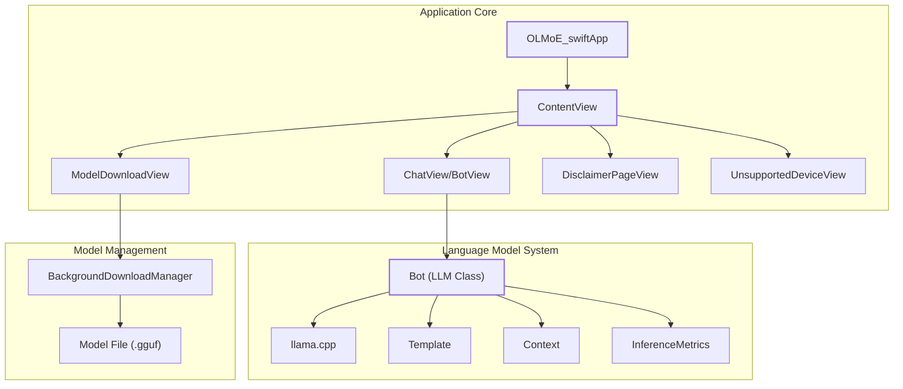
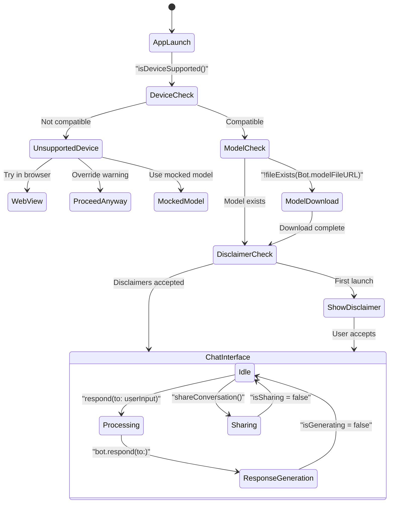
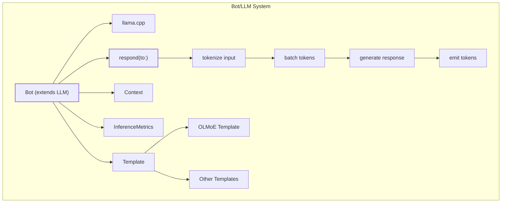
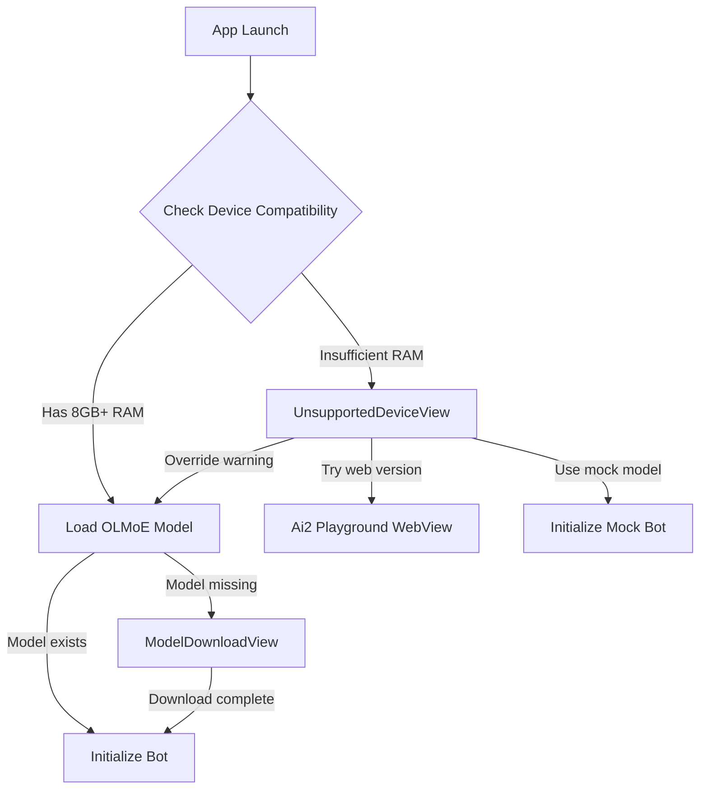
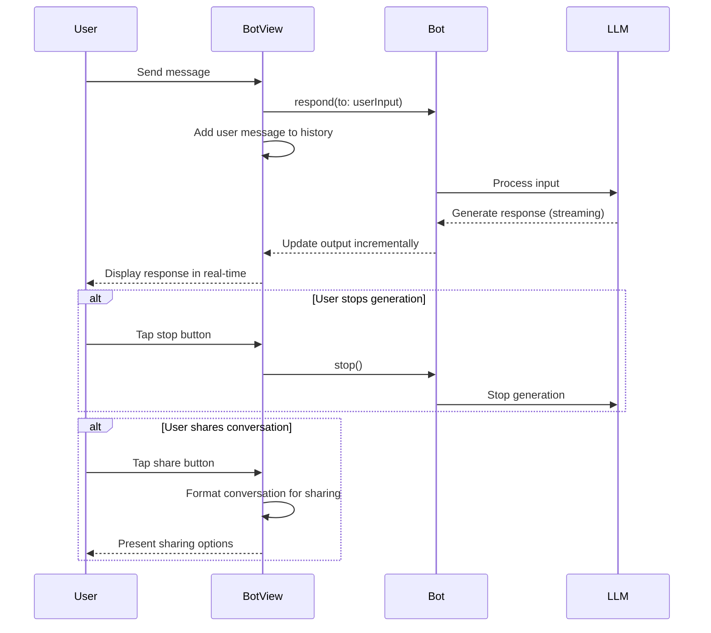

<!-- source: DeepWiki mcp.deepwiki.com · repo allenai/OLMoE.swift · page 1 Overview · fetched 2026-10-26 -->

# Overview

Relevant source files

The following files were used as context for generating this wiki page:

- [OLMoE.swift.xcodeproj/project.pbxproj](OLMoE.swift.xcodeproj/project.pbxproj)
- [OLMoE.swift.xcodeproj/project.xcworkspace/xcshareddata/swiftpm/Package.resolved](OLMoE.swift.xcodeproj/project.xcworkspace/xcshareddata/swiftpm/Package.resolved)
- [OLMoE.swift/BuildConfig/project-defaults.xcconfig](OLMoE.swift/BuildConfig/project-defaults.xcconfig)
- [OLMoE.swift/Model/KeyboardResponder.swift](OLMoE.swift/Model/KeyboardResponder.swift)
- [OLMoE.swift/README.md](OLMoE.swift/README.md)
- [OLMoE.swift/Views/ContentView.swift](OLMoE.swift/Views/ContentView.swift)
- [README.md](README.md)
- [doc_assets/App_Main.png](doc_assets/App_Main.png)
- [doc_assets/Run_App.png](doc_assets/Run_App.png)

This document provides a comprehensive overview of OLMoE.swift, an iOS and macOS application that runs a fully open, state-of-the-art language model (OLMoE) locally on compatible devices. OLMoE.swift enables users to interact with a powerful AI language model directly on their device with complete privacy and offline capability.

OLMoE.swift is designed with a focus on local computation, ensuring user data never leaves the device during normal operation. The application provides a chat interface similar to commercial AI assistants but runs entirely on-device, making it suitable for privacy-conscious users and environments with limited connectivity.

## Key Features

- **On-device LLM Inference**: Runs the OLMoE language model directly on iOS and macOS devices
- **Complete Privacy**: All interactions stay on-device with no data transmitted to external servers for inference
- **Offline Capability**: Works without internet connection after model download
- **Responsive UI**: Provides a fluid chat experience with real-time streaming of responses
- **Device Compatibility Check**: Ensures the device meets minimum requirements (primarily 8GB RAM)
- **Optional Sharing Feature**: Allows sharing conversations via AWS Lambda (optional, requires configuration)

Sources: [README.md:16-26](), [OLMoE.swift/README.md:1-16]()

## System Architecture Overview

OLMoE.swift follows a modular architecture organized around several core subsystems that work together to deliver a seamless chat experience while ensuring efficient on-device model operation.

The application architecture centers around `ContentView`, which conditionally renders different views based on the application state. The `Bot` class (which extends `LLM`) handles interactions with the language model, while various supporting components manage model downloading, device compatibility checking, and user interface presentation.

Sources: [OLMoE.swift/Views/ContentView.swift:392-524]()

## Application Flow

The application follows a specific flow from launch to interactive chat:

When the app launches, it first checks device compatibility, then verifies if the model is downloaded, presents any required disclaimers, and finally initializes the chat interface. The chat interface itself follows a cycle of idle state, processing user input, generating responses, and returning to idle.

Sources: [OLMoE.swift/Views/ContentView.swift:392-524](), [OLMoE.swift/Views/ContentView.swift:36-226]()

## Core Components

### ContentView

`ContentView` serves as the main coordinator for the application, managing the overall UI state and conditional rendering of different views based on application state:

- Determines which view to display based on device compatibility and model availability
- Initializes the `Bot` instance when the model is ready
- Manages disclaimer state and presentation
- Provides the application toolbar and navigation

Sources: [OLMoE.swift/Views/ContentView.swift:392-524]()

### Bot and LLM System

The `Bot` class extends the `LLM` class and serves as the primary interface to the language model:

Key features of the Bot/LLM system:
- Interfaces with llama.cpp to run the model
- Uses templates to format conversations appropriately
- Manages conversation context and history
- Tracks performance metrics
- Provides streaming token generation for real-time responses

Sources: [OLMoE.swift/Views/ContentView.swift:12-34]()

### BotView / Chat Interface

The `BotView` manages the chat interface, including:

- Displaying user and bot messages
- Handling user input and message submission
- Managing the message generation state
- Providing controls for stopping generation and sharing conversations
- Auto-scrolling to show new messages

The chat interface implements real-time streaming of model responses, allowing users to see responses as they're generated rather than waiting for the complete message.

Sources: [OLMoE.swift/Views/ContentView.swift:36-369]()

### Model Management

The application includes a model management system that:

- Checks if the model file exists at the expected location
- Downloads the model file if necessary
- Verifies device compatibility before attempting to load the model
- Provides fallback options for unsupported devices

The model file is a GGUF (GPT-Generated Unified Format) file that contains the weights and parameters for the OLMoE language model.

Sources: [OLMoE.swift/Views/ContentView.swift:505-513]()

## Device Compatibility

OLMoE.swift implements device compatibility checking to ensure the device has sufficient resources to run the language model effectively:

The primary compatibility requirement is sufficient RAM (8GB or more), as running large language models requires significant memory resources. For users with unsupported devices, the app provides alternative options including a web version or a mocked model experience.

Sources: [OLMoE.swift/Views/ContentView.swift:400-428]()

## Chat Experience

The chat interaction flow follows a specific sequence when a user sends a message:

Key aspects of the chat experience:
- Real-time streaming of responses
- Ability to stop response generation
- Option to share conversations
- Markdown rendering of responses
- Code syntax highlighting in responses

Sources: [OLMoE.swift/Views/ContentView.swift:81-226]()

## Configuration and Customization

OLMoE.swift supports various configuration options through environment variables and build settings:

| Configuration Item | Description | Default Value |
|-------------------|-------------|---------------|
| API_KEY | Optional key for AWS Lambda sharing feature | "Use_Your_Own_Key" |
| API_URL | Optional endpoint for AWS Lambda sharing feature | "https://use_your_own_endpoint" |
| BUNDLE_VERSION | Build version number | 1 |
| BUNDLE_VERSION_PUBLIC | Marketing version number | 1.1 |
| PRODUCT_BUNDLE_IDENTIFIER | Bundle identifier for the app | "com.example.apple-samplecode.OLMoE.swift.${DEVELOPMENT_TEAM_ID}" |

These configuration settings can be customized by creating a `build.xcconfig` file based on the provided example.

Sources: [OLMoE.swift/BuildConfig/project-defaults.xcconfig:1-15](), [OLMoE.swift/README.md:47-66]()

## Technical Implementation

OLMoE.swift is implemented using:

- Swift and SwiftUI for the user interface
- llama.cpp for model inference
- MarkdownUI for rendering Markdown content
- HighlightSwift for code syntax highlighting

The application supports both iOS and macOS platforms through Mac Catalyst, with a minimum iOS version requirement of 17.5 and macOS version requirement of 14.5.

Sources: [OLMoE.swift.xcodeproj/project.xcworkspace/xcshareddata/swiftpm/Package.resolved:1-51](), [OLMoE.swift.xcodeproj/project.pbxproj:425-428]()

## Getting Started

For information on building and running OLMoE.swift, see [Building and Running](#2.1).

For information on configuring the application with custom settings, see [Configuration](#2.2).

---

