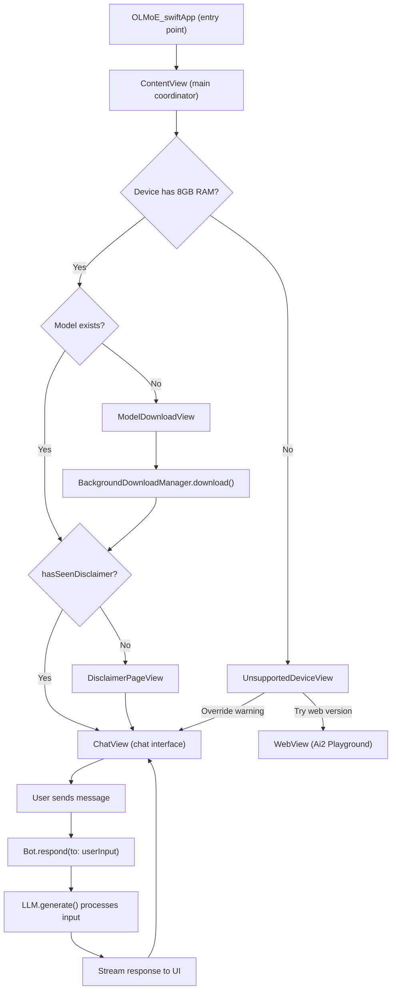
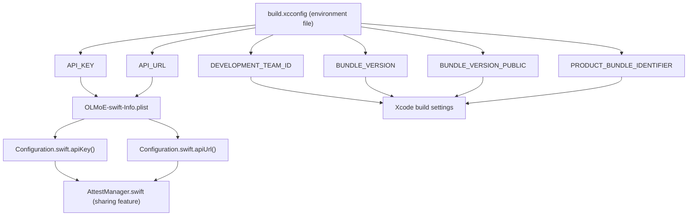

<!-- source: DeepWiki mcp.deepwiki.com · repo allenai/OLMoE.swift · page 2 Getting Started · fetched 2026-10-26 -->

# Getting Started

<details>
<summary>Relevant source files</summary>

The following files were used as context for generating this wiki page:

- [OLMoE-swift-Info.plist](OLMoE-swift-Info.plist)
- [OLMoE.swift.xcodeproj/project.pbxproj](OLMoE.swift.xcodeproj/project.pbxproj)
- [OLMoE.swift.xcodeproj/project.xcworkspace/xcshareddata/swiftpm/Package.resolved](OLMoE.swift.xcodeproj/project.xcworkspace/xcshareddata/swiftpm/Package.resolved)
- [OLMoE.swift/AppInfo.swift](OLMoE.swift/AppInfo.swift)
- [OLMoE.swift/BuildConfig/project-defaults.xcconfig](OLMoE.swift/BuildConfig/project-defaults.xcconfig)
- [OLMoE.swift/Configuration.swift](OLMoE.swift/Configuration.swift)
- [OLMoE.swift/OLMoE_swift.entitlements](OLMoE.swift/OLMoE_swift.entitlements)
- [OLMoE.swift/README.md](OLMoE.swift/README.md)
- [README.md](README.md)
- [doc_assets/App_Main.png](doc_assets/App_Main.png)
- [doc_assets/Run_App.png](doc_assets/Run_App.png)

</details>


This document provides instructions for setting up, building, and running the OLMoE.swift application - an iOS app that runs a fully open, state-of-the-art language model locally on compatible iOS and macOS devices.

For more detailed information about building with custom settings, see [Building and Running](#2.1). For configuration details, see [Configuration](#2.2).

## System Requirements

Before you begin, ensure you have:

- Xcode 15.4 or later
- iOS 17.5+ or macOS 14.5+ for running the app
- A device with at least 8GB RAM for model execution
- Sufficient storage space for model files (approximately 4GB)

The app performs a device compatibility check on launch and will notify you if your device doesn't meet the requirements.

Sources: [OLMoE.swift.xcodeproj/project.pbxproj:425-428](), [README.md:30-34]()

## Installation Options

### App Workflow Overview

The following diagram illustrates the application flow from launch to chat interface:



Sources: [README.md:35-44](), [OLMoE.swift/README.md:35-45]()

### Building and Running on a Simulator

1. Clone the repository
   ```bash
   git clone https://github.com/allenai/OLMoE.swift.git
   ```

2. Open the project in Xcode
   ```bash
   open OLMoE.swift.xcodeproj
   ```

3. Select an iOS device simulator with adequate virtual RAM (iPhone 15 Pro or later recommended)

4. Run the project by clicking the "Run" button (▶️) or pressing `Cmd + R`

Sources: [README.md:36-44](), [OLMoE.swift/README.md:35-45]()

### Running on a Physical Device

To run on a physical iOS device:

1. Connect your device to your Mac via USB
2. In the "Signing & Capabilities" section, click on "Enable Development Signing"
3. Select your device in the device dropdown menu
4. Run the project

Sources: [OLMoE.swift/README.md:109-123]()

### Running on macOS

The project supports Mac Catalyst for running on macOS:

1. In the "Signing & Capabilities" section for macOS, enable development signing
2. Select "My Mac (Mac Catalyst)" in the device dropdown menu
3. Run the project

Sources: [OLMoE.swift/README.md:96-107]()

## Configuration Options

### Configuration Flow

The app can be configured using environment variables in a build configuration file:



Sources: [OLMoE.swift/Configuration.swift:39-54](), [OLMoE-swift-Info.plist:11-14]()

### Setting Up Configuration

1. Rename `BuildConfig/build.example.xcconfig` to `build.xcconfig`
2. Edit the file to set your preferred configuration options

The key configuration parameters include:

| Parameter | Purpose | Default Value |
|-----------|---------|--------------|
| API_KEY | Key for optional sharing feature | Use_Your_Own_Key |
| API_URL | Endpoint for optional sharing feature | https://use_your_own_endpoint |
| DEVELOPMENT_TEAM_ID | Your Apple Developer team ID | None |
| BUNDLE_VERSION | Internal version number | 1 |
| BUNDLE_VERSION_PUBLIC | Public-facing version | 1.1 |
| PRODUCT_BUNDLE_IDENTIFIER | App's bundle identifier | com.example.apple-samplecode.OLMoE.swift.${DEVELOPMENT_TEAM_ID} |

These settings are optional for basic functionality but required for features like sharing conversations or deploying to physical devices.

Sources: [OLMoE.swift/README.md:45-76](), [OLMoE.swift/BuildConfig/project-defaults.xcconfig:8-14]()

## Using the App

Once you've built and launched the app:

1. First launch experience:
   - The app checks device compatibility
   - If needed, you'll be prompted to download the language model
   - First-time users will need to accept disclaimers

2. Chat interface:
   - Type your query in the message input field at the bottom
   - Tap send to submit your question
   - The model processes your input locally and generates a response
   - Responses are streamed to the interface as they're generated

3. Offline usage:
   - The app works entirely offline once the model is downloaded
   - All processing happens on-device, ensuring privacy

Sources: [README.md:18-26]()

## Troubleshooting

If you encounter build issues:

1. Ensure the correct configuration is being used:
   - Select the project in the Project Navigator
   - Verify "Debug and Release" is set to use `build.xcconfig`

2. Verify team and bundle identifier:
   - In "Signing & Capabilities" ensure your team and bundle identifier match the ones in `build.xcconfig`

Sources: [OLMoE.swift/README.md:132-145]()

---

