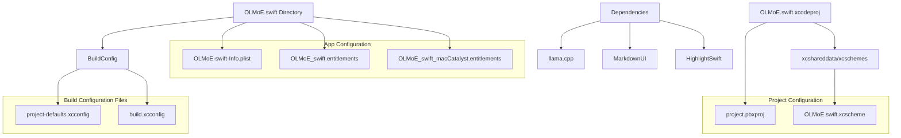
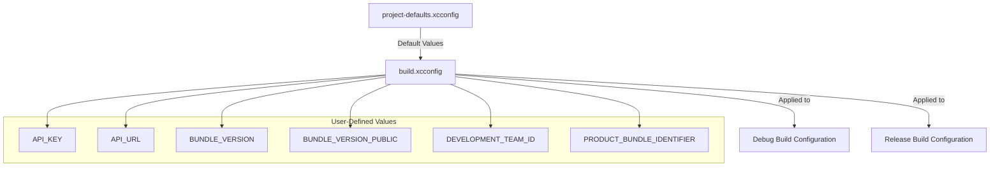
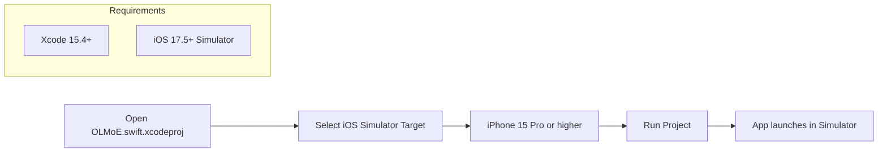
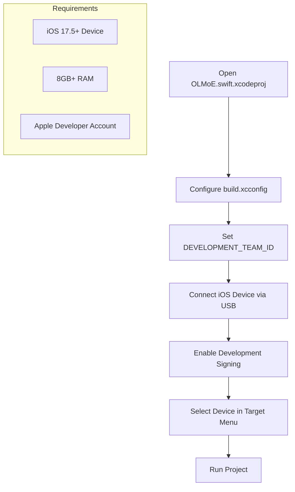
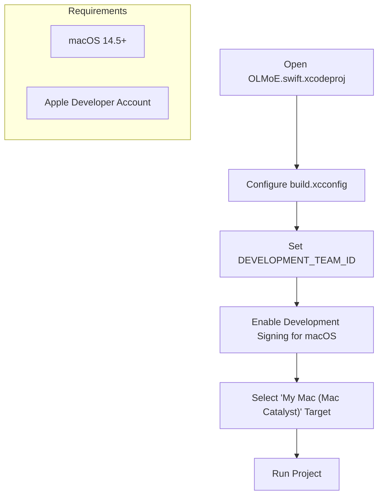
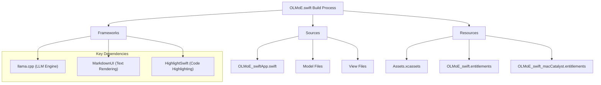
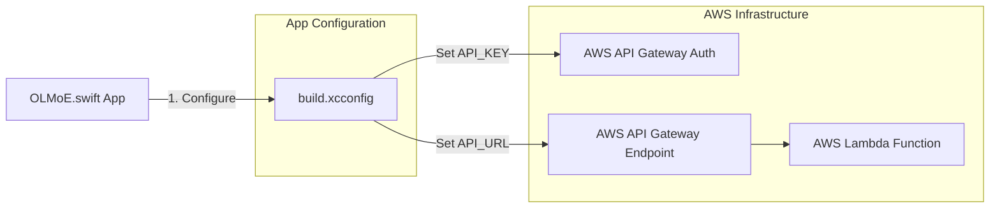
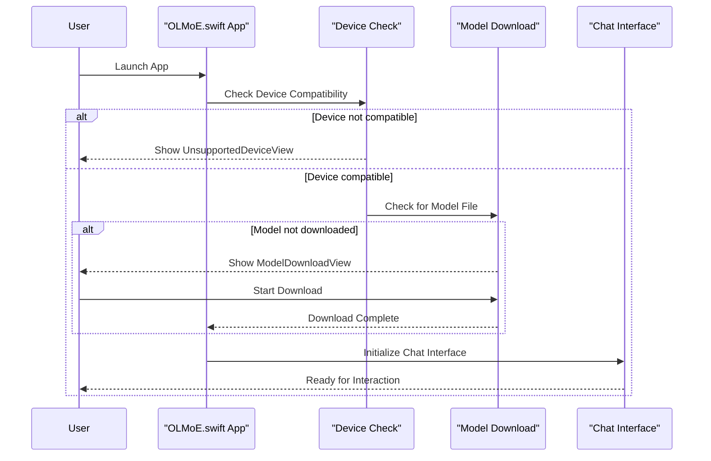

<!-- source: DeepWiki mcp.deepwiki.com · repo allenai/OLMoE.swift · page 2.1 Building and Running · fetched 2026-10-26 -->

# Building and Running

Relevant source files

The following files were used as context for generating this wiki page:

- [OLMoE.swift.xcodeproj/project.pbxproj](OLMoE.swift.xcodeproj/project.pbxproj)
- [OLMoE.swift.xcodeproj/project.xcworkspace/xcshareddata/swiftpm/Package.resolved](OLMoE.swift.xcodeproj/project.xcworkspace/xcshareddata/swiftpm/Package.resolved)
- [OLMoE.swift.xcodeproj/xcshareddata/xcschemes/OLMoE.swift.xcscheme](OLMoE.swift.xcodeproj/xcshareddata/xcschemes/OLMoE.swift.xcscheme)
- [OLMoE.swift/BuildConfig/project-defaults.xcconfig](OLMoE.swift/BuildConfig/project-defaults.xcconfig)
- [OLMoE.swift/README.md](OLMoE.swift/README.md)
- [README.md](README.md)
- [doc_assets/App_Main.png](doc_assets/App_Main.png)
- [doc_assets/Run_App.png](doc_assets/Run_App.png)

This document provides detailed technical instructions for building and running the OLMoE.swift application on various platforms. It covers setting up the development environment, configuring build settings, and deploying the app to simulators, physical iOS devices, and macOS via Mac Catalyst.

For information about configuring the application after building, see [Configuration](#2.2).

## Prerequisites

Before building the OLMoE.swift application, ensure you have the following:

| Requirement | Minimum Version | Notes |
|-------------|----------------|-------|
| Xcode | 15.4+ | Required for building the app |
| iOS | 17.5+ | For running on iOS devices |
| macOS | 14.5+ | For running via Mac Catalyst |
| Device RAM | 8GB+ | Required for model loading |

Sources: [OLMoE.swift/README.md:30-34](), [OLMoE.swift.xcodeproj/project.pbxproj:425-428]()

## Project Structure Overview

The OLMoE.swift project is structured as follows, focusing on components relevant to the build process:

Sources: [OLMoE.swift.xcodeproj/project.pbxproj:106-155](), [OLMoE.swift.xcodeproj/project.pbxproj:516-558]()

## Build Configuration Setup

OLMoE.swift uses xcconfig files to manage build configurations. These files allow setting environment variables and build parameters without modifying the Xcode project directly.

### Configuration File Structure

### Setting Up Configuration Files

1. Locate `BuildConfig/build.example.xcconfig` in the project directory
2. Copy it to `BuildConfig/build.xcconfig`
3. Edit the file to include your specific values:

| Variable | Purpose | Example |
|----------|---------|---------|
| API_KEY | Key for AWS Lambda sharing feature | your_api_key_here |
| API_URL | URL endpoint for Lambda function | https://api-gateway-url |
| BUNDLE_VERSION | Internal version number | 10 |
| BUNDLE_VERSION_PUBLIC | Public version number | 1.1.1 |
| DEVELOPMENT_TEAM_ID | Apple Developer Team ID | AB12CD34EF |
| PRODUCT_BUNDLE_IDENTIFIER | App bundle identifier | com.example.OLMoE.swift.TEAMID |

Sources: [OLMoE.swift/README.md:46-86](), [OLMoE.swift/BuildConfig/project-defaults.xcconfig:1-15]()

## Building for iOS Simulators

Building for iOS simulators is the simplest way to test the application without needing a physical device or developer account.

Steps:
1. Open the OLMoE.swift project in Xcode
2. Set the target device to an iOS device with sufficient RAM (iPhone 15 Pro or higher recommended)
3. Select the "Run" button or press `Cmd + R`
4. The app will build and launch in the simulator

Sources: [OLMoE.swift/README.md:35-43](), [README.md:36-44]()

## Building for Physical iOS Devices

Running on a physical device requires a valid development team and proper signing configuration.

Steps:
1. Ensure your `build.xcconfig` file has a valid `DEVELOPMENT_TEAM_ID`
2. Connect your iOS device to your Mac via USB
3. In Xcode, select your project and go to the "Signing & Capabilities" section
4. Click "Enable Development Signing"
5. Select your connected device in the device dropdown menu
6. Click the "Run" button or press `Cmd + R`

Sources: [OLMoE.swift/README.md:109-124]()

## Building for macOS (Mac Catalyst)

OLMoE.swift uses Mac Catalyst to run on macOS, allowing the iOS codebase to run natively on Mac.

Steps:
1. Ensure your `build.xcconfig` file has a valid `DEVELOPMENT_TEAM_ID`
2. In Xcode, select your project and go to the "Signing & Capabilities" section for macOS
3. Click "Enable Development Signing"
4. Select "My Mac (Mac Catalyst)" in the device dropdown menu
5. Click the "Run" button or press `Cmd + R`

Sources: [OLMoE.swift/README.md:96-107](), [OLMoE.swift.xcodeproj/project.pbxproj:428]()

## Build Process Internals

The OLMoE.swift application uses a standard Xcode build process with specific dependencies and frameworks.

The key external dependencies for the build process include:

1. **llama.cpp** - Core language model inference engine
2. **MarkdownUI** - For rendering markdown content in the app
3. **HighlightSwift** - For syntax highlighting of code blocks

Sources: [OLMoE.swift.xcodeproj/project.pbxproj:516-558](), [OLMoE.swift.xcodeproj/project.xcworkspace/xcshareddata/swiftpm/Package.resolved:1-50]()

## Common Build Issues and Troubleshooting

### Configuration File Issues

If you encounter build errors related to missing or incorrect configuration:

1. Ensure the correct configuration file is being used:
   - Select the project in the Project Navigator
   - Verify that both Debug and Release configurations are set to use `build.xcconfig`

2. Verify team and bundle identifier match:
   - Check that the team and bundle identifier in the Signing & Capabilities match those in your `build.xcconfig` file

Sources: [OLMoE.swift/README.md:132-145]()

### Device Compatibility Issues

The app requires devices with sufficient RAM (8GB+) to run the language model:

1. For physical devices that don't meet requirements, the app will display an UnsupportedDeviceView
2. For simulators, choose higher-end device models (iPhone 15 Pro or newer)

Sources: [README.md:39-40]()

### Dependency Resolution Issues

If you encounter build errors related to dependencies:

1. Verify Xcode can access the Swift Package repositories
2. Check that you have necessary network access to GitHub for downloading packages
3. If necessary, manually update packages via File > Packages > Update to Latest Package Versions

Sources: [OLMoE.swift.xcodeproj/project.xcworkspace/xcshareddata/swiftpm/Package.resolved:1-50]()

## Advanced: Enabling the Sharing Feature

The OLMoE app includes an optional sharing feature that requires AWS Lambda setup:

To enable the sharing feature:

1. Deploy the AWS Lambda function as described in the lambda README
2. Set the `API_KEY` and `API_URL` in your `build.xcconfig` file
3. Rebuild the application

Note that the sharing feature is optional - the app will function without it, but users won't be able to share conversations.

Sources: [OLMoE.swift/README.md:125-131](), [README.md:72-74]()

## Running the Built Application

After successful building, the application will:

1. Check for device compatibility
2. If needed, prompt to download the model file
3. Present the disclaimer screens on first launch
4. Open the chat interface

Sources: [README.md:18-26]()

This detailed guide should help developers successfully build and run the OLMoE.swift application across various platforms and resolve common issues that may arise during the process.

---

