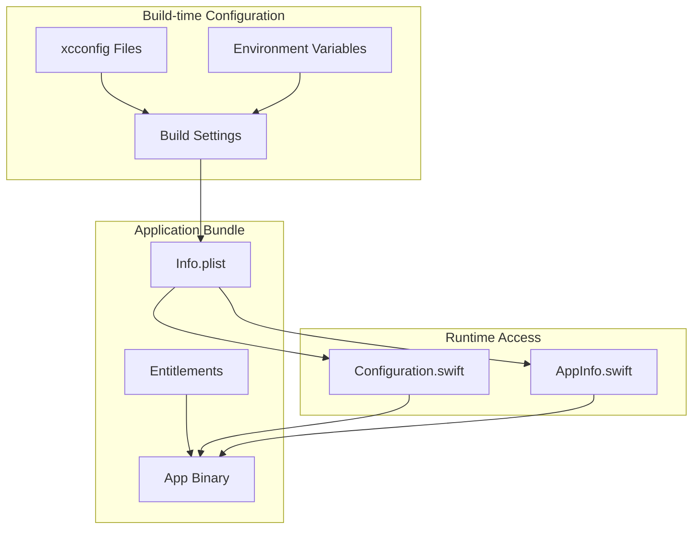
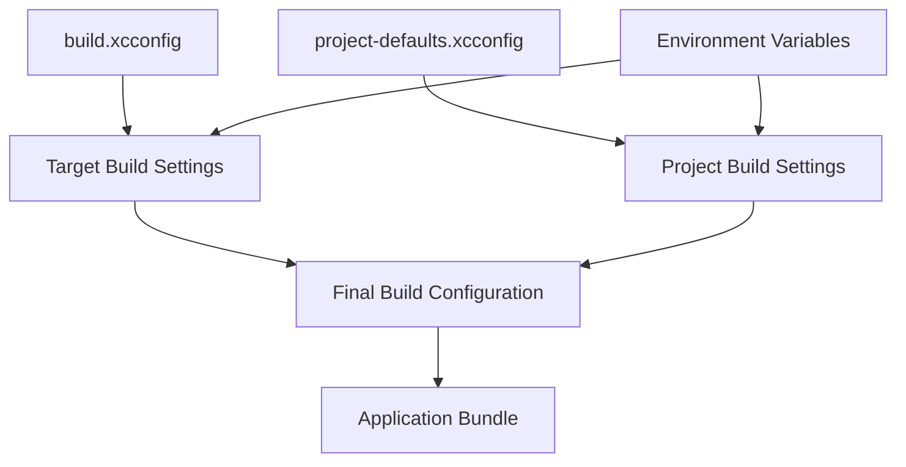

<!-- source: DeepWiki mcp.deepwiki.com · repo allenai/OLMoE.swift · page 2.2 Configuration · fetched 2026-10-26 -->

# Configuration

<details>
<summary>Relevant source files</summary>

The following files were used as context for generating this wiki page:

- [OLMoE-swift-Info.plist](OLMoE-swift-Info.plist)
- [OLMoE.swift.xcodeproj/project.pbxproj](OLMoE.swift.xcodeproj/project.pbxproj)
- [OLMoE.swift.xcodeproj/project.xcworkspace/xcshareddata/swiftpm/Package.resolved](OLMoE.swift.xcodeproj/project.xcworkspace/xcshareddata/swiftpm/Package.resolved)
- [OLMoE.swift/AppInfo.swift](OLMoE.swift/AppInfo.swift)
- [OLMoE.swift/Configuration.swift](OLMoE.swift/Configuration.swift)
- [OLMoE.swift/OLMoE_swift.entitlements](OLMoE.swift/OLMoE_swift.entitlements)

</details>


This page explains how the OLMoE.swift application is configured through various mechanisms including environment variables, build settings, Info.plist entries, and entitlement files. It covers both compile-time and runtime configuration options that control the application's behavior and capabilities.

For information about building and running the application, see [Building and Running](#2.1).

## Configuration Overview

The OLMoE.swift application uses a layered configuration approach:

1. **Build Configuration** - Settings controlled through Xcode build configurations and xcconfig files
2. **Info.plist Configuration** - Application metadata and runtime settings stored in Info.plist
3. **Entitlements** - System permissions and capabilities required by the application
4. **Runtime Configuration** - Accessing configuration values at runtime through the `Configuration` class



Sources: [OLMoE.swift/Configuration.swift:1-56](), [OLMoE.swift/AppInfo.swift:1-35](), [OLMoE-swift-Info.plist:1-31](), [OLMoE.swift.xcodeproj/project.pbxproj:1-563]()

## Info.plist Configuration

The application's primary configuration source is the Info.plist file. This file contains various settings that define the application's behavior and metadata.

Key Info.plist entries include:

| Key | Description | Source |
|-----|-------------|--------|
| `CFBundleShortVersionString` | The public version number | `$(BUNDLE_VERSION_PUBLIC)` environment variable |
| `CFBundleVersion` | The build number | `$(BUNDLE_VERSION)` environment variable |
| `CFBundleIdentifier` | The bundle identifier | `$(PRODUCT_BUNDLE_IDENTIFIER)` environment variable |
| `API_KEY` | API key for external services | `$(API_KEY)` environment variable |
| `API_URL` | URL for API endpoints | `$(API_URL)` environment variable |
| `ITSAppUsesNonExemptEncryption` | Encryption usage declaration | Hardcoded as `false` |
| `UIAppFonts` | Custom fonts used by the app | Array of font filenames |

```mermaid
classDiagram
    class "Info.plist" {
        +CFBundleShortVersionString: String
        +CFBundleVersion: String
        +CFBundleIdentifier: String
        +API_KEY: String
        +API_URL: String
        +ITSAppUsesNonExemptEncryption: Boolean
        +UIAppFonts: Array~String~
    }

    class "Environment Variables" {
        +BUNDLE_VERSION_PUBLIC
        +BUNDLE_VERSION
        +PRODUCT_BUNDLE_IDENTIFIER
        +API_KEY
        +API_URL
    }

    "Environment Variables" --> "Info.plist" : populates at build time
```

Sources: [OLMoE-swift-Info.plist:1-31](), [OLMoE.swift.xcodeproj/project.pbxproj:405-431]()

## Build Configuration

The application uses Xcode build configurations to control various aspects of the build process. These configurations are defined in xcconfig files referenced in the project.

### Build Settings

Key build settings are controlled through environment variables:

| Variable | Description | Used In |
|----------|-------------|---------|
| `BUNDLE_VERSION` | Internal build number | `CFBundleVersion`, `CURRENT_PROJECT_VERSION` |
| `BUNDLE_VERSION_PUBLIC` | Public version number | `CFBundleShortVersionString`, `MARKETING_VERSION` |
| `PRODUCT_BUNDLE_IDENTIFIER` | App's unique identifier | `CFBundleIdentifier` |
| `DEVELOPMENT_TEAM_ID` | Development team identifier | `DEVELOPMENT_TEAM` |
| `API_KEY` | API key for external services | Info.plist |
| `API_URL` | URL for API endpoints | Info.plist |

The project references two xcconfig files for build configuration:
- `BuildConfig/project-defaults.xcconfig` - Default project settings
- `BuildConfig/build.xcconfig` - Target-specific build settings



Sources: [OLMoE.swift.xcodeproj/project.pbxproj:270-492]()

## Entitlements

The application requires specific entitlements to access system capabilities. These are defined in entitlement files:

- `OLMoE_swift.entitlements` - Used for iOS
- `OLMoE_swift_macCatalyst.entitlements` - Used for macOS

Key entitlements include:

| Entitlement | Purpose |
|-------------|---------|
| `com.apple.developer.kernel.increased-memory-limit` | Allows the app to use more memory, essential for running LLMs |
| `com.apple.security.app-sandbox` | Enables app sandboxing for security |
| `com.apple.security.files.user-selected.read-only` | Grants access to user-selected files (read-only) |
| `com.apple.developer.devicecheck.appattest-environment` | Enables app attestation for the sharing feature |
| `com.apple.security.network.client` | Allows network client connections |

```mermaid
classDiagram
    class "Entitlements" {
        +increased-memory-limit: Boolean
        +app-sandbox: Boolean
        +files.user-selected.read-only: Boolean
        +devicecheck.appattest-environment: String
        +network.client: Boolean
    }

    class "Application" {
        +Run LLM Models
        +Download Models
        +Share Conversations
        +File Access
    }

    "Entitlements" --> "Application" : enables capabilities
```

Sources: [OLMoE.swift/OLMoE_swift.entitlements:1-17](), [OLMoE.swift.xcodeproj/project.pbxproj:398-401]()

## Runtime Configuration Access

The application provides a centralized way to access configuration values at runtime through the `Configuration` class and `AppInfo` struct.

### Configuration Class

The `Configuration` class provides type-safe access to Info.plist values:

```mermaid
classDiagram
    class "Configuration" {
        <<enum>>
        +Error: enum
        +value~T~(for key: String): T
        +apiKey: String
        +apiUrl: String
    }

    class "Error" {
        <<enum>>
        +missingKey
        +invalidValue
    }

    class "Bundle.main" {
        +infoDictionary: [String: Any]?
        +object(forInfoDictionaryKey: String): Any?
    }

    "Configuration" +-- "Error"
    "Configuration" --> "Bundle.main" : reads from
```

The `value<T>(for key: String)` method retrieves values from Info.plist and converts them to the requested type, with appropriate error handling.

Extension properties like `apiKey` and `apiUrl` provide convenient access to specific configuration values with fallback values if the keys are missing.

Sources: [OLMoE.swift/Configuration.swift:1-56]()

### AppInfo Struct

The `AppInfo` struct provides access to application metadata:

```mermaid
classDiagram
    class "AppInfo" {
        +shared: AppInfo
        -init()
        +name: String
        +displayName: String
        +version: String
        +build: String
        +appId: String
    }

    class "Bundle.main" {
        +infoDictionary: [String: Any]?
    }

    "AppInfo" --> "Bundle.main" : reads from
```

The `AppInfo` struct is implemented as a singleton through the `shared` static property and provides read-only access to application metadata like name, version, and build number.

Sources: [OLMoE.swift/AppInfo.swift:1-35]()

## Usage Examples

The following examples demonstrate how to access configuration values in the application code:

### Accessing API Configuration
```swift
// Get the API key
let apiKey = Configuration.apiKey

// Get the API URL
let apiUrl = Configuration.apiUrl
```

### Accessing App Information
```swift
// Get the app version
let version = AppInfo.shared.version

// Get the app build number
let build = AppInfo.shared.build

// Get a unique app identifier
let appId = AppInfo.shared.appId
```

Sources: [OLMoE.swift/Configuration.swift:38-55](), [OLMoE.swift/AppInfo.swift:15-33]()

## Dependency Management

The application uses Swift Package Manager for managing dependencies. Key dependencies are defined in the project file and include:

| Package | Purpose | Version |
|---------|---------|---------|
| llama.cpp | Core language model implementation | Specific revision (cc98896) |
| swift-markdown-ui | Markdown rendering | 2.4.1 |
| HighlightSwift | Code syntax highlighting | 1.0.9+ |

These dependencies are specified in the Xcode project and resolved to specific versions in the Package.resolved file.

Sources: [OLMoE.swift.xcodeproj/project.xcworkspace/xcshareddata/swiftpm/Package.resolved:1-51](), [OLMoE.swift.xcodeproj/project.pbxproj:516-558]()

---

