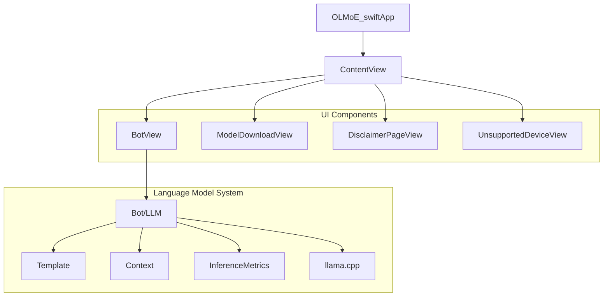
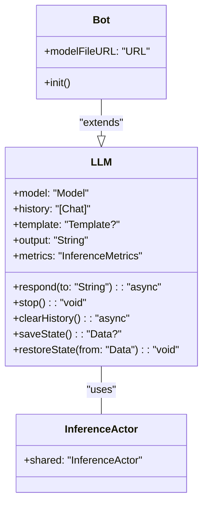
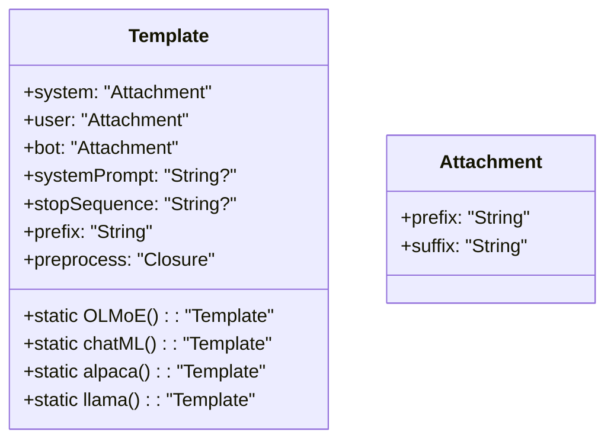
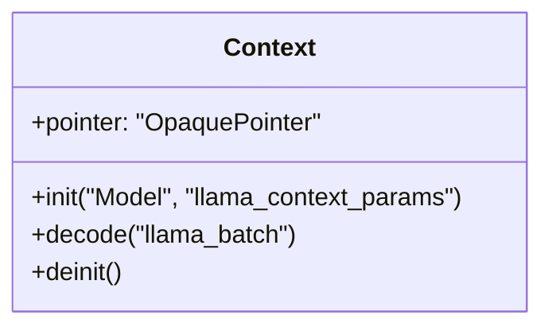
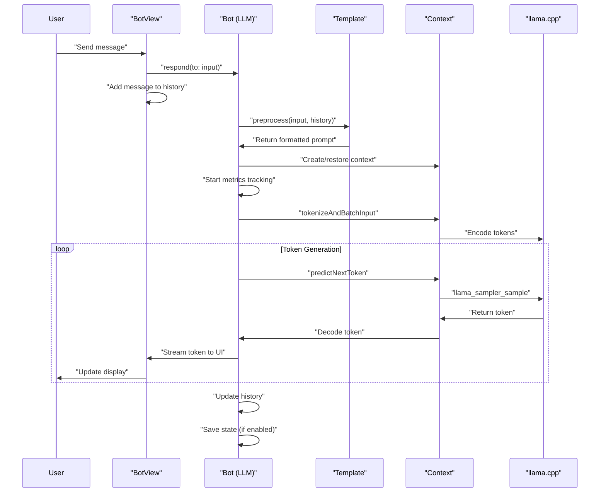
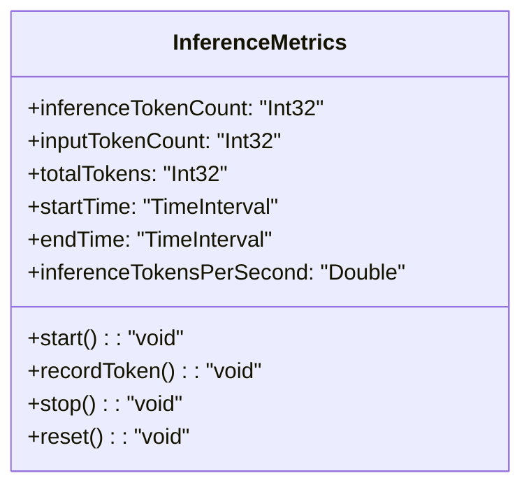
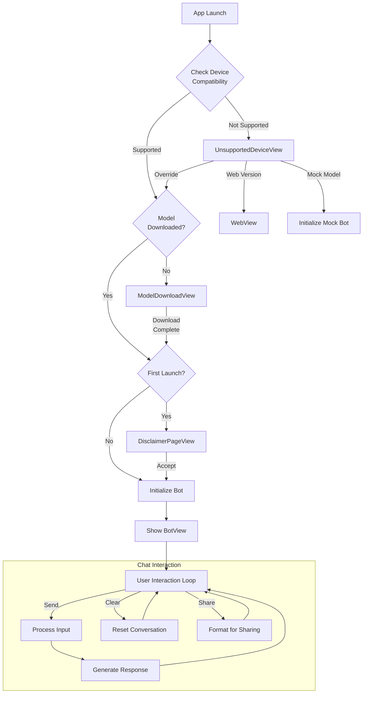
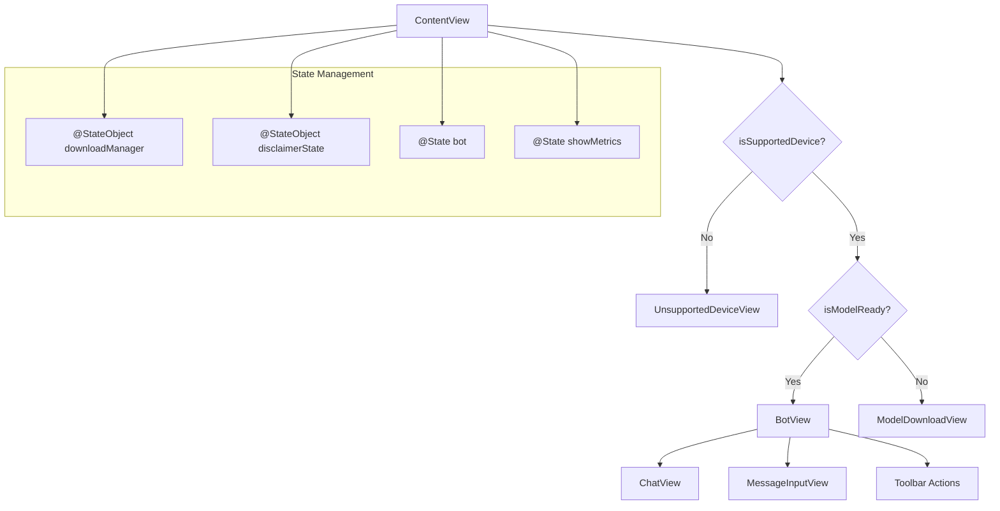
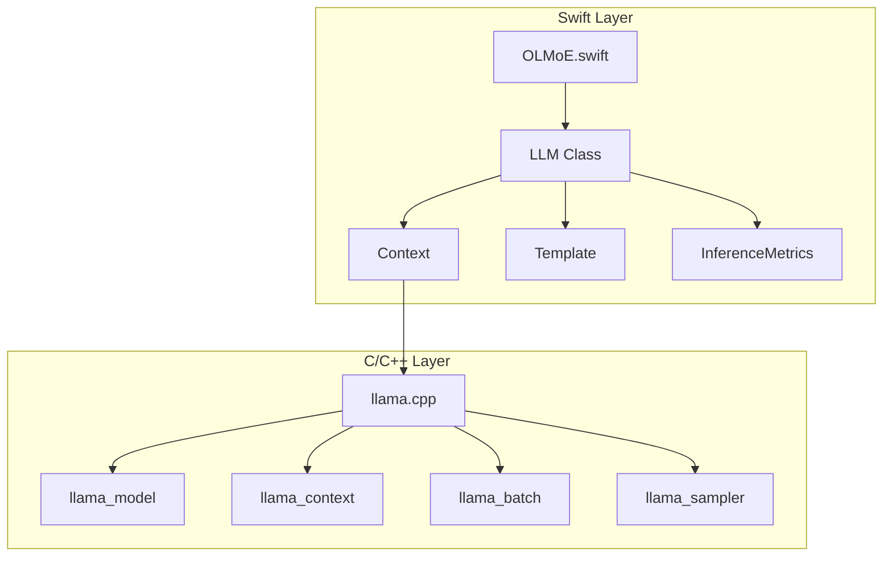
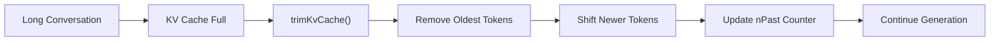

<!-- source: DeepWiki mcp.deepwiki.com · repo allenai/OLMoE.swift · page 3 Core Architecture · fetched 2026-10-26 -->

# Core Architecture

Relevant source files

The following files were used as context for generating this wiki page:

- [OLMoE.swift.xcodeproj/project.pbxproj](OLMoE.swift.xcodeproj/project.pbxproj)
- [OLMoE.swift.xcodeproj/project.xcworkspace/xcshareddata/swiftpm/Package.resolved](OLMoE.swift.xcodeproj/project.xcworkspace/xcshareddata/swiftpm/Package.resolved)
- [OLMoE.swift/Model/Context.swift](OLMoE.swift/Model/Context.swift)
- [OLMoE.swift/Model/InferenceMetrics.swift](OLMoE.swift/Model/InferenceMetrics.swift)
- [OLMoE.swift/Model/KeyboardResponder.swift](OLMoE.swift/Model/KeyboardResponder.swift)
- [OLMoE.swift/Model/LLM.swift](OLMoE.swift/Model/LLM.swift)
- [OLMoE.swift/Model/Template.swift](OLMoE.swift/Model/Template.swift)
- [OLMoE.swift/Views/ContentView.swift](OLMoE.swift/Views/ContentView.swift)

## Purpose and Scope

This document outlines the foundational architecture of OLMoE.swift, explaining the major components and their interactions that enable on-device language model inference. It covers the system's structural design, key abstractions, and component relationships. For details on specific implementation aspects, see [Language Model System](#3.1) and [User Interface Flow](#3.2).

## System Overview

OLMoE.swift is built on a modular architecture that centers around a language model inference engine integrated with a SwiftUI-based interface. The system efficiently runs the OLMoE language model directly on device without requiring cloud connectivity.

### High-Level Architecture

The application's entry point initializes `ContentView`, which serves as the main coordinator that conditionally renders different views based on the application state: device compatibility, model availability, and disclaimer acceptance.

Sources:
- [OLMoE.swift/Views/ContentView.swift:391-524]()
- [OLMoE.swift/OLMoE_swiftApp.swift]()

## Core Components

### Language Model System

At the heart of OLMoE.swift is the language model system, built on these key components:

#### LLM Class

The `LLM` class is the foundation for language model operations, providing:
- Model loading and initialization
- Token generation and stream processing
- Conversation history management
- State persistence for continuous conversations

The `LLM` class uses the `@InferenceActor` global actor to ensure thread safety during inference operations, preventing race conditions when generating text or updating model state.

Sources:
- [OLMoE.swift/Model/LLM.swift:27-489]()
- [OLMoE.swift/Views/ContentView.swift:12-34]()

#### Template System

The `Template` struct defines formatting for different model architectures:

This system provides standardized message formatting for different model architectures. The `preprocess` closure transforms raw inputs into properly formatted prompts, while maintaining conversation context.

Sources:
- [OLMoE.swift/Model/Template.swift:13-171]()

#### Context Management

The `Context` class manages the interface to the llama.cpp library:

This thin wrapper ensures proper memory management and provides a clean Swift interface to the underlying C/C++ code of llama.cpp.

Sources:
- [OLMoE.swift/Model/Context.swift:12-29]()

#### Inference Process

The inference process follows this sequence:

This streaming architecture enables real-time display of generated text while maintaining responsiveness.

Sources:
- [OLMoE.swift/Model/LLM.swift:401-463]()

#### Performance Metrics

The `InferenceMetrics` struct tracks model performance:

This component collects real-time performance data about token processing speed and counts, helping users understand model performance on their device.

Sources:
- [OLMoE.swift/Model/InferenceMetrics.swift:10-51]()

### Application Flow

The application follows a structured flow from launch to interactive chat:

This flow ensures that:
1. Only compatible devices run the model
2. Necessary model files are downloaded
3. Users accept required disclaimers
4. The chat interface is only shown when all prerequisites are met

Sources:
- [OLMoE.swift/Views/ContentView.swift:391-524]()
- [OLMoE.swift/Views/ContentView.swift:504-523]()

### Content View Architecture

The `ContentView` serves as the application's main coordinator:

The `ContentView` manages the application flow based on device compatibility and model availability. It coordinates the transition between different views and manages application-wide state.

Sources:
- [OLMoE.swift/Views/ContentView.swift:392-523]()

## Integration with llama.cpp

OLMoE.swift leverages the llama.cpp library as its core inference engine:

The integration with llama.cpp provides:
- Efficient model loading and execution
- Token generation and sampling
- Context management for long conversations
- Memory-efficient operation on mobile devices

Sources:
- [OLMoE.swift.xcodeproj/project.xcworkspace/xcshareddata/swiftpm/Package.resolved:14-19]()
- [OLMoE.swift/Model/LLM.swift:131-132]()

## State Management

The application manages several types of state:

| State Type | Storage Mechanism | Purpose | Persistence |
|------------|-------------------|---------|-------------|
| Model State | `LLM.savedState` | Enables continued conversations | Session |
| Conversation History | `LLM.history` | Stores chat messages | Session |
| UI State | SwiftUI `@State` | Controls view appearance | Transient |
| App Configuration | `DisclaimerState` | Tracks onboarding status | Persistent |
| Model Availability | `BackgroundDownloadManager` | Tracks model downloads | Persistent |

This multi-layered state management approach ensures that:
1. Conversations can be paused and resumed
2. User preferences are preserved
3. The UI remains responsive
4. Model state is efficiently managed

Sources:
- [OLMoE.swift/Model/LLM.swift:495-539]()
- [OLMoE.swift/Views/ContentView.swift:393-407]()

## Performance Optimizations

Several optimizations enable efficient on-device inference:

1. **KV Cache Management**: For long conversations, the system trims the oldest tokens from the KV cache to maintain memory efficiency and performance.

2. **Batch Processing**: Tokens are processed in batches for efficiency
3. **Thread Management**: The `@InferenceActor` global actor ensures thread-safe model operations
4. **State Persistence**: Model state can be saved and restored to avoid recomputation

Sources:
- [OLMoE.swift/Model/LLM.swift:364-384]()
- [OLMoE.swift/Model/LLM.swift:252-276]()

## Summary

The core architecture of OLMoE.swift is designed to:

1. Efficiently run language models on-device
2. Provide a responsive user experience
3. Manage system resources effectively
4. Ensure thread safety during inference
5. Support a variety of model architectures

This modular design separates concerns between the language model system, user interface components, and application flow management, creating a maintainable and extensible codebase.

Sources:
- [OLMoE.swift/Views/ContentView.swift]()
- [OLMoE.swift/Model/LLM.swift]()
- [OLMoE.swift/Model/Template.swift]()
- [OLMoE.swift/Model/Context.swift]()
- [OLMoE.swift/Model/InferenceMetrics.swift]()

---

