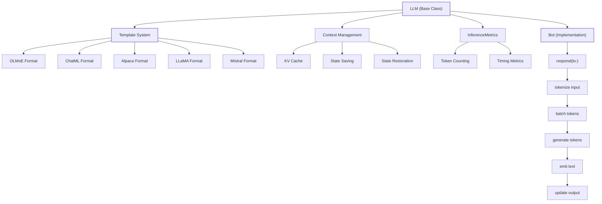
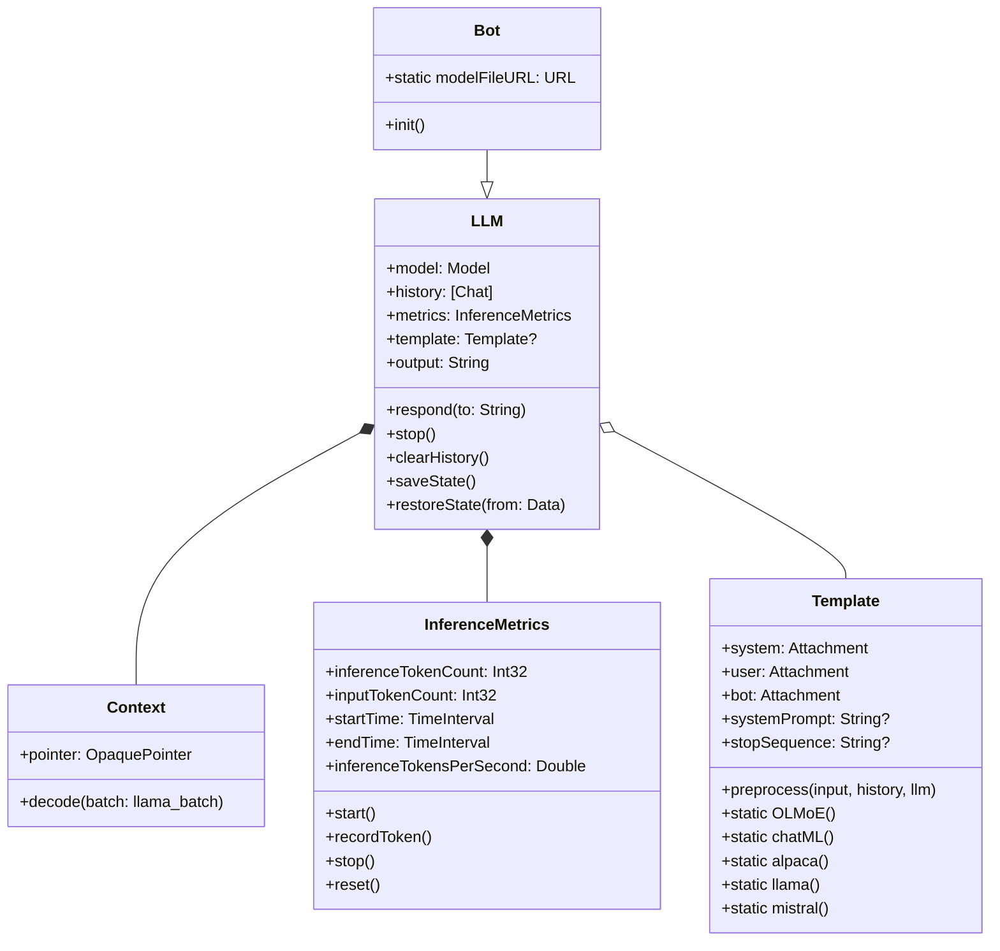
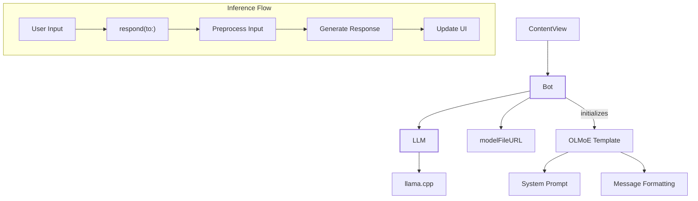
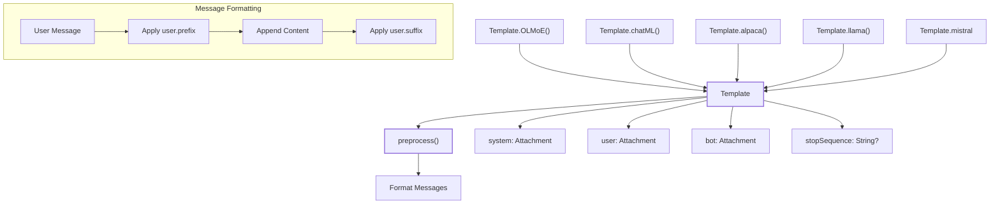
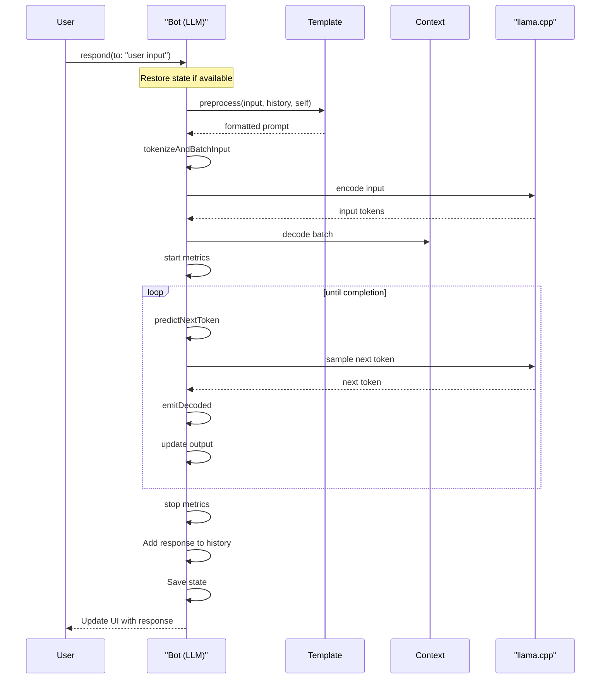
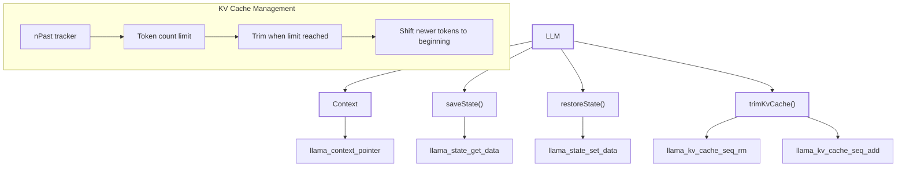
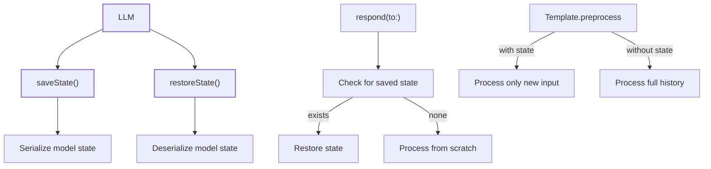
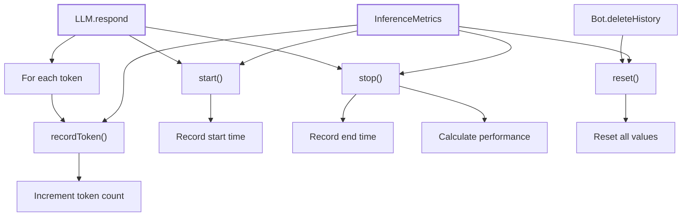
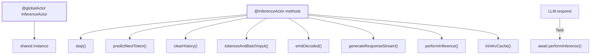
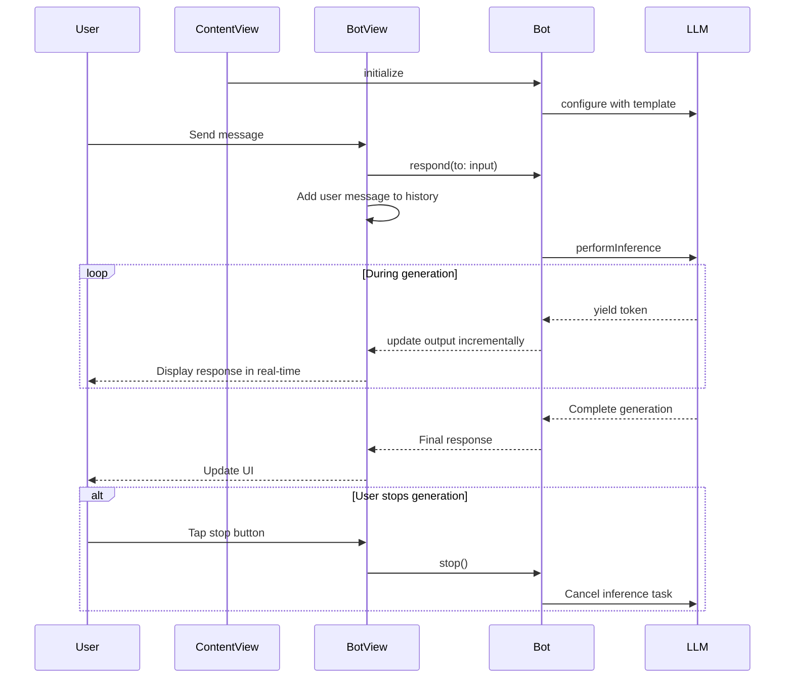

<!-- source: DeepWiki mcp.deepwiki.com · repo allenai/OLMoE.swift · page 3.1 Language Model System · fetched 2026-10-26 -->

# Language Model System

<details>
<summary>Relevant source files</summary>

The following files were used as context for generating this wiki page:

- [OLMoE.swift/Constants/InfoText.swift](OLMoE.swift/Constants/InfoText.swift)
- [OLMoE.swift/Model/Context.swift](OLMoE.swift/Model/Context.swift)
- [OLMoE.swift/Model/InferenceMetrics.swift](OLMoE.swift/Model/InferenceMetrics.swift)
- [OLMoE.swift/Model/KeyboardResponder.swift](OLMoE.swift/Model/KeyboardResponder.swift)
- [OLMoE.swift/Model/LLM.swift](OLMoE.swift/Model/LLM.swift)
- [OLMoE.swift/Model/Template.swift](OLMoE.swift/Model/Template.swift)
- [OLMoE.swift/OLMoE_swiftApp.swift](OLMoE.swift/OLMoE_swiftApp.swift)
- [OLMoE.swift/Views/ContentView.swift](OLMoE.swift/Views/ContentView.swift)

</details>


This document details the core language model implementation within OLMoE.swift, explaining how the application processes user inputs, generates responses, and manages conversations through efficient inference. It covers the model architecture, templating system, context management, and inference process. For information about the user interface flow, see [User Interface Flow](#3.2).

## Overview

The Language Model System serves as the foundation of the OLMoE.swift application, enabling on-device inference with OLMoE models. It interacts with the `llama.cpp` library to run inference efficiently on iOS devices while managing model state, conversation history, and performance metrics.



Sources: [OLMoE.swift/Model/LLM.swift:25-540](), [OLMoE.swift/Views/ContentView.swift:12-34]()

## Core Components

### LLM Base Class

The `LLM` class is the foundation of the language model system. It handles text generation, context management, inference, and conversation history.

Key attributes:
- `model`: Pointer to the underlying LLaMA model
- `context`: Manages the model's internal state and KV cache
- `history`: Array of chat messages representing the conversation
- `template`: Controls conversation formatting for different model architectures
- `metrics`: Tracks token counts and performance data

Key methods:
- `respond(to:)`: Main entry point for generating responses to user input
- `stop()`: Cancels ongoing generation
- `clearHistory()`: Resets conversation and model state
- `saveState()/restoreState()`: Manages persisting and restoring model state



Sources: [OLMoE.swift/Model/LLM.swift:27-41](), [OLMoE.swift/Views/ContentView.swift:12-34]()

### Bot Implementation

The `Bot` class extends `LLM` and implements the specific configuration for the OLMoE model:



The `Bot` class initializes the OLMoE model with a system prompt that includes device information and current date/time. It configures the template to use the OLMoE format for message handling.

Sources: [OLMoE.swift/Views/ContentView.swift:12-34]()

## Template System

The template system formats conversations for different model architectures, ensuring that user inputs and model responses are properly formatted according to the model's expected input structure.

Each template defines:
- Text formatting for system, user, and bot messages
- Stop sequences that indicate the end of model generation
- Preprocessing logic for formatting conversations



The OLMoE template uses the following format:
- System messages: `<|system|>\n[content]\n`
- User messages: `<|user|>\n[content]\n`
- Bot messages: `<|assistant|>\n[content]\n`
- Stop sequence: `<|endoftext|>`

Sources: [OLMoE.swift/Model/Template.swift:13-171]()

### Template Preprocessing

The preprocessing function in each template is responsible for:
1. Formatting the conversation history
2. Adding the current user input with appropriate formatting
3. Adding the bot prefix to prepare for the model's response
4. Handling state restoration for continued conversations

```
Template.preprocess: 
1. If model state exists (continued conversation):
   - Format only the new user input
2. If no state (new conversation or reset):
   - Format system prompt (if provided)
   - Format all messages in conversation history
   - Format new user input
3. Add bot prefix to prompt model to generate a response
```

Sources: [OLMoE.swift/Model/Template.swift:72-106]()

## Inference Process

The inference process is at the heart of the Language Model System. It handles:
1. Tokenizing user input
2. Batching tokens for efficient processing
3. Generating responses token-by-token
4. Streaming output back to the UI



Key inference methods:
- `respond(to:)`: Main entry point for generating responses
- `performInference(to:with:)`: Handles the inference process
- `tokenizeAndBatchInput(message:)`: Prepares input for the model
- `predictNextToken()`: Samples the next token from the model
- `emitDecoded(token:to:)`: Decodes tokens and checks for stop sequences

Sources: [OLMoE.swift/Model/LLM.swift:192-463]()

## Context Management

The `Context` class manages the model's internal state and KV cache. It wraps the `llama_context` pointer from `llama.cpp` and provides methods for decoding token batches.



The KV cache stores key-value pairs for each processed token. When the cache approaches its limit, it is trimmed to maintain performance:

1. The oldest half of the tokens are removed
2. The newer half are shifted to the beginning
3. The `nPast` counter is updated to reflect the new state

Sources: [OLMoE.swift/Model/Context.swift:12-29](), [OLMoE.swift/Model/LLM.swift:362-385]()

## State Management

The Language Model System includes functionality to save and restore model state, enabling efficient continuation of conversations:



State management enables:
1. Efficient continuation of conversations without reprocessing the entire history
2. Reduced token usage and faster response times for long conversations
3. Persistent context across multiple user interactions

Sources: [OLMoE.swift/Model/LLM.swift:491-540]()

## Performance Metrics

The `InferenceMetrics` struct tracks performance data during model inference:

- `inferenceTokenCount`: Number of tokens generated by the model
- `inputTokenCount`: Number of tokens in the user input
- `startTime/endTime`: Timestamps for calculating duration
- `inferenceTokensPerSecond`: Generation speed metric



These metrics are:
1. Displayed to users when metrics visualization is enabled
2. Used to monitor model performance and efficiency
3. Reset when starting a new conversation

Sources: [OLMoE.swift/Model/InferenceMetrics.swift:10-51]()

## Implementation Details

### Token Processing

The LLM class handles token processing through several key methods:

1. `encode(_:)`: Converts text to model tokens
2. `decode(_:)`: Converts tokens back to text
3. `tokenizeAndBatchInput(message:)`: Prepares batches of tokens for the model
4. `emitDecoded(token:to:)`: Handles token decoding and stop sequence detection

### Handling Empty Responses

The system includes logic to handle cases where the model fails to generate a response:

```
If generated response is empty:
1. Remove the last user input's tokens from the KV cache
2. Display "..." as a fallback response
3. Prevent "poisoning" of the model's internal state by bad inputs
```

This functionality is implemented in the `rollbackLastUserInputIfEmptyResponse` method.

Sources: [OLMoE.swift/Model/LLM.swift:465-474]()

### Inference Actor

The system uses Swift's actor system to ensure thread safety during inference:



The `@InferenceActor` annotation ensures that all critical inference operations run on the same actor, preventing race conditions and data corruption during parallel execution.

Sources: [OLMoE.swift/Model/LLM.swift:21-23]()

## Integration with UI

The Language Model System integrates with the application's UI through several key interfaces:



Key integration points:
1. `Bot` class initialization in `ContentView`
2. `respond` method called from `BotView`
3. Output streaming from LLM to UI through `update` callbacks
4. Metrics displayed in the UI for performance monitoring

Sources: [OLMoE.swift/Views/ContentView.swift:81-105](), [OLMoE.swift/Views/ContentView.swift:401-468]()

---

