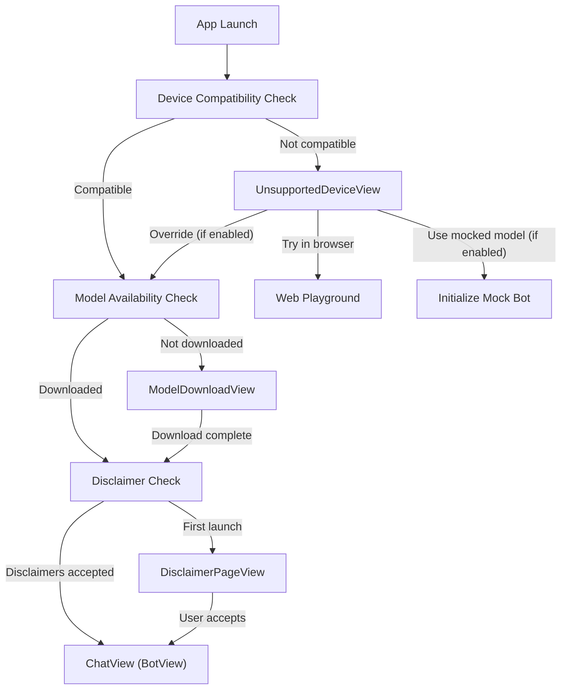
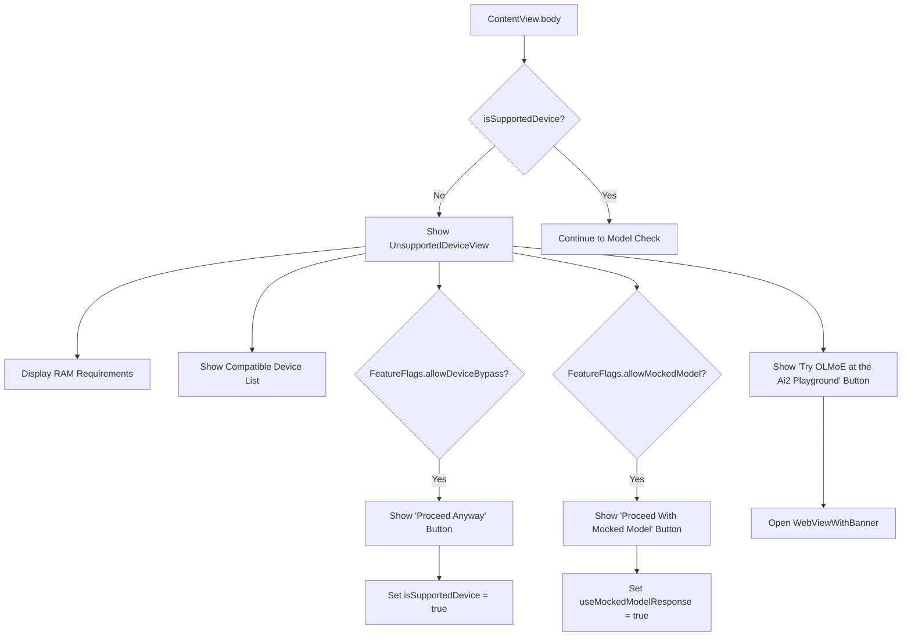
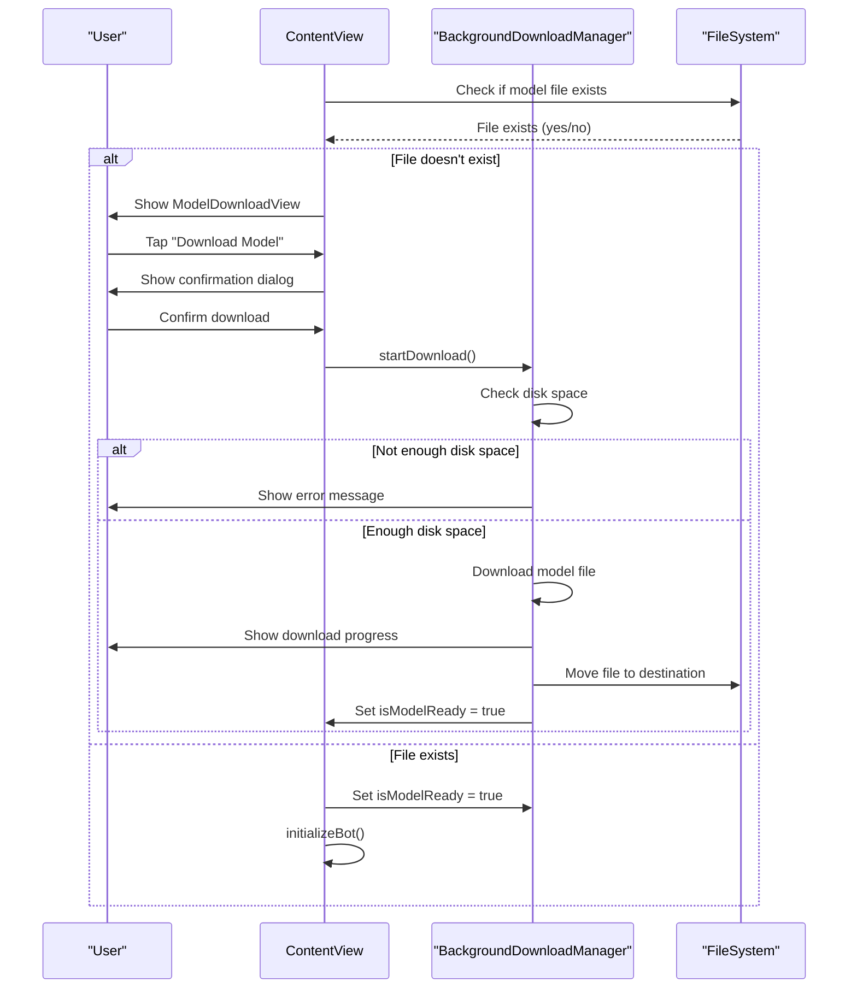
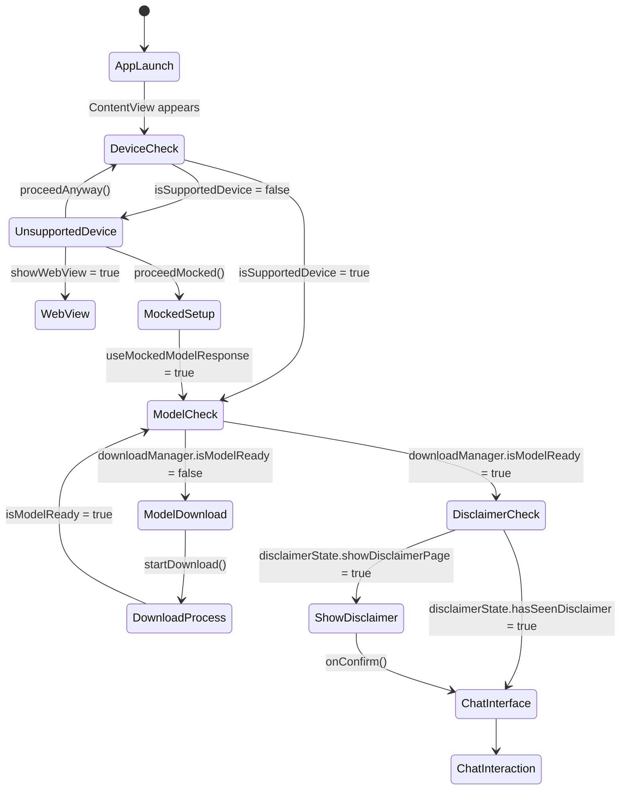
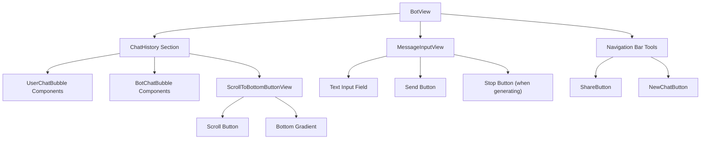
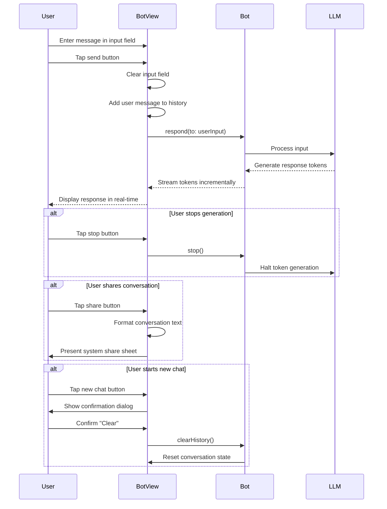
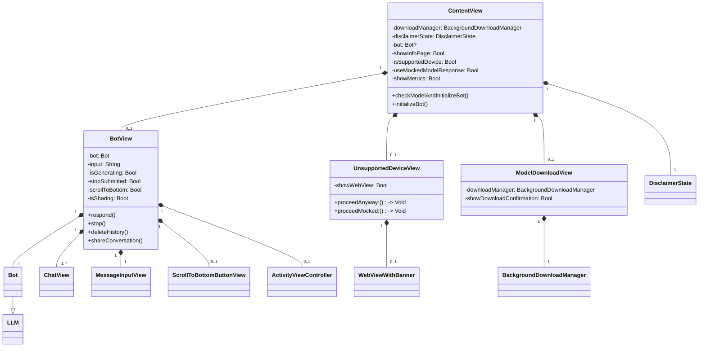
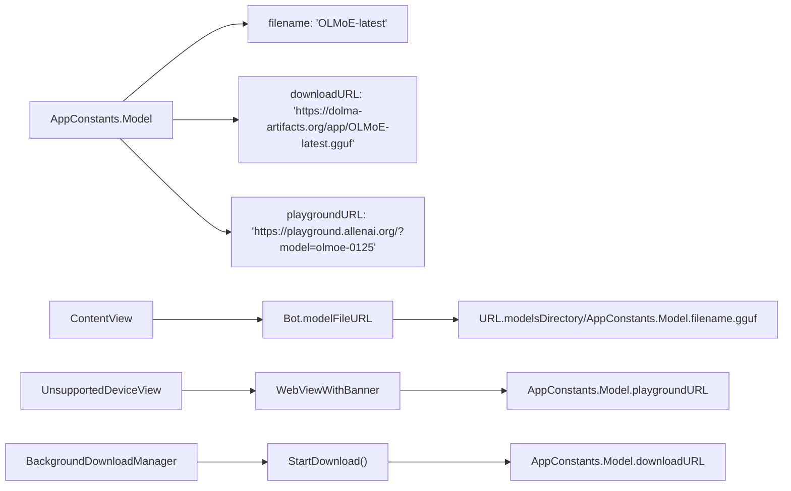
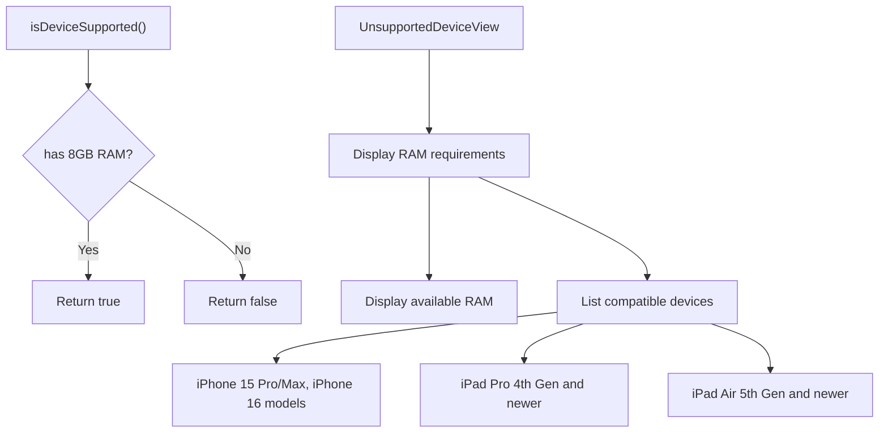

<!-- source: DeepWiki mcp.deepwiki.com · repo allenai/OLMoE.swift · page 3.2 User Interface Flow · fetched 2026-10-26 -->

# User Interface Flow

Relevant source files

The following files were used as context for generating this wiki page:

- [OLMoE.swift/Constants/AppConstants.swift](OLMoE.swift/Constants/AppConstants.swift)
- [OLMoE.swift/Constants/Localizable.xcstrings](OLMoE.swift/Constants/Localizable.xcstrings)
- [OLMoE.swift/Model/KeyboardResponder.swift](OLMoE.swift/Model/KeyboardResponder.swift)
- [OLMoE.swift/Views/ContentView.swift](OLMoE.swift/Views/ContentView.swift)
- [OLMoE.swift/Views/ModelDownloadView.swift](OLMoE.swift/Views/ModelDownloadView.swift)
- [OLMoE.swift/Views/ScrollToBottomButtonView.swift](OLMoE.swift/Views/ScrollToBottomButtonView.swift)
- [OLMoE.swift/Views/UnsupportedDeviceView.swift](OLMoE.swift/Views/UnsupportedDeviceView.swift)

This document describes the user interface flow of the OLMoE.swift application, from initial launch through device compatibility checks, model downloading, and finally to the chat experience. For detailed information about the Language Model System that powers the chat functionality, see [Language Model System](#3.1).

## Overview

The OLMoE.swift application follows a sequential flow of screens that guides users from launch to an interactive chat experience with the on-device language model. The application performs several critical checks before enabling chat functionality, including device compatibility verification and model availability.

Sources: [OLMoE.swift/Views/ContentView.swift:392-524]()

## Device Compatibility Verification

Upon launch, the application first checks if the device meets the minimum system requirements (primarily 8GB of RAM) to run the OLMoE language model efficiently.

The `UnsupportedDeviceView` provides users with several options:
1. Try OLMoE in a web playground (hosted version)
2. Proceed anyway (if enabled in feature flags)
3. Use a mocked model (if enabled in feature flags)

Sources: [OLMoE.swift/Views/ContentView.swift:406-428](), [OLMoE.swift/Views/UnsupportedDeviceView.swift:13-107]()

## Model Download Management

If the device is compatible, the app checks if the model file has been downloaded. If not, it displays the `ModelDownloadView` to facilitate downloading the model.

The download process includes:
1. Confirming download with the user (4.21GB file size warning)
2. Checking for available disk space
3. Downloading the model with progress indication
4. Moving the downloaded file to the models directory
5. Marking the model as ready for use

Sources: [OLMoE.swift/Views/ContentView.swift:429-446](), [OLMoE.swift/Views/ModelDownloadView.swift:193-296](), [OLMoE.swift/Views/ModelDownloadView.swift:18-190]()

## Application State Management

The application uses several state variables to manage its flow and transitions between different views.

Key state variables include:
- `isSupportedDevice`: Controls whether to show the UnsupportedDeviceView
- `downloadManager.isModelReady`: Determines if the model download view or chat view should be displayed
- `disclaimerState.showDisclaimerPage`: Controls when to show disclaimers
- `bot`: The initialized language model instance

Sources: [OLMoE.swift/Views/ContentView.swift:393-415](), [OLMoE.swift/Views/ContentView.swift:505-523]()

## Chat Interface Components

Once the model is downloaded and ready, and any required disclaimers are accepted, the application displays the chat interface (`BotView`).

The chat interface includes:
1. Chat history display with user and bot messages
2. Input area for typing messages
3. Controls for sharing conversations and starting new chats
4. A scroll-to-bottom button for long conversations

Sources: [OLMoE.swift/Views/ContentView.swift:36-369](), [OLMoE.swift/Views/ScrollToBottomButtonView.swift:10-70]()

## User Interaction Flow

The chat interface supports several key user interactions that drive the conversation flow.

Key user interaction methods:
- `respond()`: Processes user input and triggers the bot's response
- `stop()`: Interrupts response generation
- `deleteHistory()`: Clears the conversation history
- `shareConversation()`: Prepares conversation for sharing

Sources: [OLMoE.swift/Views/ContentView.swift:81-147](), [OLMoE.swift/Views/ContentView.swift:149-226](), [OLMoE.swift/Views/ContentView.swift:229-261]()

## UI Component Relationships

The following diagram shows the hierarchical relationships between the main UI components in the application.

Sources: [OLMoE.swift/Views/ContentView.swift:392-524](), [OLMoE.swift/Views/ContentView.swift:36-369](), [OLMoE.swift/Views/ModelDownloadView.swift:193-296](), [OLMoE.swift/Views/UnsupportedDeviceView.swift:13-107]()

## Localization Support

The application uses localized strings for user interface elements, making it adaptable to different languages.

| String Key | Description | Default Value |
|------------|-------------|---------------|
| "Welcome chat message" | Initial message shown in empty chat | "Hello! I'm OLMoE, a fully open, state-of-the-art language model running locally on your device." |
| "Empty Input Prompt" | Placeholder for empty input field | "Message OLMoE" |
| "Message OLMoE" | Text input placeholder | "Message OLMoE" |
| "Download Model Message" | Header for model download view | "Download the latest AI model" |

Sources: [OLMoE.swift/Constants/Localizable.xcstrings:4-156]()

## Model URL Configuration

The application uses constants to define key URLs for model downloading and fallback web experience.

Sources: [OLMoE.swift/Constants/AppConstants.swift:1-9](), [OLMoE.swift/Views/ContentView.swift:12-14](), [OLMoE.swift/Views/UnsupportedDeviceView.swift:73-74](), [OLMoE.swift/Views/ModelDownloadView.swift:77]()

## Device Compatibility Logic

The application determines device compatibility primarily based on available RAM, with specific recommendations for supported device models.

The device compatibility check is critical to ensure the language model can run efficiently, as it requires significant memory resources.

Sources: [OLMoE.swift/Views/ContentView.swift:406](), [OLMoE.swift/Views/UnsupportedDeviceView.swift:22-54]()

---

