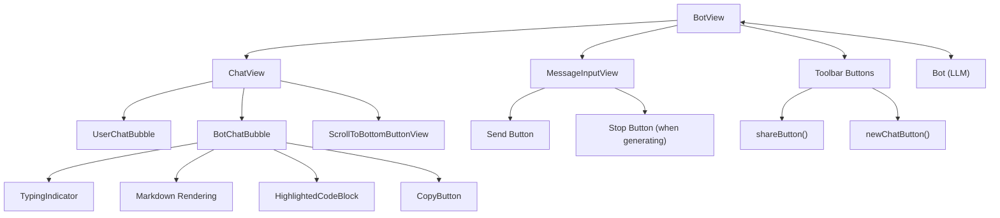
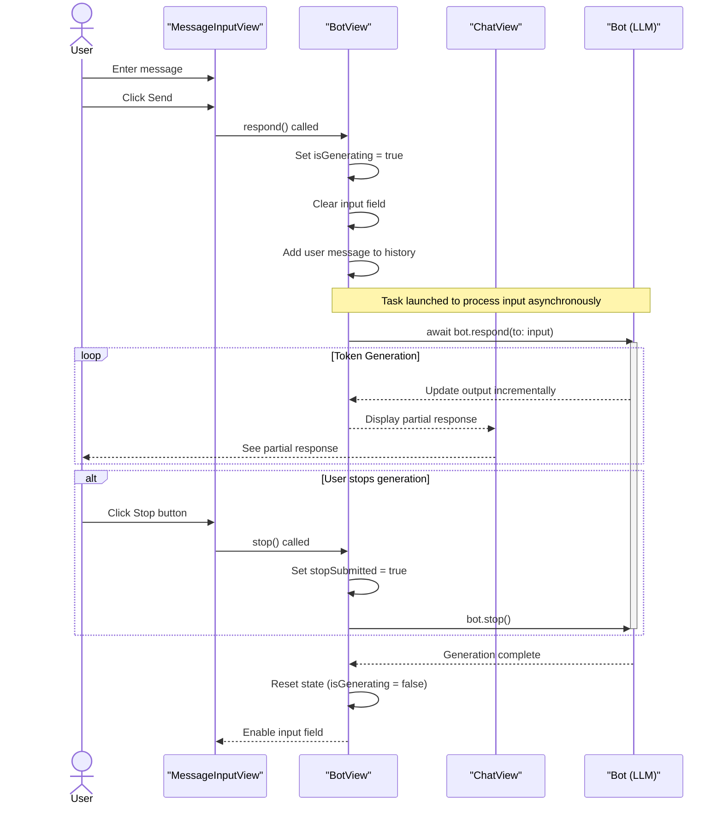
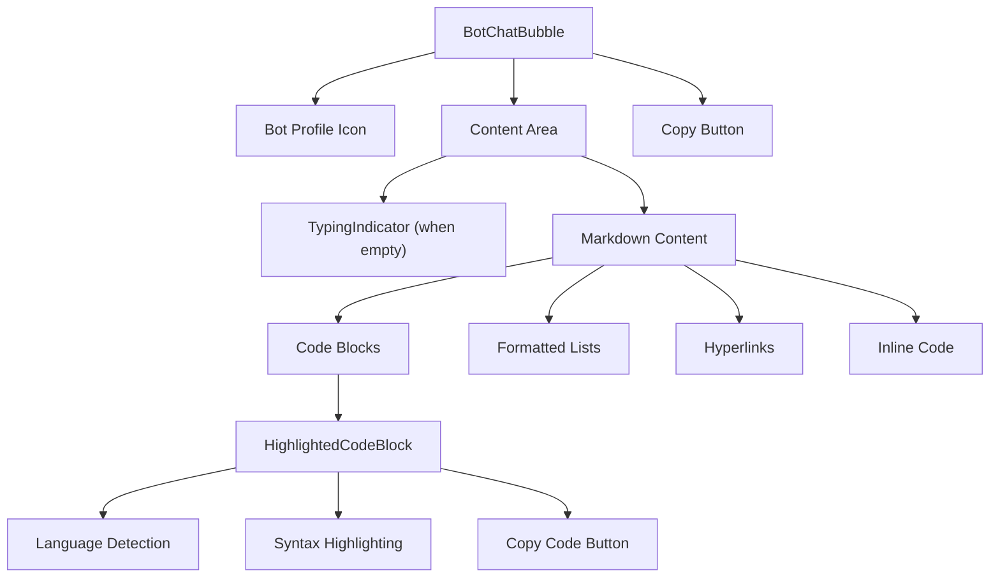

<!-- source: DeepWiki mcp.deepwiki.com · repo allenai/OLMoE.swift · page 4 Chat Interface · fetched 2026-10-26 -->

# Chat Interface

<details>
<summary>Relevant source files</summary>

The following files were used as context for generating this wiki page:

- [OLMoE.swift/Assets.xcassets/StopIcon.imageset/StopIcon.svg](OLMoE.swift/Assets.xcassets/StopIcon.imageset/StopIcon.svg)
- [OLMoE.swift/Assets.xcassets/Surface.colorset/Contents.json](OLMoE.swift/Assets.xcassets/Surface.colorset/Contents.json)
- [OLMoE.swift/Extensions/View.swift](OLMoE.swift/Extensions/View.swift)
- [OLMoE.swift/Model/KeyboardResponder.swift](OLMoE.swift/Model/KeyboardResponder.swift)
- [OLMoE.swift/Views/Chat/BotChatBubbleView.swift](OLMoE.swift/Views/Chat/BotChatBubbleView.swift)
- [OLMoE.swift/Views/Chat/ChatView.swift](OLMoE.swift/Views/Chat/ChatView.swift)
- [OLMoE.swift/Views/Chat/CopyButton.swift](OLMoE.swift/Views/Chat/CopyButton.swift)
- [OLMoE.swift/Views/Chat/HighlightedCodeBlock.swift](OLMoE.swift/Views/Chat/HighlightedCodeBlock.swift)
- [OLMoE.swift/Views/Chat/TypingIndicator.swift](OLMoE.swift/Views/Chat/TypingIndicator.swift)
- [OLMoE.swift/Views/ContentView.swift](OLMoE.swift/Views/ContentView.swift)
- [OLMoE.swift/Views/MessageInputView.swift](OLMoE.swift/Views/MessageInputView.swift)

</details>


The Chat Interface is the core user interaction component in OLMoE.swift, providing a streamlined conversational experience for interacting with the on-device language model. This page documents the architecture, components, and interaction flows that make up the chat functionality.

## Overview

The Chat Interface handles:
- Rendering the conversation history between user and AI
- Processing user input and submitting it to the language model
- Displaying real-time streaming responses with rich formatting
- Managing conversation state and scrolling behavior
- Providing conversation management features (clearing history, sharing)

Sources: [OLMoE.swift/Views/ContentView.swift:36-369]()

## Component Architecture

The Chat Interface consists of several interconnected SwiftUI components that work together to create the conversational experience:



Sources: 
- [OLMoE.swift/Views/ContentView.swift:36-369]()
- [OLMoE.swift/Views/Chat/ChatView.swift:59-284]()
- [OLMoE.swift/Views/MessageInputView.swift:11-93]()

### Primary Components

#### BotView
The `BotView` serves as the main controller for the chat experience, managing conversation state and coordinating interactions between the user interface and the language model.

Key responsibilities:
- Managing the chat history array
- Processing user input via the `respond()` method
- Handling response generation and streaming
- Coordinating conversation management actions (clear, share)

Key state properties:
```
@StateObject var bot: Bot               // LLM instance
@State var input: String                // Current user input
@State private var isGenerating: Bool   // Tracks generation state
@State private var stopSubmitted: Bool  // Indicates if stop was requested
@State private var scrollToBottom: Bool // Controls scrolling behavior
```

Sources: [OLMoE.swift/Views/ContentView.swift:36-369]()

#### ChatView
The `ChatView` handles the display of the conversation history and manages scrolling behavior. It renders both user and bot messages and handles auto-scrolling to keep the latest message visible.

Key responsibilities:
- Rendering chat history with appropriate bubble styles
- Managing scroll position and visibility
- Detecting when user has scrolled away from bottom
- Providing metrics display (optional)

Sources: [OLMoE.swift/Views/Chat/ChatView.swift:59-284]()

#### MessageInputView
The `MessageInputView` provides the text input field and action buttons for sending messages and stopping generation.

Key features:
- Text input field with multiline support
- Send button (transforms to Stop button during generation)
- Keyboard shortcuts and focus management
- Visual feedback (disabled state, animations)

Sources: [OLMoE.swift/Views/MessageInputView.swift:11-93]()

## Message Flow

The following sequence diagram illustrates the flow of messages in the Chat Interface:



Sources: 
- [OLMoE.swift/Views/ContentView.swift:81-105]() (respond method)
- [OLMoE.swift/Views/ContentView.swift:107-110]() (stop method)

## Chat Bubble Components

### Bot Messages (BotChatBubble)

The `BotChatBubble` component renders AI-generated responses with rich formatting capabilities:



Key features:
- Markdown rendering via MarkdownUI
- Code syntax highlighting with HighlightSwift
- Typing indicator animation during generation
- Generating dot marker for ongoing text
- Copy button for full message text

Sources: 
- [OLMoE.swift/Views/Chat/BotChatBubbleView.swift:15-125]()
- [OLMoE.swift/Views/Chat/HighlightedCodeBlock.swift:12-94]()
- [OLMoE.swift/Views/Chat/TypingIndicator.swift:10-41]()

### User Messages (UserChatBubble)

The `UserChatBubble` component displays user messages with simple formatting:

- Right-aligned bubble design
- Text selection enabled
- Maximum width constraint (75% of screen width)
- Simple appearance with rounded corners

Sources: [OLMoE.swift/Views/Chat/ChatView.swift:12-29]()

## Special Features

### Scroll Management

The Chat Interface implements sophisticated scroll management to handle the dynamic nature of streaming responses:

1. **ScrollViewReader**: Used to programmatically control scroll position
2. **ScrollState**: Tracks content height, scroll offset, and bottom position
3. **ScrollToBottomButtonView**: Appears when user scrolls away from bottom
4. **Auto-scrolling behavior**: Automatically scrolls for new user messages and during response generation

Sources: [OLMoE.swift/Views/Chat/ChatView.swift:31-57](), [OLMoE.swift/Views/Chat/ChatView.swift:209-224]()

### Keyboard Management

The interface handles keyboard appearance and dismissal to maintain a good user experience:

- `KeyboardResponder`: Observes keyboard show/hide notifications
- Adjusts content height when keyboard appears
- Auto-scrolls to the bottom when keyboard appears
- Provides proper focus management

Sources: [OLMoE.swift/Model/KeyboardResponder.swift:12-28](), [OLMoE.swift/Views/Chat/ChatView.swift:97-125]()

### Markdown and Code Support

The Chat Interface provides rich markdown rendering:

- Headers, lists, and inline formatting
- Code block syntax highlighting
- Customized bullet and numbered list styles
- Support for tables, blockquotes, and links

Code blocks receive special treatment:
- Language detection (explicit or automatic)
- Syntax highlighting via HighlightSwift
- Dedicated copy button for code snippets
- Custom styling with rounded corners

Sources: 
- [OLMoE.swift/Views/Chat/BotChatBubbleView.swift:46-106]()
- [OLMoE.swift/Views/Chat/HighlightedCodeBlock.swift:12-94]()

### Copy and Share Functionality

The interface provides multiple ways to share conversation content:

1. **Copy individual messages**: Via the copy button on bot messages
2. **Copy code blocks**: Dedicated copy button for code snippets
3. **Share entire conversation**: Toolbar button to export the conversation as text
4. **Attestation-based sharing** (optional): Can use device attestation for secure sharing via AWS Lambda

Sources: 
- [OLMoE.swift/Views/Chat/CopyButton.swift:11-72]()
- [OLMoE.swift/Views/ContentView.swift:122-147]() (formatConversationForSharing)
- [OLMoE.swift/Views/ContentView.swift:149-226]() (shareConversation)

## Conversation Management

The interface provides tools to manage the conversation:

1. **New Chat button**: Clears conversation history with confirmation
2. **Metrics Toggle**: Shows/hides performance metrics (token count, generation speed)
3. **Share Button**: Exports conversation as text for sharing

Sources: [OLMoE.swift/Views/ContentView.swift:112-120]() (deleteHistory)

## Related Pages

- For details on the language model implementation that powers the chat interface, see [Language Model System](#3.1)
- For information about model downloading and management, see [Model Management](#5)
- For the overall application flow including the chat interface, see [User Interface Flow](#3.2)

---

