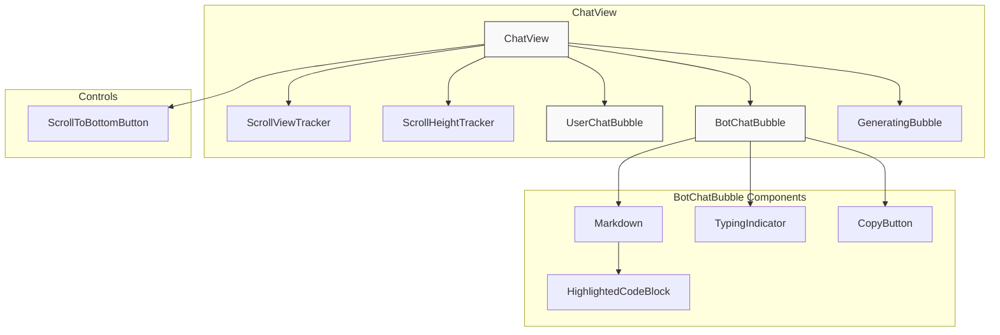
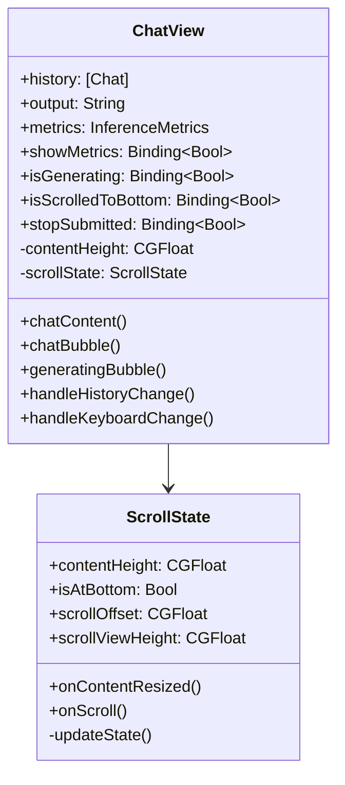
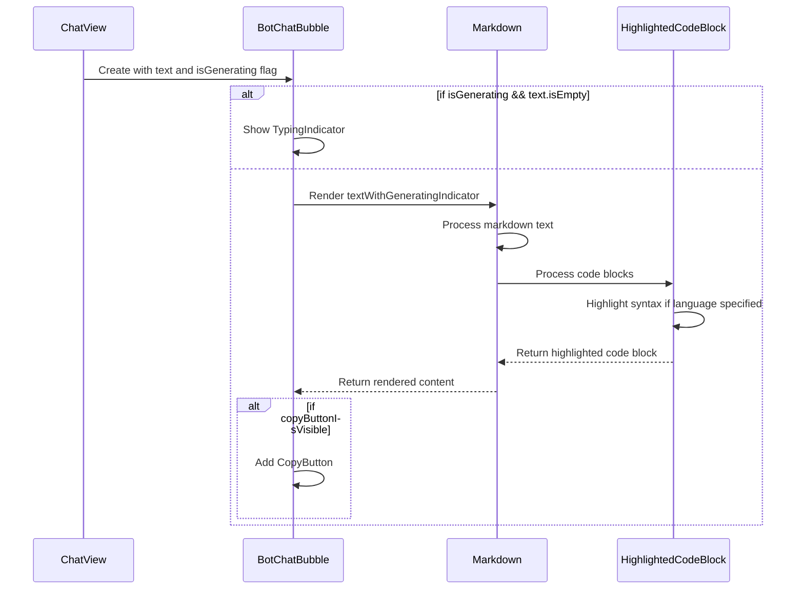
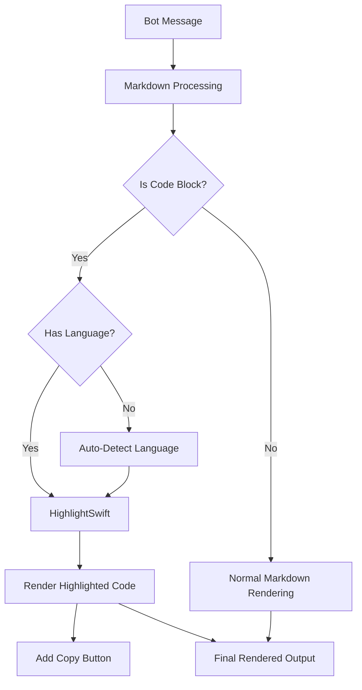
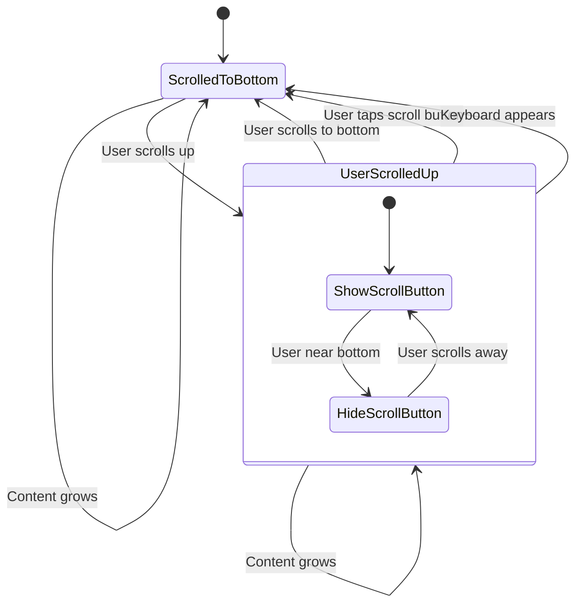

<!-- source: DeepWiki mcp.deepwiki.com · repo allenai/OLMoE.swift · page 4.1 Chat Components · fetched 2026-10-26 -->

# Chat Components

Relevant source files

The following files were used as context for generating this wiki page:

- [OLMoE.swift/Assets.xcassets/DownloadIcon.imageset/Contents.json](OLMoE.swift/Assets.xcassets/DownloadIcon.imageset/Contents.json)
- [OLMoE.swift/Assets.xcassets/DownloadIcon.imageset/DownloadIcon.svg](OLMoE.swift/Assets.xcassets/DownloadIcon.imageset/DownloadIcon.svg)
- [OLMoE.swift/Extensions/View.swift](OLMoE.swift/Extensions/View.swift)
- [OLMoE.swift/Model/KeyboardResponder.swift](OLMoE.swift/Model/KeyboardResponder.swift)
- [OLMoE.swift/Styles/ButtonStyles.swift](OLMoE.swift/Styles/ButtonStyles.swift)
- [OLMoE.swift/Styles/Typography.swift](OLMoE.swift/Styles/Typography.swift)
- [OLMoE.swift/Views/Chat/BotChatBubbleView.swift](OLMoE.swift/Views/Chat/BotChatBubbleView.swift)
- [OLMoE.swift/Views/Chat/ChatView.swift](OLMoE.swift/Views/Chat/ChatView.swift)
- [OLMoE.swift/Views/Chat/CopyButton.swift](OLMoE.swift/Views/Chat/CopyButton.swift)
- [OLMoE.swift/Views/Chat/HighlightedCodeBlock.swift](OLMoE.swift/Views/Chat/HighlightedCodeBlock.swift)
- [OLMoE.swift/Views/Chat/TypingIndicator.swift](OLMoE.swift/Views/Chat/TypingIndicator.swift)
- [OLMoE.swift/Views/ContentView.swift](OLMoE.swift/Views/ContentView.swift)

This page documents the UI components that comprise the chat interface in OLMoE.swift. These components render messages, display typing indicators, and handle code highlighting to create a responsive and feature-rich chat experience. For information about message input and sending functionality, see [Message Input](#4.2).

## Component Architecture

The Chat Components system consists of several specialized UI elements that work together to display chat conversations. The main component is the `ChatView`, which contains and manages chat bubbles for both user and bot messages.

Sources: [OLMoE.swift/Views/Chat/ChatView.swift:59-283](), [OLMoE.swift/Views/Chat/BotChatBubbleView.swift:15-125]()

## Main Components

### ChatView

The `ChatView` is the central container for all chat messages. It manages the conversation history, handles scrolling behavior, and renders appropriate chat bubbles for each message.

Key responsibilities:
- Renders user and bot messages from the conversation history
- Handles auto-scrolling to show new messages
- Detects when the user has scrolled away from the bottom
- Displays a "scroll to bottom" button when needed
- Shows the typing indicator when the bot is generating a response
- Optionally displays inference metrics

Sources: [OLMoE.swift/Views/Chat/ChatView.swift:31-58](), [OLMoE.swift/Views/Chat/ChatView.swift:59-283]()

### UserChatBubble

The `UserChatBubble` displays messages sent by the user. It has a simpler design compared to the bot bubble, with right-aligned text on a colored background.

Key features:
- Right-aligned in the chat view
- Text is formatted and trimmed
- Has a maximum width (percentage of screen width)
- Enables text selection for copying
- Uses the app's standard typography

Sources: [OLMoE.swift/Views/Chat/ChatView.swift:12-29]()

### BotChatBubble

The `BotChatBubble` displays messages sent by the bot. It is more complex than the user bubble as it supports markdown formatting, code highlighting, and shows the typing indicator when the bot is generating a response.

Key features:
- Left-aligned with the bot profile picture
- Supports rich markdown rendering
- Handles code blocks with syntax highlighting
- Shows typing indicator when generating
- Includes a copy button for easy copying of content
- Displays a generation indicator (dot) at the end of text while generating

Sources: [OLMoE.swift/Views/Chat/BotChatBubbleView.swift:15-125]()

## Supporting Components

### HighlightedCodeBlock

The `HighlightedCodeBlock` component provides syntax highlighting for code blocks in bot messages. It uses the HighlightSwift library to perform language detection and syntax highlighting.

Key features:
- Detects and displays the programming language
- Highlights syntax based on language
- Includes a copy button specific for the code block
- Has a distinct visual style to differentiate from regular text
- Provides language detection when explicit language isn't specified

Sources: [OLMoE.swift/Views/Chat/HighlightedCodeBlock.swift:12-94]()

### TypingIndicator

The `TypingIndicator` component displays an animated "typing" indicator when the bot is generating a response but hasn't produced any output yet.

Key features:
- Animated dots that pulse to indicate activity
- Simple, lightweight animation using SwiftUI animations
- Provides visual feedback that the system is working

Sources: [OLMoE.swift/Views/Chat/TypingIndicator.swift:10-41]()

### CopyButton

The `CopyButton` is a reusable component that enables users to copy text with visual feedback.

Key features:
- Used in both normal text and code blocks
- Provides visual feedback when text is copied
- Includes haptic feedback on copying
- Can display with or without a label

Sources: [OLMoE.swift/Views/Chat/CopyButton.swift:11-72]()

## Markdown Rendering and Code Highlighting

The BotChatBubble uses the MarkdownUI library to render rich text formatting in bot messages. It supports a wide range of markdown features:

| Feature | Support | Implementation |
|---------|---------|----------------|
| Basic formatting | Bold, italic, strikethrough | Standard markdown syntax |
| Links | Regular and auto-links | Custom styling with accent color |
| Lists | Ordered and unordered, with nesting | Custom bullet and number styling |
| Code | Inline code and code blocks | Custom styling and syntax highlighting |
| Blockquotes | Including nested quotes | Standard markdown implementation |
| Tables | With alignment | Standard markdown implementation |

The code highlighting process:

Sources: [OLMoE.swift/Views/Chat/BotChatBubbleView.swift:48-105](), [OLMoE.swift/Views/Chat/HighlightedCodeBlock.swift:12-94]()

## Scroll Behavior Management

The ChatView implements sophisticated scroll management to ensure a good user experience:

1. Automatically scrolls to new messages when they're added
2. Tracks when the user has manually scrolled away from the bottom
3. Provides a "scroll to bottom" button when new messages arrive but the user has scrolled up
4. Handles keyboard appearance and disappearance
5. Manages content height changes during generation

The scroll behavior is primarily managed by the `ScrollState` class, which tracks:
- Content height (total height of all messages)
- Scroll view height (visible area)
- Current scroll offset
- Whether the view is scrolled to the bottom

Sources: [OLMoE.swift/Views/Chat/ChatView.swift:31-58](), [OLMoE.swift/Views/Chat/ChatView.swift:141-223](), [OLMoE.swift/Views/Chat/ChatView.swift:267-282]()

## Message Generation Visualization

When the bot is generating a response, the UI provides several visual cues:

1. If no text has been generated yet, a `TypingIndicator` shows animated dots
2. Once text starts appearing, the `BotChatBubble` shows the partially generated text
3. While generating, a pulsing dot is added to the end of the text using `ChatConstants.generatingDotMarker`
4. The copy button is hidden during generation and reappears when complete

This system provides continuous feedback to users during the generation process, making the app feel responsive even during longer generation times.

Sources: [OLMoE.swift/Views/Chat/BotChatBubbleView.swift:24-31](), [OLMoE.swift/Views/Chat/BotChatBubbleView.swift:44-46](), [OLMoE.swift/Views/Chat/TypingIndicator.swift:10-41]()

---

