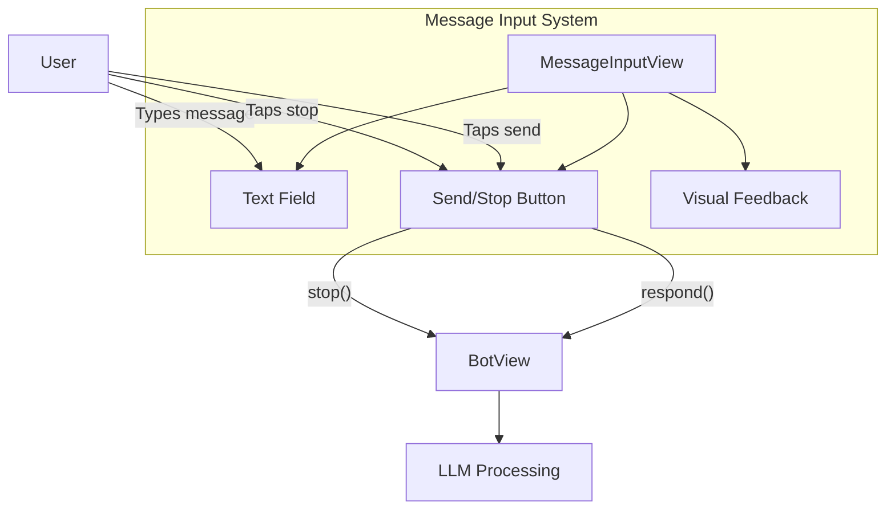
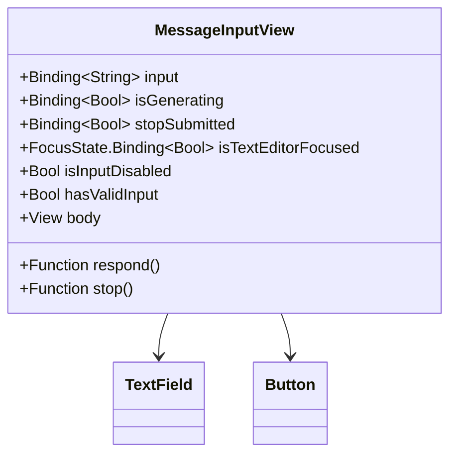
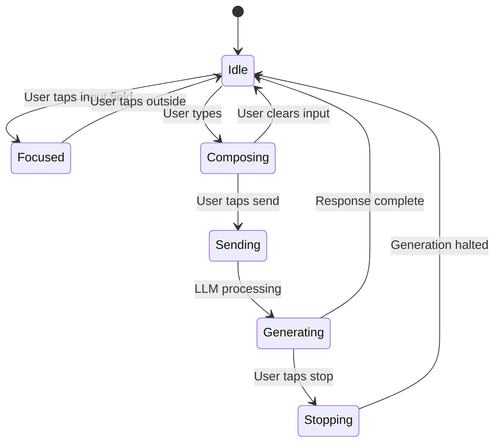
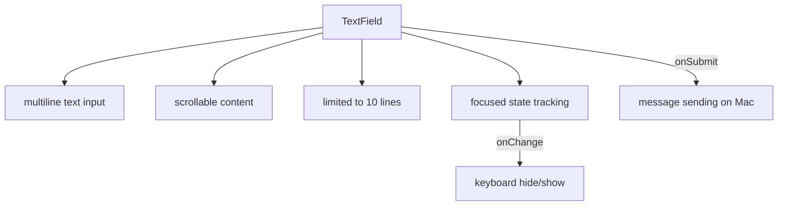
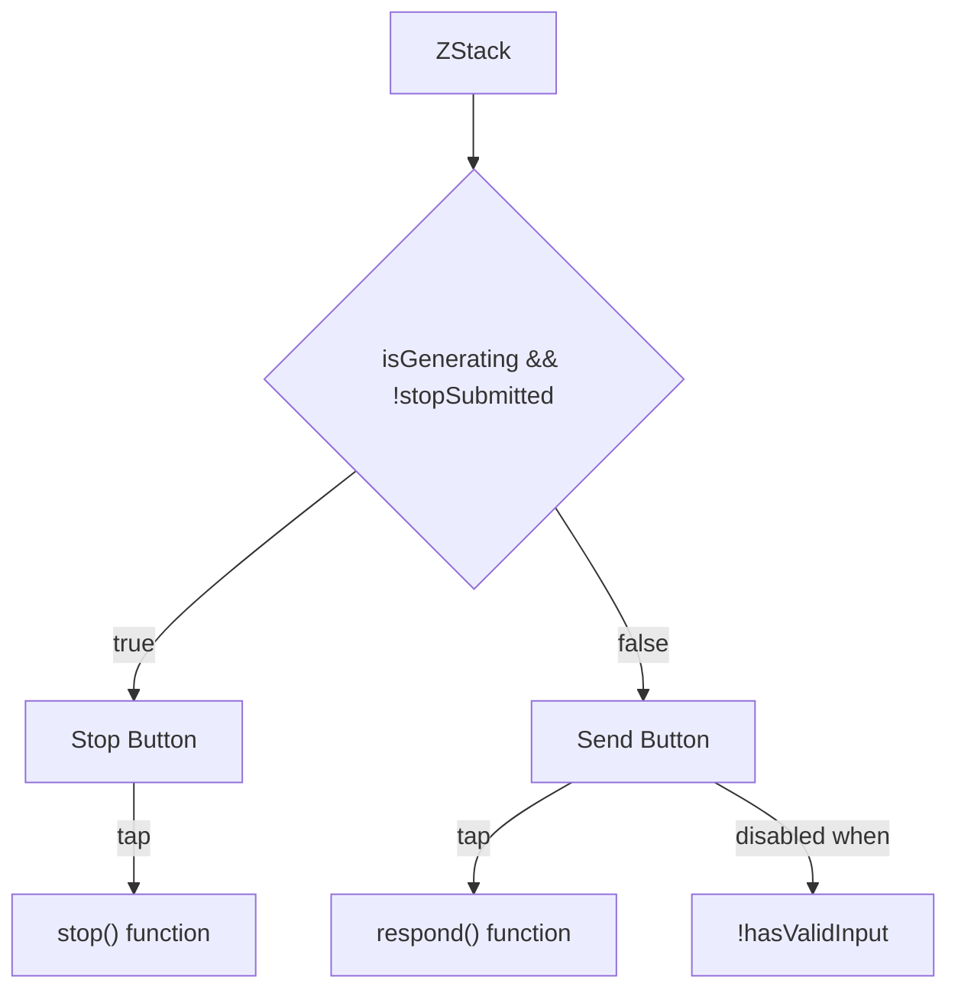
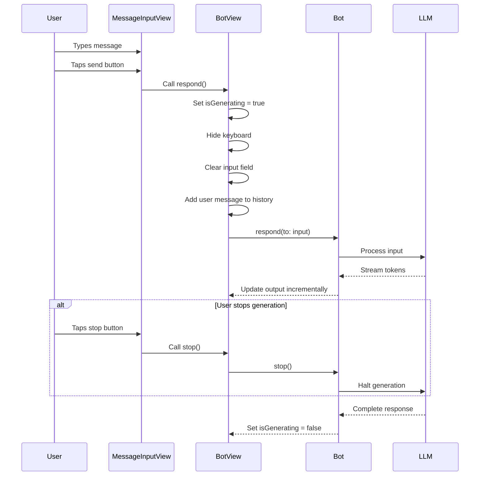
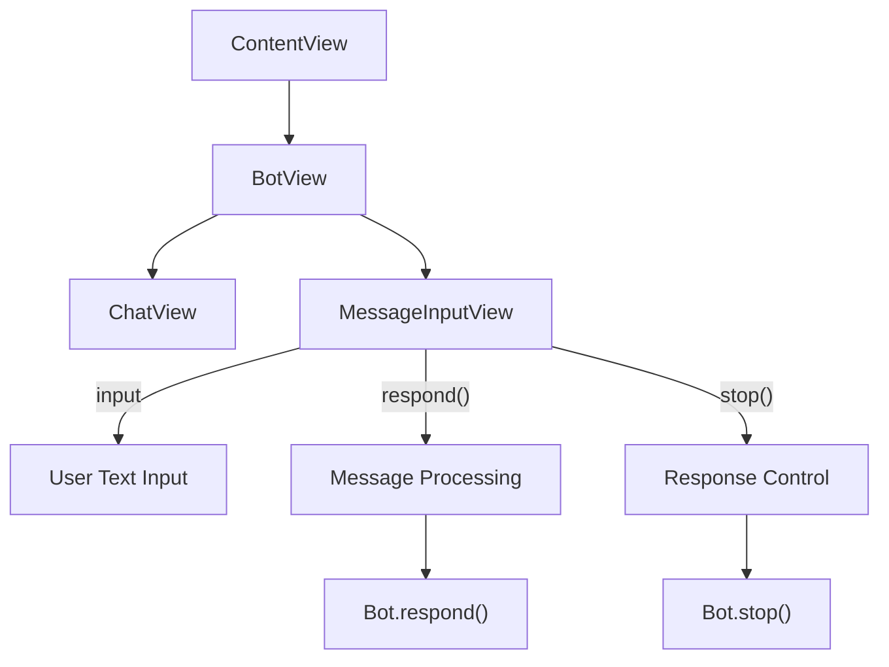
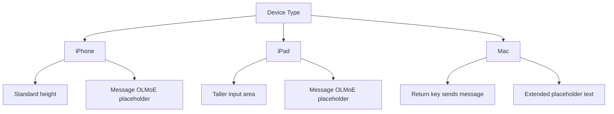

<!-- source: DeepWiki mcp.deepwiki.com · repo allenai/OLMoE.swift · page 4.2 Message Input · fetched 2026-10-26 -->

# Message Input

<details>
<summary>Relevant source files</summary>

The following files were used as context for generating this wiki page:

- [OLMoE.swift/Assets.xcassets/StopIcon.imageset/StopIcon.svg](OLMoE.swift/Assets.xcassets/StopIcon.imageset/StopIcon.svg)
- [OLMoE.swift/Assets.xcassets/Surface.colorset/Contents.json](OLMoE.swift/Assets.xcassets/Surface.colorset/Contents.json)
- [OLMoE.swift/Model/KeyboardResponder.swift](OLMoE.swift/Model/KeyboardResponder.swift)
- [OLMoE.swift/Views/ContentView.swift](OLMoE.swift/Views/ContentView.swift)
- [OLMoE.swift/Views/MessageInputView.swift](OLMoE.swift/Views/MessageInputView.swift)

</details>


The Message Input component is a critical user interface element in the OLMoE.swift application that handles text entry, message sending, and response generation control. This document covers the implementation and functionality of the message input system, including its interaction flow and integration with the chat interface.

## Overview

The message input system provides users with a text field to compose messages and buttons to send or stop message generation. It adapts to different device types and provides visual feedback during various states such as focus, message composition, and response generation.



Sources: [OLMoE.swift/Views/MessageInputView.swift:11-93]()

## Component Structure

The `MessageInputView` is implemented as a SwiftUI view that encapsulates the text input field and action buttons. It takes several binding parameters to synchronize its state with the parent view.



Sources: [OLMoE.swift/Views/MessageInputView.swift:11-20]()

The `MessageInputView` struct contains the following key properties:

| Property | Type | Description |
|----------|------|-------------|
| `input` | `Binding<String>` | The text entered by the user |
| `isGenerating` | `Binding<Bool>` | Whether the bot is currently generating a response |
| `stopSubmitted` | `Binding<Bool>` | Whether a stop request has been submitted |
| `isTextEditorFocused` | `FocusState.Binding<Bool>` | Focus state of the text field |
| `isInputDisabled` | `Bool` | Whether input is disabled during response generation |
| `hasValidInput` | `Bool` | Whether the current input is valid for sending |
| `respond` | `() -> Void` | Callback function for sending a message |
| `stop` | `() -> Void` | Callback function for stopping response generation |

Sources: [OLMoE.swift/Views/MessageInputView.swift:11-20]()

## Visual States

The message input component has several visual states that provide feedback to the user:



Sources: [OLMoE.swift/Views/MessageInputView.swift:21-93]()

The visual representation adapts based on the current state:

1. **Idle**: Standard input field with send button disabled if empty
2. **Focused**: Green border appears around the input field
3. **Composing**: Send button becomes active (full opacity)
4. **Generating**: Input field is disabled and send button changes to stop button
5. **Stopping**: Stop button is clicked and system halts response generation

The component uses a combination of opacity changes, border highlights, and icon swapping to provide clear visual feedback to the user.

Sources: [OLMoE.swift/Views/MessageInputView.swift:53-76](), [OLMoE.swift/Views/MessageInputView.swift:86-92]()

## Implementation Details

### Text Input Field

The text input is implemented using SwiftUI's `TextField` with vertical scrolling capabilities:



Sources: [OLMoE.swift/Views/MessageInputView.swift:23-51]()

Key features of the text field implementation:

- Uses `.vertical` axis for multi-line input
- Limits display to 10 lines maximum
- Changes appearance when disabled during response generation
- Automatically submits message when Return key is pressed on macOS
- Custom placeholder text based on device type

Sources: [OLMoE.swift/Views/MessageInputView.swift:23-51]()

### Send/Stop Button

The button in the message input area dynamically changes between send and stop functionality based on the current state:



Sources: [OLMoE.swift/Views/MessageInputView.swift:53-76]()

The button implementation includes:

- A `ZStack` to swap between send and stop icons
- Conditional rendering based on generation state
- Disabled state for the send button when input is empty
- Custom icons for both send and stop actions

Sources: [OLMoE.swift/Views/MessageInputView.swift:53-76](), [OLMoE.swift/Assets.xcassets/StopIcon.imageset/StopIcon.svg:1-6]()

## Message Processing Flow

When a user sends a message, a sequence of actions occurs that connects the input component to the language model:



Sources: [OLMoE.swift/Views/ContentView.swift:81-110](), [OLMoE.swift/Views/MessageInputView.swift:53-76]()

The respond function in `BotView` handles several key steps:

1. Sets `isGenerating` to true to update UI state
2. Adjusts text editor focus based on platform
3. Clears the input field after capturing the message
4. Adds the user message to chat history
5. Calls the language model's respond method asynchronously
6. Updates UI state after response is complete

Sources: [OLMoE.swift/Views/ContentView.swift:81-105]()

The stop function:

1. Sets `stopSubmitted` to true
2. Calls the bot's stop method to halt generation

Sources: [OLMoE.swift/Views/ContentView.swift:107-110]()

## Integration with Chat Interface

The `MessageInputView` is integrated into the main chat interface as part of the `BotView`:



Sources: [OLMoE.swift/Views/ContentView.swift:330-339]()

The parent `BotView` provides the necessary state variables and callback functions to the `MessageInputView`:

```swift
MessageInputView(
    input: $input,
    isGenerating: $isGenerating,
    stopSubmitted: $stopSubmitted,
    isTextEditorFocused: $isTextEditorFocused,
    isInputDisabled: isInputDisabled,
    hasValidInput: hasValidInput,
    respond: respond,
    stop: stop
)
```

Sources: [OLMoE.swift/Views/ContentView.swift:330-339]()

## Device Adaptations

The message input component adapts to different device types in several ways:



Sources: [OLMoE.swift/Views/MessageInputView.swift:23-50](), [OLMoE.swift/Views/MessageInputView.swift:80-81]()

Key adaptations include:

1. Different minimum height on iPad vs iPhone
2. Different placeholder text on Mac vs iOS devices
3. Return key behavior difference on Mac (automatically sends message)
4. Focus management differences between platforms

Sources: [OLMoE.swift/Views/MessageInputView.swift:23-50](), [OLMoE.swift/Views/MessageInputView.swift:80-81](), [OLMoE.swift/Views/ContentView.swift:83-87](), [OLMoE.swift/Views/ContentView.swift:100-102]()

## Styling and Appearance

The message input component has a distinctive visual style that matches the application's design language:

1. Rounded corners with a 30-point radius
2. Semi-transparent background using the "Surface" color
3. Green border that appears when focused
4. Custom send and stop icons
5. Dynamic opacity based on input validity and disabled state

Sources: [OLMoE.swift/Views/MessageInputView.swift:78-92](), [OLMoE.swift/Assets.xcassets/Surface.colorset/Contents.json:1-38]()

The styling aims to provide clear visual feedback to users while maintaining a consistent appearance with the rest of the application.

---

