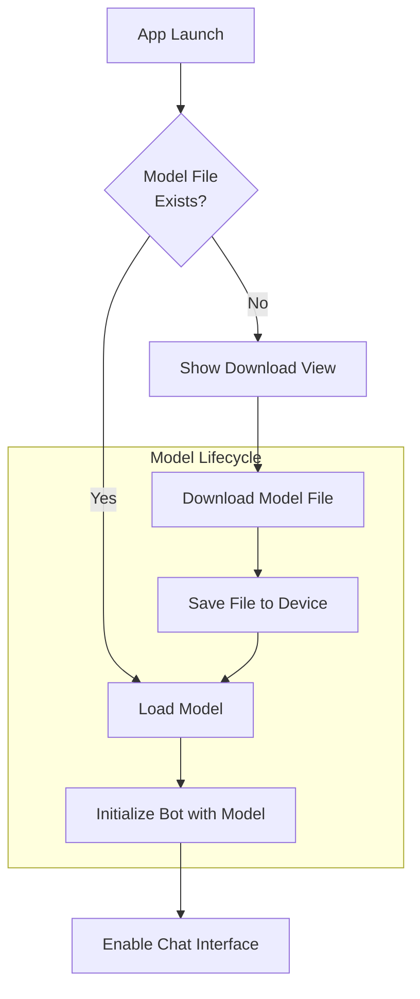
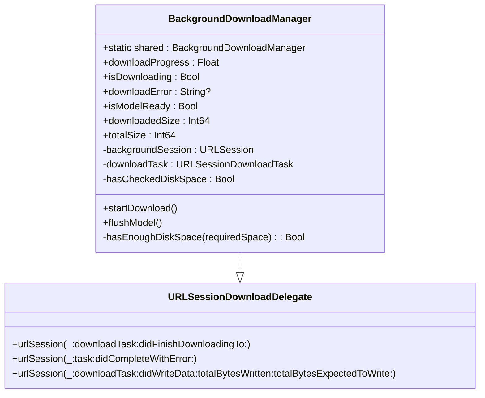
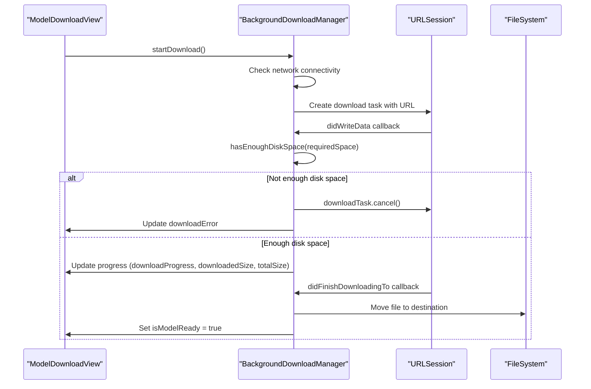
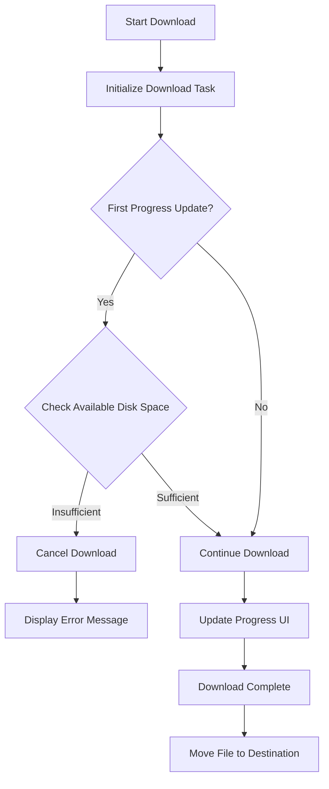
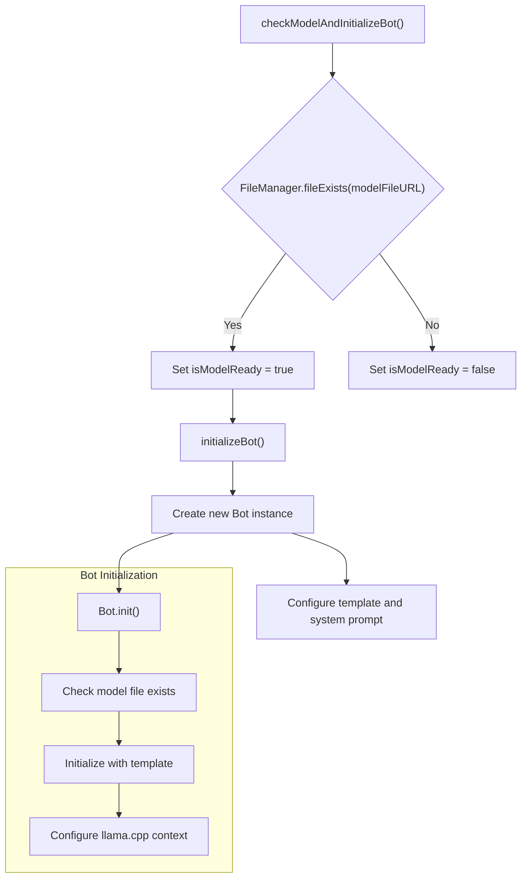
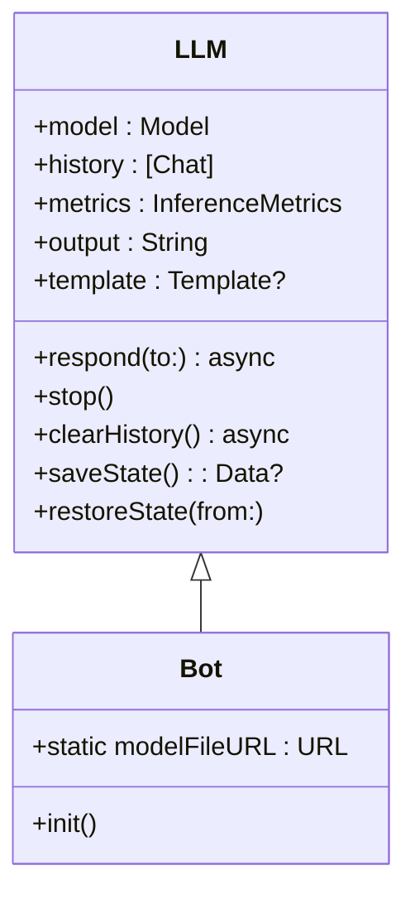
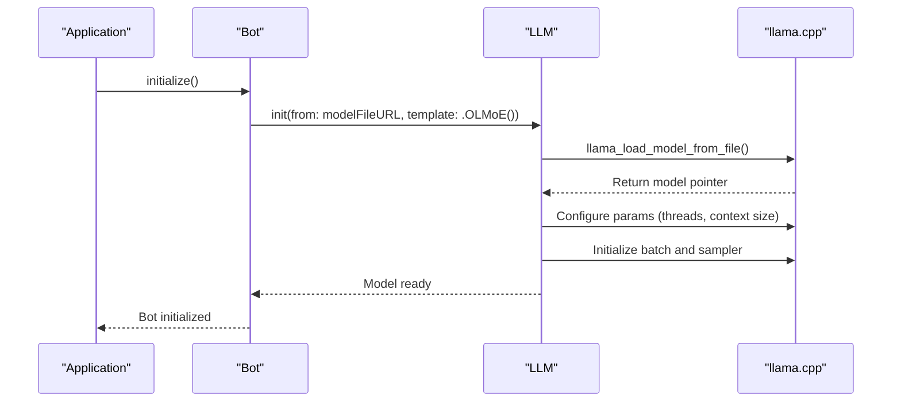
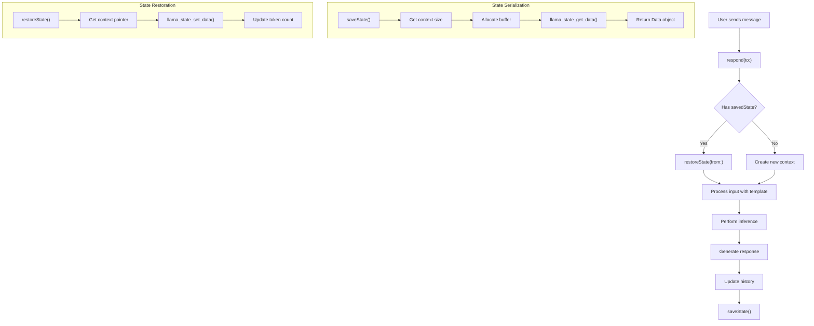
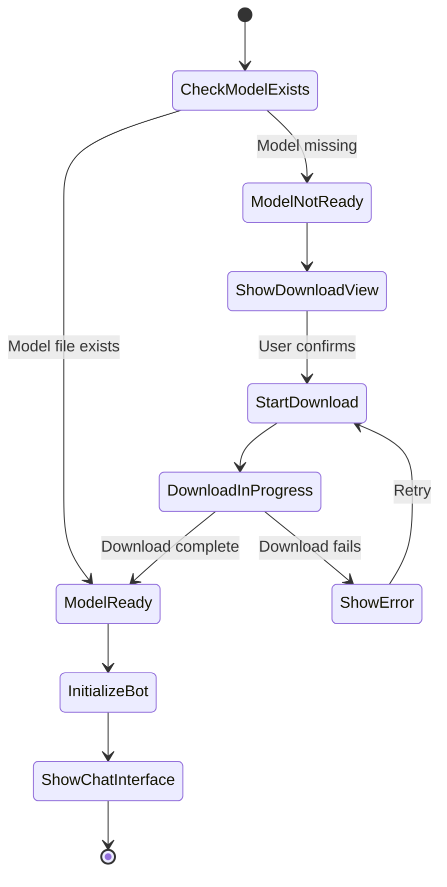

<!-- source: DeepWiki mcp.deepwiki.com · repo allenai/OLMoE.swift · page 5 Model Management · fetched 2026-10-26 -->

# Model Management

Relevant source files

The following files were used as context for generating this wiki page:

- [OLMoE.swift/Constants/AppConstants.swift](OLMoE.swift/Constants/AppConstants.swift)
- [OLMoE.swift/Model/Context.swift](OLMoE.swift/Model/Context.swift)
- [OLMoE.swift/Model/InferenceMetrics.swift](OLMoE.swift/Model/InferenceMetrics.swift)
- [OLMoE.swift/Model/KeyboardResponder.swift](OLMoE.swift/Model/KeyboardResponder.swift)
- [OLMoE.swift/Model/LLM.swift](OLMoE.swift/Model/LLM.swift)
- [OLMoE.swift/Model/Template.swift](OLMoE.swift/Model/Template.swift)
- [OLMoE.swift/Views/ContentView.swift](OLMoE.swift/Views/ContentView.swift)
- [OLMoE.swift/Views/ModelDownloadView.swift](OLMoE.swift/Views/ModelDownloadView.swift)

This document describes how OLMoE.swift manages language model files on iOS devices, including downloading, storing, loading, and initializing models. It covers the entire lifecycle of model management from initial download through usage and state persistence.

For information about device compatibility checks, see [Device Compatibility](#5.1).

## Overview of Model Management

The OLMoE.swift app requires a pre-trained language model file to function. Model management encompasses several key processes:

1. Downloading the model from a remote server
2. Storing the model in the appropriate device location
3. Loading the model into memory 
4. Maintaining model state throughout conversations

Diagram: Model Management Lifecycle in OLMoE.swift

Sources: [OLMoE.swift/Views/ContentView.swift:506-513](), [OLMoE.swift/Views/ModelDownloadView.swift:94-110]()

## Model File Specifications

OLMoE.swift utilizes GGUF format model files, which are optimized for efficient inference on mobile devices.

| Property | Value |
|----------|-------|
| File Format | GGUF (GPT-Generated Unified Format) |
| Filename | OLMoE-latest.gguf |
| Location | App's models directory |
| Size | ~4.21GB |
| Download URL | Configured in AppConstants.Model.downloadURL |

The model file location is determined by:

Diagram: Model File Path Construction

Sources: [OLMoE.swift/Views/ContentView.swift:13](), [OLMoE.swift/Constants/AppConstants.swift:4-8]()

## Model Download System

The app uses a `BackgroundDownloadManager` singleton to handle model downloads, which is designed to continue downloads even if the app is backgrounded.

Diagram: BackgroundDownloadManager Class Structure

Sources: [OLMoE.swift/Views/ModelDownloadView.swift:18-190]()

### Download Process Flow

The download process includes several key steps:

Diagram: Model Download Process Sequence

Sources: [OLMoE.swift/Views/ModelDownloadView.swift:72-225]()

### Disk Space Verification

Before downloading, the app verifies sufficient disk space is available:

Diagram: Disk Space Verification Process

Sources: [OLMoE.swift/Views/ModelDownloadView.swift:139-148](), [OLMoE.swift/Views/ModelDownloadView.swift:175-188]()

## Model Initialization

Once downloaded, the model must be initialized before use. The initialization process involves:

Diagram: Model Initialization Process

Sources: [OLMoE.swift/Views/ContentView.swift:506-523](), [OLMoE.swift/Views/ContentView.swift:12-33]()

### Bot and LLM Class Relationship

The `Bot` class extends the `LLM` base class to handle model operations:

Diagram: Bot and LLM Class Relationship

Sources: [OLMoE.swift/Views/ContentView.swift:12-33](), [OLMoE.swift/Model/LLM.swift:27-191]()

## Model Loading Process

When loading a model, OLMoE.swift uses llama.cpp's library functions to load the model file and create a context:

Diagram: Model Loading Sequence

Sources: [OLMoE.swift/Model/LLM.swift:116-189]()

## Model State Management

OLMoE.swift implements state management to preserve conversation context between inference calls:

Diagram: Model State Management Flow

Sources: [OLMoE.swift/Model/LLM.swift:442-462](), [OLMoE.swift/Model/LLM.swift:495-539]()

## Content View Integration

The `ContentView` coordinates model management with the user interface:

Diagram: ContentView Model Management States

Sources: [OLMoE.swift/Views/ContentView.swift:392-504](), [OLMoE.swift/Views/ModelDownloadView.swift:193-295]()

## Best Practices for Model Management

1. **Error Handling**: The system implements robust error handling during model download and initialization.
2. **Resource Verification**: Disk space is checked before download to prevent failed downloads.
3. **Background Processing**: Downloads continue even when the app is minimized.
4. **State Persistence**: Model state is maintained for consistent conversation context.
5. **Modular Design**: Separation of model management from UI allows for flexible implementation.

## Summary

OLMoE.swift's model management system provides a complete workflow for obtaining, loading, and using large language models on iOS devices. The design prioritizes reliability, user experience, and efficient resource usage across a variety of devices.

Sources: [OLMoE.swift/Views/ContentView.swift:392-524](), [OLMoE.swift/Views/ModelDownloadView.swift:18-296](), [OLMoE.swift/Model/LLM.swift:27-540]()

---

