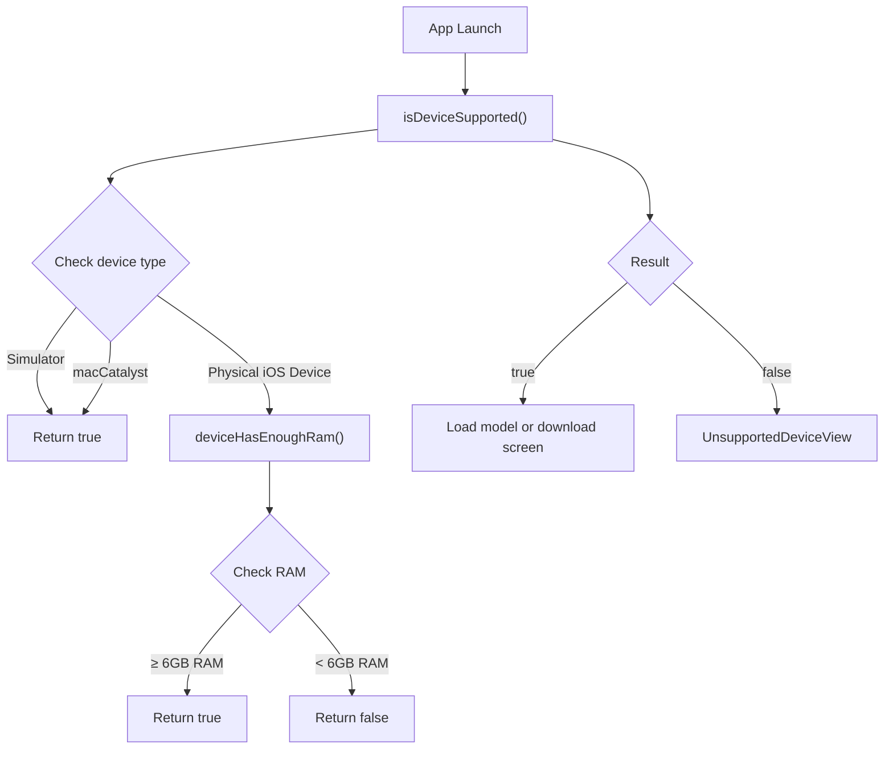
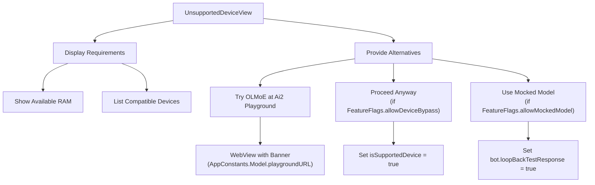
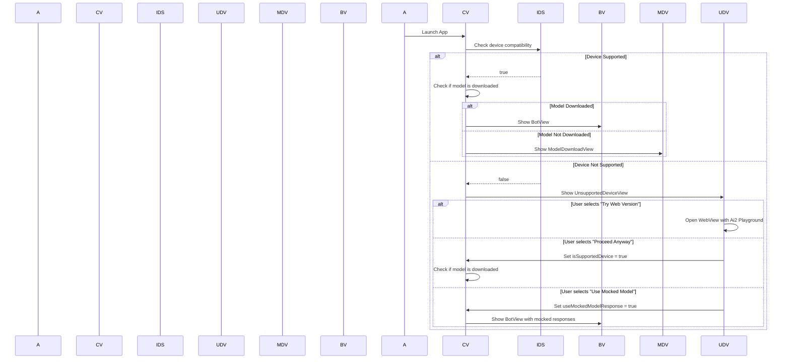

<!-- source: DeepWiki mcp.deepwiki.com · repo allenai/OLMoE.swift · page 5.1 Device Compatibility · fetched 2026-10-26 -->

# Device Compatibility

<details>
<summary>Relevant source files</summary>

The following files were used as context for generating this wiki page:

- [OLMoE.swift/Constants/Localizable.xcstrings](OLMoE.swift/Constants/Localizable.xcstrings)
- [OLMoE.swift/Extensions/DeviceSupport.swift](OLMoE.swift/Extensions/DeviceSupport.swift)
- [OLMoE.swift/Model/KeyboardResponder.swift](OLMoE.swift/Model/KeyboardResponder.swift)
- [OLMoE.swift/Views/ContentView.swift](OLMoE.swift/Views/ContentView.swift)
- [OLMoE.swift/Views/ScrollToBottomButtonView.swift](OLMoE.swift/Views/ScrollToBottomButtonView.swift)
- [OLMoE.swift/Views/UnsupportedDeviceView.swift](OLMoE.swift/Views/UnsupportedDeviceView.swift)

</details>


This document describes how OLMoE.swift determines if a device can run the language model, the specific hardware requirements, and the alternative options provided for unsupported devices. For information about model downloading and storage, see [Model Management](#5).

## Device Requirements

OLMoE requires significant hardware resources to run the language model locally. The app enforces the following requirements:

- **RAM Requirement**: At least 8GB of RAM (though the actual code checks for 6GB)
- **Compatible Devices**:
  - iPhone 15 Pro and Pro Max
  - iPhone 16 series
  - iPad Pro 4th Generation and newer
  - iPad Air 5th Generation and newer
  - Mac devices (via Mac Catalyst)

These requirements ensure the model can operate efficiently while maintaining reasonable performance for local language processing.

Sources: [OLMoE.swift/Views/UnsupportedDeviceView.swift:42-54](), [OLMoE.swift/Extensions/DeviceSupport.swift:12-17]()

## Compatibility Detection System

### How Compatibility Is Determined

The app uses the `isDeviceSupported()` function to determine if the current device meets the necessary requirements. This check happens at app launch before attempting to load the model.



Sources: [OLMoE.swift/Extensions/DeviceSupport.swift:20-28](), [OLMoE.swift/Views/ContentView.swift:406-428]()

### Implementation Details

The app determines device compatibility using two key functions:

1. `isDeviceSupported()`: The main function that returns whether the device can run the model:
   - Returns `true` for simulator and macCatalyst environments
   - Delegates to `deviceHasEnoughRam()` for physical iOS devices

2. `deviceHasEnoughRam()`: Checks if the device has sufficient RAM:
   - Required RAM: 6GB (though UI shows 8GB as requirement)
   - Uses `ProcessInfo.processInfo.physicalMemory` to check available RAM

When a user opens the app, the compatibility check happens immediately and determines whether to show the main app interface or the unsupported device view.

Sources: [OLMoE.swift/Extensions/DeviceSupport.swift:12-28]()

## Handling Unsupported Devices

When a device is detected as unsupported, the app displays the `UnsupportedDeviceView` which provides information about compatibility requirements and alternative options.



Sources: [OLMoE.swift/Views/UnsupportedDeviceView.swift:13-105](), [OLMoE.swift/Views/ContentView.swift:421-428]()

### Alternative Options

The app provides three alternatives for users with unsupported devices:

1. **Web-based Alternative**: Users can access OLMoE through the Ai2 Playground website
   - Opens a WebView with a banner indicating the model is running on Ai2's servers
   - Doesn't download the model to the device
   - Sends user input to a remote server for processing

2. **Override Warning** (Developer Option): If `FeatureFlags.allowDeviceBypass` is enabled, users can proceed anyway
   - This may result in poor performance or crashes
   - Intended for development/testing purposes

3. **Mocked Model** (Developer Option): If `FeatureFlags.allowMockedModel` is enabled, users can use a mocked model
   - Uses `loopBackTestResponse` to echo input rather than running actual inference
   - Useful for testing UI without model computation

Sources: [OLMoE.swift/Views/UnsupportedDeviceView.swift:60-95](), [OLMoE.swift/Views/ContentView.swift:425-427]()

## Integration with Application Flow

The device compatibility check is an early step in the application's initialization flow, determining which path the app takes.



Sources: [OLMoE.swift/Views/ContentView.swift:392-504]()

## Technical Implementation

### Key Components

| Component | Role |
|-----------|------|
| `isDeviceSupported()` | Main function to determine device compatibility |
| `deviceHasEnoughRam()` | Helper function to check RAM availability |
| `UnsupportedDeviceView` | UI component displayed for incompatible devices |
| `FeatureFlags.allowDeviceBypass` | Flag enabling "Proceed Anyway" option |
| `FeatureFlags.allowMockedModel` | Flag enabling "Proceed With Mocked Model" option |
| `useMockedModelResponse` | State flag to indicate mocked model usage |
| `bot.loopBackTestResponse` | Property that enables mocked responses |

Sources: [OLMoE.swift/Extensions/DeviceSupport.swift:12-28](), [OLMoE.swift/Views/UnsupportedDeviceView.swift:13-105](), [OLMoE.swift/Views/ContentView.swift:406-428]()

### Memory Calculation

The app calculates available RAM using system APIs:

```swift
// Gets physical memory in bytes
let totalRAM = ProcessInfo.processInfo.physicalMemory
// Converts to GB for display
let availableMemoryInGB = Double(os_proc_available_memory()) / (1024 * 1024 * 1024)
```

Although the UI shows 8GB as the requirement, the actual check verifies if 6GB is available:

```swift
let requiredRAM: UInt64 = 6 * 1024 * 1024 * 1024
let totalRAM = ProcessInfo.processInfo.physicalMemory
return totalRAM >= requiredRAM
```

Sources: [OLMoE.swift/Extensions/DeviceSupport.swift:12-17](), [OLMoE.swift/Views/UnsupportedDeviceView.swift:22-23]()

## User Experience

When a user with an unsupported device launches the app:

1. They see the `UnsupportedDeviceView` explaining why their device is incompatible
2. The view displays the device's available RAM and lists compatible devices
3. Users are offered alternatives:
   - Try OLMoE at the Ai2 Playground (web version)
   - Proceed anyway (if enabled)
   - Use a mocked model that doesn't require significant resources (if enabled)

This approach ensures users understand why their device is unsupported while still providing options to experience OLMoE in some form.

Sources: [OLMoE.swift/Views/UnsupportedDeviceView.swift:13-105]()

---

