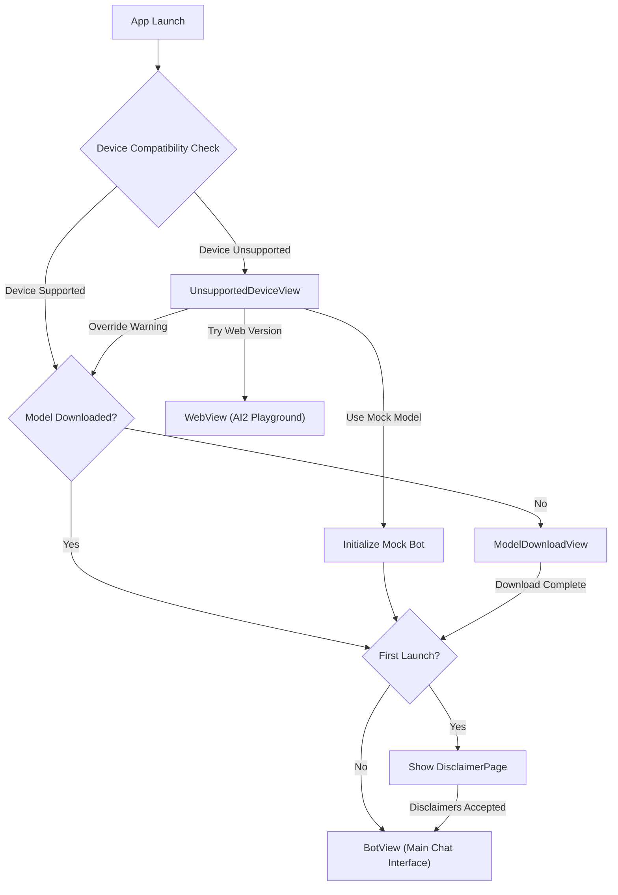
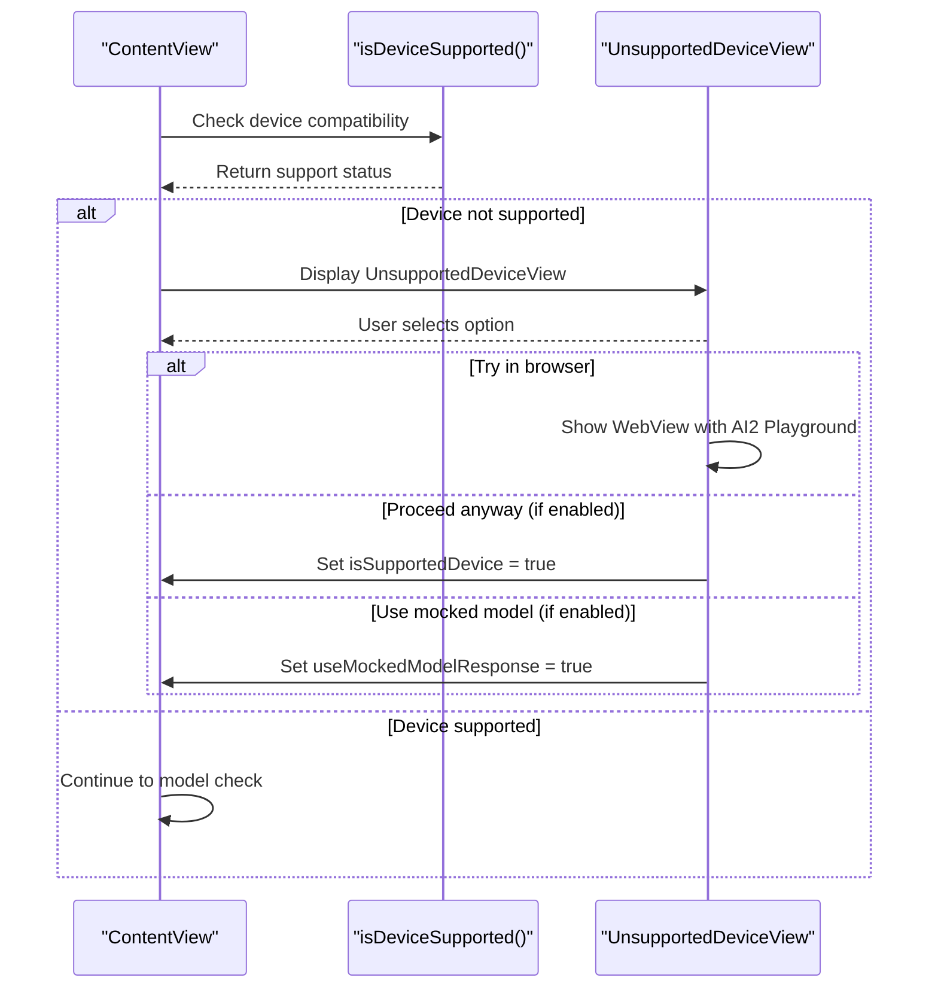
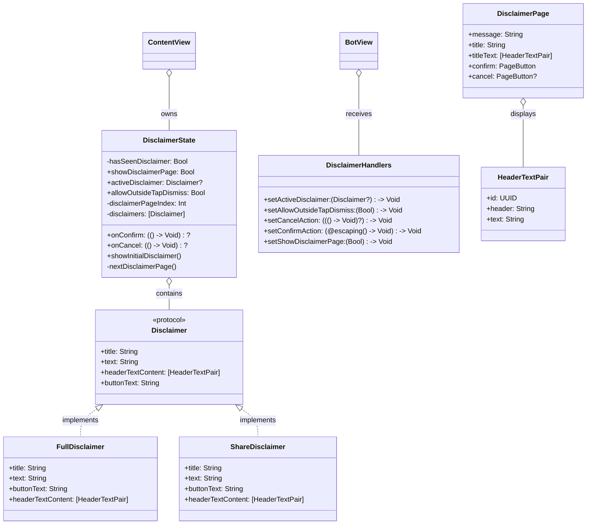
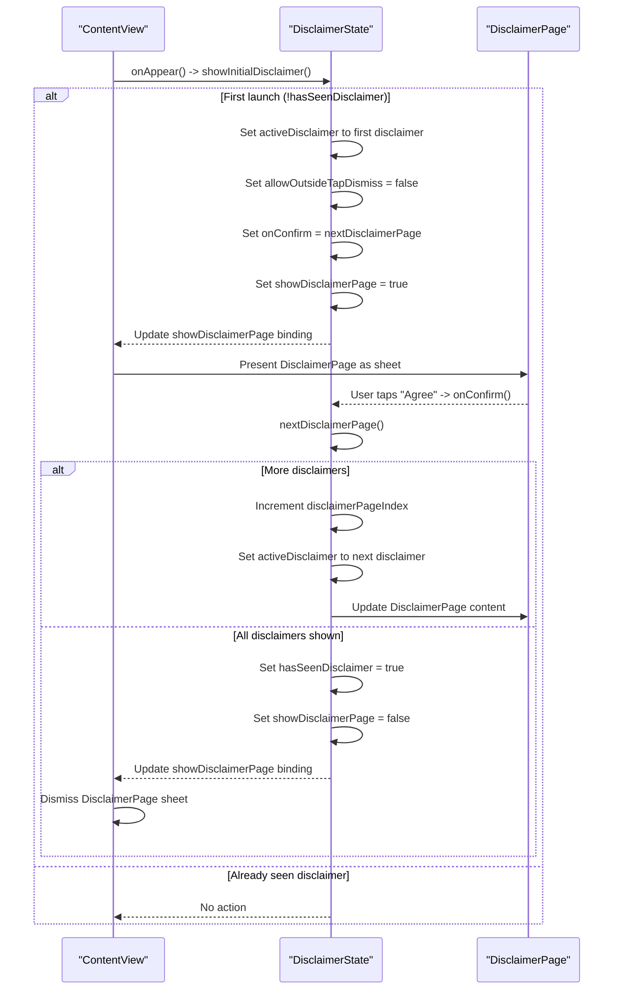
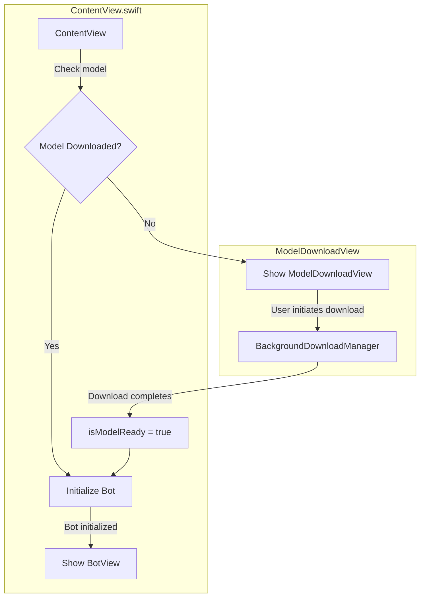
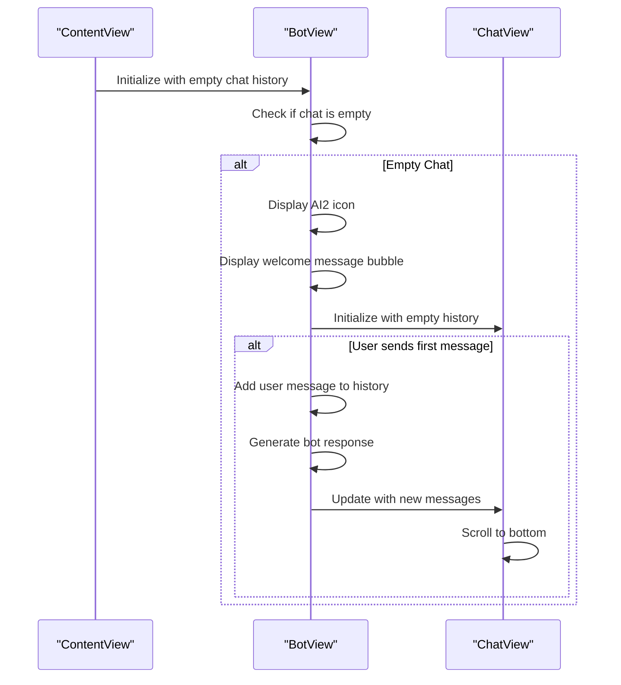

<!-- source: DeepWiki mcp.deepwiki.com · repo allenai/OLMoE.swift · page 6 User Onboarding · fetched 2026-10-26 -->

# User Onboarding

<details>
<summary>Relevant source files</summary>

The following files were used as context for generating this wiki page:

- [OLMoE.swift/Constants/Disclaimers.swift](OLMoE.swift/Constants/Disclaimers.swift)
- [OLMoE.swift/Constants/Localizable.xcstrings](OLMoE.swift/Constants/Localizable.xcstrings)
- [OLMoE.swift/Model/KeyboardResponder.swift](OLMoE.swift/Model/KeyboardResponder.swift)
- [OLMoE.swift/Views/ContentView.swift](OLMoE.swift/Views/ContentView.swift)
- [OLMoE.swift/Views/DisclaimerPageView.swift](OLMoE.swift/Views/DisclaimerPageView.swift)
- [OLMoE.swift/Views/HeaderTextPairView.swift](OLMoE.swift/Views/HeaderTextPairView.swift)
- [OLMoE.swift/Views/ScrollToBottomButtonView.swift](OLMoE.swift/Views/ScrollToBottomButtonView.swift)
- [OLMoE.swift/Views/SheetWrapperView.swift](OLMoE.swift/Views/SheetWrapperView.swift)
- [OLMoE.swift/Views/UnsupportedDeviceView.swift](OLMoE.swift/Views/UnsupportedDeviceView.swift)

</details>


## Purpose and Scope

This document covers the user onboarding process in OLMoE.swift, which includes device compatibility checks, initial disclaimers, model downloading, and transitioning the user to the main chat interface. The onboarding flow ensures users understand the app's capabilities and limitations before they begin interacting with the language model.

For information about the general architecture of the application, see [Core Architecture](#3).

## Onboarding Flow Overview

The user onboarding process in OLMoE.swift is designed to provide a smooth first-time experience while ensuring users have the proper device capabilities and understand the system's limitations.



Sources: [OLMoE.swift/Views/ContentView.swift:392-524](), [OLMoE.swift/Views/UnsupportedDeviceView.swift:13-107]()

## Device Compatibility Check

The first step in the onboarding process is checking whether the device meets the minimum requirements to run the OLMoE model locally.

### Requirements and Detection

OLMoE requires devices with at least 8GB of RAM, which typically includes:
- iPhone 15 Pro/Max and iPhone 16 models
- iPad Pro 4th Gen and newer
- iPad Air 5th Gen and newer



The `UnsupportedDeviceView` displays:
- Current device memory information
- List of supported devices
- Alternative options for using OLMoE

Sources: [OLMoE.swift/Views/ContentView.swift:406](), [OLMoE.swift/Views/ContentView.swift:421-428](), [OLMoE.swift/Views/UnsupportedDeviceView.swift:13-107]()

## Disclaimer System

The disclaimer system ensures users understand the capabilities, limitations, and terms of use for OLMoE before they begin interacting with the model.

### Disclaimer Architecture



Sources: [OLMoE.swift/Views/DisclaimerPageView.swift:12-85](), [OLMoE.swift/Constants/Disclaimers.swift:11-53](), [OLMoE.swift/Views/HeaderTextPairView.swift:12-39]()

### Disclaimer Flow

When a user first launches the app, the disclaimer system presents important information that must be acknowledged before using the app.



The `FullDisclaimer` contains three main sections:
1. **Limitations** - Explains what OLMoE should not be used for
2. **Privacy and Data Collection** - Information about data storage and privacy
3. **Acceptance** - Terms of use and acknowledgment

Sources: [OLMoE.swift/Views/ContentView.swift:469-470](), [OLMoE.swift/Views/DisclaimerPageView.swift:58-84](), [OLMoE.swift/Constants/Disclaimers.swift:20-41]()

## Model Download Process

If the model isn't already downloaded, the app presents the `ModelDownloadView` to guide the user through downloading the required model files.



The download process is managed by the `BackgroundDownloadManager`, which handles:
- Checking disk space
- Managing the download task
- Reporting download progress
- Moving the file to the correct location when complete

Sources: [OLMoE.swift/Views/ContentView.swift:394](), [OLMoE.swift/Views/ContentView.swift:429-440](), [OLMoE.swift/Views/ContentView.swift:443-449](), [OLMoE.swift/Views/ContentView.swift:506-513]()

## Initial Chat Interface

After the device check, model download, and disclaimer acceptance, the user is presented with the main chat interface (`BotView`).

### Welcome Experience

When a user first enters the chat interface, they see:

1. A clean interface with the AI2 icon in the center (when chat is empty)
2. A welcome message in a bot chat bubble: "Hello! I'm OLMoE, a fully open, state-of-the-art language model running locally on your device."
3. A message input field at the bottom



The welcome message is defined in `Localizable.xcstrings` as "Welcome chat message" and displayed conditionally when the chat history is empty.

Sources: [OLMoE.swift/Views/ContentView.swift:321-327](), [OLMoE.swift/Constants/Localizable.xcstrings:145-155]()

## Key Components in User Onboarding

| Component | Purpose | File |
|-----------|---------|------|
| `ContentView` | Main coordinator that manages the onboarding flow | [ContentView.swift]() |
| `DisclaimerState` | Manages disclaimer visibility and progression | [DisclaimerPageView.swift]() |
| `DisclaimerPage` | UI component that displays disclaimer content | [DisclaimerPageView.swift]() |
| `Disclaimer` | Protocol defining the structure of disclaimers | [Disclaimers.swift]() |
| `FullDisclaimer` | Main disclaimer shown during initial onboarding | [Disclaimers.swift]() |
| `ShareDisclaimer` | Secondary disclaimer shown when sharing | [Disclaimers.swift]() |
| `UnsupportedDeviceView` | UI for devices that don't meet requirements | [UnsupportedDeviceView.swift]() |
| `BackgroundDownloadManager` | Manages model download process | Referenced in [ContentView.swift]() |

## Persistence of Onboarding State

The app uses `@AppStorage` to persist whether the user has seen the disclaimer, preventing it from being shown on subsequent launches:

```swift
@AppStorage("hasSeenDisclaimer") private var hasSeenDisclaimer : Bool = false
```

In debug builds, this persistence is disabled to allow testing the onboarding flow repeatedly:

```swift
#if DEBUG
    @Published private var hasSeenDisclaimer: Bool = false
#else
    @AppStorage("hasSeenDisclaimer") private var hasSeenDisclaimer : Bool = false
#endif
```

Sources: [OLMoE.swift/Views/DisclaimerPageView.swift:30-34]()

---

