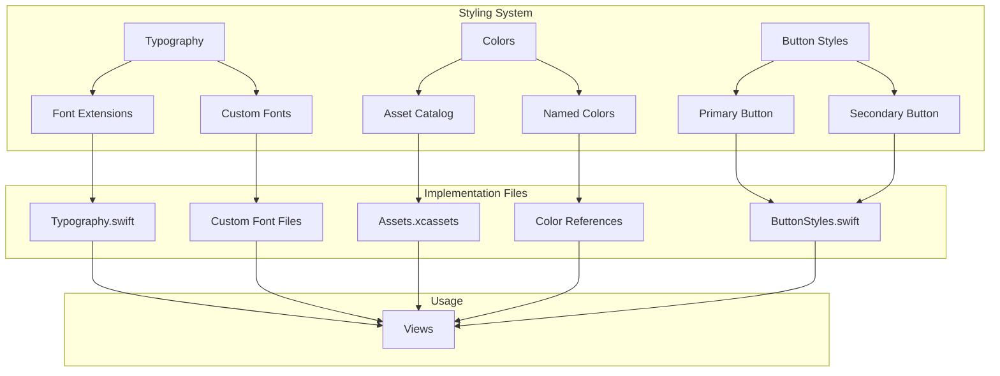
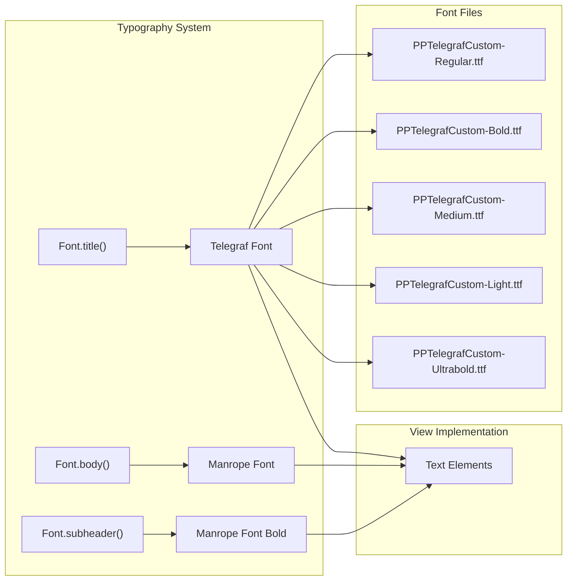
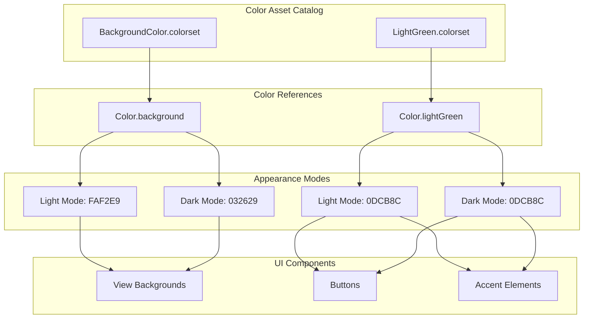
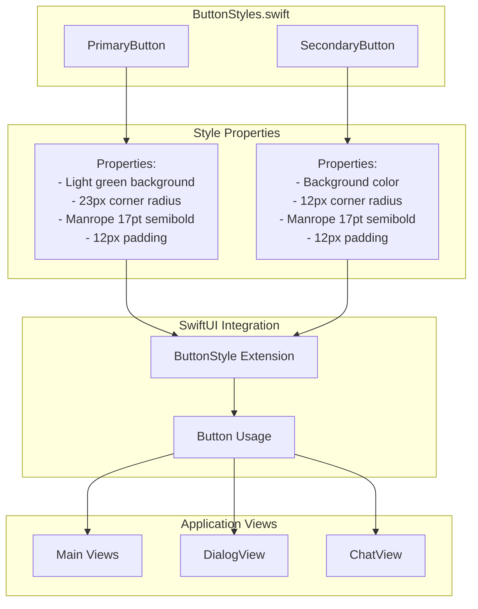
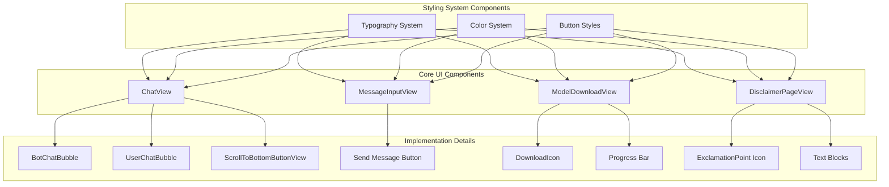

<!-- source: DeepWiki mcp.deepwiki.com · repo allenai/OLMoE.swift · page 7.1 Styling System · fetched 2026-10-26 -->

# Styling System

<details>
<summary>Relevant source files</summary>

The following files were used as context for generating this wiki page:

- [OLMoE.swift/Assets.xcassets/BackgroundColor.colorset/Contents.json](OLMoE.swift/Assets.xcassets/BackgroundColor.colorset/Contents.json)
- [OLMoE.swift/Assets.xcassets/DownloadIcon.imageset/Contents.json](OLMoE.swift/Assets.xcassets/DownloadIcon.imageset/Contents.json)
- [OLMoE.swift/Assets.xcassets/DownloadIcon.imageset/DownloadIcon.svg](OLMoE.swift/Assets.xcassets/DownloadIcon.imageset/DownloadIcon.svg)
- [OLMoE.swift/Assets.xcassets/Exclamation.imageset/Contents.json](OLMoE.swift/Assets.xcassets/Exclamation.imageset/Contents.json)
- [OLMoE.swift/Assets.xcassets/Exclamation.imageset/Exclamation.png](OLMoE.swift/Assets.xcassets/Exclamation.imageset/Exclamation.png)
- [OLMoE.swift/Assets.xcassets/LightGreen.colorset/Contents.json](OLMoE.swift/Assets.xcassets/LightGreen.colorset/Contents.json)
- [OLMoE.swift/Resources/PPTelegrafCustom/PPTelegrafCustom-Black.ttf](OLMoE.swift/Resources/PPTelegrafCustom/PPTelegrafCustom-Black.ttf)
- [OLMoE.swift/Resources/PPTelegrafCustom/PPTelegrafCustom-Bold.ttf](OLMoE.swift/Resources/PPTelegrafCustom/PPTelegrafCustom-Bold.ttf)
- [OLMoE.swift/Resources/PPTelegrafCustom/PPTelegrafCustom-Light.ttf](OLMoE.swift/Resources/PPTelegrafCustom/PPTelegrafCustom-Light.ttf)
- [OLMoE.swift/Resources/PPTelegrafCustom/PPTelegrafCustom-Medium.ttf](OLMoE.swift/Resources/PPTelegrafCustom/PPTelegrafCustom-Medium.ttf)
- [OLMoE.swift/Resources/PPTelegrafCustom/PPTelegrafCustom-Regular.ttf](OLMoE.swift/Resources/PPTelegrafCustom/PPTelegrafCustom-Regular.ttf)
- [OLMoE.swift/Resources/PPTelegrafCustom/PPTelegrafCustom-Ultrabold.ttf](OLMoE.swift/Resources/PPTelegrafCustom/PPTelegrafCustom-Ultrabold.ttf)
- [OLMoE.swift/Styles/ButtonStyles.swift](OLMoE.swift/Styles/ButtonStyles.swift)
- [OLMoE.swift/Styles/Typography.swift](OLMoE.swift/Styles/Typography.swift)

</details>


The OLMoE.swift application implements a consistent styling system to maintain visual coherence across the user interface. This document outlines the core styling components, including typography, colors, and button styles used throughout the application.

## Overview

The styling system consists of several key components:

1. **Typography**: Custom font extensions and predefined text styles
2. **Colors**: Standard color definitions with dark/light mode support
3. **Button Styles**: Reusable button style definitions

This structure enables consistent visual appearance and simplifies UI development by providing centralized styling definitions.



Sources: [OLMoE.swift/Styles/Typography.swift](), [OLMoE.swift/Styles/ButtonStyles.swift](), [OLMoE.swift/Assets.xcassets/BackgroundColor.colorset/Contents.json](), [OLMoE.swift/Assets.xcassets/LightGreen.colorset/Contents.json]()

## Typography System

The typography system is based on two primary font families: Telegraf and Manrope. Font extensions provide consistent text styling throughout the application.

### Font Extensions

The `Typography.swift` file defines extension methods on the `Font` type to create standardized text styles:

| Method | Font Family | Weight | Size | Usage |
|--------|------------|--------|------|-------|
| `title(_:)` | Telegraf | Variable (default: regular) | 24 | Headings and titles |
| `body(_:)` | Manrope | Variable (default: regular) | 17 | Body text |
| `subheader()` | Manrope | Bold | 17 | Section headers |

Example usage in views:
```swift
Text("Welcome to OLMoE")
    .font(.title())

Text("This is body text")
    .font(.body())

Text("Section Header")
    .font(.subheader())
```

### Custom Fonts

The application uses custom font files located in the Resources directory:

- PPTelegrafCustom (various weights)
  - Regular
  - Light
  - Medium
  - Bold
  - Ultrabold

These custom fonts are embedded in the application bundle and registered for use with the font extensions.



Sources: [OLMoE.swift/Styles/Typography.swift](), [OLMoE.swift/Resources/PPTelegrafCustom/PPTelegrafCustom-Regular.ttf](), [OLMoE.swift/Resources/PPTelegrafCustom/PPTelegrafCustom-Bold.ttf](), [OLMoE.swift/Resources/PPTelegrafCustom/PPTelegrafCustom-Medium.ttf](), [OLMoE.swift/Resources/PPTelegrafCustom/PPTelegrafCustom-Light.ttf](), [OLMoE.swift/Resources/PPTelegrafCustom/PPTelegrafCustom-Ultrabold.ttf]()

## Color System

The color system is defined in the Assets.xcassets directory and provides consistent colors with support for both light and dark modes.

### Key Colors

| Color Name | Light Mode (RGB) | Dark Mode (RGB) | Usage |
|------------|-----------------|-----------------|-------|
| BackgroundColor | FAF2E9 | 032629 | App background |
| LightGreen | 0DCB8C | 0DCB8C | Primary accent color |

### Usage Pattern

Colors are accessed via the SwiftUI `Color` type using named references:

```swift
// Background color (adapts to light/dark mode)
.background(Color.background)

// Accent color
.background(Color.lightGreen)
```

The application's color system ensures visual consistency across different interface elements and supports the system's appearance settings (light/dark mode).



Sources: [OLMoE.swift/Assets.xcassets/BackgroundColor.colorset/Contents.json](), [OLMoE.swift/Assets.xcassets/LightGreen.colorset/Contents.json]()

## Button Styles

The application provides reusable button styles defined in `ButtonStyles.swift` to ensure visual consistency across interactive elements.

### Primary Button

The `PrimaryButton` style is used for primary actions and has the following properties:

- Light green background color
- 23px corner radius
- Manrope font at 17pt with semibold weight
- 12px padding (vertical and horizontal)
- Configurable minimum width (default: 100)

### Secondary Button

The `SecondaryButton` style is used for secondary actions with these characteristics:

- Background color matching the app background
- 12px corner radius
- Manrope font at 17pt with semibold weight
- 12px padding (vertical and horizontal)
- Configurable minimum width (default: 100)
- Accent color for text

### Implementation

Button styles are implemented as conformances to SwiftUI's `ButtonStyle` protocol:

```swift
struct PrimaryButton: ButtonStyle {
    var minWidth: CGFloat?
    
    func makeBody(configuration: ButtonStyle.Configuration) -> some View {
        // Style implementation
    }
}

extension ButtonStyle where Self == PrimaryButton {
    static var PrimaryButton: Self {
        .init()
    }
}
```

### Usage

Button styles are applied using the `.buttonStyle()` modifier:

```swift
Button("Continue") {
    // Action
}
.buttonStyle(.PrimaryButton)

Button("Cancel") {
    // Action
}
.buttonStyle(.SecondaryButton)
```



Sources: [OLMoE.swift/Styles/ButtonStyles.swift:11-32](), [OLMoE.swift/Styles/ButtonStyles.swift:34-56]()

## Integration with Application UI

The styling system components integrate with the application's UI elements to create a cohesive visual experience.



Sources: [OLMoE.swift/Styles/Typography.swift](), [OLMoE.swift/Styles/ButtonStyles.swift](), [OLMoE.swift/Assets.xcassets/BackgroundColor.colorset/Contents.json](), [OLMoE.swift/Assets.xcassets/LightGreen.colorset/Contents.json](), [OLMoE.swift/Assets.xcassets/DownloadIcon.imageset/Contents.json](), [OLMoE.swift/Assets.xcassets/Exclamation.imageset/Contents.json]()

## Best Practices

When working with the styling system, follow these guidelines:

1. Use the predefined font extensions (`.title()`, `.body()`, `.subheader()`) rather than creating custom font specifications
2. Access colors through named references (e.g., `Color.lightGreen`) instead of hard-coding RGB values
3. Apply button styles using the `.buttonStyle(.PrimaryButton)` or `.buttonStyle(.SecondaryButton)` modifiers
4. Maintain visual consistency by using the established styling components

These practices ensure the application maintains a consistent look and feel and simplifies future design updates by centralizing styling definitions.

---

