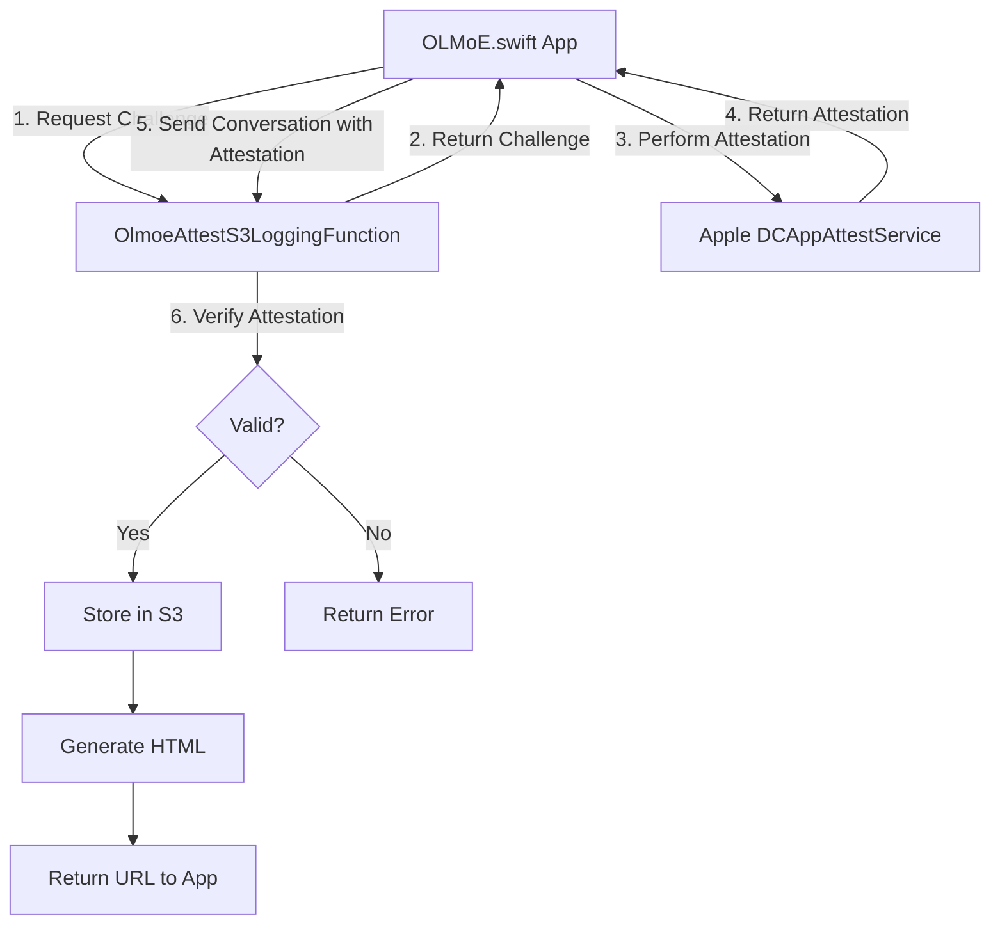
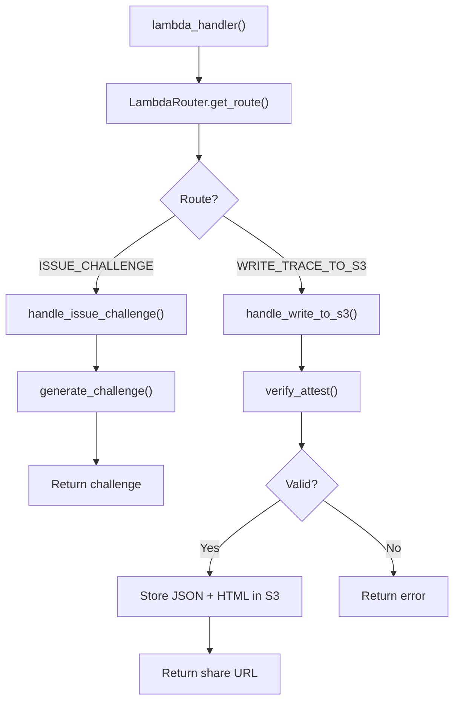
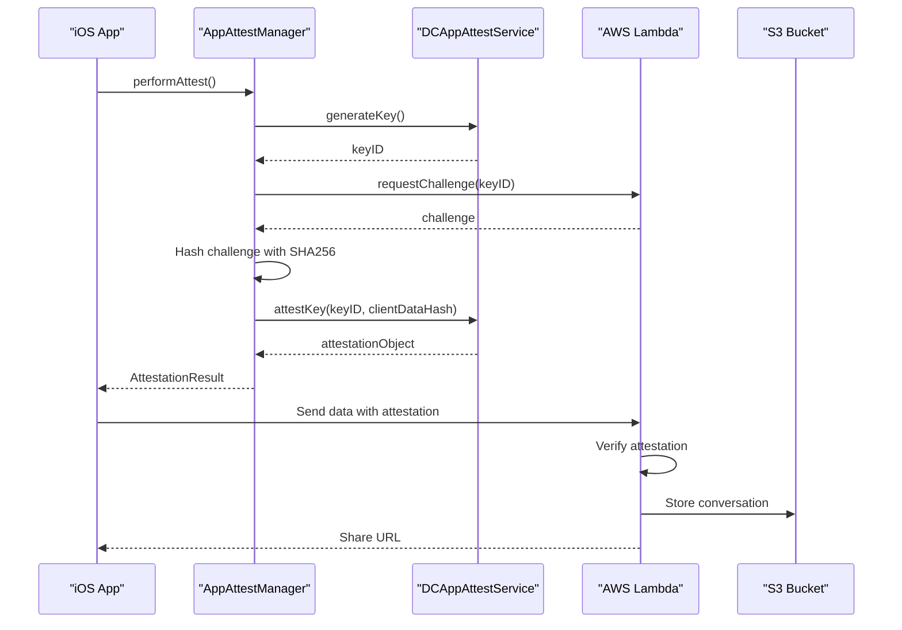

<!-- source: DeepWiki mcp.deepwiki.com · repo allenai/OLMoE.swift · page 8 AWS Lambda Integration · fetched 2026-10-26 -->

# AWS Lambda Integration

<details>
<summary>Relevant source files</summary>

The following files were used as context for generating this wiki page:

- [OLMoE.swift/Model/AttestManager.swift](OLMoE.swift/Model/AttestManager.swift)
- [aws-lambda/README.md](aws-lambda/README.md)
- [aws-lambda/src/attestation.py](aws-lambda/src/attestation.py)
- [aws-lambda/src/lambda_function.py](aws-lambda/src/lambda_function.py)
- [doc_assets/App_Attest_Challeng_Flow.png](doc_assets/App_Attest_Challeng_Flow.png)
- [doc_assets/Locate_Bundle_ID.png](doc_assets/Locate_Bundle_ID.png)

</details>


This page documents the optional AWS Lambda integration in OLMoE.swift that enables the conversation sharing functionality. While the core application runs language models entirely on-device, this Lambda function allows users to generate shareable URLs for their conversations. This feature is completely optional and not required for the primary chat functionality.

For details about the App Attestation security mechanism used by this feature, see [App Attestation](#8.1).

## Overview

The AWS Lambda integration consists of a Python-based serverless function (`OlmoeAttestS3LoggingFunction`) that securely handles conversations shared from the iOS app, verifies their legitimacy using Apple's App Attestation, stores the data in an S3 bucket, and returns a shareable URL.



Sources: [aws-lambda/README.md:1-5](), [OLMoE.swift/Model/AttestManager.swift:8-12]()

## Lambda Function Components

The AWS Lambda function is designed to handle two primary operations through distinct execution paths:

### 1. Challenge Request Handling

When the app initiates sharing, it first requests a challenge:
- The app sends a key ID to the Lambda
- The Lambda generates a deterministic challenge using HMAC
- The challenge is returned to the app for attestation with Apple's services

### 2. Conversation Storage

After attestation, the app sends the conversation data:
- The Lambda verifies the attestation object is valid
- The conversation data is stored in S3 in two formats:
  - JSON (under the `logs/` prefix) for logging purposes
  - HTML (under the `share/` prefix) for browser viewing
- A public URL to the HTML file is returned to the app



Sources: [aws-lambda/src/lambda_function.py:33-59](), [aws-lambda/src/lambda_function.py:61-83](), [aws-lambda/src/lambda_function.py:83-119]()

## iOS App Integration

The iOS app integrates with the Lambda function through the `AppAttestManager` class, which handles the attestation process and communication with the Lambda function.



Sources: [OLMoE.swift/Model/AttestManager.swift:13-99](), [aws-lambda/src/attestation.py:23-54]()

## Attestation Security Flow

The system uses Apple's App Attestation to ensure that requests come from legitimate instances of the app, which helps prevent abuse of the sharing service.


The attestation process:
1. The app generates a key using Apple's DCAppAttestService
2. The app requests a challenge from the Lambda function
3. The Lambda generates a deterministic challenge based on the key ID
4. The app obtains an attestation from Apple's servers using the challenge
5. The app sends the attestation, key ID, and conversation data to the Lambda
6. The Lambda verifies the attestation before storing the data

Sources: [aws-lambda/README.md:102-107](), [aws-lambda/src/attestation.py:23-88]()

## Setup and Configuration

### Lambda Environment Variables

The Lambda function requires several environment variables:

| Variable | Description |
|----------|-------------|
| `BUCKET_NAME` | S3 bucket for storing conversations |
| `S3_LOG_PREFIX` | Prefix for log files (default: "logs") |
| `S3_SHARE_PREFIX` | Prefix for shared files (default: "share") |
| `CERTIFICATE_AS_BYTES` | Apple App Attestation root certificate (base64) |
| `HMAC_SHA_KEY` | Secret key for signing challenges |
| `APP_ID` | App ID in format `{TEAM_ID}.{BUNDLE_IDENTIFIER}` |
| `MAX_REQUEST_SIZE_BYTES` | Maximum request size (default: 50KB) |

Sources: [aws-lambda/README.md:58-78]()

### Prerequisites

To deploy and use the Lambda function:

- AWS account with appropriate permissions
- S3 bucket for storing conversation data
- AWS CLI and SAM CLI installed
- Docker (for local testing and builds)
- Apple Developer account (for App Attestation)

Sources: [aws-lambda/README.md:20-30]()

### Deployment Process

The Lambda function can be deployed using AWS SAM CLI:

1. Install AWS CLI and SAM CLI
   ```
   pip install --upgrade aws-sam-cli
   ```

2. Create an environment file:
   ```
   cp .env.example.json .env.json
   ```

3. Populate the `.env.json` file with required variables

4. Build the Lambda:
   ```
   sam build
   ```

5. Deploy to AWS:
   ```
   sam deploy --guided --parameter-overrides $(cat .env.json | jq -r 'to_entries | map("\(.key)=\(.value|tostring)") | .[]')
   ```

Sources: [aws-lambda/README.md:33-57](), [aws-lambda/README.md:137-157]()

## Data Flow

When a user shares a conversation, the data flows through the system as follows:

1. The app sends the conversation data with attestation to the Lambda
2. The Lambda stores two artifacts in S3:
   - JSON file: `{S3_LOG_PREFIX}/{system_fingerprint}/{date}/{id}.json`
   - HTML file: `{S3_SHARE_PREFIX}/{system_fingerprint}/{date}/{id}.html`
3. The URL to the HTML file is returned: `https://{BUCKET_NAME}.s3.amazonaws.com/{html_path}`

Sources: [aws-lambda/src/lambda_function.py:83-119]()

## Security Considerations

The AWS Lambda integration implements several security measures:

1. **App Attestation**: Ensures requests come only from legitimate app instances
2. **Challenge-Response**: Prevents replay attacks
3. **Request Size Limiting**: Prevents abuse through oversized requests (default: 50KB)
4. **HMAC Signing**: Ensures challenge integrity
5. **System Fingerprinting**: Conversations are organized by device fingerprint

Sources: [aws-lambda/src/lambda_function.py:44-48](), [aws-lambda/src/attestation.py:23-54]()

## Testing Locally

The Lambda function can be tested locally using the SAM CLI:

1. Test Challenge Generation:
   ```
   sam local invoke OlmoeAttestS3LoggingFunction -e tests/get_challenge.json --parameter-overrides $(cat .env.test.json | jq -r 'to_entries | map("\(.key)=\(.value|tostring)") | .[]')
   ```

2. Test Conversation Sharing:
   ```
   sam local invoke OlmoeAttestS3LoggingFunction -e tests/prod_attest.json --parameter-overrides $(cat .env.test.json | jq -r 'to_entries | map("\(.key)=\(.value|tostring)") | .[]')
   ```

Note: Attestation is disabled during local testing since valid attestation objects can only be obtained from physical devices running the app.

Sources: [aws-lambda/README.md:102-135]()

---

