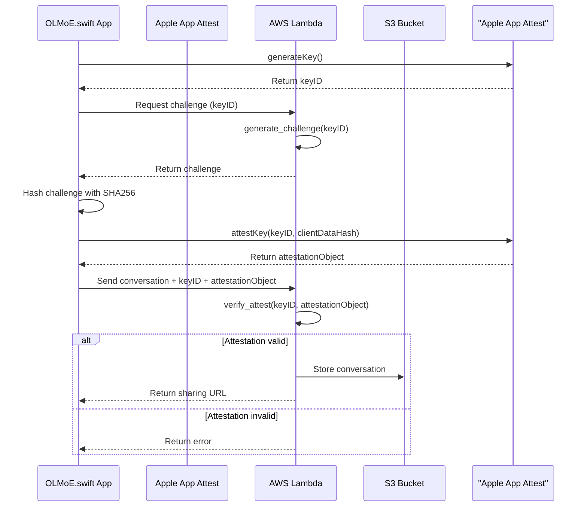
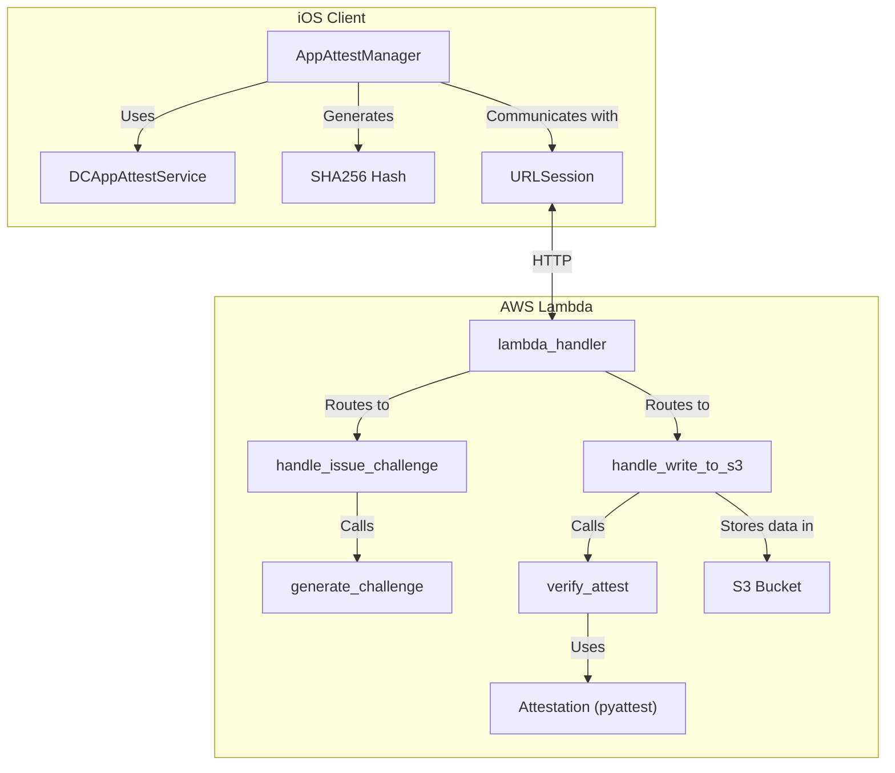
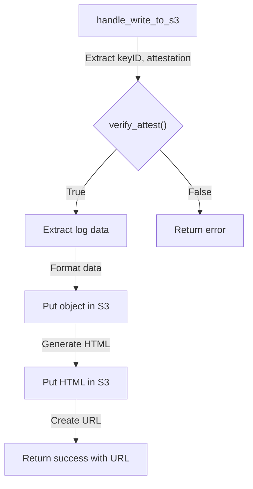

<!-- source: DeepWiki mcp.deepwiki.com · repo allenai/OLMoE.swift · page 8.1 App Attestation · fetched 2026-10-26 -->

# App Attestation

<details>
<summary>Relevant source files</summary>

The following files were used as context for generating this wiki page:

- [OLMoE.swift/Model/AttestManager.swift](OLMoE.swift/Model/AttestManager.swift)
- [aws-lambda/.env.test.json](aws-lambda/.env.test.json)
- [aws-lambda/src/attestation.py](aws-lambda/src/attestation.py)
- [aws-lambda/src/constants/deployment_environment.py](aws-lambda/src/constants/deployment_environment.py)
- [aws-lambda/src/lambda_function.py](aws-lambda/src/lambda_function.py)
- [aws-lambda/tests/get_challenge.json](aws-lambda/tests/get_challenge.json)
- [aws-lambda/tests/prod_attest.json](aws-lambda/tests/prod_attest.json)

</details>


## Purpose and Overview

This document covers the App Attestation system used in OLMoE.swift to secure the conversation sharing functionality. App Attestation ensures that shared conversations originate from legitimate, untampered app instances, preventing potential misuse or data manipulation. For information about the broader AWS Lambda integration, see [AWS Lambda Integration](#8).

App Attestation utilizes Apple's DeviceCheck framework, specifically the DCAppAttestService, to cryptographically verify the app's authenticity before allowing conversation sharing. This security measure is essential for maintaining the integrity of shared conversation data.

Sources: [OLMoE.swift/Model/AttestManager.swift:9-99]()

## Attestation Flow



This diagram illustrates the complete attestation flow between the app, Apple's DeviceCheck service, and the AWS Lambda backend.

Sources: [OLMoE.swift/Model/AttestManager.swift:13-99](), [aws-lambda/src/lambda_function.py:83-119](), [aws-lambda/src/attestation.py:23-53]()

## Implementation Components



This diagram shows the key components involved in the attestation system and their relationships.

Sources: [OLMoE.swift/Model/AttestManager.swift:13-99](), [aws-lambda/src/lambda_function.py:33-119](), [aws-lambda/src/attestation.py:23-88]()

## iOS Implementation

The iOS implementation centers around the `AppAttestManager` class, which handles all attestation-related operations:

### Key Generation

```swift
let service = DCAppAttestService.shared
let keyID: String = try await withCheckedThrowingContinuation { continuation in
    service.generateKey { newKeyID, error in
        // Handle result and resume continuation
    }
}
```

The app uses Apple's DCAppAttestService to generate a cryptographic key that uniquely identifies the app instance.

### Challenge Request

The app requests a challenge from the backend, providing the keyID:

```swift
guard let challenge = try await requestChallenge(keyID: keyID) else {
    throw NSError(domain: "AppAttest", code: -1, 
                  userInfo: [NSLocalizedDescriptionKey: "Failed to request challenge"])
}
```

### Attestation Generation

After receiving the challenge, the app:
1. Hashes the challenge using SHA256
2. Requests an attestation object from Apple's service
3. Encodes the attestation for transmission to the backend

```swift
let clientDataHash = Data(SHA256.hash(data: Data(challenge.utf8)))
let attestationObject: Data = try await withCheckedThrowingContinuation { continuation in
    service.attestKey(keyID, clientDataHash: clientDataHash) { attestation, error in
        // Handle result and resume continuation
    }
}
```

### Simulator Handling

The implementation includes a check for simulator environments where App Attestation is not supported:

```swift
#if targetEnvironment(simulator)
    throw NSError(domain: "AppAttest", code: -1, 
                  userInfo: [NSLocalizedDescriptionKey: "App Attest not supported on simulator."])
#else
    // Actual attestation implementation
#endif
```

Sources: [OLMoE.swift/Model/AttestManager.swift:13-99]()

## AWS Lambda Implementation

The backend implementation consists of multiple components that work together to handle attestation:

### Challenge Generation

When the app requests a challenge, the Lambda function calls `generate_challenge()` to create a deterministic challenge based on the keyID:

```python
def generate_challenge(key_id: str) -> str:
    # Generate deterministic bytes using HMAC of key_id
    seed_hmac = hmac.new(
        key=secret_key.encode('utf-8'),
        msg=key_id.encode('utf-8'),
        digestmod=hashlib.sha256
    )
    # ... additional processing
    return challenge_base64
```

The challenge is created using HMAC with a secret key, ensuring the challenge is unpredictable to attackers but reproducible by the server for verification.

### Attestation Verification

When the app sends data with an attestation, the Lambda function verifies it using the `verify_attest()` function:

```python
def verify_attest(key_id: str, attestation_object: str) -> bool:
    key_id_bytes = base64.b64decode(key_id)
    attest = base64.b64decode(attestation_object)
    nonce = generate_challenge(key_id).encode()
    config = AppleConfig(
        key_id=key_id_bytes,
        app_id=APP_ID,
        production=DEPLOYMENT_ENV == DeploymentEnvironment.PROD,
        root_ca=CERTIFICATE
    )
    attestation = Attestation(attest, nonce, config)
    
    try:
        attestation.verify()
        return True
    except PyAttestException:
        # Handle error
        return False
```

### Integration with S3 Storage

After successful verification, the conversation data is stored in S3 and a sharing URL is returned:



Sources: [aws-lambda/src/lambda_function.py:83-119](), [aws-lambda/src/attestation.py:23-88]()

## Configuration and Environment Considerations

The attestation system operates differently based on the deployment environment:

| Environment | Verification Behavior | Purpose |
|-------------|----------------------|---------|
| PROD | Full attestation verification | Production usage |
| DEV | Full attestation verification | Development testing |
| TEST | Bypasses verification | Automated testing |

The Lambda backend is configured using environment variables:

```python
CERTIFICATE_AS_BYTES = os.environ['CERTIFICATE_AS_BYTES'].encode()
APP_ID = os.environ['APP_ID']
DEPLOYMENT_ENV = DeploymentEnvironment.from_env()
```

The critical configuration elements include:
- Apple's root certificate for verification
- The app's bundle ID (APP_ID)
- HMAC secret key for challenge generation
- Deployment environment setting

Sources: [aws-lambda/src/attestation.py:16-20](), [aws-lambda/.env.test.json:1-10](), [aws-lambda/src/constants/deployment_environment.py:8-32]()

## Security Considerations

1. **Challenge Generation**: Uses HMAC with a secret key to create unpredictable but reproducible challenges
2. **Environment-Aware Verification**: Different verification rules for production vs. testing
3. **Certificate-Based Verification**: Uses Apple's trusted certificates to verify attestations
4. **Request Size Limiting**: Prevents potential DoS attacks by limiting request sizes
5. **Error Handling**: Comprehensive error handling to prevent information leakage
6. **No Attestation in Simulator**: Properly handles simulator environments where attestation isn't available

Sources: [aws-lambda/src/lambda_function.py:46-48](), [aws-lambda/src/attestation.py:23-53]()

## Integration with Conversation Sharing

App Attestation is specifically implemented to secure the conversation sharing functionality. When a user chooses to share a conversation:

1. The attestation process occurs as described above
2. The conversation data is combined with the attestation information
3. The data is sent to the Lambda backend for verification and storage
4. If successful, a sharing URL is returned to the app
5. The data stored in S3 includes:
   - The conversation messages
   - System information (model name, timestamps)
   - A system fingerprint for tracking

Sources: [aws-lambda/tests/prod_attest.json:1-21](), [aws-lambda/src/lambda_function.py:83-119]()

---

