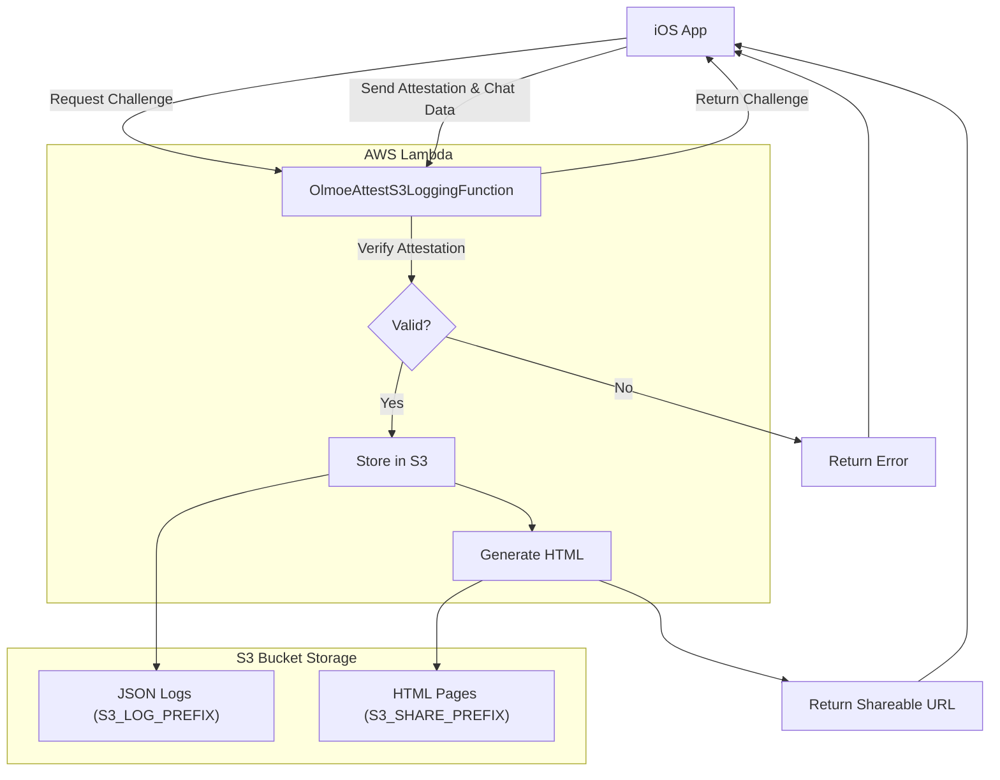
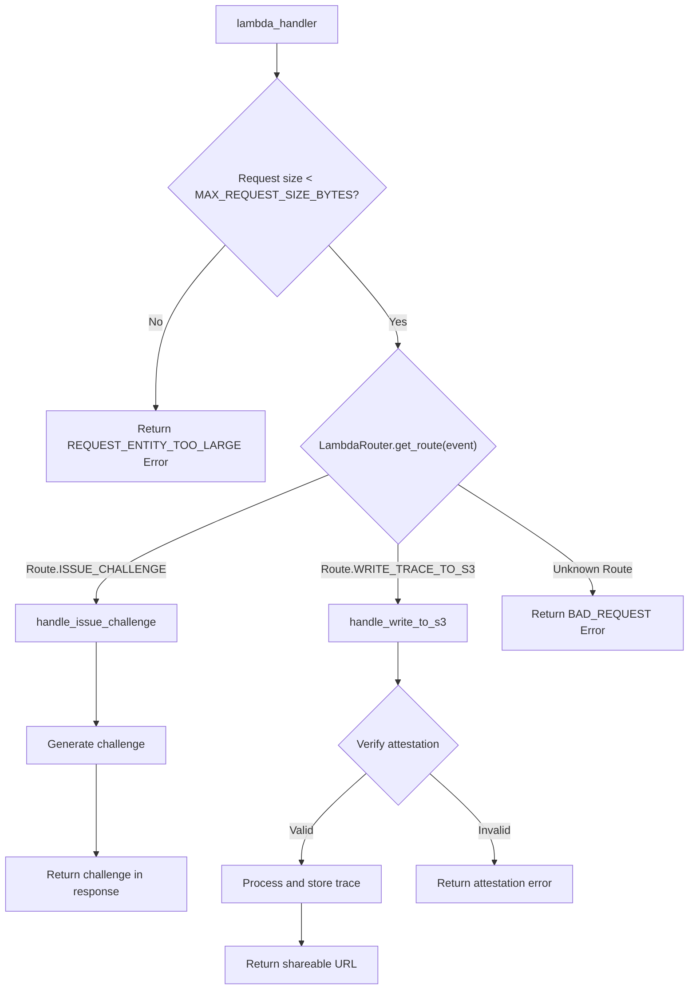
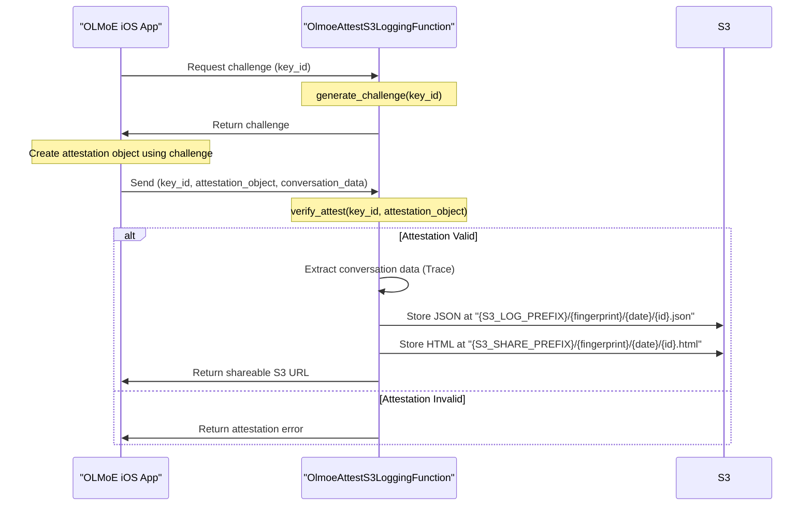
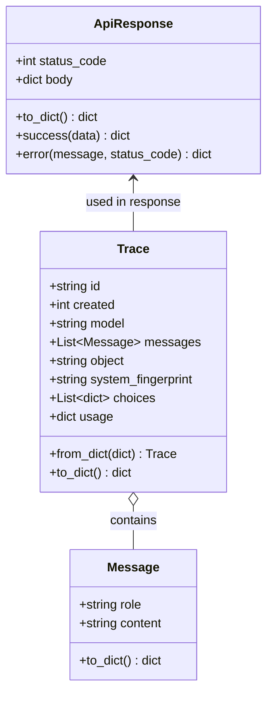
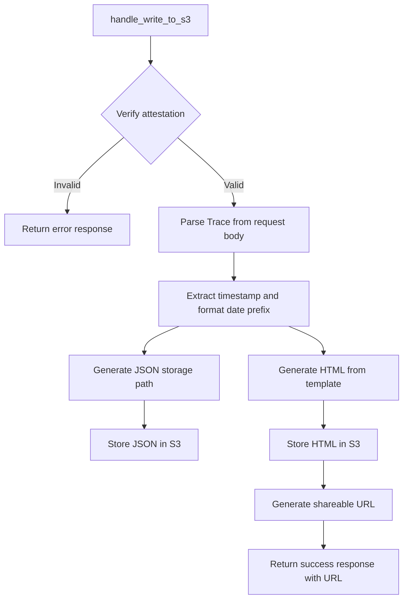
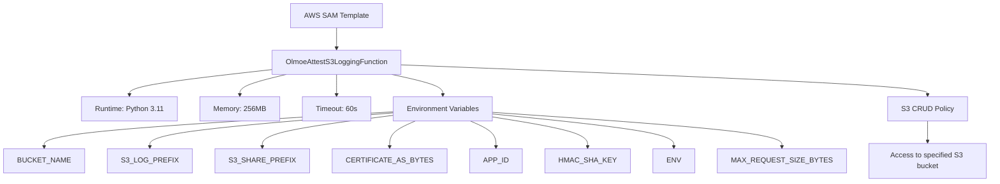

<!-- source: DeepWiki mcp.deepwiki.com · repo allenai/OLMoE.swift · page 8.2 Lambda Backend · fetched 2026-10-26 -->

# Lambda Backend

Relevant source files

The following files were used as context for generating this wiki page:

- [aws-lambda/.env.example.json](aws-lambda/.env.example.json)
- [aws-lambda/src/attestation.py](aws-lambda/src/attestation.py)
- [aws-lambda/src/constants/response_messages.py](aws-lambda/src/constants/response_messages.py)
- [aws-lambda/src/entities/message.py](aws-lambda/src/entities/message.py)
- [aws-lambda/src/entities/response.py](aws-lambda/src/entities/response.py)
- [aws-lambda/src/entities/routes.py](aws-lambda/src/entities/routes.py)
- [aws-lambda/src/entities/trace.py](aws-lambda/src/entities/trace.py)
- [aws-lambda/src/lambda_function.py](aws-lambda/src/lambda_function.py)
- [aws-lambda/template.yaml](aws-lambda/template.yaml)

The Lambda Backend is a serverless AWS Lambda function that handles secure conversation sharing for the OLMoE.swift application. This document details the architecture, request flow, and data handling of the `OlmoeAttestS3LoggingFunction`, which provides secure attestation, log storage, and URL generation for shareable conversation transcripts. For information about the app-side attestation implementation, see [App Attestation](#8.1).

## System Overview

The Lambda Backend serves two primary purposes:
1. Issues cryptographic challenges for app attestation verification
2. Securely stores conversation logs and generates shareable URLs after verifying attestation

Sources: [aws-lambda/src/lambda_function.py:32-58](), [aws-lambda/template.yaml:30-51]()

## Request Handling Architecture

The Lambda function processes two distinct types of requests based on their content:

Sources: [aws-lambda/src/lambda_function.py:33-58](), [aws-lambda/src/entities/routes.py:8-30]()

## Core Components

The Lambda function consists of several key components that work together:

| Component | Purpose | File Location |
|-----------|---------|---------------|
| `lambda_handler` | Main entry point that routes requests | [aws-lambda/src/lambda_function.py:33-58]() |
| `handle_issue_challenge` | Generates attestation challenges | [aws-lambda/src/lambda_function.py:61-80]() |
| `handle_write_to_s3` | Validates attestation and stores logs | [aws-lambda/src/lambda_function.py:83-119]() |
| `verify_attest` | Verifies Apple attestation objects | [aws-lambda/src/attestation.py:23-53]() |
| `generate_challenge` | Creates deterministic challenges | [aws-lambda/src/attestation.py:56-88]() |
| `ApiResponse` | Standardizes API responses | [aws-lambda/src/entities/response.py:11-63]() |
| `Trace` | Models conversation data | [aws-lambda/src/entities/trace.py:12-90]() |
| `Message` | Models individual chat messages | [aws-lambda/src/entities/message.py:8-31]() |

Sources: [aws-lambda/src/lambda_function.py:1-119](), [aws-lambda/src/attestation.py:1-88]()

## Attestation Flow

The attestation process ensures that requests come only from valid instances of the OLMoE.swift application:

Sources: [aws-lambda/src/lambda_function.py:83-119](), [aws-lambda/src/attestation.py:23-53]()

## Data Models

The backend uses structured data models to process and store conversation data:

Sources: [aws-lambda/src/entities/trace.py:12-90](), [aws-lambda/src/entities/message.py:8-31](), [aws-lambda/src/entities/response.py:11-63]()

## Trace Processing and Storage

When the Lambda function receives a valid attestation and trace data, it processes and stores it as follows:

The stored data follows this path structure:
- JSON logs: `{S3_LOG_PREFIX}/{system_fingerprint}/{YYYYMMDD}/{uuid}.json`
- HTML pages: `{S3_SHARE_PREFIX}/{system_fingerprint}/{YYYYMMDD}/{uuid}.html`

Sources: [aws-lambda/src/lambda_function.py:83-119]()

## Configuration

The Lambda function is configured through environment variables defined in the AWS SAM template:

| Variable | Purpose | Default |
|----------|---------|---------|
| `BUCKET_NAME` | S3 bucket for storage | - |
| `S3_LOG_PREFIX` | Prefix for log JSON files | - |
| `S3_SHARE_PREFIX` | Prefix for HTML files | - |
| `CERTIFICATE_AS_BYTES` | Apple root certificate (Base64) | - |
| `APP_ID` | App ID in format `{TEAM_ID}.{BUNDLE_ID}` | - |
| `HMAC_SHA_KEY` | Secret for challenge generation | - |
| `ENV` | Deployment environment (`dev`, `prod`, `test`) | `prod` |
| `MAX_REQUEST_SIZE_BYTES` | Maximum request size | 51200 (50KB) |

Sources: [aws-lambda/template.yaml:5-48](), [aws-lambda/.env.example.json:1-10]()

## Deployment Architecture

The function is deployed using AWS Serverless Application Model (SAM) with the following specifications:

Sources: [aws-lambda/template.yaml:30-51]()

## Error Handling

The Lambda function uses standardized error responses through the `ApiResponse` class:

| Error Scenario | Status Code | Message Source |
|----------------|-------------|----------------|
| Request too large | 413 | `INVALID_REQUEST_BODY` |
| Invalid key_id | 400 | `INVALID_KEY_ID` |
| Failed attestation | 400 | `ATTESTATION_VERIFICATION_FAILED` |
| Invalid request format | 400 | `INVALID_REQUEST_BODY` |
| Invalid message format | 400 | `INVALID_MESSAGE_FORMAT` |
| Invalid trace format | 400 | `INVALID_TRACE_FORMAT` |
| Other internal errors | 500 | Dynamic error message |

Sources: [aws-lambda/src/entities/response.py:11-63](), [aws-lambda/src/constants/response_messages.py:8-38]()

## Security Considerations

The Lambda backend incorporates several security measures:

1. **App Attestation**: Verifies requests come from legitimate app instances using Apple's App Attestation
2. **Request Size Limiting**: Prevents denial of service attacks by limiting request sizes
3. **Deterministic Challenges**: Uses HMAC-based challenge generation for attestation
4. **Environment Controls**: Different behavior based on deployment environment (test, dev, prod)
5. **S3 Access Scoping**: Limited IAM permissions for accessing only the specified S3 bucket

Sources: [aws-lambda/src/attestation.py:23-53](), [aws-lambda/src/lambda_function.py:45-48](), [aws-lambda/template.yaml:49-51]()