# Page: Overview

# Overview

<details>
<summary>Relevant source files</summary>

The following files were used as context for generating this wiki page:

- [OLMoE.swift.xcodeproj/project.pbxproj](OLMoE.swift.xcodeproj/project.pbxproj)
- [OLMoE.swift.xcodeproj/project.xcworkspace/xcshareddata/swiftpm/Package.resolved](OLMoE.swift.xcodeproj/project.xcworkspace/xcshareddata/swiftpm/Package.resolved)
- [OLMoE.swift/BuildConfig/project-defaults.xcconfig](OLMoE.swift/BuildConfig/project-defaults.xcconfig)
- [OLMoE.swift/Model/KeyboardResponder.swift](OLMoE.swift/Model/KeyboardResponder.swift)
- [OLMoE.swift/README.md](OLMoE.swift/README.md)
- [OLMoE.swift/Views/ContentView.swift](OLMoE.swift/Views/ContentView.swift)
- [README.md](README.md)
- [doc_assets/App_Main.png](doc_assets/App_Main.png)
- [doc_assets/Run_App.png](doc_assets/Run_App.png)

</details>


This document provides a comprehensive overview of OLMoE.swift, an iOS and macOS application that runs a fully open, state-of-the-art language model (OLMoE) locally on compatible devices. OLMoE.swift enables users to interact with a powerful AI language model directly on their device with complete privacy and offline capability.

OLMoE.swift is designed with a focus on local computation, ensuring user data never leaves the device during normal operation. The application provides a chat interface similar to commercial AI assistants but runs entirely on-device, making it suitable for privacy-conscious users and environments with limited connectivity.

## Key Features

- **On-device LLM Inference**: Runs the OLMoE language model directly on iOS and macOS devices
- **Complete Privacy**: All interactions stay on-device with no data transmitted to external servers for inference
- **Offline Capability**: Works without internet connection after model download
- **Responsive UI**: Provides a fluid chat experience with real-time streaming of responses
- **Device Compatibility Check**: Ensures the device meets minimum requirements (primarily 8GB RAM)
- **Optional Sharing Feature**: Allows sharing conversations via AWS Lambda (optional, requires configuration)

Sources: [README.md:16-26](), [OLMoE.swift/README.md:1-16]()

## System Architecture Overview

OLMoE.swift follows a modular architecture organized around several core subsystems that work together to deliver a seamless chat experience while ensuring efficient on-device model operation.

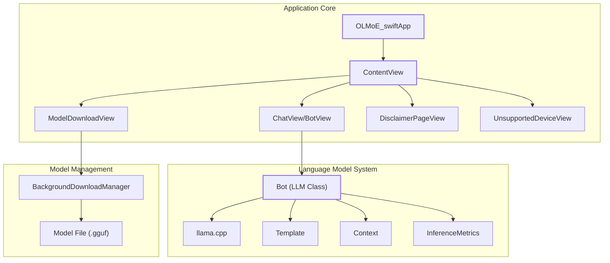

The application architecture centers around `ContentView`, which conditionally renders different views based on the application state. The `Bot` class (which extends `LLM`) handles interactions with the language model, while various supporting components manage model downloading, device compatibility checking, and user interface presentation.

Sources: [OLMoE.swift/Views/ContentView.swift:392-524]()

## Application Flow

The application follows a specific flow from launch to interactive chat:

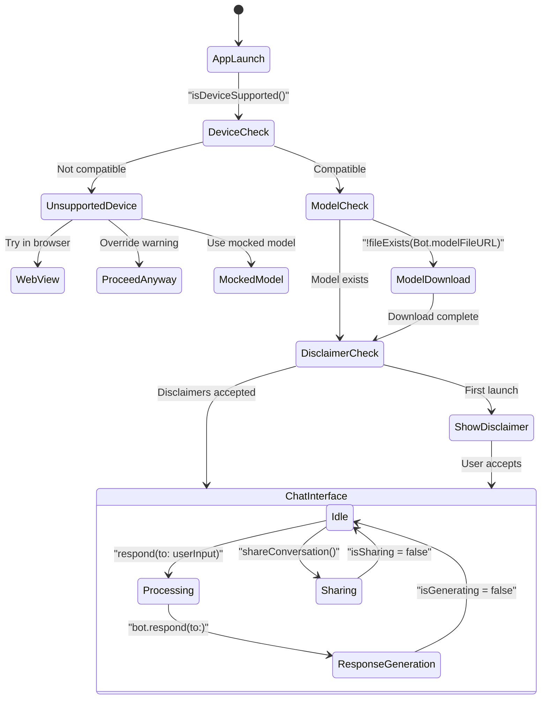

When the app launches, it first checks device compatibility, then verifies if the model is downloaded, presents any required disclaimers, and finally initializes the chat interface. The chat interface itself follows a cycle of idle state, processing user input, generating responses, and returning to idle.

Sources: [OLMoE.swift/Views/ContentView.swift:392-524](), [OLMoE.swift/Views/ContentView.swift:36-226]()

## Core Components

### ContentView

`ContentView` serves as the main coordinator for the application, managing the overall UI state and conditional rendering of different views based on application state:

- Determines which view to display based on device compatibility and model availability
- Initializes the `Bot` instance when the model is ready
- Manages disclaimer state and presentation
- Provides the application toolbar and navigation

Sources: [OLMoE.swift/Views/ContentView.swift:392-524]()

### Bot and LLM System

The `Bot` class extends the `LLM` class and serves as the primary interface to the language model:

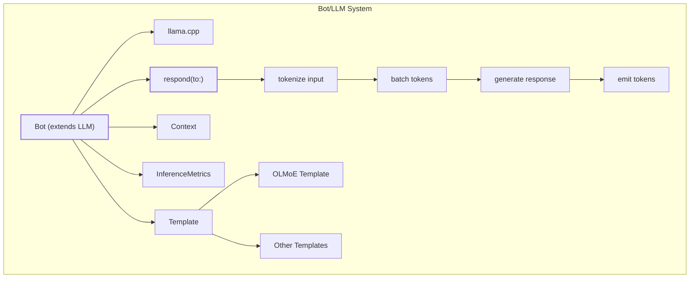

Key features of the Bot/LLM system:
- Interfaces with llama.cpp to run the model
- Uses templates to format conversations appropriately
- Manages conversation context and history
- Tracks performance metrics
- Provides streaming token generation for real-time responses

Sources: [OLMoE.swift/Views/ContentView.swift:12-34]()

### BotView / Chat Interface

The `BotView` manages the chat interface, including:

- Displaying user and bot messages
- Handling user input and message submission
- Managing the message generation state
- Providing controls for stopping generation and sharing conversations
- Auto-scrolling to show new messages

The chat interface implements real-time streaming of model responses, allowing users to see responses as they're generated rather than waiting for the complete message.

Sources: [OLMoE.swift/Views/ContentView.swift:36-369]()

### Model Management

The application includes a model management system that:

- Checks if the model file exists at the expected location
- Downloads the model file if necessary
- Verifies device compatibility before attempting to load the model
- Provides fallback options for unsupported devices

The model file is a GGUF (GPT-Generated Unified Format) file that contains the weights and parameters for the OLMoE language model.

Sources: [OLMoE.swift/Views/ContentView.swift:505-513]()

## Device Compatibility

OLMoE.swift implements device compatibility checking to ensure the device has sufficient resources to run the language model effectively:

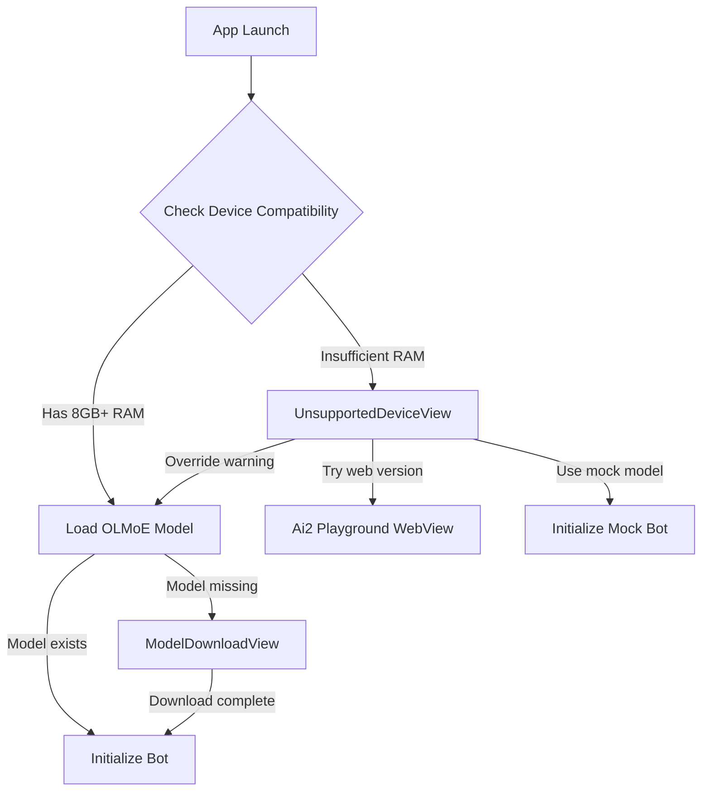

The primary compatibility requirement is sufficient RAM (8GB or more), as running large language models requires significant memory resources. For users with unsupported devices, the app provides alternative options including a web version or a mocked model experience.

Sources: [OLMoE.swift/Views/ContentView.swift:400-428]()

## Chat Experience

The chat interaction flow follows a specific sequence when a user sends a message:

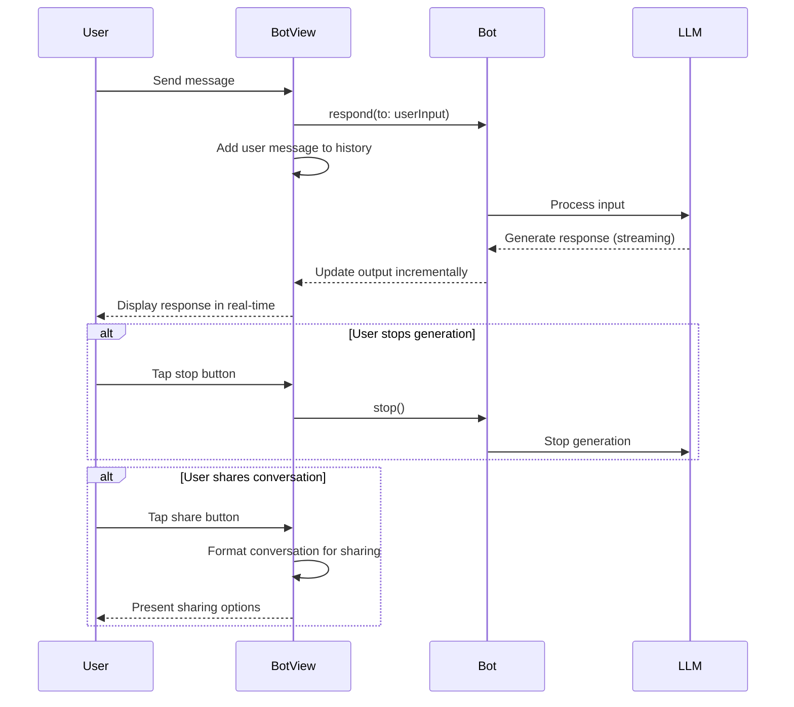

Key aspects of the chat experience:
- Real-time streaming of responses
- Ability to stop response generation
- Option to share conversations
- Markdown rendering of responses
- Code syntax highlighting in responses

Sources: [OLMoE.swift/Views/ContentView.swift:81-226]()

## Configuration and Customization

OLMoE.swift supports various configuration options through environment variables and build settings:

| Configuration Item | Description | Default Value |
|-------------------|-------------|---------------|
| API_KEY | Optional key for AWS Lambda sharing feature | "Use_Your_Own_Key" |
| API_URL | Optional endpoint for AWS Lambda sharing feature | "https://use_your_own_endpoint" |
| BUNDLE_VERSION | Build version number | 1 |
| BUNDLE_VERSION_PUBLIC | Marketing version number | 1.1 |
| PRODUCT_BUNDLE_IDENTIFIER | Bundle identifier for the app | "com.example.apple-samplecode.OLMoE.swift.${DEVELOPMENT_TEAM_ID}" |

These configuration settings can be customized by creating a `build.xcconfig` file based on the provided example.

Sources: [OLMoE.swift/BuildConfig/project-defaults.xcconfig:1-15](), [OLMoE.swift/README.md:47-66]()

## Technical Implementation

OLMoE.swift is implemented using:

- Swift and SwiftUI for the user interface
- llama.cpp for model inference
- MarkdownUI for rendering Markdown content
- HighlightSwift for code syntax highlighting

The application supports both iOS and macOS platforms through Mac Catalyst, with a minimum iOS version requirement of 17.5 and macOS version requirement of 14.5.

Sources: [OLMoE.swift.xcodeproj/project.xcworkspace/xcshareddata/swiftpm/Package.resolved:1-51](), [OLMoE.swift.xcodeproj/project.pbxproj:425-428]()

## Getting Started

For information on building and running OLMoE.swift, see [Building and Running](#2.1).

For information on configuring the application with custom settings, see [Configuration](#2.2).

---

# Page: Getting Started

# Getting Started

<details>
<summary>Relevant source files</summary>

The following files were used as context for generating this wiki page:

- [OLMoE-swift-Info.plist](OLMoE-swift-Info.plist)
- [OLMoE.swift.xcodeproj/project.pbxproj](OLMoE.swift.xcodeproj/project.pbxproj)
- [OLMoE.swift.xcodeproj/project.xcworkspace/xcshareddata/swiftpm/Package.resolved](OLMoE.swift.xcodeproj/project.xcworkspace/xcshareddata/swiftpm/Package.resolved)
- [OLMoE.swift/AppInfo.swift](OLMoE.swift/AppInfo.swift)
- [OLMoE.swift/BuildConfig/project-defaults.xcconfig](OLMoE.swift/BuildConfig/project-defaults.xcconfig)
- [OLMoE.swift/Configuration.swift](OLMoE.swift/Configuration.swift)
- [OLMoE.swift/OLMoE_swift.entitlements](OLMoE.swift/OLMoE_swift.entitlements)
- [OLMoE.swift/README.md](OLMoE.swift/README.md)
- [README.md](README.md)
- [doc_assets/App_Main.png](doc_assets/App_Main.png)
- [doc_assets/Run_App.png](doc_assets/Run_App.png)

</details>


This document provides instructions for setting up, building, and running the OLMoE.swift application - an iOS app that runs a fully open, state-of-the-art language model locally on compatible iOS and macOS devices.

For more detailed information about building with custom settings, see [Building and Running](#2.1). For configuration details, see [Configuration](#2.2).

## System Requirements

Before you begin, ensure you have:

- Xcode 15.4 or later
- iOS 17.5+ or macOS 14.5+ for running the app
- A device with at least 8GB RAM for model execution
- Sufficient storage space for model files (approximately 4GB)

The app performs a device compatibility check on launch and will notify you if your device doesn't meet the requirements.

Sources: [OLMoE.swift.xcodeproj/project.pbxproj:425-428](), [README.md:30-34]()

## Installation Options

### App Workflow Overview

The following diagram illustrates the application flow from launch to chat interface:

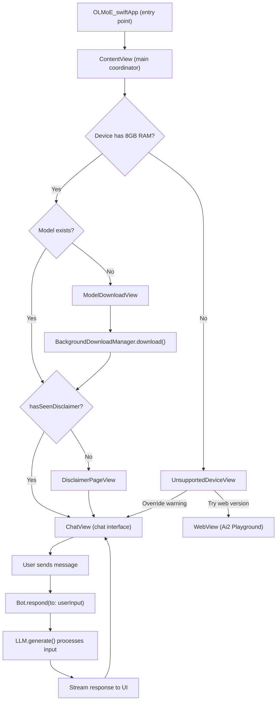

Sources: [README.md:35-44](), [OLMoE.swift/README.md:35-45]()

### Building and Running on a Simulator

1. Clone the repository
   ```bash
   git clone https://github.com/allenai/OLMoE.swift.git
   ```

2. Open the project in Xcode
   ```bash
   open OLMoE.swift.xcodeproj
   ```

3. Select an iOS device simulator with adequate virtual RAM (iPhone 15 Pro or later recommended)

4. Run the project by clicking the "Run" button (▶️) or pressing `Cmd + R`

Sources: [README.md:36-44](), [OLMoE.swift/README.md:35-45]()

### Running on a Physical Device

To run on a physical iOS device:

1. Connect your device to your Mac via USB
2. In the "Signing & Capabilities" section, click on "Enable Development Signing"
3. Select your device in the device dropdown menu
4. Run the project

Sources: [OLMoE.swift/README.md:109-123]()

### Running on macOS

The project supports Mac Catalyst for running on macOS:

1. In the "Signing & Capabilities" section for macOS, enable development signing
2. Select "My Mac (Mac Catalyst)" in the device dropdown menu
3. Run the project

Sources: [OLMoE.swift/README.md:96-107]()

## Configuration Options

### Configuration Flow

The app can be configured using environment variables in a build configuration file:

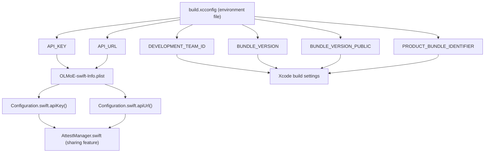

Sources: [OLMoE.swift/Configuration.swift:39-54](), [OLMoE-swift-Info.plist:11-14]()

### Setting Up Configuration

1. Rename `BuildConfig/build.example.xcconfig` to `build.xcconfig`
2. Edit the file to set your preferred configuration options

The key configuration parameters include:

| Parameter | Purpose | Default Value |
|-----------|---------|--------------|
| API_KEY | Key for optional sharing feature | Use_Your_Own_Key |
| API_URL | Endpoint for optional sharing feature | https://use_your_own_endpoint |
| DEVELOPMENT_TEAM_ID | Your Apple Developer team ID | None |
| BUNDLE_VERSION | Internal version number | 1 |
| BUNDLE_VERSION_PUBLIC | Public-facing version | 1.1 |
| PRODUCT_BUNDLE_IDENTIFIER | App's bundle identifier | com.example.apple-samplecode.OLMoE.swift.${DEVELOPMENT_TEAM_ID} |

These settings are optional for basic functionality but required for features like sharing conversations or deploying to physical devices.

Sources: [OLMoE.swift/README.md:45-76](), [OLMoE.swift/BuildConfig/project-defaults.xcconfig:8-14]()

## Using the App

Once you've built and launched the app:

1. First launch experience:
   - The app checks device compatibility
   - If needed, you'll be prompted to download the language model
   - First-time users will need to accept disclaimers

2. Chat interface:
   - Type your query in the message input field at the bottom
   - Tap send to submit your question
   - The model processes your input locally and generates a response
   - Responses are streamed to the interface as they're generated

3. Offline usage:
   - The app works entirely offline once the model is downloaded
   - All processing happens on-device, ensuring privacy

Sources: [README.md:18-26]()

## Troubleshooting

If you encounter build issues:

1. Ensure the correct configuration is being used:
   - Select the project in the Project Navigator
   - Verify "Debug and Release" is set to use `build.xcconfig`

2. Verify team and bundle identifier:
   - In "Signing & Capabilities" ensure your team and bundle identifier match the ones in `build.xcconfig`

Sources: [OLMoE.swift/README.md:132-145]()

---

# Page: Building and Running

# Building and Running

<details>
<summary>Relevant source files</summary>

The following files were used as context for generating this wiki page:

- [OLMoE.swift.xcodeproj/project.pbxproj](OLMoE.swift.xcodeproj/project.pbxproj)
- [OLMoE.swift.xcodeproj/project.xcworkspace/xcshareddata/swiftpm/Package.resolved](OLMoE.swift.xcodeproj/project.xcworkspace/xcshareddata/swiftpm/Package.resolved)
- [OLMoE.swift.xcodeproj/xcshareddata/xcschemes/OLMoE.swift.xcscheme](OLMoE.swift.xcodeproj/xcshareddata/xcschemes/OLMoE.swift.xcscheme)
- [OLMoE.swift/BuildConfig/project-defaults.xcconfig](OLMoE.swift/BuildConfig/project-defaults.xcconfig)
- [OLMoE.swift/README.md](OLMoE.swift/README.md)
- [README.md](README.md)
- [doc_assets/App_Main.png](doc_assets/App_Main.png)
- [doc_assets/Run_App.png](doc_assets/Run_App.png)

</details>


This document provides detailed technical instructions for building and running the OLMoE.swift application on various platforms. It covers setting up the development environment, configuring build settings, and deploying the app to simulators, physical iOS devices, and macOS via Mac Catalyst.

For information about configuring the application after building, see [Configuration](#2.2).

## Prerequisites

Before building the OLMoE.swift application, ensure you have the following:

| Requirement | Minimum Version | Notes |
|-------------|----------------|-------|
| Xcode | 15.4+ | Required for building the app |
| iOS | 17.5+ | For running on iOS devices |
| macOS | 14.5+ | For running via Mac Catalyst |
| Device RAM | 8GB+ | Required for model loading |

Sources: [OLMoE.swift/README.md:30-34](), [OLMoE.swift.xcodeproj/project.pbxproj:425-428]()

## Project Structure Overview

The OLMoE.swift project is structured as follows, focusing on components relevant to the build process:

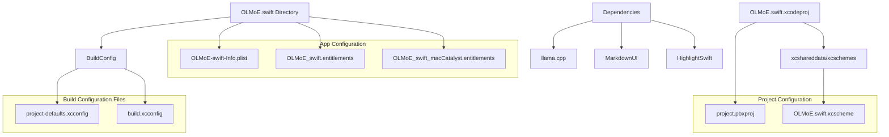

Sources: [OLMoE.swift.xcodeproj/project.pbxproj:106-155](), [OLMoE.swift.xcodeproj/project.pbxproj:516-558]()

## Build Configuration Setup

OLMoE.swift uses xcconfig files to manage build configurations. These files allow setting environment variables and build parameters without modifying the Xcode project directly.

### Configuration File Structure

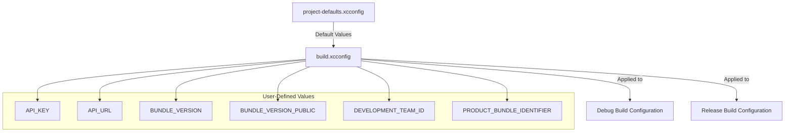

### Setting Up Configuration Files

1. Locate `BuildConfig/build.example.xcconfig` in the project directory
2. Copy it to `BuildConfig/build.xcconfig`
3. Edit the file to include your specific values:

| Variable | Purpose | Example |
|----------|---------|---------|
| API_KEY | Key for AWS Lambda sharing feature | your_api_key_here |
| API_URL | URL endpoint for Lambda function | https://api-gateway-url |
| BUNDLE_VERSION | Internal version number | 10 |
| BUNDLE_VERSION_PUBLIC | Public version number | 1.1.1 |
| DEVELOPMENT_TEAM_ID | Apple Developer Team ID | AB12CD34EF |
| PRODUCT_BUNDLE_IDENTIFIER | App bundle identifier | com.example.OLMoE.swift.TEAMID |

Sources: [OLMoE.swift/README.md:46-86](), [OLMoE.swift/BuildConfig/project-defaults.xcconfig:1-15]()

## Building for iOS Simulators

Building for iOS simulators is the simplest way to test the application without needing a physical device or developer account.

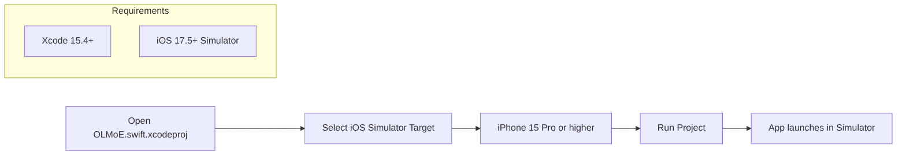

Steps:
1. Open the OLMoE.swift project in Xcode
2. Set the target device to an iOS device with sufficient RAM (iPhone 15 Pro or higher recommended)
3. Select the "Run" button or press `Cmd + R`
4. The app will build and launch in the simulator

Sources: [OLMoE.swift/README.md:35-43](), [README.md:36-44]()

## Building for Physical iOS Devices

Running on a physical device requires a valid development team and proper signing configuration.

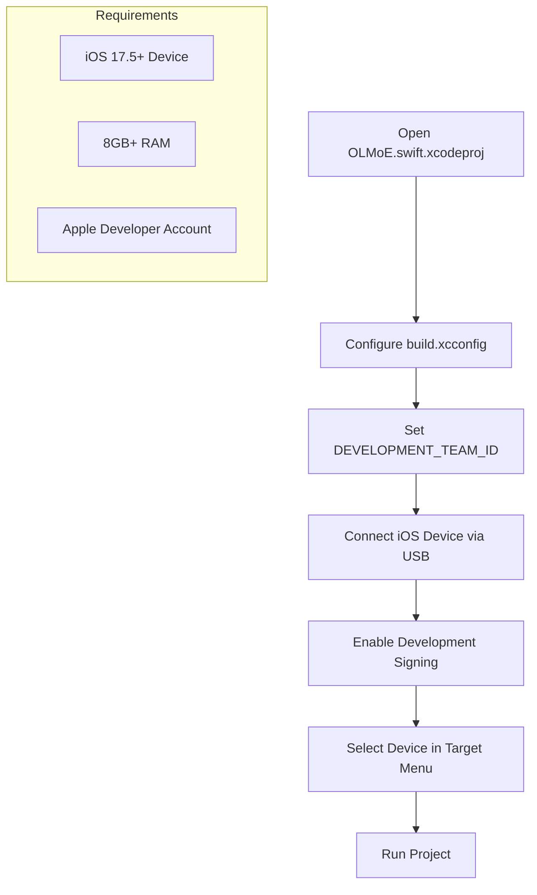

Steps:
1. Ensure your `build.xcconfig` file has a valid `DEVELOPMENT_TEAM_ID`
2. Connect your iOS device to your Mac via USB
3. In Xcode, select your project and go to the "Signing & Capabilities" section
4. Click "Enable Development Signing"
5. Select your connected device in the device dropdown menu
6. Click the "Run" button or press `Cmd + R`

Sources: [OLMoE.swift/README.md:109-124]()

## Building for macOS (Mac Catalyst)

OLMoE.swift uses Mac Catalyst to run on macOS, allowing the iOS codebase to run natively on Mac.

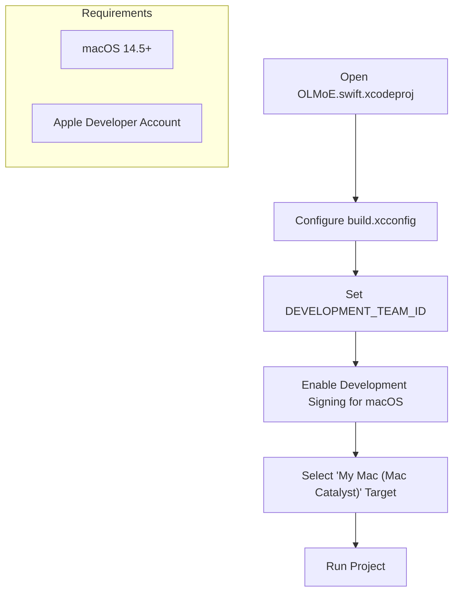

Steps:
1. Ensure your `build.xcconfig` file has a valid `DEVELOPMENT_TEAM_ID`
2. In Xcode, select your project and go to the "Signing & Capabilities" section for macOS
3. Click "Enable Development Signing"
4. Select "My Mac (Mac Catalyst)" in the device dropdown menu
5. Click the "Run" button or press `Cmd + R`

Sources: [OLMoE.swift/README.md:96-107](), [OLMoE.swift.xcodeproj/project.pbxproj:428]()

## Build Process Internals

The OLMoE.swift application uses a standard Xcode build process with specific dependencies and frameworks.

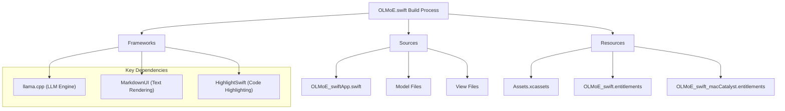

The key external dependencies for the build process include:

1. **llama.cpp** - Core language model inference engine
2. **MarkdownUI** - For rendering markdown content in the app
3. **HighlightSwift** - For syntax highlighting of code blocks

Sources: [OLMoE.swift.xcodeproj/project.pbxproj:516-558](), [OLMoE.swift.xcodeproj/project.xcworkspace/xcshareddata/swiftpm/Package.resolved:1-50]()

## Common Build Issues and Troubleshooting

### Configuration File Issues

If you encounter build errors related to missing or incorrect configuration:

1. Ensure the correct configuration file is being used:
   - Select the project in the Project Navigator
   - Verify that both Debug and Release configurations are set to use `build.xcconfig`

2. Verify team and bundle identifier match:
   - Check that the team and bundle identifier in the Signing & Capabilities match those in your `build.xcconfig` file

Sources: [OLMoE.swift/README.md:132-145]()

### Device Compatibility Issues

The app requires devices with sufficient RAM (8GB+) to run the language model:

1. For physical devices that don't meet requirements, the app will display an UnsupportedDeviceView
2. For simulators, choose higher-end device models (iPhone 15 Pro or newer)

Sources: [README.md:39-40]()

### Dependency Resolution Issues

If you encounter build errors related to dependencies:

1. Verify Xcode can access the Swift Package repositories
2. Check that you have necessary network access to GitHub for downloading packages
3. If necessary, manually update packages via File > Packages > Update to Latest Package Versions

Sources: [OLMoE.swift.xcodeproj/project.xcworkspace/xcshareddata/swiftpm/Package.resolved:1-50]()

## Advanced: Enabling the Sharing Feature

The OLMoE app includes an optional sharing feature that requires AWS Lambda setup:

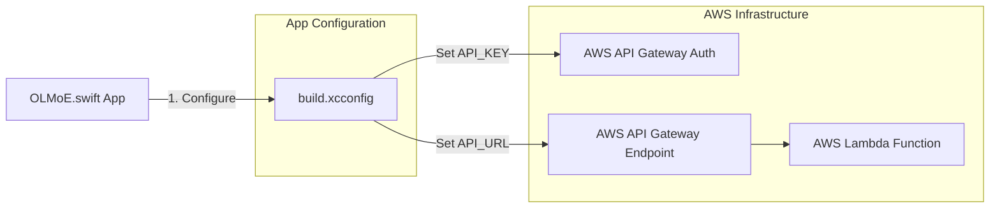

To enable the sharing feature:

1. Deploy the AWS Lambda function as described in the lambda README
2. Set the `API_KEY` and `API_URL` in your `build.xcconfig` file
3. Rebuild the application

Note that the sharing feature is optional - the app will function without it, but users won't be able to share conversations.

Sources: [OLMoE.swift/README.md:125-131](), [README.md:72-74]()

## Running the Built Application

After successful building, the application will:

1. Check for device compatibility
2. If needed, prompt to download the model file
3. Present the disclaimer screens on first launch
4. Open the chat interface

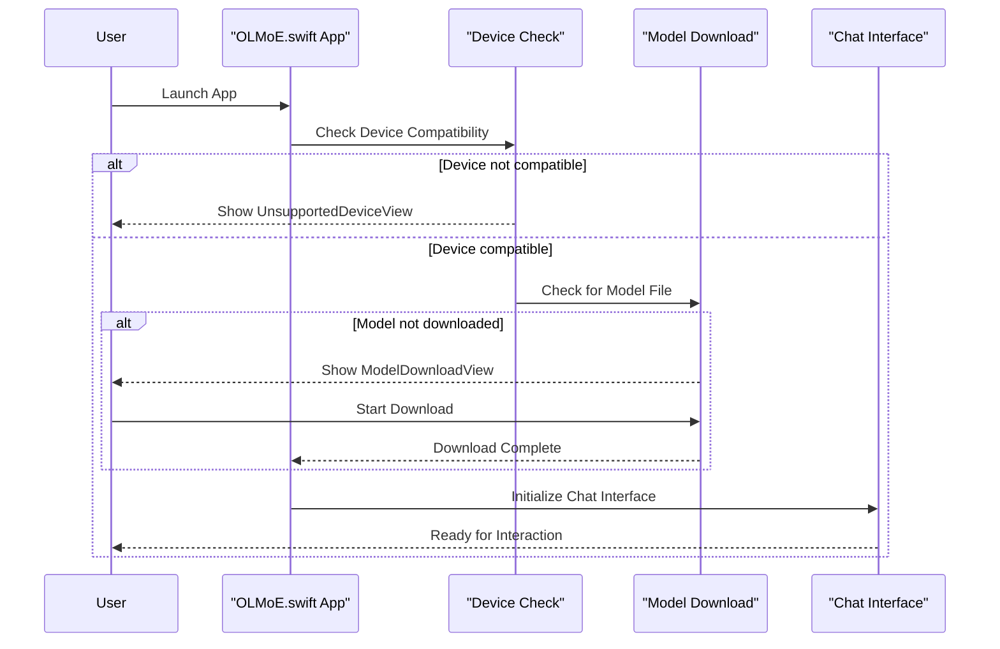

Sources: [README.md:18-26]()

This detailed guide should help developers successfully build and run the OLMoE.swift application across various platforms and resolve common issues that may arise during the process.

---

# Page: Configuration

# Configuration

<details>
<summary>Relevant source files</summary>

The following files were used as context for generating this wiki page:

- [OLMoE-swift-Info.plist](OLMoE-swift-Info.plist)
- [OLMoE.swift.xcodeproj/project.pbxproj](OLMoE.swift.xcodeproj/project.pbxproj)
- [OLMoE.swift.xcodeproj/project.xcworkspace/xcshareddata/swiftpm/Package.resolved](OLMoE.swift.xcodeproj/project.xcworkspace/xcshareddata/swiftpm/Package.resolved)
- [OLMoE.swift/AppInfo.swift](OLMoE.swift/AppInfo.swift)
- [OLMoE.swift/Configuration.swift](OLMoE.swift/Configuration.swift)
- [OLMoE.swift/OLMoE_swift.entitlements](OLMoE.swift/OLMoE_swift.entitlements)

</details>


This page explains how the OLMoE.swift application is configured through various mechanisms including environment variables, build settings, Info.plist entries, and entitlement files. It covers both compile-time and runtime configuration options that control the application's behavior and capabilities.

For information about building and running the application, see [Building and Running](#2.1).

## Configuration Overview

The OLMoE.swift application uses a layered configuration approach:

1. **Build Configuration** - Settings controlled through Xcode build configurations and xcconfig files
2. **Info.plist Configuration** - Application metadata and runtime settings stored in Info.plist
3. **Entitlements** - System permissions and capabilities required by the application
4. **Runtime Configuration** - Accessing configuration values at runtime through the `Configuration` class

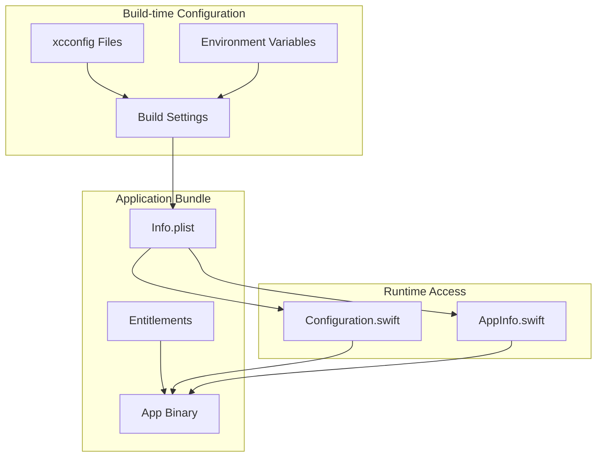

Sources: [OLMoE.swift/Configuration.swift:1-56](), [OLMoE.swift/AppInfo.swift:1-35](), [OLMoE-swift-Info.plist:1-31](), [OLMoE.swift.xcodeproj/project.pbxproj:1-563]()

## Info.plist Configuration

The application's primary configuration source is the Info.plist file. This file contains various settings that define the application's behavior and metadata.

Key Info.plist entries include:

| Key | Description | Source |
|-----|-------------|--------|
| `CFBundleShortVersionString` | The public version number | `$(BUNDLE_VERSION_PUBLIC)` environment variable |
| `CFBundleVersion` | The build number | `$(BUNDLE_VERSION)` environment variable |
| `CFBundleIdentifier` | The bundle identifier | `$(PRODUCT_BUNDLE_IDENTIFIER)` environment variable |
| `API_KEY` | API key for external services | `$(API_KEY)` environment variable |
| `API_URL` | URL for API endpoints | `$(API_URL)` environment variable |
| `ITSAppUsesNonExemptEncryption` | Encryption usage declaration | Hardcoded as `false` |
| `UIAppFonts` | Custom fonts used by the app | Array of font filenames |

```mermaid
classDiagram
    class "Info.plist" {
        +CFBundleShortVersionString: String
        +CFBundleVersion: String
        +CFBundleIdentifier: String
        +API_KEY: String
        +API_URL: String
        +ITSAppUsesNonExemptEncryption: Boolean
        +UIAppFonts: Array~String~
    }

    class "Environment Variables" {
        +BUNDLE_VERSION_PUBLIC
        +BUNDLE_VERSION
        +PRODUCT_BUNDLE_IDENTIFIER
        +API_KEY
        +API_URL
    }

    "Environment Variables" --> "Info.plist" : populates at build time
```

Sources: [OLMoE-swift-Info.plist:1-31](), [OLMoE.swift.xcodeproj/project.pbxproj:405-431]()

## Build Configuration

The application uses Xcode build configurations to control various aspects of the build process. These configurations are defined in xcconfig files referenced in the project.

### Build Settings

Key build settings are controlled through environment variables:

| Variable | Description | Used In |
|----------|-------------|---------|
| `BUNDLE_VERSION` | Internal build number | `CFBundleVersion`, `CURRENT_PROJECT_VERSION` |
| `BUNDLE_VERSION_PUBLIC` | Public version number | `CFBundleShortVersionString`, `MARKETING_VERSION` |
| `PRODUCT_BUNDLE_IDENTIFIER` | App's unique identifier | `CFBundleIdentifier` |
| `DEVELOPMENT_TEAM_ID` | Development team identifier | `DEVELOPMENT_TEAM` |
| `API_KEY` | API key for external services | Info.plist |
| `API_URL` | URL for API endpoints | Info.plist |

The project references two xcconfig files for build configuration:
- `BuildConfig/project-defaults.xcconfig` - Default project settings
- `BuildConfig/build.xcconfig` - Target-specific build settings

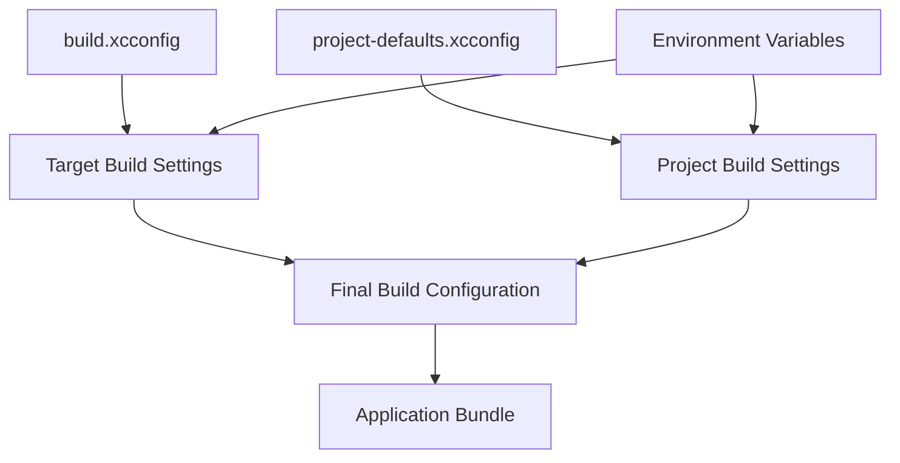

Sources: [OLMoE.swift.xcodeproj/project.pbxproj:270-492]()

## Entitlements

The application requires specific entitlements to access system capabilities. These are defined in entitlement files:

- `OLMoE_swift.entitlements` - Used for iOS
- `OLMoE_swift_macCatalyst.entitlements` - Used for macOS

Key entitlements include:

| Entitlement | Purpose |
|-------------|---------|
| `com.apple.developer.kernel.increased-memory-limit` | Allows the app to use more memory, essential for running LLMs |
| `com.apple.security.app-sandbox` | Enables app sandboxing for security |
| `com.apple.security.files.user-selected.read-only` | Grants access to user-selected files (read-only) |
| `com.apple.developer.devicecheck.appattest-environment` | Enables app attestation for the sharing feature |
| `com.apple.security.network.client` | Allows network client connections |

```mermaid
classDiagram
    class "Entitlements" {
        +increased-memory-limit: Boolean
        +app-sandbox: Boolean
        +files.user-selected.read-only: Boolean
        +devicecheck.appattest-environment: String
        +network.client: Boolean
    }

    class "Application" {
        +Run LLM Models
        +Download Models
        +Share Conversations
        +File Access
    }

    "Entitlements" --> "Application" : enables capabilities
```

Sources: [OLMoE.swift/OLMoE_swift.entitlements:1-17](), [OLMoE.swift.xcodeproj/project.pbxproj:398-401]()

## Runtime Configuration Access

The application provides a centralized way to access configuration values at runtime through the `Configuration` class and `AppInfo` struct.

### Configuration Class

The `Configuration` class provides type-safe access to Info.plist values:

```mermaid
classDiagram
    class "Configuration" {
        <<enum>>
        +Error: enum
        +value~T~(for key: String): T
        +apiKey: String
        +apiUrl: String
    }

    class "Error" {
        <<enum>>
        +missingKey
        +invalidValue
    }

    class "Bundle.main" {
        +infoDictionary: [String: Any]?
        +object(forInfoDictionaryKey: String): Any?
    }

    "Configuration" +-- "Error"
    "Configuration" --> "Bundle.main" : reads from
```

The `value<T>(for key: String)` method retrieves values from Info.plist and converts them to the requested type, with appropriate error handling.

Extension properties like `apiKey` and `apiUrl` provide convenient access to specific configuration values with fallback values if the keys are missing.

Sources: [OLMoE.swift/Configuration.swift:1-56]()

### AppInfo Struct

The `AppInfo` struct provides access to application metadata:

```mermaid
classDiagram
    class "AppInfo" {
        +shared: AppInfo
        -init()
        +name: String
        +displayName: String
        +version: String
        +build: String
        +appId: String
    }

    class "Bundle.main" {
        +infoDictionary: [String: Any]?
    }

    "AppInfo" --> "Bundle.main" : reads from
```

The `AppInfo` struct is implemented as a singleton through the `shared` static property and provides read-only access to application metadata like name, version, and build number.

Sources: [OLMoE.swift/AppInfo.swift:1-35]()

## Usage Examples

The following examples demonstrate how to access configuration values in the application code:

### Accessing API Configuration
```swift
// Get the API key
let apiKey = Configuration.apiKey

// Get the API URL
let apiUrl = Configuration.apiUrl
```

### Accessing App Information
```swift
// Get the app version
let version = AppInfo.shared.version

// Get the app build number
let build = AppInfo.shared.build

// Get a unique app identifier
let appId = AppInfo.shared.appId
```

Sources: [OLMoE.swift/Configuration.swift:38-55](), [OLMoE.swift/AppInfo.swift:15-33]()

## Dependency Management

The application uses Swift Package Manager for managing dependencies. Key dependencies are defined in the project file and include:

| Package | Purpose | Version |
|---------|---------|---------|
| llama.cpp | Core language model implementation | Specific revision (cc98896) |
| swift-markdown-ui | Markdown rendering | 2.4.1 |
| HighlightSwift | Code syntax highlighting | 1.0.9+ |

These dependencies are specified in the Xcode project and resolved to specific versions in the Package.resolved file.

Sources: [OLMoE.swift.xcodeproj/project.xcworkspace/xcshareddata/swiftpm/Package.resolved:1-51](), [OLMoE.swift.xcodeproj/project.pbxproj:516-558]()

---

# Page: Core Architecture

# Core Architecture

<details>
<summary>Relevant source files</summary>

The following files were used as context for generating this wiki page:

- [OLMoE.swift.xcodeproj/project.pbxproj](OLMoE.swift.xcodeproj/project.pbxproj)
- [OLMoE.swift.xcodeproj/project.xcworkspace/xcshareddata/swiftpm/Package.resolved](OLMoE.swift.xcodeproj/project.xcworkspace/xcshareddata/swiftpm/Package.resolved)
- [OLMoE.swift/Model/Context.swift](OLMoE.swift/Model/Context.swift)
- [OLMoE.swift/Model/InferenceMetrics.swift](OLMoE.swift/Model/InferenceMetrics.swift)
- [OLMoE.swift/Model/KeyboardResponder.swift](OLMoE.swift/Model/KeyboardResponder.swift)
- [OLMoE.swift/Model/LLM.swift](OLMoE.swift/Model/LLM.swift)
- [OLMoE.swift/Model/Template.swift](OLMoE.swift/Model/Template.swift)
- [OLMoE.swift/Views/ContentView.swift](OLMoE.swift/Views/ContentView.swift)

</details>


## Purpose and Scope

This document outlines the foundational architecture of OLMoE.swift, explaining the major components and their interactions that enable on-device language model inference. It covers the system's structural design, key abstractions, and component relationships. For details on specific implementation aspects, see [Language Model System](#3.1) and [User Interface Flow](#3.2).

## System Overview

OLMoE.swift is built on a modular architecture that centers around a language model inference engine integrated with a SwiftUI-based interface. The system efficiently runs the OLMoE language model directly on device without requiring cloud connectivity.

### High-Level Architecture

```mermaid
graph TD
    A["OLMoE_swiftApp"] --> B["ContentView"]
    B --> C["BotView"]
    B --> D["ModelDownloadView"]
    B --> E["DisclaimerPageView"]
    B --> F["UnsupportedDeviceView"]
    
    C --> G["Bot/LLM"]
    G --> H["Template"]
    G --> I["Context"]
    G --> J["InferenceMetrics"]
    
    G --> K["llama.cpp"]
    
    subgraph "Language Model System"
        G
        H
        I
        J
        K
    end
    
    subgraph "UI Components"
        C
        D
        E
        F
    end
```

The application's entry point initializes `ContentView`, which serves as the main coordinator that conditionally renders different views based on the application state: device compatibility, model availability, and disclaimer acceptance.

Sources:
- [OLMoE.swift/Views/ContentView.swift:391-524]()
- [OLMoE.swift/OLMoE_swiftApp.swift]()

## Core Components

### Language Model System

At the heart of OLMoE.swift is the language model system, built on these key components:

#### LLM Class

The `LLM` class is the foundation for language model operations, providing:
- Model loading and initialization
- Token generation and stream processing
- Conversation history management
- State persistence for continuous conversations

```mermaid
classDiagram
    class LLM {
        +model: "Model"
        +history: "[Chat]"
        +template: "Template?"
        +output: "String"
        +metrics: "InferenceMetrics"
        +respond(to: "String"): "async"
        +stop(): "void"
        +clearHistory(): "async"
        +saveState(): "Data?"
        +restoreState(from: "Data"): "void"
    }
    
    class Bot {
        +modelFileURL: "URL"
        +init()
    }
    
    class InferenceActor {
        +shared: "InferenceActor"
    }
    
    Bot --|> LLM : "extends"
    LLM -- InferenceActor : "uses"
```

The `LLM` class uses the `@InferenceActor` global actor to ensure thread safety during inference operations, preventing race conditions when generating text or updating model state.

Sources:
- [OLMoE.swift/Model/LLM.swift:27-489]()
- [OLMoE.swift/Views/ContentView.swift:12-34]()

#### Template System

The `Template` struct defines formatting for different model architectures:

```mermaid
classDiagram
    class Template {
        +system: "Attachment"
        +user: "Attachment"
        +bot: "Attachment"
        +systemPrompt: "String?"
        +stopSequence: "String?"
        +prefix: "String"
        +preprocess: "Closure"
        +static OLMoE(): "Template"
        +static chatML(): "Template"
        +static alpaca(): "Template"
        +static llama(): "Template"
    }
    
    class Attachment {
        +prefix: "String"
        +suffix: "String"
    }
```

This system provides standardized message formatting for different model architectures. The `preprocess` closure transforms raw inputs into properly formatted prompts, while maintaining conversation context.

Sources:
- [OLMoE.swift/Model/Template.swift:13-171]()

#### Context Management

The `Context` class manages the interface to the llama.cpp library:

```mermaid
classDiagram
    class Context {
        +pointer: "OpaquePointer"
        +init("Model", "llama_context_params")
        +decode("llama_batch")
        +deinit()
    }
```

This thin wrapper ensures proper memory management and provides a clean Swift interface to the underlying C/C++ code of llama.cpp.

Sources:
- [OLMoE.swift/Model/Context.swift:12-29]()

#### Inference Process

The inference process follows this sequence:

```mermaid
sequenceDiagram
    participant User
    participant BotView as "BotView"
    participant Bot as "Bot (LLM)"
    participant Template as "Template"
    participant Context as "Context"
    participant LlamaCpp as "llama.cpp"
    
    User->>BotView: "Send message"
    BotView->>Bot: "respond(to: input)"
    BotView->>BotView: "Add message to history"
    
    Bot->>Template: "preprocess(input, history)"
    Template->>Bot: "Return formatted prompt"
    
    Bot->>Context: "Create/restore context"
    Bot->>Bot: "Start metrics tracking"
    Bot->>Context: "tokenizeAndBatchInput"
    Context->>LlamaCpp: "Encode tokens"
    
    loop Token Generation
        Bot->>Context: "predictNextToken"
        Context->>LlamaCpp: "llama_sampler_sample"
        LlamaCpp->>Context: "Return token"
        Context->>Bot: "Decode token"
        Bot->>BotView: "Stream token to UI"
        BotView->>User: "Update display"
    end
    
    Bot->>Bot: "Update history"
    Bot->>Bot: "Save state (if enabled)"
```

This streaming architecture enables real-time display of generated text while maintaining responsiveness.

Sources:
- [OLMoE.swift/Model/LLM.swift:401-463]()

#### Performance Metrics

The `InferenceMetrics` struct tracks model performance:

```mermaid
classDiagram
    class InferenceMetrics {
        +inferenceTokenCount: "Int32"
        +inputTokenCount: "Int32"
        +totalTokens: "Int32"
        +startTime: "TimeInterval"
        +endTime: "TimeInterval"
        +inferenceTokensPerSecond: "Double"
        +start(): "void"
        +recordToken(): "void"
        +stop(): "void"
        +reset(): "void"
    }
```

This component collects real-time performance data about token processing speed and counts, helping users understand model performance on their device.

Sources:
- [OLMoE.swift/Model/InferenceMetrics.swift:10-51]()

### Application Flow

The application follows a structured flow from launch to interactive chat:

```mermaid
graph TD
    A["App Launch"] --> B{"Check Device<br/>Compatibility"}
    B -->|"Supported"| C{"Model<br/>Downloaded?"}
    B -->|"Not Supported"| D["UnsupportedDeviceView"]
    
    D -->|"Web Version"| D1["WebView"]
    D -->|"Override"| C
    D -->|"Mock Model"| C2["Initialize Mock Bot"]
    
    C -->|"Yes"| E{"First Launch?"}
    C -->|"No"| F["ModelDownloadView"]
    F -->|"Download<br/>Complete"| E
    
    E -->|"Yes"| G["DisclaimerPageView"]
    E -->|"No"| H["Initialize Bot"]
    G -->|"Accept"| H
    H --> I["Show BotView"]
    
    I --> J["User Interaction Loop"]
    
    subgraph "Chat Interaction"
        J -->|"Send"| K["Process Input"]
        K --> L["Generate Response"]
        L --> J
        J -->|"Clear"| M["Reset Conversation"]
        M --> J
        J -->|"Share"| N["Format for Sharing"]
        N --> J
    end
```

This flow ensures that:
1. Only compatible devices run the model
2. Necessary model files are downloaded
3. Users accept required disclaimers
4. The chat interface is only shown when all prerequisites are met

Sources:
- [OLMoE.swift/Views/ContentView.swift:391-524]()
- [OLMoE.swift/Views/ContentView.swift:504-523]()

### Content View Architecture

The `ContentView` serves as the application's main coordinator:

```mermaid
graph TD
    A["ContentView"] --> B["@StateObject downloadManager"]
    A --> C["@StateObject disclaimerState"]
    A --> D["@State bot"]
    A --> E["@State showMetrics"]
    
    A --> F{"isSupportedDevice?"}
    F -->|"No"| G["UnsupportedDeviceView"]
    F -->|"Yes"| H{"isModelReady?"}
    
    H -->|"Yes"| I["BotView"]
    H -->|"No"| J["ModelDownloadView"]
    
    I --> K["ChatView"]
    I --> L["MessageInputView"]
    I --> M["Toolbar Actions"]
    
    subgraph "State Management"
        B
        C
        D
        E
    end
```

The `ContentView` manages the application flow based on device compatibility and model availability. It coordinates the transition between different views and manages application-wide state.

Sources:
- [OLMoE.swift/Views/ContentView.swift:392-523]()

## Integration with llama.cpp

OLMoE.swift leverages the llama.cpp library as its core inference engine:

```mermaid
graph TD
    A["OLMoE.swift"] --> B["LLM Class"]
    B --> C["Context"]
    C --> D["llama.cpp"]
    
    D --> E["llama_model"]
    D --> F["llama_context"]
    D --> G["llama_batch"]
    D --> H["llama_sampler"]
    
    B --> I["Template"]
    B --> J["InferenceMetrics"]
    
    subgraph "Swift Layer"
        A
        B
        C
        I
        J
    end
    
    subgraph "C/C++ Layer"
        D
        E
        F
        G
        H
    end
```

The integration with llama.cpp provides:
- Efficient model loading and execution
- Token generation and sampling
- Context management for long conversations
- Memory-efficient operation on mobile devices

Sources:
- [OLMoE.swift.xcodeproj/project.xcworkspace/xcshareddata/swiftpm/Package.resolved:14-19]()
- [OLMoE.swift/Model/LLM.swift:131-132]()

## State Management

The application manages several types of state:

| State Type | Storage Mechanism | Purpose | Persistence |
|------------|-------------------|---------|-------------|
| Model State | `LLM.savedState` | Enables continued conversations | Session |
| Conversation History | `LLM.history` | Stores chat messages | Session |
| UI State | SwiftUI `@State` | Controls view appearance | Transient |
| App Configuration | `DisclaimerState` | Tracks onboarding status | Persistent |
| Model Availability | `BackgroundDownloadManager` | Tracks model downloads | Persistent |

This multi-layered state management approach ensures that:
1. Conversations can be paused and resumed
2. User preferences are preserved
3. The UI remains responsive
4. Model state is efficiently managed

Sources:
- [OLMoE.swift/Model/LLM.swift:495-539]()
- [OLMoE.swift/Views/ContentView.swift:393-407]()

## Performance Optimizations

Several optimizations enable efficient on-device inference:

1. **KV Cache Management**: For long conversations, the system trims the oldest tokens from the KV cache to maintain memory efficiency and performance.

```mermaid
graph LR
    A["Long Conversation"] --> B["KV Cache Full"]
    B --> C["trimKvCache()"]
    C --> D["Remove Oldest Tokens"]
    D --> E["Shift Newer Tokens"]
    E --> F["Update nPast Counter"]
    F --> G["Continue Generation"]
```

2. **Batch Processing**: Tokens are processed in batches for efficiency
3. **Thread Management**: The `@InferenceActor` global actor ensures thread-safe model operations
4. **State Persistence**: Model state can be saved and restored to avoid recomputation

Sources:
- [OLMoE.swift/Model/LLM.swift:364-384]()
- [OLMoE.swift/Model/LLM.swift:252-276]()

## Summary

The core architecture of OLMoE.swift is designed to:

1. Efficiently run language models on-device
2. Provide a responsive user experience
3. Manage system resources effectively
4. Ensure thread safety during inference
5. Support a variety of model architectures

This modular design separates concerns between the language model system, user interface components, and application flow management, creating a maintainable and extensible codebase.

Sources:
- [OLMoE.swift/Views/ContentView.swift]()
- [OLMoE.swift/Model/LLM.swift]()
- [OLMoE.swift/Model/Template.swift]()
- [OLMoE.swift/Model/Context.swift]()
- [OLMoE.swift/Model/InferenceMetrics.swift]()

---

# Page: Language Model System

# Language Model System

<details>
<summary>Relevant source files</summary>

The following files were used as context for generating this wiki page:

- [OLMoE.swift/Constants/InfoText.swift](OLMoE.swift/Constants/InfoText.swift)
- [OLMoE.swift/Model/Context.swift](OLMoE.swift/Model/Context.swift)
- [OLMoE.swift/Model/InferenceMetrics.swift](OLMoE.swift/Model/InferenceMetrics.swift)
- [OLMoE.swift/Model/KeyboardResponder.swift](OLMoE.swift/Model/KeyboardResponder.swift)
- [OLMoE.swift/Model/LLM.swift](OLMoE.swift/Model/LLM.swift)
- [OLMoE.swift/Model/Template.swift](OLMoE.swift/Model/Template.swift)
- [OLMoE.swift/OLMoE_swiftApp.swift](OLMoE.swift/OLMoE_swiftApp.swift)
- [OLMoE.swift/Views/ContentView.swift](OLMoE.swift/Views/ContentView.swift)

</details>


This document details the core language model implementation within OLMoE.swift, explaining how the application processes user inputs, generates responses, and manages conversations through efficient inference. It covers the model architecture, templating system, context management, and inference process. For information about the user interface flow, see [User Interface Flow](#3.2).

## Overview

The Language Model System serves as the foundation of the OLMoE.swift application, enabling on-device inference with OLMoE models. It interacts with the `llama.cpp` library to run inference efficiently on iOS devices while managing model state, conversation history, and performance metrics.

```mermaid
graph TD
    A["LLM (Base Class)"] --> B["Bot (Implementation)"]
    A --> C["Template System"]
    A --> D["Context Management"]
    A --> E["InferenceMetrics"]
    
    C --> C1["OLMoE Format"]
    C --> C2["ChatML Format"]
    C --> C3["Alpaca Format"]
    C --> C4["LLaMA Format"]
    C --> C5["Mistral Format"]
    
    D --> D1["KV Cache"]
    D --> D2["State Saving"]
    D --> D3["State Restoration"]
    
    E --> E1["Token Counting"]
    E --> E2["Timing Metrics"]
    
    B --> F["respond(to:)"]
    F --> G["tokenize input"]
    G --> H["batch tokens"]
    H --> I["generate tokens"]
    I --> J["emit text"]
    J --> K["update output"]
    
    style A stroke-width:2px
    style B stroke-width:2px
    style C stroke-width:2px
```

Sources: [OLMoE.swift/Model/LLM.swift:25-540](), [OLMoE.swift/Views/ContentView.swift:12-34]()

## Core Components

### LLM Base Class

The `LLM` class is the foundation of the language model system. It handles text generation, context management, inference, and conversation history.

Key attributes:
- `model`: Pointer to the underlying LLaMA model
- `context`: Manages the model's internal state and KV cache
- `history`: Array of chat messages representing the conversation
- `template`: Controls conversation formatting for different model architectures
- `metrics`: Tracks token counts and performance data

Key methods:
- `respond(to:)`: Main entry point for generating responses to user input
- `stop()`: Cancels ongoing generation
- `clearHistory()`: Resets conversation and model state
- `saveState()/restoreState()`: Manages persisting and restoring model state

```mermaid
classDiagram
    class LLM {
        +model: Model
        +history: [Chat]
        +metrics: InferenceMetrics
        +template: Template?
        +output: String
        +respond(to: String)
        +stop()
        +clearHistory()
        +saveState()
        +restoreState(from: Data)
    }
    
    class Bot {
        +static modelFileURL: URL
        +init()
    }
    
    class Context {
        +pointer: OpaquePointer
        +decode(batch: llama_batch)
    }
    
    class Template {
        +system: Attachment
        +user: Attachment
        +bot: Attachment
        +systemPrompt: String?
        +stopSequence: String?
        +preprocess(input, history, llm)
        +static OLMoE()
        +static chatML()
        +static alpaca()
        +static llama()
        +static mistral()
    }
    
    class InferenceMetrics {
        +inferenceTokenCount: Int32
        +inputTokenCount: Int32
        +startTime: TimeInterval
        +endTime: TimeInterval
        +inferenceTokensPerSecond: Double
        +start()
        +recordToken()
        +stop()
        +reset()
    }
    
    LLM *-- Context
    LLM *-- InferenceMetrics
    LLM o-- Template
    Bot --|> LLM
```

Sources: [OLMoE.swift/Model/LLM.swift:27-41](), [OLMoE.swift/Views/ContentView.swift:12-34]()

### Bot Implementation

The `Bot` class extends `LLM` and implements the specific configuration for the OLMoE model:

```mermaid
graph TD
    A["ContentView"] --> B["Bot"]
    B --> C["LLM"]
    C --> D["llama.cpp"]
    
    B --> E["modelFileURL"]
    B -- "initializes" --> F["OLMoE Template"]
    
    F --> G["System Prompt"]
    F --> H["Message Formatting"]
    
    subgraph "Inference Flow"
        I["User Input"] --> J["respond(to:)"]
        J --> K["Preprocess Input"]
        K --> L["Generate Response"]
        L --> M["Update UI"]
    end
    
    style B stroke-width:2px
    style C stroke-width:2px
```

The `Bot` class initializes the OLMoE model with a system prompt that includes device information and current date/time. It configures the template to use the OLMoE format for message handling.

Sources: [OLMoE.swift/Views/ContentView.swift:12-34]()

## Template System

The template system formats conversations for different model architectures, ensuring that user inputs and model responses are properly formatted according to the model's expected input structure.

Each template defines:
- Text formatting for system, user, and bot messages
- Stop sequences that indicate the end of model generation
- Preprocessing logic for formatting conversations

```mermaid
graph TD
    A["Template"] --> B["preprocess()"]
    B --> C["Format Messages"]
    
    A --> D["system: Attachment"]
    A --> E["user: Attachment"]
    A --> F["bot: Attachment"]
    A --> G["stopSequence: String?"]
    
    H["Template.OLMoE()"] --> A
    I["Template.chatML()"] --> A
    J["Template.alpaca()"] --> A
    K["Template.llama()"] --> A
    L["Template.mistral"] --> A
    
    subgraph "Message Formatting"
        M["User Message"] --> N["Apply user.prefix"]
        N --> O["Append Content"]
        O --> P["Apply user.suffix"]
    end
    
    style A stroke-width:2px
    style B stroke-width:2px
```

The OLMoE template uses the following format:
- System messages: `<|system|>\n[content]\n`
- User messages: `<|user|>\n[content]\n`
- Bot messages: `<|assistant|>\n[content]\n`
- Stop sequence: `<|endoftext|>`

Sources: [OLMoE.swift/Model/Template.swift:13-171]()

### Template Preprocessing

The preprocessing function in each template is responsible for:
1. Formatting the conversation history
2. Adding the current user input with appropriate formatting
3. Adding the bot prefix to prepare for the model's response
4. Handling state restoration for continued conversations

```
Template.preprocess: 
1. If model state exists (continued conversation):
   - Format only the new user input
2. If no state (new conversation or reset):
   - Format system prompt (if provided)
   - Format all messages in conversation history
   - Format new user input
3. Add bot prefix to prompt model to generate a response
```

Sources: [OLMoE.swift/Model/Template.swift:72-106]()

## Inference Process

The inference process is at the heart of the Language Model System. It handles:
1. Tokenizing user input
2. Batching tokens for efficient processing
3. Generating responses token-by-token
4. Streaming output back to the UI

```mermaid
sequenceDiagram
    participant User
    participant Bot as "Bot (LLM)"
    participant Template
    participant Context
    participant llama as "llama.cpp"
    
    User->>Bot: respond(to: "user input")
    
    Note over Bot: Restore state if available
    
    Bot->>Template: preprocess(input, history, self)
    Template-->>Bot: formatted prompt
    
    Bot->>Bot: tokenizeAndBatchInput
    Bot->>llama: encode input
    llama-->>Bot: input tokens
    
    Bot->>Context: decode batch
    
    Bot->>Bot: start metrics
    
    loop until completion
        Bot->>Bot: predictNextToken
        Bot->>llama: sample next token
        llama-->>Bot: next token
        
        Bot->>Bot: emitDecoded
        Bot->>Bot: update output
    end
    
    Bot->>Bot: stop metrics
    
    Bot->>Bot: Add response to history
    Bot->>Bot: Save state
    
    Bot-->>User: Update UI with response
```

Key inference methods:
- `respond(to:)`: Main entry point for generating responses
- `performInference(to:with:)`: Handles the inference process
- `tokenizeAndBatchInput(message:)`: Prepares input for the model
- `predictNextToken()`: Samples the next token from the model
- `emitDecoded(token:to:)`: Decodes tokens and checks for stop sequences

Sources: [OLMoE.swift/Model/LLM.swift:192-463]()

## Context Management

The `Context` class manages the model's internal state and KV cache. It wraps the `llama_context` pointer from `llama.cpp` and provides methods for decoding token batches.

```mermaid
graph TD
    A["LLM"] --> B["Context"]
    B --> C["llama_context_pointer"]
    
    A --> D["saveState()"]
    A --> E["restoreState()"]
    A --> F["trimKvCache()"]
    
    D --> G["llama_state_get_data"]
    E --> H["llama_state_set_data"]
    F --> I["llama_kv_cache_seq_rm"]
    F --> J["llama_kv_cache_seq_add"]
    
    subgraph "KV Cache Management"
        K["nPast tracker"] --> L["Token count limit"]
        L --> M["Trim when limit reached"]
        M --> N["Shift newer tokens to beginning"]
    end
    
    style A stroke-width:2px
    style B stroke-width:2px
    style F stroke-width:2px
```

The KV cache stores key-value pairs for each processed token. When the cache approaches its limit, it is trimmed to maintain performance:

1. The oldest half of the tokens are removed
2. The newer half are shifted to the beginning
3. The `nPast` counter is updated to reflect the new state

Sources: [OLMoE.swift/Model/Context.swift:12-29](), [OLMoE.swift/Model/LLM.swift:362-385]()

## State Management

The Language Model System includes functionality to save and restore model state, enabling efficient continuation of conversations:

```mermaid
graph TD
    A["LLM"] --> B["saveState()"]
    A --> C["restoreState()"]
    
    B --> D["Serialize model state"]
    C --> E["Deserialize model state"]
    
    F["respond(to:)"] --> G["Check for saved state"]
    G -- "exists" --> H["Restore state"]
    G -- "none" --> I["Process from scratch"]
    
    J["Template.preprocess"] -- "with state" --> K["Process only new input"]
    J -- "without state" --> L["Process full history"]
    
    style A stroke-width:2px
    style B stroke-width:2px
    style C stroke-width:2px
```

State management enables:
1. Efficient continuation of conversations without reprocessing the entire history
2. Reduced token usage and faster response times for long conversations
3. Persistent context across multiple user interactions

Sources: [OLMoE.swift/Model/LLM.swift:491-540]()

## Performance Metrics

The `InferenceMetrics` struct tracks performance data during model inference:

- `inferenceTokenCount`: Number of tokens generated by the model
- `inputTokenCount`: Number of tokens in the user input
- `startTime/endTime`: Timestamps for calculating duration
- `inferenceTokensPerSecond`: Generation speed metric

```mermaid
graph TD
    A["InferenceMetrics"] --> B["start()"]
    A --> C["recordToken()"]
    A --> D["stop()"]
    A --> E["reset()"]
    
    B --> F["Record start time"]
    C --> G["Increment token count"]
    D --> H["Record end time"]
    D --> I["Calculate performance"]
    E --> J["Reset all values"]
    
    K["LLM.respond"] --> B
    K --> L["For each token"]
    L --> C
    K --> D
    
    M["Bot.deleteHistory"] --> E
    
    style A stroke-width:2px
    style K stroke-width:2px
```

These metrics are:
1. Displayed to users when metrics visualization is enabled
2. Used to monitor model performance and efficiency
3. Reset when starting a new conversation

Sources: [OLMoE.swift/Model/InferenceMetrics.swift:10-51]()

## Implementation Details

### Token Processing

The LLM class handles token processing through several key methods:

1. `encode(_:)`: Converts text to model tokens
2. `decode(_:)`: Converts tokens back to text
3. `tokenizeAndBatchInput(message:)`: Prepares batches of tokens for the model
4. `emitDecoded(token:to:)`: Handles token decoding and stop sequence detection

### Handling Empty Responses

The system includes logic to handle cases where the model fails to generate a response:

```
If generated response is empty:
1. Remove the last user input's tokens from the KV cache
2. Display "..." as a fallback response
3. Prevent "poisoning" of the model's internal state by bad inputs
```

This functionality is implemented in the `rollbackLastUserInputIfEmptyResponse` method.

Sources: [OLMoE.swift/Model/LLM.swift:465-474]()

### Inference Actor

The system uses Swift's actor system to ensure thread safety during inference:

```mermaid
graph TD
    A["@globalActor InferenceActor"] --> B["shared instance"]
    
    C["@InferenceActor methods"] --> D["stop()"]
    C --> E["predictNextToken()"]
    C --> F["clearHistory()"]
    C --> G["tokenizeAndBatchInput()"]
    C --> H["emitDecoded()"]
    C --> I["generateResponseStream()"]
    C --> J["performInference()"]
    C --> K["trimKvCache()"]
    
    L["LLM.respond"] -- "Task" --> M["await performInference()"]
    
    style A stroke-width:2px
    style C stroke-width:2px
```

The `@InferenceActor` annotation ensures that all critical inference operations run on the same actor, preventing race conditions and data corruption during parallel execution.

Sources: [OLMoE.swift/Model/LLM.swift:21-23]()

## Integration with UI

The Language Model System integrates with the application's UI through several key interfaces:

```mermaid
sequenceDiagram
    participant User
    participant ContentView
    participant BotView
    participant Bot
    participant LLM
    
    ContentView->>Bot: initialize
    Bot->>LLM: configure with template
    
    User->>BotView: Send message
    BotView->>Bot: respond(to: input)
    BotView->>BotView: Add user message to history
    
    Bot->>LLM: performInference
    
    loop During generation
        LLM-->>Bot: yield token
        Bot-->>BotView: update output incrementally
        BotView-->>User: Display response in real-time
    end
    
    LLM-->>Bot: Complete generation
    Bot-->>BotView: Final response
    BotView-->>User: Update UI
    
    alt User stops generation
        User->>BotView: Tap stop button
        BotView->>Bot: stop()
        Bot->>LLM: Cancel inference task
    end
```

Key integration points:
1. `Bot` class initialization in `ContentView`
2. `respond` method called from `BotView`
3. Output streaming from LLM to UI through `update` callbacks
4. Metrics displayed in the UI for performance monitoring

Sources: [OLMoE.swift/Views/ContentView.swift:81-105](), [OLMoE.swift/Views/ContentView.swift:401-468]()

---

# Page: User Interface Flow

# User Interface Flow

<details>
<summary>Relevant source files</summary>

The following files were used as context for generating this wiki page:

- [OLMoE.swift/Constants/AppConstants.swift](OLMoE.swift/Constants/AppConstants.swift)
- [OLMoE.swift/Constants/Localizable.xcstrings](OLMoE.swift/Constants/Localizable.xcstrings)
- [OLMoE.swift/Model/KeyboardResponder.swift](OLMoE.swift/Model/KeyboardResponder.swift)
- [OLMoE.swift/Views/ContentView.swift](OLMoE.swift/Views/ContentView.swift)
- [OLMoE.swift/Views/ModelDownloadView.swift](OLMoE.swift/Views/ModelDownloadView.swift)
- [OLMoE.swift/Views/ScrollToBottomButtonView.swift](OLMoE.swift/Views/ScrollToBottomButtonView.swift)
- [OLMoE.swift/Views/UnsupportedDeviceView.swift](OLMoE.swift/Views/UnsupportedDeviceView.swift)

</details>


This document describes the user interface flow of the OLMoE.swift application, from initial launch through device compatibility checks, model downloading, and finally to the chat experience. For detailed information about the Language Model System that powers the chat functionality, see [Language Model System](#3.1).

## Overview

The OLMoE.swift application follows a sequential flow of screens that guides users from launch to an interactive chat experience with the on-device language model. The application performs several critical checks before enabling chat functionality, including device compatibility verification and model availability.

```mermaid
flowchart TD
    A["App Launch"] --> B["Device Compatibility Check"]
    B -->|"Not compatible"| C["UnsupportedDeviceView"]
    B -->|"Compatible"| D["Model Availability Check"]
    
    C -->|"Try in browser"| E["Web Playground"]
    C -->|"Override (if enabled)"| D
    C -->|"Use mocked model (if enabled)"| F["Initialize Mock Bot"]
    
    D -->|"Not downloaded"| G["ModelDownloadView"]
    D -->|"Downloaded"| H["Disclaimer Check"]
    
    G -->|"Download complete"| H
    
    H -->|"First launch"| I["DisclaimerPageView"]
    H -->|"Disclaimers accepted"| J["ChatView (BotView)"]
    
    I -->|"User accepts"| J
```

Sources: [OLMoE.swift/Views/ContentView.swift:392-524]()

## Device Compatibility Verification

Upon launch, the application first checks if the device meets the minimum system requirements (primarily 8GB of RAM) to run the OLMoE language model efficiently.

```mermaid
flowchart TD
    A["ContentView.body"] --> B{"isSupportedDevice?"}
    B -->|"No"| C["Show UnsupportedDeviceView"]
    B -->|"Yes"| D["Continue to Model Check"]
    
    C --> E["Display RAM Requirements"]
    C --> F["Show Compatible Device List"]
    C --> G{"FeatureFlags.allowDeviceBypass?"}
    C --> H{"FeatureFlags.allowMockedModel?"}
    
    G -->|"Yes"| I["Show 'Proceed Anyway' Button"]
    H -->|"Yes"| J["Show 'Proceed With Mocked Model' Button"]
    
    C --> K["Show 'Try OLMoE at the Ai2 Playground' Button"]
    K --> L["Open WebViewWithBanner"]
    
    I --> M["Set isSupportedDevice = true"]
    J --> N["Set useMockedModelResponse = true"]
```

The `UnsupportedDeviceView` provides users with several options:
1. Try OLMoE in a web playground (hosted version)
2. Proceed anyway (if enabled in feature flags)
3. Use a mocked model (if enabled in feature flags)

Sources: [OLMoE.swift/Views/ContentView.swift:406-428](), [OLMoE.swift/Views/UnsupportedDeviceView.swift:13-107]()

## Model Download Management

If the device is compatible, the app checks if the model file has been downloaded. If not, it displays the `ModelDownloadView` to facilitate downloading the model.

```mermaid
sequenceDiagram
    participant User as "User"
    participant ContentView
    participant DownloadManager as "BackgroundDownloadManager"
    participant FileSystem as "FileSystem"
    
    ContentView->>FileSystem: Check if model file exists
    FileSystem-->>ContentView: File exists (yes/no)
    
    alt File doesn't exist
        ContentView->>User: Show ModelDownloadView
        User->>ContentView: Tap "Download Model"
        ContentView->>User: Show confirmation dialog
        User->>ContentView: Confirm download
        ContentView->>DownloadManager: startDownload()
        DownloadManager->>DownloadManager: Check disk space
        
        alt Not enough disk space
            DownloadManager->>User: Show error message
        else Enough disk space
            DownloadManager->>DownloadManager: Download model file
            DownloadManager->>User: Show download progress
            DownloadManager->>FileSystem: Move file to destination
            DownloadManager->>ContentView: Set isModelReady = true
        end
    else File exists
        ContentView->>DownloadManager: Set isModelReady = true
        ContentView->>ContentView: initializeBot()
    end
```

The download process includes:
1. Confirming download with the user (4.21GB file size warning)
2. Checking for available disk space
3. Downloading the model with progress indication
4. Moving the downloaded file to the models directory
5. Marking the model as ready for use

Sources: [OLMoE.swift/Views/ContentView.swift:429-446](), [OLMoE.swift/Views/ModelDownloadView.swift:193-296](), [OLMoE.swift/Views/ModelDownloadView.swift:18-190]()

## Application State Management

The application uses several state variables to manage its flow and transitions between different views.

```mermaid
stateDiagram-v2
    [*] --> AppLaunch
    
    AppLaunch --> DeviceCheck: ContentView appears
    DeviceCheck --> UnsupportedDevice: isSupportedDevice = false
    DeviceCheck --> ModelCheck: isSupportedDevice = true
    
    UnsupportedDevice --> WebView: showWebView = true
    UnsupportedDevice --> DeviceCheck: proceedAnyway()
    UnsupportedDevice --> MockedSetup: proceedMocked()
    
    MockedSetup --> ModelCheck: useMockedModelResponse = true
    
    ModelCheck --> ModelDownload: downloadManager.isModelReady = false
    ModelCheck --> DisclaimerCheck: downloadManager.isModelReady = true
    
    ModelDownload --> DownloadProcess: startDownload()
    DownloadProcess --> ModelCheck: isModelReady = true
    
    DisclaimerCheck --> ShowDisclaimer: disclaimerState.showDisclaimerPage = true
    DisclaimerCheck --> ChatInterface: disclaimerState.hasSeenDisclaimer = true
    
    ShowDisclaimer --> ChatInterface: onConfirm()
    
    ChatInterface --> ChatInteraction
```

Key state variables include:
- `isSupportedDevice`: Controls whether to show the UnsupportedDeviceView
- `downloadManager.isModelReady`: Determines if the model download view or chat view should be displayed
- `disclaimerState.showDisclaimerPage`: Controls when to show disclaimers
- `bot`: The initialized language model instance

Sources: [OLMoE.swift/Views/ContentView.swift:393-415](), [OLMoE.swift/Views/ContentView.swift:505-523]()

## Chat Interface Components

Once the model is downloaded and ready, and any required disclaimers are accepted, the application displays the chat interface (`BotView`).

```mermaid
flowchart TD
    A["BotView"] --> B["ChatHistory Section"]
    A --> C["MessageInputView"]
    A --> D["Navigation Bar Tools"]
    
    B --> E["UserChatBubble Components"]
    B --> F["BotChatBubble Components"]
    B --> G["ScrollToBottomButtonView"]
    
    C --> H["Text Input Field"]
    C --> I["Send Button"]
    C --> J["Stop Button (when generating)"]
    
    D --> K["ShareButton"]
    D --> L["NewChatButton"]
    
    G --> M["Scroll Button"]
    G --> N["Bottom Gradient"]
```

The chat interface includes:
1. Chat history display with user and bot messages
2. Input area for typing messages
3. Controls for sharing conversations and starting new chats
4. A scroll-to-bottom button for long conversations

Sources: [OLMoE.swift/Views/ContentView.swift:36-369](), [OLMoE.swift/Views/ScrollToBottomButtonView.swift:10-70]()

## User Interaction Flow

The chat interface supports several key user interactions that drive the conversation flow.

```mermaid
sequenceDiagram
    participant User
    participant BotView
    participant Bot
    participant LLM
    
    User->>BotView: Enter message in input field
    User->>BotView: Tap send button
    
    BotView->>BotView: Clear input field
    BotView->>BotView: Add user message to history
    BotView->>Bot: respond(to: userInput)
    
    Bot->>LLM: Process input
    LLM-->>Bot: Generate response tokens
    Bot-->>BotView: Stream tokens incrementally
    BotView-->>User: Display response in real-time
    
    alt User stops generation
        User->>BotView: Tap stop button
        BotView->>Bot: stop()
        Bot->>LLM: Halt token generation
    end
    
    alt User shares conversation
        User->>BotView: Tap share button
        BotView->>BotView: Format conversation text
        BotView->>User: Present system share sheet
    end
    
    alt User starts new chat
        User->>BotView: Tap new chat button
        BotView->>User: Show confirmation dialog
        User->>BotView: Confirm "Clear"
        BotView->>Bot: clearHistory()
        Bot->>BotView: Reset conversation state
    end
```

Key user interaction methods:
- `respond()`: Processes user input and triggers the bot's response
- `stop()`: Interrupts response generation
- `deleteHistory()`: Clears the conversation history
- `shareConversation()`: Prepares conversation for sharing

Sources: [OLMoE.swift/Views/ContentView.swift:81-147](), [OLMoE.swift/Views/ContentView.swift:149-226](), [OLMoE.swift/Views/ContentView.swift:229-261]()

## UI Component Relationships

The following diagram shows the hierarchical relationships between the main UI components in the application.

```mermaid
classDiagram
    ContentView "1" *-- "0..1" BotView
    ContentView "1" *-- "0..1" ModelDownloadView
    ContentView "1" *-- "0..1" UnsupportedDeviceView
    ContentView "1" *-- "1" DisclaimerState
    
    BotView "1" *-- "1" Bot
    BotView "1" *-- "1..*" ChatView
    BotView "1" *-- "1" MessageInputView
    BotView "1" *-- "0..1" ScrollToBottomButtonView
    BotView "1" *-- "0..1" ActivityViewController
    
    Bot --|> LLM
    
    UnsupportedDeviceView "1" *-- "0..1" WebViewWithBanner
    
    ModelDownloadView "1" *-- "1" BackgroundDownloadManager
    
    class ContentView {
        -downloadManager: BackgroundDownloadManager
        -disclaimerState: DisclaimerState
        -bot: Bot?
        -showInfoPage: Bool
        -isSupportedDevice: Bool
        -useMockedModelResponse: Bool
        -showMetrics: Bool
        +checkModelAndInitializeBot()
        +initializeBot()
    }
    
    class BotView {
        -bot: Bot
        -input: String
        -isGenerating: Bool
        -stopSubmitted: Bool
        -scrollToBottom: Bool
        -isSharing: Bool
        +respond()
        +stop()
        +deleteHistory()
        +shareConversation()
    }
    
    class ModelDownloadView {
        -downloadManager: BackgroundDownloadManager
        -showDownloadConfirmation: Bool
    }
    
    class UnsupportedDeviceView {
        -showWebView: Bool
        +proceedAnyway: () -> Void
        +proceedMocked: () -> Void
    }
```

Sources: [OLMoE.swift/Views/ContentView.swift:392-524](), [OLMoE.swift/Views/ContentView.swift:36-369](), [OLMoE.swift/Views/ModelDownloadView.swift:193-296](), [OLMoE.swift/Views/UnsupportedDeviceView.swift:13-107]()

## Localization Support

The application uses localized strings for user interface elements, making it adaptable to different languages.

| String Key | Description | Default Value |
|------------|-------------|---------------|
| "Welcome chat message" | Initial message shown in empty chat | "Hello! I'm OLMoE, a fully open, state-of-the-art language model running locally on your device." |
| "Empty Input Prompt" | Placeholder for empty input field | "Message OLMoE" |
| "Message OLMoE" | Text input placeholder | "Message OLMoE" |
| "Download Model Message" | Header for model download view | "Download the latest AI model" |

Sources: [OLMoE.swift/Constants/Localizable.xcstrings:4-156]()

## Model URL Configuration

The application uses constants to define key URLs for model downloading and fallback web experience.

```mermaid
flowchart LR
    A["AppConstants.Model"] --> B["filename: 'OLMoE-latest'"]
    A --> C["downloadURL: 'https://dolma-artifacts.org/app/OLMoE-latest.gguf'"]
    A --> D["playgroundURL: 'https://playground.allenai.org/?model=olmoe-0125'"]
    
    E["ContentView"] --> F["Bot.modelFileURL"]
    F --> G["URL.modelsDirectory/AppConstants.Model.filename.gguf"]
    
    H["UnsupportedDeviceView"] --> I["WebViewWithBanner"]
    I --> J["AppConstants.Model.playgroundURL"]
    
    K["BackgroundDownloadManager"] --> L["StartDownload()"]
    L --> M["AppConstants.Model.downloadURL"]
```

Sources: [OLMoE.swift/Constants/AppConstants.swift:1-9](), [OLMoE.swift/Views/ContentView.swift:12-14](), [OLMoE.swift/Views/UnsupportedDeviceView.swift:73-74](), [OLMoE.swift/Views/ModelDownloadView.swift:77]()

## Device Compatibility Logic

The application determines device compatibility primarily based on available RAM, with specific recommendations for supported device models.

```mermaid
flowchart TD
    A["isDeviceSupported()"] --> B{"has 8GB RAM?"}
    B -->|"Yes"| C["Return true"]
    B -->|"No"| D["Return false"]
    
    E["UnsupportedDeviceView"] --> F["Display RAM requirements"]
    F --> G["Display available RAM"]
    F --> H["List compatible devices"]
    H --> I["iPhone 15 Pro/Max, iPhone 16 models"]
    H --> J["iPad Pro 4th Gen and newer"]
    H --> K["iPad Air 5th Gen and newer"]
```

The device compatibility check is critical to ensure the language model can run efficiently, as it requires significant memory resources.

Sources: [OLMoE.swift/Views/ContentView.swift:406](), [OLMoE.swift/Views/UnsupportedDeviceView.swift:22-54]()

---

# Page: Chat Interface

# Chat Interface

<details>
<summary>Relevant source files</summary>

The following files were used as context for generating this wiki page:

- [OLMoE.swift/Assets.xcassets/StopIcon.imageset/StopIcon.svg](OLMoE.swift/Assets.xcassets/StopIcon.imageset/StopIcon.svg)
- [OLMoE.swift/Assets.xcassets/Surface.colorset/Contents.json](OLMoE.swift/Assets.xcassets/Surface.colorset/Contents.json)
- [OLMoE.swift/Extensions/View.swift](OLMoE.swift/Extensions/View.swift)
- [OLMoE.swift/Model/KeyboardResponder.swift](OLMoE.swift/Model/KeyboardResponder.swift)
- [OLMoE.swift/Views/Chat/BotChatBubbleView.swift](OLMoE.swift/Views/Chat/BotChatBubbleView.swift)
- [OLMoE.swift/Views/Chat/ChatView.swift](OLMoE.swift/Views/Chat/ChatView.swift)
- [OLMoE.swift/Views/Chat/CopyButton.swift](OLMoE.swift/Views/Chat/CopyButton.swift)
- [OLMoE.swift/Views/Chat/HighlightedCodeBlock.swift](OLMoE.swift/Views/Chat/HighlightedCodeBlock.swift)
- [OLMoE.swift/Views/Chat/TypingIndicator.swift](OLMoE.swift/Views/Chat/TypingIndicator.swift)
- [OLMoE.swift/Views/ContentView.swift](OLMoE.swift/Views/ContentView.swift)
- [OLMoE.swift/Views/MessageInputView.swift](OLMoE.swift/Views/MessageInputView.swift)

</details>


The Chat Interface is the core user interaction component in OLMoE.swift, providing a streamlined conversational experience for interacting with the on-device language model. This page documents the architecture, components, and interaction flows that make up the chat functionality.

## Overview

The Chat Interface handles:
- Rendering the conversation history between user and AI
- Processing user input and submitting it to the language model
- Displaying real-time streaming responses with rich formatting
- Managing conversation state and scrolling behavior
- Providing conversation management features (clearing history, sharing)

Sources: [OLMoE.swift/Views/ContentView.swift:36-369]()

## Component Architecture

The Chat Interface consists of several interconnected SwiftUI components that work together to create the conversational experience:

```mermaid
graph TD
    BV["BotView"] --> ChV["ChatView"]
    BV --> MIV["MessageInputView"]
    BV --> TB["Toolbar Buttons"]
    BV <--> Bot["Bot (LLM)"]
    
    ChV --> UCB["UserChatBubble"]
    ChV --> BCB["BotChatBubble"]
    ChV --> STBB["ScrollToBottomButtonView"]
    
    MIV --> SendB["Send Button"]
    MIV --> StopB["Stop Button (when generating)"]
    
    BCB --> TI["TypingIndicator"]
    BCB --> MD["Markdown Rendering"]
    BCB --> HCB["HighlightedCodeBlock"]
    BCB --> CB["CopyButton"]
    
    TB --> Share["shareButton()"]
    TB --> NewChat["newChatButton()"]
```

Sources: 
- [OLMoE.swift/Views/ContentView.swift:36-369]()
- [OLMoE.swift/Views/Chat/ChatView.swift:59-284]()
- [OLMoE.swift/Views/MessageInputView.swift:11-93]()

### Primary Components

#### BotView
The `BotView` serves as the main controller for the chat experience, managing conversation state and coordinating interactions between the user interface and the language model.

Key responsibilities:
- Managing the chat history array
- Processing user input via the `respond()` method
- Handling response generation and streaming
- Coordinating conversation management actions (clear, share)

Key state properties:
```
@StateObject var bot: Bot               // LLM instance
@State var input: String                // Current user input
@State private var isGenerating: Bool   // Tracks generation state
@State private var stopSubmitted: Bool  // Indicates if stop was requested
@State private var scrollToBottom: Bool // Controls scrolling behavior
```

Sources: [OLMoE.swift/Views/ContentView.swift:36-369]()

#### ChatView
The `ChatView` handles the display of the conversation history and manages scrolling behavior. It renders both user and bot messages and handles auto-scrolling to keep the latest message visible.

Key responsibilities:
- Rendering chat history with appropriate bubble styles
- Managing scroll position and visibility
- Detecting when user has scrolled away from bottom
- Providing metrics display (optional)

Sources: [OLMoE.swift/Views/Chat/ChatView.swift:59-284]()

#### MessageInputView
The `MessageInputView` provides the text input field and action buttons for sending messages and stopping generation.

Key features:
- Text input field with multiline support
- Send button (transforms to Stop button during generation)
- Keyboard shortcuts and focus management
- Visual feedback (disabled state, animations)

Sources: [OLMoE.swift/Views/MessageInputView.swift:11-93]()

## Message Flow

The following sequence diagram illustrates the flow of messages in the Chat Interface:

```mermaid
sequenceDiagram
    actor User
    participant InputView as "MessageInputView"
    participant BotView as "BotView"
    participant ChatView as "ChatView"
    participant Bot as "Bot (LLM)"
    
    User->>InputView: Enter message
    User->>InputView: Click Send
    InputView->>BotView: respond() called
    BotView->>BotView: Set isGenerating = true
    BotView->>BotView: Clear input field
    BotView->>BotView: Add user message to history
    
    Note over BotView,Bot: Task launched to process input asynchronously
    
    BotView->>Bot: await bot.respond(to: input)
    activate Bot
    
    loop Token Generation
        Bot-->>BotView: Update output incrementally
        BotView-->>ChatView: Display partial response
        ChatView-->>User: See partial response
    end
    
    alt User stops generation
        User->>InputView: Click Stop button
        InputView->>BotView: stop() called
        BotView->>BotView: Set stopSubmitted = true
        BotView->>Bot: bot.stop()
        deactivate Bot
    end
    
    Bot-->>BotView: Generation complete
    BotView->>BotView: Reset state (isGenerating = false)
    BotView-->>InputView: Enable input field
```

Sources: 
- [OLMoE.swift/Views/ContentView.swift:81-105]() (respond method)
- [OLMoE.swift/Views/ContentView.swift:107-110]() (stop method)

## Chat Bubble Components

### Bot Messages (BotChatBubble)

The `BotChatBubble` component renders AI-generated responses with rich formatting capabilities:

```mermaid
graph TD
    BCB["BotChatBubble"] --> Profile["Bot Profile Icon"]
    BCB --> Content["Content Area"]
    BCB --> CopyBtn["Copy Button"]
    
    Content --> TI["TypingIndicator (when empty)"]
    Content --> MD["Markdown Content"]
    MD --> Code["Code Blocks"]
    MD --> Lists["Formatted Lists"]
    MD --> Links["Hyperlinks"]
    MD --> Inline["Inline Code"]
    
    Code --> HCB["HighlightedCodeBlock"]
    HCB --> Lang["Language Detection"]
    HCB --> Syntax["Syntax Highlighting"]
    HCB --> CopyCode["Copy Code Button"]
```

Key features:
- Markdown rendering via MarkdownUI
- Code syntax highlighting with HighlightSwift
- Typing indicator animation during generation
- Generating dot marker for ongoing text
- Copy button for full message text

Sources: 
- [OLMoE.swift/Views/Chat/BotChatBubbleView.swift:15-125]()
- [OLMoE.swift/Views/Chat/HighlightedCodeBlock.swift:12-94]()
- [OLMoE.swift/Views/Chat/TypingIndicator.swift:10-41]()

### User Messages (UserChatBubble)

The `UserChatBubble` component displays user messages with simple formatting:

- Right-aligned bubble design
- Text selection enabled
- Maximum width constraint (75% of screen width)
- Simple appearance with rounded corners

Sources: [OLMoE.swift/Views/Chat/ChatView.swift:12-29]()

## Special Features

### Scroll Management

The Chat Interface implements sophisticated scroll management to handle the dynamic nature of streaming responses:

1. **ScrollViewReader**: Used to programmatically control scroll position
2. **ScrollState**: Tracks content height, scroll offset, and bottom position
3. **ScrollToBottomButtonView**: Appears when user scrolls away from bottom
4. **Auto-scrolling behavior**: Automatically scrolls for new user messages and during response generation

Sources: [OLMoE.swift/Views/Chat/ChatView.swift:31-57](), [OLMoE.swift/Views/Chat/ChatView.swift:209-224]()

### Keyboard Management

The interface handles keyboard appearance and dismissal to maintain a good user experience:

- `KeyboardResponder`: Observes keyboard show/hide notifications
- Adjusts content height when keyboard appears
- Auto-scrolls to the bottom when keyboard appears
- Provides proper focus management

Sources: [OLMoE.swift/Model/KeyboardResponder.swift:12-28](), [OLMoE.swift/Views/Chat/ChatView.swift:97-125]()

### Markdown and Code Support

The Chat Interface provides rich markdown rendering:

- Headers, lists, and inline formatting
- Code block syntax highlighting
- Customized bullet and numbered list styles
- Support for tables, blockquotes, and links

Code blocks receive special treatment:
- Language detection (explicit or automatic)
- Syntax highlighting via HighlightSwift
- Dedicated copy button for code snippets
- Custom styling with rounded corners

Sources: 
- [OLMoE.swift/Views/Chat/BotChatBubbleView.swift:46-106]()
- [OLMoE.swift/Views/Chat/HighlightedCodeBlock.swift:12-94]()

### Copy and Share Functionality

The interface provides multiple ways to share conversation content:

1. **Copy individual messages**: Via the copy button on bot messages
2. **Copy code blocks**: Dedicated copy button for code snippets
3. **Share entire conversation**: Toolbar button to export the conversation as text
4. **Attestation-based sharing** (optional): Can use device attestation for secure sharing via AWS Lambda

Sources: 
- [OLMoE.swift/Views/Chat/CopyButton.swift:11-72]()
- [OLMoE.swift/Views/ContentView.swift:122-147]() (formatConversationForSharing)
- [OLMoE.swift/Views/ContentView.swift:149-226]() (shareConversation)

## Conversation Management

The interface provides tools to manage the conversation:

1. **New Chat button**: Clears conversation history with confirmation
2. **Metrics Toggle**: Shows/hides performance metrics (token count, generation speed)
3. **Share Button**: Exports conversation as text for sharing

Sources: [OLMoE.swift/Views/ContentView.swift:112-120]() (deleteHistory)

## Related Pages

- For details on the language model implementation that powers the chat interface, see [Language Model System](#3.1)
- For information about model downloading and management, see [Model Management](#5)
- For the overall application flow including the chat interface, see [User Interface Flow](#3.2)

---

# Page: Chat Components

# Chat Components

<details>
<summary>Relevant source files</summary>

The following files were used as context for generating this wiki page:

- [OLMoE.swift/Assets.xcassets/DownloadIcon.imageset/Contents.json](OLMoE.swift/Assets.xcassets/DownloadIcon.imageset/Contents.json)
- [OLMoE.swift/Assets.xcassets/DownloadIcon.imageset/DownloadIcon.svg](OLMoE.swift/Assets.xcassets/DownloadIcon.imageset/DownloadIcon.svg)
- [OLMoE.swift/Extensions/View.swift](OLMoE.swift/Extensions/View.swift)
- [OLMoE.swift/Model/KeyboardResponder.swift](OLMoE.swift/Model/KeyboardResponder.swift)
- [OLMoE.swift/Styles/ButtonStyles.swift](OLMoE.swift/Styles/ButtonStyles.swift)
- [OLMoE.swift/Styles/Typography.swift](OLMoE.swift/Styles/Typography.swift)
- [OLMoE.swift/Views/Chat/BotChatBubbleView.swift](OLMoE.swift/Views/Chat/BotChatBubbleView.swift)
- [OLMoE.swift/Views/Chat/ChatView.swift](OLMoE.swift/Views/Chat/ChatView.swift)
- [OLMoE.swift/Views/Chat/CopyButton.swift](OLMoE.swift/Views/Chat/CopyButton.swift)
- [OLMoE.swift/Views/Chat/HighlightedCodeBlock.swift](OLMoE.swift/Views/Chat/HighlightedCodeBlock.swift)
- [OLMoE.swift/Views/Chat/TypingIndicator.swift](OLMoE.swift/Views/Chat/TypingIndicator.swift)
- [OLMoE.swift/Views/ContentView.swift](OLMoE.swift/Views/ContentView.swift)

</details>


This page documents the UI components that comprise the chat interface in OLMoE.swift. These components render messages, display typing indicators, and handle code highlighting to create a responsive and feature-rich chat experience. For information about message input and sending functionality, see [Message Input](#4.2).

## Component Architecture

The Chat Components system consists of several specialized UI elements that work together to display chat conversations. The main component is the `ChatView`, which contains and manages chat bubbles for both user and bot messages.

```mermaid
graph TD
    subgraph "ChatView"
        CV["ChatView"]
        SCT["ScrollViewTracker"]
        SHT["ScrollHeightTracker"]
        
        CV --> SCT
        CV --> SHT
        
        CV --> UB["UserChatBubble"]
        CV --> BB["BotChatBubble"]
        CV --> GB["GeneratingBubble"]
    end
    
    subgraph "BotChatBubble Components"
        BB --> MD["Markdown"]
        BB --> TI["TypingIndicator"]
        BB --> CB["CopyButton"]
        
        MD --> HCB["HighlightedCodeBlock"]
    end
    
    subgraph "Controls"
        CV --> SBB["ScrollToBottomButton"]
    end
    
    style CV fill:#f9f9f9,stroke:#333
    style BB fill:#f9f9f9,stroke:#333
    style UB fill:#f9f9f9,stroke:#333
```

Sources: [OLMoE.swift/Views/Chat/ChatView.swift:59-283](), [OLMoE.swift/Views/Chat/BotChatBubbleView.swift:15-125]()

## Main Components

### ChatView

The `ChatView` is the central container for all chat messages. It manages the conversation history, handles scrolling behavior, and renders appropriate chat bubbles for each message.

Key responsibilities:
- Renders user and bot messages from the conversation history
- Handles auto-scrolling to show new messages
- Detects when the user has scrolled away from the bottom
- Displays a "scroll to bottom" button when needed
- Shows the typing indicator when the bot is generating a response
- Optionally displays inference metrics

```mermaid
classDiagram
    class ChatView {
        +history: [Chat]
        +output: String
        +metrics: InferenceMetrics
        +showMetrics: Binding~Bool~
        +isGenerating: Binding~Bool~
        +isScrolledToBottom: Binding~Bool~
        +stopSubmitted: Binding~Bool~
        -contentHeight: CGFloat
        -scrollState: ScrollState
        +chatContent()
        +chatBubble()
        +generatingBubble()
        +handleHistoryChange()
        +handleKeyboardChange()
    }
    
    class ScrollState {
        +contentHeight: CGFloat
        +isAtBottom: Bool
        +scrollOffset: CGFloat
        +scrollViewHeight: CGFloat
        +onContentResized()
        +onScroll()
        -updateState()
    }
    
    ChatView --> ScrollState
```

Sources: [OLMoE.swift/Views/Chat/ChatView.swift:31-58](), [OLMoE.swift/Views/Chat/ChatView.swift:59-283]()

### UserChatBubble

The `UserChatBubble` displays messages sent by the user. It has a simpler design compared to the bot bubble, with right-aligned text on a colored background.

Key features:
- Right-aligned in the chat view
- Text is formatted and trimmed
- Has a maximum width (percentage of screen width)
- Enables text selection for copying
- Uses the app's standard typography

Sources: [OLMoE.swift/Views/Chat/ChatView.swift:12-29]()

### BotChatBubble

The `BotChatBubble` displays messages sent by the bot. It is more complex than the user bubble as it supports markdown formatting, code highlighting, and shows the typing indicator when the bot is generating a response.

Key features:
- Left-aligned with the bot profile picture
- Supports rich markdown rendering
- Handles code blocks with syntax highlighting
- Shows typing indicator when generating
- Includes a copy button for easy copying of content
- Displays a generation indicator (dot) at the end of text while generating

```mermaid
sequenceDiagram
    participant CV as ChatView
    participant BB as BotChatBubble
    participant MD as Markdown
    participant HCB as HighlightedCodeBlock
    
    CV->>BB: Create with text and isGenerating flag
    
    alt if isGenerating && text.isEmpty
        BB->>BB: Show TypingIndicator
    else
        BB->>MD: Render textWithGeneratingIndicator
        
        MD->>MD: Process markdown text
        MD->>HCB: Process code blocks
        
        HCB->>HCB: Highlight syntax if language specified
        HCB-->>MD: Return highlighted code block
        
        MD-->>BB: Return rendered content
        
        alt if copyButtonIsVisible
            BB->>BB: Add CopyButton
        end
    end
```

Sources: [OLMoE.swift/Views/Chat/BotChatBubbleView.swift:15-125]()

## Supporting Components

### HighlightedCodeBlock

The `HighlightedCodeBlock` component provides syntax highlighting for code blocks in bot messages. It uses the HighlightSwift library to perform language detection and syntax highlighting.

Key features:
- Detects and displays the programming language
- Highlights syntax based on language
- Includes a copy button specific for the code block
- Has a distinct visual style to differentiate from regular text
- Provides language detection when explicit language isn't specified

Sources: [OLMoE.swift/Views/Chat/HighlightedCodeBlock.swift:12-94]()

### TypingIndicator

The `TypingIndicator` component displays an animated "typing" indicator when the bot is generating a response but hasn't produced any output yet.

Key features:
- Animated dots that pulse to indicate activity
- Simple, lightweight animation using SwiftUI animations
- Provides visual feedback that the system is working

Sources: [OLMoE.swift/Views/Chat/TypingIndicator.swift:10-41]()

### CopyButton

The `CopyButton` is a reusable component that enables users to copy text with visual feedback.

Key features:
- Used in both normal text and code blocks
- Provides visual feedback when text is copied
- Includes haptic feedback on copying
- Can display with or without a label

Sources: [OLMoE.swift/Views/Chat/CopyButton.swift:11-72]()

## Markdown Rendering and Code Highlighting

The BotChatBubble uses the MarkdownUI library to render rich text formatting in bot messages. It supports a wide range of markdown features:

| Feature | Support | Implementation |
|---------|---------|----------------|
| Basic formatting | Bold, italic, strikethrough | Standard markdown syntax |
| Links | Regular and auto-links | Custom styling with accent color |
| Lists | Ordered and unordered, with nesting | Custom bullet and number styling |
| Code | Inline code and code blocks | Custom styling and syntax highlighting |
| Blockquotes | Including nested quotes | Standard markdown implementation |
| Tables | With alignment | Standard markdown implementation |

The code highlighting process:

```mermaid
flowchart TD
    BM["Bot Message"] --> MD["Markdown Processing"]
    MD --> I{"Is Code Block?"}
    
    I -->|"Yes"| L{"Has Language?"}
    L -->|"Yes"| HS["HighlightSwift"]
    L -->|"No"| AD["Auto-Detect Language"]
    AD --> HS
    
    HS --> R["Render Highlighted Code"]
    I -->|"No"| N["Normal Markdown Rendering"]
    
    R --> C["Add Copy Button"]
    R --> F["Final Rendered Output"]
    N --> F
```

Sources: [OLMoE.swift/Views/Chat/BotChatBubbleView.swift:48-105](), [OLMoE.swift/Views/Chat/HighlightedCodeBlock.swift:12-94]()

## Scroll Behavior Management

The ChatView implements sophisticated scroll management to ensure a good user experience:

1. Automatically scrolls to new messages when they're added
2. Tracks when the user has manually scrolled away from the bottom
3. Provides a "scroll to bottom" button when new messages arrive but the user has scrolled up
4. Handles keyboard appearance and disappearance
5. Manages content height changes during generation

The scroll behavior is primarily managed by the `ScrollState` class, which tracks:
- Content height (total height of all messages)
- Scroll view height (visible area)
- Current scroll offset
- Whether the view is scrolled to the bottom

```mermaid
stateDiagram-v2
    [*] --> ScrolledToBottom
    
    ScrolledToBottom --> UserScrolledUp: User scrolls up
    UserScrolledUp --> ScrolledToBottom: User scrolls to bottom
    UserScrolledUp --> UserScrolledUp: Content grows
    
    state UserScrolledUp {
        [*] --> ShowScrollButton
        ShowScrollButton --> HideScrollButton: User near bottom
        HideScrollButton --> ShowScrollButton: User scrolls away
    }
    
    ScrolledToBottom --> ScrolledToBottom: Content grows
    
    UserScrolledUp --> ScrolledToBottom: User taps scroll button
    UserScrolledUp --> ScrolledToBottom: Keyboard appears
```

Sources: [OLMoE.swift/Views/Chat/ChatView.swift:31-58](), [OLMoE.swift/Views/Chat/ChatView.swift:141-223](), [OLMoE.swift/Views/Chat/ChatView.swift:267-282]()

## Message Generation Visualization

When the bot is generating a response, the UI provides several visual cues:

1. If no text has been generated yet, a `TypingIndicator` shows animated dots
2. Once text starts appearing, the `BotChatBubble` shows the partially generated text
3. While generating, a pulsing dot is added to the end of the text using `ChatConstants.generatingDotMarker`
4. The copy button is hidden during generation and reappears when complete

This system provides continuous feedback to users during the generation process, making the app feel responsive even during longer generation times.

Sources: [OLMoE.swift/Views/Chat/BotChatBubbleView.swift:24-31](), [OLMoE.swift/Views/Chat/BotChatBubbleView.swift:44-46](), [OLMoE.swift/Views/Chat/TypingIndicator.swift:10-41]()

---

# Page: Message Input

# Message Input

<details>
<summary>Relevant source files</summary>

The following files were used as context for generating this wiki page:

- [OLMoE.swift/Assets.xcassets/StopIcon.imageset/StopIcon.svg](OLMoE.swift/Assets.xcassets/StopIcon.imageset/StopIcon.svg)
- [OLMoE.swift/Assets.xcassets/Surface.colorset/Contents.json](OLMoE.swift/Assets.xcassets/Surface.colorset/Contents.json)
- [OLMoE.swift/Model/KeyboardResponder.swift](OLMoE.swift/Model/KeyboardResponder.swift)
- [OLMoE.swift/Views/ContentView.swift](OLMoE.swift/Views/ContentView.swift)
- [OLMoE.swift/Views/MessageInputView.swift](OLMoE.swift/Views/MessageInputView.swift)

</details>


The Message Input component is a critical user interface element in the OLMoE.swift application that handles text entry, message sending, and response generation control. This document covers the implementation and functionality of the message input system, including its interaction flow and integration with the chat interface.

## Overview

The message input system provides users with a text field to compose messages and buttons to send or stop message generation. It adapts to different device types and provides visual feedback during various states such as focus, message composition, and response generation.

```mermaid
graph TD
    subgraph "Message Input System"
        A["MessageInputView"] --> B["Text Field"]
        A --> C["Send/Stop Button"]
        A --> D["Visual Feedback"]
    end
    
    E["User"] --> |"Types message"| B
    E --> |"Taps send"| C
    E --> |"Taps stop"| C
    
    C --> |"respond()"| F["BotView"]
    C --> |"stop()"| F
    
    F --> G["LLM Processing"]
```

Sources: [OLMoE.swift/Views/MessageInputView.swift:11-93]()

## Component Structure

The `MessageInputView` is implemented as a SwiftUI view that encapsulates the text input field and action buttons. It takes several binding parameters to synchronize its state with the parent view.

```mermaid
classDiagram
    class MessageInputView {
        +Binding~String~ input
        +Binding~Bool~ isGenerating
        +Binding~Bool~ stopSubmitted
        +FocusState.Binding~Bool~ isTextEditorFocused
        +Bool isInputDisabled
        +Bool hasValidInput
        +Function respond()
        +Function stop()
        +View body
    }
    
    MessageInputView --> TextField
    MessageInputView --> Button
```

Sources: [OLMoE.swift/Views/MessageInputView.swift:11-20]()

The `MessageInputView` struct contains the following key properties:

| Property | Type | Description |
|----------|------|-------------|
| `input` | `Binding<String>` | The text entered by the user |
| `isGenerating` | `Binding<Bool>` | Whether the bot is currently generating a response |
| `stopSubmitted` | `Binding<Bool>` | Whether a stop request has been submitted |
| `isTextEditorFocused` | `FocusState.Binding<Bool>` | Focus state of the text field |
| `isInputDisabled` | `Bool` | Whether input is disabled during response generation |
| `hasValidInput` | `Bool` | Whether the current input is valid for sending |
| `respond` | `() -> Void` | Callback function for sending a message |
| `stop` | `() -> Void` | Callback function for stopping response generation |

Sources: [OLMoE.swift/Views/MessageInputView.swift:11-20]()

## Visual States

The message input component has several visual states that provide feedback to the user:

```mermaid
stateDiagram-v2
    [*] --> Idle
    
    Idle --> Focused: User taps input field
    Focused --> Idle: User taps outside
    
    Idle --> Composing: User types
    Composing --> Idle: User clears input
    
    Composing --> Sending: User taps send
    Sending --> Generating: LLM processing
    
    Generating --> Idle: Response complete
    Generating --> Stopping: User taps stop
    Stopping --> Idle: Generation halted
```

Sources: [OLMoE.swift/Views/MessageInputView.swift:21-93]()

The visual representation adapts based on the current state:

1. **Idle**: Standard input field with send button disabled if empty
2. **Focused**: Green border appears around the input field
3. **Composing**: Send button becomes active (full opacity)
4. **Generating**: Input field is disabled and send button changes to stop button
5. **Stopping**: Stop button is clicked and system halts response generation

The component uses a combination of opacity changes, border highlights, and icon swapping to provide clear visual feedback to the user.

Sources: [OLMoE.swift/Views/MessageInputView.swift:53-76](), [OLMoE.swift/Views/MessageInputView.swift:86-92]()

## Implementation Details

### Text Input Field

The text input is implemented using SwiftUI's `TextField` with vertical scrolling capabilities:

```mermaid
graph TD
    A["TextField"] --> B["multiline text input"]
    A --> C["scrollable content"]
    A --> D["limited to 10 lines"]
    A --> E["focused state tracking"]
    
    E --> |"onChange"| F["keyboard hide/show"]
    A --> |"onSubmit"| G["message sending on Mac"]
```

Sources: [OLMoE.swift/Views/MessageInputView.swift:23-51]()

Key features of the text field implementation:

- Uses `.vertical` axis for multi-line input
- Limits display to 10 lines maximum
- Changes appearance when disabled during response generation
- Automatically submits message when Return key is pressed on macOS
- Custom placeholder text based on device type

Sources: [OLMoE.swift/Views/MessageInputView.swift:23-51]()

### Send/Stop Button

The button in the message input area dynamically changes between send and stop functionality based on the current state:

```mermaid
graph TD
    A["ZStack"] --> B{"isGenerating && !stopSubmitted"}
    
    B -->|"true"| C["Stop Button"]
    B -->|"false"| D["Send Button"]
    
    C -->|"tap"| E["stop() function"]
    D -->|"tap"| F["respond() function"]
    
    D -->|"disabled when"| G["!hasValidInput"]
```

Sources: [OLMoE.swift/Views/MessageInputView.swift:53-76]()

The button implementation includes:

- A `ZStack` to swap between send and stop icons
- Conditional rendering based on generation state
- Disabled state for the send button when input is empty
- Custom icons for both send and stop actions

Sources: [OLMoE.swift/Views/MessageInputView.swift:53-76](), [OLMoE.swift/Assets.xcassets/StopIcon.imageset/StopIcon.svg:1-6]()

## Message Processing Flow

When a user sends a message, a sequence of actions occurs that connects the input component to the language model:

```mermaid
sequenceDiagram
    participant User
    participant MessageInputView
    participant BotView
    participant Bot
    participant LLM
    
    User->>MessageInputView: Types message
    User->>MessageInputView: Taps send button
    MessageInputView->>BotView: Call respond()
    
    BotView->>BotView: Set isGenerating = true
    BotView->>BotView: Hide keyboard
    BotView->>BotView: Clear input field
    BotView->>BotView: Add user message to history
    
    BotView->>Bot: respond(to: input)
    Bot->>LLM: Process input
    LLM-->>Bot: Stream tokens
    Bot-->>BotView: Update output incrementally
    
    alt User stops generation
        User->>MessageInputView: Taps stop button
        MessageInputView->>BotView: Call stop()
        BotView->>Bot: stop()
        Bot->>LLM: Halt generation
    end
    
    LLM-->>Bot: Complete response
    Bot-->>BotView: Set isGenerating = false
```

Sources: [OLMoE.swift/Views/ContentView.swift:81-110](), [OLMoE.swift/Views/MessageInputView.swift:53-76]()

The respond function in `BotView` handles several key steps:

1. Sets `isGenerating` to true to update UI state
2. Adjusts text editor focus based on platform
3. Clears the input field after capturing the message
4. Adds the user message to chat history
5. Calls the language model's respond method asynchronously
6. Updates UI state after response is complete

Sources: [OLMoE.swift/Views/ContentView.swift:81-105]()

The stop function:

1. Sets `stopSubmitted` to true
2. Calls the bot's stop method to halt generation

Sources: [OLMoE.swift/Views/ContentView.swift:107-110]()

## Integration with Chat Interface

The `MessageInputView` is integrated into the main chat interface as part of the `BotView`:

```mermaid
graph TD
    A["ContentView"] --> B["BotView"]
    B --> C["ChatView"]
    B --> D["MessageInputView"]
    
    D --> |"input"| E["User Text Input"]
    D --> |"respond()"| F["Message Processing"]
    D --> |"stop()"| G["Response Control"]
    
    F --> H["Bot.respond()"]
    G --> I["Bot.stop()"]
```

Sources: [OLMoE.swift/Views/ContentView.swift:330-339]()

The parent `BotView` provides the necessary state variables and callback functions to the `MessageInputView`:

```swift
MessageInputView(
    input: $input,
    isGenerating: $isGenerating,
    stopSubmitted: $stopSubmitted,
    isTextEditorFocused: $isTextEditorFocused,
    isInputDisabled: isInputDisabled,
    hasValidInput: hasValidInput,
    respond: respond,
    stop: stop
)
```

Sources: [OLMoE.swift/Views/ContentView.swift:330-339]()

## Device Adaptations

The message input component adapts to different device types in several ways:

```mermaid
graph TD
    A["Device Type"] --> B["iPhone"]
    A --> C["iPad"]
    A --> D["Mac"]
    
    B --> E["Standard height"]
    B --> F["Message OLMoE placeholder"]
    
    C --> G["Taller input area"]
    C --> H["Message OLMoE placeholder"]
    
    D --> I["Return key sends message"]
    D --> J["Extended placeholder text"]
```

Sources: [OLMoE.swift/Views/MessageInputView.swift:23-50](), [OLMoE.swift/Views/MessageInputView.swift:80-81]()

Key adaptations include:

1. Different minimum height on iPad vs iPhone
2. Different placeholder text on Mac vs iOS devices
3. Return key behavior difference on Mac (automatically sends message)
4. Focus management differences between platforms

Sources: [OLMoE.swift/Views/MessageInputView.swift:23-50](), [OLMoE.swift/Views/MessageInputView.swift:80-81](), [OLMoE.swift/Views/ContentView.swift:83-87](), [OLMoE.swift/Views/ContentView.swift:100-102]()

## Styling and Appearance

The message input component has a distinctive visual style that matches the application's design language:

1. Rounded corners with a 30-point radius
2. Semi-transparent background using the "Surface" color
3. Green border that appears when focused
4. Custom send and stop icons
5. Dynamic opacity based on input validity and disabled state

Sources: [OLMoE.swift/Views/MessageInputView.swift:78-92](), [OLMoE.swift/Assets.xcassets/Surface.colorset/Contents.json:1-38]()

The styling aims to provide clear visual feedback to users while maintaining a consistent appearance with the rest of the application.

---

# Page: Model Management

# Model Management

<details>
<summary>Relevant source files</summary>

The following files were used as context for generating this wiki page:

- [OLMoE.swift/Constants/AppConstants.swift](OLMoE.swift/Constants/AppConstants.swift)
- [OLMoE.swift/Model/Context.swift](OLMoE.swift/Model/Context.swift)
- [OLMoE.swift/Model/InferenceMetrics.swift](OLMoE.swift/Model/InferenceMetrics.swift)
- [OLMoE.swift/Model/KeyboardResponder.swift](OLMoE.swift/Model/KeyboardResponder.swift)
- [OLMoE.swift/Model/LLM.swift](OLMoE.swift/Model/LLM.swift)
- [OLMoE.swift/Model/Template.swift](OLMoE.swift/Model/Template.swift)
- [OLMoE.swift/Views/ContentView.swift](OLMoE.swift/Views/ContentView.swift)
- [OLMoE.swift/Views/ModelDownloadView.swift](OLMoE.swift/Views/ModelDownloadView.swift)

</details>


This document describes how OLMoE.swift manages language model files on iOS devices, including downloading, storing, loading, and initializing models. It covers the entire lifecycle of model management from initial download through usage and state persistence.

For information about device compatibility checks, see [Device Compatibility](#5.1).

## Overview of Model Management

The OLMoE.swift app requires a pre-trained language model file to function. Model management encompasses several key processes:

1. Downloading the model from a remote server
2. Storing the model in the appropriate device location
3. Loading the model into memory 
4. Maintaining model state throughout conversations

```mermaid
flowchart TD
    A["App Launch"] --> B{"Model File\nExists?"}
    B -->|Yes| C["Load Model"]
    B -->|No| D["Show Download View"]
    D --> E["Download Model File"]
    E --> F["Save File to Device"]
    F --> C
    C --> G["Initialize Bot with Model"]
    G --> H["Enable Chat Interface"]

    subgraph "Model Lifecycle"
        E
        F
        C
        G
    end
```

Diagram: Model Management Lifecycle in OLMoE.swift

Sources: [OLMoE.swift/Views/ContentView.swift:506-513](), [OLMoE.swift/Views/ModelDownloadView.swift:94-110]()

## Model File Specifications

OLMoE.swift utilizes GGUF format model files, which are optimized for efficient inference on mobile devices.

| Property | Value |
|----------|-------|
| File Format | GGUF (GPT-Generated Unified Format) |
| Filename | OLMoE-latest.gguf |
| Location | App's models directory |
| Size | ~4.21GB |
| Download URL | Configured in AppConstants.Model.downloadURL |

The model file location is determined by:

```mermaid
flowchart LR
    A["Bot.modelFileURL"] --> B["URL.modelsDirectory"]
    B --> C["AppConstants.Model.filename"]
    C --> D["OLMoE-latest.gguf"]
```

Diagram: Model File Path Construction

Sources: [OLMoE.swift/Views/ContentView.swift:13](), [OLMoE.swift/Constants/AppConstants.swift:4-8]()

## Model Download System

The app uses a `BackgroundDownloadManager` singleton to handle model downloads, which is designed to continue downloads even if the app is backgrounded.

```mermaid
classDiagram
    class BackgroundDownloadManager {
        +static shared : BackgroundDownloadManager
        +downloadProgress : Float
        +isDownloading : Bool
        +downloadError : String?
        +isModelReady : Bool
        +downloadedSize : Int64
        +totalSize : Int64
        -backgroundSession : URLSession
        -downloadTask : URLSessionDownloadTask
        -hasCheckedDiskSpace : Bool
        +startDownload()
        +flushModel()
        -hasEnoughDiskSpace(requiredSpace) : Bool
    }
    
    class URLSessionDownloadDelegate {
        +urlSession(_:downloadTask:didFinishDownloadingTo:)
        +urlSession(_:task:didCompleteWithError:)
        +urlSession(_:downloadTask:didWriteData:totalBytesWritten:totalBytesExpectedToWrite:)
    }
    
    BackgroundDownloadManager ..|> URLSessionDownloadDelegate
```

Diagram: BackgroundDownloadManager Class Structure

Sources: [OLMoE.swift/Views/ModelDownloadView.swift:18-190]()

### Download Process Flow

The download process includes several key steps:

```mermaid
sequenceDiagram
    participant UI as "ModelDownloadView"
    participant DM as "BackgroundDownloadManager"
    participant NS as "URLSession"
    participant FS as "FileSystem"
    
    UI->>DM: startDownload()
    DM->>DM: Check network connectivity
    DM->>NS: Create download task with URL
    NS->>DM: didWriteData callback
    DM->>DM: hasEnoughDiskSpace(requiredSpace)
    
    alt Not enough disk space
        DM->>NS: downloadTask.cancel()
        DM->>UI: Update downloadError
    else Enough disk space
        DM->>UI: Update progress (downloadProgress, downloadedSize, totalSize)
        NS->>DM: didFinishDownloadingTo callback
        DM->>FS: Move file to destination
        DM->>UI: Set isModelReady = true
    end
```

Diagram: Model Download Process Sequence

Sources: [OLMoE.swift/Views/ModelDownloadView.swift:72-225]()

### Disk Space Verification

Before downloading, the app verifies sufficient disk space is available:

```mermaid
flowchart TD
    A["Start Download"] --> B["Initialize Download Task"]
    B --> C{"First Progress Update?"}
    C -->|Yes| D{"Check Available Disk Space"}
    D -->|Sufficient| E["Continue Download"]
    D -->|Insufficient| F["Cancel Download"]
    F --> G["Display Error Message"]
    C -->|No| E
    E --> H["Update Progress UI"]
    H --> I["Download Complete"]
    I --> J["Move File to Destination"]
```

Diagram: Disk Space Verification Process

Sources: [OLMoE.swift/Views/ModelDownloadView.swift:139-148](), [OLMoE.swift/Views/ModelDownloadView.swift:175-188]()

## Model Initialization

Once downloaded, the model must be initialized before use. The initialization process involves:

```mermaid
flowchart TD
    A["checkModelAndInitializeBot()"] --> B{"FileManager.fileExists(modelFileURL)"}
    B -->|Yes| C["Set isModelReady = true"]
    B -->|No| D["Set isModelReady = false"]
    C --> E["initializeBot()"]
    E --> F["Create new Bot instance"]
    F --> G["Configure template and system prompt"]
    
    subgraph "Bot Initialization"
        H["Bot.init()"] --> I["Check model file exists"]
        I --> J["Initialize with template"]
        J --> K["Configure llama.cpp context"]
    end
    
    F --> H
```

Diagram: Model Initialization Process

Sources: [OLMoE.swift/Views/ContentView.swift:506-523](), [OLMoE.swift/Views/ContentView.swift:12-33]()

### Bot and LLM Class Relationship

The `Bot` class extends the `LLM` base class to handle model operations:

```mermaid
classDiagram
    class LLM {
        +model : Model
        +history : [Chat]
        +metrics : InferenceMetrics
        +output : String
        +template : Template?
        +respond(to:) async
        +stop()
        +clearHistory() async
        +saveState() : Data?
        +restoreState(from:)
    }
    
    class Bot {
        +static modelFileURL : URL
        +init()
    }
    
    LLM <|-- Bot
```

Diagram: Bot and LLM Class Relationship

Sources: [OLMoE.swift/Views/ContentView.swift:12-33](), [OLMoE.swift/Model/LLM.swift:27-191]()

## Model Loading Process

When loading a model, OLMoE.swift uses llama.cpp's library functions to load the model file and create a context:

```mermaid
sequenceDiagram
    participant App as "Application"
    participant Bot as "Bot"
    participant LLM as "LLM"
    participant Llama as "llama.cpp"
    
    App->>Bot: initialize()
    Bot->>LLM: init(from: modelFileURL, template: .OLMoE())
    LLM->>Llama: llama_load_model_from_file()
    Llama-->>LLM: Return model pointer
    LLM->>Llama: Configure params (threads, context size)
    LLM->>Llama: Initialize batch and sampler
    LLM-->>Bot: Model ready
    Bot-->>App: Bot initialized
```

Diagram: Model Loading Sequence

Sources: [OLMoE.swift/Model/LLM.swift:116-189]()

## Model State Management

OLMoE.swift implements state management to preserve conversation context between inference calls:

```mermaid
flowchart TD
    A["User sends message"] --> B["respond(to:)"]
    B --> C{"Has savedState?"}
    C -->|Yes| D["restoreState(from:)"]
    C -->|No| E["Create new context"]
    D --> F["Process input with template"]
    E --> F
    F --> G["Perform inference"]
    G --> H["Generate response"]
    H --> I["Update history"]
    I --> J["saveState()"]
    
    subgraph "State Serialization"
        K["saveState()"] --> L["Get context size"]
        L --> M["Allocate buffer"]
        M --> N["llama_state_get_data()"]
        N --> O["Return Data object"]
    end
    
    subgraph "State Restoration"
        P["restoreState()"] --> Q["Get context pointer"]
        Q --> R["llama_state_set_data()"]
        R --> S["Update token count"]
    end
```

Diagram: Model State Management Flow

Sources: [OLMoE.swift/Model/LLM.swift:442-462](), [OLMoE.swift/Model/LLM.swift:495-539]()

## Content View Integration

The `ContentView` coordinates model management with the user interface:

```mermaid
stateDiagram-v2
    [*] --> CheckModelExists
    
    CheckModelExists --> ModelReady: Model file exists
    CheckModelExists --> ModelNotReady: Model missing
    
    ModelNotReady --> ShowDownloadView
    ShowDownloadView --> StartDownload: User confirms
    StartDownload --> DownloadInProgress
    DownloadInProgress --> ModelReady: Download complete
    DownloadInProgress --> ShowError: Download fails
    ShowError --> StartDownload: Retry
    
    ModelReady --> InitializeBot
    InitializeBot --> ShowChatInterface
    
    ShowChatInterface --> [*]
```

Diagram: ContentView Model Management States

Sources: [OLMoE.swift/Views/ContentView.swift:392-504](), [OLMoE.swift/Views/ModelDownloadView.swift:193-295]()

## Best Practices for Model Management

1. **Error Handling**: The system implements robust error handling during model download and initialization.
2. **Resource Verification**: Disk space is checked before download to prevent failed downloads.
3. **Background Processing**: Downloads continue even when the app is minimized.
4. **State Persistence**: Model state is maintained for consistent conversation context.
5. **Modular Design**: Separation of model management from UI allows for flexible implementation.

## Summary

OLMoE.swift's model management system provides a complete workflow for obtaining, loading, and using large language models on iOS devices. The design prioritizes reliability, user experience, and efficient resource usage across a variety of devices.

Sources: [OLMoE.swift/Views/ContentView.swift:392-524](), [OLMoE.swift/Views/ModelDownloadView.swift:18-296](), [OLMoE.swift/Model/LLM.swift:27-540]()

---

# Page: Device Compatibility

# Device Compatibility

<details>
<summary>Relevant source files</summary>

The following files were used as context for generating this wiki page:

- [OLMoE.swift/Constants/Localizable.xcstrings](OLMoE.swift/Constants/Localizable.xcstrings)
- [OLMoE.swift/Extensions/DeviceSupport.swift](OLMoE.swift/Extensions/DeviceSupport.swift)
- [OLMoE.swift/Model/KeyboardResponder.swift](OLMoE.swift/Model/KeyboardResponder.swift)
- [OLMoE.swift/Views/ContentView.swift](OLMoE.swift/Views/ContentView.swift)
- [OLMoE.swift/Views/ScrollToBottomButtonView.swift](OLMoE.swift/Views/ScrollToBottomButtonView.swift)
- [OLMoE.swift/Views/UnsupportedDeviceView.swift](OLMoE.swift/Views/UnsupportedDeviceView.swift)

</details>


This document describes how OLMoE.swift determines if a device can run the language model, the specific hardware requirements, and the alternative options provided for unsupported devices. For information about model downloading and storage, see [Model Management](#5).

## Device Requirements

OLMoE requires significant hardware resources to run the language model locally. The app enforces the following requirements:

- **RAM Requirement**: At least 8GB of RAM (though the actual code checks for 6GB)
- **Compatible Devices**:
  - iPhone 15 Pro and Pro Max
  - iPhone 16 series
  - iPad Pro 4th Generation and newer
  - iPad Air 5th Generation and newer
  - Mac devices (via Mac Catalyst)

These requirements ensure the model can operate efficiently while maintaining reasonable performance for local language processing.

Sources: [OLMoE.swift/Views/UnsupportedDeviceView.swift:42-54](), [OLMoE.swift/Extensions/DeviceSupport.swift:12-17]()

## Compatibility Detection System

### How Compatibility Is Determined

The app uses the `isDeviceSupported()` function to determine if the current device meets the necessary requirements. This check happens at app launch before attempting to load the model.

```mermaid
flowchart TD
    A["App Launch"] --> B["isDeviceSupported()"]
    B --> C{"Check device type"}
    C -->|"Simulator"| D["Return true"]
    C -->|"macCatalyst"| D
    C -->|"Physical iOS Device"| E["deviceHasEnoughRam()"]
    E --> F{"Check RAM"}
    F -->|"≥ 6GB RAM"| G["Return true"]
    F -->|"< 6GB RAM"| H["Return false"]
    B --> I{"Result"}
    I -->|"true"| J["Load model or download screen"]
    I -->|"false"| K["UnsupportedDeviceView"]
```

Sources: [OLMoE.swift/Extensions/DeviceSupport.swift:20-28](), [OLMoE.swift/Views/ContentView.swift:406-428]()

### Implementation Details

The app determines device compatibility using two key functions:

1. `isDeviceSupported()`: The main function that returns whether the device can run the model:
   - Returns `true` for simulator and macCatalyst environments
   - Delegates to `deviceHasEnoughRam()` for physical iOS devices

2. `deviceHasEnoughRam()`: Checks if the device has sufficient RAM:
   - Required RAM: 6GB (though UI shows 8GB as requirement)
   - Uses `ProcessInfo.processInfo.physicalMemory` to check available RAM

When a user opens the app, the compatibility check happens immediately and determines whether to show the main app interface or the unsupported device view.

Sources: [OLMoE.swift/Extensions/DeviceSupport.swift:12-28]()

## Handling Unsupported Devices

When a device is detected as unsupported, the app displays the `UnsupportedDeviceView` which provides information about compatibility requirements and alternative options.

```mermaid
flowchart TD
    A["UnsupportedDeviceView"] --> B["Display Requirements"]
    B --> C["Show Available RAM"]
    B --> D["List Compatible Devices"]
    A --> E["Provide Alternatives"]
    E --> F["Try OLMoE at Ai2 Playground"]
    E --> G["Proceed Anyway\n(if FeatureFlags.allowDeviceBypass)"]
    E --> H["Use Mocked Model\n(if FeatureFlags.allowMockedModel)"]
    F --> I["WebView with Banner\n(AppConstants.Model.playgroundURL)"]
    G --> J["Set isSupportedDevice = true"]
    H --> K["Set bot.loopBackTestResponse = true"]
```

Sources: [OLMoE.swift/Views/UnsupportedDeviceView.swift:13-105](), [OLMoE.swift/Views/ContentView.swift:421-428]()

### Alternative Options

The app provides three alternatives for users with unsupported devices:

1. **Web-based Alternative**: Users can access OLMoE through the Ai2 Playground website
   - Opens a WebView with a banner indicating the model is running on Ai2's servers
   - Doesn't download the model to the device
   - Sends user input to a remote server for processing

2. **Override Warning** (Developer Option): If `FeatureFlags.allowDeviceBypass` is enabled, users can proceed anyway
   - This may result in poor performance or crashes
   - Intended for development/testing purposes

3. **Mocked Model** (Developer Option): If `FeatureFlags.allowMockedModel` is enabled, users can use a mocked model
   - Uses `loopBackTestResponse` to echo input rather than running actual inference
   - Useful for testing UI without model computation

Sources: [OLMoE.swift/Views/UnsupportedDeviceView.swift:60-95](), [OLMoE.swift/Views/ContentView.swift:425-427]()

## Integration with Application Flow

The device compatibility check is an early step in the application's initialization flow, determining which path the app takes.

```mermaid
sequenceDiagram
    participant "App" as A
    participant "ContentView" as CV
    participant "isDeviceSupported()" as IDS
    participant "UnsupportedDeviceView" as UDV
    participant "ModelDownloadView" as MDV
    participant "BotView" as BV

    A->>CV: Launch App
    CV->>IDS: Check device compatibility
    
    alt Device Supported
        IDS-->>CV: true
        CV->>CV: Check if model is downloaded
        
        alt Model Downloaded
            CV->>BV: Show BotView
        else Model Not Downloaded
            CV->>MDV: Show ModelDownloadView
        end
    else Device Not Supported
        IDS-->>CV: false
        CV->>UDV: Show UnsupportedDeviceView
        
        alt User selects "Try Web Version"
            UDV->>UDV: Open WebView with Ai2 Playground
        else User selects "Proceed Anyway"
            UDV->>CV: Set isSupportedDevice = true
            CV->>CV: Check if model is downloaded
        else User selects "Use Mocked Model"
            UDV->>CV: Set useMockedModelResponse = true
            CV->>BV: Show BotView with mocked responses
        end
    end
```

Sources: [OLMoE.swift/Views/ContentView.swift:392-504]()

## Technical Implementation

### Key Components

| Component | Role |
|-----------|------|
| `isDeviceSupported()` | Main function to determine device compatibility |
| `deviceHasEnoughRam()` | Helper function to check RAM availability |
| `UnsupportedDeviceView` | UI component displayed for incompatible devices |
| `FeatureFlags.allowDeviceBypass` | Flag enabling "Proceed Anyway" option |
| `FeatureFlags.allowMockedModel` | Flag enabling "Proceed With Mocked Model" option |
| `useMockedModelResponse` | State flag to indicate mocked model usage |
| `bot.loopBackTestResponse` | Property that enables mocked responses |

Sources: [OLMoE.swift/Extensions/DeviceSupport.swift:12-28](), [OLMoE.swift/Views/UnsupportedDeviceView.swift:13-105](), [OLMoE.swift/Views/ContentView.swift:406-428]()

### Memory Calculation

The app calculates available RAM using system APIs:

```swift
// Gets physical memory in bytes
let totalRAM = ProcessInfo.processInfo.physicalMemory
// Converts to GB for display
let availableMemoryInGB = Double(os_proc_available_memory()) / (1024 * 1024 * 1024)
```

Although the UI shows 8GB as the requirement, the actual check verifies if 6GB is available:

```swift
let requiredRAM: UInt64 = 6 * 1024 * 1024 * 1024
let totalRAM = ProcessInfo.processInfo.physicalMemory
return totalRAM >= requiredRAM
```

Sources: [OLMoE.swift/Extensions/DeviceSupport.swift:12-17](), [OLMoE.swift/Views/UnsupportedDeviceView.swift:22-23]()

## User Experience

When a user with an unsupported device launches the app:

1. They see the `UnsupportedDeviceView` explaining why their device is incompatible
2. The view displays the device's available RAM and lists compatible devices
3. Users are offered alternatives:
   - Try OLMoE at the Ai2 Playground (web version)
   - Proceed anyway (if enabled)
   - Use a mocked model that doesn't require significant resources (if enabled)

This approach ensures users understand why their device is unsupported while still providing options to experience OLMoE in some form.

Sources: [OLMoE.swift/Views/UnsupportedDeviceView.swift:13-105]()

---

# Page: User Onboarding

# User Onboarding

<details>
<summary>Relevant source files</summary>

The following files were used as context for generating this wiki page:

- [OLMoE.swift/Constants/Disclaimers.swift](OLMoE.swift/Constants/Disclaimers.swift)
- [OLMoE.swift/Constants/Localizable.xcstrings](OLMoE.swift/Constants/Localizable.xcstrings)
- [OLMoE.swift/Model/KeyboardResponder.swift](OLMoE.swift/Model/KeyboardResponder.swift)
- [OLMoE.swift/Views/ContentView.swift](OLMoE.swift/Views/ContentView.swift)
- [OLMoE.swift/Views/DisclaimerPageView.swift](OLMoE.swift/Views/DisclaimerPageView.swift)
- [OLMoE.swift/Views/HeaderTextPairView.swift](OLMoE.swift/Views/HeaderTextPairView.swift)
- [OLMoE.swift/Views/ScrollToBottomButtonView.swift](OLMoE.swift/Views/ScrollToBottomButtonView.swift)
- [OLMoE.swift/Views/SheetWrapperView.swift](OLMoE.swift/Views/SheetWrapperView.swift)
- [OLMoE.swift/Views/UnsupportedDeviceView.swift](OLMoE.swift/Views/UnsupportedDeviceView.swift)

</details>


## Purpose and Scope

This document covers the user onboarding process in OLMoE.swift, which includes device compatibility checks, initial disclaimers, model downloading, and transitioning the user to the main chat interface. The onboarding flow ensures users understand the app's capabilities and limitations before they begin interacting with the language model.

For information about the general architecture of the application, see [Core Architecture](#3).

## Onboarding Flow Overview

The user onboarding process in OLMoE.swift is designed to provide a smooth first-time experience while ensuring users have the proper device capabilities and understand the system's limitations.

```mermaid
flowchart TD
    A["App Launch"] --> B{"Device Compatibility Check"}
    B -->|"Device Supported"| C{"Model Downloaded?"}
    B -->|"Device Unsupported"| D["UnsupportedDeviceView"]
    
    C -->|"Yes"| E{"First Launch?"}
    C -->|"No"| F["ModelDownloadView"]
    
    E -->|"Yes"| G["Show DisclaimerPage"]
    E -->|"No"| H["BotView (Main Chat Interface)"]
    
    G -->|"Disclaimers Accepted"| H
    
    D -->|"Try Web Version"| I["WebView (AI2 Playground)"]
    D -->|"Override Warning"| C
    D -->|"Use Mock Model"| J["Initialize Mock Bot"]
    J --> E
    
    F -->|"Download Complete"| E
```

Sources: [OLMoE.swift/Views/ContentView.swift:392-524](), [OLMoE.swift/Views/UnsupportedDeviceView.swift:13-107]()

## Device Compatibility Check

The first step in the onboarding process is checking whether the device meets the minimum requirements to run the OLMoE model locally.

### Requirements and Detection

OLMoE requires devices with at least 8GB of RAM, which typically includes:
- iPhone 15 Pro/Max and iPhone 16 models
- iPad Pro 4th Gen and newer
- iPad Air 5th Gen and newer

```mermaid
sequenceDiagram
    participant App as "ContentView"
    participant Device as "isDeviceSupported()"
    participant UnsupportedView as "UnsupportedDeviceView"
    
    App->>Device: Check device compatibility
    Device-->>App: Return support status
    
    alt Device not supported
        App->>UnsupportedView: Display UnsupportedDeviceView
        UnsupportedView-->>App: User selects option
        
        alt Try in browser
            UnsupportedView->>UnsupportedView: Show WebView with AI2 Playground
        else Proceed anyway (if enabled)
            UnsupportedView->>App: Set isSupportedDevice = true
        else Use mocked model (if enabled)
            UnsupportedView->>App: Set useMockedModelResponse = true
        end
    else Device supported
        App->>App: Continue to model check
    end
```

The `UnsupportedDeviceView` displays:
- Current device memory information
- List of supported devices
- Alternative options for using OLMoE

Sources: [OLMoE.swift/Views/ContentView.swift:406](), [OLMoE.swift/Views/ContentView.swift:421-428](), [OLMoE.swift/Views/UnsupportedDeviceView.swift:13-107]()

## Disclaimer System

The disclaimer system ensures users understand the capabilities, limitations, and terms of use for OLMoE before they begin interacting with the model.

### Disclaimer Architecture

```mermaid
classDiagram
    class DisclaimerState {
        -hasSeenDisclaimer: Bool
        +showDisclaimerPage: Bool
        +activeDisclaimer: Disclaimer?
        +allowOutsideTapDismiss: Bool
        +onConfirm: (() -> Void)?
        +onCancel: (() -> Void)?
        -disclaimerPageIndex: Int
        -disclaimers: [Disclaimer]
        +showInitialDisclaimer()
        -nextDisclaimerPage()
    }
    
    class DisclaimerHandlers {
        +setActiveDisclaimer: (Disclaimer?) -> Void
        +setAllowOutsideTapDismiss: (Bool) -> Void
        +setCancelAction: ((() -> Void)?) -> Void
        +setConfirmAction: (@escaping () -> Void) -> Void
        +setShowDisclaimerPage: (Bool) -> Void
    }
    
    class Disclaimer {
        <<protocol>>
        +title: String
        +text: String
        +headerTextContent: [HeaderTextPair]
        +buttonText: String
    }
    
    class FullDisclaimer {
        +title: String
        +text: String
        +buttonText: String
        +headerTextContent: [HeaderTextPair]
    }
    
    class ShareDisclaimer {
        +title: String
        +text: String
        +buttonText: String
        +headerTextContent: [HeaderTextPair]
    }
    
    class DisclaimerPage {
        +message: String
        +title: String
        +titleText: [HeaderTextPair]
        +confirm: PageButton
        +cancel: PageButton?
    }
    
    class HeaderTextPair {
        +id: UUID
        +header: String
        +text: String
    }
    
    DisclaimerState o-- Disclaimer : contains
    Disclaimer <|.. FullDisclaimer : implements
    Disclaimer <|.. ShareDisclaimer : implements
    DisclaimerPage o-- HeaderTextPair : displays
    ContentView o-- DisclaimerState : owns
    BotView o-- DisclaimerHandlers : receives
```

Sources: [OLMoE.swift/Views/DisclaimerPageView.swift:12-85](), [OLMoE.swift/Constants/Disclaimers.swift:11-53](), [OLMoE.swift/Views/HeaderTextPairView.swift:12-39]()

### Disclaimer Flow

When a user first launches the app, the disclaimer system presents important information that must be acknowledged before using the app.

```mermaid
sequenceDiagram
    participant CV as "ContentView"
    participant DS as "DisclaimerState"
    participant DP as "DisclaimerPage"
    
    CV->>DS: onAppear() -> showInitialDisclaimer()
    
    alt First launch (!hasSeenDisclaimer)
        DS->>DS: Set activeDisclaimer to first disclaimer
        DS->>DS: Set allowOutsideTapDismiss = false
        DS->>DS: Set onConfirm = nextDisclaimerPage
        DS->>DS: Set showDisclaimerPage = true
        DS-->>CV: Update showDisclaimerPage binding
        CV->>DP: Present DisclaimerPage as sheet
        
        DP-->>DS: User taps "Agree" -> onConfirm()
        DS->>DS: nextDisclaimerPage()
        
        alt More disclaimers
            DS->>DS: Increment disclaimerPageIndex
            DS->>DS: Set activeDisclaimer to next disclaimer
            DS->>DP: Update DisclaimerPage content
        else All disclaimers shown
            DS->>DS: Set hasSeenDisclaimer = true
            DS->>DS: Set showDisclaimerPage = false
            DS-->>CV: Update showDisclaimerPage binding
            CV->>CV: Dismiss DisclaimerPage sheet
        end
    else Already seen disclaimer
        DS-->>CV: No action
    end
```

The `FullDisclaimer` contains three main sections:
1. **Limitations** - Explains what OLMoE should not be used for
2. **Privacy and Data Collection** - Information about data storage and privacy
3. **Acceptance** - Terms of use and acknowledgment

Sources: [OLMoE.swift/Views/ContentView.swift:469-470](), [OLMoE.swift/Views/DisclaimerPageView.swift:58-84](), [OLMoE.swift/Constants/Disclaimers.swift:20-41]()

## Model Download Process

If the model isn't already downloaded, the app presents the `ModelDownloadView` to guide the user through downloading the required model files.

```mermaid
flowchart TD
    A["ContentView"] -->|"Check model"| B{"Model Downloaded?"}
    B -->|"Yes"| C["Initialize Bot"]
    B -->|"No"| D["Show ModelDownloadView"]
    
    D -->|"User initiates download"| E["BackgroundDownloadManager"]
    E -->|"Download completes"| F["isModelReady = true"]
    F --> C
    
    C -->|"Bot initialized"| G["Show BotView"]
    
    subgraph "ContentView.swift"
        A
        B
        C
        F
        G
    end
    
    subgraph "ModelDownloadView"
        D
        E
    end
```

The download process is managed by the `BackgroundDownloadManager`, which handles:
- Checking disk space
- Managing the download task
- Reporting download progress
- Moving the file to the correct location when complete

Sources: [OLMoE.swift/Views/ContentView.swift:394](), [OLMoE.swift/Views/ContentView.swift:429-440](), [OLMoE.swift/Views/ContentView.swift:443-449](), [OLMoE.swift/Views/ContentView.swift:506-513]()

## Initial Chat Interface

After the device check, model download, and disclaimer acceptance, the user is presented with the main chat interface (`BotView`).

### Welcome Experience

When a user first enters the chat interface, they see:

1. A clean interface with the AI2 icon in the center (when chat is empty)
2. A welcome message in a bot chat bubble: "Hello! I'm OLMoE, a fully open, state-of-the-art language model running locally on your device."
3. A message input field at the bottom

```mermaid
sequenceDiagram
    participant CV as "ContentView"
    participant BV as "BotView"
    participant Chat as "ChatView"
    
    CV->>BV: Initialize with empty chat history
    BV->>BV: Check if chat is empty
    
    alt Empty Chat
        BV->>BV: Display AI2 icon
        BV->>BV: Display welcome message bubble
        BV->>Chat: Initialize with empty history
        
        alt User sends first message
            BV->>BV: Add user message to history
            BV->>BV: Generate bot response
            BV->>Chat: Update with new messages
            Chat->>Chat: Scroll to bottom
        end
    end
```

The welcome message is defined in `Localizable.xcstrings` as "Welcome chat message" and displayed conditionally when the chat history is empty.

Sources: [OLMoE.swift/Views/ContentView.swift:321-327](), [OLMoE.swift/Constants/Localizable.xcstrings:145-155]()

## Key Components in User Onboarding

| Component | Purpose | File |
|-----------|---------|------|
| `ContentView` | Main coordinator that manages the onboarding flow | [ContentView.swift]() |
| `DisclaimerState` | Manages disclaimer visibility and progression | [DisclaimerPageView.swift]() |
| `DisclaimerPage` | UI component that displays disclaimer content | [DisclaimerPageView.swift]() |
| `Disclaimer` | Protocol defining the structure of disclaimers | [Disclaimers.swift]() |
| `FullDisclaimer` | Main disclaimer shown during initial onboarding | [Disclaimers.swift]() |
| `ShareDisclaimer` | Secondary disclaimer shown when sharing | [Disclaimers.swift]() |
| `UnsupportedDeviceView` | UI for devices that don't meet requirements | [UnsupportedDeviceView.swift]() |
| `BackgroundDownloadManager` | Manages model download process | Referenced in [ContentView.swift]() |

## Persistence of Onboarding State

The app uses `@AppStorage` to persist whether the user has seen the disclaimer, preventing it from being shown on subsequent launches:

```swift
@AppStorage("hasSeenDisclaimer") private var hasSeenDisclaimer : Bool = false
```

In debug builds, this persistence is disabled to allow testing the onboarding flow repeatedly:

```swift
#if DEBUG
    @Published private var hasSeenDisclaimer: Bool = false
#else
    @AppStorage("hasSeenDisclaimer") private var hasSeenDisclaimer : Bool = false
#endif
```

Sources: [OLMoE.swift/Views/DisclaimerPageView.swift:30-34]()

---

# Page: UI Components

# UI Components

<details>
<summary>Relevant source files</summary>

The following files were used as context for generating this wiki page:

- [OLMoE.swift/Assets.xcassets/DownloadIcon.imageset/Contents.json](OLMoE.swift/Assets.xcassets/DownloadIcon.imageset/Contents.json)
- [OLMoE.swift/Assets.xcassets/DownloadIcon.imageset/DownloadIcon.svg](OLMoE.swift/Assets.xcassets/DownloadIcon.imageset/DownloadIcon.svg)
- [OLMoE.swift/Assets.xcassets/MacIconColor.colorset/Contents.json](OLMoE.swift/Assets.xcassets/MacIconColor.colorset/Contents.json)
- [OLMoE.swift/Styles/ButtonStyles.swift](OLMoE.swift/Styles/ButtonStyles.swift)
- [OLMoE.swift/Styles/Typography.swift](OLMoE.swift/Styles/Typography.swift)
- [OLMoE.swift/Views/InfoPageView.swift](OLMoE.swift/Views/InfoPageView.swift)
- [OLMoE.swift/Views/ToolbarButton.swift](OLMoE.swift/Views/ToolbarButton.swift)

</details>


This page documents the reusable UI components used throughout the OLMoE.swift application. It covers the styling system, button variants, and specialized components that help maintain a consistent look and feel across the app. For information about the overall user interface flow and navigation, see [User Interface Flow](#3.2).

## Typography System

OLMoE.swift implements a consistent typography system through font extensions that provide standardized text styles throughout the application.

```mermaid
classDiagram
    class "Font" {
        +static title(weight: Font.Weight) Font
        +static body(weight: Font.Weight) Font
        +static subheader() Font
    }
    note for "Font" "Extension that provides\nstandardized type styles"
```

The typography system defines three main text styles:
- `title`: Used for headings, renders in Telegraf font at 24pt
- `body`: Main text style, renders in Manrope font at 17pt
- `subheader`: Bold variant of body text, uses Manrope Bold at 17pt

Sources: [OLMoE.swift/Styles/Typography.swift:11-23]()

## Button Components

OLMoE.swift includes several button variants that provide consistent interaction patterns throughout the application.

### Primary and Secondary Buttons

```mermaid
classDiagram
    class "ButtonStyle" {
        <<Protocol>>
    }
    class "PrimaryButton" {
        +minWidth: CGFloat?
        +makeBody(configuration) View
    }
    class "SecondaryButton" {
        +minWidth: CGFloat?
        +makeBody(configuration) View
    }
    "ButtonStyle" <|-- "PrimaryButton"
    "ButtonStyle" <|-- "SecondaryButton"
    note for "PrimaryButton" "Green filled button\nwith rounded corners"
    note for "SecondaryButton" "Outline button with\naccent color text"
```

The button system provides two main styles:
- `PrimaryButton`: Green background with rounded corners, used for primary actions
- `SecondaryButton`: Background-colored button with accent text, used for secondary actions

Both button types accept an optional `minWidth` parameter and are implemented as SwiftUI `ButtonStyle` conforming types, which can be applied using the `.buttonStyle()` modifier.

Sources: [OLMoE.swift/Styles/ButtonStyles.swift:11-56]()

### Toolbar Buttons

The `ToolbarButton` component provides a consistent way to create icon-based buttons used in toolbars and navigation areas.

```mermaid
classDiagram
    class "ToolbarButton" {
        +action: () -> Void
        +systemName: String?
        +assetName: String?
        +foregroundColor: Color?
        -isHovering: Bool
    }
    note for "ToolbarButton" "Icon button with hover\neffects on macCatalyst"
```

`ToolbarButton` supports:
- System icons (SF Symbols)
- Custom asset images
- Custom foreground colors
- Platform-specific styling for iOS/iPadOS and macCatalyst
- Hover effects on macCatalyst

The component adapts to macCatalyst by showing a hover effect and using a different foreground color.

Sources: [OLMoE.swift/Views/ToolbarButton.swift:10-60]()

## Specialized UI Components

### Info and Close Buttons

```mermaid
classDiagram
    class "InfoButton" {
        +action: () -> Void
    }
    class "CloseButton" {
        +action: () -> Void
    }
    class "ToolbarButton" {
        +action: () -> Void
        +systemName: String?
        +assetName: String?
    }
    "InfoButton" --> "ToolbarButton" : uses
    note for "InfoButton" "Information icon button\nthat uses ToolbarButton"
    note for "CloseButton" "X-shaped close button\nused in modal views"
```

The application includes specialized button variants:
- `InfoButton`: An information icon button built with `ToolbarButton`
- `CloseButton`: A close (X) button used for dismissing modals and sheets

Sources: [OLMoE.swift/Views/InfoPageView.swift:11-32]()

### Info View Components

The app includes an information view system composed of several nested components:

```mermaid
component
    subgraph "InfoView Components"
        direction TB
        "InfoView" --> "InfoContent"
        "InfoView" --> "CloseButton"
        "InfoView" --> "Ai2LogoView"
        "InfoContent" --> "HeaderTextPairView"
    end
```

The information view system consists of:
- `InfoView`: The main container view that displays information about the application
- `InfoContent`: A component that renders a collection of text sections
- `HeaderTextPairView`: A reusable component for displaying a header-text pair
- `CloseButton`: Button for dismissing the info view

The `InfoView` adapts its layout based on the platform, with slightly different structure for macCatalyst vs iOS/iPadOS.

Sources: [OLMoE.swift/Views/InfoPageView.swift:34-90]()

## UI Asset Integration

OLMoE.swift uses a combination of system icons (SF Symbols) and custom assets to provide a consistent visual language.

```mermaid
flowchart TD
    subgraph "UI Assets"
        direction LR
        "Custom Assets" --> "Icons"
        "Custom Assets" --> "Colors"
        "System Icons" --> "SF Symbols"
    end
    
    subgraph "Usage in Components"
        direction LR
        "ToolbarButton" --> "Icons"
        "ToolbarButton" --> "SF Symbols"
        "PrimaryButton" --> "Colors"
        "SecondaryButton" --> "Colors"
    end
```

Key assets include:
- Icons like `DownloadIcon` used in UI components
- Custom colors like `MacIconColor` for platform-specific styling
- SF Symbols for standard system iconography

Sources: 
- [OLMoE.swift/Assets.xcassets/DownloadIcon.imageset/DownloadIcon.svg:1-14]()
- [OLMoE.swift/Assets.xcassets/MacIconColor.colorset/Contents.json:1-21]()

## UI Component Relationships

The following diagram shows how the various UI components relate to each other within the application architecture:

```mermaid
graph TD
    subgraph "View Hierarchy"
        "ContentView" --> "ChatView"
        "ContentView" --> "ModelDownloadView"
        "ContentView" --> "DisclaimerPageView"
        "ContentView" --> "InfoView"
        "ContentView" --> "UnsupportedDeviceView"
    end
    
    subgraph "UI Components"
        "ToolbarButton" 
        "InfoButton"
        "CloseButton"
        "PrimaryButton"
        "SecondaryButton"
    end
    
    subgraph "Styling"
        "Typography" --> "Font Extensions"
        "ButtonStyles" --> "PrimaryButton"
        "ButtonStyles" --> "SecondaryButton"
    end
    
    "ChatView" --> "UI Components"
    "ModelDownloadView" --> "UI Components"
    "DisclaimerPageView" --> "UI Components"
    "InfoView" --> "UI Components"
    "UnsupportedDeviceView" --> "UI Components"
    
    "UI Components" --> "Styling"
```

This illustrates how the reusable UI components fit into the larger application structure, providing consistent interface elements across different views.

Sources:
- [OLMoE.swift/Views/InfoPageView.swift:11-90]()
- [OLMoE.swift/Views/ToolbarButton.swift:10-60]()
- [OLMoE.swift/Styles/ButtonStyles.swift:11-56]()
- [OLMoE.swift/Styles/Typography.swift:11-23]()

---

# Page: Styling System

# Styling System

<details>
<summary>Relevant source files</summary>

The following files were used as context for generating this wiki page:

- [OLMoE.swift/Assets.xcassets/BackgroundColor.colorset/Contents.json](OLMoE.swift/Assets.xcassets/BackgroundColor.colorset/Contents.json)
- [OLMoE.swift/Assets.xcassets/DownloadIcon.imageset/Contents.json](OLMoE.swift/Assets.xcassets/DownloadIcon.imageset/Contents.json)
- [OLMoE.swift/Assets.xcassets/DownloadIcon.imageset/DownloadIcon.svg](OLMoE.swift/Assets.xcassets/DownloadIcon.imageset/DownloadIcon.svg)
- [OLMoE.swift/Assets.xcassets/Exclamation.imageset/Contents.json](OLMoE.swift/Assets.xcassets/Exclamation.imageset/Contents.json)
- [OLMoE.swift/Assets.xcassets/Exclamation.imageset/Exclamation.png](OLMoE.swift/Assets.xcassets/Exclamation.imageset/Exclamation.png)
- [OLMoE.swift/Assets.xcassets/LightGreen.colorset/Contents.json](OLMoE.swift/Assets.xcassets/LightGreen.colorset/Contents.json)
- [OLMoE.swift/Resources/PPTelegrafCustom/PPTelegrafCustom-Black.ttf](OLMoE.swift/Resources/PPTelegrafCustom/PPTelegrafCustom-Black.ttf)
- [OLMoE.swift/Resources/PPTelegrafCustom/PPTelegrafCustom-Bold.ttf](OLMoE.swift/Resources/PPTelegrafCustom/PPTelegrafCustom-Bold.ttf)
- [OLMoE.swift/Resources/PPTelegrafCustom/PPTelegrafCustom-Light.ttf](OLMoE.swift/Resources/PPTelegrafCustom/PPTelegrafCustom-Light.ttf)
- [OLMoE.swift/Resources/PPTelegrafCustom/PPTelegrafCustom-Medium.ttf](OLMoE.swift/Resources/PPTelegrafCustom/PPTelegrafCustom-Medium.ttf)
- [OLMoE.swift/Resources/PPTelegrafCustom/PPTelegrafCustom-Regular.ttf](OLMoE.swift/Resources/PPTelegrafCustom/PPTelegrafCustom-Regular.ttf)
- [OLMoE.swift/Resources/PPTelegrafCustom/PPTelegrafCustom-Ultrabold.ttf](OLMoE.swift/Resources/PPTelegrafCustom/PPTelegrafCustom-Ultrabold.ttf)
- [OLMoE.swift/Styles/ButtonStyles.swift](OLMoE.swift/Styles/ButtonStyles.swift)
- [OLMoE.swift/Styles/Typography.swift](OLMoE.swift/Styles/Typography.swift)

</details>


The OLMoE.swift application implements a consistent styling system to maintain visual coherence across the user interface. This document outlines the core styling components, including typography, colors, and button styles used throughout the application.

## Overview

The styling system consists of several key components:

1. **Typography**: Custom font extensions and predefined text styles
2. **Colors**: Standard color definitions with dark/light mode support
3. **Button Styles**: Reusable button style definitions

This structure enables consistent visual appearance and simplifies UI development by providing centralized styling definitions.

```mermaid
flowchart TD
    subgraph "Styling System"
        A["Typography"] --> A1["Font Extensions"]
        A --> A2["Custom Fonts"]
        B["Colors"] --> B1["Asset Catalog"]
        B --> B2["Named Colors"]
        C["Button Styles"] --> C1["Primary Button"]
        C --> C2["Secondary Button"]
    end
    
    subgraph "Implementation Files"
        A1 --> T["Typography.swift"]
        A2 --> F["Custom Font Files"]
        B1 --> AC["Assets.xcassets"]
        B2 --> CO["Color References"]
        C1 --> BS["ButtonStyles.swift"]
        C2 --> BS
    end
    
    subgraph "Usage"
        T --> V["Views"]
        F --> V
        AC --> V
        CO --> V
        BS --> V
    end
```

Sources: [OLMoE.swift/Styles/Typography.swift](), [OLMoE.swift/Styles/ButtonStyles.swift](), [OLMoE.swift/Assets.xcassets/BackgroundColor.colorset/Contents.json](), [OLMoE.swift/Assets.xcassets/LightGreen.colorset/Contents.json]()

## Typography System

The typography system is based on two primary font families: Telegraf and Manrope. Font extensions provide consistent text styling throughout the application.

### Font Extensions

The `Typography.swift` file defines extension methods on the `Font` type to create standardized text styles:

| Method | Font Family | Weight | Size | Usage |
|--------|------------|--------|------|-------|
| `title(_:)` | Telegraf | Variable (default: regular) | 24 | Headings and titles |
| `body(_:)` | Manrope | Variable (default: regular) | 17 | Body text |
| `subheader()` | Manrope | Bold | 17 | Section headers |

Example usage in views:
```swift
Text("Welcome to OLMoE")
    .font(.title())

Text("This is body text")
    .font(.body())

Text("Section Header")
    .font(.subheader())
```

### Custom Fonts

The application uses custom font files located in the Resources directory:

- PPTelegrafCustom (various weights)
  - Regular
  - Light
  - Medium
  - Bold
  - Ultrabold

These custom fonts are embedded in the application bundle and registered for use with the font extensions.

```mermaid
graph LR
    subgraph "Typography System"
        direction TB
        A["Font.title()"] --> TF["Telegraf Font"]
        B["Font.body()"] --> MF["Manrope Font"]
        C["Font.subheader()"] --> MFB["Manrope Font Bold"]
    end
    
    subgraph "Font Files"
        TF --> TFR["PPTelegrafCustom-Regular.ttf"]
        TF --> TFB["PPTelegrafCustom-Bold.ttf"]
        TF --> TFM["PPTelegrafCustom-Medium.ttf"]
        TF --> TFL["PPTelegrafCustom-Light.ttf"]
        TF --> TFU["PPTelegrafCustom-Ultrabold.ttf"]
    end
    
    subgraph "View Implementation"
        TF --> V1["Text Elements"]
        MF --> V1
        MFB --> V1
    end
```

Sources: [OLMoE.swift/Styles/Typography.swift](), [OLMoE.swift/Resources/PPTelegrafCustom/PPTelegrafCustom-Regular.ttf](), [OLMoE.swift/Resources/PPTelegrafCustom/PPTelegrafCustom-Bold.ttf](), [OLMoE.swift/Resources/PPTelegrafCustom/PPTelegrafCustom-Medium.ttf](), [OLMoE.swift/Resources/PPTelegrafCustom/PPTelegrafCustom-Light.ttf](), [OLMoE.swift/Resources/PPTelegrafCustom/PPTelegrafCustom-Ultrabold.ttf]()

## Color System

The color system is defined in the Assets.xcassets directory and provides consistent colors with support for both light and dark modes.

### Key Colors

| Color Name | Light Mode (RGB) | Dark Mode (RGB) | Usage |
|------------|-----------------|-----------------|-------|
| BackgroundColor | FAF2E9 | 032629 | App background |
| LightGreen | 0DCB8C | 0DCB8C | Primary accent color |

### Usage Pattern

Colors are accessed via the SwiftUI `Color` type using named references:

```swift
// Background color (adapts to light/dark mode)
.background(Color.background)

// Accent color
.background(Color.lightGreen)
```

The application's color system ensures visual consistency across different interface elements and supports the system's appearance settings (light/dark mode).

```mermaid
graph TD
    subgraph "Color Asset Catalog"
        BG["BackgroundColor.colorset"]
        LG["LightGreen.colorset"]
    end
    
    subgraph "Color References"
        BG --> BGC["Color.background"]
        LG --> LGC["Color.lightGreen"]
    end
    
    subgraph "Appearance Modes"
        BGC --> BGL["Light Mode: FAF2E9"]
        BGC --> BGD["Dark Mode: 032629"]
        LGC --> LGL["Light Mode: 0DCB8C"]
        LGC --> LGD["Dark Mode: 0DCB8C"]
    end
    
    subgraph "UI Components"
        BGL --> UI["View Backgrounds"]
        BGD --> UI
        LGL --> BT["Buttons"]
        LGD --> BT
        LGL --> AC["Accent Elements"]
        LGD --> AC
    end
```

Sources: [OLMoE.swift/Assets.xcassets/BackgroundColor.colorset/Contents.json](), [OLMoE.swift/Assets.xcassets/LightGreen.colorset/Contents.json]()

## Button Styles

The application provides reusable button styles defined in `ButtonStyles.swift` to ensure visual consistency across interactive elements.

### Primary Button

The `PrimaryButton` style is used for primary actions and has the following properties:

- Light green background color
- 23px corner radius
- Manrope font at 17pt with semibold weight
- 12px padding (vertical and horizontal)
- Configurable minimum width (default: 100)

### Secondary Button

The `SecondaryButton` style is used for secondary actions with these characteristics:

- Background color matching the app background
- 12px corner radius
- Manrope font at 17pt with semibold weight
- 12px padding (vertical and horizontal)
- Configurable minimum width (default: 100)
- Accent color for text

### Implementation

Button styles are implemented as conformances to SwiftUI's `ButtonStyle` protocol:

```swift
struct PrimaryButton: ButtonStyle {
    var minWidth: CGFloat?
    
    func makeBody(configuration: ButtonStyle.Configuration) -> some View {
        // Style implementation
    }
}

extension ButtonStyle where Self == PrimaryButton {
    static var PrimaryButton: Self {
        .init()
    }
}
```

### Usage

Button styles are applied using the `.buttonStyle()` modifier:

```swift
Button("Continue") {
    // Action
}
.buttonStyle(.PrimaryButton)

Button("Cancel") {
    // Action
}
.buttonStyle(.SecondaryButton)
```

```mermaid
graph TD
    subgraph "ButtonStyles.swift"
        PB["PrimaryButton"]
        SB["SecondaryButton"]
    end
    
    subgraph "Style Properties"
        PB --> PBP["Properties:
        - Light green background
        - 23px corner radius
        - Manrope 17pt semibold
        - 12px padding"]
        
        SB --> SBP["Properties:
        - Background color
        - 12px corner radius
        - Manrope 17pt semibold
        - 12px padding"]
    end
    
    subgraph "SwiftUI Integration"
        PBP --> BSE["ButtonStyle Extension"]
        SBP --> BSE
        BSE --> BU["Button Usage"]
    end
    
    subgraph "Application Views"
        BU --> MV["Main Views"]
        BU --> DV["DialogView"]
        BU --> CV["ChatView"]
    end
```

Sources: [OLMoE.swift/Styles/ButtonStyles.swift:11-32](), [OLMoE.swift/Styles/ButtonStyles.swift:34-56]()

## Integration with Application UI

The styling system components integrate with the application's UI elements to create a cohesive visual experience.

```mermaid
graph TD
    subgraph "Styling System Components"
        TS["Typography System"]
        CS["Color System"]
        BS["Button Styles"]
    end
    
    subgraph "Core UI Components"
        TS --> CV["ChatView"]
        CS --> CV
        BS --> CV
        
        TS --> MIV["MessageInputView"]
        CS --> MIV
        BS --> MIV
        
        TS --> MDV["ModelDownloadView"]
        CS --> MDV
        BS --> MDV
        
        TS --> DPV["DisclaimerPageView"]
        CS --> DPV
        BS --> DPV
    end
    
    subgraph "Implementation Details"
        CV --> BCB["BotChatBubble"]
        CV --> UCB["UserChatBubble"]
        CV --> SBB["ScrollToBottomButtonView"]
        
        MIV --> SM["Send Message Button"]
        
        MDV --> DI["DownloadIcon"]
        MDV --> PB["Progress Bar"]
        
        DPV --> EP["ExclamationPoint Icon"]
        DPV --> TB["Text Blocks"]
    end
```

Sources: [OLMoE.swift/Styles/Typography.swift](), [OLMoE.swift/Styles/ButtonStyles.swift](), [OLMoE.swift/Assets.xcassets/BackgroundColor.colorset/Contents.json](), [OLMoE.swift/Assets.xcassets/LightGreen.colorset/Contents.json](), [OLMoE.swift/Assets.xcassets/DownloadIcon.imageset/Contents.json](), [OLMoE.swift/Assets.xcassets/Exclamation.imageset/Contents.json]()

## Best Practices

When working with the styling system, follow these guidelines:

1. Use the predefined font extensions (`.title()`, `.body()`, `.subheader()`) rather than creating custom font specifications
2. Access colors through named references (e.g., `Color.lightGreen`) instead of hard-coding RGB values
3. Apply button styles using the `.buttonStyle(.PrimaryButton)` or `.buttonStyle(.SecondaryButton)` modifiers
4. Maintain visual consistency by using the established styling components

These practices ensure the application maintains a consistent look and feel and simplifies future design updates by centralizing styling definitions.

---

# Page: AWS Lambda Integration

# AWS Lambda Integration

<details>
<summary>Relevant source files</summary>

The following files were used as context for generating this wiki page:

- [OLMoE.swift/Model/AttestManager.swift](OLMoE.swift/Model/AttestManager.swift)
- [aws-lambda/README.md](aws-lambda/README.md)
- [aws-lambda/src/attestation.py](aws-lambda/src/attestation.py)
- [aws-lambda/src/lambda_function.py](aws-lambda/src/lambda_function.py)
- [doc_assets/App_Attest_Challeng_Flow.png](doc_assets/App_Attest_Challeng_Flow.png)
- [doc_assets/Locate_Bundle_ID.png](doc_assets/Locate_Bundle_ID.png)

</details>


This page documents the optional AWS Lambda integration in OLMoE.swift that enables the conversation sharing functionality. While the core application runs language models entirely on-device, this Lambda function allows users to generate shareable URLs for their conversations. This feature is completely optional and not required for the primary chat functionality.

For details about the App Attestation security mechanism used by this feature, see [App Attestation](#8.1).

## Overview

The AWS Lambda integration consists of a Python-based serverless function (`OlmoeAttestS3LoggingFunction`) that securely handles conversations shared from the iOS app, verifies their legitimacy using Apple's App Attestation, stores the data in an S3 bucket, and returns a shareable URL.

```mermaid
flowchart TD
    A["OLMoE.swift App"] -->|"1. Request Challenge"| B["OlmoeAttestS3LoggingFunction"]
    B -->|"2. Return Challenge"| A
    A -->|"3. Perform Attestation"| C["Apple DCAppAttestService"]
    C -->|"4. Return Attestation"| A
    A -->|"5. Send Conversation with Attestation"| B
    B -->|"6. Verify Attestation"| D{"Valid?"}
    D -->|"Yes"| E["Store in S3"]
    D -->|"No"| F["Return Error"]
    E --> G["Generate HTML"]
    G --> H["Return URL to App"]
```

Sources: [aws-lambda/README.md:1-5](), [OLMoE.swift/Model/AttestManager.swift:8-12]()

## Lambda Function Components

The AWS Lambda function is designed to handle two primary operations through distinct execution paths:

### 1. Challenge Request Handling

When the app initiates sharing, it first requests a challenge:
- The app sends a key ID to the Lambda
- The Lambda generates a deterministic challenge using HMAC
- The challenge is returned to the app for attestation with Apple's services

### 2. Conversation Storage

After attestation, the app sends the conversation data:
- The Lambda verifies the attestation object is valid
- The conversation data is stored in S3 in two formats:
  - JSON (under the `logs/` prefix) for logging purposes
  - HTML (under the `share/` prefix) for browser viewing
- A public URL to the HTML file is returned to the app

```mermaid
flowchart TD
    A["lambda_handler()"] --> B["LambdaRouter.get_route()"]
    B --> C{"Route?"}
    C -->|"ISSUE_CHALLENGE"| D["handle_issue_challenge()"]
    C -->|"WRITE_TRACE_TO_S3"| E["handle_write_to_s3()"]
    
    D --> F["generate_challenge()"]
    F --> G["Return challenge"]
    
    E --> H["verify_attest()"]
    H --> I{"Valid?"}
    I -->|"Yes"| J["Store JSON + HTML in S3"]
    I -->|"No"| K["Return error"]
    J --> L["Return share URL"]
```

Sources: [aws-lambda/src/lambda_function.py:33-59](), [aws-lambda/src/lambda_function.py:61-83](), [aws-lambda/src/lambda_function.py:83-119]()

## iOS App Integration

The iOS app integrates with the Lambda function through the `AppAttestManager` class, which handles the attestation process and communication with the Lambda function.

```mermaid
sequenceDiagram
    participant App as "iOS App"
    participant Manager as "AppAttestManager"
    participant Device as "DCAppAttestService"
    participant Lambda as "AWS Lambda"
    participant S3 as "S3 Bucket"
    
    App->>Manager: performAttest()
    Manager->>Device: generateKey()
    Device-->>Manager: keyID
    Manager->>Lambda: requestChallenge(keyID)
    Lambda-->>Manager: challenge
    Manager->>Manager: Hash challenge with SHA256
    Manager->>Device: attestKey(keyID, clientDataHash)
    Device-->>Manager: attestationObject
    Manager-->>App: AttestationResult
    App->>Lambda: Send data with attestation
    Lambda->>Lambda: Verify attestation
    Lambda->>S3: Store conversation
    Lambda-->>App: Share URL
```

Sources: [OLMoE.swift/Model/AttestManager.swift:13-99](), [aws-lambda/src/attestation.py:23-54]()

## Attestation Security Flow

The system uses Apple's App Attestation to ensure that requests come from legitimate instances of the app, which helps prevent abuse of the sharing service.


The attestation process:
1. The app generates a key using Apple's DCAppAttestService
2. The app requests a challenge from the Lambda function
3. The Lambda generates a deterministic challenge based on the key ID
4. The app obtains an attestation from Apple's servers using the challenge
5. The app sends the attestation, key ID, and conversation data to the Lambda
6. The Lambda verifies the attestation before storing the data

Sources: [aws-lambda/README.md:102-107](), [aws-lambda/src/attestation.py:23-88]()

## Setup and Configuration

### Lambda Environment Variables

The Lambda function requires several environment variables:

| Variable | Description |
|----------|-------------|
| `BUCKET_NAME` | S3 bucket for storing conversations |
| `S3_LOG_PREFIX` | Prefix for log files (default: "logs") |
| `S3_SHARE_PREFIX` | Prefix for shared files (default: "share") |
| `CERTIFICATE_AS_BYTES` | Apple App Attestation root certificate (base64) |
| `HMAC_SHA_KEY` | Secret key for signing challenges |
| `APP_ID` | App ID in format `{TEAM_ID}.{BUNDLE_IDENTIFIER}` |
| `MAX_REQUEST_SIZE_BYTES` | Maximum request size (default: 50KB) |

Sources: [aws-lambda/README.md:58-78]()

### Prerequisites

To deploy and use the Lambda function:

- AWS account with appropriate permissions
- S3 bucket for storing conversation data
- AWS CLI and SAM CLI installed
- Docker (for local testing and builds)
- Apple Developer account (for App Attestation)

Sources: [aws-lambda/README.md:20-30]()

### Deployment Process

The Lambda function can be deployed using AWS SAM CLI:

1. Install AWS CLI and SAM CLI
   ```
   pip install --upgrade aws-sam-cli
   ```

2. Create an environment file:
   ```
   cp .env.example.json .env.json
   ```

3. Populate the `.env.json` file with required variables

4. Build the Lambda:
   ```
   sam build
   ```

5. Deploy to AWS:
   ```
   sam deploy --guided --parameter-overrides $(cat .env.json | jq -r 'to_entries | map("\(.key)=\(.value|tostring)") | .[]')
   ```

Sources: [aws-lambda/README.md:33-57](), [aws-lambda/README.md:137-157]()

## Data Flow

When a user shares a conversation, the data flows through the system as follows:

1. The app sends the conversation data with attestation to the Lambda
2. The Lambda stores two artifacts in S3:
   - JSON file: `{S3_LOG_PREFIX}/{system_fingerprint}/{date}/{id}.json`
   - HTML file: `{S3_SHARE_PREFIX}/{system_fingerprint}/{date}/{id}.html`
3. The URL to the HTML file is returned: `https://{BUCKET_NAME}.s3.amazonaws.com/{html_path}`

Sources: [aws-lambda/src/lambda_function.py:83-119]()

## Security Considerations

The AWS Lambda integration implements several security measures:

1. **App Attestation**: Ensures requests come only from legitimate app instances
2. **Challenge-Response**: Prevents replay attacks
3. **Request Size Limiting**: Prevents abuse through oversized requests (default: 50KB)
4. **HMAC Signing**: Ensures challenge integrity
5. **System Fingerprinting**: Conversations are organized by device fingerprint

Sources: [aws-lambda/src/lambda_function.py:44-48](), [aws-lambda/src/attestation.py:23-54]()

## Testing Locally

The Lambda function can be tested locally using the SAM CLI:

1. Test Challenge Generation:
   ```
   sam local invoke OlmoeAttestS3LoggingFunction -e tests/get_challenge.json --parameter-overrides $(cat .env.test.json | jq -r 'to_entries | map("\(.key)=\(.value|tostring)") | .[]')
   ```

2. Test Conversation Sharing:
   ```
   sam local invoke OlmoeAttestS3LoggingFunction -e tests/prod_attest.json --parameter-overrides $(cat .env.test.json | jq -r 'to_entries | map("\(.key)=\(.value|tostring)") | .[]')
   ```

Note: Attestation is disabled during local testing since valid attestation objects can only be obtained from physical devices running the app.

Sources: [aws-lambda/README.md:102-135]()

---

# Page: App Attestation

# App Attestation

<details>
<summary>Relevant source files</summary>

The following files were used as context for generating this wiki page:

- [OLMoE.swift/Model/AttestManager.swift](OLMoE.swift/Model/AttestManager.swift)
- [aws-lambda/.env.test.json](aws-lambda/.env.test.json)
- [aws-lambda/src/attestation.py](aws-lambda/src/attestation.py)
- [aws-lambda/src/constants/deployment_environment.py](aws-lambda/src/constants/deployment_environment.py)
- [aws-lambda/src/lambda_function.py](aws-lambda/src/lambda_function.py)
- [aws-lambda/tests/get_challenge.json](aws-lambda/tests/get_challenge.json)
- [aws-lambda/tests/prod_attest.json](aws-lambda/tests/prod_attest.json)

</details>


## Purpose and Overview

This document covers the App Attestation system used in OLMoE.swift to secure the conversation sharing functionality. App Attestation ensures that shared conversations originate from legitimate, untampered app instances, preventing potential misuse or data manipulation. For information about the broader AWS Lambda integration, see [AWS Lambda Integration](#8).

App Attestation utilizes Apple's DeviceCheck framework, specifically the DCAppAttestService, to cryptographically verify the app's authenticity before allowing conversation sharing. This security measure is essential for maintaining the integrity of shared conversation data.

Sources: [OLMoE.swift/Model/AttestManager.swift:9-99]()

## Attestation Flow

```mermaid
sequenceDiagram
    participant "App" as OLMoE.swift App
    participant "DCAppAttestService" as Apple App Attest
    participant "Lambda" as AWS Lambda
    participant "S3" as S3 Bucket
    
    "App"->>"Apple App Attest": generateKey()
    "Apple App Attest"-->>"App": Return keyID
    "App"->>"Lambda": Request challenge (keyID)
    "Lambda"->>"Lambda": generate_challenge(keyID)
    "Lambda"-->>"App": Return challenge
    "App"->>"App": Hash challenge with SHA256
    "App"->>"Apple App Attest": attestKey(keyID, clientDataHash)
    "Apple App Attest"-->>"App": Return attestationObject
    "App"->>"Lambda": Send conversation + keyID + attestationObject
    "Lambda"->>"Lambda": verify_attest(keyID, attestationObject)
    alt Attestation valid
        "Lambda"->>"S3": Store conversation
        "Lambda"-->>"App": Return sharing URL
    else Attestation invalid
        "Lambda"-->>"App": Return error
    end
```

This diagram illustrates the complete attestation flow between the app, Apple's DeviceCheck service, and the AWS Lambda backend.

Sources: [OLMoE.swift/Model/AttestManager.swift:13-99](), [aws-lambda/src/lambda_function.py:83-119](), [aws-lambda/src/attestation.py:23-53]()

## Implementation Components

```mermaid
graph TD
    subgraph "iOS Client"
        A["AppAttestManager"] -->|Uses| B["DCAppAttestService"]
        A -->|Generates| C["SHA256 Hash"]
        A -->|Communicates with| D["URLSession"]
    end
    
    subgraph "AWS Lambda"
        E["lambda_handler"] -->|Routes to| F["handle_issue_challenge"]
        E -->|Routes to| G["handle_write_to_s3"]
        F -->|Calls| H["generate_challenge"]
        G -->|Calls| I["verify_attest"]
        I -->|Uses| J["Attestation (pyattest)"]
        G -->|Stores data in| K["S3 Bucket"]
    end
    
    D <-->|HTTP| E
```

This diagram shows the key components involved in the attestation system and their relationships.

Sources: [OLMoE.swift/Model/AttestManager.swift:13-99](), [aws-lambda/src/lambda_function.py:33-119](), [aws-lambda/src/attestation.py:23-88]()

## iOS Implementation

The iOS implementation centers around the `AppAttestManager` class, which handles all attestation-related operations:

### Key Generation

```swift
let service = DCAppAttestService.shared
let keyID: String = try await withCheckedThrowingContinuation { continuation in
    service.generateKey { newKeyID, error in
        // Handle result and resume continuation
    }
}
```

The app uses Apple's DCAppAttestService to generate a cryptographic key that uniquely identifies the app instance.

### Challenge Request

The app requests a challenge from the backend, providing the keyID:

```swift
guard let challenge = try await requestChallenge(keyID: keyID) else {
    throw NSError(domain: "AppAttest", code: -1, 
                  userInfo: [NSLocalizedDescriptionKey: "Failed to request challenge"])
}
```

### Attestation Generation

After receiving the challenge, the app:
1. Hashes the challenge using SHA256
2. Requests an attestation object from Apple's service
3. Encodes the attestation for transmission to the backend

```swift
let clientDataHash = Data(SHA256.hash(data: Data(challenge.utf8)))
let attestationObject: Data = try await withCheckedThrowingContinuation { continuation in
    service.attestKey(keyID, clientDataHash: clientDataHash) { attestation, error in
        // Handle result and resume continuation
    }
}
```

### Simulator Handling

The implementation includes a check for simulator environments where App Attestation is not supported:

```swift
#if targetEnvironment(simulator)
    throw NSError(domain: "AppAttest", code: -1, 
                  userInfo: [NSLocalizedDescriptionKey: "App Attest not supported on simulator."])
#else
    // Actual attestation implementation
#endif
```

Sources: [OLMoE.swift/Model/AttestManager.swift:13-99]()

## AWS Lambda Implementation

The backend implementation consists of multiple components that work together to handle attestation:

### Challenge Generation

When the app requests a challenge, the Lambda function calls `generate_challenge()` to create a deterministic challenge based on the keyID:

```python
def generate_challenge(key_id: str) -> str:
    # Generate deterministic bytes using HMAC of key_id
    seed_hmac = hmac.new(
        key=secret_key.encode('utf-8'),
        msg=key_id.encode('utf-8'),
        digestmod=hashlib.sha256
    )
    # ... additional processing
    return challenge_base64
```

The challenge is created using HMAC with a secret key, ensuring the challenge is unpredictable to attackers but reproducible by the server for verification.

### Attestation Verification

When the app sends data with an attestation, the Lambda function verifies it using the `verify_attest()` function:

```python
def verify_attest(key_id: str, attestation_object: str) -> bool:
    key_id_bytes = base64.b64decode(key_id)
    attest = base64.b64decode(attestation_object)
    nonce = generate_challenge(key_id).encode()
    config = AppleConfig(
        key_id=key_id_bytes,
        app_id=APP_ID,
        production=DEPLOYMENT_ENV == DeploymentEnvironment.PROD,
        root_ca=CERTIFICATE
    )
    attestation = Attestation(attest, nonce, config)
    
    try:
        attestation.verify()
        return True
    except PyAttestException:
        # Handle error
        return False
```

### Integration with S3 Storage

After successful verification, the conversation data is stored in S3 and a sharing URL is returned:

```mermaid
flowchart TD
    A["handle_write_to_s3"] -->|"Extract keyID, attestation"| B{"verify_attest()"}
    B -->|"True"| C["Extract log data"]
    B -->|"False"| D["Return error"]
    C -->|"Format data"| E["Put object in S3"]
    E -->|"Generate HTML"| F["Put HTML in S3"]
    F -->|"Create URL"| G["Return success with URL"]
```

Sources: [aws-lambda/src/lambda_function.py:83-119](), [aws-lambda/src/attestation.py:23-88]()

## Configuration and Environment Considerations

The attestation system operates differently based on the deployment environment:

| Environment | Verification Behavior | Purpose |
|-------------|----------------------|---------|
| PROD | Full attestation verification | Production usage |
| DEV | Full attestation verification | Development testing |
| TEST | Bypasses verification | Automated testing |

The Lambda backend is configured using environment variables:

```python
CERTIFICATE_AS_BYTES = os.environ['CERTIFICATE_AS_BYTES'].encode()
APP_ID = os.environ['APP_ID']
DEPLOYMENT_ENV = DeploymentEnvironment.from_env()
```

The critical configuration elements include:
- Apple's root certificate for verification
- The app's bundle ID (APP_ID)
- HMAC secret key for challenge generation
- Deployment environment setting

Sources: [aws-lambda/src/attestation.py:16-20](), [aws-lambda/.env.test.json:1-10](), [aws-lambda/src/constants/deployment_environment.py:8-32]()

## Security Considerations

1. **Challenge Generation**: Uses HMAC with a secret key to create unpredictable but reproducible challenges
2. **Environment-Aware Verification**: Different verification rules for production vs. testing
3. **Certificate-Based Verification**: Uses Apple's trusted certificates to verify attestations
4. **Request Size Limiting**: Prevents potential DoS attacks by limiting request sizes
5. **Error Handling**: Comprehensive error handling to prevent information leakage
6. **No Attestation in Simulator**: Properly handles simulator environments where attestation isn't available

Sources: [aws-lambda/src/lambda_function.py:46-48](), [aws-lambda/src/attestation.py:23-53]()

## Integration with Conversation Sharing

App Attestation is specifically implemented to secure the conversation sharing functionality. When a user chooses to share a conversation:

1. The attestation process occurs as described above
2. The conversation data is combined with the attestation information
3. The data is sent to the Lambda backend for verification and storage
4. If successful, a sharing URL is returned to the app
5. The data stored in S3 includes:
   - The conversation messages
   - System information (model name, timestamps)
   - A system fingerprint for tracking

Sources: [aws-lambda/tests/prod_attest.json:1-21](), [aws-lambda/src/lambda_function.py:83-119]()

---

# Page: Lambda Backend

# Lambda Backend

<details>
<summary>Relevant source files</summary>

The following files were used as context for generating this wiki page:

- [aws-lambda/.env.example.json](aws-lambda/.env.example.json)
- [aws-lambda/src/attestation.py](aws-lambda/src/attestation.py)
- [aws-lambda/src/constants/response_messages.py](aws-lambda/src/constants/response_messages.py)
- [aws-lambda/src/entities/message.py](aws-lambda/src/entities/message.py)
- [aws-lambda/src/entities/response.py](aws-lambda/src/entities/response.py)
- [aws-lambda/src/entities/routes.py](aws-lambda/src/entities/routes.py)
- [aws-lambda/src/entities/trace.py](aws-lambda/src/entities/trace.py)
- [aws-lambda/src/lambda_function.py](aws-lambda/src/lambda_function.py)
- [aws-lambda/template.yaml](aws-lambda/template.yaml)

</details>


The Lambda Backend is a serverless AWS Lambda function that handles secure conversation sharing for the OLMoE.swift application. This document details the architecture, request flow, and data handling of the `OlmoeAttestS3LoggingFunction`, which provides secure attestation, log storage, and URL generation for shareable conversation transcripts. For information about the app-side attestation implementation, see [App Attestation](#8.1).

## System Overview

The Lambda Backend serves two primary purposes:
1. Issues cryptographic challenges for app attestation verification
2. Securely stores conversation logs and generates shareable URLs after verifying attestation

```mermaid
flowchart TD
    A["iOS App"] -->|"Request Challenge"| B["OlmoeAttestS3LoggingFunction"]
    B -->|"Return Challenge"| A
    A -->|"Send Attestation & Chat Data"| B
    B -->|"Verify Attestation"| C{"Valid?"}
    C -->|"Yes"| D["Store in S3"]
    D --> E["Generate HTML"]
    E --> F["Return Shareable URL"]
    C -->|"No"| G["Return Error"]
    
    subgraph "AWS Lambda"
        B
        C
        D
        E
    end
    
    subgraph "S3 Bucket Storage"
        H["JSON Logs (S3_LOG_PREFIX)"]
        I["HTML Pages (S3_SHARE_PREFIX)"]
    end
    
    D --> H
    E --> I
    F --> A
    G --> A
```

Sources: [aws-lambda/src/lambda_function.py:32-58](), [aws-lambda/template.yaml:30-51]()

## Request Handling Architecture

The Lambda function processes two distinct types of requests based on their content:

```mermaid
flowchart TD
    A["lambda_handler"] --> B{"Request size < MAX_REQUEST_SIZE_BYTES?"}
    B -->|"No"| C["Return REQUEST_ENTITY_TOO_LARGE Error"]
    B -->|"Yes"| D{"LambdaRouter.get_route(event)"}
    
    D -->|"Route.ISSUE_CHALLENGE"| E["handle_issue_challenge"]
    D -->|"Route.WRITE_TRACE_TO_S3"| F["handle_write_to_s3"]
    D -->|"Unknown Route"| G["Return BAD_REQUEST Error"]
    
    E --> H["Generate challenge"]
    H --> I["Return challenge in response"]
    
    F --> J{"Verify attestation"}
    J -->|"Valid"| K["Process and store trace"]
    J -->|"Invalid"| L["Return attestation error"]
    
    K --> M["Return shareable URL"]
```

Sources: [aws-lambda/src/lambda_function.py:33-58](), [aws-lambda/src/entities/routes.py:8-30]()

## Core Components

The Lambda function consists of several key components that work together:

| Component | Purpose | File Location |
|-----------|---------|---------------|
| `lambda_handler` | Main entry point that routes requests | [aws-lambda/src/lambda_function.py:33-58]() |
| `handle_issue_challenge` | Generates attestation challenges | [aws-lambda/src/lambda_function.py:61-80]() |
| `handle_write_to_s3` | Validates attestation and stores logs | [aws-lambda/src/lambda_function.py:83-119]() |
| `verify_attest` | Verifies Apple attestation objects | [aws-lambda/src/attestation.py:23-53]() |
| `generate_challenge` | Creates deterministic challenges | [aws-lambda/src/attestation.py:56-88]() |
| `ApiResponse` | Standardizes API responses | [aws-lambda/src/entities/response.py:11-63]() |
| `Trace` | Models conversation data | [aws-lambda/src/entities/trace.py:12-90]() |
| `Message` | Models individual chat messages | [aws-lambda/src/entities/message.py:8-31]() |

Sources: [aws-lambda/src/lambda_function.py:1-119](), [aws-lambda/src/attestation.py:1-88]()

## Attestation Flow

The attestation process ensures that requests come only from valid instances of the OLMoE.swift application:

```mermaid
sequenceDiagram
    participant App as "OLMoE iOS App"
    participant Lambda as "OlmoeAttestS3LoggingFunction"
    
    App->>Lambda: Request challenge (key_id)
    note over Lambda: generate_challenge(key_id)
    Lambda->>App: Return challenge
    
    note over App: Create attestation object using challenge
    
    App->>Lambda: Send (key_id, attestation_object, conversation_data)
    note over Lambda: verify_attest(key_id, attestation_object)
    
    alt Attestation Valid
        Lambda->>Lambda: Extract conversation data (Trace)
        Lambda->>S3: Store JSON at "{S3_LOG_PREFIX}/{fingerprint}/{date}/{id}.json"
        Lambda->>S3: Store HTML at "{S3_SHARE_PREFIX}/{fingerprint}/{date}/{id}.html"
        Lambda->>App: Return shareable S3 URL
    else Attestation Invalid
        Lambda->>App: Return attestation error
    end
```

Sources: [aws-lambda/src/lambda_function.py:83-119](), [aws-lambda/src/attestation.py:23-53]()

## Data Models

The backend uses structured data models to process and store conversation data:

```mermaid
classDiagram
    class Trace {
        +string id
        +int created
        +string model
        +List~Message~ messages
        +string object
        +string system_fingerprint
        +List~dict~ choices
        +dict usage
        +from_dict(dict) Trace
        +to_dict() dict
    }
    
    class Message {
        +string role
        +string content
        +to_dict() dict
    }
    
    class ApiResponse {
        +int status_code
        +dict body
        +to_dict() dict
        +success(data) dict
        +error(message, status_code) dict
    }
    
    Trace o-- Message : contains
    ApiResponse <-- Trace : used in response
```

Sources: [aws-lambda/src/entities/trace.py:12-90](), [aws-lambda/src/entities/message.py:8-31](), [aws-lambda/src/entities/response.py:11-63]()

## Trace Processing and Storage

When the Lambda function receives a valid attestation and trace data, it processes and stores it as follows:

```mermaid
flowchart TD
    A["handle_write_to_s3"] --> B{"Verify attestation"}
    B -->|"Invalid"| C["Return error response"]
    B -->|"Valid"| D["Parse Trace from request body"]
    
    D --> E["Extract timestamp and format date prefix"]
    E --> F["Generate JSON storage path"]
    F --> G["Store JSON in S3"]
    
    E --> H["Generate HTML from template"]
    H --> I["Store HTML in S3"]
    I --> J["Generate shareable URL"]
    J --> K["Return success response with URL"]
```

The stored data follows this path structure:
- JSON logs: `{S3_LOG_PREFIX}/{system_fingerprint}/{YYYYMMDD}/{uuid}.json`
- HTML pages: `{S3_SHARE_PREFIX}/{system_fingerprint}/{YYYYMMDD}/{uuid}.html`

Sources: [aws-lambda/src/lambda_function.py:83-119]()

## Configuration

The Lambda function is configured through environment variables defined in the AWS SAM template:

| Variable | Purpose | Default |
|----------|---------|---------|
| `BUCKET_NAME` | S3 bucket for storage | - |
| `S3_LOG_PREFIX` | Prefix for log JSON files | - |
| `S3_SHARE_PREFIX` | Prefix for HTML files | - |
| `CERTIFICATE_AS_BYTES` | Apple root certificate (Base64) | - |
| `APP_ID` | App ID in format `{TEAM_ID}.{BUNDLE_ID}` | - |
| `HMAC_SHA_KEY` | Secret for challenge generation | - |
| `ENV` | Deployment environment (`dev`, `prod`, `test`) | `prod` |
| `MAX_REQUEST_SIZE_BYTES` | Maximum request size | 51200 (50KB) |

Sources: [aws-lambda/template.yaml:5-48](), [aws-lambda/.env.example.json:1-10]()

## Deployment Architecture

The function is deployed using AWS Serverless Application Model (SAM) with the following specifications:

```mermaid
flowchart TD
    A["AWS SAM Template"] --> B["OlmoeAttestS3LoggingFunction"]
    B --> C["Runtime: Python 3.11"]
    B --> D["Memory: 256MB"]
    B --> E["Timeout: 60s"]
    B --> F["Environment Variables"]
    B --> G["S3 CRUD Policy"]
    
    F --> H["BUCKET_NAME"]
    F --> I["S3_LOG_PREFIX"]
    F --> J["S3_SHARE_PREFIX"]
    F --> K["CERTIFICATE_AS_BYTES"]
    F --> L["APP_ID"]
    F --> M["HMAC_SHA_KEY"]
    F --> N["ENV"]
    F --> O["MAX_REQUEST_SIZE_BYTES"]
    
    G --> P["Access to specified S3 bucket"]
```

Sources: [aws-lambda/template.yaml:30-51]()

## Error Handling

The Lambda function uses standardized error responses through the `ApiResponse` class:

| Error Scenario | Status Code | Message Source |
|----------------|-------------|----------------|
| Request too large | 413 | `INVALID_REQUEST_BODY` |
| Invalid key_id | 400 | `INVALID_KEY_ID` |
| Failed attestation | 400 | `ATTESTATION_VERIFICATION_FAILED` |
| Invalid request format | 400 | `INVALID_REQUEST_BODY` |
| Invalid message format | 400 | `INVALID_MESSAGE_FORMAT` |
| Invalid trace format | 400 | `INVALID_TRACE_FORMAT` |
| Other internal errors | 500 | Dynamic error message |

Sources: [aws-lambda/src/entities/response.py:11-63](), [aws-lambda/src/constants/response_messages.py:8-38]()

## Security Considerations

The Lambda backend incorporates several security measures:

1. **App Attestation**: Verifies requests come from legitimate app instances using Apple's App Attestation
2. **Request Size Limiting**: Prevents denial of service attacks by limiting request sizes
3. **Deterministic Challenges**: Uses HMAC-based challenge generation for attestation
4. **Environment Controls**: Different behavior based on deployment environment (test, dev, prod)
5. **S3 Access Scoping**: Limited IAM permissions for accessing only the specified S3 bucket

Sources: [aws-lambda/src/attestation.py:23-53](), [aws-lambda/src/lambda_function.py:45-48](), [aws-lambda/template.yaml:49-51]()