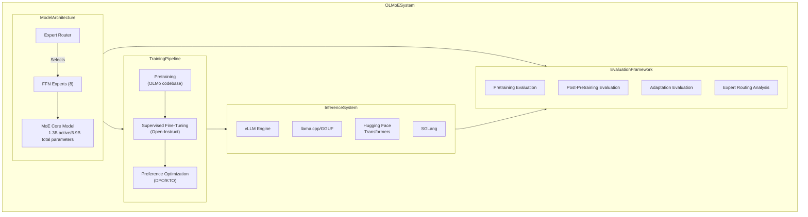
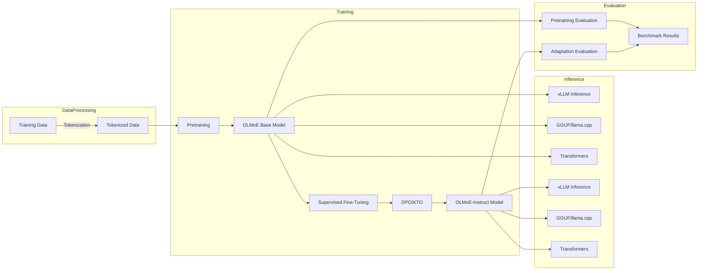
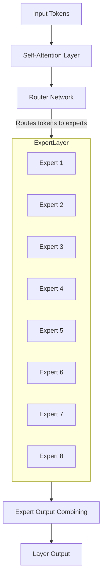
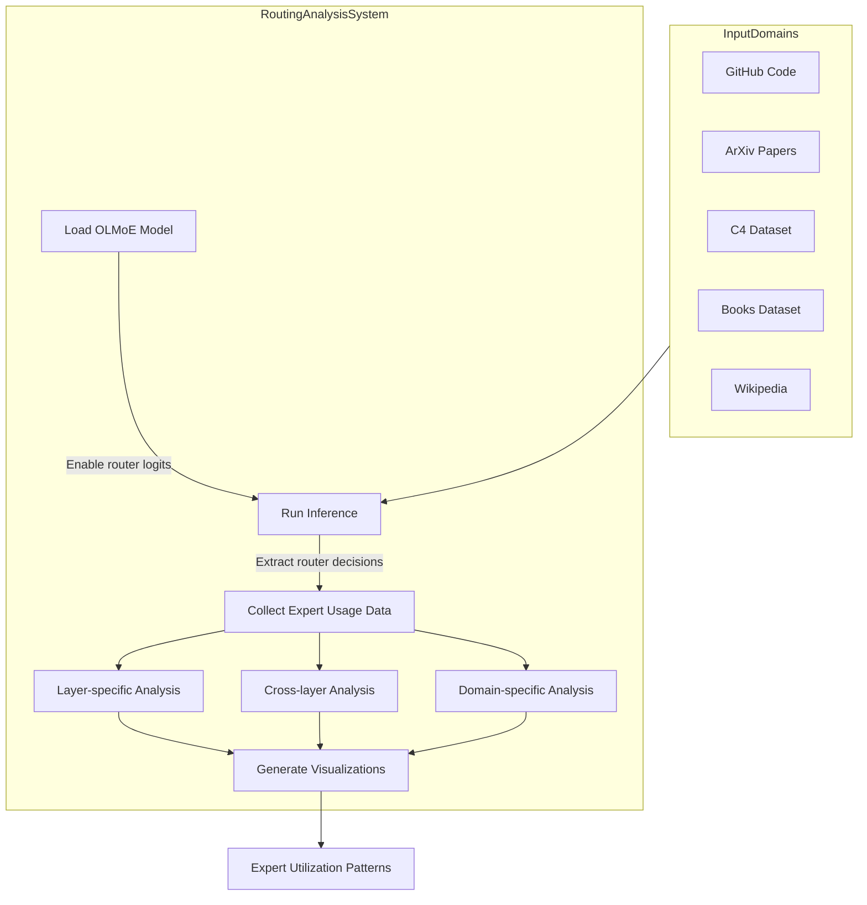

<!-- source: DeepWiki mcp.deepwiki.com · repo allenai/OLMoE · page 1 OLMoE Overview · fetched 2026-10-26 -->

# OLMoE Overview

<details>
<summary>Relevant source files</summary>

The following files were used as context for generating this wiki page:

- [README.md](README.md)
- [scripts/adapteval.sh](scripts/adapteval.sh)
- [scripts/olmoe_visuals.ipynb](scripts/olmoe_visuals.ipynb)

</details>


## Purpose and Scope

This document provides an introduction to OLMoE (Open Mixture-of-Experts Language Models), an open-source Mixture-of-Experts language model with 1.3 billion active parameters from a total of 6.9 billion parameters. It explains the fundamental concepts behind OLMoE, outlines its system architecture, and provides an overview of its key components, including training, inference, and evaluation methods.

This overview serves as an entry point to the OLMoE repository and documentation. For detailed information about specific components, please refer to their dedicated pages: [Model Architecture](#2), [Training Pipeline](#3), [Inference Methods](#4), [Evaluation Framework](#5), and [Expert Routing Analysis](#6).

Sources: [README.md:1-30]()

## What is OLMoE?

OLMoE is a fully open, state-of-the-art Mixture-of-Experts (MoE) language model developed by researchers at the Allen Institute for AI and other institutions. Unlike traditional dense language models where all parameters are active for every input, OLMoE employs a sparse activation strategy where different "expert" neural networks specialize in processing different types of inputs. This approach allows the model to have a large total parameter count (6.9B) while only using a fraction of those parameters (1.3B) for any given input token, resulting in computational efficiency without sacrificing model capacity.

The project encompasses not only the model itself but also the complete ecosystem around it, including:
1. All training code and configurations
2. All training data and preprocessing steps
3. Complete training logs
4. Evaluation frameworks and results
5. Multiple inference options
6. Specialized tools for analyzing expert routing behavior

Sources: [README.md:1-10](), [README.md:23-28]()

## System Architecture Overview

### High-Level Architecture

The following diagram illustrates the high-level architecture of the OLMoE system, showing the major components and their relationships:

**OLMoE System Architecture**


Sources: [README.md:8-29](), [README.md:175-193]()

### Model Lifecycle Flow

The following diagram illustrates the full lifecycle of the OLMoE model, from data processing through training, inference, and evaluation:

**OLMoE Model Lifecycle**


Sources: [README.md:30-97](), [README.md:175-193]()

## Model Architecture Fundamentals

OLMoE is based on a transformer architecture that incorporates Mixture-of-Experts (MoE) layers. In a traditional transformer, each layer consists of an attention mechanism followed by a feed-forward network (FFN). In OLMoE, certain FFN layers are replaced with MoE layers containing multiple "expert" FFNs and a router network that determines which experts should process each token.

### Key Architectural Features

- **Base Architecture**: Transformer-based language model similar to OLMo
- **Parameter Count**: 1.3 billion active parameters (during inference) from a total of 6.9 billion parameters
- **Expert Configuration**: 8 experts per MoE layer, with each token routed to 2 experts (top-2 routing)
- **Token Choice Routing**: "Dropless token choice" routing strategy that efficiently assigns tokens to experts

Sources: [README.md:3-4](), [README.md:24-25](), [README.md:104-108]()

### MoE Layer Structure

**OLMoE MoE Layer Structure**


Sources: [README.md:104-108]()

## Training Pipeline

OLMoE's training pipeline consists of three main stages: pretraining, supervised fine-tuning (SFT), and preference optimization (DPO/KTO).

### Pretraining

The pretraining phase uses a modified version of the OLMo codebase to train the base model on a large corpus of text data. This process establishes the model's fundamental language understanding capabilities.

**Key Pretraining Components**:
- **Data**: OLMoE-mix-0924 dataset
- **Infrastructure**: Training performed using a modified OLMo codebase
- **Configuration**: Detailed configuration files for different model variants
- **Monitoring**: Comprehensive evaluation during training

Sources: [README.md:82-101]()

### Supervised Fine-Tuning (SFT)

After pretraining, the model undergoes supervised fine-tuning using the Open-Instruct framework to improve its instruction-following capabilities.

**SFT Configuration**:
- **Framework**: Open-Instruct
- **Datasets**: Tulu v3.1 mix preview for OLMoE and specialized datasets
- **Training Parameters**: 2e-05 learning rate, linear scheduler, 2 epochs

Sources: [README.md:111-143]()

### Preference Optimization

The final adaptation stage uses preference optimization techniques (DPO/KTO) to align the model with human preferences.

**Preference Optimization Methods**:
- **DPO (Direct Preference Optimization)**: Using Open-Instruct framework
- **KTO (Kahneman-Tversky Optimization)**: Alternative preference optimization approach
- **Dataset**: UltraFeedback binarized preferences

Sources: [README.md:144-175]()

## Inference Methods

OLMoE supports multiple inference methods to accommodate different deployment scenarios:

| Inference Method | Description | Recommended Use Case |
|------------------|-------------|----------------------|
| vLLM | High-performance inference engine with optimized memory usage | Production deployments requiring high throughput |
| llama.cpp/GGUF | Optimized C++ implementation with quantization support | Edge devices or CPU-only environments |
| Transformers | Hugging Face Transformers integration | Research and experimentation |
| SGLang | Structured generation language for controlled text generation | Applications requiring structured outputs |

### vLLM Example

```python
from vllm import LLM, SamplingParams
model = LLM("allenai/OLMoE-1B-7B-0924")
out = model.generate("Bitcoin is", SamplingParams(temperature=0.0))
```

### llama.cpp Example

```bash
llama-cli -m olmoe-1b-7b-0924-q4_0.gguf -p "Bitcoin is" -n 128
```

### Transformers Example

```python
from transformers import OlmoeForCausalLM, AutoTokenizer
import torch

model = OlmoeForCausalLM.from_pretrained("allenai/OLMoE-1B-7B-0924").to("cuda")
tokenizer = AutoTokenizer.from_pretrained("allenai/OLMoE-1B-7B-0924")
inputs = tokenizer("Bitcoin is", return_tensors="pt").to("cuda")
out = model.generate(**inputs, max_length=64)
```

Sources: [README.md:30-80]()

## Evaluation Framework

OLMoE employs a comprehensive evaluation framework that covers different stages of model development:

### Evaluation During Pretraining

Evaluation during pretraining is configured in the training configuration files and runs automatically. It monitors the model's performance on various tasks as training progresses.

Sources: [README.md:177-181]()

### Post-Pretraining Evaluation

After pretraining, the model is evaluated using:
- OLMES Evaluations: Evaluating base model capabilities
- DCLM Evaluations: Additional domain-specific evaluations

Sources: [README.md:183-187]()

### Adaptation Evaluation

After fine-tuning and preference optimization, the model is evaluated on a range of benchmarks:

**Adaptation Benchmarks**:
- **MMLU**: Testing knowledge across 57 subjects
- **GSM8K**: Mathematical reasoning
- **Alpaca Farm**: Instruction following
- **BBH**: Big Bench Hard tasks
- **XSTest**: Testing for model biases
- **HumanEval**: Code generation capabilities
- **IFEval**: Instruction following evaluation

Sources: [README.md:189-193](), [scripts/adapteval.sh:1-98]()

## Expert Routing Analysis

One of the unique aspects of OLMoE is its expert routing analysis system, which examines how the model routes tokens to different experts across various domains.

**Expert Routing Analysis System**


The routing analysis tools provide insights into:
- How tokens are routed to different experts
- Which experts specialize in which types of content
- How routing patterns change across model layers
- Domain-specific expert utilization

Sources: [README.md:200-202]()

## Available Resources and Artifacts

OLMoE provides comprehensive resources for researchers and developers:

| Resource Type | Description | Location |
|---------------|-------------|----------|
| Paper | Technical paper detailing the model | https://arxiv.org/abs/2409.02060 |
| Pretraining | Checkpoints, code, data, and logs | Hugging Face and AI2 repositories |
| SFT | Fine-tuned checkpoints and code | Hugging Face and Open-Instruct |
| DPO/KTO | Aligned model checkpoints | Hugging Face |
| Evaluation Tools | Scripts and frameworks | GitHub repository |
| Routing Analysis | Tools for analyzing expert utilization | GitHub repository |

Sources: [README.md:23-28]()

## Conclusion

OLMoE represents a comprehensive implementation of a Mixture-of-Experts language model, providing not only the model itself but also the complete ecosystem for training, evaluating, and deploying it. The open-source nature of the project, with all data, code, and logs released, enables researchers to build upon and extend this work.

For more detailed information about specific components, please refer to their dedicated wiki pages:
- [Model Architecture](#2)
- [Training Pipeline](#3)
- [Inference Methods](#4)
- [Evaluation Framework](#5)
- [Expert Routing Analysis](#6)

Sources: [README.md:206-218]()

---

