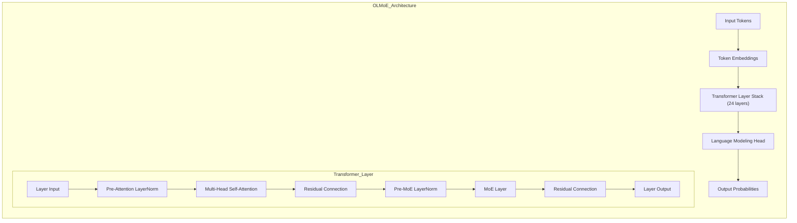
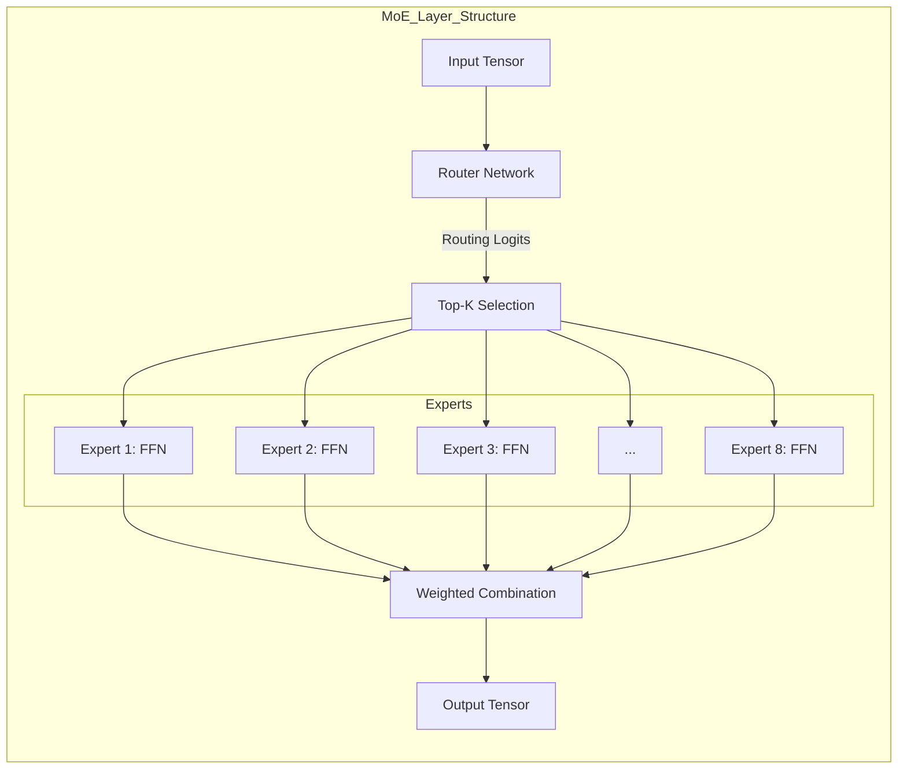
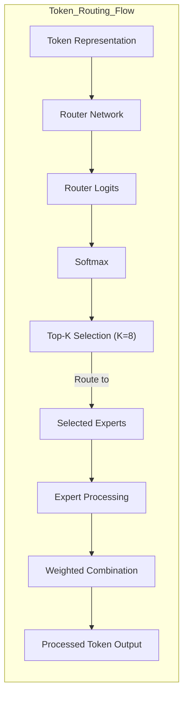
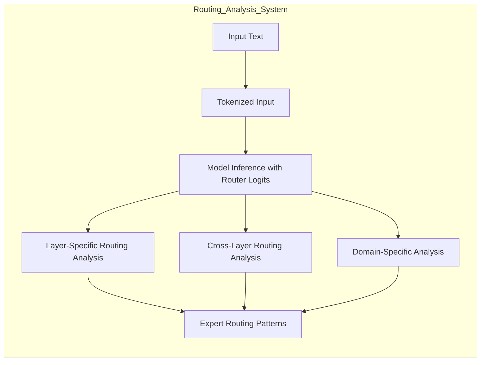
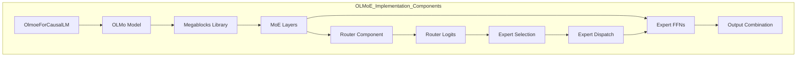

<!-- source: DeepWiki mcp.deepwiki.com · repo allenai/OLMoE · page 2 Model Architecture · fetched 2026-10-26 -->

# Model Architecture

<details>
<summary>Relevant source files</summary>

The following files were used as context for generating this wiki page:

- [README.md](README.md)
- [scripts/adapteval.sh](scripts/adapteval.sh)
- [scripts/olmoe_visuals.ipynb](scripts/olmoe_visuals.ipynb)
- [scripts/run_routing_analysis.py](scripts/run_routing_analysis.py)

</details>


## Purpose and Scope

This document explains the architecture of OLMoE (Open Mixture-of-Experts Language Model), detailing its structural design, parameter distribution, and expert routing mechanisms. It focuses on the technical implementation of the model's architecture rather than training or inference procedures.

For information on how to train the model, see [Training Pipeline](#3).
For information on using the trained model, see [Inference Methods](#4).
For analysis of expert routing patterns, see [Expert Routing Analysis](#6).

## Architecture Overview

OLMoE is a transformer-based language model that implements a Mixture-of-Experts (MoE) approach to achieve parameter efficiency. The model has 1.3 billion active parameters out of a total of 6.9 billion parameters, making it approximately 5.3x more parameter-efficient than a dense model with equivalent capacity.

The key architectural innovation is replacing standard feed-forward networks in transformer layers with sparse MoE modules that selectively route tokens to specialized expert subnetworks.



Sources: [README.md:3-4]()

## Mixture-of-Experts Implementation

OLMoE replaces the standard feed-forward networks in transformer layers with Mixture-of-Experts (MoE) layers. Each MoE layer contains multiple expert networks and a router that determines which experts should process each token.

### MoE Layer Structure



Sources: [README.md:8-9](), [scripts/run_routing_analysis.py:134-143]()

### Expert Configuration

Each expert is a feed-forward neural network with:
- An up-projection linear layer
- A GELU activation function
- A down-projection linear layer

The model contains 8 experts per MoE layer, with each expert being selectively activated based on the token's content and context.

Sources: [README.md:4](), [scripts/run_routing_analysis.py:138-140]()

## Routing Mechanism

The router network determines which experts should process each token:

1. For each token, the router computes logits representing the token's affinity to each expert
2. These logits are converted to probabilities through a softmax function
3. The top-k experts with the highest probabilities are selected (k=8 in OLMoE)
4. Each selected expert processes the token independently
5. The outputs from the selected experts are combined using the routing probabilities as weights



Sources: [scripts/run_routing_analysis.py:19-42](), [scripts/run_routing_analysis.py:134-143]()

### Load Balancing

To ensure all experts are utilized effectively, OLMoE employs a load balancing mechanism during training. This is implemented as an auxiliary loss that encourages even distribution of tokens across experts:

1. It calculates the percentage of tokens routed to each expert
2. It computes the average routing probability for each expert
3. It generates a loss value that penalizes imbalanced expert utilization

The load balancing loss is defined as:

```
load_balancing_loss = sum(tokens_per_expert * router_prob_per_expert) * num_experts
```

Sources: [scripts/run_routing_analysis.py:17-42]()

## Model Parameters and Dimensions

| Component | Parameters |
|-----------|------------|
| Total Parameters | 6.9 billion |
| Active Parameters | 1.3 billion |
| Number of Layers | 24 |
| Experts per Layer | 8 |
| Experts per Token | 8 |

The majority of parameters are in the expert networks, which are sparsely activated. This approach allows OLMoE to have a large capacity while maintaining computational efficiency.

Sources: [README.md:4](), [scripts/run_routing_analysis.py:134-143]()

## Cross-Layer Routing Analysis

OLMoE implements sophisticated analysis tools to understand how tokens are routed across different layers:



The routing analysis examines:
- Expert usage at specific layers (particularly layers 0, 7, and 15)
- Correlations between expert selections across different layers
- Domain-specific routing patterns across various content types

Sources: [scripts/run_routing_analysis.py:104-169](), [scripts/run_routing_analysis.py:171-197]()

## Sparse Upcycling and Model Variants

OLMoE supports a technique called "sparse upcycling" where a dense model is converted to a sparse MoE model, allowing for efficient parameter scaling. The repository contains several model variants:

1. **OLMoE Base Model**: The pretrained language model (1.3B active/6.9B total parameters)
2. **OLMoE-SFT**: Supervised fine-tuned version for instruction following
3. **OLMoE-Instruct**: Further optimized using DPO/KTO techniques

Each variant maintains the same architectural structure while being optimized for different use cases.

Sources: [README.md:25-28](), [README.md:105-106]()

## Expert Choice Routing

In addition to the standard "top-k" routing mechanism, OLMoE supports an alternative routing approach called "expert choice," where experts choose which tokens they want to process rather than tokens choosing experts. This is an experimental feature that can be enabled through configuration.

Sources: [README.md:107]()

## Implementation Details

The OLMoE architecture is implemented using a modified version of the megablocks library for efficient MoE operations. The architecture uses the following components:



The implementation leverages specific classes from the transformers library and the custom megablocks implementation for efficient MoE operations.

Sources: [README.md:84-86](), [scripts/run_routing_analysis.py:1-16]()

## Comparison with Other MoE Models

OLMoE's architecture can be compared to other MoE models like Mixtral. Notable differences include:

| Feature | OLMoE | Mixtral |
|---------|-------|---------|
| Total Parameters | 6.9B | 47B |
| Active Parameters | 1.3B | ~12B |
| Experts per Layer | 8 | 8 |
| Experts per Token | 8 | 2 |
| Router Implementation | Dropless token choice | Top-k routing |

The OLMoE architecture uses a "dropless token choice" routing mechanism, which ensures all tokens are routed to experts without dropping any tokens.

Sources: [README.md:173-175](), [scripts/run_routing_analysis.py:91-96]()

## Integration with Inference Frameworks

The OLMoE architecture has been integrated with various inference frameworks including vLLM, llama.cpp, and SGLang, enabling efficient deployment across different platforms.

Sources: [README.md:31-33]()

---

