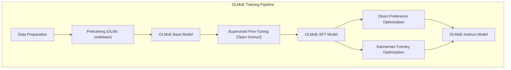
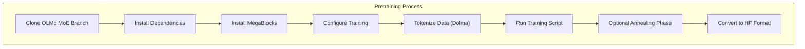
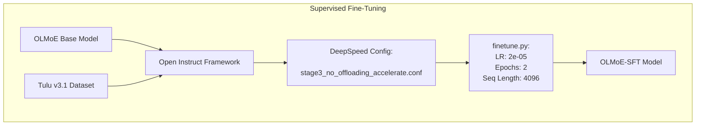
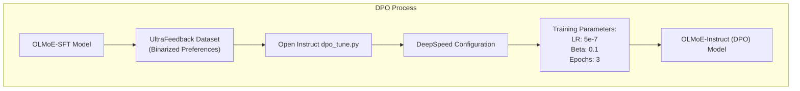
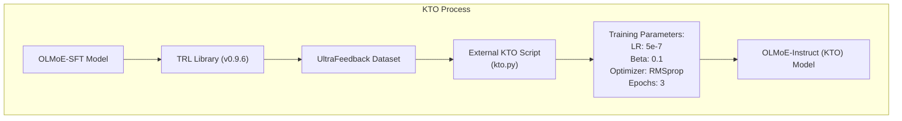
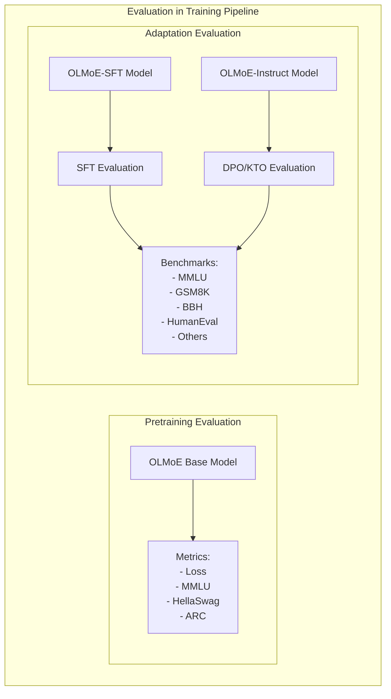
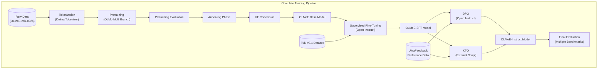

<!-- source: DeepWiki mcp.deepwiki.com · repo allenai/OLMoE · page 3 Training Pipeline · fetched 2026-10-26 -->

# Training Pipeline

<details>
<summary>Relevant source files</summary>

The following files were used as context for generating this wiki page:

- [README.md](README.md)
- [logs/olmoe-dpo-logs.txt](logs/olmoe-dpo-logs.txt)
- [logs/olmoe-sft-logs.txt](logs/olmoe-sft-logs.txt)
- [scripts/adapteval.sh](scripts/adapteval.sh)
- [scripts/olmoe_visuals.ipynb](scripts/olmoe_visuals.ipynb)

</details>


The Training Pipeline in OLMoE (Open Mixture-of-Experts Language Models) encompasses the complete process of developing the model from initial pretraining through fine-tuning and alignment. This page documents the components, workflow, and implementation details of each stage in the pipeline, providing references to relevant code and configuration files.

For information about the model architecture, see [Model Architecture](#2). For specific details about pretraining, see [Pretraining](#3.1).

## Overview of the Training Pipeline

The OLMoE training pipeline consists of three main stages, each building upon the previous one:



Sources: [README.md:12-21]()

## Pretraining

Pretraining is the initial stage where the model learns general language patterns from a large corpus of text data. OLMoE pretraining uses a modified version of the OLMo codebase.

### Setup and Requirements

To run pretraining, the following steps are required:

1. Clone a specific branch of the OLMo repository (`Muennighoff/MoE`)
2. Install dependencies with `cd OLMo; pip install -e .`
3. Install additional requirements with `pip install git+https://github.com/Muennighoff/megablocks.git@olmoe`
4. Configure using files in the `configs/` directory
5. Tokenize and prepare the training data



### Data Preparation

The training data is tokenized using the Dolma toolkit with specific parameters:

```
dolma tokens \
--documents ${PATH_TO_DOWNLOADED_DATA} \
--destination ${PATH_WHERE_TO_SAVE_TOKENIZED_DATA} \
--tokenizer.name_or_path 'allenai/gpt-neox-olmo-dolma-v1_5' \
--max_size '2_147_483_648' \
--seed 0 \
--tokenizer.eos_token_id 50279 \
--tokenizer.pad_token_id 1 \
--processes ${NUMBER_OF_CPU_CORES_TO_USE}
```

### Training Process

Pretraining uses configuration files in the `configs/` directory. The main configuration file for OLMoE pretraining is `configs/OLMoE-1B-7B-0924.yml`.

The training is launched with:

```
bash scripts/olmoe-gantry.sh
```

This invokes [scripts/train.py]() from the OLMo repository using the Beaker Gantry job submission system.

After initial pretraining, an optional annealing phase can be run with a modified configuration (`configs/ablations/olmoe-8x1b-newhp-newds-final-anneal.yml`), which primarily adjusts the optimizer and scheduler settings.

Finally, the model checkpoint is converted to the Hugging Face Transformers format using a conversion script provided in the transformers library.

Sources: [README.md:82-101]()

## Supervised Fine-Tuning (SFT)

Supervised Fine-Tuning adapts the pretrained model to follow instructions using the Open Instruct framework and instruction-response pairs.

### Setup and Process

To run SFT:

1. Clone the Open Instruct repository
2. Install dependencies according to its setup instructions
3. Run the fine-tuning script with DeepSpeed acceleration



### Training Command

The SFT process uses the following command:

```
accelerate launch \
--mixed_precision bf16 \
--num_machines 1 \
--num_processes 8 \
--use_deepspeed \
--deepspeed_config_file configs/ds_configs/stage3_no_offloading_accelerate.conf \
open_instruct/finetune.py \
--model_name_or_path allenai/OLMoE-1B-7B-0924 \
--tokenizer_name allenai/OLMoE-1B-7B-0924 \
--use_flash_attn \
--max_seq_length 4096 \
--preprocessing_num_workers 128 \
--per_device_train_batch_size 2 \
--gradient_accumulation_steps 8 \
--learning_rate 2e-05 \
--lr_scheduler_type linear \
--warmup_ratio 0.03 \
--weight_decay 0.0 \
--num_train_epochs 2 \
--output_dir output/ \
--with_tracking \
--report_to wandb \
--logging_steps 1 \
--reduce_loss sum \
--model_revision main \
--dataset_mixer_list allenai/tulu-v3-mix-preview-4096-OLMoE 1.0 ai2-adapt-dev/daring-anteater-specialized 1.0 \
--checkpointing_steps epoch \
--add_bos
```

The SFT process uses Tulu v3.1 dataset and creates an instruction-following model that serves as the foundation for subsequent preference optimization stages.

Sources: [README.md:111-143]()

## Preference Optimization

Preference optimization further aligns the model with human preferences using paired examples where one response is preferred over another. OLMoE offers two methods: Direct Preference Optimization (DPO) and Kahneman-Tversky Optimization (KTO).

### Direct Preference Optimization (DPO)

DPO trains the model to produce outputs that humans would prefer, using the Open Instruct framework and UltraFeedback dataset.



The DPO process uses the following command:

```
accelerate launch \
--mixed_precision bf16 \
--num_machines 1 \
--num_processes 8 \
--use_deepspeed \
--deepspeed_config_file configs/ds_configs/stage3_no_offloading_accelerate.conf \
open_instruct/dpo_tune.py \
--model_name_or_path allenai/OLMoE-1B-7B-0924-SFT \
--tokenizer_name allenai/OLMoE-1B-7B-0924-SFT \
--use_flash_attn \
--gradient_checkpointing \
--dataset_name argilla/ultrafeedback-binarized-preferences-cleaned \
--max_seq_length 4096 \
--preprocessing_num_workers 16 \
--per_device_train_batch_size 1 \
--gradient_accumulation_steps 4 \
--learning_rate 5e-7 \
--lr_scheduler_type linear \
--warmup_ratio 0.1 \
--weight_decay 0. \
--num_train_epochs 3 \
--output_dir output/ \
--report_to tensorboard \
--logging_steps 1 \
--reduce_loss sum \
--add_bos \
--checkpointing_steps epoch \
--dpo_beta 0.1
```

Sources: [README.md:144-174](), [logs/olmoe-dpo-logs.txt]()

### Kahneman-Tversky Optimization (KTO)

KTO is an alternative to DPO that uses a different optimization approach. It requires installing the `trl` library and running an external script.



The KTO process is run using:

```
WANDB_PROJECT=olmoe accelerate launch --config_file=config_8gpusdsz2_m7.yml kto.py \
--model_name_or_path allenai/OLMoE-1B-7B-0924-SFT \
--output_dir OLMoE-1B-7B-0924-SFT-KTO-3EP \
--report_to "wandb" \
--per_device_train_batch_size 4 \
--gradient_accumulation_steps 1 \
--optim rmsprop \
--learning_rate 5e-07 \
--beta 0.1 \
--logging_steps 1 \
--bf16 \
--sanity_check False \
--num_train_epochs 3
```

The KTO script (`kto.py`) is from an external repository: https://github.com/Muennighoff/kto

Sources: [README.md:175-176]()

## Evaluation Within the Pipeline

Each stage of the training pipeline includes evaluation to assess model quality and progress.



### Pretraining Evaluation

During pretraining, evaluation is done automatically and configured in the config file using the OLMo evaluation framework: [olmo/eval](https://github.com/allenai/OLMo/tree/Muennighoff/MoE/olmo/eval).

### Post-Adaptation Evaluation

After SFT, DPO, or KTO, the model is evaluated using benchmark tasks through the Open Instruct framework. The evaluation script (`scripts/adapteval.sh`) runs multiple evaluations including:

- MMLU (massive multitask language understanding)
- GSM8K (math problem solving)
- Alpaca (instruction following)
- BBH (big-bench hard)
- XSTest (cross-lingual evaluation)
- HumanEval (code generation)
- IFEval (instruction following)

These evaluations provide comprehensive measurements of model capabilities across different tasks and domains after each stage of training.

Sources: [README.md:178-193](), [scripts/adapteval.sh:1-98]()

## End-to-End Pipeline Flow

The complete training pipeline comprises a sequence of stages that transform raw data into a capable, aligned language model.



This diagram illustrates the complete flow from data preparation through all training stages to the final evaluation, showing the key inputs, processes, and outputs at each stage.

Sources: [README.md:12-193]()

## Data and Artifacts

Throughout the training pipeline, various data and model artifacts are produced:

| Stage | Input | Output | Repository |
|-------|-------|--------|------------|
| Pretraining | Raw text data (OLMoE-mix-0924) | Base model checkpoints | [allenai/OLMoE-1B-7B-0924](https://hf.co/allenai/OLMoE-1B-7B-0924) |
| SFT | Base model + Tulu v3.1 dataset | SFT model | [allenai/OLMoE-1B-7B-0924-SFT](https://huggingface.co/allenai/OLMoE-1B-7B-0924-SFT) |
| DPO/KTO | SFT model + UltraFeedback dataset | Instruct model | [allenai/OLMoE-1B-7B-0924-Instruct](https://huggingface.co/allenai/OLMoE-1B-7B-0924-Instruct) |

For each stage, logs and evaluation results are also stored for tracking progress and performance.

Sources: [README.md:23-28]()

## Conclusion

The OLMoE training pipeline represents a comprehensive approach to developing a high-quality Mixture-of-Experts language model. It progresses from pretraining on a large corpus to instruction tuning and alignment with human preferences. 

The modular nature of the pipeline allows for experimentation with different approaches at each stage (particularly in preference optimization with both DPO and KTO options), while maintaining a coherent workflow from raw data to final, aligned model.

---

