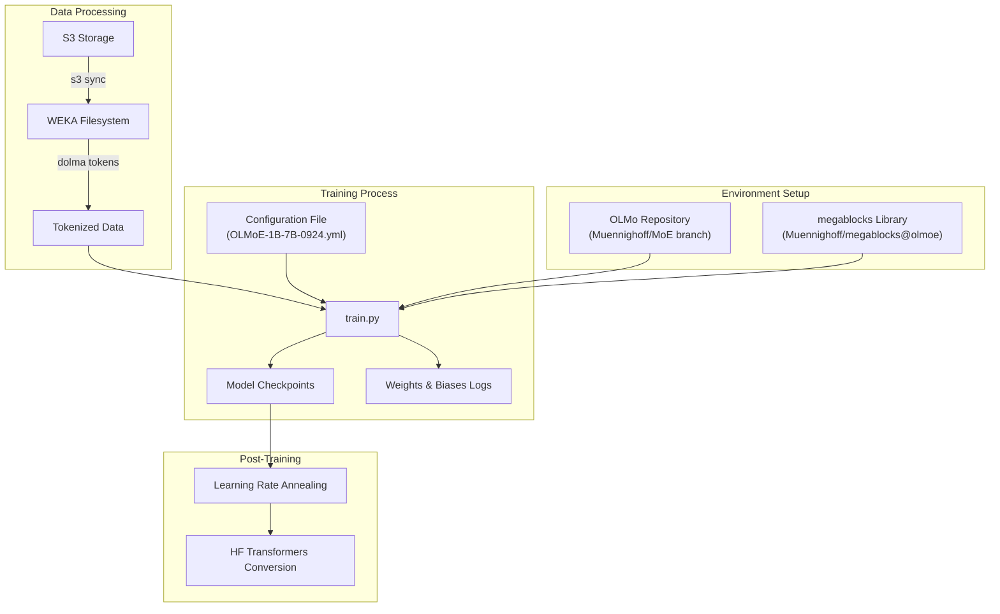
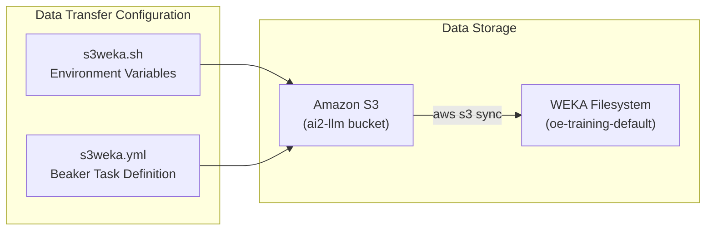
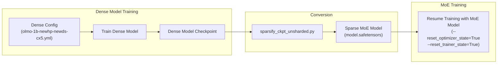
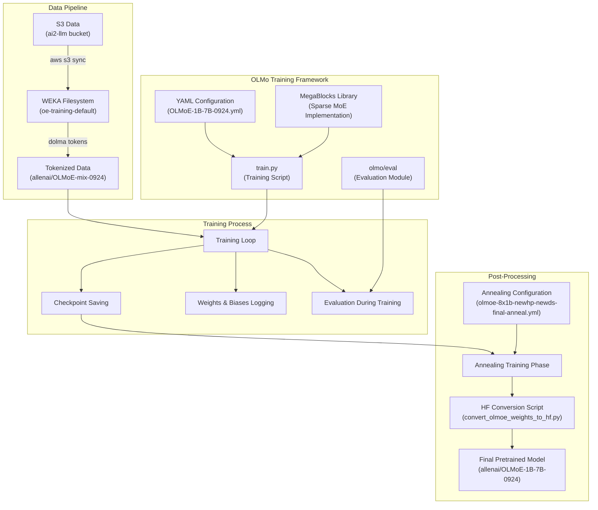

<!-- source: DeepWiki mcp.deepwiki.com · repo allenai/OLMoE · page 3.1 Pretraining · fetched 2026-10-26 -->

# Pretraining

<details>
<summary>Relevant source files</summary>

The following files were used as context for generating this wiki page:

- [README.md](README.md)
- [scripts/adapteval.sh](scripts/adapteval.sh)
- [scripts/olmoe_visuals.ipynb](scripts/olmoe_visuals.ipynb)
- [scripts/wekatransfer/s3weka.sh](scripts/wekatransfer/s3weka.sh)
- [scripts/wekatransfer/s3weka.yml](scripts/wekatransfer/s3weka.yml)

</details>


This document details the technical process of pretraining the OLMoE (Open Mixture-of-Experts Language Models) model. Pretraining is the initial phase of model development where the model learns language patterns from a large corpus of text before any fine-tuning or alignment. For information about subsequent training stages, see [Supervised Fine-Tuning (SFT)](#3.2) and [Preference Optimization (DPO/KTO)](#3.3).

## Pretraining Pipeline Overview

The OLMoE pretraining pipeline consists of several interconnected components:



Sources: [README.md:82-101]()

## Environment Setup

To prepare for OLMoE pretraining, you must set up the development environment with specific dependencies:

1. Clone the OLMo repository with the MoE branch:
   ```bash
   git clone https://github.com/allenai/OLMo.git
   cd OLMo
   git checkout Muennighoff/MoE
   pip install -e .
   ```

2. Install the modified megablocks library:
   ```bash
   pip install git+https://github.com/Muennighoff/megablocks.git@olmoe
   ```

Sources: [README.md:84-86]()

## Data Preparation

### S3 to WEKA Transfer

The pretraining data must first be transferred from Amazon S3 to a WEKA filesystem:



Configure the transfer by setting environment variables in the script:

```bash
export BUDGET=ai2/oe-training
export S3_BUCKET=ai2-llm
export S3_PREFIX=preprocessed/olmo-mix/danyh-compiled-v1_7
export WEKA_BUCKET=oe-training-default
export WEKA_PREFIX=ai2-llm/preprocessed/danyh-compiled-v1_7
```

Sources: [scripts/wekatransfer/s3weka.sh:1-9](), [scripts/wekatransfer/s3weka.yml:1-22]()

### Data Tokenization

After transferring the raw data, tokenize it using the `dolma tokens` command:

```bash
dolma tokens \
--documents ${PATH_TO_DOWNLOADED_DATA} \
--destination ${PATH_WHERE_TO_SAVE_TOKENIZED_DATA} \
--tokenizer.name_or_path 'allenai/gpt-neox-olmo-dolma-v1_5' \
--max_size '2_147_483_648' \
--seed 0 \
--tokenizer.eos_token_id 50279 \
--tokenizer.pad_token_id 1 \
--processes ${NUMBER_OF_CPU_CORES_TO_USE}
```

The tokenized data can be downloaded from the `allenai/OLMoE-mix-0924` dataset on Hugging Face for reference.

Sources: [README.md:87-98]()

## Configuration

The configuration file defines all parameters for model architecture and training. The primary configuration used for OLMoE is located at `configs/OLMoE-1B-7B-0924.yml`.

Key configuration components include:

| Configuration Section | Description |
|-----------------------|-------------|
| `model` | Defines architecture parameters (hidden size, layers, experts, etc.) |
| `tokenizer` | Settings for the tokenizer |
| `optimizer` | Optimizer type and parameters (AdamW, learning rate, etc.) |
| `scheduler` | Learning rate schedule configuration |
| `train` | Training parameters (batch size, sequences, etc.) |
| `paths` | Data paths for tokenized training data |
| `eval` | Configuration for evaluation during training |

For different architectural choices and ablations, explore the configuration files in `configs/ablations`.

Sources: [README.md:86-87]()

## Training Execution

Training is executed through the OLMo training script, typically submitted as a job:

```bash
bash scripts/olmoe-gantry.sh
```

This script invokes the training script (`train.py`) from the OLMo repository with the configuration file. The script handles:

1. Loading the configuration
2. Setting up the model, optimizer, and data loaders
3. Executing the training loop
4. Saving checkpoints
5. Performing evaluation during training
6. Logging metrics to Weights & Biases

Sources: [README.md:99]()

## Post-Training

### Learning Rate Annealing

After the main pretraining is complete, an additional annealing phase further refines the model:

1. Use the annealing configuration file: `configs/ablations/olmoe-8x1b-newhp-newds-final-anneal.yml`
2. Key changes from the main training configuration:
   - Modified `optimizer` parameters
   - Adjusted `scheduler` settings
   - Updated `max_duration` and `stop_at` values

Sources: [README.md:100-101]()

### Checkpoint Conversion

Convert the trained checkpoint to Hugging Face Transformers format:

```bash
# Use the script from transformers repository
python /path/to/transformers/src/transformers/models/olmoe/convert_olmoe_weights_to_hf.py
```

The script handles the conversion of OLMoE's internal format to the structure expected by Hugging Face Transformers.

Sources: [README.md:101]()

## Design Variants

### Sparse Upcycling



Sparse upcycling converts a dense model to an MoE model:

1. Train a dense model first using `configs/ablations/olmo-1b-newhp-newds-cx5.yml`
2. Convert the checkpoint to MoE using `scripts/sparsify_ckpt_unsharded.py`
3. Place the generated model in a folder with name ending in `-unsharded` and file named `model.safetensors`
4. Launch a job that loads this model with:
   ```
   --load_path=path_to_upcycled_ckpt --reset_optimizer_state=True --reset_trainer_state=True
   ```

A pre-converted checkpoint is available at `allenai/OLMo-1B-0724-954000steps-unsharded`.

Sources: [README.md:105-107]()

### Expert Choice Routing

To experiment with expert choice routing:

1. Use the OLMo branch `Muennighoff/OLMoSE` or copy the config changes
2. Activate expert choice in your configuration
3. The implementation uses code from the modified megablocks library

Sources: [README.md:107-108]()

### Shared MoE Layers

For shared MoE layer experiments:

1. Use the OLMo branch `Muennighoff/OLMoSE`
2. Create a custom configuration file similar to those used in previous experiments

Sources: [README.md:108-109]()

## Evaluation During Pretraining

Evaluation is configured in the YAML file and happens automatically during pretraining, using the code in `olmo/eval` from the OLMo repository. Results are logged to Weights & Biases for tracking progress.

The evaluation metrics include:
- Perplexity on validation sets
- Expert utilization statistics
- Learning rate and optimization metrics

Sources: [README.md:179-181]()

## Pretraining Workflow Diagram



Sources: [README.md:82-109](), [README.md:179-181]()

---

