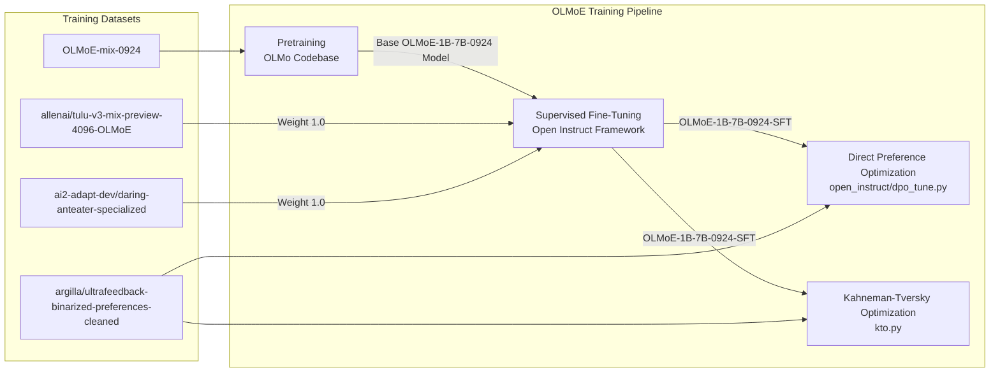
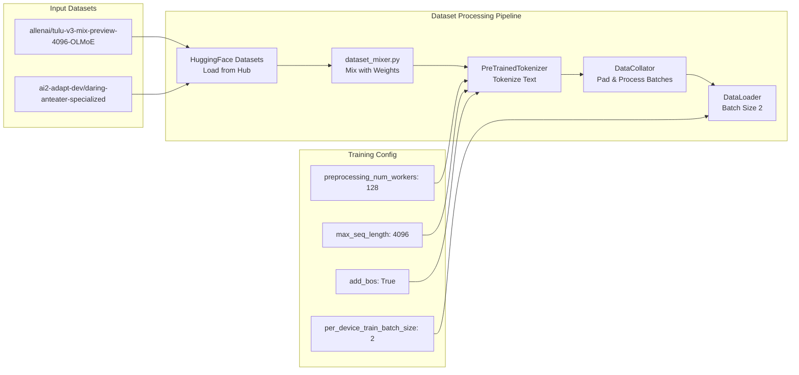
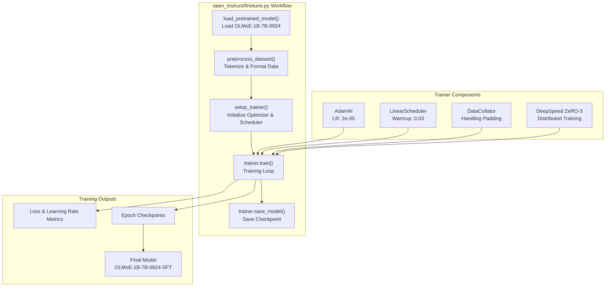

<!-- source: DeepWiki mcp.deepwiki.com · repo allenai/OLMoE · page 3.2 Supervised Fine-Tuning (SFT) · fetched 2026-10-26 -->

# Supervised Fine-Tuning (SFT)

<details>
<summary>Relevant source files</summary>

The following files were used as context for generating this wiki page:

- [README.md](README.md)
- [logs/olmoe-dpo-logs.txt](logs/olmoe-dpo-logs.txt)
- [logs/olmoe-sft-logs.txt](logs/olmoe-sft-logs.txt)
- [scripts/adapteval.sh](scripts/adapteval.sh)
- [scripts/olmoe_visuals.ipynb](scripts/olmoe_visuals.ipynb)

</details>


This page documents the Supervised Fine-Tuning (SFT) process in the OLMoE pipeline. SFT is the second stage in the training pipeline, following pretraining and preceding preference optimization (DPO/KTO). This process aligns the pretrained model with human instructions and enhances its ability to follow user prompts. For information about the pretraining step, see [Pretraining](#3.1), and for details on preference optimization, see [Preference Optimization (DPO/KTO)](#3.3).

## SFT in the OLMoE Training Pipeline

SFT transforms the base pretrained OLMoE model into an instruction-following model by fine-tuning it on a dataset of instruction-response pairs. This phase is critical for making the model responsive to user instructions and preparing it for further alignment.

**SFT Pipeline Overview**



Sources: [README.md:111-143]()

## Dataset Information

OLMoE's SFT process uses a combination of two datasets:

1. **Primary Dataset**: `allenai/tulu-v3-mix-preview-4096-OLMoE` - A version of the Tulu v3.1 dataset formatted for OLMoE's 4096 token context length
2. **Specialized Dataset**: `ai2-adapt-dev/daring-anteater-specialized` - A specialized instruction dataset

Both datasets are mixed with equal weight (1.0 each) using the `dataset_mixer_list` parameter of the Open Instruct framework. The Tulu dataset consists of instruction-response pairs curated to improve instruction-following capabilities across diverse tasks.

**Dataset Processing Flow**



Sources: [README.md:123-142]()

## Training Configuration

The SFT process uses the Open Instruct framework with DeepSpeed for distributed training. Key configuration parameters include:

| Parameter | Value | Description |
|-----------|-------|-------------|
| Base Model | `allenai/OLMoE-1B-7B-0924` | Pretrained OLMoE model with 1.3B active parameters |
| Max Sequence Length | 4096 | Maximum token length for training |
| Batch Size | 2 per device | Training batch size per GPU |
| GPUs | 8 | Number of GPUs used in parallel |
| Gradient Accumulation | 8 steps | Number of steps before updating weights |
| Effective Batch Size | 128 | 2 × 8 × 8 = 128 samples per update |
| Learning Rate | 2e-05 | Learning rate for AdamW optimizer |
| LR Scheduler | Linear | Linear learning rate decay |
| Warmup Ratio | 0.03 | Portion of training for LR warmup |
| Weight Decay | 0.0 | No weight decay regularization |
| Training Epochs | 2 | Number of passes through the dataset |
| Precision | BF16 | Mixed precision training with bfloat16 |
| Optimization | DeepSpeed ZeRO-3 | Parameter partitioning across GPUs |

Sources: [README.md:114-142]()

## Implementation Details

### Launch Command

The SFT process is implemented using the Open Instruct framework and launched with the following command:

```bash
accelerate launch \
--mixed_precision bf16 \
--num_machines 1 \
--num_processes 8 \
--use_deepspeed \
--deepspeed_config_file configs/ds_configs/stage3_no_offloading_accelerate.conf \
open_instruct/finetune.py \
--model_name_or_path allenai/OLMoE-1B-7B-0924 \
--tokenizer_name allenai/OLMoE-1B-7B-0924 \
--use_flash_attn \
--max_seq_length 4096 \
--preprocessing_num_workers 128 \
--per_device_train_batch_size 2 \
--gradient_accumulation_steps 8 \
--learning_rate 2e-05 \
--lr_scheduler_type linear \
--warmup_ratio 0.03 \
--weight_decay 0.0 \
--num_train_epochs 2 \
--output_dir output/ \
--with_tracking \
--report_to wandb \
--logging_steps 1 \
--reduce_loss sum \
--model_revision main \
--dataset_mixer_list allenai/tulu-v3-mix-preview-4096-OLMoE 1.0 ai2-adapt-dev/daring-anteater-specialized 1.0 \
--checkpointing_steps epoch \
--add_bos
```

### Technical Implementation

The SFT process leverages several key components:

1. **DeepSpeed Integration**: Utilizes ZeRO-3 optimization to partition model parameters, gradients, and optimizer states across GPUs for memory efficiency.

2. **Flash Attention**: Uses optimized attention implementation for faster training with long sequences.

3. **Distributed Training**: The `accelerate` library manages distributed training across 8 GPUs.

4. **Checkpointing**: Models are saved at the end of each epoch to enable resume capability.

5. **Logging**: Training metrics are tracked and reported to Weights & Biases.

**SFT Process Workflow**



Sources: [README.md:111-143]()

## Evaluation

After SFT, the model is evaluated on a diverse set of benchmarks using the `adapteval.sh` script, which runs individual evaluation tasks in parallel:

| Benchmark | Description | Evaluation Script | Metrics |
|-----------|-------------|------------------|---------|
| MMLU | Tests knowledge across 57 subjects | `eval.mmlu.run_eval` | Accuracy |
| GSM8K | Tests mathematical reasoning | `eval.gsm.run_eval` | Accuracy |
| Alpaca | Measures instruction following | `eval.alpaca_farm.run_eval` | Win rate |
| BBH | Tests hard reasoning tasks | `eval.bbh.run_eval` | Accuracy |
| XS Test | Evaluates model safety | `eval.xstest.run_eval` | Safety score |
| HumanEval | Assesses code generation | `eval.codex_humaneval.run_eval` | Pass@k |
| IFEval | Tests instruction following precision | `eval.ifeval.run_eval` | Precision score |

The evaluation employs different prompting strategies including zero-shot (MMLU) and few-shot (GSM8K with 8 examples) approaches. Each evaluation script generates detailed metrics saved to the model's evaluation directory.

Sources: [README.md:189-193](), [scripts/adapteval.sh:1-98]()

## Results and Checkpoints

The final SFT model is published to Hugging Face as `allenai/OLMoE-1B-7B-0924-SFT` and serves as the foundation for subsequent preference optimization. The logs for the SFT process are stored in the repository at `logs/olmoe-sft-logs.txt`.

### Accessing the Model

The model can be loaded using the Hugging Face Transformers library:

```python
from transformers import OlmoeForCausalLM, AutoTokenizer

model = OlmoeForCausalLM.from_pretrained("allenai/OLMoE-1B-7B-0924-SFT")
tokenizer = AutoTokenizer.from_pretrained("allenai/OLMoE-1B-7B-0924-SFT")
```

For inference, it's recommended to use vLLM, SGLang, or llama.cpp for better performance compared to the transformers implementation.

Sources: [README.md:26-27](), [README.md:30-73]()

## Next Steps

After SFT, the model undergoes further alignment through preference optimization:

1. **DPO (Direct Preference Optimization)**: Fine-tunes the model using the UltraFeedback dataset with binary preferences.

2. **KTO (Kahneman-Tversky Optimization)**: An alternative preference optimization approach also used with the SFT model.

For details on preference optimization, see [Preference Optimization (DPO/KTO)](#3.3).

Sources: [README.md:143-175]()

---

