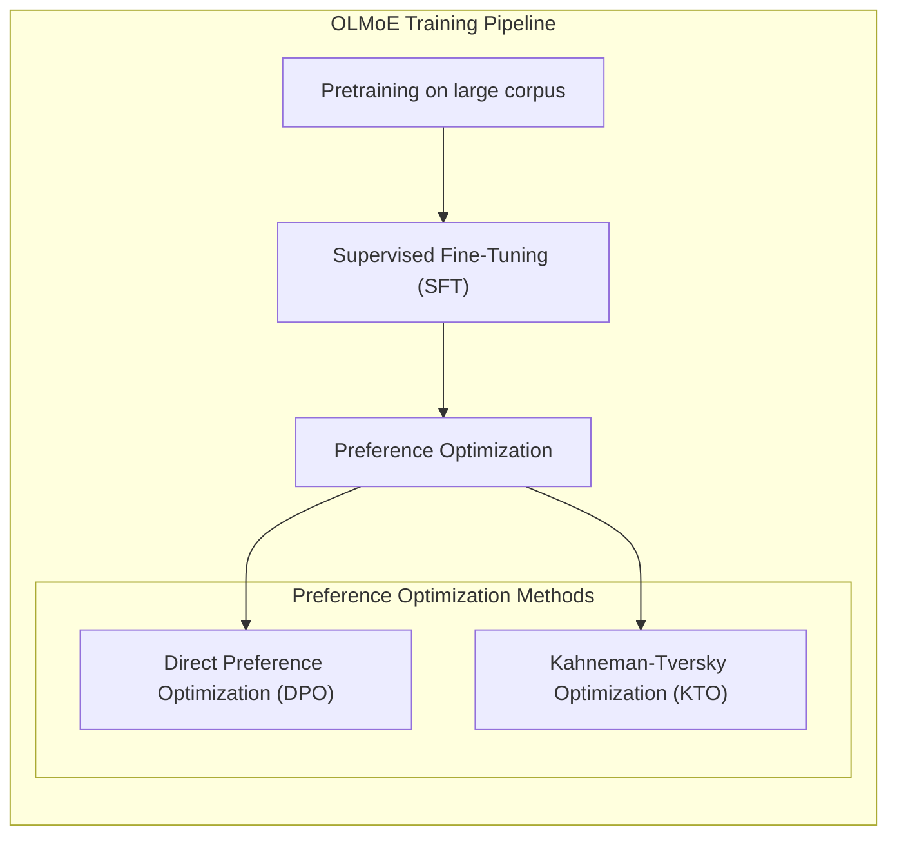
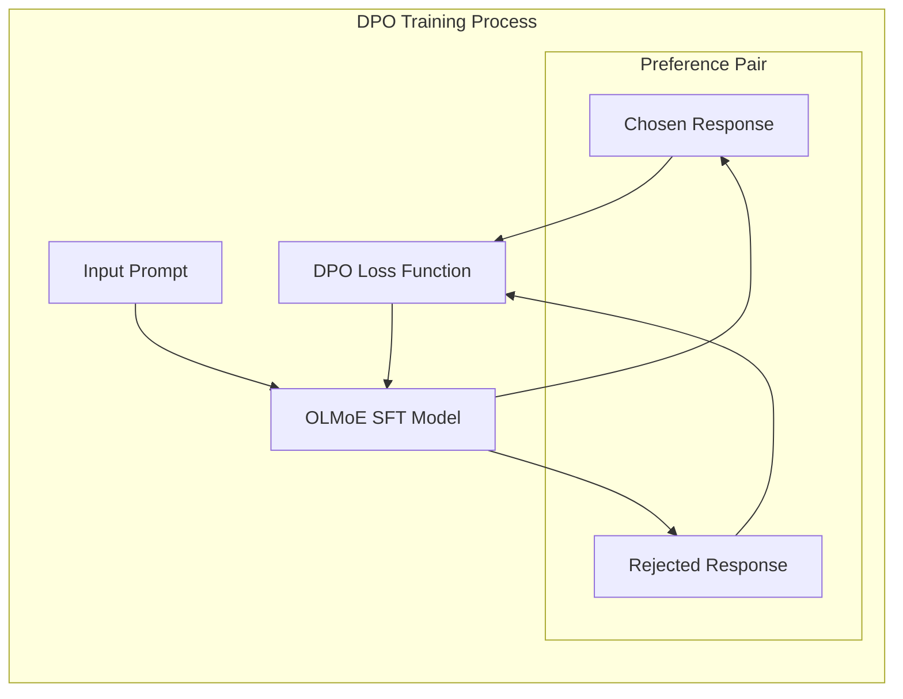
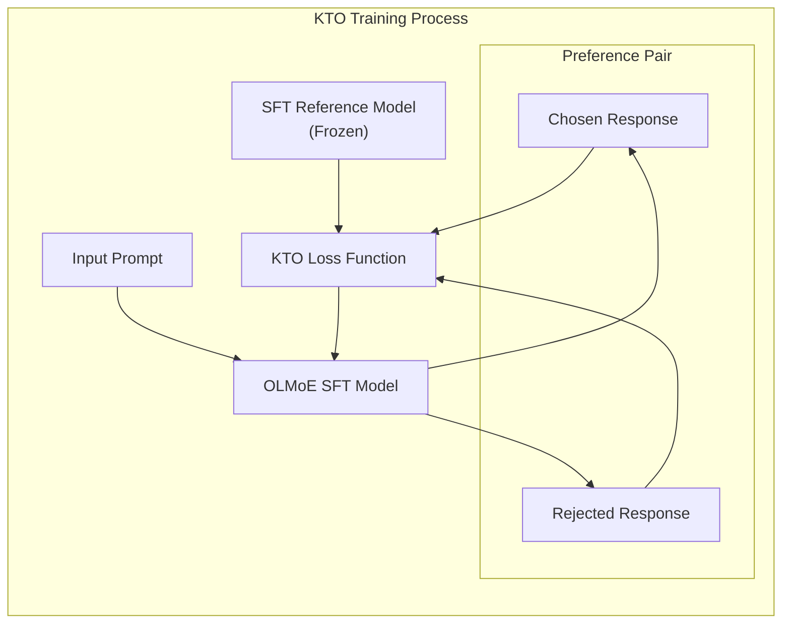
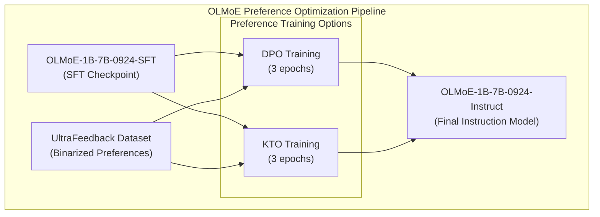
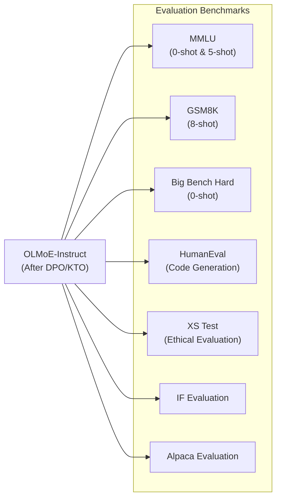

<!-- source: DeepWiki mcp.deepwiki.com · repo allenai/OLMoE · page 3.3 Preference Optimization (DPO/KTO) · fetched 2026-10-26 -->

# Preference Optimization (DPO/KTO)

<details>
<summary>Relevant source files</summary>

The following files were used as context for generating this wiki page:

- [README.md](README.md)
- [logs/olmoe-dpo-logs.txt](logs/olmoe-dpo-logs.txt)
- [logs/olmoe-sft-logs.txt](logs/olmoe-sft-logs.txt)
- [scripts/adapteval.sh](scripts/adapteval.sh)
- [scripts/olmoe_visuals.ipynb](scripts/olmoe_visuals.ipynb)

</details>


This document covers the Preference Optimization techniques used in OLMoE, specifically Direct Preference Optimization (DPO) and Kahneman-Tversky Optimization (KTO). These techniques represent the final training phase in the OLMoE pipeline, coming after Supervised Fine-Tuning (SFT). For information about the SFT phase, see [Supervised Fine-Tuning (SFT)](#3.2).

## Overview and Purpose

Preference Optimization is a crucial phase in developing instruction-following language models. After a model has been pre-trained and undergone supervised fine-tuning, preference optimization techniques use human preference data to further align the model with human values and expectations. 



**Diagram: OLMoE Training Pipeline with Preference Optimization Methods**

Sources: [README.md:111-145]()

## Preference Optimization Techniques

### Direct Preference Optimization (DPO)

DPO is a method for aligning language models with human preferences without explicitly modeling a reward function. It directly optimizes the policy to maximize the probability that the preferred response is ranked higher than the dispreferred one.



**Diagram: DPO Training Process**

DPO works by:
1. Taking a prompt and a pair of responses (chosen and rejected)
2. Computing the log probability of both responses given the prompt using the SFT model
3. Optimizing a contrastive loss function that increases the likelihood gap between chosen and rejected responses
4. Using the hyperparameter β (beta) to control the trade-off between preference alignment and divergence from the reference model

Sources: [README.md:144-173]()

### Kahneman-Tversky Optimization (KTO)

KTO is an alternative to DPO that uses findings from behavioral economics to design a different loss function. It's named after psychologists Daniel Kahneman and Amos Tversky, who developed Prospect Theory, which explains how people make decisions under risk and uncertainty.



**Diagram: KTO Training Process**

KTO differs from DPO in:
1. Using an asymmetric loss function inspired by Prospect Theory
2. Potentially providing better convergence properties for certain types of preference data
3. Having different sensitivity to the selection of hyperparameters

Sources: [README.md:174-175]()

### Comparison between DPO and KTO

Both DPO and KTO:
- Work with paired preference data (chosen vs. rejected responses)
- Optimize directly on preferences without an explicit reward model
- Use a reference (SFT) model to prevent divergence
- Employ a beta hyperparameter to control alignment strength

The key differences lie in their loss functions and how they handle the trade-off between preference alignment and divergence from the reference model.

## Implementation in OLMoE

### Data Preparation

The OLMoE Preference Optimization phase uses the UltraFeedback dataset, specifically the binarized and cleaned version:

```
argilla/ultrafeedback-binarized-preferences-cleaned
```

This dataset contains pairs of responses to the same prompt, with human annotations indicating which response is preferred.

Sources: [README.md:156]()

### Training Process



**Diagram: OLMoE Preference Optimization Pipeline**

The training process for preference optimization follows these general steps:

1. Start with the SFT model (`allenai/OLMoE-1B-7B-0924-SFT`)
2. Load preference data from UltraFeedback
3. Apply either DPO or KTO optimization for 3 epochs
4. Output the final instruction-tuned model (`OLMoE-1B-7B-0924-Instruct`)

Sources: [README.md:144-175]()

### DPO Configuration

For DPO training, OLMoE uses the following key parameters:

| Parameter | Value | Description |
|-----------|-------|-------------|
| Learning Rate | 5e-7 | Very small to prevent divergence from reference model |
| Scheduler | Linear | With 10% warmup ratio |
| Batch Size | 1 per device | With gradient accumulation of 4 steps |
| Sequence Length | 4096 | Maximum input sequence length |
| Beta | 0.1 | Controls preference alignment strength |
| Epochs | 3 | Number of training epochs |

The model is trained using DeepSpeed ZeRO-3 for efficient distributed training with mixed precision (bf16).

Sources: [README.md:144-173]()

### KTO Configuration

For KTO training, similar parameters are used:

| Parameter | Value | Description |
|-----------|-------|-------------|
| Learning Rate | 5e-7 | Same as DPO for consistency |
| Optimizer | RMSprop | Different from AdamW typically used in DPO |
| Batch Size | 4 per device | Larger than DPO |
| Beta | 0.1 | Same as DPO for fair comparison |
| Epochs | 3 | Same as DPO |

Unlike DPO which typically uses the AdamW optimizer, KTO uses RMSprop, which may provide different convergence properties.

Sources: [README.md:174-175]()

## Training Commands

The OLMoE repository provides specific commands to run both DPO and KTO training:

### DPO Training Command

```
accelerate launch \
--mixed_precision bf16 \
--num_machines 1 \
--num_processes 8 \
--use_deepspeed \
--deepspeed_config_file configs/ds_configs/stage3_no_offloading_accelerate.conf \
open_instruct/dpo_tune.py \
--model_name_or_path allenai/OLMoE-1B-7B-0924-SFT \
--tokenizer_name allenai/OLMoE-1B-7B-0924-SFT \
--use_flash_attn \
--gradient_checkpointing \
--dataset_name argilla/ultrafeedback-binarized-preferences-cleaned \
--max_seq_length 4096 \
--preprocessing_num_workers 16 \
--per_device_train_batch_size 1 \
--gradient_accumulation_steps 4 \
--learning_rate 5e-7 \
--lr_scheduler_type linear \
--warmup_ratio 0.1 \
--weight_decay 0. \
--num_train_epochs 3 \
--output_dir output/ \
--report_to tensorboard \
--logging_steps 1 \
--reduce_loss sum \
--add_bos \
--checkpointing_steps epoch \
--dpo_beta 0.1
```

This command launches the DPO training process using the Open-Instruct framework, with DeepSpeed for distributed training.

Sources: [README.md:144-173]()

### KTO Training Command

```
WANDB_PROJECT=olmoe accelerate launch --config_file=config_8gpusdsz2_m7.yml kto.py \
--model_name_or_path allenai/OLMoE-1B-7B-0924-SFT \
--output_dir OLMoE-1B-7B-0924-SFT-KTO-3EP \
--report_to "wandb" \
--per_device_train_batch_size 4 \
--gradient_accumulation_steps 1 \
--optim rmsprop \
--learning_rate 5e-07 \
--beta 0.1 \
--logging_steps 1 \
--bf16 \
--sanity_check False \
--num_train_epochs 3
```

KTO training uses a separate implementation (`kto.py`) from the GitHub repository `Muennighoff/kto`.

Sources: [README.md:174-175]()

## Integration with Evaluation

After preference optimization, the resulting model is evaluated on various benchmarks to assess its instruction-following capabilities.



**Diagram: Evaluation of OLMoE after Preference Optimization**

The evaluation script (`scripts/adapteval.sh`) automates the evaluation of the preference-optimized model on these benchmarks.

Sources: [scripts/adapteval.sh:1-98](), [README.md:190-192]()

## Outcomes

Preference optimization is a critical step in producing a high-quality instruction-following model. The OLMoE project demonstrates the use of both DPO and KTO techniques to leverage human preference data for aligning the model with human expectations, leading to the final OLMoE-Instruct model.

The resulting instruction-tuned model checkpoint is made available at:
```
allenai/OLMoE-1B-7B-0924-Instruct
```

As well as the quantized GGUF version:
```
allenai/OLMoE-1B-7B-0924-Instruct-GGUF
```

Sources: [README.md:28]()

---

