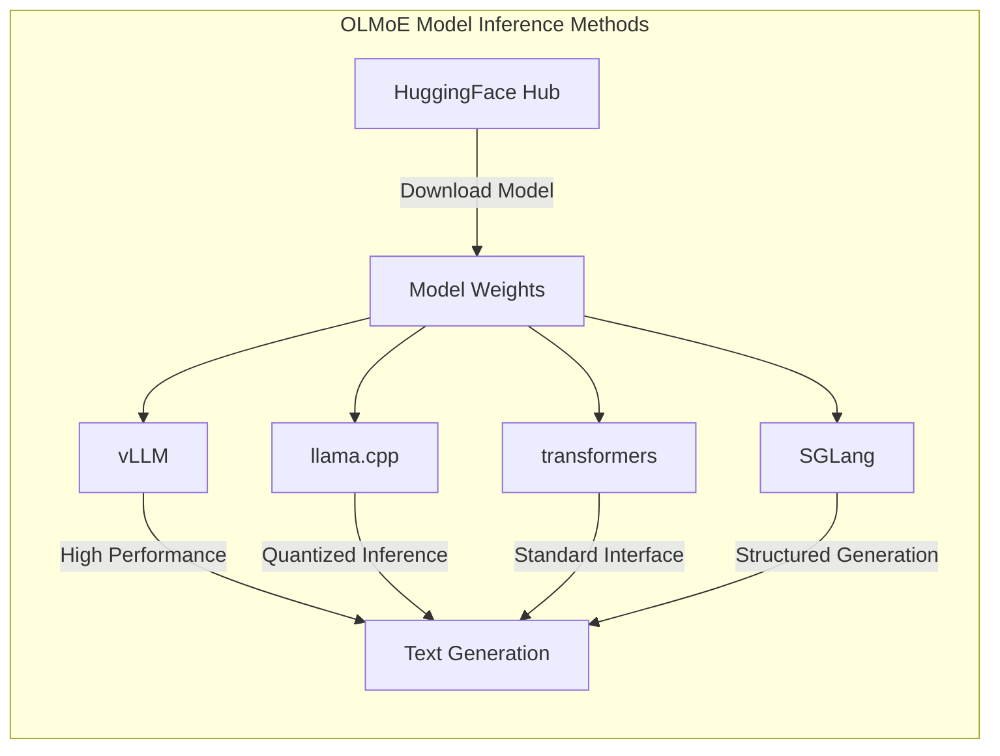
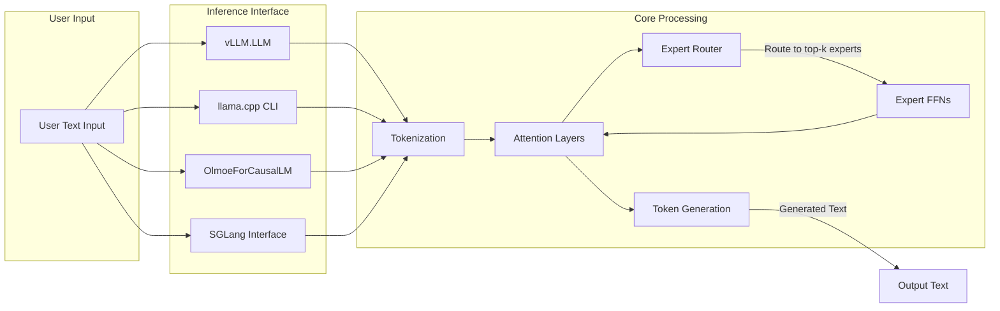
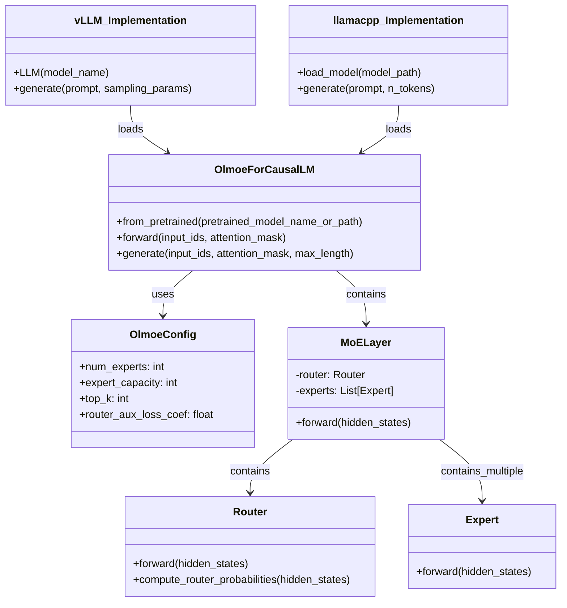
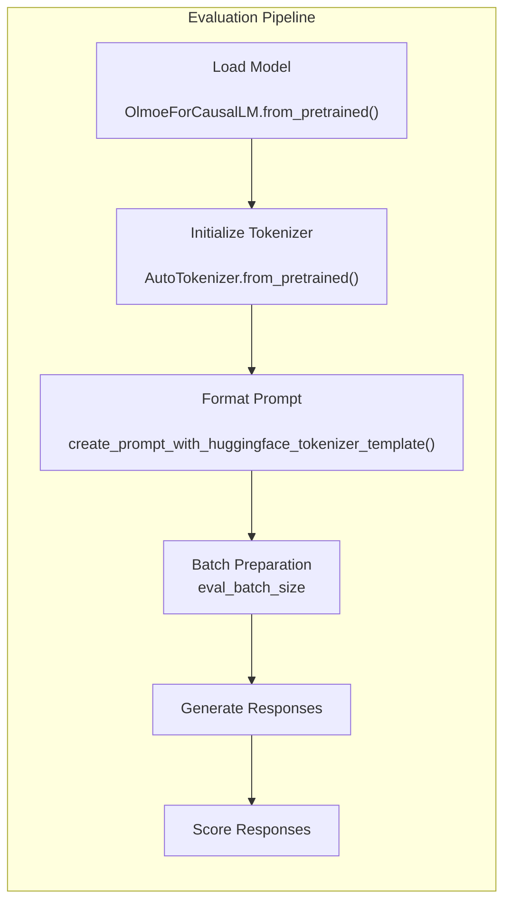

<!-- source: DeepWiki mcp.deepwiki.com · repo allenai/OLMoE · page 4 Inference Methods · fetched 2026-10-26 -->

# Inference Methods

<details>
<summary>Relevant source files</summary>

The following files were used as context for generating this wiki page:

- [README.md](README.md)
- [scripts/adapteval.sh](scripts/adapteval.sh)
- [scripts/olmoe_visuals.ipynb](scripts/olmoe_visuals.ipynb)

</details>


## Purpose and Overview

This document describes the various methods available for running inference with the OLMoE (Open Mixture-of-Experts Language Models) models. OLMoE has been integrated with multiple inference frameworks to accommodate different performance needs and use cases, from high-throughput production deployments to local CPU-based inference.

For information about the model architecture, see [Model Architecture](#2), and for details on how to train these models, see [Training Pipeline](#3).

Sources: [README.md:30-32]()

## Supported Inference Methods

OLMoE supports four primary inference methods:

1. **vLLM** - Recommended high-performance inference engine
2. **llama.cpp** - Optimized C++ implementation with GGUF quantization support
3. **Transformers** - Hugging Face transformers library integration
4. **SGLang** - Structured generation framework

The transformers implementation is generally slower than the others, so vLLM is recommended where possible for most applications.



Sources: [README.md:30-32]()

## Implementation Details

### vLLM

vLLM is the recommended inference method for OLMoE models due to its high performance and optimization for large language models. It implements PagedAttention for efficient memory management and supports both base and instruction-tuned models.

To use vLLM with OLMoE:

```python
from vllm import LLM, SamplingParams
model = LLM("allenai/OLMoE-1B-7B-0924")
out = model.generate("Bitcoin is", SamplingParams(temperature=0.0))
print("Bitcoin is" + out[0].outputs[0].text)
```

vLLM allows for batch inference and provides options to configure generation parameters through the `SamplingParams` object.

Sources: [README.md:34-44]()

### llama.cpp

llama.cpp provides optimized CPU inference and supports quantized models through GGUF formats. This is particularly useful for deployment on resource-constrained environments or when GPU acceleration is not available.

To use llama.cpp with OLMoE:

1. Install llama.cpp
2. Download a quantized GGUF file (e.g. `olmoe-1b-7b-0924-q4_0.gguf`)
3. Run inference using the command-line interface:

```bash
llama-cli -m olmoe-1b-7b-0924-q4_0.gguf -p "Bitcoin is" -n 128
```

The `-n` parameter controls the number of tokens to generate.

Sources: [README.md:46-52]()

### Transformers

The Hugging Face transformers library provides a standard interface for working with OLMoE models. While it's more flexible for research or experimentation, it's generally slower than vLLM or llama.cpp for inference.

```python
from transformers import OlmoeForCausalLM, AutoTokenizer
import torch

DEVICE = "cuda" if torch.cuda.is_available() else "cpu"

model = OlmoeForCausalLM.from_pretrained("allenai/OLMoE-1B-7B-0924").to(DEVICE)
tokenizer = AutoTokenizer.from_pretrained("allenai/OLMoE-1B-7B-0924")
inputs = tokenizer("Bitcoin is", return_tensors="pt")
inputs = {k: v.to(DEVICE) for k, v in inputs.items()}
out = model.generate(**inputs, max_length=64)
print(tokenizer.decode(out[0]))
```

The `OlmoeForCausalLM` class is specifically designed to handle the mixture-of-experts architecture of OLMoE models.

Sources: [README.md:54-73]()

### SGLang

SGLang is mentioned as an integration option but detailed implementation examples are not provided in the repository. SGLang is designed for structured generation workflows and can be useful for applications requiring complex output formats.

Sources: [README.md:30-32]()

## Inference Method Architecture

The following diagram illustrates how the different inference methods interface with the OLMoE model architecture:



Sources: [README.md:30-73]()

## Model Variants and Loading Checkpoints

OLMoE provides multiple model checkpoints at different training stages:

| Model Checkpoint | Description | Path |
|------------------|-------------|------|
| Base Model | Pretrained OLMoE model | `allenai/OLMoE-1B-7B-0924` |
| SFT | Supervised fine-tuned model | `allenai/OLMoE-1B-7B-0924-SFT` |
| Instruct | DPO/KTO optimized model | `allenai/OLMoE-1B-7B-0924-Instruct` |

You can also load specific training revisions or branches using the `revision` parameter:

```python
# Load a specific checkpoint from training
model = OlmoeForCausalLM.from_pretrained(
    "allenai/OLMoE-1B-7B-0924", 
    revision="step10000-tokens41B"
)
```

To list all available revisions:

```python
from huggingface_hub import list_repo_refs
out = list_repo_refs("allenai/OLMoE-1B-7B-0924")
branches = [b.name for b in out.branches]
```

Sources: [README.md:64-80]()

## Technical Implementation Details

The following diagram shows how the implementation of OLMoE inference connects with the core model code:



Sources: [README.md:30-73]()

## Advanced Usage

### Inference for Evaluation

The OLMoE repository includes a script for running evaluations using the trained models. The script demonstrates how to configure the model for various evaluation benchmarks.



The evaluation script configures various parameters for efficient inference:

- `use_chat_format` - Formats input as a chat conversation
- `chat_formatting_function` - Specifies the template for formatting
- `eval_batch_size` - Controls batching for efficient inference

Sources: [scripts/adapteval.sh:19-93]()

### Performance Considerations

When choosing an inference method, consider:

1. **vLLM**: Best for GPU-accelerated high-throughput inference
2. **llama.cpp**: Best for CPU inference and quantized models
3. **transformers**: Most flexible but slowest option
4. **SGLang**: Specialized for structured generation tasks

For production deployments, vLLM is generally recommended due to its optimized implementation and support for batched inference.

Sources: [README.md:30-32]()

## Available Model Weights

OLMoE provides GGUF quantized models for efficient inference with llama.cpp:

- Base model: [olmoe-1b-7b-0924-q4_0.gguf](https://huggingface.co/allenai/OLMoE-1B-7B-0924-GGUF/resolve/main/olmoe-1b-7b-0924-q4_0.gguf)
- Instruct model: Available at [allenai/OLMoE-1B-7B-0924-Instruct-GGUF](https://huggingface.co/allenai/OLMoE-1B-7B-0924-Instruct-GGUF)

The full model weights for different training stages are available at:
- Base model: [allenai/OLMoE-1B-7B-0924](https://huggingface.co/allenai/OLMoE-1B-7B-0924)
- SFT model: [allenai/OLMoE-1B-7B-0924-SFT](https://huggingface.co/allenai/OLMoE-1B-7B-0924-SFT)
- Instruct model: [allenai/OLMoE-1B-7B-0924-Instruct](https://huggingface.co/allenai/OLMoE-1B-7B-0924-Instruct)

Sources: [README.md:25-28]()

---

