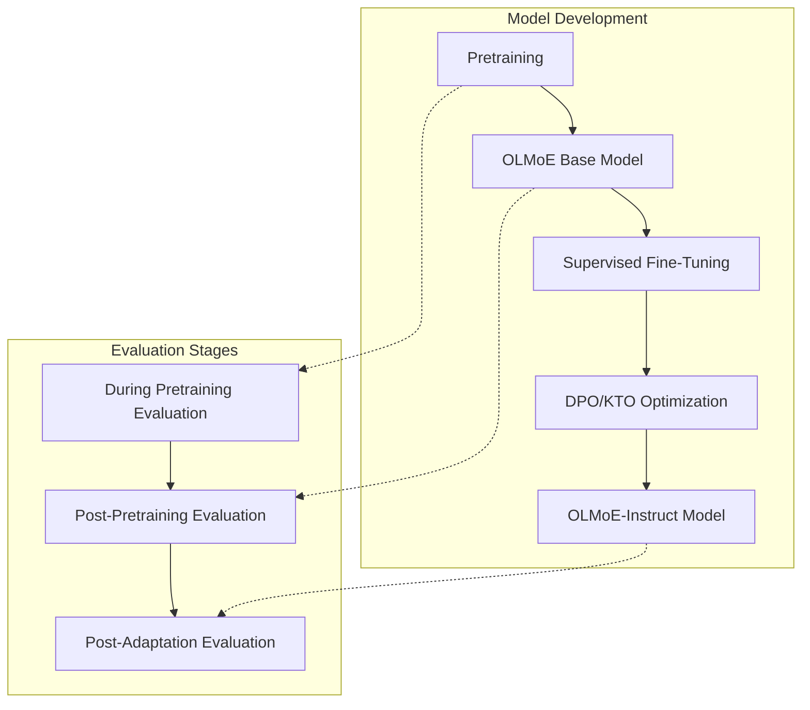
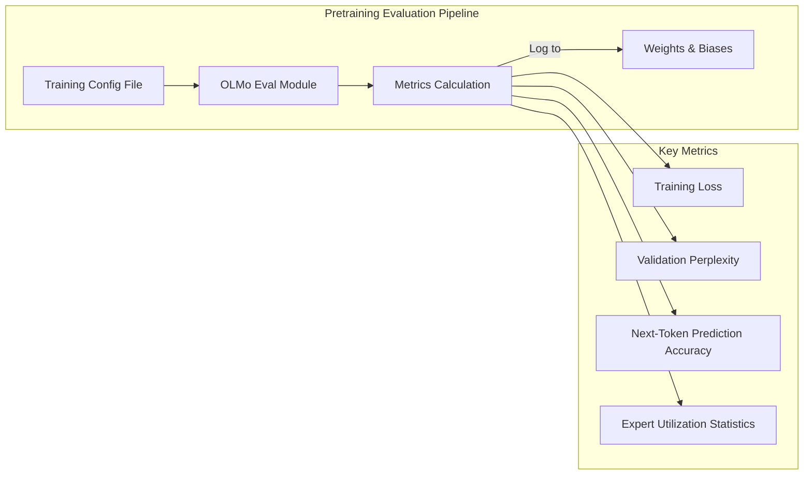
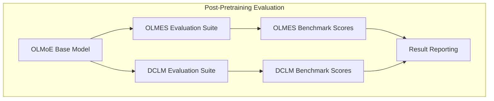
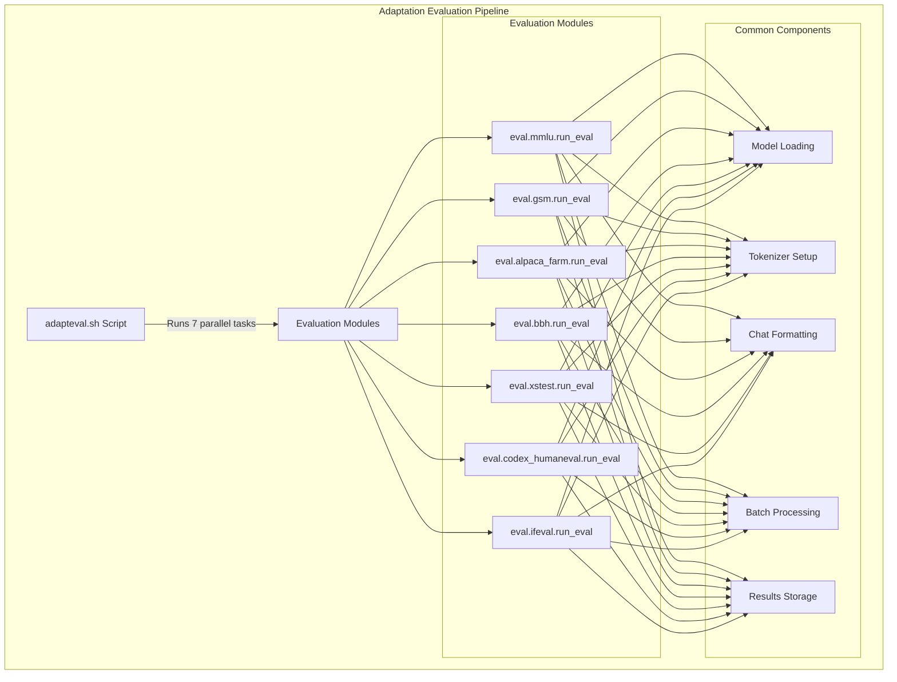
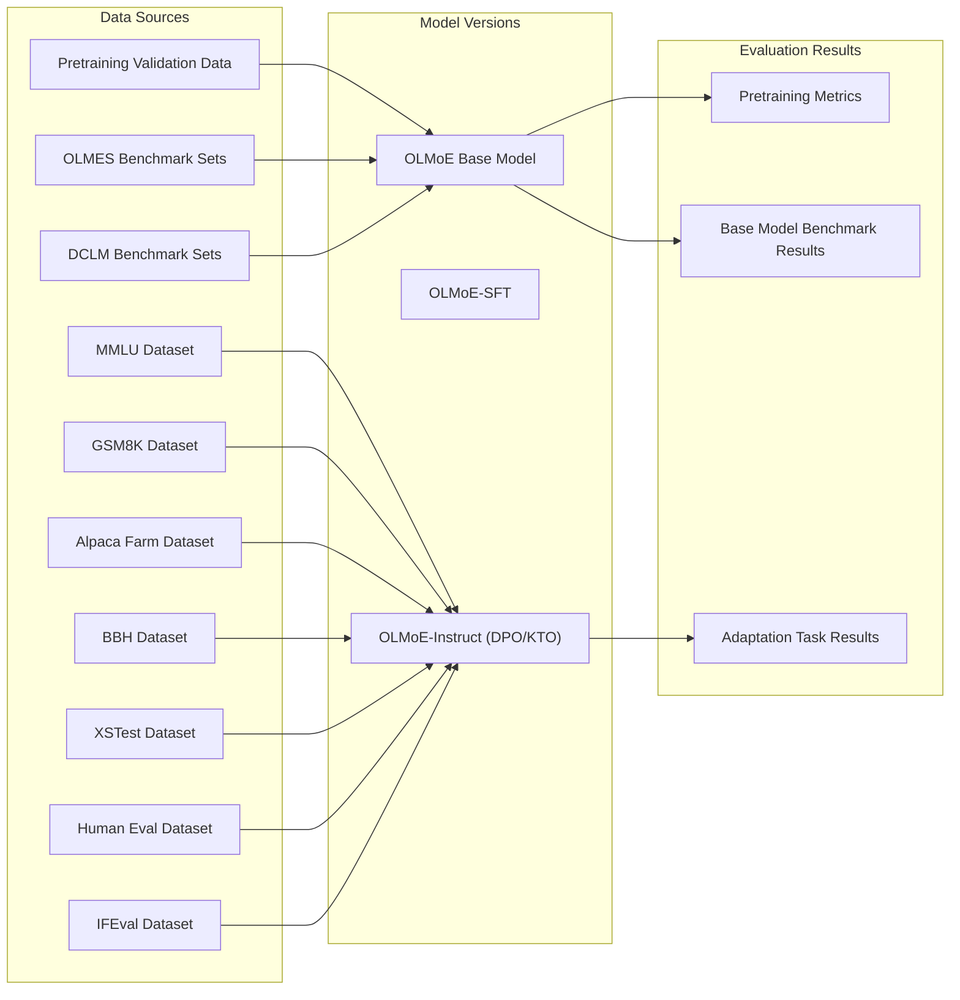

<!-- source: DeepWiki mcp.deepwiki.com · repo allenai/OLMoE · page 5 Evaluation Framework · fetched 2026-10-26 -->

# Evaluation Framework

<details>
<summary>Relevant source files</summary>

The following files were used as context for generating this wiki page:

- [README.md](README.md)
- [scripts/adapteval.sh](scripts/adapteval.sh)
- [scripts/olmoe_visuals.ipynb](scripts/olmoe_visuals.ipynb)

</details>


## Purpose and Scope

This document describes the comprehensive evaluation framework used for assessing OLMoE models throughout their development lifecycle. The framework provides structured methodology and tooling for evaluating model performance across three critical stages: during pretraining, after pretraining is complete, and after adaptation (fine-tuning). The evaluation framework plays a crucial role in quantifying model capabilities, tracking improvements, and comparing performance against baselines and other models.

## Evaluation Timeline and Stages

The OLMoE evaluation framework follows a systematic approach aligned with the model development stages:



Sources: [README.md:176-183]()

## Evaluation During Pretraining

During the pretraining phase, automated evaluations run at regular intervals to track model progress and detect potential issues early.

### Implementation

Evaluation during pretraining is automatically configured in the pretraining configuration file and executed using the OLMo evaluation module. The evaluations compute metrics on a held-out validation set, allowing for continuous monitoring of model performance.



Sources: [README.md:180-181]()

## Post-Pretraining Evaluation

After pretraining completes, the base OLMoE model undergoes comprehensive evaluation across standardized benchmarks to assess its capabilities.

### OLMES (OLMo Evaluation Suite) Evaluations

OLMES provides a standardized set of benchmarks for evaluating language model capabilities.

**Implementation:**
- Follows the evaluation protocol specified in the OLMo-Eval repository
- Evaluates across diverse tasks including reasoning, factual knowledge, and comprehension

### DCLM (Data-Contamination-Lab-Models) Evaluations

DCLM evaluations focus on assessing model performance while controlling for data contamination issues.

**Implementation:**
- Uses scripts in the `scripts/run_dclm_evals*` directory
- Follows methodology from the DCLM framework



Sources: [README.md:185-187]()

## Post-Adaptation Evaluation

After the model has undergone adaptation through SFT, DPO, or KTO, it is evaluated on a range of downstream tasks to measure its instruction-following and task-specific capabilities.

### Evaluation Benchmarks

The adaptation evaluation uses seven key benchmarks:

| Benchmark | Description | Implementation |
|-----------|-------------|----------------|
| MMLU | Massive Multitask Language Understanding - tests knowledge across 57 subjects | `eval.mmlu.run_eval` |
| GSM8K | Grade School Math - tests mathematical reasoning | `eval.gsm.run_eval` |
| Alpaca Farm | Evaluates instruction-following capabilities | `eval.alpaca_farm.run_eval` |
| BBH | Big Bench Hard - challenging reasoning tasks | `eval.bbh.run_eval` |
| XSTest | Tests for unwanted behaviors and safety issues | `eval.xstest.run_eval` |
| Human Eval | Evaluates code generation capabilities | `eval.codex_humaneval.run_eval` |
| IFEval | Instruction Following Evaluation | `eval.ifeval.run_eval` |

Sources: [README.md:189-193](), [scripts/adapteval.sh:1-98]()

### Adaptation Evaluation Pipeline

The adaptation evaluation is implemented through a structured pipeline that handles each benchmark separately but follows a consistent pattern:



Sources: [scripts/adapteval.sh:1-98]()

### Implementation Details

The adaptation evaluation is implemented through the `adapteval.sh` script, which uses SLURM array jobs to run multiple evaluations in parallel. Each evaluation task:

1. Loads the OLMoE-Instruct model
2. Sets up the tokenizer
3. Configures batch processing parameters
4. Applies the appropriate chat formatting function (for most benchmarks)
5. Processes the evaluation dataset
6. Stores results in a structured format

The script is designed to be run in a high-performance computing environment with appropriate GPU resources. Results are saved to the specified output directories for each benchmark.

Example MMLU evaluation command:
```bash
python -m eval.mmlu.run_eval \
  --ntrain 0 \
  --data_dir /data/niklas/data/eval/mmlu/ \
  --save_dir ${MODEL_PATH}/eval/mmlu \
  --model_name_or_path ${MODEL_PATH} \
  --tokenizer_name_or_path ${TOKENIZER_PATH} \
  --use_chat_format \
  --chat_formatting_function eval.templates.create_prompt_with_huggingface_tokenizer_template \
  --eval_batch_size 64
```

Sources: [scripts/adapteval.sh:20-30]()

## Data Flow in the Evaluation Framework

The evaluation framework involves a systematic flow of data from benchmark datasets through model inference to results analysis:



Sources: [README.md:176-193]()

## Summary

The OLMoE evaluation framework provides a comprehensive approach to assessing model performance throughout its development lifecycle. The framework:

1. Tracks core metrics during pretraining using automated evaluation
2. Benchmarks the base model after pretraining using standardized suites
3. Evaluates adapted models on a diverse range of downstream tasks

This structured approach ensures consistent measurement of model capabilities, enables comparison with other models, and helps identify areas for improvement in future iterations.

Sources: [README.md:16-20](), [README.md:176-193]()

---

