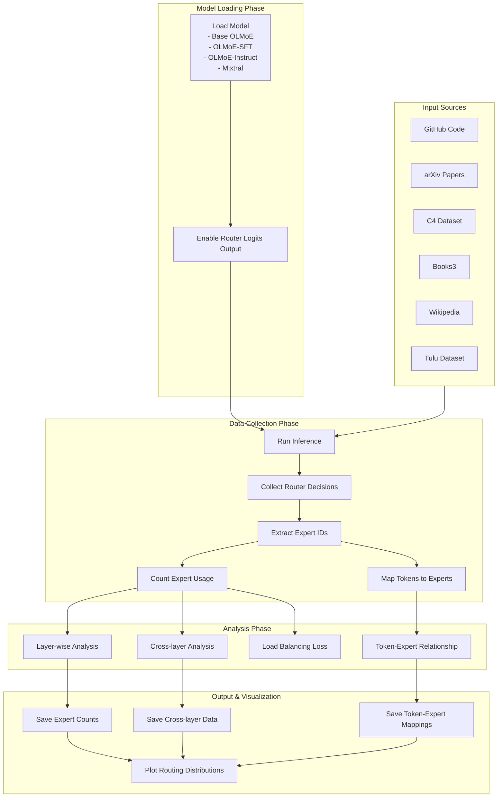
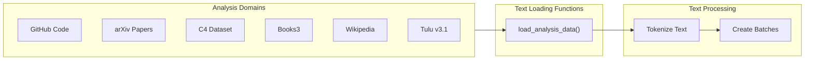
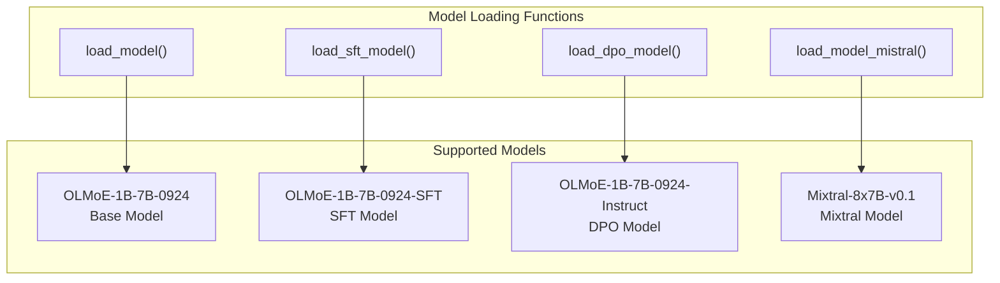
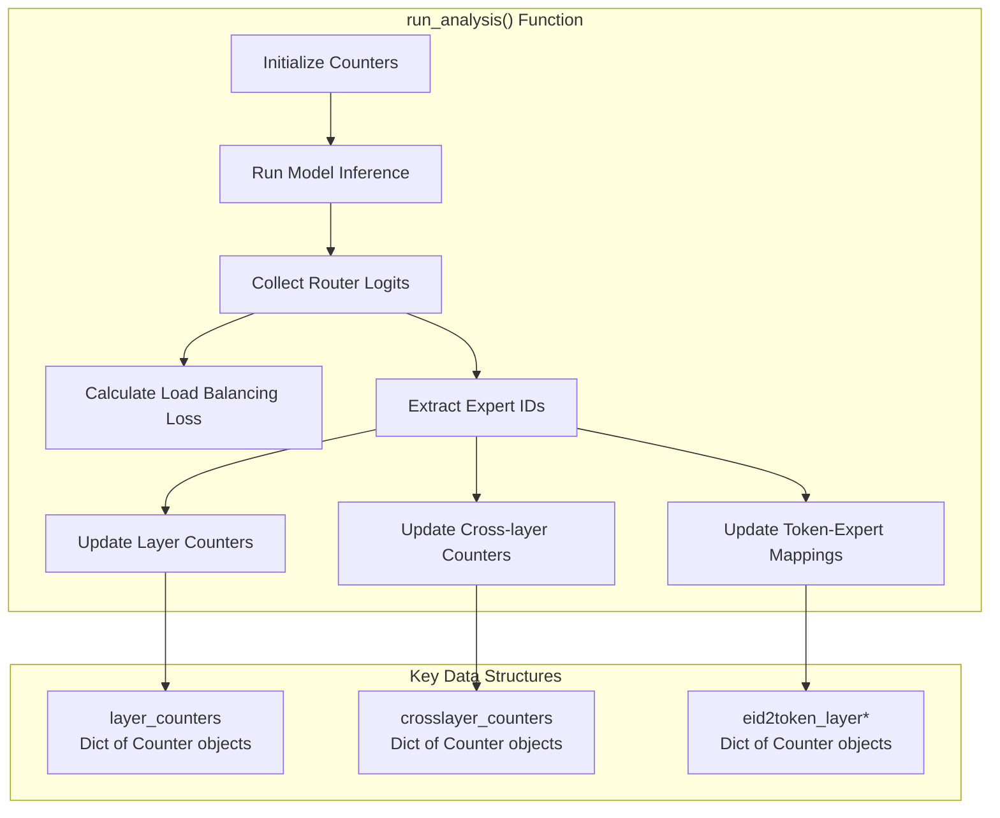
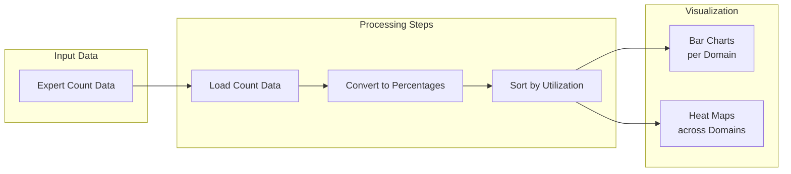
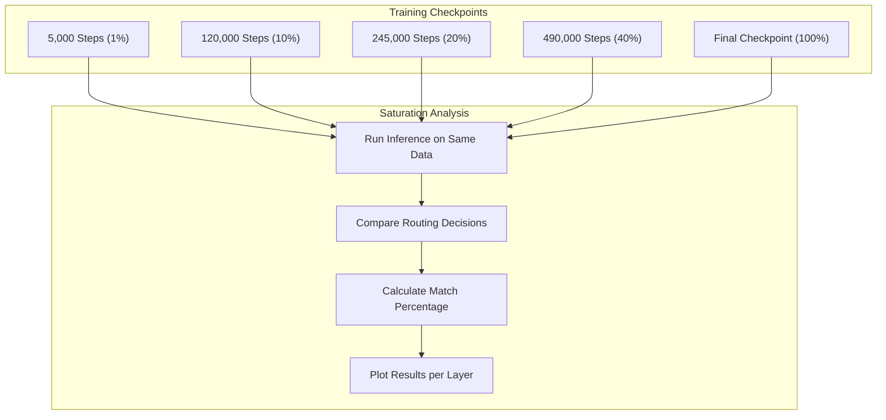
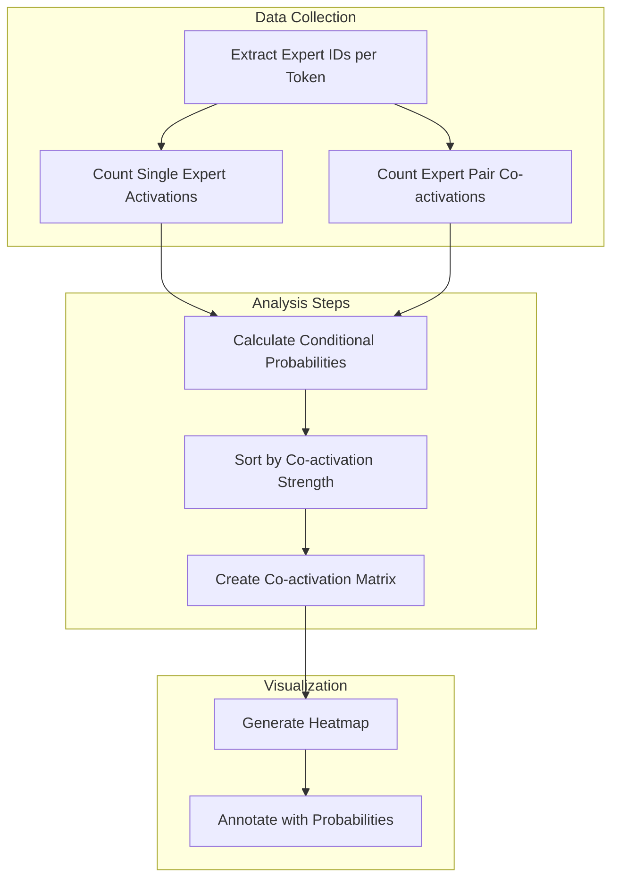
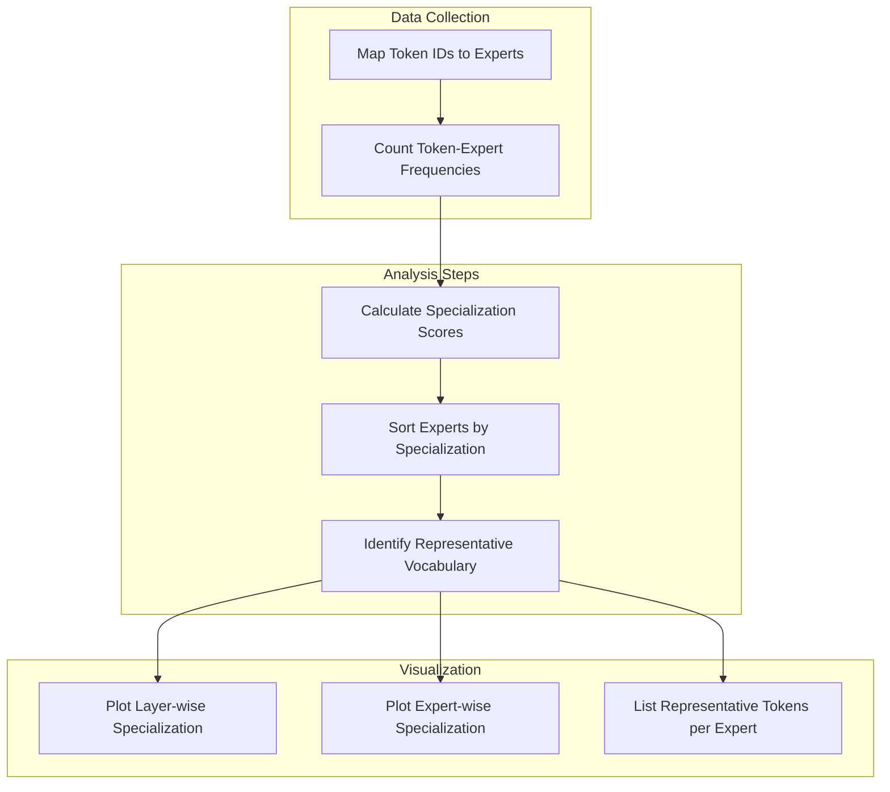

<!-- source: DeepWiki mcp.deepwiki.com · repo allenai/OLMoE · page 6 Expert Routing Analysis · fetched 2026-10-26 -->

# Expert Routing Analysis

<details>
<summary>Relevant source files</summary>

The following files were used as context for generating this wiki page:

- [scripts/plot_routing_analysis.ipynb](scripts/plot_routing_analysis.ipynb)
- [scripts/routing_output.zip](scripts/routing_output.zip)
- [scripts/run_moe_analysis.py](scripts/run_moe_analysis.py)
- [scripts/run_routing_analysis.py](scripts/run_routing_analysis.py)
- [visuals/emojis/olmoe_checkmark.png](visuals/emojis/olmoe_checkmark.png)

</details>


## Overview

Expert Routing Analysis is a system for understanding how OLMoE (Open Language Model Mixture of Experts) models route tokens to different experts across various domains and model layers. This analysis helps researchers understand the specialization patterns that emerge during training and provides insights into how model architecture and training objectives impact expert utilization.

This documentation focuses on the tools and methodologies used to analyze expert routing behaviors. For information about the model architecture itself, see [Model Architecture](#2).

Sources: [scripts/run_routing_analysis.py](), [scripts/plot_routing_analysis.ipynb](), [scripts/run_moe_analysis.py]()

## Routing Analysis Pipeline

The routing analysis pipeline extracts and analyzes expert routing decisions made by the model during inference. It collects data across different domains, tracks which experts are activated for which tokens, and examines patterns both within and across layers.



Sources: [scripts/run_routing_analysis.py:76-169](), [scripts/run_moe_analysis.py:76-112]()

## Key Components

### 1. Domain-Specific Text Loading

The system loads text from various domains to analyze how routing behavior differs across content types:



The `load_analysis_data()` function handles loading text from different domains, tokenizing it, and creating batches for model inference.

Sources: [scripts/run_routing_analysis.py:45-67]()

### 2. Model Loading

The system supports loading different variants of OLMoE models:



Sources: [scripts/run_routing_analysis.py:68-96]()

### 3. Router Analysis

The core analysis component collects and processes expert routing decisions:



The `run_analysis()` function processes input data through the model, extracts routing decisions, and organizes them into various counter data structures for further analysis.

Sources: [scripts/run_routing_analysis.py:105-169](), [scripts/run_moe_analysis.py:77-169]()

## Analysis Methods

### 1. Expert Usage Distribution

Expert usage distribution analysis examines how frequently each expert is activated across different input domains. This helps identify which experts are overutilized or underutilized.



This analysis reveals whether the router is effectively distributing tokens across all available experts or if there's a bias toward certain experts.

Sources: [scripts/plot_routing_analysis.ipynb:112-169]()

### 2. Router Saturation Across Training

Router saturation analysis tracks how routing decisions evolve during model training. It compares expert assignments at different checkpoints to understand how routing patterns stabilize over time.



This analysis shows at what point in training the router begins to make consistent decisions, indicating when expert specialization becomes stable.

Sources: [scripts/run_moe_analysis.py:114-245]()

### 3. Co-activation Patterns

Co-activation analysis examines which experts tend to be activated together for the same type of inputs:



Co-activation analysis helps understand the relationships between experts and identify groups of experts that might have related specializations.

Sources: [scripts/run_moe_analysis.py:246-324]()

### 4. Vocabulary Specialization

Vocabulary specialization analysis maps tokens to the experts that process them most frequently, revealing whether experts have specialized in particular vocabulary subsets:



This analysis reveals how experts specialize in different parts of the vocabulary, such as code syntax, mathematical notation, or topic-specific terminology.

Sources: [scripts/run_moe_analysis.py:326-405](), [scripts/run_moe_analysis.py:546-718]()

## Running Routing Analysis

### Using `run_routing_analysis.py`

The main script for basic routing analysis is `run_routing_analysis.py`. Here's how to use it:

1. The script loads a specified model variant (base, SFT, DPO, or Mixtral)
2. It runs analysis on various domains (GitHub, arXiv, C4, books, Wikipedia, Tulu)
3. For each domain, it tracks expert usage and token-expert mappings
4. Results are saved as pickle files for later visualization

Example usage:

```
python scripts/run_routing_analysis.py
```

The script saves results to `routing_output/{model_name}/expert_counts/` and other directories.

Sources: [scripts/run_routing_analysis.py:171-196]()

### Using `run_moe_analysis.py`

For more advanced analysis, including router saturation, co-activation, and vocabulary specialization, use `run_moe_analysis.py`:

1. First, run inference to generate data:
   ```
   python scripts/run_moe_analysis.py --do_inference
   ```

2. For checkpoint analysis:
   ```
   python scripts/run_moe_analysis.py --do_ckpt_analysis --topk 1
   ```

3. For co-activation analysis:
   ```
   python scripts/run_moe_analysis.py --do_coactivation_analysis --layer_num 7
   ```

4. For vocabulary specialization analysis:
   ```
   python scripts/run_moe_analysis.py --do_token_analysis_layers_experts --topk 1
   ```

Sources: [scripts/run_moe_analysis.py:721-747]()

## Key Findings and Interpretations

### Expert Utilization Patterns

The routing analysis reveals several important patterns in expert utilization:

| Layer Position | Typical Pattern | Interpretation |
|----------------|-----------------|----------------|
| Early layers (0-3) | Rapidly stabilizing routing | Early layers specialize quickly in low-level features |
| Middle layers (4-11) | Gradual specialization | Develop more complex, contextual specializations |
| Late layers (12-15) | Most domain-specific routing | Specialize in high-level, domain-specific features |

### Router Saturation

Router saturation analysis shows how expert assignments stabilize during training:

1. At 1% of pretraining, routing decisions are largely random across all layers
2. By 10% of pretraining, early layers show significant stabilization (~60-80% match with final routing)
3. By 40% of pretraining, most layers have reached ~80-90% of their final routing patterns
4. Different layers saturate at different rates, with early layers generally stabilizing faster

### Expert Specialization

Vocabulary specialization analysis reveals that experts specialize in different types of content:

1. Some experts focus on specific domains (e.g., code syntax, mathematical notation)
2. Others specialize in specific parts of speech or linguistic constructs
3. The degree of specialization varies by layer, with later layers showing more pronounced specialization
4. Input token specialization is typically stronger than output token specialization

## Conclusion

Expert Routing Analysis provides crucial insights into how Mixture-of-Experts models like OLMoE distribute computation across experts. These insights can help guide architecture design, training strategies, and model interpretation.

For more detailed analysis of cross-layer routing patterns, see [Cross-Layer Routing Analysis](#6.1). For tools to visualize expert routing patterns, see [Routing Visualization Tools](#6.2). For domain-specific analysis, see [Domain-Specific Routing Analysis](#6.3).

---

