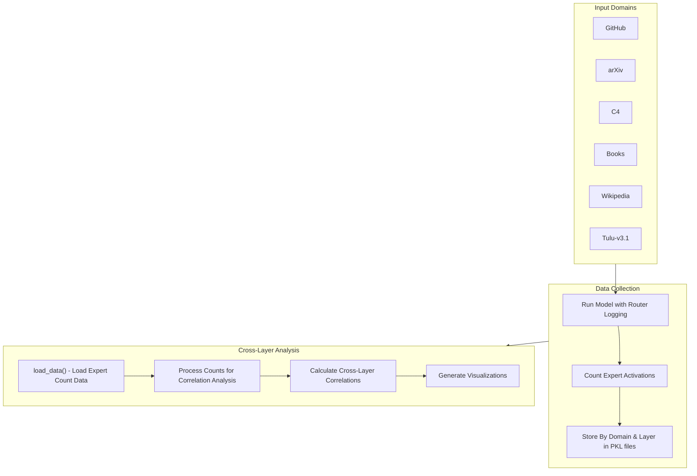
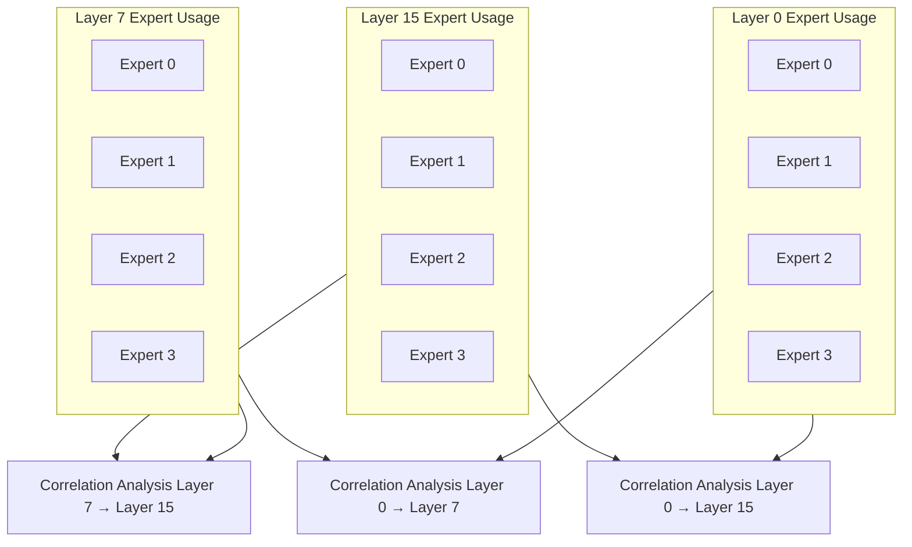
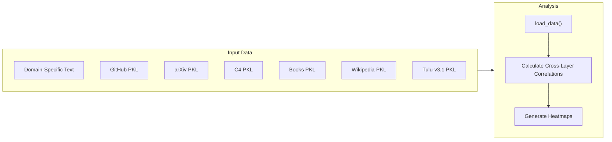
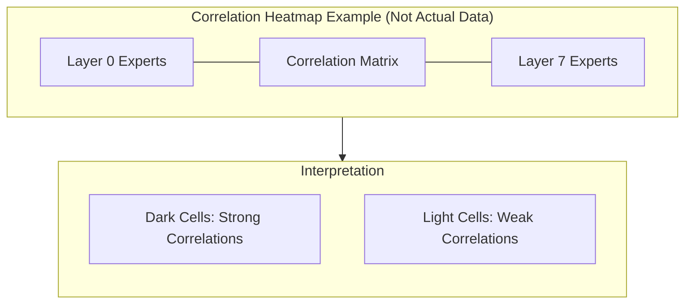
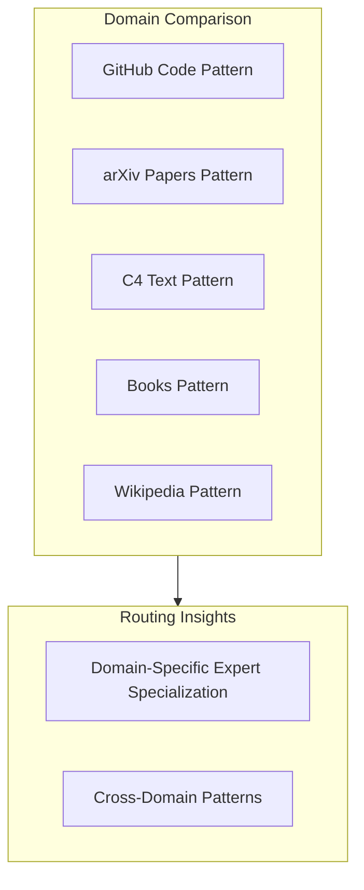

<!-- source: DeepWiki mcp.deepwiki.com · repo allenai/OLMoE · page 6.1 Cross-Layer Routing Analysis · fetched 2026-10-26 -->

# Cross-Layer Routing Analysis

<details>
<summary>Relevant source files</summary>

The following files were used as context for generating this wiki page:

- [scripts/plot_routing_analysis_v2.ipynb](scripts/plot_routing_analysis_v2.ipynb)
- [scripts/plot_routing_analysis_v2_cross_layer.ipynb](scripts/plot_routing_analysis_v2_cross_layer.ipynb)
- [scripts/routing_mixtral_v2.jpg](scripts/routing_mixtral_v2.jpg)
- [scripts/routing_olmoe_v2.jpg](scripts/routing_olmoe_v2.jpg)
- [scripts/routing_output/mistral/expert_counts_crosslayer/arxiv.pkl](scripts/routing_output/mistral/expert_counts_crosslayer/arxiv.pkl)

</details>


This document describes the cross-layer routing analysis component in OLMoE, which examines correlations between expert selections across different layers of the Mixture-of-Experts model. By analyzing how routing patterns relate between early, middle, and deep layers across various domains, we gain insights into how experts specialize and coordinate throughout the model.

For information about the broader routing analysis system, see [Expert Routing Analysis](#6).
For details on visualization tools, see [Routing Visualization Tools](#6.2).
For domain-specific analyses, see [Domain-Specific Routing Analysis](#6.3).

## Overview

In OLMoE, each layer contains multiple expert neural networks. For each token, a router determines which expert to use. Cross-layer routing analysis examines correlations between these routing decisions across different layers, revealing patterns in how experts are selected throughout the model's depth.

The analysis focuses on three key layers:
- Layer 0 (early layer)
- Layer 7 (middle layer)
- Layer 15 (deep layer)

And examines routing patterns across multiple domains:
- GitHub code
- arXiv papers
- C4 dataset
- Books
- Wikipedia
- Tulu v3.1 dataset

## Data Collection and Processing Pipeline

The cross-layer routing analysis follows this process:



**Title: Cross-Layer Routing Analysis Pipeline**

Sources: [scripts/plot_routing_analysis_v2_cross_layer.ipynb:8-28](), [scripts/plot_routing_analysis_v2.ipynb:8-51]()

## Implementation

The cross-layer routing analysis is primarily implemented in the Jupyter notebook `plot_routing_analysis_v2_cross_layer.ipynb`. This notebook loads pickled data containing expert activation counts collected during inference.

Key functions in the implementation:

```python
# Basic data loading function
def load_data(input_path):
    with open(input_path, 'rb') as f:
        data = pickle.load(f)
    return data

# Domain mappings for visualization
domain_names = {
    'github': 'GitHub',
    'arxiv': 'arXiv',
    'c4': 'C4',
    'book': 'Books',
    'wikipedia': 'Wikipedia',
}
```

The data is organized by domain and layer, with specific focus on layers 0, 7, and 15. The primary script loads this data and performs correlation analysis to identify patterns.

Sources: [scripts/plot_routing_analysis_v2_cross_layer.ipynb:8-28](), [scripts/plot_routing_analysis_v2.ipynb:8-51]()

## Data Structure

The routing analysis examines how frequently each expert is activated in each layer. Each domain dataset contains counters for the three analyzed layers:

```
layer0, layer7, layer15 = load_data(input_path)
counters = {
    0: layer0,  # Counter mapping expert_id → activation_count
    7: layer7,  # Counter mapping expert_id → activation_count
    15: layer15,  # Counter mapping expert_id → activation_count
}
```

This structure allows the analysis to compute the proportion of tokens routed to each expert within each layer and then examine correlations between these patterns across layers.

Sources: [scripts/plot_routing_analysis_v2.ipynb:31-51]()

## Cross-Layer Correlation Analysis

The key analysis examines correlations between expert activations across different layers:



**Title: Cross-Layer Expert Correlation Analysis**

Sources: [scripts/plot_routing_analysis_v2_cross_layer.ipynb]()

## Domain-Specific Analysis

The analysis also examines how cross-layer routing patterns differ across domains:



**Title: Domain-Specific Routing Analysis Flow**

Sources: [scripts/plot_routing_analysis_v2_cross_layer.ipynb](), [scripts/plot_routing_analysis_v2.ipynb:17-23]()

## Key Visualizations

The cross-layer routing analysis produces several important visualizations:

### Correlation Heatmaps

Heatmaps display the correlation strength between expert usage in different layers. These visualizations reveal which experts tend to be activated together across layers, indicating specialization patterns.



**Title: Expert Correlation Heatmap Structure**

Sources: [scripts/plot_routing_analysis_v2_cross_layer.ipynb]()

### Domain Comparison

The analysis also compares routing patterns across domains to identify domain-specific expert specialization:



**Title: Domain Comparison Analysis**

Sources: [scripts/plot_routing_analysis_v2_cross_layer.ipynb](), [scripts/plot_routing_analysis_v2.ipynb:17-23]()

## Insights from Cross-Layer Analysis

The cross-layer routing analysis provides valuable insights into OLMoE's behavior:

1. **Expert Specialization**: Understanding which experts in different layers specialize in similar tasks
2. **Information Flow**: Revealing how information propagates through the model via routing decisions
3. **Domain Adaptation**: Showing how routing patterns adapt to different types of content
4. **Architectural Insights**: Informing potential improvements to the model's architecture

## Usage

To perform cross-layer routing analysis:

1. Collect expert activation data by running inference with router logging enabled
2. Store the data in pickle files by domain and layer
3. Run `plot_routing_analysis_v2_cross_layer.ipynb` to analyze correlations
4. Examine the resulting visualizations to understand cross-layer routing patterns

## Example Workflow

```mermaid
flowchart LR
    subgraph setup["Setup"]
        model["Load OLMoE Model"]
        enable["Enable Router Logits"]
    end
    
    subgraph inference["Inference"]
        github["Run on GitHub Data"]
        arxiv["Run on arXiv Data"]
        c4["Run on C4 Data"]
        books["Run on Books Data"]
        wiki["Run on Wikipedia Data"]
    end
    
    subgraph analysis["Analysis"]
        loadData["Load Pickle Data"]
        process["Process Counts"]
        correlate["Calculate Correlations"]
        visualize["Generate Visualizations"]
    end
    
    setup --> inference --> analysis
```



**Title: Cross-Layer Analysis Workflow**

Sources: [scripts/plot_routing_analysis_v2_cross_layer.ipynb](), [scripts/plot_routing_analysis_v2.ipynb]()

## Related Components

- [Expert Routing Analysis](#6) - Overview of all routing analysis methodologies
- [Routing Visualization Tools](#6.2) - Additional tools for visualizing routing patterns
- [Domain-Specific Routing Analysis](#6.3) - Analysis of routing patterns by domain

---

