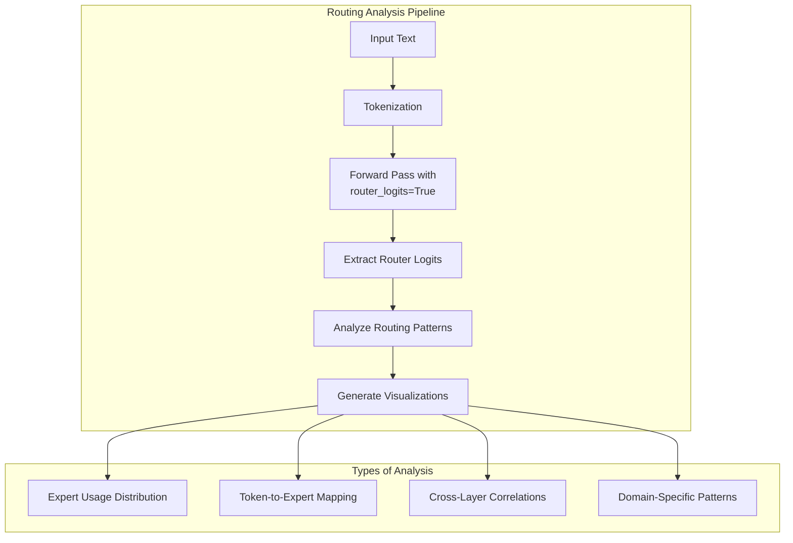
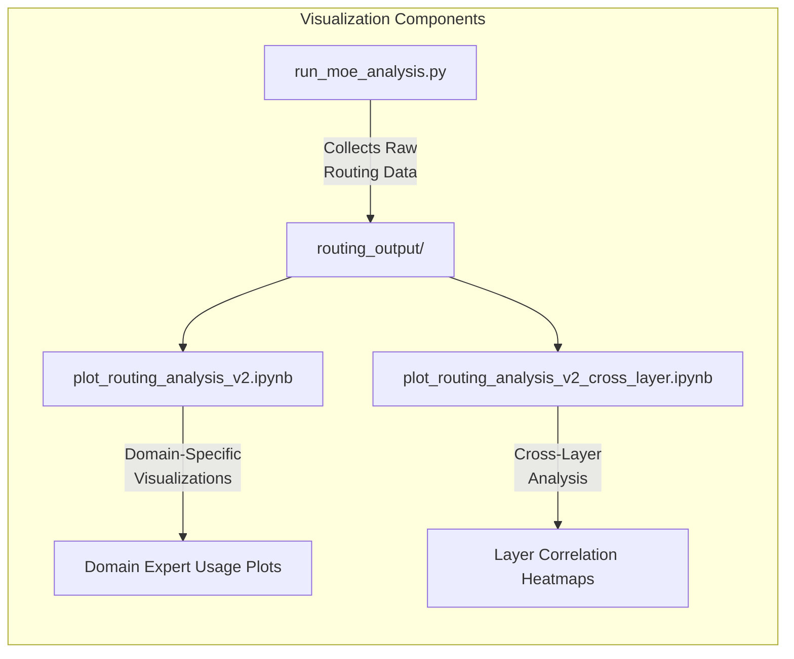
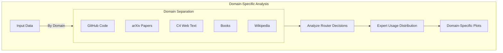
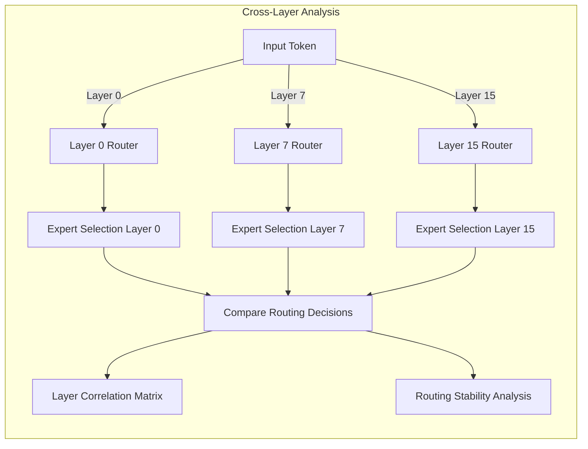
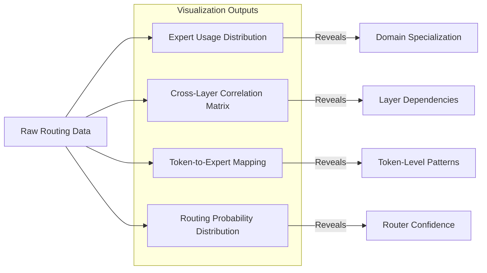
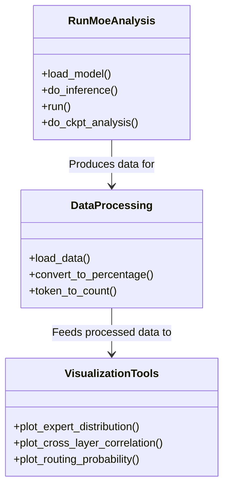

<!-- source: DeepWiki mcp.deepwiki.com · repo allenai/OLMoE · page 6.2 Routing Visualization Tools · fetched 2026-10-26 -->

# Routing Visualization Tools

<details>
<summary>Relevant source files</summary>

The following files were used as context for generating this wiki page:

- [scripts/plot_routing_analysis.ipynb](scripts/plot_routing_analysis.ipynb)
- [scripts/plot_routing_analysis_v2.ipynb](scripts/plot_routing_analysis_v2.ipynb)
- [scripts/plot_routing_analysis_v2_cross_layer.ipynb](scripts/plot_routing_analysis_v2_cross_layer.ipynb)
- [scripts/routing_mixtral_v2.jpg](scripts/routing_mixtral_v2.jpg)
- [scripts/routing_olmoe_v2.jpg](scripts/routing_olmoe_v2.jpg)
- [scripts/routing_output.zip](scripts/routing_output.zip)
- [scripts/routing_output/mistral/expert_counts_crosslayer/arxiv.pkl](scripts/routing_output/mistral/expert_counts_crosslayer/arxiv.pkl)
- [scripts/run_moe_analysis.py](scripts/run_moe_analysis.py)
- [visuals/emojis/olmoe_checkmark.png](visuals/emojis/olmoe_checkmark.png)

</details>


This page documents the tools and utilities for visualizing and analyzing expert routing patterns in OLMoE (Open Language Mixture-of-Experts). These tools help researchers and developers understand how the model routes tokens to different experts across various domains and model layers. For details about the router mechanisms themselves, see [Expert Routing Analysis](#6) and [Cross-Layer Routing Analysis](#6.1).

## Overview of Routing Visualization

OLMoE's sparse MoE architecture routes each token to a subset of experts at each layer of the model. Understanding these routing decisions is crucial for analyzing model behavior, identifying domain specialization, and improving model performance. The routing visualization tools provide insights into:

1. Expert utilization across different domains
2. Token-to-expert mapping patterns
3. Cross-layer routing correlations
4. Comparison between different MoE models (e.g., OLMoE vs. Mixtral)



Sources:
- [scripts/plot_routing_analysis_v2.ipynb](https://github.com/allenai/OLMoE/blob/main/scripts/plot_routing_analysis_v2.ipynb)
- [scripts/plot_routing_analysis_v2_cross_layer.ipynb](https://github.com/allenai/OLMoE/blob/main/scripts/plot_routing_analysis_v2_cross_layer.ipynb)
- [scripts/run_moe_analysis.py](https://github.com/allenai/OLMoE/blob/main/scripts/run_moe_analysis.py)

## Main Visualization Tools

The routing visualization toolkit consists of several key Python scripts and notebooks:

| Tool | Description |
|------|-------------|
| `plot_routing_analysis_v2.ipynb` | Jupyter notebook for analyzing and visualizing expert usage distribution across different domains |
| `plot_routing_analysis_v2_cross_layer.ipynb` | Notebook focusing on cross-layer routing correlation analysis |
| `run_moe_analysis.py` | Script for running inference with router logits enabled and collecting routing data |

These tools work together to provide comprehensive insights into the routing behavior of OLMoE models.



Sources:
- [scripts/plot_routing_analysis_v2.ipynb](https://github.com/allenai/OLMoE/blob/main/scripts/plot_routing_analysis_v2.ipynb)
- [scripts/plot_routing_analysis_v2_cross_layer.ipynb](https://github.com/allenai/OLMoE/blob/main/scripts/plot_routing_analysis_v2_cross_layer.ipynb)
- [scripts/run_moe_analysis.py](https://github.com/allenai/OLMoE/blob/main/scripts/run_moe_analysis.py)

## Collecting Routing Data

The first step in visualizing routing patterns is to collect the router logits from model inference. This is done using the `run_moe_analysis.py` script, which enables the output of router logits during model inference.

### Key Functions for Data Collection

The `run_moe_analysis.py` script contains several important functions:

- `load_model()`: Loads an OLMoE or Mixtral model with router logits enabled
- `do_inference()`: Runs inference on a dataset with router logits collected
- `run()`: Core function that processes inputs and saves router logits
- `do_ckpt_analysis()`: Analyzes routing patterns across different model checkpoints

To collect routing data, you need to:

1. Load the model with `output_router_logits=True`
2. Run inference on input data
3. Extract and save the router logits for visualization

```python
# Example of running inference with router logits enabled
out = model(input_ids=input_ids, output_router_logits=True)
router_logits = out["router_logits"]
```

Sources:
- [scripts/run_moe_analysis.py:88-104](https://github.com/allenai/OLMoE/blob/main/scripts/run_moe_analysis.py#L88-L104)
- [scripts/run_moe_analysis.py:49-58](https://github.com/allenai/OLMoE/blob/main/scripts/run_moe_analysis.py#L49-L58)

## Domain-Specific Routing Analysis

One of the main capabilities of the routing visualization tools is analyzing how expert routing varies across different domains. The tools support analysis across several domains:

- GitHub code
- arXiv papers
- C4 web text
- Books
- Wikipedia
- Tulu dataset

The `plot_routing_analysis_v2.ipynb` notebook provides visualizations showing the percentage of tokens routed to each expert across these domains.



Sources:
- [scripts/plot_routing_analysis_v2.ipynb:16-24](https://github.com/allenai/OLMoE/blob/main/scripts/plot_routing_analysis_v2.ipynb#L16-L24)
- [scripts/plot_routing_analysis_v2.ipynb:162-186](https://github.com/allenai/OLMoE/blob/main/scripts/plot_routing_analysis_v2.ipynb#L162-L186)

## Cross-Layer Routing Analysis

Understanding how routing decisions correlate across different layers is important for analyzing the model's hierarchical understanding of text. The `plot_routing_analysis_v2_cross_layer.ipynb` notebook provides tools for visualizing these cross-layer correlations.

Key aspects of cross-layer analysis:

1. Tracking which experts are selected for the same token across different layers
2. Measuring the correlation of expert selection between layers
3. Visualizing routing stability across model depth
4. Comparing routing patterns at early vs. later layers



Sources:
- [scripts/plot_routing_analysis_v2_cross_layer.ipynb](https://github.com/allenai/OLMoE/blob/main/scripts/plot_routing_analysis_v2_cross_layer.ipynb)
- [scripts/run_moe_analysis.py:114-178](https://github.com/allenai/OLMoE/blob/main/scripts/run_moe_analysis.py#L114-L178)

## Visualization Functions and Utilities

The visualization notebooks include several utility functions for processing and visualizing routing data:

### Data Loading and Processing

```python
# Load routing data
def load_data(input_path):
    with open(input_path, 'rb') as f:
        data = pickle.load(f)
    return data

# Convert expert counts to percentages
def convert_to_percentage(exp_counts):
    total = sum(exp_counts.values())
    return {eid: ecount/total*100 for eid, ecount in exp_counts.items()}
```

### Visualization Functions

The plotting functions in the notebooks create various visualizations, including:

1. Expert usage distribution across domains
2. Cross-layer correlation heatmaps
3. Token-to-expert mappings
4. Routing probability distributions

These visualizations help to identify patterns in how the model routes tokens to different experts based on the input domain and layer depth.

Sources:
- [scripts/plot_routing_analysis_v2.ipynb:8-29](https://github.com/allenai/OLMoE/blob/main/scripts/plot_routing_analysis_v2.ipynb#L8-L29)
- [scripts/plot_routing_analysis_v2_cross_layer.ipynb:8-28](https://github.com/allenai/OLMoE/blob/main/scripts/plot_routing_analysis_v2_cross_layer.ipynb#L8-L28)

## Expert Routing Visualization Outputs

The routing visualization tools produce several types of visualizations to help understand routing patterns:

1. **Expert Usage Distribution**: Bar charts or heatmaps showing the percentage of tokens routed to each expert for different domains
2. **Cross-Layer Correlation Matrices**: Heatmaps showing how expert selection correlates across different layers
3. **Token-to-Expert Mapping**: Visualizations showing which tokens are routed to which experts
4. **Routing Probability Distribution**: Plots showing the distribution of routing probabilities

These visualizations help to identify domain specialization, routing consistency, and potential training improvements for OLMoE models.



Sources:
- [scripts/plot_routing_analysis_v2.ipynb:191-250](https://github.com/allenai/OLMoE/blob/main/scripts/plot_routing_analysis_v2.ipynb#L191-L250)
- [scripts/plot_routing_analysis_v2_cross_layer.ipynb:30-95](https://github.com/allenai/OLMoE/blob/main/scripts/plot_routing_analysis_v2_cross_layer.ipynb#L30-L95)

## Comparing OLMoE and Mixtral Routing

The visualization tools also support comparing routing behavior between different MoE models, such as OLMoE and Mixtral. This comparative analysis helps understand the differences in expert specialization and routing patterns between models.

Key aspects of model comparison:

1. Analyzing expert usage distribution differences
2. Comparing cross-layer correlations
3. Identifying domain specialization differences
4. Evaluating routing consistency

The scripts handle the differences in model architecture (OLMoE: 8 experts per token, Mixtral: 2 experts per token) and provide normalized visualizations for comparison.

Sources:
- [scripts/run_moe_analysis.py:93-102](https://github.com/allenai/OLMoE/blob/main/scripts/run_moe_analysis.py#L93-L102)
- [scripts/plot_routing_analysis_v2.ipynb:163-225](https://github.com/allenai/OLMoE/blob/main/scripts/plot_routing_analysis_v2.ipynb#L163-L225)

## Using the Routing Visualization Tools

To use the routing visualization tools, follow these steps:

1. **Collect Router Logits Data**:
   ```bash
   python scripts/run_moe_analysis.py --model olmoe --out_dir ./routing_output
   ```

2. **Generate Visualizations**:
   - Run `plot_routing_analysis_v2.ipynb` for domain-specific analysis
   - Run `plot_routing_analysis_v2_cross_layer.ipynb` for cross-layer analysis

3. **Interpret Results**:
   - Identify which experts specialize in which domains
   - Analyze cross-layer routing correlations
   - Investigate token-expert mapping patterns

These tools provide valuable insights into the model's routing behavior, which can inform model improvements and help understand the specialization of different experts.

Sources:
- [scripts/run_moe_analysis.py:59-75](https://github.com/allenai/OLMoE/blob/main/scripts/run_moe_analysis.py#L59-L75)
- [scripts/plot_routing_analysis_v2.ipynb:2-7](https://github.com/allenai/OLMoE/blob/main/scripts/plot_routing_analysis_v2.ipynb#L2-L7)
- [scripts/plot_routing_analysis_v2_cross_layer.ipynb:2-7](https://github.com/allenai/OLMoE/blob/main/scripts/plot_routing_analysis_v2_cross_layer.ipynb#L2-L7)

## Implementation Architecture

The routing visualization tools are implemented using a modular architecture that separates data collection, processing, and visualization:



This architecture allows for flexibility in analyzing different aspects of routing behavior and comparing different models or domains.

Sources:
- [scripts/run_moe_analysis.py](https://github.com/allenai/OLMoE/blob/main/scripts/run_moe_analysis.py)
- [scripts/plot_routing_analysis_v2.ipynb](https://github.com/allenai/OLMoE/blob/main/scripts/plot_routing_analysis_v2.ipynb)
- [scripts/plot_routing_analysis_v2_cross_layer.ipynb](https://github.com/allenai/OLMoE/blob/main/scripts/plot_routing_analysis_v2_cross_layer.ipynb)

## Advanced Visualization Features

The routing visualization tools include several advanced features for in-depth analysis:

1. **Checkpoint Comparison**: Compare routing patterns across different model checkpoints during training to analyze how routing behavior evolves
2. **Top-k Analysis**: Analyze top-1 vs. top-k expert selection to understand router confidence
3. **Domain-Specific Token Analysis**: Identify which tokens from specific domains are routed to which experts
4. **Routing Stability Analysis**: Measure how consistent routing decisions are for the same tokens across different contexts

These advanced features provide deeper insights into the model's routing behavior and can help identify potential improvements to the routing mechanism.

Sources:
- [scripts/run_moe_analysis.py:114-215](https://github.com/allenai/OLMoE/blob/main/scripts/run_moe_analysis.py#L114-L215)
- [scripts/plot_routing_analysis_v2.ipynb:198-250](https://github.com/allenai/OLMoE/blob/main/scripts/plot_routing_analysis_v2.ipynb#L198-L250)

## Conclusion

The routing visualization tools provide powerful capabilities for analyzing and understanding expert routing patterns in OLMoE and other MoE models. Through these tools, researchers and developers can gain insights into:

- How experts specialize in different domains
- How routing decisions correlate across model layers
- How routing patterns evolve during model training
- How different MoE models compare in their routing behavior

These insights can inform model improvements, help understand model behavior, and guide the development of more effective MoE architectures.

Sources:
- [scripts/plot_routing_analysis_v2.ipynb](https://github.com/allenai/OLMoE/blob/main/scripts/plot_routing_analysis_v2.ipynb)
- [scripts/plot_routing_analysis_v2_cross_layer.ipynb](https://github.com/allenai/OLMoE/blob/main/scripts/plot_routing_analysis_v2_cross_layer.ipynb)
- [scripts/run_moe_analysis.py](https://github.com/allenai/OLMoE/blob/main/scripts/run_moe_analysis.py)

---

