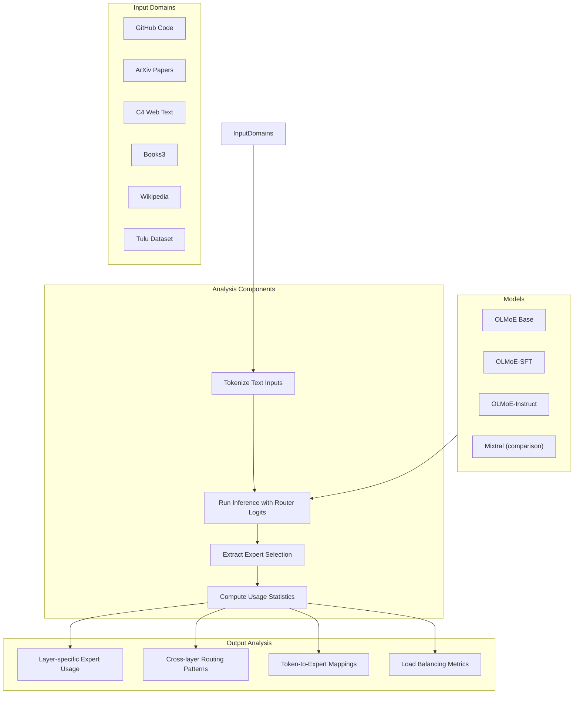
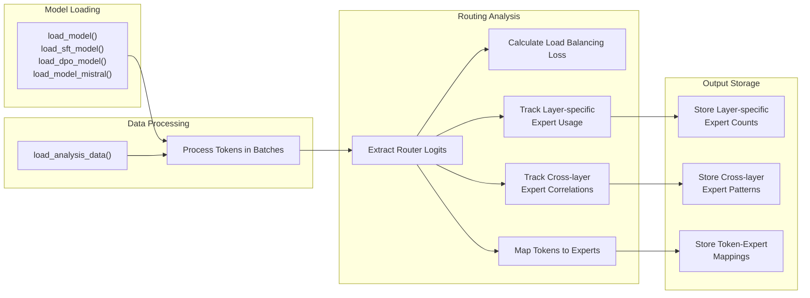
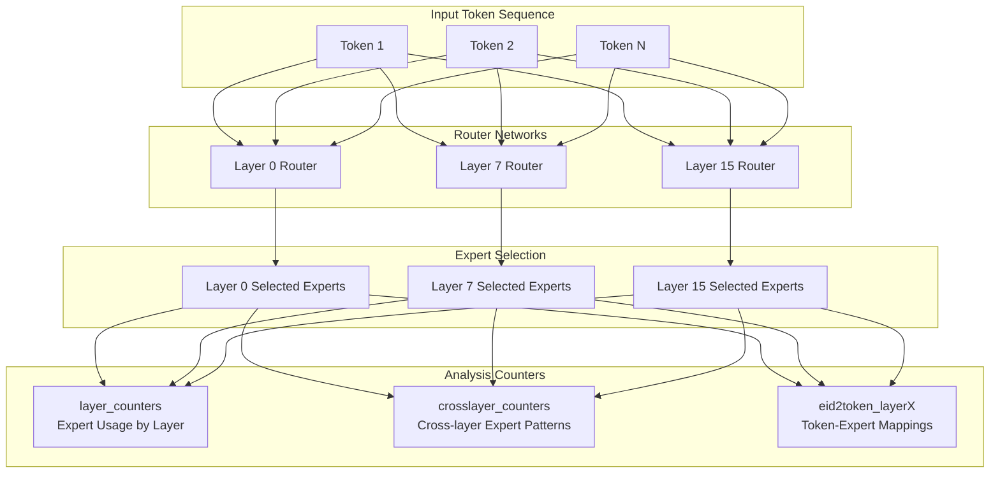

<!-- source: DeepWiki mcp.deepwiki.com · repo allenai/OLMoE · page 6.3 Domain-Specific Routing Analysis · fetched 2026-10-26 -->

# Domain-Specific Routing Analysis

Relevant source files

The following files were used as context for generating this wiki page:

- [scripts/run_routing_analysis.py](scripts/run_routing_analysis.py)

## Purpose and Scope

This document explains the domain-specific routing analysis system in OLMoE, which examines how OLMoE's mixture-of-experts architecture routes tokens to different experts when processing inputs from various domains. The system helps researchers understand expert specialization patterns and how routing behavior changes across different text domains, model variants, and layer depths. 

For information about cross-layer routing patterns, see [Cross-Layer Routing Analysis](#6.1). For visualization tools that help interpret the data collected here, see [Routing Visualization Tools](#6.2).

## Analysis Overview

Domain-specific routing analysis examines how the router networks within each layer of the OLMoE model assign tokens to experts depending on the domain of the input text. This analysis reveals whether certain experts specialize in processing particular types of content (such as code, scientific papers, or general text) and how this specialization varies across model variants.

Sources: [scripts/run_routing_analysis.py:105-169]()

## Domain Datasets

The routing analysis system examines expert behavior across six distinct text domains:

| Domain ID | Description | Source | Characteristics |
|-----------|-------------|--------|-----------------|
| github | Open-source code | GitHub repositories | Programming languages, comments, documentation |
| arxiv | Scientific papers | ArXiv preprints | Academic language, math notation, technical terms |
| c4 | Web text | Common Crawl | Diverse general language from the web |
| book | Book text | Books3 dataset | Literary text, narratives, dialogue |
| wikipedia | Encyclopedia | Wikipedia | Factual information, structured articles |
| tulu | Instruction-tuning | Tulu v3.1 | Instruction-response pairs, diverse tasks |

These domains represent distinct language distributions that may activate different routing patterns in the model.

Sources: [scripts/run_routing_analysis.py:45-67](), [scripts/run_routing_analysis.py:171](), [scripts/run_routing_analysis.py:186]()

## Analysis Workflow

Sources: [scripts/run_routing_analysis.py:68-96](), [scripts/run_routing_analysis.py:105-169](), [scripts/run_routing_analysis.py:186-196]()

## Implementation Details

### Model Variants

The routing analysis system can analyze multiple model variants to compare how routing behavior changes after different training stages:

1. **OLMoE Base**: The base pretrained model
2. **OLMoE-SFT**: The supervised fine-tuned model
3. **OLMoE-DPO**: The instruct model trained with Direct Preference Optimization
4. **Mixtral**: Mistral's Mixtral-8x7B model (used for comparison)

Each model is loaded with router logits output enabled to capture expert selection decisions.

Sources: [scripts/run_routing_analysis.py:68-96](), [scripts/run_routing_analysis.py:173-183]()

### Key Analysis Functions

#### Run Analysis Function

The `run_analysis` function is the core of the domain-specific routing analysis:

1. Iterates through text from a specific domain
2. Tokenizes and processes text in batches
3. Runs model inference with router logits enabled
4. Extracts which experts were selected for each token
5. Tracks:
   - Layer-specific expert usage counts
   - Cross-layer expert selection patterns
   - Token-to-expert mappings for specific layers (0, 7, and 15)
6. Calculates load balancing loss to measure expert utilization uniformity

Sources: [scripts/run_routing_analysis.py:105-169]()

#### Load Balancing Analysis

The system calculates load balancing loss to quantify how evenly the model distributes tokens across experts:

- Higher values indicate uneven distribution (some experts overused, others underused)
- Lower values indicate more balanced expert utilization
- This metric helps evaluate routing efficiency and potential expert specialization

Sources: [scripts/run_routing_analysis.py:17-42](), [scripts/run_routing_analysis.py:123-128](), [scripts/run_routing_analysis.py:167]()

## Data Collection Details

### Expert Selection Tracking

The system tracks which experts are selected for each token across all model layers:

Sources: [scripts/run_routing_analysis.py:106-154]()

### Collected Data Types

The analysis produces three main types of data:

1. **Layer-specific expert counts**: How frequently each expert is selected at specific layers
   - Stored in `routing_output/{model_name}/expert_counts/{domain}.pkl`
   - Focuses on layers 0, 7, and 15 as representative samples

2. **Cross-layer patterns**: How expert selection correlates between layers
   - Stored in `routing_output/{model_name}/expert_counts_crosslayer/{domain}.pkl`
   - Specifically tracks patterns between layers 0 and 7, and between layers 7 and 15

3. **Token-to-expert mappings**: Which tokens are commonly routed to which experts
   - Stored in `routing_output/{model_name}/eid2token/{domain}.pkl`
   - Helps identify expert specialization by token type

Sources: [scripts/run_routing_analysis.py:189-197]()

## Applications and Insights

Domain-specific routing analysis provides several important insights:

1. **Expert Specialization**: Reveals whether specific experts handle certain domains (e.g., one expert focusing on programming code, another on scientific text)

2. **Training Evolution**: Shows how routing patterns change from the base model through SFT and DPO stages

3. **Layer Functionality**: Demonstrates how different layers in the model may have different routing behaviors (early layers vs. middle vs. deeper layers)

4. **Load Distribution**: Indicates whether the model is effectively utilizing all experts or over-relying on a subset

5. **Token Associations**: Identifies patterns in which tokens tend to be routed to which experts, potentially revealing semantic or syntactic specialization

These insights are valuable for:
- Understanding model behavior and capabilities
- Debugging poor performance on specific domains
- Guiding future MoE architecture improvements
- Interpreting model decisions

Sources: [scripts/run_routing_analysis.py:99-103](), [scripts/run_routing_analysis.py:167]()

## Integration with Visualization Tools

The data collected by the domain-specific routing analysis system serves as input for the visualization tools described in [Routing Visualization Tools](#6.2). The pickle files produced by this system can be loaded and analyzed to create visualizations that help researchers interpret routing patterns across domains.

---

