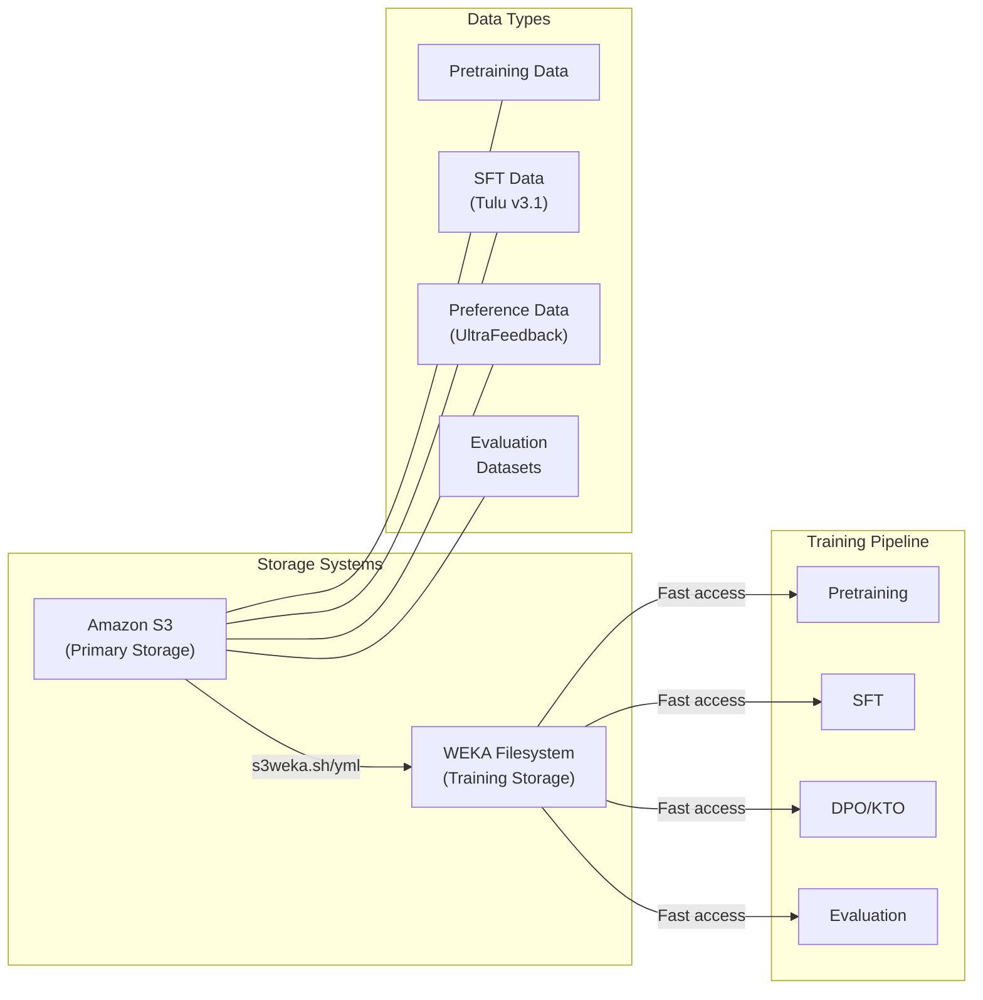
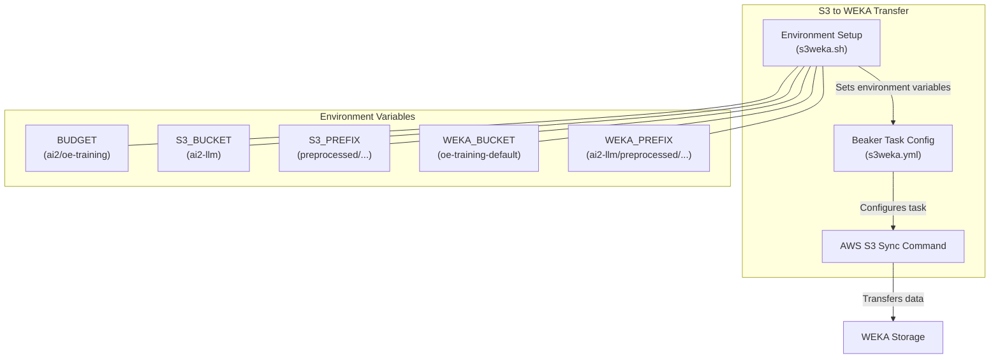
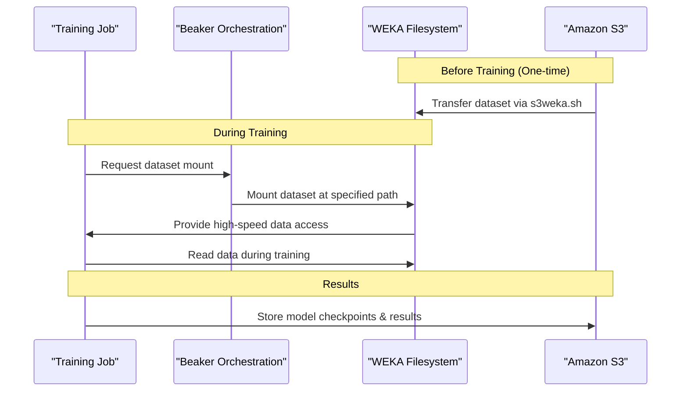
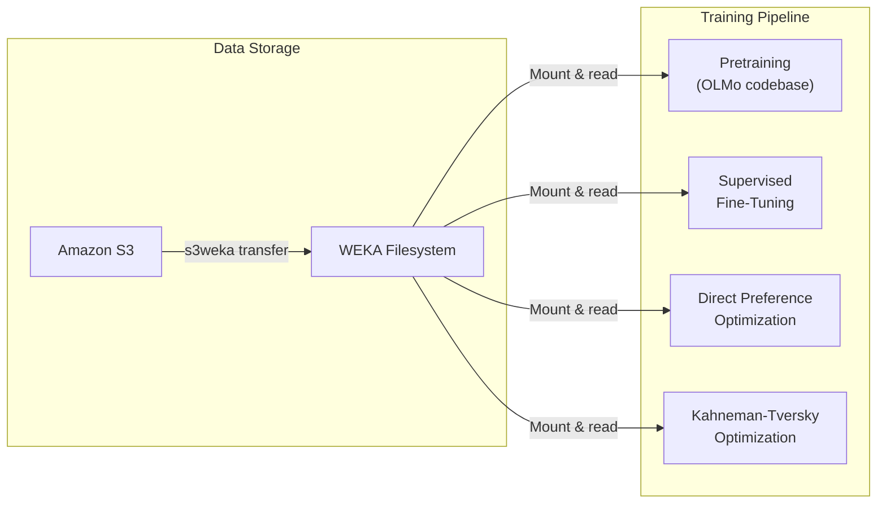

<!-- source: DeepWiki mcp.deepwiki.com · repo allenai/OLMoE · page 7 Data Management · fetched 2026-10-26 -->

# Data Management

<details>
<summary>Relevant source files</summary>

The following files were used as context for generating this wiki page:

- [.gitignore](.gitignore)
- [scripts/wekatransfer/s3weka.sh](scripts/wekatransfer/s3weka.sh)
- [scripts/wekatransfer/s3weka.yml](scripts/wekatransfer/s3weka.yml)

</details>


This document outlines the data management infrastructure and processes in the OLMoE project. It covers how training and evaluation data is stored, transferred, and prepared for use in model training pipelines. For information about how this data is used in training, see [Training Pipeline](#3), and for details about how model checkpoints are managed, see [Model Artifacts and Checkpoints](#8).

## Overview

The OLMoE project requires efficient management of large-scale datasets for pretraining and fine-tuning Mixture-of-Experts language models. The data management infrastructure is designed to handle multi-terabyte datasets while ensuring fast access for compute-intensive training workloads.



Sources: [scripts/wekatransfer/s3weka.yml](), [scripts/wekatransfer/s3weka.sh]()

## Storage Infrastructure

The OLMoE data management system uses a two-tier storage approach:

1. **Amazon S3** - Primary long-term storage for all datasets
2. **WEKA Filesystem** - High-performance storage for active training workloads

This architecture ensures both data durability and high-throughput access during computation-intensive model training.

### WEKA Filesystem

The WEKA filesystem provides a distributed, high-performance storage solution optimized for AI workloads. It offers:

- Higher I/O throughput than traditional network file systems
- POSIX-compliant interface for seamless integration with existing code
- Scalable performance for handling large-scale training datasets
- Direct mounting into compute clusters via Beaker jobs

## Data Transfer System

Data is transferred from Amazon S3 to the WEKA filesystem using an automated Beaker workflow.



Sources: [scripts/wekatransfer/s3weka.yml](), [scripts/wekatransfer/s3weka.sh]()

### Transfer Process Components

1. **Environment Configuration**: The `s3weka.sh` script defines the source and destination locations through environment variables:
   - `BUDGET`: Beaker budget for resource allocation
   - `S3_BUCKET`: Source S3 bucket name
   - `S3_PREFIX`: Path prefix within the S3 bucket
   - `WEKA_BUCKET`: Destination WEKA bucket name
   - `WEKA_PREFIX`: Path prefix within the WEKA filesystem

2. **Beaker Task Configuration**: The `s3weka.yml` file defines a Beaker task that:
   - Uses the `ai2/cuda11.8-ubuntu20.04` container image
   - Runs the AWS CLI sync command to transfer data
   - Mounts the WEKA filesystem at a specified path
   - Uses AWS credentials from secrets
   - Runs on the specified compute cluster

Example transfer configuration:

```
Source: s3://ai2-llm/preprocessed/starcoder/v1-decon-100_to_20k-2star-top_token_030
Destination: /oe-training-default/ai2-llm/preprocessed/starcoder/v1-decon-100_to_20k-2star-top_token_030
```

Sources: [scripts/wekatransfer/s3weka.yml:4-21](), [scripts/wekatransfer/s3weka.sh:1-9]()

## Dataset Organization

The OLMoE project maintains several types of datasets for different stages of the model lifecycle:

| Dataset Type | Source Location | Description | Usage |
|-------------|----------------|-------------|-------|
| Pretraining Data | `ai2-llm/preprocessed/*/` | Tokenized text for model pretraining | Base model training |
| SFT Data (Tulu v3.1) | `ai2-llm/preprocessed/` | Instruction-following examples | Supervised fine-tuning |
| Preference Data (UltraFeedback) | `ai2-llm/preprocessed/` | Preferred/dispreferred response pairs | DPO/KTO alignment |
| Evaluation Datasets | `ai2-llm/preprocessed/` | Benchmark datasets | Model evaluation |

### Dataset Examples

Based on the transfer script, several dataset prefixes have been used:

- `preprocessed/olmo-mix/danyh-compiled-v1_7`
- `preprocessed/fastdclm`
- `preprocessed/starcoder/v1-decon-100_to_20k-2star-top_token_030`

Sources: [scripts/wekatransfer/s3weka.sh:3-9]()

## Data Access Pattern



Sources: [scripts/wekatransfer/s3weka.yml:8-12]()

## Data Management Best Practices

When working with the OLMoE data management system:

1. **Use the transfer scripts** for moving data from S3 to WEKA to ensure consistency
2. **Modify environment variables** in `s3weka.sh` to specify source and destination paths
3. **Mount WEKA datasets** in Beaker jobs rather than transferring them again
4. **Maintain path consistency** between S3 and WEKA to simplify data management

### Example Usage

To transfer a new dataset from S3 to WEKA:

1. Update the environment variables in `s3weka.sh`:
   ```bash
   export S3_PREFIX=preprocessed/your-new-dataset
   export WEKA_PREFIX=ai2-llm/preprocessed/your-new-dataset
   ```

2. Run the transfer script which uses the Beaker workflow defined in `s3weka.yml`

3. Reference the WEKA path in your training configuration

Sources: [scripts/wekatransfer/s3weka.sh:1-9](), [scripts/wekatransfer/s3weka.yml:1-22]()

## Integration with Training Pipeline

The data management system integrates with the OLMoE training pipeline through dataset mounting. Training jobs request access to specific datasets which are efficiently mounted from the WEKA filesystem.



Sources: [scripts/wekatransfer/s3weka.yml:8-12]()

## Conclusion

The OLMoE data management system implements a two-tier storage architecture with Amazon S3 for long-term storage and WEKA filesystem for high-performance training access. The automated transfer process using Beaker ensures consistent data movement between these systems, while maintaining a clear organization for different dataset types throughout the model lifecycle.

---

