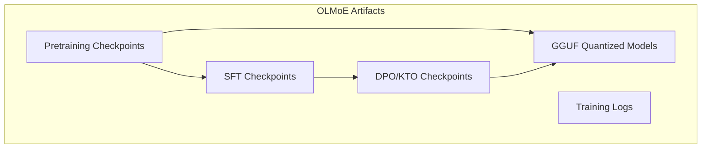
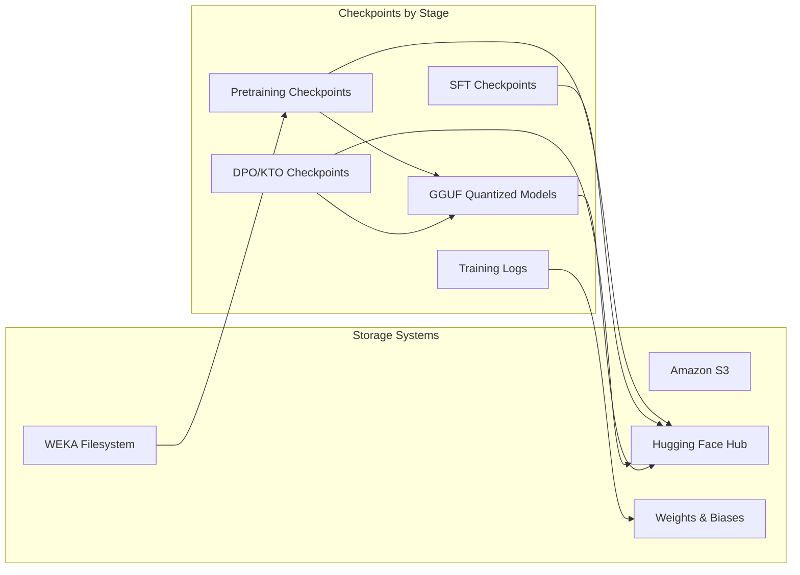
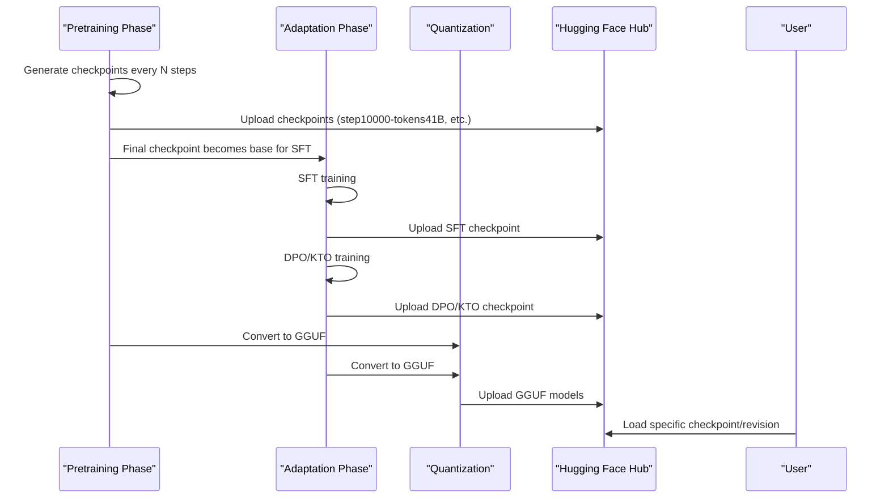

<!-- source: DeepWiki mcp.deepwiki.com · repo allenai/OLMoE · page 8 Model Artifacts and Checkpoints · fetched 2026-10-26 -->

# Model Artifacts and Checkpoints

<details>
<summary>Relevant source files</summary>

The following files were used as context for generating this wiki page:

- [README.md](README.md)
- [logs/olmoe-dpo-logs.txt](logs/olmoe-dpo-logs.txt)
- [logs/olmoe-sft-logs.txt](logs/olmoe-sft-logs.txt)
- [scripts/adapteval.sh](scripts/adapteval.sh)
- [scripts/olmoe_visuals.ipynb](scripts/olmoe_visuals.ipynb)

</details>


This page provides detailed information about the various model artifacts and checkpoints in the OLMoE project, including their storage locations, formats, and methods for accessing them. It serves as a comprehensive guide for researchers and developers who need to work with the OLMoE model weights, experiment with different configurations, or reproduce results from the paper.

For information about using these models for inference, see [Inference Methods](#4).

## Types of Model Artifacts

OLMoE offers several types of model artifacts corresponding to different stages of the training pipeline:



Sources: [README.md:23-28]()

## Checkpoint Repositories

All OLMoE model artifacts are stored in Hugging Face repositories, organized by training stage. The following table summarizes the available repositories and their contents:

| Training Stage | Repository URL | Description |
|----------------|----------------|-------------|
| Pretraining | [allenai/OLMoE-1B-7B-0924](https://hf.co/allenai/OLMoE-1B-7B-0924) | Full-precision pretraining checkpoints at various steps |
| Pretraining (GGUF) | [allenai/OLMoE-1B-7B-0924-GGUF](https://hf.co/allenai/OLMoE-1B-7B-0924-GGUF) | Quantized models of the final pretraining checkpoint |
| SFT | [allenai/OLMoE-1B-7B-0924-SFT](https://huggingface.co/allenai/OLMoE-1B-7B-0924-SFT) | Supervised fine-tuning checkpoints |
| DPO/KTO | [allenai/OLMoE-1B-7B-0924-Instruct](https://huggingface.co/allenai/OLMoE-1B-7B-0924-Instruct) | Direct Preference Optimization/Kahneman-Tversky Optimization checkpoints |
| DPO/KTO (GGUF) | [allenai/OLMoE-1B-7B-0924-Instruct-GGUF](https://hf.co/allenai/OLMoE-1B-7B-0924-Instruct-GGUF) | Quantized models of the final DPO checkpoint |

Sources: [README.md:23-28]()



Sources: [README.md:23-28]()

## Checkpoint Formats and Structures

OLMoE checkpoints are available in several formats:

1. **Native OLMo Format**: Used primarily during pretraining
2. **Hugging Face Transformers Format**: For use with the transformers library
3. **GGUF Format**: For use with llama.cpp and other efficient inference engines

### Pretraining Checkpoints

Pretraining checkpoints in the `allenai/OLMoE-1B-7B-0924` repository include:

- Full model weights at different training steps
- Model configurations
- Tokenizer files

Each checkpoint is identified by a revision name in the format `stepXXXXX-tokensYYB` where:
- `XXXXX` represents the training step number
- `YY` represents the number of tokens seen during training in billions

### SFT and DPO/KTO Checkpoints

The supervised fine-tuning (SFT) and preference optimization (DPO/KTO) checkpoints follow the standard Hugging Face transformers model format, containing:

- Model weights
- Configuration files
- Tokenizer files

### GGUF Quantized Models

GGUF (formerly GGML) is a format optimized for efficient inference on CPUs. The GGUF repositories contain:

- Quantized models at different precision levels (typically q4_0, q4_1, q5_0, q5_1, q8_0)
- Each quantization level represents a different trade-off between model size and accuracy

## Accessing Checkpoints

### Loading Checkpoints with Hugging Face Transformers

To load a specific checkpoint using the transformers library:

```python
from transformers import OlmoeForCausalLM, AutoTokenizer
import torch

DEVICE = "cuda" if torch.cuda.is_available() else "cpu"

# Load model - can specify a specific revision with `revision` parameter
model = OlmoeForCausalLM.from_pretrained("allenai/OLMoE-1B-7B-0924").to(DEVICE)
tokenizer = AutoTokenizer.from_pretrained("allenai/OLMoE-1B-7B-0924")
```

Sources: [README.md:56-73]()

### Listing Available Revisions

To list all available revisions/branches in a repository:

```python
from huggingface_hub import list_repo_refs
out = list_repo_refs("allenai/OLMoE-1B-7B-0924")
branches = [b.name for b in out.branches]
```

Sources: [README.md:75-80]()

### Using GGUF Quantized Models

With llama.cpp:

```bash
llama-cli -m olmoe-1b-7b-0924-q4_0.gguf -p "Bitcoin is" -n 128
```

Sources: [README.md:46-52]()

## Checkpoint Management Workflow

The following diagram illustrates the overall workflow for checkpoint management in the OLMoE project:



Sources: [README.md:23-28](), [README.md:56-73]()

## Converting Between Formats

### Converting OLMo Checkpoints to Hugging Face Format

To convert a pretraining checkpoint to Hugging Face transformers format:

1. Use the conversion script in the transformers repository:
   ```python
   # Script location: transformers/src/transformers/models/olmoe/convert_olmoe_weights_to_hf.py
   ```

2. Follow the instructions in the script to convert your checkpoint.

Sources: [README.md:101]()

### Creating GGUF Quantized Models

The repository provides pre-quantized GGUF models, but you can create your own using llama.cpp's conversion tools:

1. Clone the llama.cpp repository
2. Use the conversion scripts to convert a Hugging Face model to GGUF format
3. Apply different quantization parameters to achieve the desired size/quality trade-off

## Evaluation Checkpoints

When running evaluations, the results are also stored as artifacts:

| Evaluation Stage | Path Format | Description |
|-----------------|-------------|-------------|
| Pretraining Eval | Tracked in WandB | Evaluation metrics during pretraining |
| Post-pretraining | `${MODEL_PATH}/eval/dclm` | DCLM evaluation results |
| Post-adaptation | `${MODEL_PATH}/eval/mmlu` | MMLU evaluation results |
| Post-adaptation | `${MODEL_PATH}/eval/gsm8k` | GSM8K evaluation results |
| Post-adaptation | `${MODEL_PATH}/eval/bbh` | BBH evaluation results |
| Post-adaptation | `${MODEL_PATH}/eval/alpaca` | Alpaca evaluation results |
| Post-adaptation | `${MODEL_PATH}/eval/xstest` | XSTest evaluation results |
| Post-adaptation | `${MODEL_PATH}/eval/humaneval` | HumanEval evaluation results |
| Post-adaptation | `${MODEL_PATH}/eval/ifeval` | IFEval evaluation results |

Sources: [README.md:175-193](), [scripts/adapteval.sh:11-98]()

## Specific Model Checkpoint Examples

The following table outlines some specific OLMoE checkpoint examples and their characteristics:

| Checkpoint | Description | Location | Size |
|------------|-------------|----------|------|
| OLMoE-1B-7B-0924 | Base pretrained model (1.3B active/6.9B total parameters) | allenai/OLMoE-1B-7B-0924 | ~14GB |
| OLMoE-1B-7B-0924-SFT | Supervised fine-tuned on Tulu v3.1 | allenai/OLMoE-1B-7B-0924-SFT | ~14GB |
| OLMoE-1B-7B-0924-Instruct | DPO-tuned on UltraFeedback | allenai/OLMoE-1B-7B-0924-Instruct | ~14GB |
| olmoe-1b-7b-0924-q4_0.gguf | 4-bit quantized base model | allenai/OLMoE-1B-7B-0924-GGUF | ~2GB |
| olmoe-1b-7b-0924-instruct-q4_0.gguf | 4-bit quantized instruct model | allenai/OLMoE-1B-7B-0924-Instruct-GGUF | ~2GB |

Sources: [README.md:23-28](), [README.md:46-52]()

## Logs and Training Metrics

In addition to model weights, the project provides access to training logs and metrics:

1. **Pretraining Logs**: Available on [Weights & Biases](https://wandb.ai/ai2-llm/olmoe/reports/OLMoE-1B-7B-0924--Vmlldzo4OTcyMjU3)
2. **SFT Logs**: Stored in [logs/olmoe-sft-logs.txt](https://github.com/allenai/OLMoE/blob/main/logs/olmoe-sft-logs.txt)
3. **DPO Logs**: Stored in [logs/olmoe-dpo-logs.txt](https://github.com/allenai/OLMoE/blob/main/logs/olmoe-dpo-logs.txt)

These logs contain valuable information about training hyperparameters, loss curves, and evaluation metrics throughout the training process.

Sources: [README.md:23-28](), [logs/olmoe-dpo-logs.txt:1-223]()

## Model Artifact Directory Structure

The following is the typical directory structure for model artifacts in the Hugging Face repositories:

```
Repository/
├── config.json           # Model architecture configuration
├── generation_config.json # Text generation configuration
├── model.safetensors     # Model weights in safetensors format
├── pytorch_model.bin     # Optional PyTorch format model weights
├── special_tokens_map.json # Tokenizer special tokens definition
├── tokenizer_config.json  # Tokenizer configuration
└── tokenizer.model       # Tokenizer model file
```

For GGUF repositories, the structure includes various quantized versions of the model:

```
Repository/
├── olmoe-1b-7b-0924-q4_0.gguf   # 4-bit quantization (smaller, lower quality)
├── olmoe-1b-7b-0924-q5_0.gguf   # 5-bit quantization (balance)
└── olmoe-1b-7b-0924-q8_0.gguf   # 8-bit quantization (larger, higher quality)
```

---

