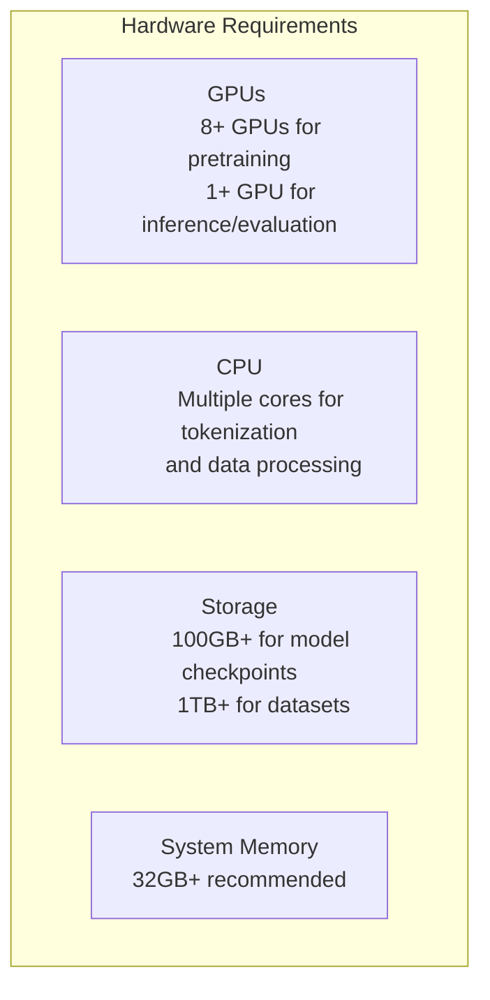
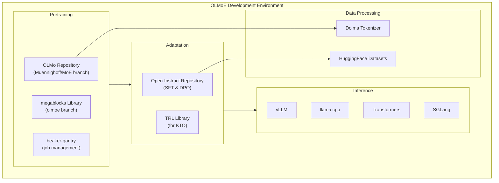
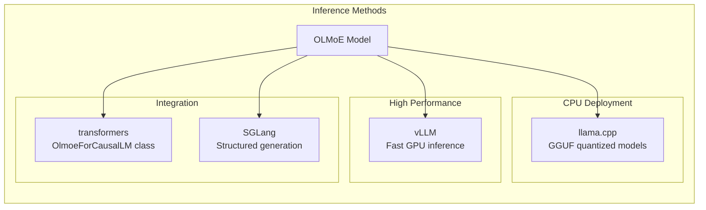
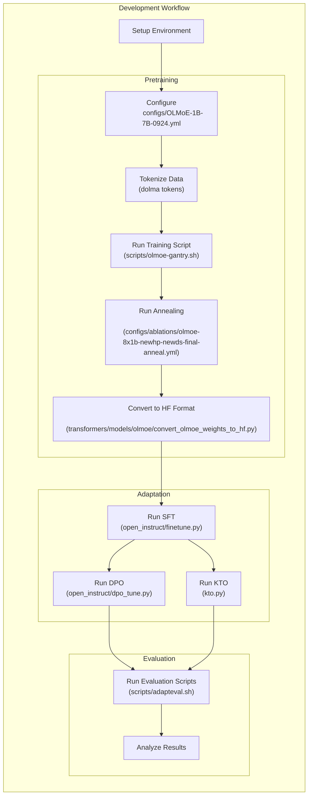

<!-- source: DeepWiki mcp.deepwiki.com · repo allenai/OLMoE · page 9 Development Environment · fetched 2026-10-26 -->

# Development Environment

<details>
<summary>Relevant source files</summary>

The following files were used as context for generating this wiki page:

- [.gitignore](.gitignore)
- [README.md](README.md)
- [scripts/adapteval.sh](scripts/adapteval.sh)
- [scripts/olmoe_visuals.ipynb](scripts/olmoe_visuals.ipynb)

</details>


This document provides instructions for setting up and configuring a development environment to work with the OLMoE (Open Mixture-of-Experts Language Models) codebase. It covers required dependencies, environment configuration, and key development tools.

## System Requirements

### Hardware Requirements


Sources: [README.md:83-101]()

### Software Requirements

| Component | Requirement | Notes |
|-----------|-------------|-------|
| Operating System | Linux | Ubuntu or similar distro recommended |
| Python | 3.8+ | Required for all components |
| CUDA | Compatible with PyTorch | For GPU acceleration |
| Git | Latest | For version control |
| Conda | Optional | For environment management |

Sources: [README.md:32-35](), [README.md:82-84]()

## Environment Setup



Sources: [README.md:82-101](), [README.md:32-74](), [README.md:103-107]()

### Setting Up for Pretraining

1. Clone the OLMo repository with the MoE branch:
   ```bash
   git clone https://github.com/allenai/OLMo.git
   cd OLMo
   git checkout Muennighoff/MoE
   pip install -e .
   ```

2. Install the custom MegaBlocks library:
   ```bash
   pip install git+https://github.com/Muennighoff/megablocks.git@olmoe
   ```

3. Prepare a config file based on the examples in `configs/` directory

Sources: [README.md:82-87]()

### Setting Up for Adaptation

1. Clone the Open Instruct repository:
   ```bash
   git clone https://github.com/allenai/open-instruct/
   cd open-instruct
   # Follow the repository's setup instructions
   ```

2. If needed, upgrade transformers:
   ```bash
   pip install --upgrade transformers
   ```

3. For KTO (Kahneman-Tversky Optimization), install TRL:
   ```bash
   pip install trl==0.9.6
   ```

Sources: [README.md:110-113](), [README.md:175]()

### Setting Up for Inference

OLMoE supports multiple inference backends:



To use each inference method, install the appropriate packages:

| Method | Installation | Performance |
|--------|-------------|------------|
| vLLM | `pip install vllm` | Fastest GPU inference |
| llama.cpp | Clone repo & build | Best CPU performance, supports quantization |
| transformers | `pip install transformers` | Simplest integration, slower inference |
| SGLang | `pip install sglang` | Optimized for structured generation |

Sources: [README.md:30-74]()

## Data Management

### Tokenizing Data for Pretraining

```bash
dolma tokens \
  --documents ${PATH_TO_DOWNLOADED_DATA} \
  --destination ${PATH_WHERE_TO_SAVE_TOKENIZED_DATA} \
  --tokenizer.name_or_path 'allenai/gpt-neox-olmo-dolma-v1_5' \
  --max_size '2_147_483_648' \
  --seed 0 \
  --tokenizer.eos_token_id 50279 \
  --tokenizer.pad_token_id 1 \
  --processes ${NUMBER_OF_CPU_CORES_TO_USE}
```

Sources: [README.md:88-98]()

### Dataset Locations

| Dataset | Purpose | Location |
|---------|---------|----------|
| OLMoE-mix-0924 | Pretraining | https://huggingface.co/datasets/allenai/OLMoE-mix-0924 |
| tulu-v3.1-mix-preview-4096-OLMoE | SFT | https://huggingface.co/datasets/allenai/tulu-v3.1-mix-preview-4096-OLMoE |
| ultrafeedback_binarized_cleaned | DPO/KTO | https://huggingface.co/datasets/allenai/ultrafeedback_binarized_cleaned |

Sources: [README.md:26-28]()

## Job Management

### Using SLURM for Distributed Training

The repository includes SLURM job scripts for running distributed training and evaluation tasks.

Example SLURM configuration from `adapteval.sh`:

```bash
#SBATCH --job-name=eval
#SBATCH --nodes=1
#SBATCH --ntasks-per-node=1          # crucial - only 1 task per dist per node!
#SBATCH --partition=a3
#SBATCH --gres=gpu:8                 # number of gpus
#SBATCH --time 24:00:00              # maximum execution time (HH:MM:SS)
#SBATCH --output=jobs/%x-%j.out      # output file name
#SBATCH --exclusive
#SBATCH --array=0-6%7                # adjusted array size and concurrency
```

Sources: [scripts/adapteval.sh:1-11]()

### Beaker Gantry

For pretraining, the repository uses Beaker Gantry for job management:

```bash
bash scripts/olmoe-gantry.sh
```

This invokes the training script and uses Beaker Gantry to manage the job.

Sources: [README.md:99]()

## Configuration Files

### Pretraining Configurations

The repository includes several configuration files in the `configs/` directory:

| Configuration File | Purpose |
|--------------------|---------|
| `configs/OLMoE-1B-7B-0924.yml` | Main pretraining configuration |
| `configs/ablations/*.yml` | Configurations for ablation studies |
| `configs/ablations/olmoe-8x1b-newhp-newds-final-anneal.yml` | Annealing configuration |

Sources: [README.md:86-100]()

### DeepSpeed Configurations

Adaptation uses DeepSpeed for efficient training:

```bash
--deepspeed_config_file configs/ds_configs/stage3_no_offloading_accelerate.conf
```

Sources: [README.md:120]()

## Development Workflows



Sources: [README.md:82-193]()

### Pretraining Workflow

1. Set up the environment as described above
2. Configure your training parameters in a config file (e.g., `configs/OLMoE-1B-7B-0924.yml`)
3. Download and tokenize the pretraining data
4. Submit your training job using Beaker Gantry
5. (Optional) Run annealing after pretraining
6. Convert checkpoint to Hugging Face format

Sources: [README.md:82-101]()

### Adaptation Workflow

1. Set up the adaptation environment
2. Run supervised fine-tuning (SFT) using the provided commands
3. Run preference optimization (DPO/KTO) on the SFT model

Sources: [README.md:112-175]()

### Evaluation Workflow

The repository provides scripts for evaluating models on various benchmarks:

```bash
# Example evaluation command from adapteval.sh
python -m eval.mmlu.run_eval \
  --ntrain 0 \
  --data_dir /data/niklas/data/eval/mmlu/ \
  --save_dir ${MODEL_PATH}/eval/mmlu \
  --model_name_or_path ${MODEL_PATH} \
  --tokenizer_name_or_path ${TOKENIZER_PATH} \
  --use_chat_format \
  --chat_formatting_function eval.templates.create_prompt_with_huggingface_tokenizer_template \
  --eval_batch_size 64
```

Sources: [scripts/adapteval.sh:20-93](), [README.md:178-193]()

## Debugging and Development Tips

### Listing Available Model Revisions

```python
from huggingface_hub import list_repo_refs
out = list_repo_refs("allenai/OLMoE-1B-7B-0924")
branches = [b.name for b in out.branches]
```

Sources: [README.md:75-80]()

### Sparse Upcycling

For sparse upcycling (converting a dense model to an MoE):

1. Train a dense model first
2. Convert a checkpoint using `scripts/sparsify_ckpt_unsharded.py`
3. Place the converted model in a folder with name ending in `-unsharded`
4. Launch a new training job with specific settings

Sources: [README.md:105-106]()

## Related Pages

For more information about other aspects of OLMoE, see:
- For model architecture details, see [Model Architecture](#2)
- For training pipeline information, see [Training Pipeline](#3)
- For inference methods, see [Inference Methods](#4)
- For evaluation framework, see [Evaluation Framework](#5)

Sources: [README.md:24-28]()