# Page: OLMoE Overview

# OLMoE Overview

<details>
<summary>Relevant source files</summary>

The following files were used as context for generating this wiki page:

- [README.md](README.md)
- [scripts/adapteval.sh](scripts/adapteval.sh)
- [scripts/olmoe_visuals.ipynb](scripts/olmoe_visuals.ipynb)

</details>


## Purpose and Scope

This document provides an introduction to OLMoE (Open Mixture-of-Experts Language Models), an open-source Mixture-of-Experts language model with 1.3 billion active parameters from a total of 6.9 billion parameters. It explains the fundamental concepts behind OLMoE, outlines its system architecture, and provides an overview of its key components, including training, inference, and evaluation methods.

This overview serves as an entry point to the OLMoE repository and documentation. For detailed information about specific components, please refer to their dedicated pages: [Model Architecture](#2), [Training Pipeline](#3), [Inference Methods](#4), [Evaluation Framework](#5), and [Expert Routing Analysis](#6).

Sources: [README.md:1-30]()

## What is OLMoE?

OLMoE is a fully open, state-of-the-art Mixture-of-Experts (MoE) language model developed by researchers at the Allen Institute for AI and other institutions. Unlike traditional dense language models where all parameters are active for every input, OLMoE employs a sparse activation strategy where different "expert" neural networks specialize in processing different types of inputs. This approach allows the model to have a large total parameter count (6.9B) while only using a fraction of those parameters (1.3B) for any given input token, resulting in computational efficiency without sacrificing model capacity.

The project encompasses not only the model itself but also the complete ecosystem around it, including:
1. All training code and configurations
2. All training data and preprocessing steps
3. Complete training logs
4. Evaluation frameworks and results
5. Multiple inference options
6. Specialized tools for analyzing expert routing behavior

Sources: [README.md:1-10](), [README.md:23-28]()

## System Architecture Overview

### High-Level Architecture

The following diagram illustrates the high-level architecture of the OLMoE system, showing the major components and their relationships:

**OLMoE System Architecture**
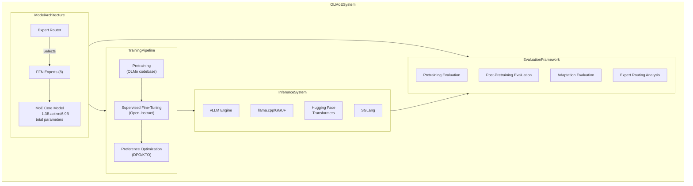

Sources: [README.md:8-29](), [README.md:175-193]()

### Model Lifecycle Flow

The following diagram illustrates the full lifecycle of the OLMoE model, from data processing through training, inference, and evaluation:

**OLMoE Model Lifecycle**
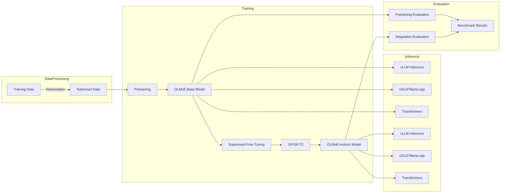

Sources: [README.md:30-97](), [README.md:175-193]()

## Model Architecture Fundamentals

OLMoE is based on a transformer architecture that incorporates Mixture-of-Experts (MoE) layers. In a traditional transformer, each layer consists of an attention mechanism followed by a feed-forward network (FFN). In OLMoE, certain FFN layers are replaced with MoE layers containing multiple "expert" FFNs and a router network that determines which experts should process each token.

### Key Architectural Features

- **Base Architecture**: Transformer-based language model similar to OLMo
- **Parameter Count**: 1.3 billion active parameters (during inference) from a total of 6.9 billion parameters
- **Expert Configuration**: 8 experts per MoE layer, with each token routed to 2 experts (top-2 routing)
- **Token Choice Routing**: "Dropless token choice" routing strategy that efficiently assigns tokens to experts

Sources: [README.md:3-4](), [README.md:24-25](), [README.md:104-108]()

### MoE Layer Structure

**OLMoE MoE Layer Structure**
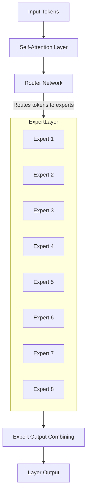

Sources: [README.md:104-108]()

## Training Pipeline

OLMoE's training pipeline consists of three main stages: pretraining, supervised fine-tuning (SFT), and preference optimization (DPO/KTO).

### Pretraining

The pretraining phase uses a modified version of the OLMo codebase to train the base model on a large corpus of text data. This process establishes the model's fundamental language understanding capabilities.

**Key Pretraining Components**:
- **Data**: OLMoE-mix-0924 dataset
- **Infrastructure**: Training performed using a modified OLMo codebase
- **Configuration**: Detailed configuration files for different model variants
- **Monitoring**: Comprehensive evaluation during training

Sources: [README.md:82-101]()

### Supervised Fine-Tuning (SFT)

After pretraining, the model undergoes supervised fine-tuning using the Open-Instruct framework to improve its instruction-following capabilities.

**SFT Configuration**:
- **Framework**: Open-Instruct
- **Datasets**: Tulu v3.1 mix preview for OLMoE and specialized datasets
- **Training Parameters**: 2e-05 learning rate, linear scheduler, 2 epochs

Sources: [README.md:111-143]()

### Preference Optimization

The final adaptation stage uses preference optimization techniques (DPO/KTO) to align the model with human preferences.

**Preference Optimization Methods**:
- **DPO (Direct Preference Optimization)**: Using Open-Instruct framework
- **KTO (Kahneman-Tversky Optimization)**: Alternative preference optimization approach
- **Dataset**: UltraFeedback binarized preferences

Sources: [README.md:144-175]()

## Inference Methods

OLMoE supports multiple inference methods to accommodate different deployment scenarios:

| Inference Method | Description | Recommended Use Case |
|------------------|-------------|----------------------|
| vLLM | High-performance inference engine with optimized memory usage | Production deployments requiring high throughput |
| llama.cpp/GGUF | Optimized C++ implementation with quantization support | Edge devices or CPU-only environments |
| Transformers | Hugging Face Transformers integration | Research and experimentation |
| SGLang | Structured generation language for controlled text generation | Applications requiring structured outputs |

### vLLM Example

```python
from vllm import LLM, SamplingParams
model = LLM("allenai/OLMoE-1B-7B-0924")
out = model.generate("Bitcoin is", SamplingParams(temperature=0.0))
```

### llama.cpp Example

```bash
llama-cli -m olmoe-1b-7b-0924-q4_0.gguf -p "Bitcoin is" -n 128
```

### Transformers Example

```python
from transformers import OlmoeForCausalLM, AutoTokenizer
import torch

model = OlmoeForCausalLM.from_pretrained("allenai/OLMoE-1B-7B-0924").to("cuda")
tokenizer = AutoTokenizer.from_pretrained("allenai/OLMoE-1B-7B-0924")
inputs = tokenizer("Bitcoin is", return_tensors="pt").to("cuda")
out = model.generate(**inputs, max_length=64)
```

Sources: [README.md:30-80]()

## Evaluation Framework

OLMoE employs a comprehensive evaluation framework that covers different stages of model development:

### Evaluation During Pretraining

Evaluation during pretraining is configured in the training configuration files and runs automatically. It monitors the model's performance on various tasks as training progresses.

Sources: [README.md:177-181]()

### Post-Pretraining Evaluation

After pretraining, the model is evaluated using:
- OLMES Evaluations: Evaluating base model capabilities
- DCLM Evaluations: Additional domain-specific evaluations

Sources: [README.md:183-187]()

### Adaptation Evaluation

After fine-tuning and preference optimization, the model is evaluated on a range of benchmarks:

**Adaptation Benchmarks**:
- **MMLU**: Testing knowledge across 57 subjects
- **GSM8K**: Mathematical reasoning
- **Alpaca Farm**: Instruction following
- **BBH**: Big Bench Hard tasks
- **XSTest**: Testing for model biases
- **HumanEval**: Code generation capabilities
- **IFEval**: Instruction following evaluation

Sources: [README.md:189-193](), [scripts/adapteval.sh:1-98]()

## Expert Routing Analysis

One of the unique aspects of OLMoE is its expert routing analysis system, which examines how the model routes tokens to different experts across various domains.

**Expert Routing Analysis System**
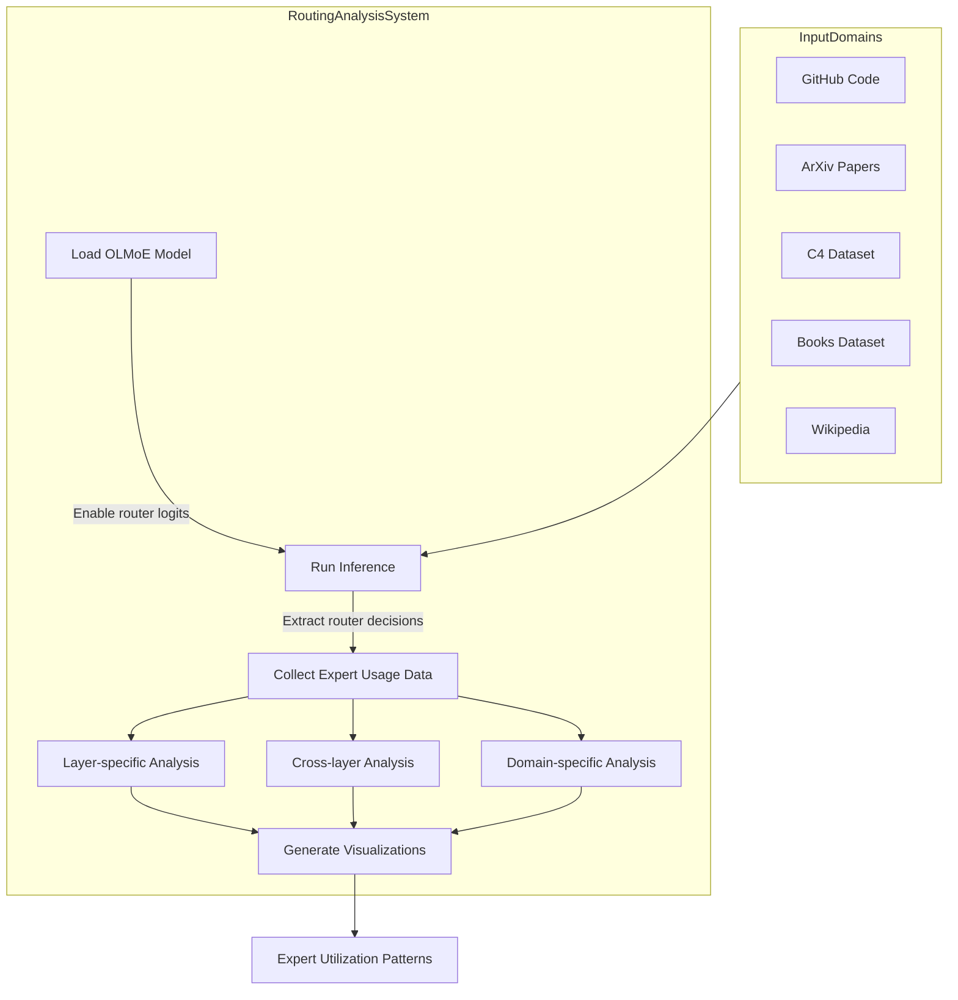

The routing analysis tools provide insights into:
- How tokens are routed to different experts
- Which experts specialize in which types of content
- How routing patterns change across model layers
- Domain-specific expert utilization

Sources: [README.md:200-202]()

## Available Resources and Artifacts

OLMoE provides comprehensive resources for researchers and developers:

| Resource Type | Description | Location |
|---------------|-------------|----------|
| Paper | Technical paper detailing the model | https://arxiv.org/abs/2409.02060 |
| Pretraining | Checkpoints, code, data, and logs | Hugging Face and AI2 repositories |
| SFT | Fine-tuned checkpoints and code | Hugging Face and Open-Instruct |
| DPO/KTO | Aligned model checkpoints | Hugging Face |
| Evaluation Tools | Scripts and frameworks | GitHub repository |
| Routing Analysis | Tools for analyzing expert utilization | GitHub repository |

Sources: [README.md:23-28]()

## Conclusion

OLMoE represents a comprehensive implementation of a Mixture-of-Experts language model, providing not only the model itself but also the complete ecosystem for training, evaluating, and deploying it. The open-source nature of the project, with all data, code, and logs released, enables researchers to build upon and extend this work.

For more detailed information about specific components, please refer to their dedicated wiki pages:
- [Model Architecture](#2)
- [Training Pipeline](#3)
- [Inference Methods](#4)
- [Evaluation Framework](#5)
- [Expert Routing Analysis](#6)

Sources: [README.md:206-218]()

---

# Page: Model Architecture

# Model Architecture

<details>
<summary>Relevant source files</summary>

The following files were used as context for generating this wiki page:

- [README.md](README.md)
- [scripts/adapteval.sh](scripts/adapteval.sh)
- [scripts/olmoe_visuals.ipynb](scripts/olmoe_visuals.ipynb)
- [scripts/run_routing_analysis.py](scripts/run_routing_analysis.py)

</details>


## Purpose and Scope

This document explains the architecture of OLMoE (Open Mixture-of-Experts Language Model), detailing its structural design, parameter distribution, and expert routing mechanisms. It focuses on the technical implementation of the model's architecture rather than training or inference procedures.

For information on how to train the model, see [Training Pipeline](#3).
For information on using the trained model, see [Inference Methods](#4).
For analysis of expert routing patterns, see [Expert Routing Analysis](#6).

## Architecture Overview

OLMoE is a transformer-based language model that implements a Mixture-of-Experts (MoE) approach to achieve parameter efficiency. The model has 1.3 billion active parameters out of a total of 6.9 billion parameters, making it approximately 5.3x more parameter-efficient than a dense model with equivalent capacity.

The key architectural innovation is replacing standard feed-forward networks in transformer layers with sparse MoE modules that selectively route tokens to specialized expert subnetworks.

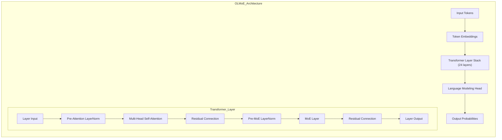

Sources: [README.md:3-4]()

## Mixture-of-Experts Implementation

OLMoE replaces the standard feed-forward networks in transformer layers with Mixture-of-Experts (MoE) layers. Each MoE layer contains multiple expert networks and a router that determines which experts should process each token.

### MoE Layer Structure

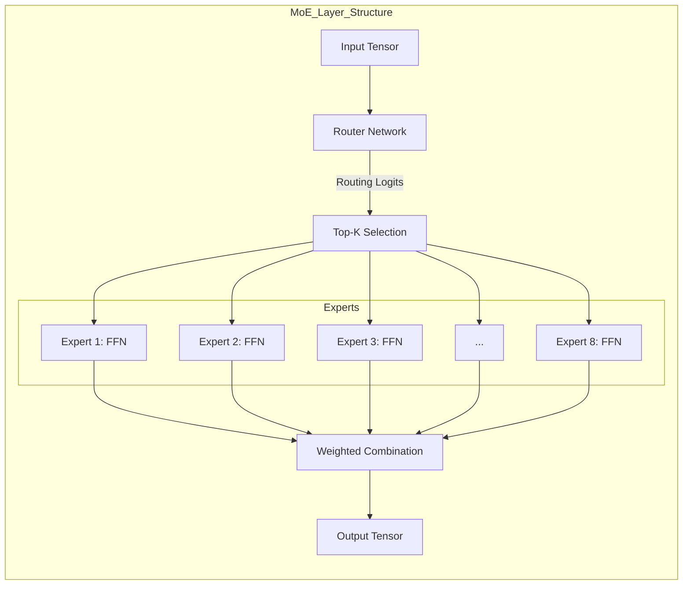

Sources: [README.md:8-9](), [scripts/run_routing_analysis.py:134-143]()

### Expert Configuration

Each expert is a feed-forward neural network with:
- An up-projection linear layer
- A GELU activation function
- A down-projection linear layer

The model contains 8 experts per MoE layer, with each expert being selectively activated based on the token's content and context.

Sources: [README.md:4](), [scripts/run_routing_analysis.py:138-140]()

## Routing Mechanism

The router network determines which experts should process each token:

1. For each token, the router computes logits representing the token's affinity to each expert
2. These logits are converted to probabilities through a softmax function
3. The top-k experts with the highest probabilities are selected (k=8 in OLMoE)
4. Each selected expert processes the token independently
5. The outputs from the selected experts are combined using the routing probabilities as weights

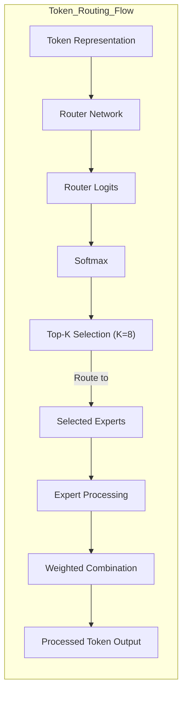

Sources: [scripts/run_routing_analysis.py:19-42](), [scripts/run_routing_analysis.py:134-143]()

### Load Balancing

To ensure all experts are utilized effectively, OLMoE employs a load balancing mechanism during training. This is implemented as an auxiliary loss that encourages even distribution of tokens across experts:

1. It calculates the percentage of tokens routed to each expert
2. It computes the average routing probability for each expert
3. It generates a loss value that penalizes imbalanced expert utilization

The load balancing loss is defined as:

```
load_balancing_loss = sum(tokens_per_expert * router_prob_per_expert) * num_experts
```

Sources: [scripts/run_routing_analysis.py:17-42]()

## Model Parameters and Dimensions

| Component | Parameters |
|-----------|------------|
| Total Parameters | 6.9 billion |
| Active Parameters | 1.3 billion |
| Number of Layers | 24 |
| Experts per Layer | 8 |
| Experts per Token | 8 |

The majority of parameters are in the expert networks, which are sparsely activated. This approach allows OLMoE to have a large capacity while maintaining computational efficiency.

Sources: [README.md:4](), [scripts/run_routing_analysis.py:134-143]()

## Cross-Layer Routing Analysis

OLMoE implements sophisticated analysis tools to understand how tokens are routed across different layers:

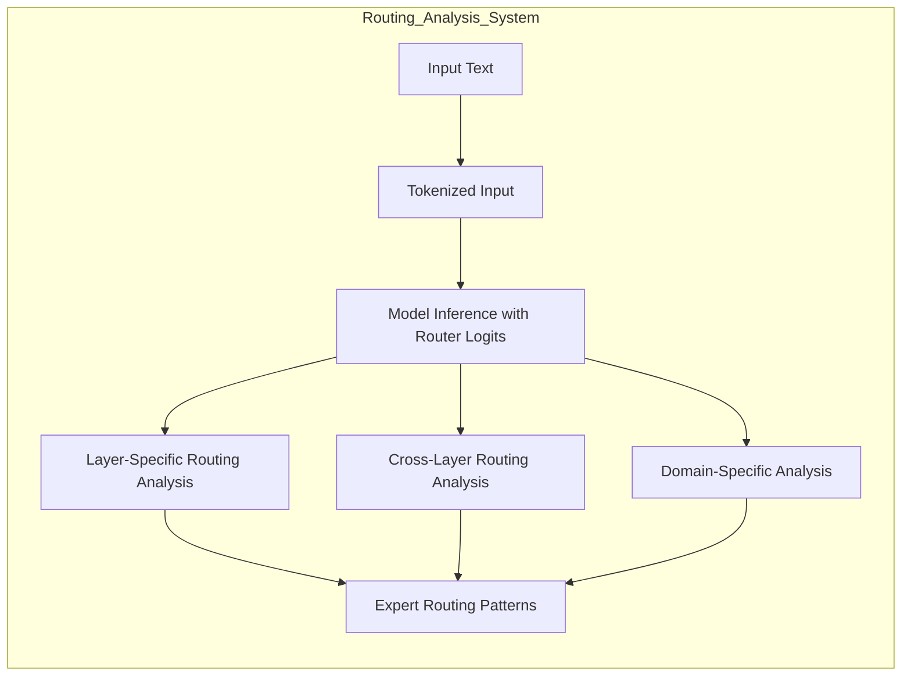

The routing analysis examines:
- Expert usage at specific layers (particularly layers 0, 7, and 15)
- Correlations between expert selections across different layers
- Domain-specific routing patterns across various content types

Sources: [scripts/run_routing_analysis.py:104-169](), [scripts/run_routing_analysis.py:171-197]()

## Sparse Upcycling and Model Variants

OLMoE supports a technique called "sparse upcycling" where a dense model is converted to a sparse MoE model, allowing for efficient parameter scaling. The repository contains several model variants:

1. **OLMoE Base Model**: The pretrained language model (1.3B active/6.9B total parameters)
2. **OLMoE-SFT**: Supervised fine-tuned version for instruction following
3. **OLMoE-Instruct**: Further optimized using DPO/KTO techniques

Each variant maintains the same architectural structure while being optimized for different use cases.

Sources: [README.md:25-28](), [README.md:105-106]()

## Expert Choice Routing

In addition to the standard "top-k" routing mechanism, OLMoE supports an alternative routing approach called "expert choice," where experts choose which tokens they want to process rather than tokens choosing experts. This is an experimental feature that can be enabled through configuration.

Sources: [README.md:107]()

## Implementation Details

The OLMoE architecture is implemented using a modified version of the megablocks library for efficient MoE operations. The architecture uses the following components:

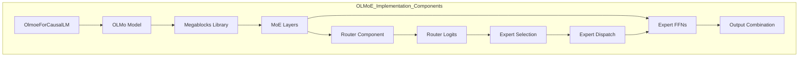

The implementation leverages specific classes from the transformers library and the custom megablocks implementation for efficient MoE operations.

Sources: [README.md:84-86](), [scripts/run_routing_analysis.py:1-16]()

## Comparison with Other MoE Models

OLMoE's architecture can be compared to other MoE models like Mixtral. Notable differences include:

| Feature | OLMoE | Mixtral |
|---------|-------|---------|
| Total Parameters | 6.9B | 47B |
| Active Parameters | 1.3B | ~12B |
| Experts per Layer | 8 | 8 |
| Experts per Token | 8 | 2 |
| Router Implementation | Dropless token choice | Top-k routing |

The OLMoE architecture uses a "dropless token choice" routing mechanism, which ensures all tokens are routed to experts without dropping any tokens.

Sources: [README.md:173-175](), [scripts/run_routing_analysis.py:91-96]()

## Integration with Inference Frameworks

The OLMoE architecture has been integrated with various inference frameworks including vLLM, llama.cpp, and SGLang, enabling efficient deployment across different platforms.

Sources: [README.md:31-33]()

---

# Page: Training Pipeline

# Training Pipeline

<details>
<summary>Relevant source files</summary>

The following files were used as context for generating this wiki page:

- [README.md](README.md)
- [logs/olmoe-dpo-logs.txt](logs/olmoe-dpo-logs.txt)
- [logs/olmoe-sft-logs.txt](logs/olmoe-sft-logs.txt)
- [scripts/adapteval.sh](scripts/adapteval.sh)
- [scripts/olmoe_visuals.ipynb](scripts/olmoe_visuals.ipynb)

</details>


The Training Pipeline in OLMoE (Open Mixture-of-Experts Language Models) encompasses the complete process of developing the model from initial pretraining through fine-tuning and alignment. This page documents the components, workflow, and implementation details of each stage in the pipeline, providing references to relevant code and configuration files.

For information about the model architecture, see [Model Architecture](#2). For specific details about pretraining, see [Pretraining](#3.1).

## Overview of the Training Pipeline

The OLMoE training pipeline consists of three main stages, each building upon the previous one:

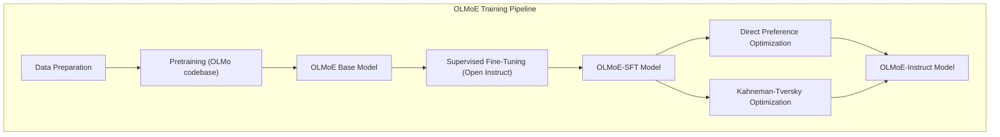

Sources: [README.md:12-21]()

## Pretraining

Pretraining is the initial stage where the model learns general language patterns from a large corpus of text data. OLMoE pretraining uses a modified version of the OLMo codebase.

### Setup and Requirements

To run pretraining, the following steps are required:

1. Clone a specific branch of the OLMo repository (`Muennighoff/MoE`)
2. Install dependencies with `cd OLMo; pip install -e .`
3. Install additional requirements with `pip install git+https://github.com/Muennighoff/megablocks.git@olmoe`
4. Configure using files in the `configs/` directory
5. Tokenize and prepare the training data

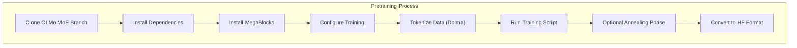

### Data Preparation

The training data is tokenized using the Dolma toolkit with specific parameters:

```
dolma tokens \
--documents ${PATH_TO_DOWNLOADED_DATA} \
--destination ${PATH_WHERE_TO_SAVE_TOKENIZED_DATA} \
--tokenizer.name_or_path 'allenai/gpt-neox-olmo-dolma-v1_5' \
--max_size '2_147_483_648' \
--seed 0 \
--tokenizer.eos_token_id 50279 \
--tokenizer.pad_token_id 1 \
--processes ${NUMBER_OF_CPU_CORES_TO_USE}
```

### Training Process

Pretraining uses configuration files in the `configs/` directory. The main configuration file for OLMoE pretraining is `configs/OLMoE-1B-7B-0924.yml`.

The training is launched with:

```
bash scripts/olmoe-gantry.sh
```

This invokes [scripts/train.py]() from the OLMo repository using the Beaker Gantry job submission system.

After initial pretraining, an optional annealing phase can be run with a modified configuration (`configs/ablations/olmoe-8x1b-newhp-newds-final-anneal.yml`), which primarily adjusts the optimizer and scheduler settings.

Finally, the model checkpoint is converted to the Hugging Face Transformers format using a conversion script provided in the transformers library.

Sources: [README.md:82-101]()

## Supervised Fine-Tuning (SFT)

Supervised Fine-Tuning adapts the pretrained model to follow instructions using the Open Instruct framework and instruction-response pairs.

### Setup and Process

To run SFT:

1. Clone the Open Instruct repository
2. Install dependencies according to its setup instructions
3. Run the fine-tuning script with DeepSpeed acceleration

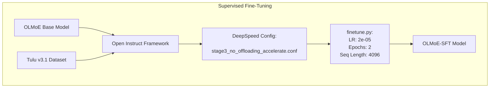

### Training Command

The SFT process uses the following command:

```
accelerate launch \
--mixed_precision bf16 \
--num_machines 1 \
--num_processes 8 \
--use_deepspeed \
--deepspeed_config_file configs/ds_configs/stage3_no_offloading_accelerate.conf \
open_instruct/finetune.py \
--model_name_or_path allenai/OLMoE-1B-7B-0924 \
--tokenizer_name allenai/OLMoE-1B-7B-0924 \
--use_flash_attn \
--max_seq_length 4096 \
--preprocessing_num_workers 128 \
--per_device_train_batch_size 2 \
--gradient_accumulation_steps 8 \
--learning_rate 2e-05 \
--lr_scheduler_type linear \
--warmup_ratio 0.03 \
--weight_decay 0.0 \
--num_train_epochs 2 \
--output_dir output/ \
--with_tracking \
--report_to wandb \
--logging_steps 1 \
--reduce_loss sum \
--model_revision main \
--dataset_mixer_list allenai/tulu-v3-mix-preview-4096-OLMoE 1.0 ai2-adapt-dev/daring-anteater-specialized 1.0 \
--checkpointing_steps epoch \
--add_bos
```

The SFT process uses Tulu v3.1 dataset and creates an instruction-following model that serves as the foundation for subsequent preference optimization stages.

Sources: [README.md:111-143]()

## Preference Optimization

Preference optimization further aligns the model with human preferences using paired examples where one response is preferred over another. OLMoE offers two methods: Direct Preference Optimization (DPO) and Kahneman-Tversky Optimization (KTO).

### Direct Preference Optimization (DPO)

DPO trains the model to produce outputs that humans would prefer, using the Open Instruct framework and UltraFeedback dataset.

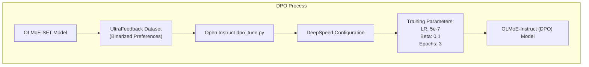

The DPO process uses the following command:

```
accelerate launch \
--mixed_precision bf16 \
--num_machines 1 \
--num_processes 8 \
--use_deepspeed \
--deepspeed_config_file configs/ds_configs/stage3_no_offloading_accelerate.conf \
open_instruct/dpo_tune.py \
--model_name_or_path allenai/OLMoE-1B-7B-0924-SFT \
--tokenizer_name allenai/OLMoE-1B-7B-0924-SFT \
--use_flash_attn \
--gradient_checkpointing \
--dataset_name argilla/ultrafeedback-binarized-preferences-cleaned \
--max_seq_length 4096 \
--preprocessing_num_workers 16 \
--per_device_train_batch_size 1 \
--gradient_accumulation_steps 4 \
--learning_rate 5e-7 \
--lr_scheduler_type linear \
--warmup_ratio 0.1 \
--weight_decay 0. \
--num_train_epochs 3 \
--output_dir output/ \
--report_to tensorboard \
--logging_steps 1 \
--reduce_loss sum \
--add_bos \
--checkpointing_steps epoch \
--dpo_beta 0.1
```

Sources: [README.md:144-174](), [logs/olmoe-dpo-logs.txt]()

### Kahneman-Tversky Optimization (KTO)

KTO is an alternative to DPO that uses a different optimization approach. It requires installing the `trl` library and running an external script.

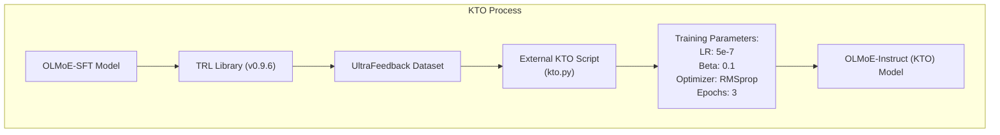

The KTO process is run using:

```
WANDB_PROJECT=olmoe accelerate launch --config_file=config_8gpusdsz2_m7.yml kto.py \
--model_name_or_path allenai/OLMoE-1B-7B-0924-SFT \
--output_dir OLMoE-1B-7B-0924-SFT-KTO-3EP \
--report_to "wandb" \
--per_device_train_batch_size 4 \
--gradient_accumulation_steps 1 \
--optim rmsprop \
--learning_rate 5e-07 \
--beta 0.1 \
--logging_steps 1 \
--bf16 \
--sanity_check False \
--num_train_epochs 3
```

The KTO script (`kto.py`) is from an external repository: https://github.com/Muennighoff/kto

Sources: [README.md:175-176]()

## Evaluation Within the Pipeline

Each stage of the training pipeline includes evaluation to assess model quality and progress.

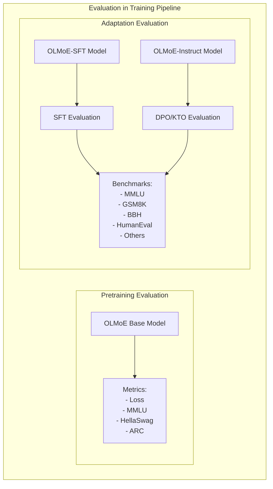

### Pretraining Evaluation

During pretraining, evaluation is done automatically and configured in the config file using the OLMo evaluation framework: [olmo/eval](https://github.com/allenai/OLMo/tree/Muennighoff/MoE/olmo/eval).

### Post-Adaptation Evaluation

After SFT, DPO, or KTO, the model is evaluated using benchmark tasks through the Open Instruct framework. The evaluation script (`scripts/adapteval.sh`) runs multiple evaluations including:

- MMLU (massive multitask language understanding)
- GSM8K (math problem solving)
- Alpaca (instruction following)
- BBH (big-bench hard)
- XSTest (cross-lingual evaluation)
- HumanEval (code generation)
- IFEval (instruction following)

These evaluations provide comprehensive measurements of model capabilities across different tasks and domains after each stage of training.

Sources: [README.md:178-193](), [scripts/adapteval.sh:1-98]()

## End-to-End Pipeline Flow

The complete training pipeline comprises a sequence of stages that transform raw data into a capable, aligned language model.

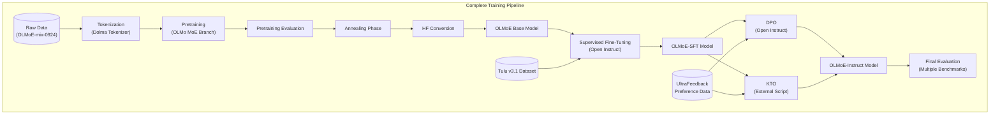

This diagram illustrates the complete flow from data preparation through all training stages to the final evaluation, showing the key inputs, processes, and outputs at each stage.

Sources: [README.md:12-193]()

## Data and Artifacts

Throughout the training pipeline, various data and model artifacts are produced:

| Stage | Input | Output | Repository |
|-------|-------|--------|------------|
| Pretraining | Raw text data (OLMoE-mix-0924) | Base model checkpoints | [allenai/OLMoE-1B-7B-0924](https://hf.co/allenai/OLMoE-1B-7B-0924) |
| SFT | Base model + Tulu v3.1 dataset | SFT model | [allenai/OLMoE-1B-7B-0924-SFT](https://huggingface.co/allenai/OLMoE-1B-7B-0924-SFT) |
| DPO/KTO | SFT model + UltraFeedback dataset | Instruct model | [allenai/OLMoE-1B-7B-0924-Instruct](https://huggingface.co/allenai/OLMoE-1B-7B-0924-Instruct) |

For each stage, logs and evaluation results are also stored for tracking progress and performance.

Sources: [README.md:23-28]()

## Conclusion

The OLMoE training pipeline represents a comprehensive approach to developing a high-quality Mixture-of-Experts language model. It progresses from pretraining on a large corpus to instruction tuning and alignment with human preferences. 

The modular nature of the pipeline allows for experimentation with different approaches at each stage (particularly in preference optimization with both DPO and KTO options), while maintaining a coherent workflow from raw data to final, aligned model.

---

# Page: Pretraining

# Pretraining

<details>
<summary>Relevant source files</summary>

The following files were used as context for generating this wiki page:

- [README.md](README.md)
- [scripts/adapteval.sh](scripts/adapteval.sh)
- [scripts/olmoe_visuals.ipynb](scripts/olmoe_visuals.ipynb)
- [scripts/wekatransfer/s3weka.sh](scripts/wekatransfer/s3weka.sh)
- [scripts/wekatransfer/s3weka.yml](scripts/wekatransfer/s3weka.yml)

</details>


This document details the technical process of pretraining the OLMoE (Open Mixture-of-Experts Language Models) model. Pretraining is the initial phase of model development where the model learns language patterns from a large corpus of text before any fine-tuning or alignment. For information about subsequent training stages, see [Supervised Fine-Tuning (SFT)](#3.2) and [Preference Optimization (DPO/KTO)](#3.3).

## Pretraining Pipeline Overview

The OLMoE pretraining pipeline consists of several interconnected components:

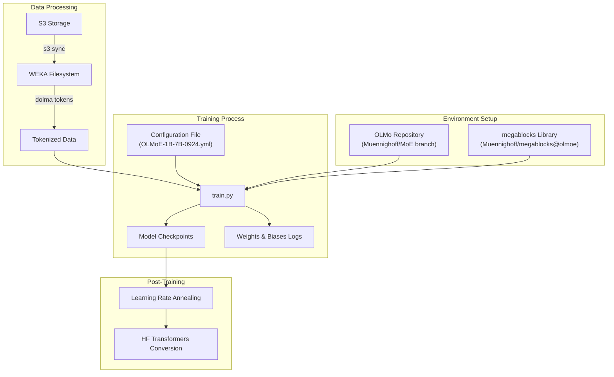

Sources: [README.md:82-101]()

## Environment Setup

To prepare for OLMoE pretraining, you must set up the development environment with specific dependencies:

1. Clone the OLMo repository with the MoE branch:
   ```bash
   git clone https://github.com/allenai/OLMo.git
   cd OLMo
   git checkout Muennighoff/MoE
   pip install -e .
   ```

2. Install the modified megablocks library:
   ```bash
   pip install git+https://github.com/Muennighoff/megablocks.git@olmoe
   ```

Sources: [README.md:84-86]()

## Data Preparation

### S3 to WEKA Transfer

The pretraining data must first be transferred from Amazon S3 to a WEKA filesystem:

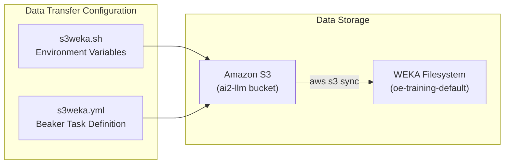

Configure the transfer by setting environment variables in the script:

```bash
export BUDGET=ai2/oe-training
export S3_BUCKET=ai2-llm
export S3_PREFIX=preprocessed/olmo-mix/danyh-compiled-v1_7
export WEKA_BUCKET=oe-training-default
export WEKA_PREFIX=ai2-llm/preprocessed/danyh-compiled-v1_7
```

Sources: [scripts/wekatransfer/s3weka.sh:1-9](), [scripts/wekatransfer/s3weka.yml:1-22]()

### Data Tokenization

After transferring the raw data, tokenize it using the `dolma tokens` command:

```bash
dolma tokens \
--documents ${PATH_TO_DOWNLOADED_DATA} \
--destination ${PATH_WHERE_TO_SAVE_TOKENIZED_DATA} \
--tokenizer.name_or_path 'allenai/gpt-neox-olmo-dolma-v1_5' \
--max_size '2_147_483_648' \
--seed 0 \
--tokenizer.eos_token_id 50279 \
--tokenizer.pad_token_id 1 \
--processes ${NUMBER_OF_CPU_CORES_TO_USE}
```

The tokenized data can be downloaded from the `allenai/OLMoE-mix-0924` dataset on Hugging Face for reference.

Sources: [README.md:87-98]()

## Configuration

The configuration file defines all parameters for model architecture and training. The primary configuration used for OLMoE is located at `configs/OLMoE-1B-7B-0924.yml`.

Key configuration components include:

| Configuration Section | Description |
|-----------------------|-------------|
| `model` | Defines architecture parameters (hidden size, layers, experts, etc.) |
| `tokenizer` | Settings for the tokenizer |
| `optimizer` | Optimizer type and parameters (AdamW, learning rate, etc.) |
| `scheduler` | Learning rate schedule configuration |
| `train` | Training parameters (batch size, sequences, etc.) |
| `paths` | Data paths for tokenized training data |
| `eval` | Configuration for evaluation during training |

For different architectural choices and ablations, explore the configuration files in `configs/ablations`.

Sources: [README.md:86-87]()

## Training Execution

Training is executed through the OLMo training script, typically submitted as a job:

```bash
bash scripts/olmoe-gantry.sh
```

This script invokes the training script (`train.py`) from the OLMo repository with the configuration file. The script handles:

1. Loading the configuration
2. Setting up the model, optimizer, and data loaders
3. Executing the training loop
4. Saving checkpoints
5. Performing evaluation during training
6. Logging metrics to Weights & Biases

Sources: [README.md:99]()

## Post-Training

### Learning Rate Annealing

After the main pretraining is complete, an additional annealing phase further refines the model:

1. Use the annealing configuration file: `configs/ablations/olmoe-8x1b-newhp-newds-final-anneal.yml`
2. Key changes from the main training configuration:
   - Modified `optimizer` parameters
   - Adjusted `scheduler` settings
   - Updated `max_duration` and `stop_at` values

Sources: [README.md:100-101]()

### Checkpoint Conversion

Convert the trained checkpoint to Hugging Face Transformers format:

```bash
# Use the script from transformers repository
python /path/to/transformers/src/transformers/models/olmoe/convert_olmoe_weights_to_hf.py
```

The script handles the conversion of OLMoE's internal format to the structure expected by Hugging Face Transformers.

Sources: [README.md:101]()

## Design Variants

### Sparse Upcycling

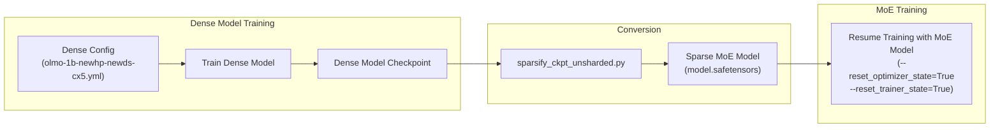

Sparse upcycling converts a dense model to an MoE model:

1. Train a dense model first using `configs/ablations/olmo-1b-newhp-newds-cx5.yml`
2. Convert the checkpoint to MoE using `scripts/sparsify_ckpt_unsharded.py`
3. Place the generated model in a folder with name ending in `-unsharded` and file named `model.safetensors`
4. Launch a job that loads this model with:
   ```
   --load_path=path_to_upcycled_ckpt --reset_optimizer_state=True --reset_trainer_state=True
   ```

A pre-converted checkpoint is available at `allenai/OLMo-1B-0724-954000steps-unsharded`.

Sources: [README.md:105-107]()

### Expert Choice Routing

To experiment with expert choice routing:

1. Use the OLMo branch `Muennighoff/OLMoSE` or copy the config changes
2. Activate expert choice in your configuration
3. The implementation uses code from the modified megablocks library

Sources: [README.md:107-108]()

### Shared MoE Layers

For shared MoE layer experiments:

1. Use the OLMo branch `Muennighoff/OLMoSE`
2. Create a custom configuration file similar to those used in previous experiments

Sources: [README.md:108-109]()

## Evaluation During Pretraining

Evaluation is configured in the YAML file and happens automatically during pretraining, using the code in `olmo/eval` from the OLMo repository. Results are logged to Weights & Biases for tracking progress.

The evaluation metrics include:
- Perplexity on validation sets
- Expert utilization statistics
- Learning rate and optimization metrics

Sources: [README.md:179-181]()

## Pretraining Workflow Diagram

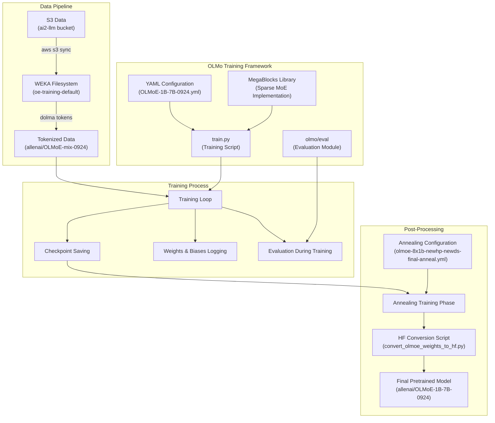

Sources: [README.md:82-109](), [README.md:179-181]()

---

# Page: Supervised Fine-Tuning (SFT)

# Supervised Fine-Tuning (SFT)

<details>
<summary>Relevant source files</summary>

The following files were used as context for generating this wiki page:

- [README.md](README.md)
- [logs/olmoe-dpo-logs.txt](logs/olmoe-dpo-logs.txt)
- [logs/olmoe-sft-logs.txt](logs/olmoe-sft-logs.txt)
- [scripts/adapteval.sh](scripts/adapteval.sh)
- [scripts/olmoe_visuals.ipynb](scripts/olmoe_visuals.ipynb)

</details>


This page documents the Supervised Fine-Tuning (SFT) process in the OLMoE pipeline. SFT is the second stage in the training pipeline, following pretraining and preceding preference optimization (DPO/KTO). This process aligns the pretrained model with human instructions and enhances its ability to follow user prompts. For information about the pretraining step, see [Pretraining](#3.1), and for details on preference optimization, see [Preference Optimization (DPO/KTO)](#3.3).

## SFT in the OLMoE Training Pipeline

SFT transforms the base pretrained OLMoE model into an instruction-following model by fine-tuning it on a dataset of instruction-response pairs. This phase is critical for making the model responsive to user instructions and preparing it for further alignment.

**SFT Pipeline Overview**

```mermaid
flowchart LR
    subgraph TrainingPipeline["OLMoE Training Pipeline"]
        direction LR
        Pretraining["Pretraining\nOLMo Codebase"] --> |"Base OLMoE-1B-7B-0924 Model"| SFT["Supervised Fine-Tuning\nOpen Instruct Framework"]
        SFT --> |"OLMoE-1B-7B-0924-SFT"| DPO["Direct Preference Optimization\nopen_instruct/dpo_tune.py"]
        SFT --> |"OLMoE-1B-7B-0924-SFT"| KTO["Kahneman-Tversky Optimization\nkto.py"]
    end
    
    subgraph Data["Training Datasets"]
        PretrainingData["OLMoE-mix-0924"] --> Pretraining
        TuluData["allenai/tulu-v3-mix-preview-4096-OLMoE"] --> |"Weight 1.0"| SFT
        SpecializedData["ai2-adapt-dev/daring-anteater-specialized"] --> |"Weight 1.0"| SFT
        UFData["argilla/ultrafeedback-binarized-preferences-cleaned"] --> DPO
        UFData --> KTO
    end
```

Sources: [README.md:111-143]()

## Dataset Information

OLMoE's SFT process uses a combination of two datasets:

1. **Primary Dataset**: `allenai/tulu-v3-mix-preview-4096-OLMoE` - A version of the Tulu v3.1 dataset formatted for OLMoE's 4096 token context length
2. **Specialized Dataset**: `ai2-adapt-dev/daring-anteater-specialized` - A specialized instruction dataset

Both datasets are mixed with equal weight (1.0 each) using the `dataset_mixer_list` parameter of the Open Instruct framework. The Tulu dataset consists of instruction-response pairs curated to improve instruction-following capabilities across diverse tasks.

**Dataset Processing Flow**

```mermaid
flowchart LR
    subgraph DatasetPreparation["Dataset Processing Pipeline"]
        direction TB
        datasets["HuggingFace Datasets\nLoad from Hub"] --> mixer["dataset_mixer.py\nMix with Weights"]
        mixer --> tokenizer["PreTrainedTokenizer\nTokenize Text"]
        tokenizer --> collator["DataCollator\nPad & Process Batches"]
        collator --> loader["DataLoader\nBatch Size 2"]
    end
    
    subgraph Datasets["Input Datasets"]
        tulu["allenai/tulu-v3-mix-preview-4096-OLMoE"] --> datasets
        specialized["ai2-adapt-dev/daring-anteater-specialized"] --> datasets
    end
    
    subgraph Config["Training Config"]
        bs["per_device_train_batch_size: 2"] --> loader
        workers["preprocessing_num_workers: 128"] --> tokenizer
        maxlen["max_seq_length: 4096"] --> tokenizer
        bos["add_bos: True"] --> tokenizer
    end
```

Sources: [README.md:123-142]()

## Training Configuration

The SFT process uses the Open Instruct framework with DeepSpeed for distributed training. Key configuration parameters include:

| Parameter | Value | Description |
|-----------|-------|-------------|
| Base Model | `allenai/OLMoE-1B-7B-0924` | Pretrained OLMoE model with 1.3B active parameters |
| Max Sequence Length | 4096 | Maximum token length for training |
| Batch Size | 2 per device | Training batch size per GPU |
| GPUs | 8 | Number of GPUs used in parallel |
| Gradient Accumulation | 8 steps | Number of steps before updating weights |
| Effective Batch Size | 128 | 2 × 8 × 8 = 128 samples per update |
| Learning Rate | 2e-05 | Learning rate for AdamW optimizer |
| LR Scheduler | Linear | Linear learning rate decay |
| Warmup Ratio | 0.03 | Portion of training for LR warmup |
| Weight Decay | 0.0 | No weight decay regularization |
| Training Epochs | 2 | Number of passes through the dataset |
| Precision | BF16 | Mixed precision training with bfloat16 |
| Optimization | DeepSpeed ZeRO-3 | Parameter partitioning across GPUs |

Sources: [README.md:114-142]()

## Implementation Details

### Launch Command

The SFT process is implemented using the Open Instruct framework and launched with the following command:

```bash
accelerate launch \
--mixed_precision bf16 \
--num_machines 1 \
--num_processes 8 \
--use_deepspeed \
--deepspeed_config_file configs/ds_configs/stage3_no_offloading_accelerate.conf \
open_instruct/finetune.py \
--model_name_or_path allenai/OLMoE-1B-7B-0924 \
--tokenizer_name allenai/OLMoE-1B-7B-0924 \
--use_flash_attn \
--max_seq_length 4096 \
--preprocessing_num_workers 128 \
--per_device_train_batch_size 2 \
--gradient_accumulation_steps 8 \
--learning_rate 2e-05 \
--lr_scheduler_type linear \
--warmup_ratio 0.03 \
--weight_decay 0.0 \
--num_train_epochs 2 \
--output_dir output/ \
--with_tracking \
--report_to wandb \
--logging_steps 1 \
--reduce_loss sum \
--model_revision main \
--dataset_mixer_list allenai/tulu-v3-mix-preview-4096-OLMoE 1.0 ai2-adapt-dev/daring-anteater-specialized 1.0 \
--checkpointing_steps epoch \
--add_bos
```

### Technical Implementation

The SFT process leverages several key components:

1. **DeepSpeed Integration**: Utilizes ZeRO-3 optimization to partition model parameters, gradients, and optimizer states across GPUs for memory efficiency.

2. **Flash Attention**: Uses optimized attention implementation for faster training with long sequences.

3. **Distributed Training**: The `accelerate` library manages distributed training across 8 GPUs.

4. **Checkpointing**: Models are saved at the end of each epoch to enable resume capability.

5. **Logging**: Training metrics are tracked and reported to Weights & Biases.

**SFT Process Workflow**

```mermaid
flowchart TB
    subgraph SFTProcess["open_instruct/finetune.py Workflow"]
        direction TB
        load["load_pretrained_model()\nLoad OLMoE-1B-7B-0924"] --> preprocess["preprocess_dataset()\nTokenize & Format Data"]
        preprocess --> setup["setup_trainer()\nInitialize Optimizer & Scheduler"]
        setup --> train["trainer.train()\nTraining Loop"]
        train --> save["trainer.save_model()\nSave Checkpoint"]
    end
    
    subgraph TrainerComponents["Trainer Components"]
        optimizer["AdamW\nLR: 2e-05"] --> train
        scheduler["LinearScheduler\nWarmup: 0.03"] --> train
        collator["DataCollator\nHandling Padding"] --> train
        deepspeed["DeepSpeed ZeRO-3\nDistributed Training"] --> train
    end
    
    subgraph Outputs["Training Outputs"]
        train --> metrics["Loss & Learning Rate Metrics"]
        train --> checkpoint["Epoch Checkpoints"]
        checkpoint --> final["Final Model\nOLMoE-1B-7B-0924-SFT"]
    end
```

Sources: [README.md:111-143]()

## Evaluation

After SFT, the model is evaluated on a diverse set of benchmarks using the `adapteval.sh` script, which runs individual evaluation tasks in parallel:

| Benchmark | Description | Evaluation Script | Metrics |
|-----------|-------------|------------------|---------|
| MMLU | Tests knowledge across 57 subjects | `eval.mmlu.run_eval` | Accuracy |
| GSM8K | Tests mathematical reasoning | `eval.gsm.run_eval` | Accuracy |
| Alpaca | Measures instruction following | `eval.alpaca_farm.run_eval` | Win rate |
| BBH | Tests hard reasoning tasks | `eval.bbh.run_eval` | Accuracy |
| XS Test | Evaluates model safety | `eval.xstest.run_eval` | Safety score |
| HumanEval | Assesses code generation | `eval.codex_humaneval.run_eval` | Pass@k |
| IFEval | Tests instruction following precision | `eval.ifeval.run_eval` | Precision score |

The evaluation employs different prompting strategies including zero-shot (MMLU) and few-shot (GSM8K with 8 examples) approaches. Each evaluation script generates detailed metrics saved to the model's evaluation directory.

Sources: [README.md:189-193](), [scripts/adapteval.sh:1-98]()

## Results and Checkpoints

The final SFT model is published to Hugging Face as `allenai/OLMoE-1B-7B-0924-SFT` and serves as the foundation for subsequent preference optimization. The logs for the SFT process are stored in the repository at `logs/olmoe-sft-logs.txt`.

### Accessing the Model

The model can be loaded using the Hugging Face Transformers library:

```python
from transformers import OlmoeForCausalLM, AutoTokenizer

model = OlmoeForCausalLM.from_pretrained("allenai/OLMoE-1B-7B-0924-SFT")
tokenizer = AutoTokenizer.from_pretrained("allenai/OLMoE-1B-7B-0924-SFT")
```

For inference, it's recommended to use vLLM, SGLang, or llama.cpp for better performance compared to the transformers implementation.

Sources: [README.md:26-27](), [README.md:30-73]()

## Next Steps

After SFT, the model undergoes further alignment through preference optimization:

1. **DPO (Direct Preference Optimization)**: Fine-tunes the model using the UltraFeedback dataset with binary preferences.

2. **KTO (Kahneman-Tversky Optimization)**: An alternative preference optimization approach also used with the SFT model.

For details on preference optimization, see [Preference Optimization (DPO/KTO)](#3.3).

Sources: [README.md:143-175]()

---

# Page: Preference Optimization (DPO/KTO)

# Preference Optimization (DPO/KTO)

<details>
<summary>Relevant source files</summary>

The following files were used as context for generating this wiki page:

- [README.md](README.md)
- [logs/olmoe-dpo-logs.txt](logs/olmoe-dpo-logs.txt)
- [logs/olmoe-sft-logs.txt](logs/olmoe-sft-logs.txt)
- [scripts/adapteval.sh](scripts/adapteval.sh)
- [scripts/olmoe_visuals.ipynb](scripts/olmoe_visuals.ipynb)

</details>


This document covers the Preference Optimization techniques used in OLMoE, specifically Direct Preference Optimization (DPO) and Kahneman-Tversky Optimization (KTO). These techniques represent the final training phase in the OLMoE pipeline, coming after Supervised Fine-Tuning (SFT). For information about the SFT phase, see [Supervised Fine-Tuning (SFT)](#3.2).

## Overview and Purpose

Preference Optimization is a crucial phase in developing instruction-following language models. After a model has been pre-trained and undergone supervised fine-tuning, preference optimization techniques use human preference data to further align the model with human values and expectations. 

```mermaid
flowchart TB
    subgraph "OLMoE Training Pipeline"
        direction TB
        Pretraining["Pretraining on large corpus"]
        SFT["Supervised Fine-Tuning (SFT)"]
        PrefOpt["Preference Optimization"]
        
        subgraph "Preference Optimization Methods"
            direction LR
            DPO["Direct Preference Optimization (DPO)"]
            KTO["Kahneman-Tversky Optimization (KTO)"]
        end
        
        Pretraining --> SFT
        SFT --> PrefOpt
        PrefOpt --> DPO
        PrefOpt --> KTO
    end
```

**Diagram: OLMoE Training Pipeline with Preference Optimization Methods**

Sources: [README.md:111-145]()

## Preference Optimization Techniques

### Direct Preference Optimization (DPO)

DPO is a method for aligning language models with human preferences without explicitly modeling a reward function. It directly optimizes the policy to maximize the probability that the preferred response is ranked higher than the dispreferred one.

```mermaid
flowchart LR
    subgraph "DPO Training Process"
        direction TB
        Input["Input Prompt"]
        
        subgraph "Preference Pair"
            chosen["Chosen Response"]
            rejected["Rejected Response"]
        end
        
        Model["OLMoE SFT Model"]
        Loss["DPO Loss Function"]
        
        Input --> Model
        Model --> chosen
        Model --> rejected
        chosen --> Loss
        rejected --> Loss
        Loss --> Model
    end
```

**Diagram: DPO Training Process**

DPO works by:
1. Taking a prompt and a pair of responses (chosen and rejected)
2. Computing the log probability of both responses given the prompt using the SFT model
3. Optimizing a contrastive loss function that increases the likelihood gap between chosen and rejected responses
4. Using the hyperparameter β (beta) to control the trade-off between preference alignment and divergence from the reference model

Sources: [README.md:144-173]()

### Kahneman-Tversky Optimization (KTO)

KTO is an alternative to DPO that uses findings from behavioral economics to design a different loss function. It's named after psychologists Daniel Kahneman and Amos Tversky, who developed Prospect Theory, which explains how people make decisions under risk and uncertainty.

```mermaid
flowchart LR
    subgraph "KTO Training Process"
        direction TB
        Input["Input Prompt"]
        
        subgraph "Preference Pair"
            chosen["Chosen Response"]
            rejected["Rejected Response"]
        end
        
        Model["OLMoE SFT Model"]
        ReferenceModel["SFT Reference Model\n(Frozen)"]
        Loss["KTO Loss Function"]
        
        Input --> Model
        Model --> chosen
        Model --> rejected
        chosen --> Loss
        rejected --> Loss
        ReferenceModel --> Loss
        Loss --> Model
    end
```

**Diagram: KTO Training Process**

KTO differs from DPO in:
1. Using an asymmetric loss function inspired by Prospect Theory
2. Potentially providing better convergence properties for certain types of preference data
3. Having different sensitivity to the selection of hyperparameters

Sources: [README.md:174-175]()

### Comparison between DPO and KTO

Both DPO and KTO:
- Work with paired preference data (chosen vs. rejected responses)
- Optimize directly on preferences without an explicit reward model
- Use a reference (SFT) model to prevent divergence
- Employ a beta hyperparameter to control alignment strength

The key differences lie in their loss functions and how they handle the trade-off between preference alignment and divergence from the reference model.

## Implementation in OLMoE

### Data Preparation

The OLMoE Preference Optimization phase uses the UltraFeedback dataset, specifically the binarized and cleaned version:

```
argilla/ultrafeedback-binarized-preferences-cleaned
```

This dataset contains pairs of responses to the same prompt, with human annotations indicating which response is preferred.

Sources: [README.md:156]()

### Training Process

```mermaid
flowchart TB
    subgraph "OLMoE Preference Optimization Pipeline"
        direction LR
        SFT["OLMoE-1B-7B-0924-SFT\n(SFT Checkpoint)"]
        
        subgraph "Preference Training Options"
            DPOTraining["DPO Training\n(3 epochs)"]
            KTOTraining["KTO Training\n(3 epochs)"]
        end
        
        UltraFeedback["UltraFeedback Dataset\n(Binarized Preferences)"]
        
        FinalModel["OLMoE-1B-7B-0924-Instruct\n(Final Instruction Model)"]
        
        SFT --> DPOTraining
        SFT --> KTOTraining
        UltraFeedback --> DPOTraining
        UltraFeedback --> KTOTraining
        DPOTraining --> FinalModel
        KTOTraining --> FinalModel
    end
```

**Diagram: OLMoE Preference Optimization Pipeline**

The training process for preference optimization follows these general steps:

1. Start with the SFT model (`allenai/OLMoE-1B-7B-0924-SFT`)
2. Load preference data from UltraFeedback
3. Apply either DPO or KTO optimization for 3 epochs
4. Output the final instruction-tuned model (`OLMoE-1B-7B-0924-Instruct`)

Sources: [README.md:144-175]()

### DPO Configuration

For DPO training, OLMoE uses the following key parameters:

| Parameter | Value | Description |
|-----------|-------|-------------|
| Learning Rate | 5e-7 | Very small to prevent divergence from reference model |
| Scheduler | Linear | With 10% warmup ratio |
| Batch Size | 1 per device | With gradient accumulation of 4 steps |
| Sequence Length | 4096 | Maximum input sequence length |
| Beta | 0.1 | Controls preference alignment strength |
| Epochs | 3 | Number of training epochs |

The model is trained using DeepSpeed ZeRO-3 for efficient distributed training with mixed precision (bf16).

Sources: [README.md:144-173]()

### KTO Configuration

For KTO training, similar parameters are used:

| Parameter | Value | Description |
|-----------|-------|-------------|
| Learning Rate | 5e-7 | Same as DPO for consistency |
| Optimizer | RMSprop | Different from AdamW typically used in DPO |
| Batch Size | 4 per device | Larger than DPO |
| Beta | 0.1 | Same as DPO for fair comparison |
| Epochs | 3 | Same as DPO |

Unlike DPO which typically uses the AdamW optimizer, KTO uses RMSprop, which may provide different convergence properties.

Sources: [README.md:174-175]()

## Training Commands

The OLMoE repository provides specific commands to run both DPO and KTO training:

### DPO Training Command

```
accelerate launch \
--mixed_precision bf16 \
--num_machines 1 \
--num_processes 8 \
--use_deepspeed \
--deepspeed_config_file configs/ds_configs/stage3_no_offloading_accelerate.conf \
open_instruct/dpo_tune.py \
--model_name_or_path allenai/OLMoE-1B-7B-0924-SFT \
--tokenizer_name allenai/OLMoE-1B-7B-0924-SFT \
--use_flash_attn \
--gradient_checkpointing \
--dataset_name argilla/ultrafeedback-binarized-preferences-cleaned \
--max_seq_length 4096 \
--preprocessing_num_workers 16 \
--per_device_train_batch_size 1 \
--gradient_accumulation_steps 4 \
--learning_rate 5e-7 \
--lr_scheduler_type linear \
--warmup_ratio 0.1 \
--weight_decay 0. \
--num_train_epochs 3 \
--output_dir output/ \
--report_to tensorboard \
--logging_steps 1 \
--reduce_loss sum \
--add_bos \
--checkpointing_steps epoch \
--dpo_beta 0.1
```

This command launches the DPO training process using the Open-Instruct framework, with DeepSpeed for distributed training.

Sources: [README.md:144-173]()

### KTO Training Command

```
WANDB_PROJECT=olmoe accelerate launch --config_file=config_8gpusdsz2_m7.yml kto.py \
--model_name_or_path allenai/OLMoE-1B-7B-0924-SFT \
--output_dir OLMoE-1B-7B-0924-SFT-KTO-3EP \
--report_to "wandb" \
--per_device_train_batch_size 4 \
--gradient_accumulation_steps 1 \
--optim rmsprop \
--learning_rate 5e-07 \
--beta 0.1 \
--logging_steps 1 \
--bf16 \
--sanity_check False \
--num_train_epochs 3
```

KTO training uses a separate implementation (`kto.py`) from the GitHub repository `Muennighoff/kto`.

Sources: [README.md:174-175]()

## Integration with Evaluation

After preference optimization, the resulting model is evaluated on various benchmarks to assess its instruction-following capabilities.

```mermaid
flowchart LR
    PrefModel["OLMoE-Instruct\n(After DPO/KTO)"]
    
    subgraph "Evaluation Benchmarks"
        MMLU["MMLU\n(0-shot & 5-shot)"]
        GSM8K["GSM8K\n(8-shot)"]
        BBH["Big Bench Hard\n(0-shot)"]
        HumanEval["HumanEval\n(Code Generation)"]
        XSTest["XS Test\n(Ethical Evaluation)"]
        IFEval["IF Evaluation"]
        Alpaca["Alpaca Evaluation"]
    end
    
    PrefModel --> MMLU
    PrefModel --> GSM8K
    PrefModel --> BBH
    PrefModel --> HumanEval
    PrefModel --> XSTest
    PrefModel --> IFEval
    PrefModel --> Alpaca
```

**Diagram: Evaluation of OLMoE after Preference Optimization**

The evaluation script (`scripts/adapteval.sh`) automates the evaluation of the preference-optimized model on these benchmarks.

Sources: [scripts/adapteval.sh:1-98](), [README.md:190-192]()

## Outcomes

Preference optimization is a critical step in producing a high-quality instruction-following model. The OLMoE project demonstrates the use of both DPO and KTO techniques to leverage human preference data for aligning the model with human expectations, leading to the final OLMoE-Instruct model.

The resulting instruction-tuned model checkpoint is made available at:
```
allenai/OLMoE-1B-7B-0924-Instruct
```

As well as the quantized GGUF version:
```
allenai/OLMoE-1B-7B-0924-Instruct-GGUF
```

Sources: [README.md:28]()

---

# Page: Inference Methods

# Inference Methods

<details>
<summary>Relevant source files</summary>

The following files were used as context for generating this wiki page:

- [README.md](README.md)
- [scripts/adapteval.sh](scripts/adapteval.sh)
- [scripts/olmoe_visuals.ipynb](scripts/olmoe_visuals.ipynb)

</details>


## Purpose and Overview

This document describes the various methods available for running inference with the OLMoE (Open Mixture-of-Experts Language Models) models. OLMoE has been integrated with multiple inference frameworks to accommodate different performance needs and use cases, from high-throughput production deployments to local CPU-based inference.

For information about the model architecture, see [Model Architecture](#2), and for details on how to train these models, see [Training Pipeline](#3).

Sources: [README.md:30-32]()

## Supported Inference Methods

OLMoE supports four primary inference methods:

1. **vLLM** - Recommended high-performance inference engine
2. **llama.cpp** - Optimized C++ implementation with GGUF quantization support
3. **Transformers** - Hugging Face transformers library integration
4. **SGLang** - Structured generation framework

The transformers implementation is generally slower than the others, so vLLM is recommended where possible for most applications.

```mermaid
flowchart TD
    subgraph "OLMoE Model Inference Methods"
        direction TB
        
        huggingface["HuggingFace Hub"] --> |"Download Model"| model_weights["Model Weights"]
        
        model_weights --> vLLM["vLLM"]
        model_weights --> llama_cpp["llama.cpp"]
        model_weights --> transformers["transformers"]
        model_weights --> sglang["SGLang"]
        
        vLLM --> |"High Performance"| inference["Text Generation"]
        llama_cpp --> |"Quantized Inference"| inference
        transformers --> |"Standard Interface"| inference
        sglang --> |"Structured Generation"| inference
    end
```

Sources: [README.md:30-32]()

## Implementation Details

### vLLM

vLLM is the recommended inference method for OLMoE models due to its high performance and optimization for large language models. It implements PagedAttention for efficient memory management and supports both base and instruction-tuned models.

To use vLLM with OLMoE:

```python
from vllm import LLM, SamplingParams
model = LLM("allenai/OLMoE-1B-7B-0924")
out = model.generate("Bitcoin is", SamplingParams(temperature=0.0))
print("Bitcoin is" + out[0].outputs[0].text)
```

vLLM allows for batch inference and provides options to configure generation parameters through the `SamplingParams` object.

Sources: [README.md:34-44]()

### llama.cpp

llama.cpp provides optimized CPU inference and supports quantized models through GGUF formats. This is particularly useful for deployment on resource-constrained environments or when GPU acceleration is not available.

To use llama.cpp with OLMoE:

1. Install llama.cpp
2. Download a quantized GGUF file (e.g. `olmoe-1b-7b-0924-q4_0.gguf`)
3. Run inference using the command-line interface:

```bash
llama-cli -m olmoe-1b-7b-0924-q4_0.gguf -p "Bitcoin is" -n 128
```

The `-n` parameter controls the number of tokens to generate.

Sources: [README.md:46-52]()

### Transformers

The Hugging Face transformers library provides a standard interface for working with OLMoE models. While it's more flexible for research or experimentation, it's generally slower than vLLM or llama.cpp for inference.

```python
from transformers import OlmoeForCausalLM, AutoTokenizer
import torch

DEVICE = "cuda" if torch.cuda.is_available() else "cpu"

model = OlmoeForCausalLM.from_pretrained("allenai/OLMoE-1B-7B-0924").to(DEVICE)
tokenizer = AutoTokenizer.from_pretrained("allenai/OLMoE-1B-7B-0924")
inputs = tokenizer("Bitcoin is", return_tensors="pt")
inputs = {k: v.to(DEVICE) for k, v in inputs.items()}
out = model.generate(**inputs, max_length=64)
print(tokenizer.decode(out[0]))
```

The `OlmoeForCausalLM` class is specifically designed to handle the mixture-of-experts architecture of OLMoE models.

Sources: [README.md:54-73]()

### SGLang

SGLang is mentioned as an integration option but detailed implementation examples are not provided in the repository. SGLang is designed for structured generation workflows and can be useful for applications requiring complex output formats.

Sources: [README.md:30-32]()

## Inference Method Architecture

The following diagram illustrates how the different inference methods interface with the OLMoE model architecture:

```mermaid
flowchart LR
    subgraph "User Input"
        Input["User Text Input"]
    end
    
    subgraph "Inference Interface"
        direction TB
        vllm_interface["vLLM.LLM"]
        llamacpp_interface["llama.cpp CLI"]
        transformers_interface["OlmoeForCausalLM"]
        sglang_interface["SGLang Interface"]
    end
    
    subgraph "Core Processing"
        direction TB
        tokenizer["Tokenization"]
        router["Expert Router"]
        experts["Expert FFNs"]
        attention["Attention Layers"]
        generation["Token Generation"]
    end
    
    Input --> vllm_interface
    Input --> llamacpp_interface
    Input --> transformers_interface
    Input --> sglang_interface
    
    vllm_interface --> tokenizer
    llamacpp_interface --> tokenizer
    transformers_interface --> tokenizer
    sglang_interface --> tokenizer
    
    tokenizer --> attention
    attention --> router
    router --> |"Route to top-k experts"| experts
    experts --> attention
    attention --> generation
    generation --> |"Generated Text"| Output["Output Text"]
```

Sources: [README.md:30-73]()

## Model Variants and Loading Checkpoints

OLMoE provides multiple model checkpoints at different training stages:

| Model Checkpoint | Description | Path |
|------------------|-------------|------|
| Base Model | Pretrained OLMoE model | `allenai/OLMoE-1B-7B-0924` |
| SFT | Supervised fine-tuned model | `allenai/OLMoE-1B-7B-0924-SFT` |
| Instruct | DPO/KTO optimized model | `allenai/OLMoE-1B-7B-0924-Instruct` |

You can also load specific training revisions or branches using the `revision` parameter:

```python
# Load a specific checkpoint from training
model = OlmoeForCausalLM.from_pretrained(
    "allenai/OLMoE-1B-7B-0924", 
    revision="step10000-tokens41B"
)
```

To list all available revisions:

```python
from huggingface_hub import list_repo_refs
out = list_repo_refs("allenai/OLMoE-1B-7B-0924")
branches = [b.name for b in out.branches]
```

Sources: [README.md:64-80]()

## Technical Implementation Details

The following diagram shows how the implementation of OLMoE inference connects with the core model code:

```mermaid
classDiagram
    class OlmoeForCausalLM {
        +from_pretrained(pretrained_model_name_or_path)
        +forward(input_ids, attention_mask)
        +generate(input_ids, attention_mask, max_length)
    }
    
    class OlmoeConfig {
        +num_experts: int
        +expert_capacity: int
        +top_k: int
        +router_aux_loss_coef: float
    }
    
    class MoELayer {
        -router: Router
        -experts: List[Expert]
        +forward(hidden_states)
    }
    
    class Router {
        +forward(hidden_states)
        +compute_router_probabilities(hidden_states)
    }
    
    class Expert {
        +forward(hidden_states)
    }
    
    class vLLM_Implementation {
        +LLM(model_name)
        +generate(prompt, sampling_params)
    }
    
    class llamacpp_Implementation {
        +load_model(model_path)
        +generate(prompt, n_tokens)
    }
    
    OlmoeForCausalLM --> OlmoeConfig: uses
    OlmoeForCausalLM --> MoELayer: contains
    MoELayer --> Router: contains
    MoELayer --> Expert: contains_multiple
    vLLM_Implementation --> OlmoeForCausalLM: loads
    llamacpp_Implementation --> OlmoeForCausalLM: loads
```

Sources: [README.md:30-73]()

## Advanced Usage

### Inference for Evaluation

The OLMoE repository includes a script for running evaluations using the trained models. The script demonstrates how to configure the model for various evaluation benchmarks.

```mermaid
flowchart TD
    subgraph "Evaluation Pipeline"
        direction TB
        load["Load Model
        OlmoeForCausalLM.from_pretrained()"]
        tokenize["Initialize Tokenizer
        AutoTokenizer.from_pretrained()"]
        format["Format Prompt
        create_prompt_with_huggingface_tokenizer_template()"]
        batch["Batch Preparation
        eval_batch_size"]
        generate["Generate Responses"]
        evaluate["Score Responses"]
    end
    
    load --> tokenize
    tokenize --> format
    format --> batch
    batch --> generate
    generate --> evaluate
```

The evaluation script configures various parameters for efficient inference:

- `use_chat_format` - Formats input as a chat conversation
- `chat_formatting_function` - Specifies the template for formatting
- `eval_batch_size` - Controls batching for efficient inference

Sources: [scripts/adapteval.sh:19-93]()

### Performance Considerations

When choosing an inference method, consider:

1. **vLLM**: Best for GPU-accelerated high-throughput inference
2. **llama.cpp**: Best for CPU inference and quantized models
3. **transformers**: Most flexible but slowest option
4. **SGLang**: Specialized for structured generation tasks

For production deployments, vLLM is generally recommended due to its optimized implementation and support for batched inference.

Sources: [README.md:30-32]()

## Available Model Weights

OLMoE provides GGUF quantized models for efficient inference with llama.cpp:

- Base model: [olmoe-1b-7b-0924-q4_0.gguf](https://huggingface.co/allenai/OLMoE-1B-7B-0924-GGUF/resolve/main/olmoe-1b-7b-0924-q4_0.gguf)
- Instruct model: Available at [allenai/OLMoE-1B-7B-0924-Instruct-GGUF](https://huggingface.co/allenai/OLMoE-1B-7B-0924-Instruct-GGUF)

The full model weights for different training stages are available at:
- Base model: [allenai/OLMoE-1B-7B-0924](https://huggingface.co/allenai/OLMoE-1B-7B-0924)
- SFT model: [allenai/OLMoE-1B-7B-0924-SFT](https://huggingface.co/allenai/OLMoE-1B-7B-0924-SFT)
- Instruct model: [allenai/OLMoE-1B-7B-0924-Instruct](https://huggingface.co/allenai/OLMoE-1B-7B-0924-Instruct)

Sources: [README.md:25-28]()

---

# Page: Evaluation Framework

# Evaluation Framework

<details>
<summary>Relevant source files</summary>

The following files were used as context for generating this wiki page:

- [README.md](README.md)
- [scripts/adapteval.sh](scripts/adapteval.sh)
- [scripts/olmoe_visuals.ipynb](scripts/olmoe_visuals.ipynb)

</details>


## Purpose and Scope

This document describes the comprehensive evaluation framework used for assessing OLMoE models throughout their development lifecycle. The framework provides structured methodology and tooling for evaluating model performance across three critical stages: during pretraining, after pretraining is complete, and after adaptation (fine-tuning). The evaluation framework plays a crucial role in quantifying model capabilities, tracking improvements, and comparing performance against baselines and other models.

## Evaluation Timeline and Stages

The OLMoE evaluation framework follows a systematic approach aligned with the model development stages:

```mermaid
flowchart TD
    subgraph "Model Development"
        direction LR
        Pretraining["Pretraining"] --> BaseModel["OLMoE Base Model"]
        BaseModel --> SFT["Supervised Fine-Tuning"]
        SFT --> DPO_KTO["DPO/KTO Optimization"]
        DPO_KTO --> InstructModel["OLMoE-Instruct Model"]
    end
    
    subgraph "Evaluation Stages"
        direction LR
        PretrainingEval["During Pretraining Evaluation"] --> PostPretrainingEval["Post-Pretraining Evaluation"]
        PostPretrainingEval --> AdaptationEval["Post-Adaptation Evaluation"]
    end
    
    Pretraining -.-> PretrainingEval
    BaseModel -.-> PostPretrainingEval
    InstructModel -.-> AdaptationEval
```

Sources: [README.md:176-183]()

## Evaluation During Pretraining

During the pretraining phase, automated evaluations run at regular intervals to track model progress and detect potential issues early.

### Implementation

Evaluation during pretraining is automatically configured in the pretraining configuration file and executed using the OLMo evaluation module. The evaluations compute metrics on a held-out validation set, allowing for continuous monitoring of model performance.

```mermaid
flowchart LR
    subgraph "Pretraining Evaluation Pipeline"
        Config["Training Config File"] --> OLMoEval["OLMo Eval Module"]
        OLMoEval --> Metrics["Metrics Calculation"]
        Metrics --> |"Log to"| WandB["Weights & Biases"]
    end
    
    subgraph "Key Metrics"
        Loss["Training Loss"]
        Perplexity["Validation Perplexity"]
        NextToken["Next-Token Prediction Accuracy"]
        ExpertUsage["Expert Utilization Statistics"]
    end
    
    Metrics --> Loss
    Metrics --> Perplexity
    Metrics --> NextToken
    Metrics --> ExpertUsage
```

Sources: [README.md:180-181]()

## Post-Pretraining Evaluation

After pretraining completes, the base OLMoE model undergoes comprehensive evaluation across standardized benchmarks to assess its capabilities.

### OLMES (OLMo Evaluation Suite) Evaluations

OLMES provides a standardized set of benchmarks for evaluating language model capabilities.

**Implementation:**
- Follows the evaluation protocol specified in the OLMo-Eval repository
- Evaluates across diverse tasks including reasoning, factual knowledge, and comprehension

### DCLM (Data-Contamination-Lab-Models) Evaluations

DCLM evaluations focus on assessing model performance while controlling for data contamination issues.

**Implementation:**
- Uses scripts in the `scripts/run_dclm_evals*` directory
- Follows methodology from the DCLM framework

```mermaid
flowchart TD
    subgraph "Post-Pretraining Evaluation"
        OLMoE["OLMoE Base Model"] --> OLMES["OLMES Evaluation Suite"]
        OLMoE --> DCLM["DCLM Evaluation Suite"]
        
        OLMES --> OLMESScores["OLMES Benchmark Scores"]
        DCLM --> DCLMScores["DCLM Benchmark Scores"]
        
        OLMESScores --> Reporting["Result Reporting"]
        DCLMScores --> Reporting
    end
```

Sources: [README.md:185-187]()

## Post-Adaptation Evaluation

After the model has undergone adaptation through SFT, DPO, or KTO, it is evaluated on a range of downstream tasks to measure its instruction-following and task-specific capabilities.

### Evaluation Benchmarks

The adaptation evaluation uses seven key benchmarks:

| Benchmark | Description | Implementation |
|-----------|-------------|----------------|
| MMLU | Massive Multitask Language Understanding - tests knowledge across 57 subjects | `eval.mmlu.run_eval` |
| GSM8K | Grade School Math - tests mathematical reasoning | `eval.gsm.run_eval` |
| Alpaca Farm | Evaluates instruction-following capabilities | `eval.alpaca_farm.run_eval` |
| BBH | Big Bench Hard - challenging reasoning tasks | `eval.bbh.run_eval` |
| XSTest | Tests for unwanted behaviors and safety issues | `eval.xstest.run_eval` |
| Human Eval | Evaluates code generation capabilities | `eval.codex_humaneval.run_eval` |
| IFEval | Instruction Following Evaluation | `eval.ifeval.run_eval` |

Sources: [README.md:189-193](), [scripts/adapteval.sh:1-98]()

### Adaptation Evaluation Pipeline

The adaptation evaluation is implemented through a structured pipeline that handles each benchmark separately but follows a consistent pattern:

```mermaid
flowchart TD
    subgraph "Adaptation Evaluation Pipeline"
        AdaptEvalScript["adapteval.sh Script"] --> |"Runs 7 parallel tasks"| EvalModules["Evaluation Modules"]
        
        subgraph "Evaluation Modules"
            MMLU["eval.mmlu.run_eval"]
            GSM["eval.gsm.run_eval"]
            Alpaca["eval.alpaca_farm.run_eval"]
            BBH["eval.bbh.run_eval"]
            XSTest["eval.xstest.run_eval"]
            HumanEval["eval.codex_humaneval.run_eval"]
            IFEval["eval.ifeval.run_eval"]
        end
        
        EvalModules --> MMLU
        EvalModules --> GSM
        EvalModules --> Alpaca
        EvalModules --> BBH
        EvalModules --> XSTest
        EvalModules --> HumanEval
        EvalModules --> IFEval
        
        subgraph "Common Components"
            ModelLoad["Model Loading"]
            Tokenizer["Tokenizer Setup"]
            ChatFormat["Chat Formatting"]
            BatchProc["Batch Processing"]
            Results["Results Storage"]
        end
        
        MMLU --> ModelLoad
        MMLU --> Tokenizer
        MMLU --> ChatFormat
        MMLU --> BatchProc
        MMLU --> Results
        
        GSM --> ModelLoad
        GSM --> Tokenizer
        GSM --> ChatFormat
        GSM --> BatchProc
        GSM --> Results
        
        Alpaca --> ModelLoad
        Alpaca --> Tokenizer
        Alpaca --> ChatFormat
        Alpaca --> BatchProc
        Alpaca --> Results
        
        BBH --> ModelLoad
        BBH --> Tokenizer
        BBH --> ChatFormat
        BBH --> BatchProc
        BBH --> Results
        
        XSTest --> ModelLoad
        XSTest --> Tokenizer
        XSTest --> ChatFormat
        XSTest --> BatchProc
        XSTest --> Results
        
        HumanEval --> ModelLoad
        HumanEval --> Tokenizer
        HumanEval --> BatchProc
        HumanEval --> Results
        
        IFEval --> ModelLoad
        IFEval --> Tokenizer
        IFEval --> ChatFormat
        IFEval --> BatchProc
        IFEval --> Results
    end
```

Sources: [scripts/adapteval.sh:1-98]()

### Implementation Details

The adaptation evaluation is implemented through the `adapteval.sh` script, which uses SLURM array jobs to run multiple evaluations in parallel. Each evaluation task:

1. Loads the OLMoE-Instruct model
2. Sets up the tokenizer
3. Configures batch processing parameters
4. Applies the appropriate chat formatting function (for most benchmarks)
5. Processes the evaluation dataset
6. Stores results in a structured format

The script is designed to be run in a high-performance computing environment with appropriate GPU resources. Results are saved to the specified output directories for each benchmark.

Example MMLU evaluation command:
```bash
python -m eval.mmlu.run_eval \
  --ntrain 0 \
  --data_dir /data/niklas/data/eval/mmlu/ \
  --save_dir ${MODEL_PATH}/eval/mmlu \
  --model_name_or_path ${MODEL_PATH} \
  --tokenizer_name_or_path ${TOKENIZER_PATH} \
  --use_chat_format \
  --chat_formatting_function eval.templates.create_prompt_with_huggingface_tokenizer_template \
  --eval_batch_size 64
```

Sources: [scripts/adapteval.sh:20-30]()

## Data Flow in the Evaluation Framework

The evaluation framework involves a systematic flow of data from benchmark datasets through model inference to results analysis:

```mermaid
flowchart LR
    subgraph "Data Sources"
        PretrainValid["Pretraining Validation Data"]
        OLMESData["OLMES Benchmark Sets"]
        DCLMData["DCLM Benchmark Sets"]
        MMLUData["MMLU Dataset"]
        GSMData["GSM8K Dataset"]
        AlpacaData["Alpaca Farm Dataset"]
        BBHData["BBH Dataset"]
        XSTestData["XSTest Dataset"]
        HumanEvalData["Human Eval Dataset"]
        IFEvalData["IFEval Dataset"]
    end
    
    subgraph "Model Versions"
        BaseModel["OLMoE Base Model"]
        SFTModel["OLMoE-SFT"]
        InstructModel["OLMoE-Instruct (DPO/KTO)"]
    end
    
    subgraph "Evaluation Results"
        PretrainResults["Pretraining Metrics"]
        BenchmarkResults["Base Model Benchmark Results"]
        AdaptResults["Adaptation Task Results"]
    end
    
    PretrainValid --> BaseModel --> PretrainResults
    
    OLMESData --> BaseModel
    DCLMData --> BaseModel
    BaseModel --> BenchmarkResults
    
    MMLUData --> InstructModel
    GSMData --> InstructModel
    AlpacaData --> InstructModel
    BBHData --> InstructModel
    XSTestData --> InstructModel
    HumanEvalData --> InstructModel
    IFEvalData --> InstructModel
    InstructModel --> AdaptResults
```

Sources: [README.md:176-193]()

## Summary

The OLMoE evaluation framework provides a comprehensive approach to assessing model performance throughout its development lifecycle. The framework:

1. Tracks core metrics during pretraining using automated evaluation
2. Benchmarks the base model after pretraining using standardized suites
3. Evaluates adapted models on a diverse range of downstream tasks

This structured approach ensures consistent measurement of model capabilities, enables comparison with other models, and helps identify areas for improvement in future iterations.

Sources: [README.md:16-20](), [README.md:176-193]()

---

# Page: Expert Routing Analysis

# Expert Routing Analysis

<details>
<summary>Relevant source files</summary>

The following files were used as context for generating this wiki page:

- [scripts/plot_routing_analysis.ipynb](scripts/plot_routing_analysis.ipynb)
- [scripts/routing_output.zip](scripts/routing_output.zip)
- [scripts/run_moe_analysis.py](scripts/run_moe_analysis.py)
- [scripts/run_routing_analysis.py](scripts/run_routing_analysis.py)
- [visuals/emojis/olmoe_checkmark.png](visuals/emojis/olmoe_checkmark.png)

</details>


## Overview

Expert Routing Analysis is a system for understanding how OLMoE (Open Language Model Mixture of Experts) models route tokens to different experts across various domains and model layers. This analysis helps researchers understand the specialization patterns that emerge during training and provides insights into how model architecture and training objectives impact expert utilization.

This documentation focuses on the tools and methodologies used to analyze expert routing behaviors. For information about the model architecture itself, see [Model Architecture](#2).

Sources: [scripts/run_routing_analysis.py](), [scripts/plot_routing_analysis.ipynb](), [scripts/run_moe_analysis.py]()

## Routing Analysis Pipeline

The routing analysis pipeline extracts and analyzes expert routing decisions made by the model during inference. It collects data across different domains, tracks which experts are activated for which tokens, and examines patterns both within and across layers.

```mermaid
flowchart TD
    subgraph InputSources["Input Sources"]
        GitHub["GitHub Code"]
        arXiv["arXiv Papers"]
        C4["C4 Dataset"]
        Books["Books3"]
        Wikipedia["Wikipedia"]
        Tulu["Tulu Dataset"]
    end

    subgraph ModelLoading["Model Loading Phase"]
        LoadModel["Load Model\n- Base OLMoE\n- OLMoE-SFT\n- OLMoE-Instruct\n- Mixtral"]
        EnableRouting["Enable Router Logits Output"]
    end

    subgraph DataCollection["Data Collection Phase"]
        RunInference["Run Inference"]
        CollectRouting["Collect Router Decisions"]
        ExtractExperts["Extract Expert IDs"]
        CountExperts["Count Expert Usage"]
        MapTokens["Map Tokens to Experts"]
    end

    subgraph Analysis["Analysis Phase"]
        LayerAnalysis["Layer-wise Analysis"]
        CrossLayerAnalysis["Cross-layer Analysis"]
        LoadBalancing["Load Balancing Loss"]
        TokenExpertRelation["Token-Expert Relationship"]
    end

    subgraph OutputAndVisualization["Output & Visualization"]
        SaveCounts["Save Expert Counts"]
        SaveCrosslayer["Save Cross-layer Data"]
        SaveTokenMappings["Save Token-Expert Mappings"]
        PlotDistributions["Plot Routing Distributions"]
    end

    InputSources --> RunInference
    LoadModel --> EnableRouting
    EnableRouting --> RunInference
    RunInference --> CollectRouting
    CollectRouting --> ExtractExperts
    ExtractExperts --> CountExperts
    ExtractExperts --> MapTokens
    CountExperts --> LayerAnalysis
    CountExperts --> CrossLayerAnalysis
    CountExperts --> LoadBalancing
    MapTokens --> TokenExpertRelation
    LayerAnalysis --> SaveCounts
    CrossLayerAnalysis --> SaveCrosslayer
    TokenExpertRelation --> SaveTokenMappings
    SaveCounts --> PlotDistributions
    SaveCrosslayer --> PlotDistributions
    SaveTokenMappings --> PlotDistributions
```

Sources: [scripts/run_routing_analysis.py:76-169](), [scripts/run_moe_analysis.py:76-112]()

## Key Components

### 1. Domain-Specific Text Loading

The system loads text from various domains to analyze how routing behavior differs across content types:

```mermaid
flowchart LR
    subgraph Domains["Analysis Domains"]
        GitHub["GitHub Code"]
        arXiv["arXiv Papers"]
        C4["C4 Dataset"]
        Books["Books3"]
        Wikipedia["Wikipedia"]
        Tulu["Tulu v3.1"]
    end

    subgraph TextLoading["Text Loading Functions"]
        LoadAnalysisData["load_analysis_data()"]
    end

    subgraph Processing["Text Processing"]
        Tokenization["Tokenize Text"]
        BatchCreation["Create Batches"]
    end

    Domains --> LoadAnalysisData
    LoadAnalysisData --> Tokenization
    Tokenization --> BatchCreation
```

The `load_analysis_data()` function handles loading text from different domains, tokenizing it, and creating batches for model inference.

Sources: [scripts/run_routing_analysis.py:45-67]()

### 2. Model Loading

The system supports loading different variants of OLMoE models:

```mermaid
flowchart TD
    subgraph ModelLoading["Model Loading Functions"]
        LoadModel["load_model()"]
        LoadSFTModel["load_sft_model()"]
        LoadDPOModel["load_dpo_model()"]
        LoadMistralModel["load_model_mistral()"]
    end

    subgraph Models["Supported Models"]
        BaseOLMoE["OLMoE-1B-7B-0924\nBase Model"]
        SFTOLMoE["OLMoE-1B-7B-0924-SFT\nSFT Model"]
        DPOOLMoE["OLMoE-1B-7B-0924-Instruct\nDPO Model"]
        Mixtral["Mixtral-8x7B-v0.1\nMixtral Model"]
    end

    LoadModel --> BaseOLMoE
    LoadSFTModel --> SFTOLMoE
    LoadDPOModel --> DPOOLMoE
    LoadMistralModel --> Mixtral
```

Sources: [scripts/run_routing_analysis.py:68-96]()

### 3. Router Analysis

The core analysis component collects and processes expert routing decisions:

```mermaid
flowchart TD
    subgraph RunAnalysis["run_analysis() Function"]
        InitCounters["Initialize Counters"]
        Inference["Run Model Inference"]
        CollectRouterLogits["Collect Router Logits"]
        CalculateLoadBalance["Calculate Load Balancing Loss"]
        ExtractExpertIDs["Extract Expert IDs"]
        UpdateCounters["Update Layer Counters"]
        UpdateCrosslayerCounters["Update Cross-layer Counters"]
        UpdateTokenMappings["Update Token-Expert Mappings"]
    end

    subgraph DataStructures["Key Data Structures"]
        LayerCounters["layer_counters\nDict of Counter objects"]
        CrosslayerCounters["crosslayer_counters\nDict of Counter objects"]
        TokenExpertMappings["eid2token_layer*\nDict of Counter objects"]
    end

    InitCounters --> Inference
    Inference --> CollectRouterLogits
    CollectRouterLogits --> CalculateLoadBalance
    CollectRouterLogits --> ExtractExpertIDs
    ExtractExpertIDs --> UpdateCounters
    ExtractExpertIDs --> UpdateCrosslayerCounters
    ExtractExpertIDs --> UpdateTokenMappings
    UpdateCounters --> LayerCounters
    UpdateCrosslayerCounters --> CrosslayerCounters
    UpdateTokenMappings --> TokenExpertMappings
```

The `run_analysis()` function processes input data through the model, extracts routing decisions, and organizes them into various counter data structures for further analysis.

Sources: [scripts/run_routing_analysis.py:105-169](), [scripts/run_moe_analysis.py:77-169]()

## Analysis Methods

### 1. Expert Usage Distribution

Expert usage distribution analysis examines how frequently each expert is activated across different input domains. This helps identify which experts are overutilized or underutilized.

```mermaid
flowchart LR
    subgraph InputData["Input Data"]
        ExpertCounts["Expert Count Data"]
    end

    subgraph Processing["Processing Steps"]
        LoadData["Load Count Data"]
        ConvertPercentage["Convert to Percentages"]
        SortExperts["Sort by Utilization"]
    end

    subgraph Visualization["Visualization"]
        BarCharts["Bar Charts\nper Domain"]
        HeatMaps["Heat Maps\nacross Domains"]
    end

    ExpertCounts --> LoadData
    LoadData --> ConvertPercentage
    ConvertPercentage --> SortExperts
    SortExperts --> BarCharts
    SortExperts --> HeatMaps
```

This analysis reveals whether the router is effectively distributing tokens across all available experts or if there's a bias toward certain experts.

Sources: [scripts/plot_routing_analysis.ipynb:112-169]()

### 2. Router Saturation Across Training

Router saturation analysis tracks how routing decisions evolve during model training. It compares expert assignments at different checkpoints to understand how routing patterns stabilize over time.

```mermaid
flowchart TD
    subgraph Checkpoints["Training Checkpoints"]
        CP1["5,000 Steps (1%)"]
        CP2["120,000 Steps (10%)"]
        CP3["245,000 Steps (20%)"]
        CP4["490,000 Steps (40%)"]
        CP5["Final Checkpoint (100%)"]
    end

    subgraph Analysis["Saturation Analysis"]
        RunInference["Run Inference on Same Data"]
        CompareRouting["Compare Routing Decisions"]
        CalculateMatch["Calculate Match Percentage"]
        PlotResults["Plot Results per Layer"]
    end

    CP1 --> RunInference
    CP2 --> RunInference
    CP3 --> RunInference
    CP4 --> RunInference
    CP5 --> RunInference
    RunInference --> CompareRouting
    CompareRouting --> CalculateMatch
    CalculateMatch --> PlotResults
```

This analysis shows at what point in training the router begins to make consistent decisions, indicating when expert specialization becomes stable.

Sources: [scripts/run_moe_analysis.py:114-245]()

### 3. Co-activation Patterns

Co-activation analysis examines which experts tend to be activated together for the same type of inputs:

```mermaid
flowchart TD
    subgraph DataCollection["Data Collection"]
        ExtractExperts["Extract Expert IDs per Token"]
        CountSingle["Count Single Expert Activations"]
        CountPairs["Count Expert Pair Co-activations"]
    end

    subgraph Analysis["Analysis Steps"]
        CalculateProbs["Calculate Conditional Probabilities"]
        SortPairs["Sort by Co-activation Strength"]
        CreateMatrix["Create Co-activation Matrix"]
    end

    subgraph Visualization["Visualization"]
        Heatmap["Generate Heatmap"]
        AnnotateMap["Annotate with Probabilities"]
    end

    ExtractExperts --> CountSingle
    ExtractExperts --> CountPairs
    CountSingle --> CalculateProbs
    CountPairs --> CalculateProbs
    CalculateProbs --> SortPairs
    SortPairs --> CreateMatrix
    CreateMatrix --> Heatmap
    Heatmap --> AnnotateMap
```

Co-activation analysis helps understand the relationships between experts and identify groups of experts that might have related specializations.

Sources: [scripts/run_moe_analysis.py:246-324]()

### 4. Vocabulary Specialization

Vocabulary specialization analysis maps tokens to the experts that process them most frequently, revealing whether experts have specialized in particular vocabulary subsets:

```mermaid
flowchart TD
    subgraph DataCollection["Data Collection"]
        MapTokensToExperts["Map Token IDs to Experts"]
        CountFrequencies["Count Token-Expert Frequencies"]
    end

    subgraph Analysis["Analysis Steps"]
        CalculateSpecialization["Calculate Specialization Scores"]
        SortBySpecialization["Sort Experts by Specialization"]
        IdentifyVocab["Identify Representative Vocabulary"]
    end

    subgraph Visualization["Visualization"]
        PlotLayerwise["Plot Layer-wise Specialization"]
        PlotExpertwise["Plot Expert-wise Specialization"]
        ListTokens["List Representative Tokens per Expert"]
    end

    MapTokensToExperts --> CountFrequencies
    CountFrequencies --> CalculateSpecialization
    CalculateSpecialization --> SortBySpecialization
    SortBySpecialization --> IdentifyVocab
    IdentifyVocab --> PlotLayerwise
    IdentifyVocab --> PlotExpertwise
    IdentifyVocab --> ListTokens
```

This analysis reveals how experts specialize in different parts of the vocabulary, such as code syntax, mathematical notation, or topic-specific terminology.

Sources: [scripts/run_moe_analysis.py:326-405](), [scripts/run_moe_analysis.py:546-718]()

## Running Routing Analysis

### Using `run_routing_analysis.py`

The main script for basic routing analysis is `run_routing_analysis.py`. Here's how to use it:

1. The script loads a specified model variant (base, SFT, DPO, or Mixtral)
2. It runs analysis on various domains (GitHub, arXiv, C4, books, Wikipedia, Tulu)
3. For each domain, it tracks expert usage and token-expert mappings
4. Results are saved as pickle files for later visualization

Example usage:

```
python scripts/run_routing_analysis.py
```

The script saves results to `routing_output/{model_name}/expert_counts/` and other directories.

Sources: [scripts/run_routing_analysis.py:171-196]()

### Using `run_moe_analysis.py`

For more advanced analysis, including router saturation, co-activation, and vocabulary specialization, use `run_moe_analysis.py`:

1. First, run inference to generate data:
   ```
   python scripts/run_moe_analysis.py --do_inference
   ```

2. For checkpoint analysis:
   ```
   python scripts/run_moe_analysis.py --do_ckpt_analysis --topk 1
   ```

3. For co-activation analysis:
   ```
   python scripts/run_moe_analysis.py --do_coactivation_analysis --layer_num 7
   ```

4. For vocabulary specialization analysis:
   ```
   python scripts/run_moe_analysis.py --do_token_analysis_layers_experts --topk 1
   ```

Sources: [scripts/run_moe_analysis.py:721-747]()

## Key Findings and Interpretations

### Expert Utilization Patterns

The routing analysis reveals several important patterns in expert utilization:

| Layer Position | Typical Pattern | Interpretation |
|----------------|-----------------|----------------|
| Early layers (0-3) | Rapidly stabilizing routing | Early layers specialize quickly in low-level features |
| Middle layers (4-11) | Gradual specialization | Develop more complex, contextual specializations |
| Late layers (12-15) | Most domain-specific routing | Specialize in high-level, domain-specific features |

### Router Saturation

Router saturation analysis shows how expert assignments stabilize during training:

1. At 1% of pretraining, routing decisions are largely random across all layers
2. By 10% of pretraining, early layers show significant stabilization (~60-80% match with final routing)
3. By 40% of pretraining, most layers have reached ~80-90% of their final routing patterns
4. Different layers saturate at different rates, with early layers generally stabilizing faster

### Expert Specialization

Vocabulary specialization analysis reveals that experts specialize in different types of content:

1. Some experts focus on specific domains (e.g., code syntax, mathematical notation)
2. Others specialize in specific parts of speech or linguistic constructs
3. The degree of specialization varies by layer, with later layers showing more pronounced specialization
4. Input token specialization is typically stronger than output token specialization

## Conclusion

Expert Routing Analysis provides crucial insights into how Mixture-of-Experts models like OLMoE distribute computation across experts. These insights can help guide architecture design, training strategies, and model interpretation.

For more detailed analysis of cross-layer routing patterns, see [Cross-Layer Routing Analysis](#6.1). For tools to visualize expert routing patterns, see [Routing Visualization Tools](#6.2). For domain-specific analysis, see [Domain-Specific Routing Analysis](#6.3).

---

# Page: Cross-Layer Routing Analysis

# Cross-Layer Routing Analysis

<details>
<summary>Relevant source files</summary>

The following files were used as context for generating this wiki page:

- [scripts/plot_routing_analysis_v2.ipynb](scripts/plot_routing_analysis_v2.ipynb)
- [scripts/plot_routing_analysis_v2_cross_layer.ipynb](scripts/plot_routing_analysis_v2_cross_layer.ipynb)
- [scripts/routing_mixtral_v2.jpg](scripts/routing_mixtral_v2.jpg)
- [scripts/routing_olmoe_v2.jpg](scripts/routing_olmoe_v2.jpg)
- [scripts/routing_output/mistral/expert_counts_crosslayer/arxiv.pkl](scripts/routing_output/mistral/expert_counts_crosslayer/arxiv.pkl)

</details>


This document describes the cross-layer routing analysis component in OLMoE, which examines correlations between expert selections across different layers of the Mixture-of-Experts model. By analyzing how routing patterns relate between early, middle, and deep layers across various domains, we gain insights into how experts specialize and coordinate throughout the model.

For information about the broader routing analysis system, see [Expert Routing Analysis](#6).
For details on visualization tools, see [Routing Visualization Tools](#6.2).
For domain-specific analyses, see [Domain-Specific Routing Analysis](#6.3).

## Overview

In OLMoE, each layer contains multiple expert neural networks. For each token, a router determines which expert to use. Cross-layer routing analysis examines correlations between these routing decisions across different layers, revealing patterns in how experts are selected throughout the model's depth.

The analysis focuses on three key layers:
- Layer 0 (early layer)
- Layer 7 (middle layer)
- Layer 15 (deep layer)

And examines routing patterns across multiple domains:
- GitHub code
- arXiv papers
- C4 dataset
- Books
- Wikipedia
- Tulu v3.1 dataset

## Data Collection and Processing Pipeline

The cross-layer routing analysis follows this process:

```mermaid
flowchart TD
    subgraph collection["Data Collection"]
        run["Run Model with Router Logging"]
        count["Count Expert Activations"]
        store["Store By Domain & Layer in PKL files"]
    end
    
    subgraph analysis["Cross-Layer Analysis"]
        load["load_data() - Load Expert Count Data"]
        process["Process Counts for Correlation Analysis"]
        calculate["Calculate Cross-Layer Correlations"]
        visualize["Generate Visualizations"]
    end
    
    collection --> analysis
    run --> count --> store
    load --> process --> calculate --> visualize
    
    subgraph domains["Input Domains"]
        github["GitHub"]
        arxiv["arXiv"]
        c4["C4"]
        books["Books"]
        wikipedia["Wikipedia"]
        tulu["Tulu-v3.1"]
    end
    
    domains --> run
```

**Title: Cross-Layer Routing Analysis Pipeline**

Sources: [scripts/plot_routing_analysis_v2_cross_layer.ipynb:8-28](), [scripts/plot_routing_analysis_v2.ipynb:8-51]()

## Implementation

The cross-layer routing analysis is primarily implemented in the Jupyter notebook `plot_routing_analysis_v2_cross_layer.ipynb`. This notebook loads pickled data containing expert activation counts collected during inference.

Key functions in the implementation:

```python
# Basic data loading function
def load_data(input_path):
    with open(input_path, 'rb') as f:
        data = pickle.load(f)
    return data

# Domain mappings for visualization
domain_names = {
    'github': 'GitHub',
    'arxiv': 'arXiv',
    'c4': 'C4',
    'book': 'Books',
    'wikipedia': 'Wikipedia',
}
```

The data is organized by domain and layer, with specific focus on layers 0, 7, and 15. The primary script loads this data and performs correlation analysis to identify patterns.

Sources: [scripts/plot_routing_analysis_v2_cross_layer.ipynb:8-28](), [scripts/plot_routing_analysis_v2.ipynb:8-51]()

## Data Structure

The routing analysis examines how frequently each expert is activated in each layer. Each domain dataset contains counters for the three analyzed layers:

```
layer0, layer7, layer15 = load_data(input_path)
counters = {
    0: layer0,  # Counter mapping expert_id → activation_count
    7: layer7,  # Counter mapping expert_id → activation_count
    15: layer15,  # Counter mapping expert_id → activation_count
}
```

This structure allows the analysis to compute the proportion of tokens routed to each expert within each layer and then examine correlations between these patterns across layers.

Sources: [scripts/plot_routing_analysis_v2.ipynb:31-51]()

## Cross-Layer Correlation Analysis

The key analysis examines correlations between expert activations across different layers:

```mermaid
flowchart TD
    subgraph layer0["Layer 0 Expert Usage"]
        e0_0["Expert 0"]
        e0_1["Expert 1"]
        e0_2["Expert 2"]
        e0_3["Expert 3"]
    end
    
    subgraph layer7["Layer 7 Expert Usage"]
        e7_0["Expert 0"]
        e7_1["Expert 1"] 
        e7_2["Expert 2"]
        e7_3["Expert 3"]
    end
    
    subgraph layer15["Layer 15 Expert Usage"]
        e15_0["Expert 0"]
        e15_1["Expert 1"]
        e15_2["Expert 2"]
        e15_3["Expert 3"]
    end
    
    correlation1["Correlation Analysis Layer 0 → Layer 7"]
    correlation2["Correlation Analysis Layer 7 → Layer 15"]
    correlation3["Correlation Analysis Layer 0 → Layer 15"]
    
    layer0 --> correlation1
    layer7 --> correlation1
    
    layer7 --> correlation2
    layer15 --> correlation2
    
    layer0 --> correlation3
    layer15 --> correlation3
```

**Title: Cross-Layer Expert Correlation Analysis**

Sources: [scripts/plot_routing_analysis_v2_cross_layer.ipynb]()

## Domain-Specific Analysis

The analysis also examines how cross-layer routing patterns differ across domains:

```mermaid
flowchart LR
    subgraph input["Input Data"]
        direction TD
        domain["Domain-Specific Text"]
        github["GitHub PKL"]
        arxiv["arXiv PKL"]
        c4["C4 PKL"]
        books["Books PKL"]
        wiki["Wikipedia PKL"]
        tulu["Tulu-v3.1 PKL"]
    end
    
    subgraph analysis["Analysis"]
        direction TD
        load["load_data()"]
        correlate["Calculate Cross-Layer Correlations"]
        visualize["Generate Heatmaps"]
    end
    
    input --> analysis
    load --> correlate --> visualize
```

**Title: Domain-Specific Routing Analysis Flow**

Sources: [scripts/plot_routing_analysis_v2_cross_layer.ipynb](), [scripts/plot_routing_analysis_v2.ipynb:17-23]()

## Key Visualizations

The cross-layer routing analysis produces several important visualizations:

### Correlation Heatmaps

Heatmaps display the correlation strength between expert usage in different layers. These visualizations reveal which experts tend to be activated together across layers, indicating specialization patterns.

```mermaid
flowchart TD
    subgraph heatmap["Correlation Heatmap Example (Not Actual Data)"]
        direction LR
        rowLabels["Layer 0 Experts"] --- matrix
        matrix["Correlation Matrix"] --- colLabels["Layer 7 Experts"]
    end
    
    subgraph explanation["Interpretation"]
        direction TD
        high["Dark Cells: Strong Correlations"]
        low["Light Cells: Weak Correlations"]
    end
    
    heatmap --> explanation
```

**Title: Expert Correlation Heatmap Structure**

Sources: [scripts/plot_routing_analysis_v2_cross_layer.ipynb]()

### Domain Comparison

The analysis also compares routing patterns across domains to identify domain-specific expert specialization:

```mermaid
flowchart TD
    subgraph domainAnalysis["Domain Comparison"]
        GitHub["GitHub Code Pattern"]
        ArXiv["arXiv Papers Pattern"]
        C4["C4 Text Pattern"]
        Books["Books Pattern"]
        Wikipedia["Wikipedia Pattern"]
    end
    
    subgraph insights["Routing Insights"]
        domainSpecific["Domain-Specific Expert Specialization"]
        sharedPatterns["Cross-Domain Patterns"]
    end
    
    domainAnalysis --> insights
```

**Title: Domain Comparison Analysis**

Sources: [scripts/plot_routing_analysis_v2_cross_layer.ipynb](), [scripts/plot_routing_analysis_v2.ipynb:17-23]()

## Insights from Cross-Layer Analysis

The cross-layer routing analysis provides valuable insights into OLMoE's behavior:

1. **Expert Specialization**: Understanding which experts in different layers specialize in similar tasks
2. **Information Flow**: Revealing how information propagates through the model via routing decisions
3. **Domain Adaptation**: Showing how routing patterns adapt to different types of content
4. **Architectural Insights**: Informing potential improvements to the model's architecture

## Usage

To perform cross-layer routing analysis:

1. Collect expert activation data by running inference with router logging enabled
2. Store the data in pickle files by domain and layer
3. Run `plot_routing_analysis_v2_cross_layer.ipynb` to analyze correlations
4. Examine the resulting visualizations to understand cross-layer routing patterns

## Example Workflow

```mermaid
flowchart LR
    subgraph setup["Setup"]
        model["Load OLMoE Model"]
        enable["Enable Router Logits"]
    end
    
    subgraph inference["Inference"]
        github["Run on GitHub Data"]
        arxiv["Run on arXiv Data"]
        c4["Run on C4 Data"]
        books["Run on Books Data"]
        wiki["Run on Wikipedia Data"]
    end
    
    subgraph analysis["Analysis"]
        loadData["Load Pickle Data"]
        process["Process Counts"]
        correlate["Calculate Correlations"]
        visualize["Generate Visualizations"]
    end
    
    setup --> inference --> analysis
```

**Title: Cross-Layer Analysis Workflow**

Sources: [scripts/plot_routing_analysis_v2_cross_layer.ipynb](), [scripts/plot_routing_analysis_v2.ipynb]()

## Related Components

- [Expert Routing Analysis](#6) - Overview of all routing analysis methodologies
- [Routing Visualization Tools](#6.2) - Additional tools for visualizing routing patterns
- [Domain-Specific Routing Analysis](#6.3) - Analysis of routing patterns by domain

---

# Page: Routing Visualization Tools

# Routing Visualization Tools

<details>
<summary>Relevant source files</summary>

The following files were used as context for generating this wiki page:

- [scripts/plot_routing_analysis.ipynb](scripts/plot_routing_analysis.ipynb)
- [scripts/plot_routing_analysis_v2.ipynb](scripts/plot_routing_analysis_v2.ipynb)
- [scripts/plot_routing_analysis_v2_cross_layer.ipynb](scripts/plot_routing_analysis_v2_cross_layer.ipynb)
- [scripts/routing_mixtral_v2.jpg](scripts/routing_mixtral_v2.jpg)
- [scripts/routing_olmoe_v2.jpg](scripts/routing_olmoe_v2.jpg)
- [scripts/routing_output.zip](scripts/routing_output.zip)
- [scripts/routing_output/mistral/expert_counts_crosslayer/arxiv.pkl](scripts/routing_output/mistral/expert_counts_crosslayer/arxiv.pkl)
- [scripts/run_moe_analysis.py](scripts/run_moe_analysis.py)
- [visuals/emojis/olmoe_checkmark.png](visuals/emojis/olmoe_checkmark.png)

</details>


This page documents the tools and utilities for visualizing and analyzing expert routing patterns in OLMoE (Open Language Mixture-of-Experts). These tools help researchers and developers understand how the model routes tokens to different experts across various domains and model layers. For details about the router mechanisms themselves, see [Expert Routing Analysis](#6) and [Cross-Layer Routing Analysis](#6.1).

## Overview of Routing Visualization

OLMoE's sparse MoE architecture routes each token to a subset of experts at each layer of the model. Understanding these routing decisions is crucial for analyzing model behavior, identifying domain specialization, and improving model performance. The routing visualization tools provide insights into:

1. Expert utilization across different domains
2. Token-to-expert mapping patterns
3. Cross-layer routing correlations
4. Comparison between different MoE models (e.g., OLMoE vs. Mixtral)

```mermaid
flowchart TD
    subgraph "Routing Analysis Pipeline"
        direction LR
        ModelInput["Input Text"] --> Tokenization
        Tokenization --> ModelForward["Forward Pass with\nrouter_logits=True"]
        ModelForward --> ExtractRouterDecisions["Extract Router Logits"]
        ExtractRouterDecisions --> AnalyzePatterns["Analyze Routing Patterns"]
        AnalyzePatterns --> Visualize["Generate Visualizations"]
    end

    subgraph "Types of Analysis"
        direction TB
        ExpertCounts["Expert Usage Distribution"]
        TokenMapping["Token-to-Expert Mapping"]
        CrossLayer["Cross-Layer Correlations"]
        DomainSpecific["Domain-Specific Patterns"]
    end
    
    Visualize --> ExpertCounts
    Visualize --> TokenMapping
    Visualize --> CrossLayer
    Visualize --> DomainSpecific
```

Sources:
- [scripts/plot_routing_analysis_v2.ipynb](https://github.com/allenai/OLMoE/blob/main/scripts/plot_routing_analysis_v2.ipynb)
- [scripts/plot_routing_analysis_v2_cross_layer.ipynb](https://github.com/allenai/OLMoE/blob/main/scripts/plot_routing_analysis_v2_cross_layer.ipynb)
- [scripts/run_moe_analysis.py](https://github.com/allenai/OLMoE/blob/main/scripts/run_moe_analysis.py)

## Main Visualization Tools

The routing visualization toolkit consists of several key Python scripts and notebooks:

| Tool | Description |
|------|-------------|
| `plot_routing_analysis_v2.ipynb` | Jupyter notebook for analyzing and visualizing expert usage distribution across different domains |
| `plot_routing_analysis_v2_cross_layer.ipynb` | Notebook focusing on cross-layer routing correlation analysis |
| `run_moe_analysis.py` | Script for running inference with router logits enabled and collecting routing data |

These tools work together to provide comprehensive insights into the routing behavior of OLMoE models.

```mermaid
flowchart TD
    subgraph "Visualization Components"
        direction TB
        RunAnalysis["run_moe_analysis.py"] --> |"Collects Raw\nRouting Data"| RoutingOutput["routing_output/"]
        RoutingOutput --> PlotRouting["plot_routing_analysis_v2.ipynb"]
        RoutingOutput --> PlotCrossLayer["plot_routing_analysis_v2_cross_layer.ipynb"]
        PlotRouting --> |"Domain-Specific\nVisualizations"| DomainViz["Domain Expert Usage Plots"]
        PlotCrossLayer --> |"Cross-Layer\nAnalysis"| LayerViz["Layer Correlation Heatmaps"]
    end
```

Sources:
- [scripts/plot_routing_analysis_v2.ipynb](https://github.com/allenai/OLMoE/blob/main/scripts/plot_routing_analysis_v2.ipynb)
- [scripts/plot_routing_analysis_v2_cross_layer.ipynb](https://github.com/allenai/OLMoE/blob/main/scripts/plot_routing_analysis_v2_cross_layer.ipynb)
- [scripts/run_moe_analysis.py](https://github.com/allenai/OLMoE/blob/main/scripts/run_moe_analysis.py)

## Collecting Routing Data

The first step in visualizing routing patterns is to collect the router logits from model inference. This is done using the `run_moe_analysis.py` script, which enables the output of router logits during model inference.

### Key Functions for Data Collection

The `run_moe_analysis.py` script contains several important functions:

- `load_model()`: Loads an OLMoE or Mixtral model with router logits enabled
- `do_inference()`: Runs inference on a dataset with router logits collected
- `run()`: Core function that processes inputs and saves router logits
- `do_ckpt_analysis()`: Analyzes routing patterns across different model checkpoints

To collect routing data, you need to:

1. Load the model with `output_router_logits=True`
2. Run inference on input data
3. Extract and save the router logits for visualization

```python
# Example of running inference with router logits enabled
out = model(input_ids=input_ids, output_router_logits=True)
router_logits = out["router_logits"]
```

Sources:
- [scripts/run_moe_analysis.py:88-104](https://github.com/allenai/OLMoE/blob/main/scripts/run_moe_analysis.py#L88-L104)
- [scripts/run_moe_analysis.py:49-58](https://github.com/allenai/OLMoE/blob/main/scripts/run_moe_analysis.py#L49-L58)

## Domain-Specific Routing Analysis

One of the main capabilities of the routing visualization tools is analyzing how expert routing varies across different domains. The tools support analysis across several domains:

- GitHub code
- arXiv papers
- C4 web text
- Books
- Wikipedia
- Tulu dataset

The `plot_routing_analysis_v2.ipynb` notebook provides visualizations showing the percentage of tokens routed to each expert across these domains.

```mermaid
flowchart TD
    subgraph "Domain-Specific Analysis"
        direction LR
        InputData["Input Data"] --> |"By Domain"| DomainSplit
        
        subgraph DomainSplit["Domain Separation"]
            GitHub["GitHub Code"]
            ArXiv["arXiv Papers"]
            C4["C4 Web Text"]
            Books["Books"]
            Wikipedia["Wikipedia"]
        end
        
        DomainSplit --> RoutingAnalysis["Analyze Router Decisions"]
        RoutingAnalysis --> ExpertUsage["Expert Usage Distribution"]
        ExpertUsage --> DomainPlots["Domain-Specific Plots"]
    end
```

Sources:
- [scripts/plot_routing_analysis_v2.ipynb:16-24](https://github.com/allenai/OLMoE/blob/main/scripts/plot_routing_analysis_v2.ipynb#L16-L24)
- [scripts/plot_routing_analysis_v2.ipynb:162-186](https://github.com/allenai/OLMoE/blob/main/scripts/plot_routing_analysis_v2.ipynb#L162-L186)

## Cross-Layer Routing Analysis

Understanding how routing decisions correlate across different layers is important for analyzing the model's hierarchical understanding of text. The `plot_routing_analysis_v2_cross_layer.ipynb` notebook provides tools for visualizing these cross-layer correlations.

Key aspects of cross-layer analysis:

1. Tracking which experts are selected for the same token across different layers
2. Measuring the correlation of expert selection between layers
3. Visualizing routing stability across model depth
4. Comparing routing patterns at early vs. later layers

```mermaid
flowchart TD
    subgraph "Cross-Layer Analysis"
        direction TB
        Token["Input Token"] --> |"Layer 0"| Layer0["Layer 0 Router"]
        Layer0 --> Expert0["Expert Selection Layer 0"]
        Token --> |"Layer 7"| Layer7["Layer 7 Router"]
        Layer7 --> Expert7["Expert Selection Layer 7"]
        Token --> |"Layer 15"| Layer15["Layer 15 Router"]
        Layer15 --> Expert15["Expert Selection Layer 15"]
        
        Expert0 --> CompareRouting["Compare Routing Decisions"]
        Expert7 --> CompareRouting
        Expert15 --> CompareRouting
        
        CompareRouting --> CorrelationMatrix["Layer Correlation Matrix"]
        CompareRouting --> RoutingStability["Routing Stability Analysis"]
    end
```

Sources:
- [scripts/plot_routing_analysis_v2_cross_layer.ipynb](https://github.com/allenai/OLMoE/blob/main/scripts/plot_routing_analysis_v2_cross_layer.ipynb)
- [scripts/run_moe_analysis.py:114-178](https://github.com/allenai/OLMoE/blob/main/scripts/run_moe_analysis.py#L114-L178)

## Visualization Functions and Utilities

The visualization notebooks include several utility functions for processing and visualizing routing data:

### Data Loading and Processing

```python
# Load routing data
def load_data(input_path):
    with open(input_path, 'rb') as f:
        data = pickle.load(f)
    return data

# Convert expert counts to percentages
def convert_to_percentage(exp_counts):
    total = sum(exp_counts.values())
    return {eid: ecount/total*100 for eid, ecount in exp_counts.items()}
```

### Visualization Functions

The plotting functions in the notebooks create various visualizations, including:

1. Expert usage distribution across domains
2. Cross-layer correlation heatmaps
3. Token-to-expert mappings
4. Routing probability distributions

These visualizations help to identify patterns in how the model routes tokens to different experts based on the input domain and layer depth.

Sources:
- [scripts/plot_routing_analysis_v2.ipynb:8-29](https://github.com/allenai/OLMoE/blob/main/scripts/plot_routing_analysis_v2.ipynb#L8-L29)
- [scripts/plot_routing_analysis_v2_cross_layer.ipynb:8-28](https://github.com/allenai/OLMoE/blob/main/scripts/plot_routing_analysis_v2_cross_layer.ipynb#L8-L28)

## Expert Routing Visualization Outputs

The routing visualization tools produce several types of visualizations to help understand routing patterns:

1. **Expert Usage Distribution**: Bar charts or heatmaps showing the percentage of tokens routed to each expert for different domains
2. **Cross-Layer Correlation Matrices**: Heatmaps showing how expert selection correlates across different layers
3. **Token-to-Expert Mapping**: Visualizations showing which tokens are routed to which experts
4. **Routing Probability Distribution**: Plots showing the distribution of routing probabilities

These visualizations help to identify domain specialization, routing consistency, and potential training improvements for OLMoE models.

```mermaid
flowchart LR
    subgraph "Visualization Outputs"
        direction TB
        ExpertUsage["Expert Usage Distribution"]
        CrossLayer["Cross-Layer Correlation Matrix"]
        TokenMapping["Token-to-Expert Mapping"]
        ProbDist["Routing Probability Distribution"]
    end
    
    RawData["Raw Routing Data"] --> ExpertUsage
    RawData --> CrossLayer
    RawData --> TokenMapping
    RawData --> ProbDist
    
    ExpertUsage --> |"Reveals"| DomainSpecialization["Domain Specialization"]
    CrossLayer --> |"Reveals"| LayerDependencies["Layer Dependencies"]
    TokenMapping --> |"Reveals"| TokenPatterns["Token-Level Patterns"]
    ProbDist --> |"Reveals"| RouterConfidence["Router Confidence"]
```

Sources:
- [scripts/plot_routing_analysis_v2.ipynb:191-250](https://github.com/allenai/OLMoE/blob/main/scripts/plot_routing_analysis_v2.ipynb#L191-L250)
- [scripts/plot_routing_analysis_v2_cross_layer.ipynb:30-95](https://github.com/allenai/OLMoE/blob/main/scripts/plot_routing_analysis_v2_cross_layer.ipynb#L30-L95)

## Comparing OLMoE and Mixtral Routing

The visualization tools also support comparing routing behavior between different MoE models, such as OLMoE and Mixtral. This comparative analysis helps understand the differences in expert specialization and routing patterns between models.

Key aspects of model comparison:

1. Analyzing expert usage distribution differences
2. Comparing cross-layer correlations
3. Identifying domain specialization differences
4. Evaluating routing consistency

The scripts handle the differences in model architecture (OLMoE: 8 experts per token, Mixtral: 2 experts per token) and provide normalized visualizations for comparison.

Sources:
- [scripts/run_moe_analysis.py:93-102](https://github.com/allenai/OLMoE/blob/main/scripts/run_moe_analysis.py#L93-L102)
- [scripts/plot_routing_analysis_v2.ipynb:163-225](https://github.com/allenai/OLMoE/blob/main/scripts/plot_routing_analysis_v2.ipynb#L163-L225)

## Using the Routing Visualization Tools

To use the routing visualization tools, follow these steps:

1. **Collect Router Logits Data**:
   ```bash
   python scripts/run_moe_analysis.py --model olmoe --out_dir ./routing_output
   ```

2. **Generate Visualizations**:
   - Run `plot_routing_analysis_v2.ipynb` for domain-specific analysis
   - Run `plot_routing_analysis_v2_cross_layer.ipynb` for cross-layer analysis

3. **Interpret Results**:
   - Identify which experts specialize in which domains
   - Analyze cross-layer routing correlations
   - Investigate token-expert mapping patterns

These tools provide valuable insights into the model's routing behavior, which can inform model improvements and help understand the specialization of different experts.

Sources:
- [scripts/run_moe_analysis.py:59-75](https://github.com/allenai/OLMoE/blob/main/scripts/run_moe_analysis.py#L59-L75)
- [scripts/plot_routing_analysis_v2.ipynb:2-7](https://github.com/allenai/OLMoE/blob/main/scripts/plot_routing_analysis_v2.ipynb#L2-L7)
- [scripts/plot_routing_analysis_v2_cross_layer.ipynb:2-7](https://github.com/allenai/OLMoE/blob/main/scripts/plot_routing_analysis_v2_cross_layer.ipynb#L2-L7)

## Implementation Architecture

The routing visualization tools are implemented using a modular architecture that separates data collection, processing, and visualization:

```mermaid
classDiagram
    class RunMoeAnalysis {
        +load_model()
        +do_inference()
        +run()
        +do_ckpt_analysis()
    }
    
    class DataProcessing {
        +load_data()
        +convert_to_percentage()
        +token_to_count()
    }
    
    class VisualizationTools {
        +plot_expert_distribution()
        +plot_cross_layer_correlation()
        +plot_routing_probability()
    }
    
    RunMoeAnalysis --> DataProcessing: Produces data for
    DataProcessing --> VisualizationTools: Feeds processed data to
```

This architecture allows for flexibility in analyzing different aspects of routing behavior and comparing different models or domains.

Sources:
- [scripts/run_moe_analysis.py](https://github.com/allenai/OLMoE/blob/main/scripts/run_moe_analysis.py)
- [scripts/plot_routing_analysis_v2.ipynb](https://github.com/allenai/OLMoE/blob/main/scripts/plot_routing_analysis_v2.ipynb)
- [scripts/plot_routing_analysis_v2_cross_layer.ipynb](https://github.com/allenai/OLMoE/blob/main/scripts/plot_routing_analysis_v2_cross_layer.ipynb)

## Advanced Visualization Features

The routing visualization tools include several advanced features for in-depth analysis:

1. **Checkpoint Comparison**: Compare routing patterns across different model checkpoints during training to analyze how routing behavior evolves
2. **Top-k Analysis**: Analyze top-1 vs. top-k expert selection to understand router confidence
3. **Domain-Specific Token Analysis**: Identify which tokens from specific domains are routed to which experts
4. **Routing Stability Analysis**: Measure how consistent routing decisions are for the same tokens across different contexts

These advanced features provide deeper insights into the model's routing behavior and can help identify potential improvements to the routing mechanism.

Sources:
- [scripts/run_moe_analysis.py:114-215](https://github.com/allenai/OLMoE/blob/main/scripts/run_moe_analysis.py#L114-L215)
- [scripts/plot_routing_analysis_v2.ipynb:198-250](https://github.com/allenai/OLMoE/blob/main/scripts/plot_routing_analysis_v2.ipynb#L198-L250)

## Conclusion

The routing visualization tools provide powerful capabilities for analyzing and understanding expert routing patterns in OLMoE and other MoE models. Through these tools, researchers and developers can gain insights into:

- How experts specialize in different domains
- How routing decisions correlate across model layers
- How routing patterns evolve during model training
- How different MoE models compare in their routing behavior

These insights can inform model improvements, help understand model behavior, and guide the development of more effective MoE architectures.

Sources:
- [scripts/plot_routing_analysis_v2.ipynb](https://github.com/allenai/OLMoE/blob/main/scripts/plot_routing_analysis_v2.ipynb)
- [scripts/plot_routing_analysis_v2_cross_layer.ipynb](https://github.com/allenai/OLMoE/blob/main/scripts/plot_routing_analysis_v2_cross_layer.ipynb)
- [scripts/run_moe_analysis.py](https://github.com/allenai/OLMoE/blob/main/scripts/run_moe_analysis.py)

---

# Page: Domain-Specific Routing Analysis

# Domain-Specific Routing Analysis

<details>
<summary>Relevant source files</summary>

The following files were used as context for generating this wiki page:

- [scripts/run_routing_analysis.py](scripts/run_routing_analysis.py)

</details>


## Purpose and Scope

This document explains the domain-specific routing analysis system in OLMoE, which examines how OLMoE's mixture-of-experts architecture routes tokens to different experts when processing inputs from various domains. The system helps researchers understand expert specialization patterns and how routing behavior changes across different text domains, model variants, and layer depths. 

For information about cross-layer routing patterns, see [Cross-Layer Routing Analysis](#6.1). For visualization tools that help interpret the data collected here, see [Routing Visualization Tools](#6.2).

## Analysis Overview

Domain-specific routing analysis examines how the router networks within each layer of the OLMoE model assign tokens to experts depending on the domain of the input text. This analysis reveals whether certain experts specialize in processing particular types of content (such as code, scientific papers, or general text) and how this specialization varies across model variants.

```mermaid
flowchart TD
    subgraph "Input Domains"
        direction LR
        GitHub["GitHub Code"]
        ArXiv["ArXiv Papers"]
        C4["C4 Web Text"]
        Books["Books3"]
        Wikipedia["Wikipedia"]
        Tulu["Tulu Dataset"]
    end

    subgraph "Models"
        direction LR
        OLMoE["OLMoE Base"]
        OLMoE_SFT["OLMoE-SFT"]
        OLMoE_DPO["OLMoE-Instruct"]
        Mixtral["Mixtral (comparison)"]
    end

    subgraph "Analysis Components"
        direction TB
        TokenizeText["Tokenize Text Inputs"]
        RunInference["Run Inference with Router Logits"]
        ExtractRouting["Extract Expert Selection"]
        ComputeStatistics["Compute Usage Statistics"]
    end

    subgraph "Output Analysis"
        direction TB
        LayerStats["Layer-specific Expert Usage"]
        CrossLayerPatterns["Cross-layer Routing Patterns"]
        TokenExpertMaps["Token-to-Expert Mappings"]
        LoadBalance["Load Balancing Metrics"]
    end

    InputDomains --> TokenizeText
    Models --> RunInference
    TokenizeText --> RunInference
    RunInference --> ExtractRouting
    ExtractRouting --> ComputeStatistics
    ComputeStatistics --> LayerStats
    ComputeStatistics --> CrossLayerPatterns
    ComputeStatistics --> TokenExpertMaps
    ComputeStatistics --> LoadBalance
```

Sources: [scripts/run_routing_analysis.py:105-169]()

## Domain Datasets

The routing analysis system examines expert behavior across six distinct text domains:

| Domain ID | Description | Source | Characteristics |
|-----------|-------------|--------|-----------------|
| github | Open-source code | GitHub repositories | Programming languages, comments, documentation |
| arxiv | Scientific papers | ArXiv preprints | Academic language, math notation, technical terms |
| c4 | Web text | Common Crawl | Diverse general language from the web |
| book | Book text | Books3 dataset | Literary text, narratives, dialogue |
| wikipedia | Encyclopedia | Wikipedia | Factual information, structured articles |
| tulu | Instruction-tuning | Tulu v3.1 | Instruction-response pairs, diverse tasks |

These domains represent distinct language distributions that may activate different routing patterns in the model.

Sources: [scripts/run_routing_analysis.py:45-67](), [scripts/run_routing_analysis.py:171](), [scripts/run_routing_analysis.py:186]()

## Analysis Workflow

```mermaid
flowchart LR
    subgraph "Model Loading"
        LoadModel["load_model()
        load_sft_model()
        load_dpo_model()
        load_model_mistral()"]
    end

    subgraph "Data Processing"
        LoadData["load_analysis_data()"]
        ProcessTokens["Process Tokens in Batches"]
    end

    subgraph "Routing Analysis"
        ExtractRouters["Extract Router Logits"]
        CalcLoadBalance["Calculate Load Balancing Loss"]
        TrackLayerUsage["Track Layer-specific
        Expert Usage"]
        TrackCrossLayer["Track Cross-layer
        Expert Correlations"]
        MapTokensToExperts["Map Tokens to Experts"]
    end

    subgraph "Output Storage"
        StoreLayerCounts["Store Layer-specific
        Expert Counts"]
        StoreCrossLayer["Store Cross-layer
        Expert Patterns"]
        StoreTokenMaps["Store Token-Expert
        Mappings"]
    end

    LoadModel --> ProcessTokens
    LoadData --> ProcessTokens
    ProcessTokens --> ExtractRouters
    ExtractRouters --> CalcLoadBalance
    ExtractRouters --> TrackLayerUsage
    ExtractRouters --> TrackCrossLayer
    ExtractRouters --> MapTokensToExperts
    TrackLayerUsage --> StoreLayerCounts
    TrackCrossLayer --> StoreCrossLayer
    MapTokensToExperts --> StoreTokenMaps
```

Sources: [scripts/run_routing_analysis.py:68-96](), [scripts/run_routing_analysis.py:105-169](), [scripts/run_routing_analysis.py:186-196]()

## Implementation Details

### Model Variants

The routing analysis system can analyze multiple model variants to compare how routing behavior changes after different training stages:

1. **OLMoE Base**: The base pretrained model
2. **OLMoE-SFT**: The supervised fine-tuned model
3. **OLMoE-DPO**: The instruct model trained with Direct Preference Optimization
4. **Mixtral**: Mistral's Mixtral-8x7B model (used for comparison)

Each model is loaded with router logits output enabled to capture expert selection decisions.

Sources: [scripts/run_routing_analysis.py:68-96](), [scripts/run_routing_analysis.py:173-183]()

### Key Analysis Functions

#### Run Analysis Function

The `run_analysis` function is the core of the domain-specific routing analysis:

1. Iterates through text from a specific domain
2. Tokenizes and processes text in batches
3. Runs model inference with router logits enabled
4. Extracts which experts were selected for each token
5. Tracks:
   - Layer-specific expert usage counts
   - Cross-layer expert selection patterns
   - Token-to-expert mappings for specific layers (0, 7, and 15)
6. Calculates load balancing loss to measure expert utilization uniformity

Sources: [scripts/run_routing_analysis.py:105-169]()

#### Load Balancing Analysis

The system calculates load balancing loss to quantify how evenly the model distributes tokens across experts:

- Higher values indicate uneven distribution (some experts overused, others underused)
- Lower values indicate more balanced expert utilization
- This metric helps evaluate routing efficiency and potential expert specialization

Sources: [scripts/run_routing_analysis.py:17-42](), [scripts/run_routing_analysis.py:123-128](), [scripts/run_routing_analysis.py:167]()

## Data Collection Details

### Expert Selection Tracking

The system tracks which experts are selected for each token across all model layers:

```mermaid
flowchart TD
    subgraph "Input Token Sequence"
        Token1["Token 1"]
        Token2["Token 2"]
        TokenN["Token N"]
    end
    
    subgraph "Router Networks"
        Layer0Router["Layer 0 Router"]
        Layer7Router["Layer 7 Router"]
        Layer15Router["Layer 15 Router"]
    end
    
    subgraph "Expert Selection"
        Layer0Experts["Layer 0 Selected Experts"]
        Layer7Experts["Layer 7 Selected Experts"]
        Layer15Experts["Layer 15 Selected Experts"]
    end
    
    subgraph "Analysis Counters"
        LayerCounters["layer_counters
        Expert Usage by Layer"]
        CrossLayerCounters["crosslayer_counters
        Cross-layer Expert Patterns"]
        TokenMappings["eid2token_layerX
        Token-Expert Mappings"]
    end
    
    Token1 --> Layer0Router
    Token2 --> Layer0Router
    TokenN --> Layer0Router
    
    Token1 --> Layer7Router
    Token2 --> Layer7Router
    TokenN --> Layer7Router
    
    Token1 --> Layer15Router
    Token2 --> Layer15Router
    TokenN --> Layer15Router
    
    Layer0Router --> Layer0Experts
    Layer7Router --> Layer7Experts
    Layer15Router --> Layer15Experts
    
    Layer0Experts --> LayerCounters
    Layer7Experts --> LayerCounters
    Layer15Experts --> LayerCounters
    
    Layer0Experts --> CrossLayerCounters
    Layer7Experts --> CrossLayerCounters
    Layer15Experts --> CrossLayerCounters
    
    Layer0Experts --> TokenMappings
    Layer7Experts --> TokenMappings
    Layer15Experts --> TokenMappings
```

Sources: [scripts/run_routing_analysis.py:106-154]()

### Collected Data Types

The analysis produces three main types of data:

1. **Layer-specific expert counts**: How frequently each expert is selected at specific layers
   - Stored in `routing_output/{model_name}/expert_counts/{domain}.pkl`
   - Focuses on layers 0, 7, and 15 as representative samples

2. **Cross-layer patterns**: How expert selection correlates between layers
   - Stored in `routing_output/{model_name}/expert_counts_crosslayer/{domain}.pkl`
   - Specifically tracks patterns between layers 0 and 7, and between layers 7 and 15

3. **Token-to-expert mappings**: Which tokens are commonly routed to which experts
   - Stored in `routing_output/{model_name}/eid2token/{domain}.pkl`
   - Helps identify expert specialization by token type

Sources: [scripts/run_routing_analysis.py:189-197]()

## Applications and Insights

Domain-specific routing analysis provides several important insights:

1. **Expert Specialization**: Reveals whether specific experts handle certain domains (e.g., one expert focusing on programming code, another on scientific text)

2. **Training Evolution**: Shows how routing patterns change from the base model through SFT and DPO stages

3. **Layer Functionality**: Demonstrates how different layers in the model may have different routing behaviors (early layers vs. middle vs. deeper layers)

4. **Load Distribution**: Indicates whether the model is effectively utilizing all experts or over-relying on a subset

5. **Token Associations**: Identifies patterns in which tokens tend to be routed to which experts, potentially revealing semantic or syntactic specialization

These insights are valuable for:
- Understanding model behavior and capabilities
- Debugging poor performance on specific domains
- Guiding future MoE architecture improvements
- Interpreting model decisions

Sources: [scripts/run_routing_analysis.py:99-103](), [scripts/run_routing_analysis.py:167]()

## Integration with Visualization Tools

The data collected by the domain-specific routing analysis system serves as input for the visualization tools described in [Routing Visualization Tools](#6.2). The pickle files produced by this system can be loaded and analyzed to create visualizations that help researchers interpret routing patterns across domains.

---

# Page: Data Management

# Data Management

<details>
<summary>Relevant source files</summary>

The following files were used as context for generating this wiki page:

- [.gitignore](.gitignore)
- [scripts/wekatransfer/s3weka.sh](scripts/wekatransfer/s3weka.sh)
- [scripts/wekatransfer/s3weka.yml](scripts/wekatransfer/s3weka.yml)

</details>


This document outlines the data management infrastructure and processes in the OLMoE project. It covers how training and evaluation data is stored, transferred, and prepared for use in model training pipelines. For information about how this data is used in training, see [Training Pipeline](#3), and for details about how model checkpoints are managed, see [Model Artifacts and Checkpoints](#8).

## Overview

The OLMoE project requires efficient management of large-scale datasets for pretraining and fine-tuning Mixture-of-Experts language models. The data management infrastructure is designed to handle multi-terabyte datasets while ensuring fast access for compute-intensive training workloads.

```mermaid
flowchart LR
    subgraph "Storage Systems"
        S3["Amazon S3
        (Primary Storage)"]
        WEKA["WEKA Filesystem
        (Training Storage)"]
    end
    
    subgraph "Data Types"
        PD["Pretraining Data"]
        SFT["SFT Data
        (Tulu v3.1)"]
        PrefD["Preference Data
        (UltraFeedback)"]
        EvalD["Evaluation
        Datasets"]
    end
    
    subgraph "Training Pipeline"
        Pretrain["Pretraining"]
        SFTProc["SFT"]
        DPO["DPO/KTO"]
        Eval["Evaluation"]
    end
    
    S3 -->|"s3weka.sh/yml"| WEKA
    S3 --- PD
    S3 --- SFT
    S3 --- PrefD
    S3 --- EvalD
    
    WEKA -->|"Fast access"| Pretrain
    WEKA -->|"Fast access"| SFTProc
    WEKA -->|"Fast access"| DPO
    WEKA -->|"Fast access"| Eval
```

Sources: [scripts/wekatransfer/s3weka.yml](), [scripts/wekatransfer/s3weka.sh]()

## Storage Infrastructure

The OLMoE data management system uses a two-tier storage approach:

1. **Amazon S3** - Primary long-term storage for all datasets
2. **WEKA Filesystem** - High-performance storage for active training workloads

This architecture ensures both data durability and high-throughput access during computation-intensive model training.

### WEKA Filesystem

The WEKA filesystem provides a distributed, high-performance storage solution optimized for AI workloads. It offers:

- Higher I/O throughput than traditional network file systems
- POSIX-compliant interface for seamless integration with existing code
- Scalable performance for handling large-scale training datasets
- Direct mounting into compute clusters via Beaker jobs

## Data Transfer System

Data is transferred from Amazon S3 to the WEKA filesystem using an automated Beaker workflow.

```mermaid
flowchart TD
    subgraph "S3 to WEKA Transfer"
        ENV["Environment Setup
        (s3weka.sh)"]
        BEAKER["Beaker Task Config
        (s3weka.yml)"]
        AWS["AWS S3 Sync Command"]
    end
    
    ENV -->|"Sets environment variables"| BEAKER
    BEAKER -->|"Configures task"| AWS
    AWS -->|"Transfers data"| WEKA["WEKA Storage"]
    
    subgraph "Environment Variables"
        BUDGET["BUDGET
        (ai2/oe-training)"]
        S3_BUCKET["S3_BUCKET
        (ai2-llm)"]
        S3_PREFIX["S3_PREFIX
        (preprocessed/...)"]
        WEKA_BUCKET["WEKA_BUCKET
        (oe-training-default)"]
        WEKA_PREFIX["WEKA_PREFIX
        (ai2-llm/preprocessed/...)"]
    end
    
    ENV --- BUDGET
    ENV --- S3_BUCKET
    ENV --- S3_PREFIX
    ENV --- WEKA_BUCKET
    ENV --- WEKA_PREFIX
```

Sources: [scripts/wekatransfer/s3weka.yml](), [scripts/wekatransfer/s3weka.sh]()

### Transfer Process Components

1. **Environment Configuration**: The `s3weka.sh` script defines the source and destination locations through environment variables:
   - `BUDGET`: Beaker budget for resource allocation
   - `S3_BUCKET`: Source S3 bucket name
   - `S3_PREFIX`: Path prefix within the S3 bucket
   - `WEKA_BUCKET`: Destination WEKA bucket name
   - `WEKA_PREFIX`: Path prefix within the WEKA filesystem

2. **Beaker Task Configuration**: The `s3weka.yml` file defines a Beaker task that:
   - Uses the `ai2/cuda11.8-ubuntu20.04` container image
   - Runs the AWS CLI sync command to transfer data
   - Mounts the WEKA filesystem at a specified path
   - Uses AWS credentials from secrets
   - Runs on the specified compute cluster

Example transfer configuration:

```
Source: s3://ai2-llm/preprocessed/starcoder/v1-decon-100_to_20k-2star-top_token_030
Destination: /oe-training-default/ai2-llm/preprocessed/starcoder/v1-decon-100_to_20k-2star-top_token_030
```

Sources: [scripts/wekatransfer/s3weka.yml:4-21](), [scripts/wekatransfer/s3weka.sh:1-9]()

## Dataset Organization

The OLMoE project maintains several types of datasets for different stages of the model lifecycle:

| Dataset Type | Source Location | Description | Usage |
|-------------|----------------|-------------|-------|
| Pretraining Data | `ai2-llm/preprocessed/*/` | Tokenized text for model pretraining | Base model training |
| SFT Data (Tulu v3.1) | `ai2-llm/preprocessed/` | Instruction-following examples | Supervised fine-tuning |
| Preference Data (UltraFeedback) | `ai2-llm/preprocessed/` | Preferred/dispreferred response pairs | DPO/KTO alignment |
| Evaluation Datasets | `ai2-llm/preprocessed/` | Benchmark datasets | Model evaluation |

### Dataset Examples

Based on the transfer script, several dataset prefixes have been used:

- `preprocessed/olmo-mix/danyh-compiled-v1_7`
- `preprocessed/fastdclm`
- `preprocessed/starcoder/v1-decon-100_to_20k-2star-top_token_030`

Sources: [scripts/wekatransfer/s3weka.sh:3-9]()

## Data Access Pattern

```mermaid
sequenceDiagram
    participant Training as "Training Job"
    participant Beaker as "Beaker Orchestration"
    participant WEKA as "WEKA Filesystem"
    participant S3 as "Amazon S3"
    
    Note over S3,WEKA: Before Training (One-time)
    S3->>WEKA: Transfer dataset via s3weka.sh
    
    Note over Training,WEKA: During Training
    Training->>Beaker: Request dataset mount
    Beaker->>WEKA: Mount dataset at specified path
    WEKA->>Training: Provide high-speed data access
    Training->>WEKA: Read data during training
    
    Note over Training,S3: Results
    Training->>S3: Store model checkpoints & results
```

Sources: [scripts/wekatransfer/s3weka.yml:8-12]()

## Data Management Best Practices

When working with the OLMoE data management system:

1. **Use the transfer scripts** for moving data from S3 to WEKA to ensure consistency
2. **Modify environment variables** in `s3weka.sh` to specify source and destination paths
3. **Mount WEKA datasets** in Beaker jobs rather than transferring them again
4. **Maintain path consistency** between S3 and WEKA to simplify data management

### Example Usage

To transfer a new dataset from S3 to WEKA:

1. Update the environment variables in `s3weka.sh`:
   ```bash
   export S3_PREFIX=preprocessed/your-new-dataset
   export WEKA_PREFIX=ai2-llm/preprocessed/your-new-dataset
   ```

2. Run the transfer script which uses the Beaker workflow defined in `s3weka.yml`

3. Reference the WEKA path in your training configuration

Sources: [scripts/wekatransfer/s3weka.sh:1-9](), [scripts/wekatransfer/s3weka.yml:1-22]()

## Integration with Training Pipeline

The data management system integrates with the OLMoE training pipeline through dataset mounting. Training jobs request access to specific datasets which are efficiently mounted from the WEKA filesystem.

```mermaid
flowchart LR
    subgraph "Data Storage"
        S3["Amazon S3"]
        WEKA["WEKA Filesystem"]
    end
    
    subgraph "Training Pipeline"
        Pretrain["Pretraining
        (OLMo codebase)"]
        SFT["Supervised 
        Fine-Tuning"]
        DPO["Direct Preference
        Optimization"]
        KTO["Kahneman-Tversky
        Optimization"]
    end
    
    S3 -->|"s3weka transfer"| WEKA
    WEKA -->|"Mount & read"| Pretrain
    WEKA -->|"Mount & read"| SFT
    WEKA -->|"Mount & read"| DPO
    WEKA -->|"Mount & read"| KTO
```

Sources: [scripts/wekatransfer/s3weka.yml:8-12]()

## Conclusion

The OLMoE data management system implements a two-tier storage architecture with Amazon S3 for long-term storage and WEKA filesystem for high-performance training access. The automated transfer process using Beaker ensures consistent data movement between these systems, while maintaining a clear organization for different dataset types throughout the model lifecycle.

---

# Page: Model Artifacts and Checkpoints

# Model Artifacts and Checkpoints

<details>
<summary>Relevant source files</summary>

The following files were used as context for generating this wiki page:

- [README.md](README.md)
- [logs/olmoe-dpo-logs.txt](logs/olmoe-dpo-logs.txt)
- [logs/olmoe-sft-logs.txt](logs/olmoe-sft-logs.txt)
- [scripts/adapteval.sh](scripts/adapteval.sh)
- [scripts/olmoe_visuals.ipynb](scripts/olmoe_visuals.ipynb)

</details>


This page provides detailed information about the various model artifacts and checkpoints in the OLMoE project, including their storage locations, formats, and methods for accessing them. It serves as a comprehensive guide for researchers and developers who need to work with the OLMoE model weights, experiment with different configurations, or reproduce results from the paper.

For information about using these models for inference, see [Inference Methods](#4).

## Types of Model Artifacts

OLMoE offers several types of model artifacts corresponding to different stages of the training pipeline:

```mermaid
flowchart TD
    subgraph "OLMoE Artifacts"
        direction LR
        PretrainCkpt["Pretraining Checkpoints"]
        SFTCkpt["SFT Checkpoints"]
        DPOCkpt["DPO/KTO Checkpoints"]
        GGUF["GGUF Quantized Models"]
        Logs["Training Logs"]

        PretrainCkpt --> SFTCkpt --> DPOCkpt
        PretrainCkpt --> GGUF
        DPOCkpt --> GGUF
    end
```

Sources: [README.md:23-28]()

## Checkpoint Repositories

All OLMoE model artifacts are stored in Hugging Face repositories, organized by training stage. The following table summarizes the available repositories and their contents:

| Training Stage | Repository URL | Description |
|----------------|----------------|-------------|
| Pretraining | [allenai/OLMoE-1B-7B-0924](https://hf.co/allenai/OLMoE-1B-7B-0924) | Full-precision pretraining checkpoints at various steps |
| Pretraining (GGUF) | [allenai/OLMoE-1B-7B-0924-GGUF](https://hf.co/allenai/OLMoE-1B-7B-0924-GGUF) | Quantized models of the final pretraining checkpoint |
| SFT | [allenai/OLMoE-1B-7B-0924-SFT](https://huggingface.co/allenai/OLMoE-1B-7B-0924-SFT) | Supervised fine-tuning checkpoints |
| DPO/KTO | [allenai/OLMoE-1B-7B-0924-Instruct](https://huggingface.co/allenai/OLMoE-1B-7B-0924-Instruct) | Direct Preference Optimization/Kahneman-Tversky Optimization checkpoints |
| DPO/KTO (GGUF) | [allenai/OLMoE-1B-7B-0924-Instruct-GGUF](https://hf.co/allenai/OLMoE-1B-7B-0924-Instruct-GGUF) | Quantized models of the final DPO checkpoint |

Sources: [README.md:23-28]()

```mermaid
graph LR
    subgraph "Storage Systems"
        S3["Amazon S3"]
        WEKA["WEKA Filesystem"]
        HF["Hugging Face Hub"]
        WandB["Weights & Biases"]
    end
    
    subgraph "Checkpoints by Stage"
        PretrainCkpt["Pretraining Checkpoints"]
        SFTCkpt["SFT Checkpoints"]
        DPOCkpt["DPO/KTO Checkpoints"]
        GGUF["GGUF Quantized Models"]
        Logs["Training Logs"]
    end
    
    WEKA --> PretrainCkpt
    PretrainCkpt --> HF
    SFTCkpt --> HF
    DPOCkpt --> HF
    PretrainCkpt --> GGUF
    DPOCkpt --> GGUF
    GGUF --> HF
    Logs --> WandB
```

Sources: [README.md:23-28]()

## Checkpoint Formats and Structures

OLMoE checkpoints are available in several formats:

1. **Native OLMo Format**: Used primarily during pretraining
2. **Hugging Face Transformers Format**: For use with the transformers library
3. **GGUF Format**: For use with llama.cpp and other efficient inference engines

### Pretraining Checkpoints

Pretraining checkpoints in the `allenai/OLMoE-1B-7B-0924` repository include:

- Full model weights at different training steps
- Model configurations
- Tokenizer files

Each checkpoint is identified by a revision name in the format `stepXXXXX-tokensYYB` where:
- `XXXXX` represents the training step number
- `YY` represents the number of tokens seen during training in billions

### SFT and DPO/KTO Checkpoints

The supervised fine-tuning (SFT) and preference optimization (DPO/KTO) checkpoints follow the standard Hugging Face transformers model format, containing:

- Model weights
- Configuration files
- Tokenizer files

### GGUF Quantized Models

GGUF (formerly GGML) is a format optimized for efficient inference on CPUs. The GGUF repositories contain:

- Quantized models at different precision levels (typically q4_0, q4_1, q5_0, q5_1, q8_0)
- Each quantization level represents a different trade-off between model size and accuracy

## Accessing Checkpoints

### Loading Checkpoints with Hugging Face Transformers

To load a specific checkpoint using the transformers library:

```python
from transformers import OlmoeForCausalLM, AutoTokenizer
import torch

DEVICE = "cuda" if torch.cuda.is_available() else "cpu"

# Load model - can specify a specific revision with `revision` parameter
model = OlmoeForCausalLM.from_pretrained("allenai/OLMoE-1B-7B-0924").to(DEVICE)
tokenizer = AutoTokenizer.from_pretrained("allenai/OLMoE-1B-7B-0924")
```

Sources: [README.md:56-73]()

### Listing Available Revisions

To list all available revisions/branches in a repository:

```python
from huggingface_hub import list_repo_refs
out = list_repo_refs("allenai/OLMoE-1B-7B-0924")
branches = [b.name for b in out.branches]
```

Sources: [README.md:75-80]()

### Using GGUF Quantized Models

With llama.cpp:

```bash
llama-cli -m olmoe-1b-7b-0924-q4_0.gguf -p "Bitcoin is" -n 128
```

Sources: [README.md:46-52]()

## Checkpoint Management Workflow

The following diagram illustrates the overall workflow for checkpoint management in the OLMoE project:

```mermaid
sequenceDiagram
    participant Pretraining as "Pretraining Phase"
    participant Adaptation as "Adaptation Phase"
    participant Quantization as "Quantization"
    participant HF as "Hugging Face Hub"
    participant User as "User"
    
    Pretraining->>Pretraining: Generate checkpoints every N steps
    Pretraining->>HF: Upload checkpoints (step10000-tokens41B, etc.)
    Pretraining->>Adaptation: Final checkpoint becomes base for SFT
    Adaptation->>Adaptation: SFT training
    Adaptation->>HF: Upload SFT checkpoint
    Adaptation->>Adaptation: DPO/KTO training
    Adaptation->>HF: Upload DPO/KTO checkpoint
    Pretraining->>Quantization: Convert to GGUF
    Adaptation->>Quantization: Convert to GGUF
    Quantization->>HF: Upload GGUF models
    User->>HF: Load specific checkpoint/revision
```

Sources: [README.md:23-28](), [README.md:56-73]()

## Converting Between Formats

### Converting OLMo Checkpoints to Hugging Face Format

To convert a pretraining checkpoint to Hugging Face transformers format:

1. Use the conversion script in the transformers repository:
   ```python
   # Script location: transformers/src/transformers/models/olmoe/convert_olmoe_weights_to_hf.py
   ```

2. Follow the instructions in the script to convert your checkpoint.

Sources: [README.md:101]()

### Creating GGUF Quantized Models

The repository provides pre-quantized GGUF models, but you can create your own using llama.cpp's conversion tools:

1. Clone the llama.cpp repository
2. Use the conversion scripts to convert a Hugging Face model to GGUF format
3. Apply different quantization parameters to achieve the desired size/quality trade-off

## Evaluation Checkpoints

When running evaluations, the results are also stored as artifacts:

| Evaluation Stage | Path Format | Description |
|-----------------|-------------|-------------|
| Pretraining Eval | Tracked in WandB | Evaluation metrics during pretraining |
| Post-pretraining | `${MODEL_PATH}/eval/dclm` | DCLM evaluation results |
| Post-adaptation | `${MODEL_PATH}/eval/mmlu` | MMLU evaluation results |
| Post-adaptation | `${MODEL_PATH}/eval/gsm8k` | GSM8K evaluation results |
| Post-adaptation | `${MODEL_PATH}/eval/bbh` | BBH evaluation results |
| Post-adaptation | `${MODEL_PATH}/eval/alpaca` | Alpaca evaluation results |
| Post-adaptation | `${MODEL_PATH}/eval/xstest` | XSTest evaluation results |
| Post-adaptation | `${MODEL_PATH}/eval/humaneval` | HumanEval evaluation results |
| Post-adaptation | `${MODEL_PATH}/eval/ifeval` | IFEval evaluation results |

Sources: [README.md:175-193](), [scripts/adapteval.sh:11-98]()

## Specific Model Checkpoint Examples

The following table outlines some specific OLMoE checkpoint examples and their characteristics:

| Checkpoint | Description | Location | Size |
|------------|-------------|----------|------|
| OLMoE-1B-7B-0924 | Base pretrained model (1.3B active/6.9B total parameters) | allenai/OLMoE-1B-7B-0924 | ~14GB |
| OLMoE-1B-7B-0924-SFT | Supervised fine-tuned on Tulu v3.1 | allenai/OLMoE-1B-7B-0924-SFT | ~14GB |
| OLMoE-1B-7B-0924-Instruct | DPO-tuned on UltraFeedback | allenai/OLMoE-1B-7B-0924-Instruct | ~14GB |
| olmoe-1b-7b-0924-q4_0.gguf | 4-bit quantized base model | allenai/OLMoE-1B-7B-0924-GGUF | ~2GB |
| olmoe-1b-7b-0924-instruct-q4_0.gguf | 4-bit quantized instruct model | allenai/OLMoE-1B-7B-0924-Instruct-GGUF | ~2GB |

Sources: [README.md:23-28](), [README.md:46-52]()

## Logs and Training Metrics

In addition to model weights, the project provides access to training logs and metrics:

1. **Pretraining Logs**: Available on [Weights & Biases](https://wandb.ai/ai2-llm/olmoe/reports/OLMoE-1B-7B-0924--Vmlldzo4OTcyMjU3)
2. **SFT Logs**: Stored in [logs/olmoe-sft-logs.txt](https://github.com/allenai/OLMoE/blob/main/logs/olmoe-sft-logs.txt)
3. **DPO Logs**: Stored in [logs/olmoe-dpo-logs.txt](https://github.com/allenai/OLMoE/blob/main/logs/olmoe-dpo-logs.txt)

These logs contain valuable information about training hyperparameters, loss curves, and evaluation metrics throughout the training process.

Sources: [README.md:23-28](), [logs/olmoe-dpo-logs.txt:1-223]()

## Model Artifact Directory Structure

The following is the typical directory structure for model artifacts in the Hugging Face repositories:

```
Repository/
├── config.json           # Model architecture configuration
├── generation_config.json # Text generation configuration
├── model.safetensors     # Model weights in safetensors format
├── pytorch_model.bin     # Optional PyTorch format model weights
├── special_tokens_map.json # Tokenizer special tokens definition
├── tokenizer_config.json  # Tokenizer configuration
└── tokenizer.model       # Tokenizer model file
```

For GGUF repositories, the structure includes various quantized versions of the model:

```
Repository/
├── olmoe-1b-7b-0924-q4_0.gguf   # 4-bit quantization (smaller, lower quality)
├── olmoe-1b-7b-0924-q5_0.gguf   # 5-bit quantization (balance)
└── olmoe-1b-7b-0924-q8_0.gguf   # 8-bit quantization (larger, higher quality)
```

---

# Page: Development Environment

# Development Environment

<details>
<summary>Relevant source files</summary>

The following files were used as context for generating this wiki page:

- [.gitignore](.gitignore)
- [README.md](README.md)
- [scripts/adapteval.sh](scripts/adapteval.sh)
- [scripts/olmoe_visuals.ipynb](scripts/olmoe_visuals.ipynb)

</details>


This document provides instructions for setting up and configuring a development environment to work with the OLMoE (Open Mixture-of-Experts Language Models) codebase. It covers required dependencies, environment configuration, and key development tools.

## System Requirements

### Hardware Requirements

```mermaid
graph TD
    subgraph "Hardware Requirements"
        GPU["GPUs 
        8+ GPUs for pretraining
        1+ GPU for inference/evaluation"]
        
        CPU["CPU
        Multiple cores for tokenization
        and data processing"]
        
        Storage["Storage
        100GB+ for model checkpoints
        1TB+ for datasets"]
        
        RAM["System Memory
        32GB+ recommended"]
    end
```
Sources: [README.md:83-101]()

### Software Requirements

| Component | Requirement | Notes |
|-----------|-------------|-------|
| Operating System | Linux | Ubuntu or similar distro recommended |
| Python | 3.8+ | Required for all components |
| CUDA | Compatible with PyTorch | For GPU acceleration |
| Git | Latest | For version control |
| Conda | Optional | For environment management |

Sources: [README.md:32-35](), [README.md:82-84]()

## Environment Setup

```mermaid
flowchart TD
    subgraph "OLMoE Development Environment"
        direction LR
        
        subgraph "Pretraining"
            OLMoRepo["OLMo Repository
            (Muennighoff/MoE branch)"]
            MegaBlocks["megablocks Library
            (olmoe branch)"]
            BeakerGantry["beaker-gantry
            (job management)"]
        end
        
        subgraph "Adaptation"
            OpenInstruct["Open-Instruct Repository
            (SFT & DPO)"]
            TRL["TRL Library
            (for KTO)"]
        end
        
        subgraph "Inference"
            vLLM["vLLM"]
            LlamaCPP["llama.cpp"]
            Transformers["Transformers"]
            SGLang["SGLang"]
        end
        
        subgraph "Data Processing"
            Dolma["Dolma Tokenizer"]
            HFDatasets["HuggingFace Datasets"]
        end
    end
    
    OLMoRepo --> Dolma
    OpenInstruct --> HFDatasets
    Adaptation --> Inference
    Pretraining --> Adaptation
```

Sources: [README.md:82-101](), [README.md:32-74](), [README.md:103-107]()

### Setting Up for Pretraining

1. Clone the OLMo repository with the MoE branch:
   ```bash
   git clone https://github.com/allenai/OLMo.git
   cd OLMo
   git checkout Muennighoff/MoE
   pip install -e .
   ```

2. Install the custom MegaBlocks library:
   ```bash
   pip install git+https://github.com/Muennighoff/megablocks.git@olmoe
   ```

3. Prepare a config file based on the examples in `configs/` directory

Sources: [README.md:82-87]()

### Setting Up for Adaptation

1. Clone the Open Instruct repository:
   ```bash
   git clone https://github.com/allenai/open-instruct/
   cd open-instruct
   # Follow the repository's setup instructions
   ```

2. If needed, upgrade transformers:
   ```bash
   pip install --upgrade transformers
   ```

3. For KTO (Kahneman-Tversky Optimization), install TRL:
   ```bash
   pip install trl==0.9.6
   ```

Sources: [README.md:110-113](), [README.md:175]()

### Setting Up for Inference

OLMoE supports multiple inference backends:

```mermaid
flowchart LR
    subgraph "Inference Methods"
        direction TB
        
        Model["OLMoE Model"]
        
        subgraph "High Performance"
            vLLM["vLLM
            Fast GPU inference"]
        end
        
        subgraph "CPU Deployment"
            LlamaCPP["llama.cpp
            GGUF quantized models"]
        end
        
        subgraph "Integration"
            Transformers["transformers
            OlmoeForCausalLM class"]
            SGLang["SGLang
            Structured generation"]
        end
        
        Model --> vLLM
        Model --> LlamaCPP
        Model --> Transformers
        Model --> SGLang
    end
```

To use each inference method, install the appropriate packages:

| Method | Installation | Performance |
|--------|-------------|------------|
| vLLM | `pip install vllm` | Fastest GPU inference |
| llama.cpp | Clone repo & build | Best CPU performance, supports quantization |
| transformers | `pip install transformers` | Simplest integration, slower inference |
| SGLang | `pip install sglang` | Optimized for structured generation |

Sources: [README.md:30-74]()

## Data Management

### Tokenizing Data for Pretraining

```bash
dolma tokens \
  --documents ${PATH_TO_DOWNLOADED_DATA} \
  --destination ${PATH_WHERE_TO_SAVE_TOKENIZED_DATA} \
  --tokenizer.name_or_path 'allenai/gpt-neox-olmo-dolma-v1_5' \
  --max_size '2_147_483_648' \
  --seed 0 \
  --tokenizer.eos_token_id 50279 \
  --tokenizer.pad_token_id 1 \
  --processes ${NUMBER_OF_CPU_CORES_TO_USE}
```

Sources: [README.md:88-98]()

### Dataset Locations

| Dataset | Purpose | Location |
|---------|---------|----------|
| OLMoE-mix-0924 | Pretraining | https://huggingface.co/datasets/allenai/OLMoE-mix-0924 |
| tulu-v3.1-mix-preview-4096-OLMoE | SFT | https://huggingface.co/datasets/allenai/tulu-v3.1-mix-preview-4096-OLMoE |
| ultrafeedback_binarized_cleaned | DPO/KTO | https://huggingface.co/datasets/allenai/ultrafeedback_binarized_cleaned |

Sources: [README.md:26-28]()

## Job Management

### Using SLURM for Distributed Training

The repository includes SLURM job scripts for running distributed training and evaluation tasks.

Example SLURM configuration from `adapteval.sh`:

```bash
#SBATCH --job-name=eval
#SBATCH --nodes=1
#SBATCH --ntasks-per-node=1          # crucial - only 1 task per dist per node!
#SBATCH --partition=a3
#SBATCH --gres=gpu:8                 # number of gpus
#SBATCH --time 24:00:00              # maximum execution time (HH:MM:SS)
#SBATCH --output=jobs/%x-%j.out      # output file name
#SBATCH --exclusive
#SBATCH --array=0-6%7                # adjusted array size and concurrency
```

Sources: [scripts/adapteval.sh:1-11]()

### Beaker Gantry

For pretraining, the repository uses Beaker Gantry for job management:

```bash
bash scripts/olmoe-gantry.sh
```

This invokes the training script and uses Beaker Gantry to manage the job.

Sources: [README.md:99]()

## Configuration Files

### Pretraining Configurations

The repository includes several configuration files in the `configs/` directory:

| Configuration File | Purpose |
|--------------------|---------|
| `configs/OLMoE-1B-7B-0924.yml` | Main pretraining configuration |
| `configs/ablations/*.yml` | Configurations for ablation studies |
| `configs/ablations/olmoe-8x1b-newhp-newds-final-anneal.yml` | Annealing configuration |

Sources: [README.md:86-100]()

### DeepSpeed Configurations

Adaptation uses DeepSpeed for efficient training:

```bash
--deepspeed_config_file configs/ds_configs/stage3_no_offloading_accelerate.conf
```

Sources: [README.md:120]()

## Development Workflows

```mermaid
flowchart LR
    subgraph "Development Workflow"
        direction TB
        
        Setup["Setup Environment"]
        
        subgraph "Pretraining"
            ConfigPretraining["Configure
            configs/OLMoE-1B-7B-0924.yml"]
            TokenizeData["Tokenize Data
            (dolma tokens)"]
            TrainModel["Run Training Script
            (scripts/olmoe-gantry.sh)"]
            AnnealModel["Run Annealing
            (configs/ablations/olmoe-8x1b-newhp-newds-final-anneal.yml)"]
            ConvertCheckpoint["Convert to HF Format
            (transformers/models/olmoe/convert_olmoe_weights_to_hf.py)"]
        end
        
        subgraph "Adaptation"
            RunSFT["Run SFT
            (open_instruct/finetune.py)"]
            RunDPO["Run DPO
            (open_instruct/dpo_tune.py)"]
            RunKTO["Run KTO
            (kto.py)"]
        end
        
        subgraph "Evaluation"
            RunEval["Run Evaluation Scripts
            (scripts/adapteval.sh)"]
            AnalyzeResults["Analyze Results"]
        end
        
        Setup --> ConfigPretraining
        ConfigPretraining --> TokenizeData
        TokenizeData --> TrainModel
        TrainModel --> AnnealModel
        AnnealModel --> ConvertCheckpoint
        
        ConvertCheckpoint --> RunSFT
        RunSFT --> RunDPO
        RunSFT --> RunKTO
        
        RunDPO --> RunEval
        RunKTO --> RunEval
        RunEval --> AnalyzeResults
    end
```

Sources: [README.md:82-193]()

### Pretraining Workflow

1. Set up the environment as described above
2. Configure your training parameters in a config file (e.g., `configs/OLMoE-1B-7B-0924.yml`)
3. Download and tokenize the pretraining data
4. Submit your training job using Beaker Gantry
5. (Optional) Run annealing after pretraining
6. Convert checkpoint to Hugging Face format

Sources: [README.md:82-101]()

### Adaptation Workflow

1. Set up the adaptation environment
2. Run supervised fine-tuning (SFT) using the provided commands
3. Run preference optimization (DPO/KTO) on the SFT model

Sources: [README.md:112-175]()

### Evaluation Workflow

The repository provides scripts for evaluating models on various benchmarks:

```bash
# Example evaluation command from adapteval.sh
python -m eval.mmlu.run_eval \
  --ntrain 0 \
  --data_dir /data/niklas/data/eval/mmlu/ \
  --save_dir ${MODEL_PATH}/eval/mmlu \
  --model_name_or_path ${MODEL_PATH} \
  --tokenizer_name_or_path ${TOKENIZER_PATH} \
  --use_chat_format \
  --chat_formatting_function eval.templates.create_prompt_with_huggingface_tokenizer_template \
  --eval_batch_size 64
```

Sources: [scripts/adapteval.sh:20-93](), [README.md:178-193]()

## Debugging and Development Tips

### Listing Available Model Revisions

```python
from huggingface_hub import list_repo_refs
out = list_repo_refs("allenai/OLMoE-1B-7B-0924")
branches = [b.name for b in out.branches]
```

Sources: [README.md:75-80]()

### Sparse Upcycling

For sparse upcycling (converting a dense model to an MoE):

1. Train a dense model first
2. Convert a checkpoint using `scripts/sparsify_ckpt_unsharded.py`
3. Place the converted model in a folder with name ending in `-unsharded`
4. Launch a new training job with specific settings

Sources: [README.md:105-106]()

## Related Pages

For more information about other aspects of OLMoE, see:
- For model architecture details, see [Model Architecture](#2)
- For training pipeline information, see [Training Pipeline](#3)
- For inference methods, see [Inference Methods](#4)
- For evaluation framework, see [Evaluation Framework](#5)

Sources: [README.md:24-28]()