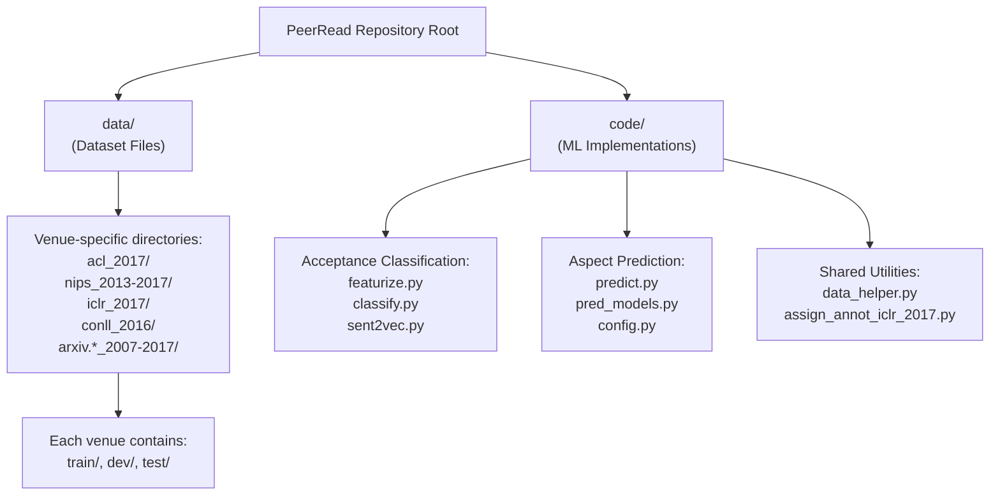
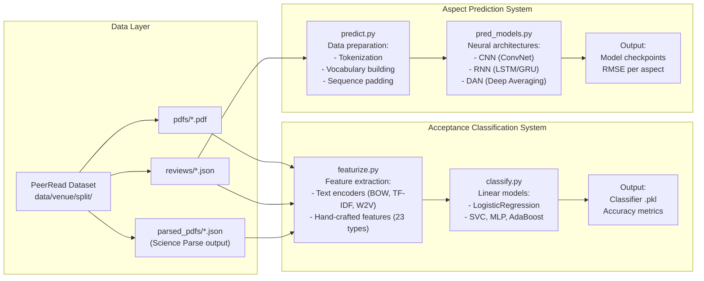
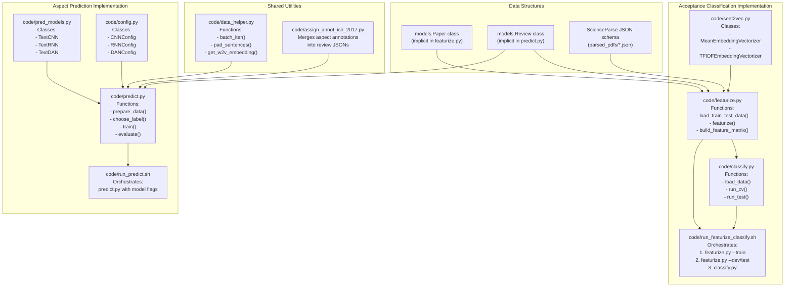
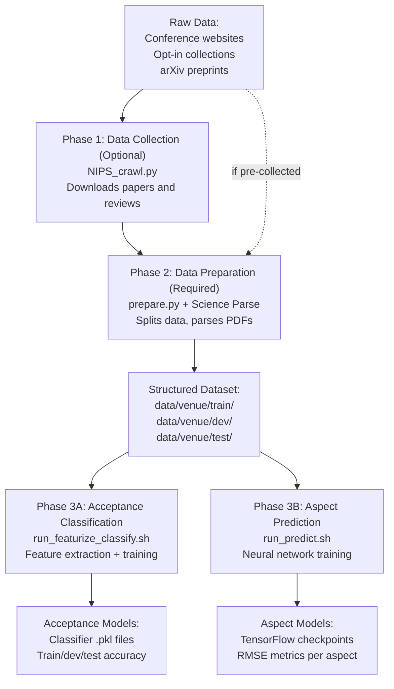

<!-- source: DeepWiki mcp.deepwiki.com · repo allenai/PeerRead · page 1 Overview · fetched 2026-10-26 -->

# Overview

Relevant source files

The following files were used as context for generating this wiki page:

- [README.md](README.md)

This document provides a high-level introduction to the PeerRead dataset and repository, including its purpose, contents, and the two main machine learning systems for peer review analysis. For detailed setup instructions, see [Getting Started](#2). For in-depth documentation of the ML pipelines, see [Acceptance Classification Pipeline](#5) and [Aspect Prediction Pipeline](#6).

## Purpose and Scope

The PeerRead repository serves two primary functions:

1. **Dataset Distribution**: Provides access to a large-scale dataset of scientific peer reviews, including paper drafts, review texts, and accept/reject decisions from multiple top-tier conferences
2. **Reference Implementations**: Includes baseline models for two NLP research tasks:
   - **Acceptance prediction**: Classifying whether a paper will be accepted or rejected
   - **Aspect score prediction**: Predicting numerical scores for specific review aspects (e.g., clarity, originality, soundness)

The repository is designed for researchers studying peer review processes, developing automatic review generation systems, or exploring machine learning applications in scientific communication.

**Sources:** [README.md:1-11]()

## Dataset Contents

The PeerRead dataset consists of over **14,000 paper drafts** and corresponding accept/reject decisions, along with over **10,000 textual peer reviews** written by domain experts. The data spans multiple venues and time periods:

| Venue/Source | Time Period | Content Type |
|--------------|-------------|--------------|
| ACL | 2017 | Papers + Reviews + Decisions |
| NIPS | 2013-2017 | Papers + Reviews + Decisions |
| ICLR | 2017 | Papers + Reviews + Decisions + Aspect Annotations |
| CoNLL | 2016 | Papers + Reviews + Decisions |
| arXiv (cs.CL, cs.LG, cs.AI) | 2007-2017 | Papers (no reviews) |

The dataset includes:
- **PDF files** of paper drafts
- **JSON-formatted reviews** with text, scores, and metadata
- **Parsed paper content** extracted using Science Parse (sections, references, abstracts)
- **Aspect annotations** for ICLR 2017 reviews (9 numerical aspect scores)

**Sources:** [README.md:4-8]()

## Repository Structure

The repository is organized into two main directories:

**Directory Structure:**
- **`/data/`**: Contains venue-specific subdirectories, each with train/dev/test splits. Each split directory includes `reviews/`, `pdfs/`, and `parsed_pdfs/` subdirectories
- **`/code/`**: Contains Python implementations of the two ML pipelines and shared utilities
- **`/setup.sh`**: Installation script for dependencies and data download

**Sources:** [README.md:8-11]()

## Machine Learning Pipelines

The repository implements two independent ML systems for analyzing peer reviews:

### Pipeline Architecture

**Sources:** [README.md:10-11](), High-level diagrams

### Acceptance Classification Pipeline

**Purpose**: Predict whether a paper will be accepted or rejected based on paper content and review text.

**Approach**: Feature engineering with linear classifiers
- **Input**: Paper PDFs (parsed) + review JSONs
- **Method**: Extracts lexical features (bag-of-words, TF-IDF, Word2Vec embeddings) and hand-crafted features (reference statistics, document structure, linguistic patterns)
- **Models**: Linear classifiers selected via 5-fold cross-validation (Logistic Regression, SVM, MLP, AdaBoost)
- **Output**: Binary accept/reject predictions with accuracy metrics

**Key Components**:
- `featurize.py` - Extracts and persists features in SVMLight format
- `classify.py` - Trains and evaluates classification models
- `sent2vec.py` - Implements Word2Vec-based embedding vectorizers
- `run_featurize_classify.sh` - End-to-end pipeline execution script

For detailed documentation, see [Acceptance Classification Pipeline](#5).

**Sources:** [README.md:11](), High-level diagrams

### Aspect Prediction Pipeline

**Purpose**: Predict numerical scores for 9 specific review aspects (e.g., clarity, originality, soundness, impact).

**Approach**: Deep learning with neural networks
- **Input**: Review text + aspect annotations (ICLR 2017 subset)
- **Method**: Trains neural networks to perform multi-output regression, predicting scores for each aspect
- **Models**: Three architectures available - CNN (convolutional), RNN (recurrent), DAN (deep averaging network)
- **Output**: Aspect score predictions with RMSE metrics compared to mean/majority baselines

**Key Components**:
- `predict.py` - Data loading, preprocessing, training loop, and evaluation
- `pred_models.py` - Neural network architecture implementations
- `config.py` - Configuration classes for each model type (CNNConfig, RNNConfig, DANConfig)
- `run_predict.sh` - Pipeline execution script

For detailed documentation, see [Aspect Prediction Pipeline](#6).

**Sources:** [README.md:11](), High-level diagrams

## Code-to-System Mapping

The following diagram maps the conceptual systems to their implementation files:

**Sources:** [README.md:11](), High-level diagrams

## Data Flow Summary

The complete end-to-end workflow consists of three sequential phases:

**Key Points**:
1. **Phase 1** (optional): Data can be collected via web crawling or used pre-collected
2. **Phase 2** (required): The `prepare.py` script creates train/dev/test splits and invokes Science Parse to extract structured content from PDFs
3. **Phase 3**: Two independent pipelines that can be run in parallel or separately

For setup and execution details, see [Getting Started](#2). For dataset structure details, see [Dataset Structure](#3).

**Sources:** [README.md:1-14](), High-level diagrams

## External Dependencies

The repository relies on several external tools and libraries:

| Dependency | Purpose | Used By |
|------------|---------|---------|
| **Science Parse** | PDF parsing (extracting sections, references, abstracts) | Data preparation pipeline |
| **scikit-learn** | Feature vectorizers and classification models | Acceptance classification |
| **Gensim** | Word2Vec embeddings | Both pipelines |
| **TensorFlow** | Neural network training | Aspect prediction |
| **NLTK** | Text tokenization and preprocessing | Aspect prediction |

The `setup.sh` script at the repository root installs these dependencies and downloads necessary data files.

**Sources:** [README.md:14](), High-level diagrams

## Research Applications

The dataset and models support research in multiple areas:

1. **Peer Review Analysis**: Understanding what factors influence acceptance decisions
2. **Automatic Review Generation**: Training models to provide feedback on scientific papers
3. **Review Quality Assessment**: Predicting which aspects of a paper need improvement
4. **Scholarly Document Understanding**: Leveraging parsed paper structure for NLP tasks
5. **Transfer Learning**: Using pre-trained models for related scientific document tasks

For citation information and acknowledgements, see [README.md:17-35]().

**Sources:** [README.md:1-11]()

## Quick Start

To begin using PeerRead:

1. **Installation**: Run `./setup.sh` to install dependencies
2. **Explore Data**: Navigate to `data/` to examine the dataset structure (see [Dataset Structure](#3))
3. **Run Acceptance Classification**: Execute `code/run_featurize_classify.sh` (see [Acceptance Classification Pipeline](#5))
4. **Run Aspect Prediction**: Execute `code/run_predict.sh` (see [Aspect Prediction Pipeline](#6))

For complete setup instructions, see [Getting Started](#2).

**Sources:** [README.md:13-14]()

---

