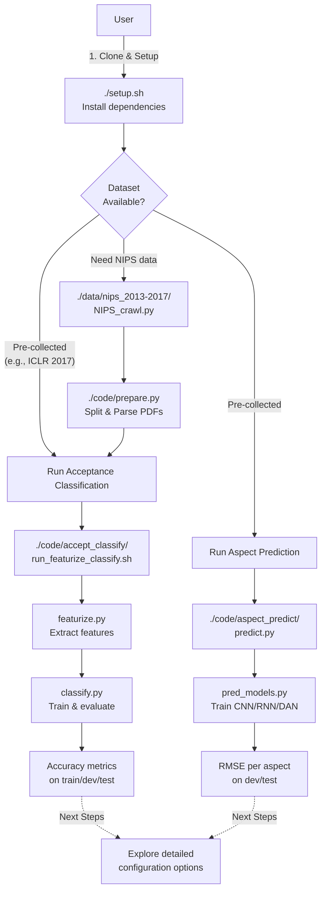
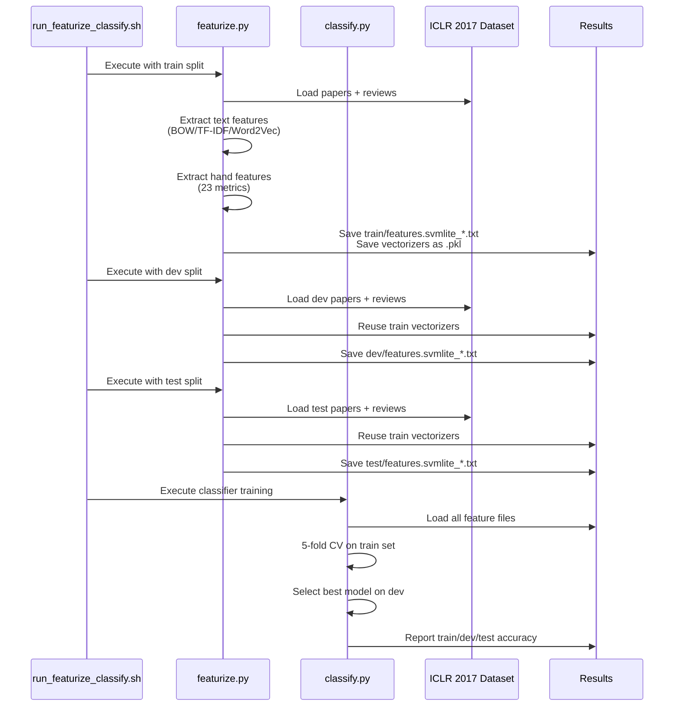
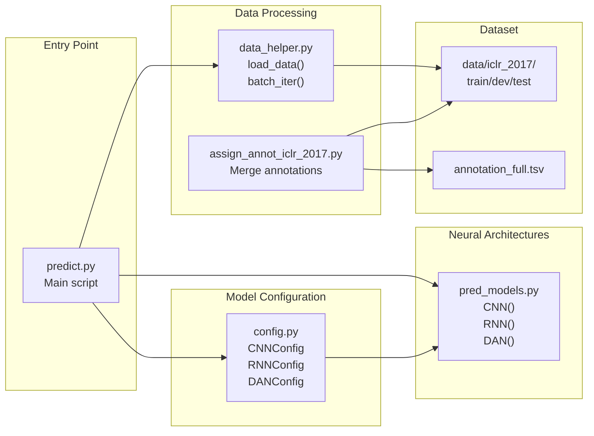
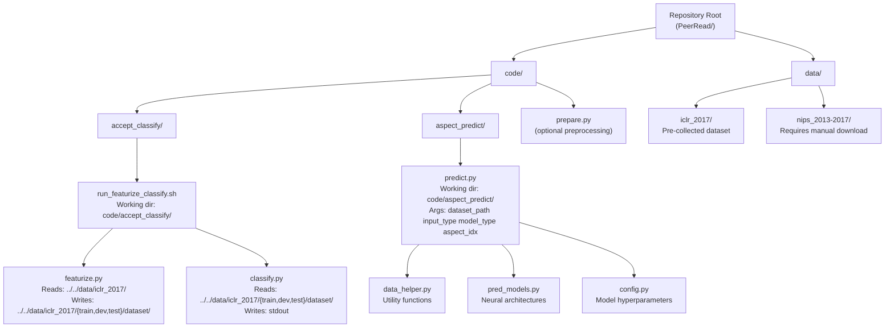

<!-- source: DeepWiki mcp.deepwiki.com · repo allenai/PeerRead · page 2 Getting Started · fetched 2026-10-26 -->

# Getting Started

<details>
<summary>Relevant source files</summary>

The following files were used as context for generating this wiki page:

- [README.md](README.md)
- [code/README.md](code/README.md)

</details>


This guide provides step-by-step instructions for installing the PeerRead repository, setting up the required dependencies, and running your first experiments with both the acceptance classification and aspect prediction pipelines. By the end of this guide, you will have executed both machine learning tasks on the ICLR 2017 dataset.

For detailed information about the dataset structure and file formats, see [Dataset Structure](#3). For comprehensive documentation of the individual pipelines, see [Acceptance Classification Pipeline](#5) and [Aspect Prediction Pipeline](#6).

---

## Prerequisites

Before starting, ensure your system meets these requirements:

| Requirement | Version/Specification | Purpose |
|-------------|----------------------|---------|
| Python | 2.7 or 3.x | Core runtime for all scripts |
| Git | Any recent version | Repository cloning |
| Java | JDK 8+ | Required for Science Parse PDF processing |
| Disk Space | ~5 GB | Dataset storage and model checkpoints |
| RAM | 8 GB minimum | Feature extraction and model training |

**Required Python Libraries:**
- `scikit-learn`: Linear classifiers and feature extraction
- `numpy`: Numerical operations
- `scipy`: Sparse matrix operations for features
- `gensim`: Word2Vec embeddings
- `nltk`: Text preprocessing
- `tensorflow`: Neural network models (aspect prediction only)

**Sources:** [README.md:1-36](), [code/README.md:1-54]()

---

## Installation and Setup

### Step 1: Clone the Repository

```bash
git clone https://github.com/allenai/PeerRead.git
cd PeerRead
```

### Step 2: Run Setup Script

The `setup.sh` script installs Python dependencies and downloads large data files not included in the repository:

```bash
./setup.sh
```

This script performs the following operations:
- Installs required Python packages via pip
- Downloads pre-trained Word2Vec embeddings
- Downloads Science Parse JAR file for PDF processing
- Verifies dataset directory structure

**Sources:** [README.md:13-14]()

---

## System Architecture: Getting Started Workflow

The following diagram shows the typical workflow for getting started with PeerRead, mapping high-level actions to specific scripts and their locations:



**Sources:** [README.md:1-36](), [code/README.md:1-54]()

---

## Quick Start: Acceptance Classification

The acceptance classification pipeline predicts whether a paper will be accepted or rejected based on the paper content and peer reviews. This task uses feature engineering with linear classifiers.

### Step 1: Navigate to the Acceptance Classification Directory

```bash
cd code/accept_classify
```

### Step 2: Execute the Pipeline Script

The `run_featurize_classify.sh` script orchestrates the entire pipeline:

```bash
./run_featurize_classify.sh
```

### What Happens During Execution



**Runtime Expectations:**
- **featurize.py**: ~35 minutes on ICLR 2017 dataset (one-time cost)
- **classify.py**: ~5 seconds on ICLR 2017 dataset

**Expected Output:**
```
Training accuracy: 0.XX
Development accuracy: 0.XX
Test accuracy: 0.XX
```

**Sources:** [code/README.md:4-20]()

---

## Quick Start: Aspect Prediction

The aspect prediction pipeline uses deep learning to predict numerical scores for 9 different review aspects (e.g., recommendation, clarity, originality).

### Step 1: Navigate to the Aspect Prediction Directory

```bash
cd code/aspect_predict
```

### Step 2: Execute the Prediction Script

The `predict.py` script handles data loading, model training, and evaluation:

```bash
python predict.py "../../data/iclr_2017" "all" "dan" 0
```

### Command-Line Arguments

The `predict.py` script accepts four positional arguments:

| Position | Argument | Options | Description |
|----------|----------|---------|-------------|
| 1 | Dataset path | Path string | Directory containing train/dev/test splits |
| 2 | Input type | `all`, `review`, `paper` | Text source for prediction |
| 3 | Model type | `dan`, `rnn`, `cnn` | Neural architecture to use |
| 4 | Aspect index | 0-8 | Which aspect to predict (0=all aspects) |

**Example Commands:**
```bash
# Train DAN model on review text for all aspects
python predict.py "../../data/iclr_2017" "review" "dan" 0

# Train RNN model on paper text for aspect 3
python predict.py "../../data/iclr_2017" "paper" "rnn" 3

# Train CNN model on combined text for recommendation score
python predict.py "../../data/iclr_2017" "all" "cnn" 1
```

### Code Components for Aspect Prediction



**Expected Output:**
```
Aspect 0 - RMSE on dev: X.XX
Aspect 1 - RMSE on dev: X.XX
...
Mean baseline: X.XX
Majority baseline: X.XX
```

**Sources:** [code/README.md:21-37]()

---

## Detailed Script Execution Flow

### Acceptance Classification Pipeline

The following table maps user actions to specific Python functions and their file locations:

| Action | Script | Key Functions | Output Location |
|--------|--------|---------------|-----------------|
| Feature extraction (train) | `featurize.py` | `build_vocabulary()`, `create_vectorizer()` | `train/dataset/features.svmlite_*.txt`<br/>`train/dataset/vect_*.pkl` |
| Feature extraction (dev/test) | `featurize.py` | `load_vectorizer()`, `transform_features()` | `dev/dataset/features.svmlite_*.txt`<br/>`test/dataset/features.svmlite_*.txt` |
| Model training | `classify.py` | `cross_validate()`, `train_model()` | Console output with accuracies |

**Sources:** [code/README.md:16-19]()

### Aspect Prediction Pipeline

The following table maps user actions to specific Python functions:

| Action | Script | Key Functions | Output Location |
|--------|--------|---------------|-----------------|
| Data loading | `predict.py` | `prepare_data()`, `choose_label()` | In-memory tensors |
| Model initialization | `pred_models.py` | `CNN()`, `RNN()`, `DAN()` | TensorFlow graph |
| Training loop | `predict.py` | `train_step()`, `dev_step()` | `ckpts/` directory |
| Evaluation | `predict.py` | `calculate_rmse()` | Console output with RMSE |

**Sources:** [code/README.md:31-36]()

---

## Verification Steps

After running both pipelines, verify your installation by checking for expected outputs:

### Acceptance Classification Verification

```bash
# Check that feature files were created
ls -lh ../../data/iclr_2017/train/dataset/features.svmlite_*.txt
ls -lh ../../data/iclr_2017/dev/dataset/features.svmlite_*.txt
ls -lh ../../data/iclr_2017/test/dataset/features.svmlite_*.txt

# Check that vectorizer pickle files exist (train only)
ls -lh ../../data/iclr_2017/train/dataset/vect_*.pkl
```

**Expected files:**
- `features.svmlite_bow.txt`: Bag-of-words features
- `features.svmlite_w2v.txt`: Word2Vec features
- `features.svmlite_tfidf.txt`: TF-IDF features
- `vect_bow.pkl`, `vect_tfidf.pkl`, `vect_w2v.pkl`: Trained vectorizers

### Aspect Prediction Verification

```bash
# Check that model checkpoints were saved
ls -lh ckpts/
```

**Expected directory structure:**
- `ckpts/checkpoint`: TensorFlow checkpoint metadata
- `ckpts/model-*.data-*`: Model weights
- `ckpts/model-*.index`: Model index
- `ckpts/model-*.meta`: Model graph definition

**Sources:** [code/README.md:1-54]()

---

## Execution Environment Mapping

This diagram shows where each script executes and what working directory assumptions they make:



**Sources:** [code/README.md:1-54]()

---

## Common Issues and Solutions

| Issue | Likely Cause | Solution |
|-------|--------------|----------|
| `ModuleNotFoundError: No module named 'sklearn'` | Missing scikit-learn | Run `pip install scikit-learn` |
| `FileNotFoundError: [Errno 2] No such file or directory: '../../data/iclr_2017'` | Wrong working directory | Ensure you're in `code/accept_classify/` or `code/aspect_predict/` |
| `java.lang.OutOfMemoryError` during Science Parse | Insufficient heap space | Edit `prepare.py` to increase JVM memory: `-Xmx8g` |
| `TypeError: 'NoneType' object is not iterable` in featurize.py | Missing parsed PDFs | Run `prepare.py` to generate `parsed_pdfs/` directories |
| Empty feature files | No papers/reviews in dataset | Verify `pdfs/` and `reviews/` directories exist and contain data |

**Sources:** [code/README.md:1-54]()

---

## Next Steps

After successfully running the quick start experiments, explore these topics:

### Deeper Understanding
- **[Dataset Structure](#3)**: Learn about the organization of data splits, file formats, and venue-specific differences
- **[Data Preparation Pipeline](#4)**: Understand how to preprocess raw data if you want to add new venues or papers
- **[External Dependencies](#9)**: Learn about Science Parse and how to configure it for optimal PDF processing

### Pipeline Customization
- **[Feature Extraction](#5.1)**: Explore the 23 hand-crafted features and experiment with different text encoding methods
- **[Classification and Model Selection](#5.3)**: Understand the cross-validation strategy and try different classifier families
- **[Neural Network Models](#6.2)**: Configure CNN, RNN, and DAN architectures with custom hyperparameters
- **[Training and Evaluation](#6.3)**: Learn about early stopping, checkpointing, and evaluation metrics

### Advanced Workflows
- **[Running Experiments](#8)**: Systematic approach to hyperparameter tuning and result logging
- **[Text Encoding Methods](#5.2)**: Deep dive into Word2Vec, TF-IDF, and bag-of-words implementations
- **[Core Components](#7)**: Understand the shared data models and utilities used across both pipelines

**Sources:** [README.md:1-36](), [code/README.md:1-54]()

---

## Quick Reference: Essential Commands

```bash
# Initial setup (one-time)
./setup.sh

# Acceptance classification (from code/accept_classify/)
./run_featurize_classify.sh

# Aspect prediction examples (from code/aspect_predict/)
python predict.py "../../data/iclr_2017" "all" "dan" 0
python predict.py "../../data/iclr_2017" "review" "rnn" 0
python predict.py "../../data/iclr_2017" "paper" "cnn" 0

# Optional: Prepare new dataset (from code/)
python prepare.py ../data/your_venue_name
```

**Sources:** [README.md:1-36](), [code/README.md:1-54]()

---

