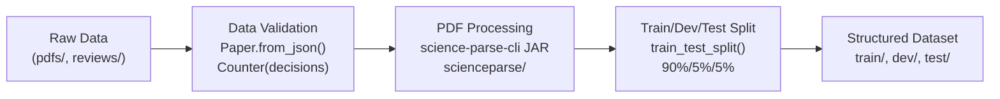
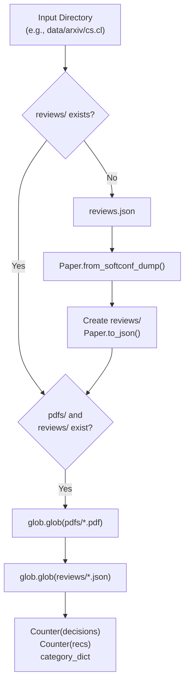
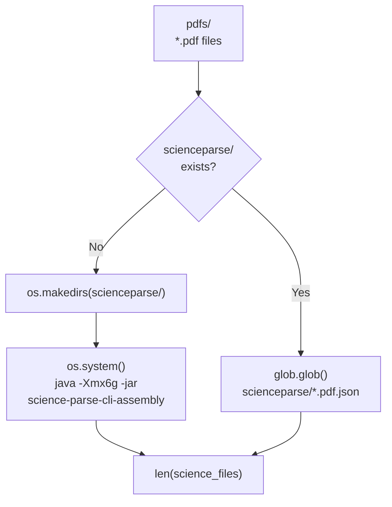
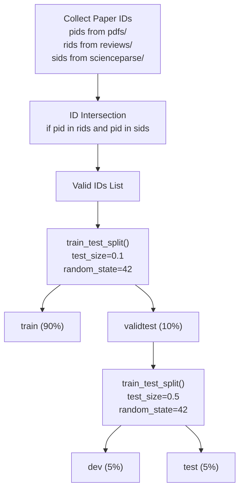
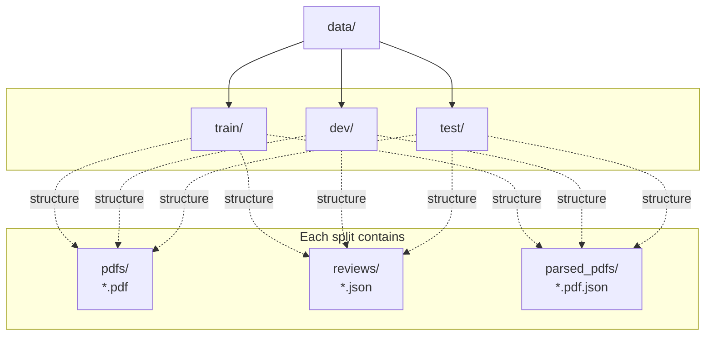
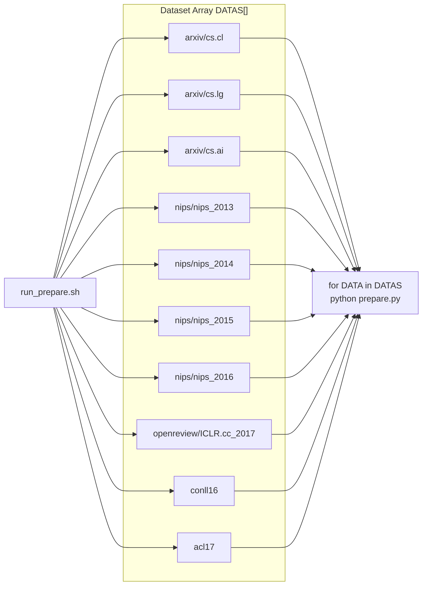
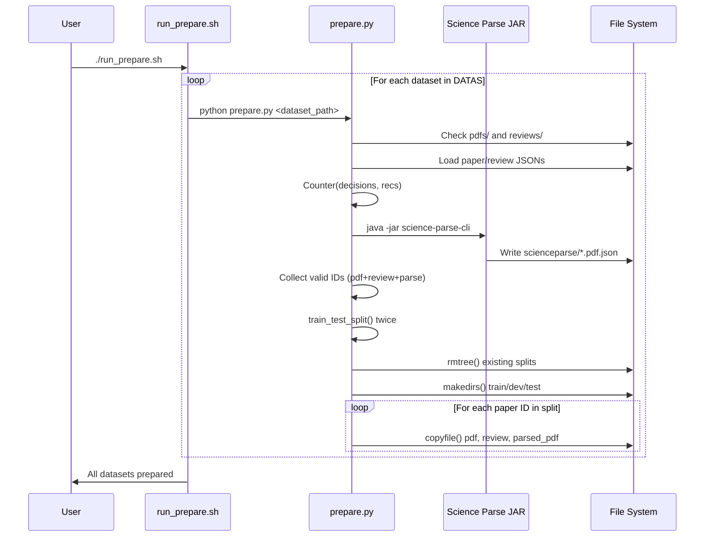

<!-- source: DeepWiki mcp.deepwiki.com · repo allenai/PeerRead · page 4 Data Preparation Pipeline · fetched 2026-10-26 -->

# Data Preparation Pipeline

<details>
<summary>Relevant source files</summary>

The following files were used as context for generating this wiki page:

- [code/data_prepare/prepare.py](code/data_prepare/prepare.py)
- [code/data_prepare/run_prepare.sh](code/data_prepare/run_prepare.sh)

</details>


## Purpose and Scope

The Data Preparation Pipeline transforms raw conference data (PDFs and review JSONs) into structured train/dev/test splits ready for machine learning experiments. This pipeline handles data validation, PDF parsing via Science Parse, and standardized dataset organization.

This document provides a high-level overview of the complete preparation workflow. For detailed information about specific stages:
- Data collection from conferences and arXiv: see [Data Collection](#4.1)
- The `prepare.py` script and splitting logic: see [Data Processing and Splitting](#4.2)

For information about the downstream ML pipelines that consume the prepared data:
- Acceptance classification: see [Acceptance Classification Pipeline](#5)
- Aspect prediction: see [Aspect Prediction Pipeline](#6)

**Sources:** [code/data_prepare/prepare.py:1-126](), [code/data_prepare/run_prepare.sh:1-15]()

## Pipeline Overview

The data preparation pipeline consists of four stages executed sequentially for each dataset. The pipeline is mandatory before running any ML experiments, as it creates the standardized directory structure and enriches PDFs with metadata from Science Parse.



**Diagram: High-level pipeline stages executed by prepare.py**

The pipeline operates on multiple datasets in batch mode via the `run_prepare.sh` script, which iterates through conference venues (NIPS, ICLR, ACL, CoNLL, arXiv categories).

**Sources:** [code/data_prepare/prepare.py:10-126](), [code/data_prepare/run_prepare.sh:1-15]()

## Input Requirements

Before running the preparation pipeline, the data directory must contain:

| Directory/File | Description | Required |
|----------------|-------------|----------|
| `pdfs/` | Directory containing PDF files of papers | Yes |
| `reviews/` | Directory containing JSON files with reviews | Yes (or `reviews.json`) |
| `reviews.json` | Alternative: single file with all reviews from SoftConf dump | Alternative to `reviews/` |

The pipeline validates these inputs and reports statistics before processing:



**Diagram: Input validation and review file handling in prepare.py**

The validation stage [code/data_prepare/prepare.py:17-61]() performs several checks:
- Converts SoftConf dump format to individual review JSONs if needed
- Counts PDFs, papers, and reviews
- Analyzes decision distributions (accept/reject)
- Categorizes papers by arXiv subject area

**Sources:** [code/data_prepare/prepare.py:14-61]()

## Science Parse Integration

The pipeline invokes an external Science Parse JAR file to extract structured information from PDFs. This produces enriched JSON files containing:
- Title, authors, abstract
- References (parsed bibliographic entries)
- Section structure
- Figures and tables



**Diagram: Science Parse execution flow**

The Science Parse invocation [code/data_prepare/prepare.py:69]() uses:
- **Memory allocation:** 6GB heap (`-Xmx6g`)
- **Input:** `pdf_dir` containing all PDFs
- **Output:** `scienceparse/` directory with `*.pdf.json` files
- **JAR path:** `../lib/science-parse-cli-assembly-1.2.9-SNAPSHOT.jar`

If the `scienceparse/` directory already exists, the pipeline skips reprocessing and loads existing parsed files [code/data_prepare/prepare.py:72-74]().

**Sources:** [code/data_prepare/prepare.py:64-75]()

## Data Splitting Strategy

The pipeline splits data into train/dev/test sets with a 90%/5%/5% ratio using `sklearn.model_selection.train_test_split`:



**Diagram: Two-stage splitting process**

The splitting logic [code/data_prepare/prepare.py:95-103]() ensures:
1. **Completeness:** Only papers with all three components (PDF, review, parsed PDF) are included
2. **Reproducibility:** Fixed random seed (42) ensures consistent splits across runs
3. **Two-stage split:** First separates train (90%) from validation+test (10%), then splits the 10% equally into dev and test

**Sources:** [code/data_prepare/prepare.py:78-103]()

## File Organization

After splitting, the pipeline creates parallel directory structures for each split:



**Diagram: Output directory structure created by prepare.py**

The file copying operation [code/data_prepare/prepare.py:105-123]() uses:
- `copyfile()` from `shutil` module to copy files
- `rmtree()` to clean existing split directories if re-running
- Consistent naming: Paper ID is preserved across all three file types

| Split | Purpose | Directory Structure |
|-------|---------|---------------------|
| `train/` | Model training | `pdfs/`, `reviews/`, `parsed_pdfs/` |
| `dev/` | Hyperparameter tuning, model selection | `pdfs/`, `reviews/`, `parsed_pdfs/` |
| `test/` | Final evaluation | `pdfs/`, `reviews/`, `parsed_pdfs/` |

**Sources:** [code/data_prepare/prepare.py:105-124]()

## Batch Processing

The `run_prepare.sh` script processes multiple datasets in sequence:



**Diagram: Batch processing loop in run_prepare.sh**

The script [code/data_prepare/run_prepare.sh:4-12]() defines:
- **DATADIR:** Base path (`../../data/`)
- **DATAS array:** 10 datasets across 4 venues (arXiv, NIPS, ICLR/OpenReview, direct submissions)
- **Execution:** Calls `python prepare.py $DATADIR$DATA` for each dataset

**Sources:** [code/data_prepare/run_prepare.sh:1-15]()

## Dependencies and Imports

The preparation pipeline requires the following Python dependencies:

| Module | Purpose | Usage in prepare.py |
|--------|---------|---------------------|
| `os`, `sys`, `glob` | File system operations | Directory creation, file discovery |
| `collections.Counter` | Statistics collection | Decision and recommendation counts |
| `shutil.copyfile`, `rmtree` | File operations | Copying files to splits, cleaning directories |
| `sklearn.model_selection.train_test_split` | Data splitting | Creating train/dev/test splits |
| `models.Paper` | Data model | Loading and parsing paper/review JSON files |
| `models.Review` | Data model | Review representation |

The pipeline also depends on:
- **Science Parse JAR:** External Java tool for PDF processing (see [External Dependencies](#9))
- **Java Runtime:** Required to execute Science Parse (minimum 6GB heap)

**Sources:** [code/data_prepare/prepare.py:1-9]()

## Execution Flow Summary

The complete execution flow from raw data to structured dataset:



**Diagram: Sequence diagram showing prepare.py execution**

The pipeline is idempotent: running it multiple times on the same data produces identical results due to the fixed random seed. However, existing split directories are removed and recreated [code/data_prepare/prepare.py:106-107]() to ensure clean state.

**Sources:** [code/data_prepare/prepare.py:10-126](), [code/data_prepare/run_prepare.sh:8-12]()

## Output Validation

The pipeline prints statistics at each stage:

```
Number of pdfs: <count>
Number of papers: <count>
Paper Decisions: Counter({'true': X, 'false': Y})
Review Recommendations: Counter({...})
Number of reviews: <count>
Categories: {'cs.cl': X, 'cs.lg': Y, ...}
Number of science parses: <count>
Splitting.. train <count>
Splitting.. dev <count>
Splitting.. test <count>
```

These statistics [code/data_prepare/prepare.py:28-74]() help verify:
- All expected PDFs and reviews are present
- Decision distribution (class balance)
- Category breakdown for arXiv papers
- Science Parse completed successfully
- Split sizes match expected ratios

**Sources:** [code/data_prepare/prepare.py:28-111]()

---

