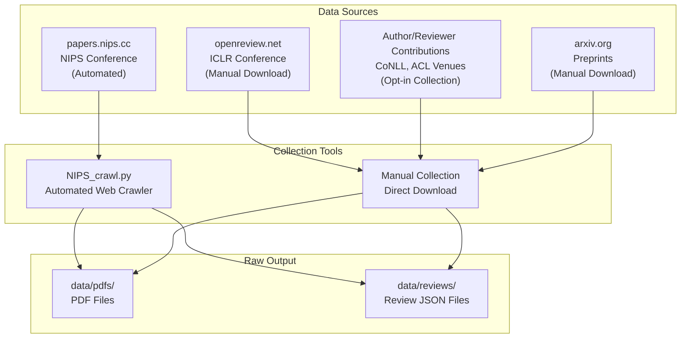
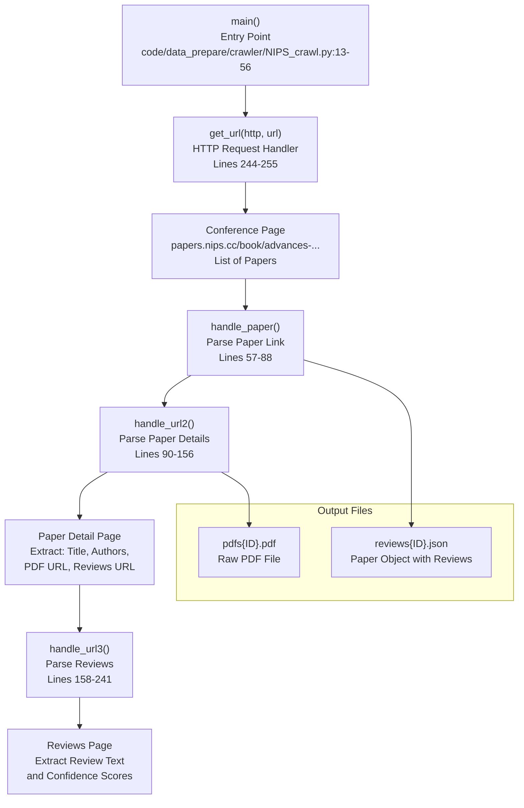
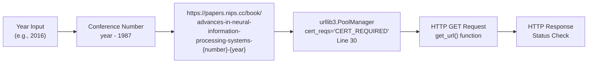
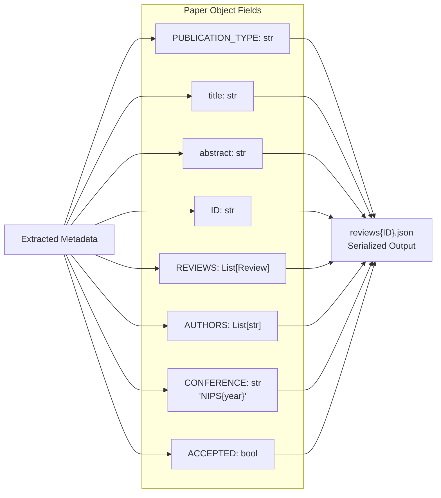
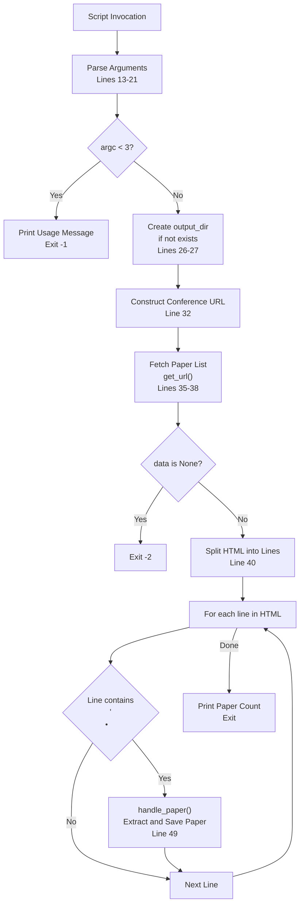
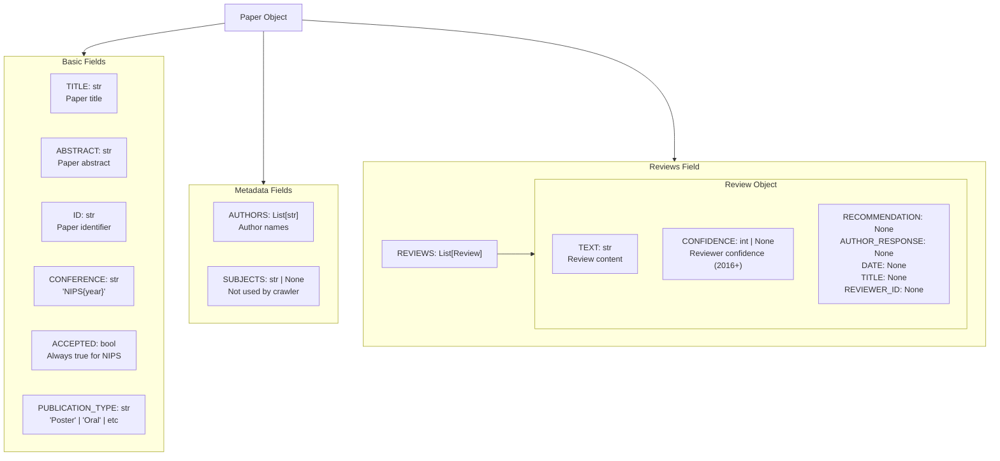
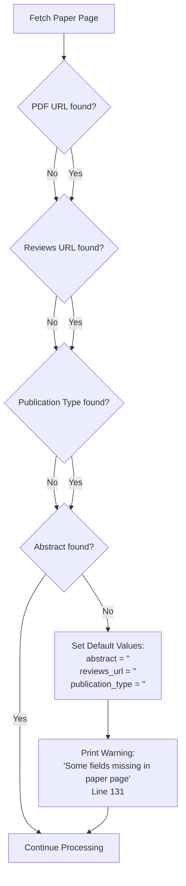
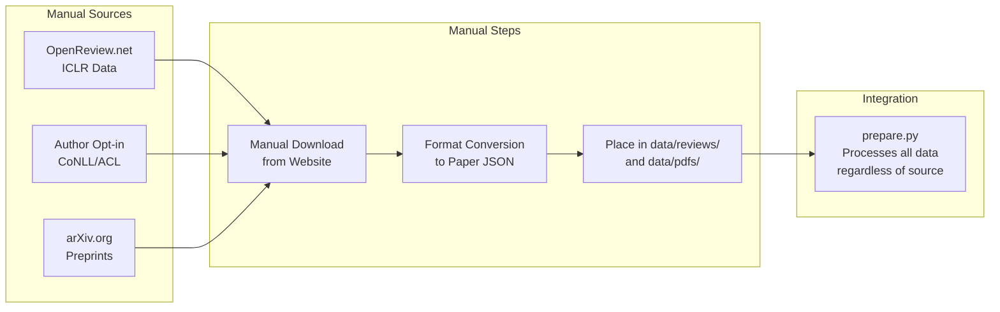
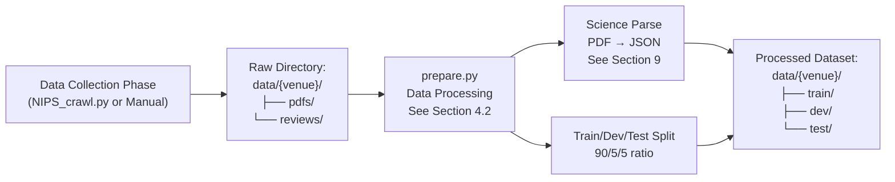

<!-- source: DeepWiki mcp.deepwiki.com · repo allenai/PeerRead · page 4.1 Data Collection · fetched 2026-10-26 -->

# Data Collection

<details>
<summary>Relevant source files</summary>

The following files were used as context for generating this wiki page:

- [code/data_prepare/crawler/NIPS_crawl.py](code/data_prepare/crawler/NIPS_crawl.py)
- [code/data_prepare/prepare.py](code/data_prepare/prepare.py)

</details>


## Purpose and Scope

This document explains how to collect raw data for the PeerRead dataset using the NIPS web crawler and describes alternative data collection methods. Data collection is **optional** - the repository can work with pre-collected data that is already included or obtained from other sources.

For information about processing and splitting collected data into train/dev/test sets, see [Data Processing and Splitting](#4.2). For the complete dataset structure after processing, see [Dataset Structure](#3).

---

## Overview of Data Sources

The PeerRead dataset aggregates peer review data from multiple sources. The repository provides automated collection tools for some sources while others require manual acquisition.



**Data Source Characteristics:**

| Source | Collection Method | Content Available | Automated Tool |
|--------|------------------|-------------------|----------------|
| NIPS Conference | Web Scraping | Papers, Reviews, Acceptance Decisions | `NIPS_crawl.py` |
| ICLR (OpenReview) | Manual Download | Papers, Reviews, Public Comments | None |
| CoNLL/ACL | Author Opt-in | Papers, Reviews (with consent) | None |
| arXiv | Manual Download | Preprints only (no reviews) | None |

Sources: [code/data_prepare/crawler/NIPS_crawl.py]()

---

## NIPS Crawler Architecture

The `NIPS_crawl.py` script implements a hierarchical web crawler that traverses the NIPS conference website structure to extract papers, reviews, and metadata.



**Crawler Components:**

| Function | Purpose | Lines |
|----------|---------|-------|
| `main()` | Entry point, processes command-line arguments and iterates through papers | [code/data_prepare/crawler/NIPS_crawl.py:13-56]() |
| `handle_paper()` | Parses paper listing HTML, extracts title and authors | [code/data_prepare/crawler/NIPS_crawl.py:57-88]() |
| `handle_url2()` | Extracts paper metadata, abstract, PDF/review URLs | [code/data_prepare/crawler/NIPS_crawl.py:90-156]() |
| `handle_url3()` | Parses review pages, handles different HTML formats by year | [code/data_prepare/crawler/NIPS_crawl.py:158-241]() |
| `get_url()` | HTTP request wrapper with error handling | [code/data_prepare/crawler/NIPS_crawl.py:244-255]() |

Sources: [code/data_prepare/crawler/NIPS_crawl.py:1-261]()

---

## Implementation Details

### URL Construction and HTTP Handling

The crawler constructs URLs based on the NIPS conference year and uses `urllib3` with certificate verification for secure connections:



**Key implementation details:**

- **Conference number calculation**: `number = str(int(year)-1987)` [code/data_prepare/crawler/NIPS_crawl.py:29]()
- **SSL verification**: Uses `certifi` package for certificate validation [code/data_prepare/crawler/NIPS_crawl.py:8,30]()
- **Error handling**: Returns `None` on HTTP errors or retry exhaustion [code/data_prepare/crawler/NIPS_crawl.py:248-253]()

Sources: [code/data_prepare/crawler/NIPS_crawl.py:13-32,244-255]()

### HTML Parsing and Regular Expressions

The crawler uses regular expressions to extract structured data from HTML pages. Different regex patterns handle format variations across conference years:

**Paper Listing Pattern** [code/data_prepare/crawler/NIPS_crawl.py:59]():
```
<li><a href="([^\"]+)">([^<]+)</a> (.*)</li>
```
Captures: (1) Paper URL, (2) Title, (3) Author HTML

**Author Extraction Pattern** [code/data_prepare/crawler/NIPS_crawl.py:70]():
```
a [^>]+>([^<]+)</a
```
Captures: (1) Author name from anchor tag

**Review Extraction Patterns**:

| Year Range | Pattern | Location |
|------------|---------|----------|
| Pre-2016 | `<i>Submitted by Assigned_Reviewer_[0-9]+</i>` | [code/data_prepare/crawler/NIPS_crawl.py:180]() |
| 2016+ | `<h3>Reviewer [0-9]+</h3>` | [code/data_prepare/crawler/NIPS_crawl.py:205]() |

Sources: [code/data_prepare/crawler/NIPS_crawl.py:57-241]()

### Paper Object Construction

The crawler constructs `Paper` objects with all collected metadata and serializes them to JSON:



**Paper instantiation** [code/data_prepare/crawler/NIPS_crawl.py:83-84]():
```python
conference = "NIPS"+str(year)
p = Paper(title, abstract, id, reviews, authors, conference, True, None, publication_type)
```

**JSON serialization** [code/data_prepare/crawler/NIPS_crawl.py:86]():
```python
p.to_json(out_dir+"/reviews"+str(id)+".json")
```

Sources: [code/data_prepare/crawler/NIPS_crawl.py:83-88](), [code/models/Paper.py]()

### Review Object Handling

Reviews are extracted with varying metadata depending on the conference year. The crawler adapts to different HTML structures:

**Pre-2016 Format** [code/data_prepare/crawler/NIPS_crawl.py:171-200]():
- Uses `<BR>` tag splitting
- Extracts review text from `<DIV class="response">` blocks
- No confidence scores available

**2016+ Format** [code/data_prepare/crawler/NIPS_crawl.py:201-232]():
- Uses `<h3>Reviewer [0-9]+</h3>` headers
- Extracts confidence scores: `<p>([0-9]+)-.*</p>`
- Review text from `<p>` tags

**Review construction** [code/data_prepare/crawler/NIPS_crawl.py:208,235]():
```python
r = Review(None, review, None, None, None, None, None, confidence)
reviews.append(r)
```

Sources: [code/data_prepare/crawler/NIPS_crawl.py:158-241](), [code/models/Review.py]()

---

## Running the Crawler

### Command-Line Interface

**Basic usage:**
```bash
python code/data_prepare/crawler/NIPS_crawl.py <year> <output_dir>
```

**Skip PDF downloads (reviews only):**
```bash
python code/data_prepare/crawler/NIPS_crawl.py <year> <output_dir> no_pdf
```

**Command-line arguments** [code/data_prepare/crawler/NIPS_crawl.py:13-21]():

| Argument | Position | Required | Description |
|----------|----------|----------|-------------|
| `year` | 1 | Yes | Conference year to crawl (e.g., 2016) |
| `output_dir` | 2 | Yes | Directory to save PDFs and review JSONs |
| `no_pdf` | 3 | No | Any value disables PDF downloads |

### Execution Flow



**Exit codes:**
- `-1`: Invalid arguments
- `-2`: Failed to fetch conference page
- `0`: Success

Sources: [code/data_prepare/crawler/NIPS_crawl.py:13-56]()

### Example Crawl Session

**Crawling NIPS 2016 papers:**
```bash
mkdir -p data/nips2016
python code/data_prepare/crawler/NIPS_crawl.py 2016 data/nips2016
```

**Expected console output:**
```
Got 1234 lines
Found 567 papers
```

**Output directory structure:**
```
data/nips2016/
├── pdfs1234.pdf
├── pdfs1235.pdf
├── ...
├── reviews1234.json
├── reviews1235.json
└── ...
```

Sources: [code/data_prepare/crawler/NIPS_crawl.py:42,55]()

---

## Output Format

### Directory Structure

The crawler creates files with specific naming conventions in the output directory:

| File Pattern | Content | Generated By |
|-------------|---------|--------------|
| `pdfs{ID}.pdf` | Raw PDF file of the paper | [code/data_prepare/crawler/NIPS_crawl.py:153]() |
| `reviews{ID}.json` | Paper object with reviews as JSON | [code/data_prepare/crawler/NIPS_crawl.py:86]() |

**ID extraction** [code/data_prepare/crawler/NIPS_crawl.py:159]():
```python
id = reviews_url.split("/")[-1].split(".")[0]
```

Sources: [code/data_prepare/crawler/NIPS_crawl.py:86,153,159]()

### Review JSON Schema

Each `reviews{ID}.json` file contains a serialized `Paper` object with the following structure:



**Example JSON structure:**
```json
{
  "TITLE": "Example Paper Title",
  "ABSTRACT": "This paper presents...",
  "ID": "1234",
  "CONFERENCE": "NIPS2016",
  "ACCEPTED": true,
  "PUBLICATION_TYPE": "Poster",
  "AUTHORS": ["Author One", "Author Two"],
  "SUBJECTS": null,
  "REVIEWS": [
    {
      "TEXT": "This paper makes an interesting contribution...",
      "CONFIDENCE": "4",
      "RECOMMENDATION": null,
      "AUTHOR_RESPONSE": null,
      "DATE": null,
      "TITLE": null,
      "REVIEWER_ID": null
    }
  ]
}
```

Sources: [code/data_prepare/crawler/NIPS_crawl.py:83-86,182,208,235](), [code/models/Paper.py](), [code/models/Review.py]()

---

## Error Handling and Edge Cases

### Missing Data Handling

The crawler handles missing or incomplete data gracefully:



**Missing field handling** [code/data_prepare/crawler/NIPS_crawl.py:130-139]():
- Sets empty strings for missing abstract, review URL, or publication type
- Logs warning but continues processing
- Does not skip the paper

**No reviews found** [code/data_prepare/crawler/NIPS_crawl.py:238-239]():
```python
if len(reviews) == 0:
    print("%%% no reviews found in",reviews_url,"!")
```
- Prints warning but returns empty reviews list
- Paper JSON is still created

Sources: [code/data_prepare/crawler/NIPS_crawl.py:130-139,238-239]()

### HTTP Error Handling

Network and HTTP errors are caught and logged:

**Request failure handling** [code/data_prepare/crawler/NIPS_crawl.py:245-253]():

| Error Type | Detection | Action |
|------------|-----------|--------|
| HTTP Status ≠ 200 | `response.status != 200` | Print error, return `None` |
| Max Retries Exceeded | `urllib3.exceptions.MaxRetryError` | Print error, return `None` |
| Paper handling fails | `data is None` in `main()` | Skip paper, print "Can't handle paper" |

**Error propagation:**
- `get_url()` returns `None` on errors
- Calling functions check for `None` and skip processing
- Script continues to next paper rather than crashing

Sources: [code/data_prepare/crawler/NIPS_crawl.py:51-53,244-255]()

---

## Alternative Data Collection Methods

While the NIPS crawler provides automated collection, other data sources require different approaches:

### Manual Collection Workflow



**Manual collection guidelines:**

1. **ICLR (OpenReview)**: Download JSON exports from openreview.net, convert to `Paper` format
2. **Opt-in Data**: Collect with author/reviewer consent, format as review JSONs
3. **arXiv Preprints**: Download PDFs, create review JSONs with empty review lists

**Expected directory structure before processing** [code/data_prepare/prepare.py:14-15,24-25]():
```
data/<venue_name>/
├── pdfs/
│   ├── {id}.pdf
│   └── ...
└── reviews/
    ├── {id}.json
    └── ...
```

### SoftConf Dump Format

The repository also supports importing from SoftConf review dumps:

**SoftConf import** [code/data_prepare/prepare.py:17-22]():
```python
if os.path.exists(os.path.join(data_dir, 'reviews.json')) and not os.path.exists(review_dir):
    print('Loading reviews from a review file')
    papers = Paper.from_softconf_dump(os.path.join(data_dir, 'reviews.json'))
    os.makedirs(review_dir)
    for paper in papers:
      paper.to_json('{}/reviews/{}.json'.format(data_dir,paper.ID))
```

This method:
- Reads a single `reviews.json` file with all papers
- Splits it into individual review JSON files
- Places them in `data/reviews/` directory

Sources: [code/data_prepare/prepare.py:17-22](), [code/models/Paper.py]()

---

## Integration with Data Preparation Pipeline

After data collection, the raw files must be processed by the data preparation pipeline:



**Next steps after collection:**

1. Ensure PDFs and review JSONs are in correct directories
2. Run `prepare.py` to split data and invoke Science Parse (see [Data Processing and Splitting](#4.2))
3. Verify train/dev/test splits are created
4. Proceed to feature extraction or aspect prediction (see [Acceptance Classification Pipeline](#5) or [Aspect Prediction Pipeline](#6))

Sources: [code/data_prepare/prepare.py:1-126]()

---

