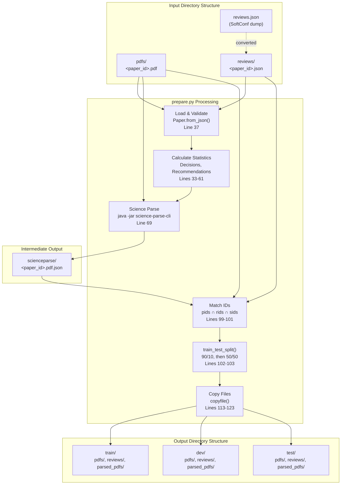
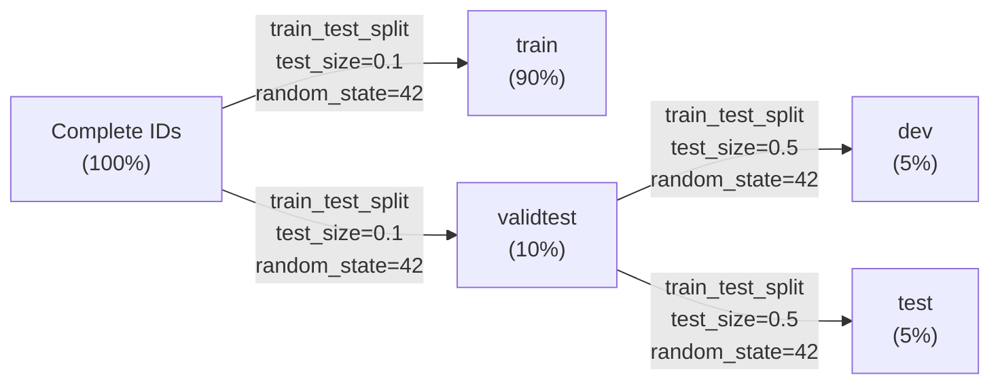
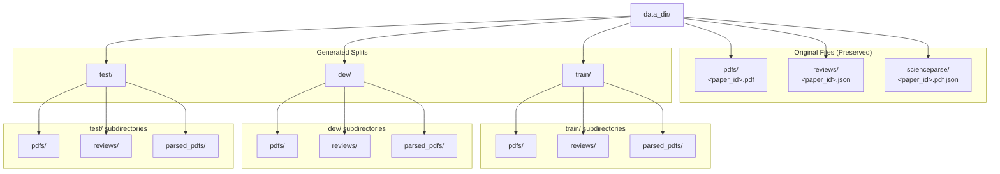
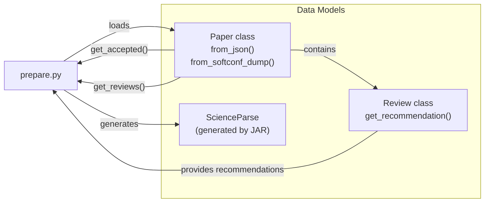

<!-- source: DeepWiki mcp.deepwiki.com · repo allenai/PeerRead · page 4.2 Data Processing and Splitting · fetched 2026-10-26 -->

# Data Processing and Splitting

<details>
<summary>Relevant source files</summary>

The following files were used as context for generating this wiki page:

- [code/data_prepare/prepare.py](code/data_prepare/prepare.py)
- [code/data_prepare/run_prepare.sh](code/data_prepare/run_prepare.sh)

</details>


## Purpose and Scope

This page documents the data preparation pipeline implemented in `prepare.py`, which transforms raw PeerRead data into organized train/dev/test splits. This script is the mandatory entry point for both downstream ML pipelines and must be executed after data collection but before running any experiments.

For information about collecting raw data, see [Data Collection](#4.1). For details about how the resulting structured datasets are used in feature extraction, see [Feature Extraction](#5.1).

## Overview

The `prepare.py` script performs three core operations:

1. **Validation**: Loads and validates PDFs and review JSONs, printing dataset statistics
2. **Science Parse Execution**: Invokes the external Science Parse JAR to extract structured information from PDFs
3. **Data Splitting**: Splits data into train (90%), dev (5%), and test (5%) sets with consistent random state

The script ensures that only papers with complete data (PDF + review JSON + parsed PDF) are included in the final splits, maintaining data integrity across all three components.

**Sources**: [code/data_prepare/prepare.py:1-126]()

## Input Requirements

Before running `prepare.py`, the target data directory must contain:

| Required Directory | Contents | Format |
|-------------------|----------|--------|
| `pdfs/` | Paper PDF files | `<paper_id>.pdf` |
| `reviews/` | Review metadata | `<paper_id>.json` (Paper objects) |

Alternatively, a single `reviews.json` file in SoftConf dump format can be provided, which the script will automatically split into individual review files.

**Sources**: [code/data_prepare/prepare.py:14-25]()

## Data Flow

The following diagram shows the complete transformation performed by `prepare.py`:



**Sources**: [code/data_prepare/prepare.py:10-124]()

## Processing Steps

### Step 1: SoftConf Dump Handling

The script first checks for a `reviews.json` file in SoftConf dump format. If found and the `reviews/` directory doesn't exist, it converts the dump into individual review files:

```python
# Lines 17-22
if os.path.exists(os.path.join(data_dir, 'reviews.json')) and not os.path.exists(review_dir):
    papers = Paper.from_softconf_dump(os.path.join(data_dir, 'reviews.json'))
    os.makedirs(review_dir)
    for paper in papers:
        paper.to_json('{}/reviews/{}.json'.format(data_dir,paper.ID))
```

This allows the script to work with data from conferences that provide SoftConf exports.

**Sources**: [code/data_prepare/prepare.py:17-22]()

### Step 2: Data Validation and Statistics

The script loads all review files and collects statistics:

| Statistic | Purpose |
|-----------|---------|
| Paper Decisions | Distribution of accept/reject labels |
| Review Recommendations | Reviewer recommendation distribution |
| Number of Reviews | Total review count |
| Categories | Paper category distribution (cs.cl, cs.lg, cs.ai) |

These statistics are printed to console for manual verification:

```python
# Lines 58-61
print('Paper Decisions:',Counter(decisions))
print('Review Recommendations:',Counter(recs))
print('Number of reviews:',len(reviews))
print('Categories: ', category_dict)
```

**Sources**: [code/data_prepare/prepare.py:27-61]()

### Step 3: Science Parse Execution

The script invokes the Science Parse JAR to extract structured information from PDFs:

```bash
java -Xmx6g -jar ../lib/science-parse-cli-assembly-1.2.9-SNAPSHOT.jar <pdf_dir> -o <science_dir>
```

This command:
- Allocates 6GB heap memory (`-Xmx6g`)
- Processes all PDFs in the `pdfs/` directory
- Outputs parsed JSON files to `scienceparse/` directory

The parsed files are named `<paper_id>.pdf.json` and contain extracted sections, references, figures, and other metadata required for feature extraction.

**Sources**: [code/data_prepare/prepare.py:64-74]()

### Step 4: ID Matching and Filtering

Before splitting, the script ensures data completeness by finding the intersection of paper IDs that have all three components:

```python
# Lines 95-101
pids = [os.path.basename(pfile).replace('.pdf','') for pfile in pdf_files]
rids = [os.path.basename(rfile).replace('.json','') for rfile in review_files]
sids = [os.path.basename(sfile).replace('.pdf.json','') for sfile in science_files]
ids = []
for pid in pids:
    if pid in rids and pid in sids:
        ids.append(pid)
```

Only papers present in all three lists are included in the final dataset. This prevents downstream errors from incomplete data.

**Sources**: [code/data_prepare/prepare.py:95-101]()

### Step 5: Train/Dev/Test Splitting

The script uses sklearn's `train_test_split` with a fixed random state for reproducibility:



The splitting strategy:
1. Split all IDs into 90% train and 10% validtest
2. Split validtest into 50% dev and 50% test
3. Final ratio: **90% train, 5% dev, 5% test**

**Sources**: [code/data_prepare/prepare.py:102-103]()

### Step 6: File Organization

For each paper in each split, the script copies three files into the appropriate subdirectories:

```python
# Lines 113-123
copyfile(
    os.path.join(pdf_dir,d+'.pdf'),
    os.path.join(data_dir, data_types[didx], 'pdfs', d+'.pdf'))

copyfile(
    os.path.join(review_dir,d+'.json'),
    os.path.join(data_dir, data_types[didx], 'reviews', d+'.json'))

copyfile(
    os.path.join(science_dir,d+'.pdf.json'),
    os.path.join(data_dir, data_types[didx], 'parsed_pdfs', d+'.pdf.json'))
```

The script removes existing split directories before creating new ones to ensure clean state.

**Sources**: [code/data_prepare/prepare.py:105-123]()

## Output Structure

After successful execution, the data directory contains the following structure:



Each split directory contains three subdirectories with identical naming:

| Subdirectory | Contents | Source |
|--------------|----------|--------|
| `pdfs/` | Original PDF files | Copied from `data_dir/pdfs/` |
| `reviews/` | Review JSON files | Copied from `data_dir/reviews/` |
| `parsed_pdfs/` | Science Parse outputs | Copied from `data_dir/scienceparse/` |

**Sources**: [code/data_prepare/prepare.py:108-110]()

## Execution Workflow

### Running prepare.py Directly

Execute the script with a single argument specifying the data directory:

```bash
python prepare.py /path/to/data/directory
```

The script will:
1. Print configuration and input statistics
2. Execute Science Parse (if not already run)
3. Perform splitting (if not already done)
4. Print completion status for each step

**Sources**: [code/data_prepare/prepare.py:10-12]()

### Running via Shell Script

The provided `run_prepare.sh` script processes multiple datasets in batch:

```bash
#!/bin/bash
DATADIR="../../data/"
DATAS=("arxiv/cs.cl" "arxiv/cs.lg" "arxiv/cs.ai" "nips/nips_2013" ...)

for DATA in "${DATAS[@]}"
do
  echo "preparing dataset: " $DATA
  python prepare.py $DATADIR$DATA
done
```

This is useful for preparing all PeerRead datasets at once.

**Sources**: [code/data_prepare/run_prepare.sh:1-15]()

## Idempotency and Caching

The script implements intelligent caching to avoid redundant work:

| Check | Behavior |
|-------|----------|
| `scienceparse/` exists | Reads existing parsed files instead of re-parsing |
| Split directories exist | Skips splitting unless `split_again=True` |

This allows the script to be run multiple times safely. However, if the source data changes, you must manually delete the split directories to trigger re-splitting:

```bash
rm -rf data_dir/train data_dir/dev data_dir/test
python prepare.py data_dir
```

**Sources**: [code/data_prepare/prepare.py:66-88]()

## Dependencies

The script relies on the following components:

| Component | Usage | Location |
|-----------|-------|----------|
| `Paper` class | Loading and parsing review JSONs | [models/Paper.py]() |
| `Review` class | Accessing review metadata | [models/Review.py]() |
| `sklearn.model_selection.train_test_split` | Random splitting with fixed seed | Standard library |
| Science Parse JAR | PDF parsing | `../lib/science-parse-cli-assembly-1.2.9-SNAPSHOT.jar` |

For more details on the Science Parse dependency and how to install it, see [External Dependencies](#9).

**Sources**: [code/data_prepare/prepare.py:1-8](), [code/data_prepare/prepare.py:69]()

## Data Model Integration

The script integrates with PeerRead's core data models:



Key methods used:
- `Paper.from_softconf_dump()`: Converts SoftConf dump to Paper objects
- `Paper.from_json()`: Loads individual review files
- `Paper.get_accepted()`: Extracts acceptance decision
- `Paper.get_reviews()`: Returns list of Review objects

For detailed documentation of these data models, see [Data Models](#7.1).

**Sources**: [code/data_prepare/prepare.py:7-8](), [code/data_prepare/prepare.py:19](), [code/data_prepare/prepare.py:37](), [code/data_prepare/prepare.py:40-42]()

## Summary Table

| Aspect | Details |
|--------|---------|
| **Script** | `code/data_prepare/prepare.py` |
| **Input** | `pdfs/` and `reviews/` directories (or `reviews.json` dump) |
| **Output** | `train/`, `dev/`, `test/` directories with 90/5/5 split |
| **Split Method** | `sklearn.train_test_split` with `random_state=42` |
| **External Tool** | Science Parse JAR for PDF parsing |
| **Validation** | ID intersection across PDFs, reviews, and parsed files |
| **Idempotent** | Yes, skips existing outputs |
| **Prerequisites** | Paper and Review models, Science Parse JAR |
| **Next Step** | Feature extraction for acceptance classification or aspect prediction |

**Sources**: [code/data_prepare/prepare.py:1-126](), [code/data_prepare/run_prepare.sh:1-15]()

---

